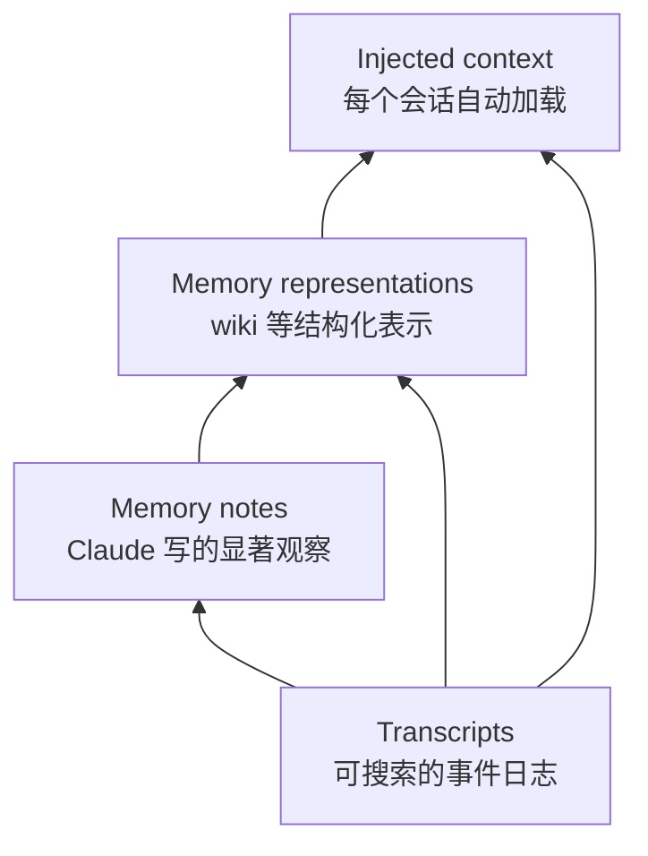

# Agent 记忆的四个部件与「做梦」：Anthropic 的工程实践

## 来源信息

| 项 | 内容 |
| --- | --- |
| 标题 | The components of agent memory（本次未发现官方中文版；页面无 hreflang，未逐一探测其他语言路径，只读了英文页） |
| 作者 | Lance Martin（文末致谢：编辑 Caitlin Love、Tom Chivers、Rebecca Hiscott、Jake Eaton、Blake Wilson；图由 Monika Tuchowska 制作；发布团队署名为 Engineering） |
| 站点 | [anthropic.com / Research](https://www.anthropic.com/research/components-of-agent-memory)，分类 Agents / Context engineering / Agent memory |
| 仓库编号 | **00226**（非论文条目，与论文共用编号序列；无 PDF 可归档，README 编号列直接指向原文地址） |
| 原文 | <https://www.anthropic.com/research/components-of-agent-memory> |
| 发布日期 | 2026-11-06（JSON-LD `datePublished`；`dateModified` 为同日 21:15:32Z，页面无独立更新日志） |
| 阅读日期 | 2026-11-08 |
| 版本锚点 | 页面为 Next.js 服务端渲染，本次未发现可对应本页的源码仓，也没有 `…/article.md` 之类直链。本节记录 **2026-11-08** 抓取的页面：取 `<article>…</article>` 区块（含标题、发布元信息、正文、15 张图的图注、致谢与相关文章卡），丢弃 `<script>/<style>`，标签替换为空格、解 HTML 实体、连续空白折叠为单空格、首尾去空白，得 **24,423 字符**，sha256 `d75f06e892dbb79e64afb7da86170b00f310f1c0cf783349598a399a0479f47a`；首读时保存的完整 HTML 为 242,373 B（sha256 `8b87567a…`），但该文件含 Next.js 构建产物与内联数据，重抓后哈希会变（本次复核为 242,416 B、`e66b59be…`），因此**不作为版本锚点**。复核时按同一口径重算规范化文本的哈希 |
| 阅读范围 | **正文全文**（引言、九个小节、结尾与致谢），15 张图的图注与 `alt` 文本全部读取；另取 10 张图的原图人工查看并核对图内数字（图 1、3、4、5、8、10、11、12、14、15）。图 2/6/9/13 是同一记忆层级的强调版本，图 7 是 Pokémon 地图截图，这 5 张只按图注与 `alt` 引用。配图未复制进仓库，未做像素测量 |
| 交叉核对 | ① 睡眠期计算（sleep-time compute）arXiv [2504.13171](https://arxiv.org/abs/2504.13171)：标题 *Sleep-time Compute: Beyond Inference Scaling at Test-time*，作者含 Kevin Lin、Charlie Snell、Sarah Wooders、Ion Stoica、Joseph E. Gonzalez，与文中「Letta 与 UC Berkeley 研究者」的归属一致；② [Claude Code memory 文档](https://code.claude.com/docs/en/memory)：核对「first 200 lines of `MEMORY.md`, or the first 25KB, whichever comes first」与「Longer files consume more context and reduce adherence」两句；③ [harveyai/harvey-labs](https://github.com/harveyai/harvey-labs) README：MIT 许可、标注 2,010 个任务（2026-11-08 取回，仅核 README 徽章与开头，未逐任务读）；④ 文中 [Managed Agents memory 文档](https://platform.claude.com/docs/en/managed-agents/memory) 返回 HTTP 200 但正文被区域限制（显示 “App unavailable in region”），内容**未核**；⑤ 文中 CL-Bench 1.0 链接 `continual-learning-bench.com/news/cl-bench-1-0/` 及其根域均为 **HTTP 404**（GitHub Pages “Site not found”），基准协议**未核**；⑥ 文中 cookbook、knowledge-wiki quickstart、Claude Duet 三个链接均返回 200，但只核可达性、未读内容 |
| 许可 | 文章页面与 `www-cdn.anthropic.com` 上的配图均**未标注许可**，故本笔记不复制任何配图 |
| 未核 | 文中所有模型（Opus 5.5、Sonnet 5.5、Opus 5、Opus 4.7、Sonnet 5、Sonnet 4.6、Fable 5、Sonnet 3.7）的版本、能力、上下文窗口与公开可用性均未独立核验；CL-Bench 任务协议与数据不可达；Stainless 语料为内部文档，无法复核；未运行任何实验或代码 |

> 说明：这是一篇厂商工程博客，不是论文。它没有新算法，也没有发布新的公开数据集或可复现配置；所用 CL-Bench 1.0 与 Harvey LAB 是公开基准（前者的链接当前 404），但本文的具体运行配置不可复现。可验证的部分主要是**概念框架**、**Claude Code 的文档化行为**，以及**内部评测的读数**。下文把「作者结论」「图中读数」「本笔记复算/推断」分开标注。

## 复核记录

- **2026-11-08（首轮）**：按 check-paper-note 复核。基准：同日重新抓取原文，按 `<article>` 去标签 / 解实体 / 空白折叠口径复算为 **24,423 字符**、sha256 `d75f06e892dbb79e64afb7da86170b00f310f1c0cf783349598a399a0479f47a`，与首读一致，正文未变。完整 HTML 含 Next.js 构建产物，哈希会变（首读 242,373 B / `8b87567a…`，复核 242,416 B / `e66b59be…`），因此只把规范化文本当作版本锚点。
- **方式**：全文逐段对照；重新查看图 1/3/4/5/8/10/11/12/14/15 的原图；重点核对 Figure 5 的运行次数、Figure 8 的纵轴、Figure 10 的对数刻度与预算脚注、Figure 11 的 criteria/文档映射与 31/57 脚注；另派独立子 agent 只读审计，报告中的关键问题均由本人回原文复验后决定是否采纳。
- **本轮修正**：图 8 纵轴方向与 1,500 分段线；Harvey LAB 的公开属性与「24 questions vs 24 criteria」归属；87%/73% 只适用于图 11 红/橙线子集；LAB 任务数量（至少四个）；「六种作用」补入 create notes 并把 wiki 适用性移出作用清单；`often / can be / relatively / may` 等情态与频率词；「nearly doubled」的比较基准；Opus 5.5 通关、7 个球、31/57、log scale 等遗漏；HTML 哈希不再作为锚点。
- **未修/未核**：CL-Bench 1.0 链接 404，任务协议与「正确答案如何给出」无法核；Managed Agents memory 文档被区域限制；模型版本与内部运行配置不可核；未运行任何实验或代码。
- **校验**：`doc_lint.py` 无问题；`site/build.py` 构建通过；`check_render.mjs` 通过（Mermaid 1/1、TOC 13、表格 12、无 render-error、literalStars 0）。

---

## 核心结论

一句话：**Anthropic 把 agent 记忆拆成「可搜索的会话日志 → Claude 写的记忆笔记 → wiki 等结构化表示 → 每会话预加载的注入上下文」四层，并用一个离线计算过程（dreaming）在层与层之间搬运、纠错和整理；真正难的不是「记住更多」，而是判断什么值得记、以及如何让记下来的东西保持正确且足够小。**

三个最值得带走的判断：

1. **记忆的边界是功能性的**：只算「跨会话保留、可被后续读取的上下文」，不算权重更新、单会话内的 in-context learning，也不算为了继续当前任务而替换旧轮次的 compaction。
2. **记忆质量与「显著性判断」相关，而不是由写入量决定**：Pokémon 的单轨迹对照里，413 个文件、97.8 万字符的记忆目录换来 1 枚徽章；10 个文件、4.3 万字符的目录换来 4 枚徽章。两者同向变化，但模型能力混杂，**不能把徽章差异单独归因于记忆策略**；能较稳带走的是：把「屏幕上每回合都能读到的状态」写进记忆是冗余的，只有想清楚才存在的策略与规则才值得记。
3. **dreaming 不是单一功能，而是一组离线操作**：创建笔记、纠错、建表示、按任务聚焦、上提注入、补跨会话的缺口。每个操作的收益、成本和失败模式都不同，不能笼统地说「加一个做梦阶段就好了」。

### 证据层级一览

| 主张 | 原文依据 | 证据层级 |
| --- | --- | --- |
| 记忆能显著提升跨会话任务表现 | CL-Bench 数据库任务，6 个模型，基线 vs 记忆目录 | **厂商内部评测**；图 3 无误差棒、未逐模型给运行次数（图 5 左图另给 16/3/3，右图 3/3/1） |
| 「只记失败」这类固定规则会削弱强模型的记忆收益 | Opus 5 −0.234、Opus 4.7 −0.150、Sonnet 4.6 −0.020 | **单规则消融**；3/3/1 次运行，只报告了这一条规则 |
| 弱模型需要更多脚手架 | Sonnet 4.6 基线 0.330 → 有记忆 0.364 → 加提示 0.641 | **内部评测**；3 次运行，误差棒为标准差且跨度较大 |
| 记忆应记「不可从环境直接读到」的策略与规则 | Pokémon 记忆目录对照（413 文件/1 徽章 vs 10 文件/4 徽章） | **单轨迹案例**；每个模型只跑一次，且模型能力本身不同，不能把徽章差异单独归因于记忆策略 |
| dreaming 能纠正错误记忆并改变结果 | Mt. Moon 单案例；有 dreaming 在动作 1935 到达 Cerulean，原始记忆与无记忆均未到达 | **单轨迹对照**；原文只展示每个条件的一条轨迹（the run），未说明重复次数 |
| wiki 表示能提升需要跨文档综合的任务 | Stainless 语料 25 题：wiki 单独 13%→48%，wiki+搜索 54%→61%，仅搜索 53% | **内部评测**；单一语料、25 题，横轴是 token 预算而非实测消耗 |
| wiki 只在部分任务上有增益 | Harvey LAB：跨文档/判断类题项 87% vs 73%（红/橙线子集）；单文档可检索题无明确增益 | **公开基准（Harvey LAB，MIT）+ 多为公开文件的并购文档**；本文具体任务子集与运行配置未说明 |
| 顶层注入必须保持小 | Claude Code 只加载 `MEMORY.md` 前 200 行或 25 KB | **可核文档**（2026-11-08 核对） |

---

## 1. 问题：会话之间失忆，日志不等于记忆

文章从一句 Kierkegaard 的话开头：生活只能向后理解，却必须向前过。作者用它类比 agent 记忆的困境——**写记忆时不知道未来会需要什么，等知道时已经晚了**。

人类侧的依据是文章引用的神经科学文献：海马体在体验发生的当下快速编码，只有一部分体验会在离线（睡眠、安静休息）时被「重放」（replay）并逐步巩固到新皮层。作者没有声称 agent 记忆要模拟大脑，只是借这个**双时间尺度**的分工：在线快速记录，离线慢慢整理。

对应到 agent：会话日志（transcripts）其实已经记下了大量工作过程，但它是原始事件流，不是可用的知识。Letta 与 UC Berkeley 的 sleep-time compute 提出让模型利用交互之间的空闲时间重整已有上下文；原文把这类离线整理称为 **dreaming**（原文说「often called dreaming」，并同时链接 Anthropic 的 dreams 文档与 Google Research 的 Sleep Framework；不能读成 Anthropic 单独命名）。

这里有一个容易忽略的前提：**日志必须存在且可检索**。没有 transcripts，dreaming 没有可供校验的「事实底稿」，后面「纠错」这一整类能力就无从谈起。

---

## 2. 什么算 agent memory：定义与四层结构

### 2.1 定义与排除项

原文的定义很窄：

> knowledge that Claude gains from experience—including interactions with users and tasks it's been assigned—and that it retains between sessions, saved as context it can read later.

关键是「**跨会话保留、以可读上下文的形式保存**」。按这个定义，三种常见机制被排除：

| 不算 agent memory | 原文理由 | 典型形式 |
| --- | --- | --- |
| 权重更新 | 参数在训练时设定，不是「可读的上下文」 | 微调、持续预训练 |
| In-context learning | 知识只存在于单次对话内 | few-shot、长提示里的示例 |
| Compaction | 用 Claude 写的摘要替换较早的轮次，目的是在新上下文窗口里继续当前工作 | Claude 的上下文压缩 |

**解读（本笔记）**：compaction 与 memory 在文本形态上很像，都是「模型写的摘要」，区别在于**作用域与生命周期**——compaction 服务于当前任务的连续进行，memory 服务于未来会话。这个边界在工程上会变模糊：如果一次 compaction 的摘要被写进记忆目录，它就成了 memory；反过来，一条记忆被注入当前会话后，也可能被再次压缩。原文没有展开讨论这种交叉。

### 2.2 四层结构

图 1 给出的层级，从下到上：

图 1 的 Dreaming 框里还画了上层之间的双向箭头，但**箭头没有文字标签**。原文只说明 dreaming 可以创建笔记、建表示、上提笔记；「笔记与表示可以互相改写」是**本笔记对双向箭头的解读**。按这个读法，它不是一条单向流水线，而是一个可回流的整理循环。

| 层 | 内容 | 谁写、何时写 | 何时读 | 主要成本与风险 |
| --- | --- | --- | --- | --- |
| Transcripts | 会话事件日志 | harness 自动记录 | 搜索；dreaming 的输入与事实底稿 | 量大、原始、检索成本随会话数增长 |
| Memory notes | Claude 判断为显著的观察、规则、陷阱 | 会话中直接写，或 dreaming 整理时写 | 后续会话按需读取 | 可能一开始就错、会随环境漂移、容易冗余 |
| Memory representations | wiki 等带链接的结构化知识 | 主要由 dreaming 计算生成与维护 | 需要时遍历、跳转 | 维护要算力；可能膨胀到比原文还大；会断链 |
| Injected context | 每会话预加载的记忆 | dreaming 上提 + harness 注入 | 每个会话开始 | 占 token；错误可能被带进每个会话；过长会降低依从性 |

这张表的工程含义比图更直接：**越往上，读取越自动、越省事，但写入的代价与错误的传播面也越大**。顶层是「广播」，底层是「按需查询」。

---

## 3. 记忆是对未来的预测：CL-Bench 与学习闭环

### 3.1 任务设置

原文用 Continual Learning Bench (CL-Bench) 1.0 的数据库任务来测「用记忆做长程任务」的能力。设置是：

- Claude 通过 Claude Managed Agents 运行；
- **每道题都从全新会话开始**，唯一跨会话的东西是一个持久化的记忆目录；
- 答完后告知正确答案，Claude 可以把经验写进记忆，供后续题目使用。

这正好隔离出「跨会话记忆」这一变量：没有记忆，每道题都是零起点；有记忆，模型必须自己决定记什么、怎么用。

### 3.2 学习闭环

文章描述的闭环是：

1. 答错后记录失败；
2. 提出「为什么错」的假设；
3. 验证假设；
4. 把验证结果写成未来可用的规则。

不同模型停在了不同步骤：

| 模型 | 观察到的行为 |
| --- | --- |
| Sonnet 4.6 | 只到「提出假设」：目录里散落着多个文件，每个列着若干**未验证**的猜测 |
| Opus 4.7 | 把笔记合并成单一参考文档，并开始标注哪些事实已核实、哪些仍未确认 |
| Sonnet 5 | 评分者确认后把答案标为 confirmed；答错时写下更正 |
| Opus 5 | **第一个闭环**：多数条目同时包含规则、规则为何成立的依据、旧题答案，以及沿途发现的陷阱警告 |
| Opus 5.5 / Sonnet 5.5 | 同样闭环；有记忆时与 Opus 5 得分相近，无记忆基线略高 |

原文没有说模型自己宣布「闭环」；这里的闭环是**从记忆目录的内容形态归纳的**：有规则、有依据、有反例警告，才算把一次失败转化成了可复用知识。

### 3.3 数字

图 3 左图给出 6 个模型的平均奖励（0–1）：

| 模型 | 无记忆基线 | 有记忆 | 绝对增益 | 相对增益 |
| --- | ---: | ---: | ---: | ---: |
| Opus 5.5 | 0.655 | 0.838 | +0.183 | +27.9% |
| Sonnet 5.5 | 0.644 | 0.833 | +0.189 | +29.3% |
| Opus 5 | 0.564 | 0.828 | +0.264 | +46.8% |
| Opus 4.7 | 0.383 | 0.700 | +0.317 | +82.8% |
| Sonnet 5 | 0.306 | 0.610 | +0.304 | +99.3% |
| Sonnet 4.6 | 0.330 | 0.364 | +0.034 | +10.3% |

（绝对增益与相对增益为**本笔记复算**，原始数值取自图 3 左图；图中柱子上直接标了数值，未给误差棒。）

右图是同一批模型在 30 道题上的**运行均值**（running mean）随题号的变化。它补充了一个左图看不到的信息：有记忆的曲线并非单调上升，中间会回落——记忆不是「装上就涨」的开关，而是一个会受具体题目、错误记忆与检索时机影响的动态过程。

### 3.4 怎么读这组数

- **不能把「增益大小」直接读成「记忆能力」**。各模型基线差异很大（0.306–0.655），天花板效应与题目难度都会影响可提升空间；Sonnet 4.6 的低增益也可能来自「根本没好好读记忆」，而不只是「不会写记忆」。
- 原文自己的解释是「不同模型建立学习闭环的程度不同」，这与上面的行为观察一致；但**评测指标是任务奖励，不是闭环质量的直接度量**。
- 图 3 没有误差棒，也没有在图注里逐模型给运行次数；只有图 5 标了运行次数：左图 Opus 5 记忆条件 16 次、Opus 4.7 3 次、Sonnet 4.6 三根柱各 3 次；右图 Opus 5 3 次、Opus 4.7 3 次、Sonnet 4.6 1 次。**不同模型的运行次数可能不同**，比较均值时要留意。

---

## 4. 显著性判断：Pokémon 的两个记忆目录

### 4.1 设置

Pokémon Red 被当作「长程任务 + 显著性判断」的测试：每个模型在开局拿到一个可读写的记忆文件夹，边玩边写。作者比较了 Sonnet 3.7 与 Fable 5 各自跑到约 10,000 步时的目录。

| 指标 | Sonnet 3.7 | Fable 5 |
| --- | ---: | ---: |
| 文件数 | 413 | 10（9 个 + 顶层 `global.md`） |
| 目录数 | 225 | 2 |
| 字符数 | 977,930 | 43,406 |
| 徽章数 | 1 | 4 |

（文件数与字符数取自图 4；「10 个文件」由正文的「9 个文件 + 1 个 `global.md`」与图 4 的 10 files 相互印证。文件数比约 41.3 倍、字符数比约 22.5 倍为**本笔记复算**。）

### 4.2 为什么「记得多」反而更差

原文给的机制很具体：**Pokémon 的游戏状态持续变化**。Sonnet 3.7 **常常**为每场战斗、每个道具、每个 NPC 各写一个文件，这些记录很快过时；随着游戏推进，它不得不花更多时间翻记忆，而不是玩游戏。原文举了一个直接的成本证据：约第 10,000 步时它开始整理第四个「master」记忆文件夹，接下来 **17 步里创建 6 个文件、删除 9 个，游戏内一个动作都没做**。

Fable 5 的判断标准不同：**只记游戏不会直接告诉它、且不写就会消失的东西**。钱数、地图位置这类每回合都能从屏幕读到的状态不记；策略、计划、验证过的规则才记。它的 `global.md` 是仪表盘：当前目标、打道馆的预写计划、以及自己使用记忆的规则；`locations/` 放具体路线的走法，`gameplay/` 放对游戏机制的理解。Opus 5.5 也采用类似做法：用小目录跟踪当前目标与下一步，边玩边改写，最终通关（原文只说 beat the game，未给步数或重复次数）。

一个具体例子是连续 7 个球都没抓到 Magikarp 后写下的规则：

> “If 3+ balls fail in a row, VARY the timing (insert extra ‘wait’ presses between menu steps) - the catch landed right after doing this.”

**解读（本笔记）**：这条规则的价值在于它不是「发生了什么」，而是「下次遇到同类情况该怎么办」，并且带上了验证条件。

### 4.3 证据边界

这是**每个模型一次运行**的对照，而且 Sonnet 3.7 与 Fable 5 本身就是不同能力的模型。徽章数差异不能单独归因于记忆策略；原文也只是把它当作「记忆目录形态」的例证，而不是控制实验。能较稳带走的结论是：**把可从环境实时读取的状态写进记忆是冗余的，且会带来检索与维护开销**——这一点有 17 步零动作的直接证据支撑。

---

## 5. 该教模型「写什么」吗：规则 vs 判断

### 5.1 只给目的，不给流程

在 CL-Bench 上，作者只告诉 Claude「有一个记忆文件夹可用」，没有规定怎么写。这个最小提示对 Opus 4.7 与 Opus 5 已经够用，两者都获得了明显提升（图 3）。

随后他们测试了**固定规则**：每条规则单独测一次，比较「有该规则时的记忆增益」与「无规则时的记忆增益」。原文在这一段只展示了这一条规则的结果——「只记录失败」（record only failures）：

| 模型 | 记忆增益变化 | 运行次数 |
| --- | ---: | ---: |
| Opus 5 | −0.234 | 3 |
| Opus 4.7 | −0.150 | 3 |
| Sonnet 4.6 | −0.020 | 1 |

（数值与运行次数取自图 5 右图；误差棒为标准误。）

结论是：**对强模型，事先规定「记什么」可能削弱记忆收益；让模型自己判断显著性更有效。** 但要注意证据范围：这是**一条规则、三个模型**的消融，原文说「one rule per test」，却没有列出其他规则的结果。把它推广成「所有固定规则都有害」超出了原文证据。

### 5.2 脚手架对弱模型更有效

原文强调 Sonnet 4.6 **经常不读、不验证**：它经常不打开记忆目录，也不去检验自己关于「为什么答错」的假设；原文没有说「写」不是问题。作者加了两个提示——回答前先读记忆、然后显式检验假设——得分从 0.330（基线）/0.364（有记忆）升到 **0.641**（有记忆 + 改进提示）。

原文只说这「nearly doubled its benchmark score」，**没有说明比较基准**；按无记忆的 0.330 算是 0.641 / 0.330 ≈ 1.94 倍，按「有记忆但无提示」的 0.364 算是约 1.76 倍（均为**本笔记复算**）。图 5 左图的三根柱各有 3 次运行，误差棒为标准差，跨度不小——0.641 这个均值的不确定性不应被忽略。

另一个行为读数是：**Sonnet 5 在没有提示的情况下，10 次里有 9 次先读记忆再回答；Sonnet 4.6 不到一半。** 这是一个行为频率，不是基准分数；Sonnet 5 的分母是 10 次，Sonnet 4.6 只说「不到一半」，原文未给分母。

由此得到的工程判断是**能力相关**的：原文显示脚手架对旧模型帮助最大、固定规则可能削弱强模型；它**没有测试**同样的脚手架对新模型是否有害，不能据此说「新模型不需要脚手架」。作者自己的做法是给前沿模型一句简单指导（有人要求或明显值得记时写记忆笔记），把判断留给模型。

---

## 6. Dreaming 的六种作用

原文开头把 dreaming 概括为「correct mistakes, create notes, build new memory representations, or shape what's preemptively loaded into future sessions」，正文又分别讲了 focus 与 fill gaps。合起来是六种，可分三类：

- **创建/修正类**：创建笔记、纠错、补缺口；
- **构建类**：建表示、聚焦目标；
- **调度类**：把笔记上提到注入层。

6.7 讨论的是 wiki 在什么任务上值得建，属于**适用性评估**，不算 dreaming 的一种作用。

下面逐项看机制、证据与成本。

### 6.1 创建笔记：原文点名、但未单独评测的能力

原文在开头的总述里把 create notes 列为 dreaming 的能力之一；正文没有为它单列一节，也没有给出「离线创建笔记」相对在线写笔记的独立对照。最接近的例子是第二次 dreaming pass 新增的 3 个页面（index、instructions email、escalations，图 15），但那是表示层的页面，严格说属于 6.3 的建表示，不宜当作 create notes 的直接证据。因此这一项的证据强度最低：原文只点名，未单独验证。

### 6.2 纠错：用 transcript 当事实底稿

机制：把记忆笔记与原始会话日志对照，发现矛盾就改写。日志在这里扮演 ground truth。

Pokémon 的 Mt. Moon 案例把失败链条讲得很清楚：

1. Claude 把 PokéCenter 的位置**错记**为山东侧；
2. 走出 PokéCenter 时它宣布 "Mt Moon is behind me"，并把笔记更新为 "Mt Moon DONE"；
3. 实际上山还在前面；几步后它走过单向台阶，掉回原路；
4. 导航工具没有显示这次跌落，于是它推断 "I overshot far west"，以为一直在正确的一侧。

随后作者对这个含错误位置的记忆目录跑了一次 dreaming：Claude 对照 transcript 发现错误并改写笔记。结果：

- 修正后：直接回到洞口，最终到达 Cerulean City，累计动作 **1,935**；
- 不修正（Raw memory）：掉了三次台阶，写下 "I'm going to stop rather than keep looping."，被 harness 的自动回复要求继续后一路退回 Pewter City，整轮没到 Cerulean；
- 无记忆：同样没到。

图 8 的纵轴是「朝 Cerulean 前进的进度（估计走过的 tile 数）」，刻度是路线位置（Pewter 在下、Cerulean 在上），越往上越接近终点；横轴是累计动作数。1,500 处是图表的分段线（First 1,500 actions / Next 1,500 actions），修正组大约在 1,600 动作之后明显上行，并在 1,935 动作到达终点。

**证据边界**：原文只展示每个条件的一条轨迹（the run with ...），没有说明重复次数。它证明「这种错误可以发生、dreaming 可以修」，不能给出修复成功率。另一点值得注意：agent 已经表达「想停下来」，是 harness 的自动继续把它推回循环——这说明**记忆错误与 harness 的继续策略会耦合**，单看模型行为会误判。

### 6.3 建表示：wiki 作为可遍历的知识地图

机制：dreaming 不只写零散笔记，还可以生成带链接的 wiki——每个页面汇总一个主题，并链接到相关笔记。链接相当于一张地图，让 Claude 在知识库变大后还能找到路。

主实验用的是 Anthropic 收购的软件公司 **Stainless** 的内部文档（原文只说 acquired in May，未给年份）：约 **350,000 个文件、约 420M tokens**。作者构造了 **25 个问题**，给 Claude 一个搜索工具；同时让 Opus 5 agent 通过 **128 个 session** 的 dreaming 增量构建 wiki：探索文件、写或修正页面、合并重复、对照来源核查断言。每个 session 基于前一个 session 的进度，用共享日志协调。

图 10 中图给出三条曲线（纵轴为满足的评分项百分比）：

| 配置 | 起点 | 终点 | 读法 |
| --- | ---: | ---: | --- |
| 仅 wiki | 13% | 48% | wiki 从 2 个 session 长到 128 个 session |
| wiki + 搜索 | 54% | 61% | 一开始就比仅搜索高，随 wiki 增长继续上升 |
| 仅搜索 | — | 53% | 横线，不随 dreaming 变化 |

另有两点原文数字：**仅 wiki 的最高分是 48%**；**搜索 + wiki 每题大约省 20,000 tokens**（原文未给这个数字的基线口径，是相对仅搜索还是相对仅 wiki，未说明）。

图 10 的横轴标注是 **dreaming tokens (wiki generation)，2M–128M**，为对数刻度；脚注写明「Log scale. Budget of 1M tokens per session, not measured spend」。也就是说，**横轴是预算，不是实测消耗**；不能把它读成「实际烧了 128M token」。两侧的示例 wiki 显示：2 个 session 后 103 页、766 条链接；128 个 session 后 222 页、12,893 条链接——页数约 2.2 倍，链接数约 16.8 倍（**本笔记复算**），说明增长主要发生在**连接密度**而不是页面数量。

### 6.4 上提：把笔记放进每个会话的注入层

机制：dreaming 可以把笔记上提到记忆层级的顶层，由 harness 在**每个会话开始时预加载**。好处是 Claude 不需要搜索，甚至不需要知道「有东西可搜」。

代价与风险，原文说得很明确：

- 注入的记忆占用宝贵的 token；
- 一条错误笔记可能被带进**每一个**会话；
- 加载不等于执行：Claude Code 的文档警告，更长的指令文件会降低依从性（adherence）。

所以顶层必须保持**相对**小，dreaming 在这里的大量工作反而是**把细节往下层搬、只留下链接**。Claude Code 的 auto memory 就是这样做的，并由 Claude 在会话中维护：每个会话只加载 `MEMORY.md` 的前 **200 行或 25 KB**（以先到者为准），这个头部充当索引，告诉 Claude「知道什么、去哪里找」。这条与 Claude Code 文档一致（2026-11-08 核对）。

### 6.5 聚焦：用指令塑造记忆的生长方向

机制：dreaming 的指令决定「什么信息重要」，从而决定 wiki 往哪个方向长。原文举了 Claude Duet 这类面向个人助理的场景——它**往往受益于**把记忆围绕「它服务的人」来组织（原文用 often benefits，不是硬性要求）。

证据来自 LAB 的合同任务（模拟公司收购，提供一组合同，按简报是否正确描述合同条款评分）：

- **改进前**：多个 agent 同时往一张共享的合同条款表 `provisions.md` 写。并发写入互相覆盖，条款被拙劣地摘要、甚至整条丢失。最终生成的简报只覆盖 **57 条评分事实中的 41 条（72%）**。
- **改进后**：每个合同一个独立页面、由一个 agent 独占写入，条款**逐字引用**而不是摘要。结果 **57/57（100%）**。

改进指令不是人手写的，而是跑了一个循环：Claude 反思失败 → 提出指令修改 → 重建 wiki。它「发现」了合同条款最重要，并据此改写了建 wiki 的指令；结果是每个合同一页、逐字引用。

图 14 把并发冲突画得很清楚：四个 agent 写同一页，一次保存会擦掉另一个 agent 的行。**原文把它呈现为并发写入问题**；是否与模型能力无关，原文没有做对照实验。原文用「一页一 owner」解决，等价于把共享写变成分区写。

### 6.6 补缺口：跨会话找共同模式

机制：单次会话写笔记时，Claude 只看得到当前上下文；dreaming 可以跨多个 session 搜索，发现共同模式或共同错误。

具体例子（图 15）：建 wiki 时 Claude 多次链接到一个还不存在的页面 `escrow-agreement`——**6 个页面里的 9 条链接**都指向它。第二次 dreaming 把这 9 条链接改指到已存在的 `buyer-form-escrow-agreement`，另外新增 3 个页面（index、instructions email、escalations）。wiki 从 38 个条目、225 条链接变成 41 个条目、278 条链接。

这个例子的价值在于它展示了**表示层的自我修复**：断链不是靠人发现，而是靠一次跨会话的遍历发现并批量修复。风险同样存在：如果第二次 pass 的判断错了，批量改指会把错误扩散到更多页面。

### 6.7 wiki 的适用性：不是所有任务都值得建表示

为了判断「什么任务适合 wiki」，作者用了 Harvey LAB（公开的法律 agent 基准，MIT）加一套并购文档；图 11 的图注说这些文档多为公开文件（mostly public filings）。

- **跨文档/判断类题项**：这一组在正文里写作 24 个问题，超过一半需要跨多份文档找信息，其中 9 项需要判断或算术；图 11 左面板把这 24 项列为 criteria（`alt` 也写 24 criteria，正文说 questions；数量相同，是否一一对应原文未说明）。原文只在需要跨文档或判断/算术的题项（图 11 的红/橙线）上报告 **87% vs 73%**（+14 个百分点），**不是全部 24 题的平均分**。
- **单文档可检索题**：另一个 LAB 任务里，多数评分项能在一份文档里用文本搜索找到；图 11 脚注说单是 deal overview memo 就满足 **31/57**。wiki **没有明确增益**。
- **反例：wiki 比原文还大**：另一个任务里，10 份文档、115 KB 的语料生成了 68 页、255 条链接、203 KB 的 wiki，是语料的 **1.77 倍**。作者用 Borges 的「精确地图」故事讽刺它——详细到没有抽象，等于没建表示。图 12 还显示不少页面没有任何链接（灰色节点）。

**工程含义**：判断要不要建 wiki，先看任务是否需要**跨文档综合、判断与计算**；如果答案是「一段文本搜索就能找到」，wiki 的构建与维护成本很难收回。这个判断是**本笔记从原文的任务对比中归纳的**，原文只展示了这些例子（图 11 对比了两个任务，另有图 12 的膨胀任务与图 14 的合同任务，至少四个 LAB 任务），属于**存在性证据**，不是任务类型的完整分类。

---

## 7. 工程视角：把记忆当系统来设计

### 7.1 数据流与接口

从原文的用法可以还原出一套最小接口（**本笔记整理**，不是作者给出的 API）：

| 操作 | 输入 | 输出 | 触发时机 | 主要约束 |
| --- | --- | --- | --- | --- |
| 记录 transcript | 会话事件 | 可搜索日志 | 持续 | 存储与索引成本；保留期 |
| 写笔记 | 当前会话上下文 | 记忆文件 | 会话中（显著事件）或 dreaming | 写时看不到未来；可能写错 |
| 读/搜记忆 | 查询 | 相关笔记/页面 | 回答前或需要时 | 模型是否主动读；检索质量 |
| 建/改表示 | transcripts + 笔记 | wiki 页面与链接 | dreaming | 算力；并发写；膨胀 |
| 注入 | 顶层笔记 | 每会话上下文 | 会话开始 | token 预算；依从性；错误传播 |

原文的实验里，这些操作落在 Claude Managed Agents 的「挂载记忆目录」上：会话从空开始，只能通过目录跨会话；dreaming 则是对目录与日志的离线 pass。这套接口的关键设计点是**记忆以可读写的文件形式出现**：原文的例子是文件夹/文件，模型可以用文件工具读、写、改、链接，人也容易检查；原文同时说记忆存储可以是「a folder, file, or database」，并没有排除向量库或数据库。

### 7.2 成本模型

原文没有给完整的成本表，但散落的数字足以勾勒量级：

- **注入成本**：每会话最多 200 行或 25 KB 的 `MEMORY.md` 头部；这是硬上限，超出部分不会在会话开始加载。
- **维护成本**：128 个 session，每个按 1M token 的 dreaming 预算计，合计约 128M token 的**预算**（不是实测消耗）。
- **检索节省**：搜索 + wiki 每题约省 20,000 tokens（口径未说明）。
- **在线写入的隐性成本**：会话中写记忆会占用模型注意力；Pokémon 案例里 17 步只整理记忆、不玩游戏，是这种成本的直接体现。
- **延迟**：原文没有给 dreaming 的时延、吞吐或失败率；只说它「需要算力」。

### 7.3 失败模式

| 失败模式 | 触发条件 | 原文证据 | 缓解手段 |
| --- | --- | --- | --- |
| 记忆一开始就错 | 在线判断失误 | PokéCenter 位置记反 | dreaming 对照 transcript 纠错 |
| 记忆随环境漂移 | 环境变化、状态过期 | Pokémon 游戏状态持续变化 | 只记不随环境变化的知识；定期复查 |
| 写入冗余 | 把可实时读取的状态也记下来 | Sonnet 3.7 的 413 个文件 | 只记「不写就消失」的策略与规则 |
| 并发覆盖 | 多 agent 写同一页 | `provisions.md` 丢条款，41/57 | 一页一 owner，分区写 |
| 表示膨胀 | 过度详细、没有抽象 | wiki 203 KB > 语料 115 KB | 剪枝；用链接代替复述 |
| 断链 | 先写链接、后建页面 | 9 条链接指向不存在的页面 | 第二次 dreaming pass 批量修复 |
| 注入污染 | 错误笔记被上提 | 原文警告可能带进每个会话 | 顶层保持小；上提前校验 |
| 依从性下降 | 注入内容过长 | Claude Code 文档：更长文件降低 adherence | 索引化；细节下沉 |

### 7.4 可直接借鉴的设计规则

以下是**本笔记从原文提炼**的规则，不是作者逐条列出的清单：

1. **先问「这条信息不写会不会消失」**。能从环境实时读到的不写；只有推理、策略、验证过的规则才值得写。
2. **记忆默认是索引，不是仓库**。顶层只放「知道什么、去哪里找」，细节放在可检索的下层。
3. **高价值事实逐字保留，不要摘要**。合同条款的例子说明，摘要是信息损失的来源；逐字引用 + 一页一 owner 才能保住 57/57。
4. **给强模型判断权，给弱模型脚手架**。固定规则可能伤害强模型；弱模型需要「先读记忆、再验证假设」这类流程提示。
5. **纠错要有事实底稿**。dreaming 的纠错能力来自 transcript；没有可信日志，离线整理只是在错误上再加工。
6. **先测任务类型，再决定要不要建表示**。跨文档综合、判断、算术可能受益；单文档检索用搜索就够。
7. **把记忆当有并发与生命周期的系统**。写冲突、断链、膨胀、注入污染都是系统问题，不是提示词问题。

---

## 8. 局限与待确认

**作者明确讨论的开放问题**（原文结尾）：

- **何时写记忆**：在线写能抓住当下的显著性、立刻可用，但会分散主任务注意力；离线 dreaming 不打扰任务，但产出不一定马上可用。
- **如何保持最新**：记忆可能一开始就错，也可能随环境漂移；dreaming 能修，但要算力，持续检查所有记忆不现实。原文说可能更重要的是（It may be important instead）把计算集中在「容易变化」的信息上，或按访问频率调整 dreaming 的节奏。
- **transcript 搜索是否应作为记忆的基础**：把表示与搜索结合有时有效，但维护表示本身要算力，还要防止错误与幻觉累积。

**本笔记根据证据提出的保留**：

- Harvey LAB 的基准与评分器是公开的（MIT）；除此之外，本文的模型版本、系统提示、工具接口与具体运行配置均未公开，外部无法完整复现。图 11 所用并购文档也多为公开文件（mostly public filings）。
- 样本量普遍偏小：Pokémon 的显著性对照原文明确 one run each，Mt. Moon 对照只说 the run、未给重复次数；CL-Bench 图 3 未给误差棒，图 5 左图 16/3/3、右图 3/3/1；wiki 评测是单一语料、25 题；LAB 部分展示了至少四个任务（24 题并购、57 项单文档、wiki 膨胀、57 条合同事实），但每个只给一组结果。
- 「记忆带来提升」与「模型能力提升」在 Pokémon 对照里混在一起，无法单独归因。
- 没有 dreaming 的成本/时延/失败率数据，也没有「错误记忆被纠正的概率」这类可靠性指标。
- 没有记忆投毒、隐私、跨用户隔离等安全实验；原文只警告错误笔记**可能**被带入每个会话，未给缓解效果。
- CL-Bench 1.0 的链接当前 404，任务协议与「正确答案如何给出」只能按原文转述。
- 「dreaming」与睡眠期计算、其他实验室的 sleep 方法共享直觉，但本文没有做跨方法对照；它也不是权重层面的巩固。

---

## 9. 原文自身的表述张力与核验注记

| 位置 | 张力 | 处理 |
| --- | --- | --- |
| 图 3 vs 图 5 | 图 3 的柱状图没有误差棒，也没逐模型给运行次数；图 5 才标出运行次数（左图 16/3/3，右图 3/3/1） | 引用图 3 时只当点估计；运行次数以图 5 为准 |
| §CL-Bench | 「With memory, both scored about the same as Opus 5」是文本点估计（Opus 5.5 0.838、Sonnet 5.5 0.833、Opus 5 0.828），不是统计等价 | 引用时并列三个数值，不写成「显著相同」 |
| §"Claude has learned to judge salience" | 用 Sonnet 3.7 与 Fable 5 各一次运行、且模型本身不同，来支撑「记忆策略差异」 | 只取「冗余状态会过时」这一有直接证据的机制，不取「小目录导致更多徽章」的因果 |
| §"Steering Claude to write memory" | 说「one rule per test」，但只报告了 "record only failures" 一条规则 | 结论限定为「这一条规则在三个模型上削弱收益」 |
| 图 10 | 横轴 2M–128M 是**每 session 1M 的预算**，不是实测消耗；正文说「scaled dreaming from two sessions to 128」 | 笔记明确写「预算」，不写成「实际烧了 128M token」 |
| Harvey LAB 段 | 正文与图 11 图注说「24 questions about the merger」，图 11 左面板列的是 24 个 criteria，`alt` 也写「24 criteria」 | 两处并列；引用评分时写「题项/criteria」，不把题数当评分数 |
| §"Dreaming can correct memory" | 修正组到达 Cerulean 的动作数是 1,935；原始记忆组三次掉台阶后放弃，被 harness 自动继续 | 明确这是单条轨迹，且 harness 行为参与了结果 |
| Sonnet 4.6 的「nearly doubled」 | 原文没有说明比较基准；0.641 相对无记忆 0.330 是 1.94 倍，相对「有记忆」0.364 是 1.76 倍 | 并列两种算法，不替原文指定基准 |
| Stainless 的「acquired in May」 | 原文只说 May，未给年份 | 正文照录并注明「未给年份」，不补年份 |
| CL-Bench 链接 | `continual-learning-bench.com/news/cl-bench-1-0/` 与根域均 404 | 标注「链接当前不可达」，不据此判断基准不存在 |

---

## 10. 与本仓库其他条目的关系

- **00219**（[把 subagent 折回主循环](https://claude.com/resources/articles/building-agents-when-to-fold-subagents-into-your-main-agent-loop)）：同一厂商的 harness 设计文章，讨论的是「一个循环 + 渐进披露」如何替代多 agent 拆分；本篇讨论的是「跨会话的状态放在哪里」。两篇的共同点是**把上下文管理当作系统设计**，而不是提示词技巧。
- 仓库清单里与记忆直接相关、但尚未生成笔记的条目：00047 LightRAG、00071 HippoRAG、00072 HippoRAG2、00110 MemAct、00163 HyperRAG、00200 ISM、00207 CHIME。它们分别从检索结构、记忆动作、记忆演化等角度处理长期记忆；本篇的差异是**工程分层 + 厂商内部评测**，不是新的检索算法。本笔记不展开比较，等这些条目读完后再做横向汇总更合适。
