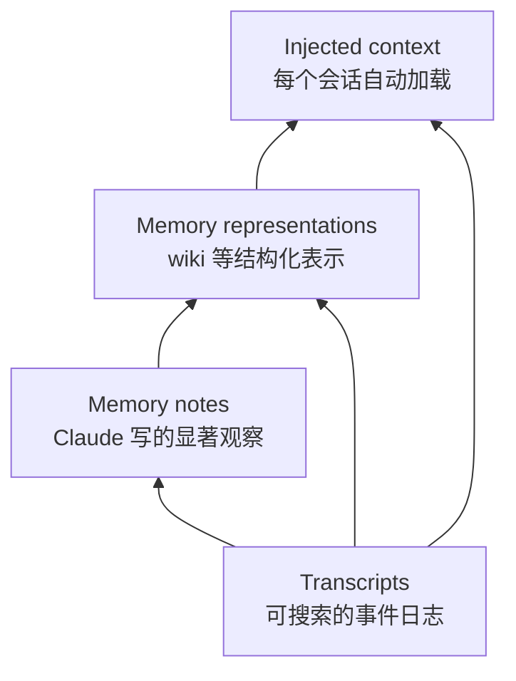

# Agent 记忆的四个部件与「做梦」：Anthropic 的工程实践

## 来源信息

| 项 | 内容 |
| --- | --- |
| 标题 | The components of agent memory |
| 作者 | Lance Martin（Engineering 团队发布；编辑 Caitlin Love、Tom Chivers、Rebecca Hiscott、Jake Eaton、Blake Wilson；图由 Monika Tuchowska 制作） |
| 来源 | Anthropic · [anthropic.com / Research](https://www.anthropic.com/research/components-of-agent-memory)，分类 Agents / Context engineering / Agent memory |
| 仓库编号 | 00226（非论文条目，与论文共用编号序列） |
| 发布日期 | 2026-11-06（JSON-LD `datePublished`） |
| 阅读日期 | 2026-11-08 |
| 版本锚点 | 2026-11-08 抓取的 `<article>` 规范化文本 24,423 字符，sha256 `d75f06e8…`；整页 HTML 含 Next.js 构建产物，哈希会变，不作锚点 |
| 说明 | 厂商工程博客，不是论文：没有新算法、没有发布新的公开数据集或可复现配置；内部评测的运行配置不可复现。核对凭据见同目录 `audit.md` |

## 核心结论

一句话：**Anthropic 把 agent 记忆拆成「可搜索的会话日志 → Claude 写的记忆笔记 → wiki 等结构化表示 → 每会话预加载的注入上下文」四层，并用一个离线计算过程（dreaming）在层与层之间搬运、纠错和整理；真正难的不是「记住更多」，而是判断什么值得记、以及如何让记下来的东西保持正确且足够小。**

- **记忆的边界是功能性的**：只算跨会话保留、可被后续读取的上下文；权重更新、单会话内的 in-context learning、为继续当前任务而做的 compaction 都不算。
- **质量取决于显著性判断，不由写入量决定**：Pokémon 的单轨迹对照里，413 个文件、97.8 万字符的记忆目录只换来 1 枚徽章，10 个文件、4.3 万字符的目录换来 4 枚徽章；但两者模型能力不同，不能把差异单独归因于记忆策略。
- **dreaming 是一组离线操作，不是单一功能**：创建笔记、纠错、建表示、聚焦任务、上提注入、补跨会话缺口，六种作用的收益、成本与失败模式各不相同。
- **收益有数字，但证据以厂商内部评测为主**：CL-Bench 上 6 个模型有记忆后平均奖励从 0.306–0.655 升到 0.610–0.838；固定规则与 wiki 的增益则都有明确的条件限制。
- **定位是工程框架**：它给的是分层、接口与失败模式，不是新的检索算法或训练方法；可复现的部分主要是概念框架与 Claude Code 的文档化行为。

## 问题

文章从 Kierkegaard 的话开头：生活只能向后理解，却必须向前过。作者用它类比 agent 记忆的困境——**写记忆时不知道未来会需要什么，等知道时已经晚了**。

人类侧的依据是文章引用的神经科学文献：海马体在体验发生的当下快速编码，只有一部分体验会在离线（睡眠、安静休息）时被「重放」（replay）并逐步巩固到新皮层。作者没有声称 agent 记忆要模拟大脑，只借这个**双时间尺度**的分工：在线快速记录，离线慢慢整理。

对应到 agent，问题有三层：

1. **会话之间失忆**：每次任务从零开始，上一次的判断、陷阱与验证过的规则都不带走。
2. **日志不等于记忆**：transcripts 已经记下大量工作过程，但它是原始事件流，不是可直接复用的知识。
3. **整理发生在错误的时机**：在线时模型忙于任务，写下的笔记可能一开始就错；离线整理又需要一份可信的事实底稿。

Letta 与 UC Berkeley 的 sleep-time compute 提出让模型利用交互之间的空闲时间重整已有上下文；原文把这类离线整理称为 **dreaming**（原文说「often called dreaming」，并同时链接 Anthropic 的 dreams 文档与 Google Research 的 Sleep Framework，不能读成 Anthropic 单独命名）。

这里有一个容易忽略的前提：**日志必须存在且可检索**。没有 transcripts，dreaming 没有可供校验的「事实底稿」，后面「纠错」这一整类能力就无从谈起。

原文对 agent memory 的定义很窄：

> knowledge that Claude gains from experience—including interactions with users and tasks it's been assigned—and that it retains between sessions, saved as context it can read later.

关键是「**跨会话保留、以可读上下文的形式保存**」。按这个定义，三种常见机制被排除：

| 不算 agent memory | 原文理由 | 典型形式 |
| --- | --- | --- |
| 权重更新 | 参数在训练时设定，不是「可读的上下文」 | 微调、持续预训练 |
| In-context learning | 知识只存在于单次对话内 | few-shot、长提示里的示例 |
| Compaction | 用 Claude 写的摘要替换较早的轮次，目的是在新上下文窗口里继续当前工作 | Claude 的上下文压缩 |

**解读（本笔记）**：compaction 与 memory 在文本形态上很像，都是「模型写的摘要」，区别在**作用域与生命周期**——compaction 服务于当前任务的连续进行，memory 服务于未来会话。这个边界在工程上会变模糊：一次 compaction 的摘要被写进记忆目录，它就成了 memory；反过来，一条记忆被注入当前会话后，也可能被再次压缩。原文没有展开这种交叉。定义划清后，工程问题变成四个：**写什么、写在哪、怎么保持正确、什么时候自动加载**。

## 核心想法

一句话：**把记忆按「读取的自动程度」分层，再用离线 dreaming 在层间搬运；越靠上的层读取越省事，但写入代价与错误传播面也越大。**

**直觉：顶层广播，底层按需查询。** 会话日志量最大、最原始，按需搜索；笔记是模型对「什么重要」的判断；wiki 把零散笔记连成可遍历的地图；注入层只放一个很小的头部，让每个会话一开始就知道「知道什么、去哪里找」。这样既不必把全部历史塞进上下文，也不用每次从零检索。

四层各自的角色可以一句话概括：

- **Transcripts**：事实底稿，dreaming 的输入。
- **Memory notes**：判断层，写下规则、陷阱与验证结果。
- **Memory representations**：地图层，把笔记连成可遍历的 wiki。
- **Injected context**：索引层，每个会话自动加载的很小头部。

**为什么成立：记忆是对未来的预测，所以要用两套时间尺度。** 在线时只能凭当下的显著性写，写的时候不知道未来会需要什么；离线时拿 transcript 当事实底稿，可以回头检查「当时写的还对不对」。三个机制支撑这个分工：

- **显著性**：只记「不写就会消失、且环境不会直接告诉你」的策略与规则；每回合都能从屏幕读到的状态不记。
- **纠错**：把笔记与原始会话日志对照，发现矛盾就改写；日志在这里扮演 ground truth。
- **表示**：wiki 的链接相当于地图，让知识库变大后还能找到路；页面本身可以逐字保留高价值事实。

作者没有把「该记什么」写成一套固定规则，判断标准是从案例里归纳的（本笔记）：

- 不写会不会消失？
- 以后还会不会用到？
- 能不能从环境实时读到？

**类比的边界。** 文章借海马体—新皮层的双时间尺度，但没有把 agent 记忆等同于生物记忆：transcript 是外部可检索的日志，dreaming 是可重复运行的离线 pass，二者都不涉及突触或权重。这个区别很重要——它意味着记忆可以被当作可检查、可修改的文件系统来设计，而不只是「模型记住了」。所以它不声称要模拟大脑，dreaming 也不是权重层面的巩固，而是对可读上下文的离线加工。

**一次会话里四层怎么配合。**

1. 会话开始：harness 只把注入层的头部放进上下文。
2. 任务进行中：Claude 遇到值得记的规则或陷阱，写进 notes。
3. 会话结束：transcript 留在日志里，成为下一次 dreaming 的事实底稿。
4. 空闲时：dreaming 对照日志改笔记、建或合并 wiki 页面，再把仍重要的结论上提到注入层。

这条流程解释了为什么四层缺一不可：没有日志无法纠错，没有笔记就没有判断，没有表示知识库大了找不到路，没有注入则每次都要先搜索。

**与已有做法区别。** 不是「换一种检索索引」：原文说记忆存储可以是「a folder, file, or database」，并没有排除向量库；重点是分层与可读写。不是微调或持续学习：不改权重。不是「上下文越长越好」：顶层必须小，细节下沉。也不是「加一个做梦阶段就好」：dreaming 是六种作用不同、成本不同的离线操作。

**一个走通的例子：Mt. Moon 的错记与纠错。** Claude 把 PokéCenter 的位置错记为山东侧；走出 PokéCenter 时它宣布 "Mt Moon is behind me"，并把笔记更新为 "Mt Moon DONE"。实际上山还在前面，几步后它走过单向台阶、掉回原路；导航工具没有显示这次跌落，于是它推断 "I overshot far west"，以为一直在正确的一侧。作者对这个含错误位置的记忆目录跑了一次 dreaming：Claude 对照 transcript 发现错误并改写。修正后它直接回到洞口，累计 1,935 个动作到达 Cerulean City；不修正的原始记忆掉了三次台阶，写下 "I'm going to stop rather than keep looping."，被 harness 的自动回复要求继续后一路退回 Pewter City，整轮没到；无记忆也没到。**这就是「日志当底稿」的具体价值：错误不是靠模型重新推理发现的，而是靠回看已发生的事实。**

**代价。** 分层不是免费的：

- 注入的记忆占 token，一条错误笔记可能被带进每一个会话；加载不等于执行，更长的指令文件会降低依从性。
- 建表示要算力，可能膨胀到比原文还大，还会断链。
- 在线写记忆会分散主任务注意力；Pokémon 案例里 17 步只整理记忆、不玩游戏，是这种成本的直接体现。
- 并发写会互相覆盖；一个共享页面被多个 agent 写，一次保存会擦掉另一行。
- 原文没有给 dreaming 的时延、吞吐或失败率，只说它「需要算力」。

## 核心论证链

文章的推进顺序是「划边界 → 给层级 → 证明有用 → 追问记住更多是否更好 → 该不该教模型写 → 拆开 dreaming → 落到工程」。每一段都在回答前一段留下的问题。

### 1. 先划边界：只谈可读、跨会话的上下文

定义与排除项确定了后面的讨论对象。这样 transcripts、notes、representations、injected context 才构成一个完整的记忆系统；权重与单会话机制被排除在外。几个关键术语在文中各有明确位置：

| 术语 | 在文中的含义 | 为什么重要 |
| --- | --- | --- |
| Agent memory | 跨会话保留、可读的上下文 | 排除权重更新与单会话机制 |
| Transcripts | 会话事件日志 | 搜索对象，也是 dreaming 的事实底稿 |
| Memory notes | Claude 判断为显著的观察、规则、陷阱 | 记忆的「判断层」 |
| Memory representations | wiki 等带链接的结构化知识 | 让知识库可遍历 |
| Injected context | 每会话开始时预加载的记忆 | 无需搜索，但占 token |
| Dreaming | 交互之间的离线整理过程 | 创建、纠错、建表示、上提等 |
| Salience | 什么值得记的判断 | 决定记忆质量 |
| Compaction | 为继续当前任务而压缩旧轮次 | 与 memory 的作用域不同 |
| CL-Bench | Continual Learning Bench 1.0 的数据库任务 | 跨会话记忆的主实验 |
| Harvey LAB | 公开的法律 agent 基准（MIT） | wiki 适用性评估 |
| Stainless | Anthropic 收购的软件公司，内部文档语料 | wiki 建表示的主实验 |

### 2. 再给层级：四层结构

*图 1（原文 Figure 1 的层级关系，本笔记重画）：四层记忆由下往上，读取越来越自动，写入代价与错误传播面也越来越大。*

| 层 | 内容 | 谁写、何时写 | 何时读 | 主要成本与风险 |
| --- | --- | --- | --- | --- |
| Transcripts | 会话事件日志 | harness 自动记录 | 搜索；dreaming 的输入与事实底稿 | 量大、原始、检索成本随会话数增长 |
| Memory notes | Claude 判断为显著的观察、规则、陷阱 | 会话中直接写，或 dreaming 整理时写 | 后续会话按需读取 | 可能一开始就错、随环境漂移、容易冗余 |
| Memory representations | wiki 等带链接的结构化知识 | 主要由 dreaming 生成与维护 | 需要时遍历、跳转 | 维护要算力；可能膨胀；会断链 |
| Injected context | 每会话预加载的记忆 | dreaming 上提 + harness 注入 | 每个会话开始 | 占 token；错误进每个会话；过长降低依从性 |

### 3. 证明「有记忆比没记忆好」：CL-Bench

原文用 CL-Bench 1.0 的数据库任务来测长程任务中的记忆使用：Claude 通过 Claude Managed Agents 运行；**每道题都从全新会话开始**，唯一跨会话的东西是一个持久化的记忆目录；答完后告知正确答案，Claude 可以把经验写进记忆，供后续题目使用。这正好隔离出「跨会话记忆」这一变量。

文章描述的学习闭环是：答错后记录失败 → 提出「为什么错」的假设 → 验证假设 → 把验证结果写成未来可用的规则。不同模型停在不同步骤：

- **Sonnet 4.6**：只到「提出假设」，目录里散落着多个文件，每个列着若干**未验证**的猜测。
- **Opus 4.7**：把笔记合并成单一参考文档，并开始标注哪些事实已核实、哪些仍未确认。
- **Sonnet 5**：评分者确认后把答案标为 confirmed；答错时写下更正。
- **Opus 5**：第一个闭环，多数条目同时包含规则、规则为何成立的依据、旧题答案，以及沿途发现的陷阱警告。
- **Opus 5.5 / Sonnet 5.5**：同样闭环；有记忆时与 Opus 5 得分相近，无记忆基线略高。

图 3 左图给出 6 个模型的平均奖励（0–1）：无记忆基线 0.306–0.655，有记忆 0.610–0.838。相对增益最大的是 Sonnet 5（+99.3%），其次 Opus 4.7（+82.8%），最小的是 Sonnet 4.6（+0.034，+10.3%）。右图是 30 道题上的运行均值，有记忆的曲线并不单调上升，中间会回落——记忆不是「装上就涨」的开关，而是一个会受具体题目、错误记忆与检索时机影响的动态过程。

**怎么读这组数**：不能把增益大小直接读成「记忆能力」。各模型基线差异很大（0.306–0.655），天花板效应与题目难度都会影响可提升空间；Sonnet 4.6 的低增益也可能来自「根本没好好读记忆」，而不只是「不会写记忆」。图 3 没有误差棒，也没有逐模型给运行次数；运行次数只散落在图 5（左图 16/3/3，右图 3/3/1），比较均值时要留意。原文自己的解释是「不同模型建立学习闭环的程度不同」，但**评测指标是任务奖励，不是闭环质量的直接度量**。

### 4. 追问「记住更多是否更好」：Pokémon

Pokémon Red 被当作「长程任务 + 显著性判断」的测试：每个模型在开局拿到一个可读写的记忆文件夹，边玩边写。作者比较了 Sonnet 3.7 与 Fable 5 各自跑到约 10,000 步时的目录：Sonnet 3.7 有 413 个文件、97.8 万字符，换来 1 枚徽章；Fable 5 有 10 个文件、4.3 万字符，换来 4 枚徽章。

原文给的机制很具体：**Pokémon 的游戏状态持续变化**。Sonnet 3.7 常常为每场战斗、每个道具、每个 NPC 各写一个文件，这些记录很快过时；随着游戏推进，它不得不花更多时间翻记忆，而不是玩游戏。约第 10,000 步时它开始整理第四个「master」记忆文件夹，接下来 **17 步里创建 6 个文件、删除 9 个，游戏内一个动作都没做**。Fable 5 只记游戏不会直接告诉它、且不写就会消失的东西；它的 `global.md` 是仪表盘：当前目标、打道馆的预写计划、以及自己使用记忆的规则。

一个具体例子是连续 7 个球都没抓到 Magikarp 后写下的规则：

> “If 3+ balls fail in a row, VARY the timing (insert extra ‘wait’ presses between menu steps) - the catch landed right after doing this.”

这条规则的价值在于它不是「发生了什么」，而是「下次遇到同类情况该怎么办」，并且带上了验证条件。

**证据边界**：这是每个模型一次运行的对照，而且 Sonnet 3.7 与 Fable 5 本身就是不同能力的模型。徽章数差异不能单独归因于记忆策略；能较稳带走的是：**把可从环境实时读取的状态写进记忆是冗余的，且会带来检索与维护开销**——这一点有 17 步零动作的直接证据支撑。

### 5. 该不该教模型写什么：规则 vs 判断

在 CL-Bench 上，作者只告诉 Claude「有一个记忆文件夹可用」，没有规定怎么写。这个最小提示对 Opus 4.7 与 Opus 5 已经够用。随后他们测试了**固定规则**：每条规则单独测一次，比较「有该规则时的记忆增益」与「无规则时的记忆增益」。原文只展示了「只记录失败」（record only failures）这一条：

| 模型 | 记忆增益变化 | 运行次数 |
| --- | ---: | ---: |
| Opus 5 | −0.234 | 3 |
| Opus 4.7 | −0.150 | 3 |
| Sonnet 4.6 | −0.020 | 1 |

（数值与运行次数取自图 5 右图；误差棒为标准误。）结论是：**对强模型，事先规定「记什么」可能削弱记忆收益；让模型自己判断显著性更有效。** 但证据范围很窄：这是一条规则、三个模型的消融，原文说「one rule per test」，却没有列出其他规则的结果。

另一侧是**脚手架对弱模型更有效**。原文强调 Sonnet 4.6 经常不读、不验证：它经常不打开记忆目录，也不去检验自己关于「为什么答错」的假设。作者加了两个提示——回答前先读记忆、然后显式检验假设——得分从 0.330（基线）/0.364（有记忆）升到 **0.641**（有记忆 + 改进提示）。原文只说这「nearly doubled its benchmark score」，没有说明比较基准；按无记忆的 0.330 算是 1.94 倍，按「有记忆但无提示」的 0.364 算是约 1.76 倍（均为本笔记复算）。图 5 左图的三根柱各有 3 次运行，误差棒为标准差，跨度不小。

另一个行为读数是：**Sonnet 5 在没有提示的情况下，10 次里有 9 次先读记忆再回答；Sonnet 4.6 不到一半。** 这是行为频率，不是基准分数。由此得到的工程判断是**能力相关**的：脚手架对旧模型帮助最大、固定规则可能削弱强模型；原文没有测试同样的脚手架对新模型是否有害，不能据此说「新模型不需要脚手架」。

### 6. 拆开 dreaming：六种作用

原文开头把 dreaming 概括为「correct mistakes, create notes, build new memory representations, or shape what's preemptively loaded into future sessions」，正文又分别讲了 focus 与 fill gaps，合起来是六种，可分三类：**创建/修正类**（创建笔记、纠错、补缺口）、**构建类**（建表示、聚焦目标）、**调度类**（把笔记上提到注入层）。6.7 讨论 wiki 在什么任务上值得建，属于适用性评估，不算 dreaming 的一种作用。

| 作用 | 机制 | 证据 | 成本 / 风险 |
| --- | --- | --- | --- |
| 创建笔记 | 离线把观察写成笔记 | 原文点名，未单独评测；第二次 dreaming pass 新增 3 页属于建表示 | 证据最弱 |
| 纠错 | 笔记对照 transcript，发现矛盾改写 | Mt. Moon：修正后 1,935 动作到 Cerulean；原始记忆与无记忆都没到 | 单轨迹；错误记忆与 harness 继续策略耦合 |
| 建表示 | 生成带链接的 wiki，合并重复、核对断言 | Stainless 25 题：仅 wiki 13%→48%，wiki+搜索 54%→61%，仅搜索 53% | 128 个 session 的算力；横轴是预算不是实测 |
| 上提 | 把笔记放进每会话注入层 | Claude Code 只加载 `MEMORY.md` 前 200 行或 25 KB | 占 token；错误进每个会话；依从性下降 |
| 聚焦 | 用指令决定 wiki 往哪长 | LAB 合同：41/57→57/57；一页一 owner、逐字引用 | 指令靠反思循环试出来；并发写冲突 |
| 补缺口 | 跨 session 找共同模式、修断链 | 9 条链接指向不存在的页面，第二次 pass 批量改指；38/225→41/278 | 判断错了会批量扩散错误 |

**纠错**的机制是把记忆笔记与原始会话日志对照，日志扮演 ground truth。Mt. Moon 案例把失败链条讲得很清楚：错记 PokéCenter 位置 → 宣布 "Mt Moon DONE" → 走过单向台阶掉回原路 → 导航工具不显示跌落 → 推断 "I overshot far west"。修正后 1,935 个动作到达 Cerulean；原始记忆掉了三次台阶后放弃，被 harness 自动继续，整轮没到；无记忆也没到。原文只展示每个条件的一条轨迹，没有说明重复次数；它证明「这种错误可以发生、dreaming 可以修」，不能给出修复成功率。

**建表示**的主实验用 Stainless 的内部文档（约 350,000 个文件、约 420M tokens）。作者构造 25 个问题，给 Claude 一个搜索工具，同时让 Opus 5 agent 通过 128 个 session 的 dreaming 增量构建 wiki：探索文件、写或修正页面、合并重复、对照来源核查断言，每个 session 基于前一个 session 的进度，用共享日志协调。图 10 中图给出：仅 wiki 从 13% 到 48%；wiki + 搜索从 54% 到 61%；仅搜索是 53% 的横线。搜索 + wiki 每题大约省 20,000 tokens（原文未给基线口径）。横轴标注是 dreaming tokens，2M–128M，为**对数刻度**；脚注写明「Log scale. Budget of 1M tokens per session, not measured spend」，所以它是预算，不是实测消耗。两侧示例 wiki 显示：2 个 session 后 103 页、766 条链接；128 个 session 后 222 页、12,893 条链接——页数约 2.2 倍，链接数约 16.8 倍（本笔记复算），增长主要发生在**连接密度**而不是页面数量。

**上提**的好处是 Claude 不需要搜索，甚至不需要知道「有东西可搜」。代价也明确：注入的记忆占用宝贵的 token；一条错误笔记可能被带进每一个会话；加载不等于执行，Claude Code 的文档警告更长的指令文件会降低依从性（adherence）。所以顶层必须保持**相对**小，dreaming 在这里的大量工作反而是把细节往下层搬、只留下链接。Claude Code 的 auto memory 每个会话只加载 `MEMORY.md` 的前 200 行或 25 KB（以先到者为准），这个头部充当索引，告诉 Claude「知道什么、去哪里找」。

**聚焦**的机制是 dreaming 的指令决定「什么信息重要」，从而决定 wiki 往哪个方向长。原文举了 Claude Duet 这类面向个人助理的场景——它往往受益于把记忆围绕「它服务的人」来组织（原文用 often benefits，不是硬性要求）。证据来自 LAB 的合同任务：改进前多个 agent 同时往一张共享的合同条款表 `provisions.md` 写，并发写入互相覆盖，条款被拙劣地摘要、甚至整条丢失，最终简报只覆盖 57 条评分事实中的 41 条（72%）；改进后每个合同一个独立页面、由一个 agent 独占写入，条款逐字引用而不是摘要，结果 57/57（100%）。改进指令不是人手写的，而是跑了一个循环：Claude 反思失败 → 提出指令修改 → 重建 wiki，它「发现」了合同条款最重要。图 14 把并发冲突画得很清楚：四个 agent 写同一页，一次保存会擦掉另一个 agent 的行。

**补缺口**利用 dreaming 可以跨多个 session 搜索，发现共同模式或共同错误。具体例子：建 wiki 时 Claude 多次链接到一个还不存在的页面 `escrow-agreement`——6 个页面里的 9 条链接都指向它。第二次 dreaming 把这 9 条链接改指到已存在的 `buyer-form-escrow-agreement`，另外新增 3 个页面（index、instructions email、escalations）；wiki 从 38 个条目、225 条链接变成 41 个条目、278 条链接。这展示了表示层的自我修复：断链不是靠人发现，而是靠一次跨会话遍历发现并批量修复。风险同样存在：如果第二次 pass 的判断错了，批量改指会把错误扩散到更多页面。

**wiki 的适用性**不是 dreaming 的一种作用，而是「什么任务值得建表示」的评估。作者用 Harvey LAB（公开的法律 agent 基准，MIT）加一套并购文档，图 11 的图注说这些文档多为公开文件（mostly public filings）。跨文档/判断类题项在正文里写作 24 个问题，超过一半需要跨多份文档找信息，其中 9 项需要判断或算术；原文只在需要跨文档或判断/算术的题项（图 11 的红/橙线）上报告 **87% vs 73%**（+14 个百分点），不是全部 24 题的平均分。单文档可检索题里，多数评分项能在一份文档里用文本搜索找到；图 11 脚注说单是 deal overview memo 就满足 31/57，wiki 没有明确增益。还有一个反例：10 份文档、115 KB 的语料生成了 68 页、255 条链接、203 KB 的 wiki，是语料的 1.77 倍；作者用 Borges 的「精确地图」故事讽刺它——详细到没有抽象，等于没建表示。**工程含义**：先看任务是否需要跨文档综合、判断与计算；如果一段文本搜索就能找到，wiki 的构建与维护成本很难收回。这是本笔记从原文任务对比中归纳的，属于存在性证据，不是任务类型的完整分类。

### 7. 落到工程：接口与成本

原文的实验落在 Claude Managed Agents 的「挂载记忆目录」上：会话从空开始，只能通过目录跨会话；dreaming 则是对目录与日志的离线 pass。这套接口的关键设计点是**记忆以可读写的文件形式出现**：模型可以用文件工具读、写、改、链接，人也容易检查；原文同时说记忆存储可以是「a folder, file, or database」，并没有排除向量库或数据库。

成本可以勾勒出量级：注入层每会话最多 200 行或 25 KB 的 `MEMORY.md` 头部；128 个 session、每个按 1M token 的 dreaming 预算计，合计约 128M token 的**预算**（不是实测消耗）；搜索 + wiki 每题约省 20,000 tokens（口径未说明）；在线写记忆会占用模型注意力，Pokémon 的 17 步是直接体现。原文没有给 dreaming 的时延、吞吐或失败率；失败模式的完整表见 `audit.md`。

## 主要结论

- **记忆确实带来跨会话增益，但增益大小不能直接读成记忆能力。** CL-Bench 6 个模型平均奖励从 0.306–0.655 升到 0.610–0.838；相对增益从 Sonnet 4.6 的 +10.3% 到 Sonnet 5 的 +99.3%，基线高低、天花板与题目难度都在影响可提升空间。
- **固定规则可能削弱强模型，脚手架对弱模型更有效。** 只记录失败让 Opus 5 −0.234、Opus 4.7 −0.150、Sonnet 4.6 −0.020；Sonnet 4.6 在「先读记忆、再验证假设」的提示下从 0.330/0.364 升到 0.641。证据只覆盖一条规则、三个模型。
- **「记得多」不等于「记得好」。** Pokémon 的 413 文件/97.8 万字符目录换来 1 枚徽章，10 文件/4.3 万字符目录换来 4 枚徽章；能较稳带走的是「把环境实时可读的状态写进记忆是冗余的」，不是「小目录必然更好」。
- **dreaming 的六种作用里，纠错、建表示、聚焦、补缺口有具体案例；创建笔记只有点名。** wiki 在 Stainless 25 题上把仅 wiki 从 13% 提到 48%，wiki+搜索从 54% 到 61%，仅搜索 53%；合同任务从 41/57 到 57/57。
- **工程上最稳的几条规则是：顶层小、细节下沉、高价值事实逐字保留、给强模型判断权、纠错要有事实底稿。** Claude Code 的注入上限是 `MEMORY.md` 前 200 行或 25 KB（以先到者为准）。

## 边界与局限

**作者明确讨论的开放问题**：

- **何时写记忆**：在线写能抓住当下的显著性、立刻可用，但会分散主任务注意力；离线 dreaming 不打扰任务，但产出不一定马上可用。
- **如何保持最新**：记忆可能一开始就错，也可能随环境漂移；dreaming 能修，但要算力，持续检查所有记忆不现实。原文说可能更重要的是把计算集中在「容易变化」的信息上，或按访问频率调整 dreaming 的节奏。
- **transcript 搜索是否应作为记忆的基础**：把表示与搜索结合有时有效，但维护表示本身要算力，还要防止错误与幻觉累积。

**读者判断**：

- 样本量普遍偏小：Pokémon 对照 one run each；Mt. Moon 只说 the run、未给重复次数；CL-Bench 图 3 无误差棒，运行次数只散落在图 5；wiki 评测是单一语料、25 题；LAB 至少四个任务，每个只给一组结果。
- 厂商内部评测为主：模型版本、系统提示、工具接口与具体运行配置未公开；CL-Bench 1.0 链接当前 404，任务协议与「正确答案如何给出」只能按原文转述。
- 「记忆带来提升」与「模型能力提升」在 Pokémon 对照里混在一起，无法单独归因；Harvey LAB 虽公开（MIT），本文的任务子集与运行配置未说明。
- 没有 dreaming 的成本、时延、失败率数据，也没有「错误记忆被纠正的概率」这类可靠性指标；没有记忆投毒、隐私、跨用户隔离等安全实验。

## 与其他工作的关系

- **00219（把 subagent 折回主循环）**：同一厂商的 harness 设计文章，讨论「一个循环 + 渐进披露」如何替代多 agent 拆分；本篇讨论「跨会话的状态放在哪里」。共同点是把上下文管理当作系统设计，而不是提示词技巧。
- **仓库里与记忆直接相关、尚未生成笔记的条目**：00047 LightRAG、00071 HippoRAG、00072 HippoRAG2、00110 MemAct、00163 HyperRAG、00200 ISM、00207 CHIME。它们分别从检索结构、记忆动作、记忆演化等角度处理长期记忆；本篇的差异是工程分层 + 厂商内部评测，不是新的检索算法。
