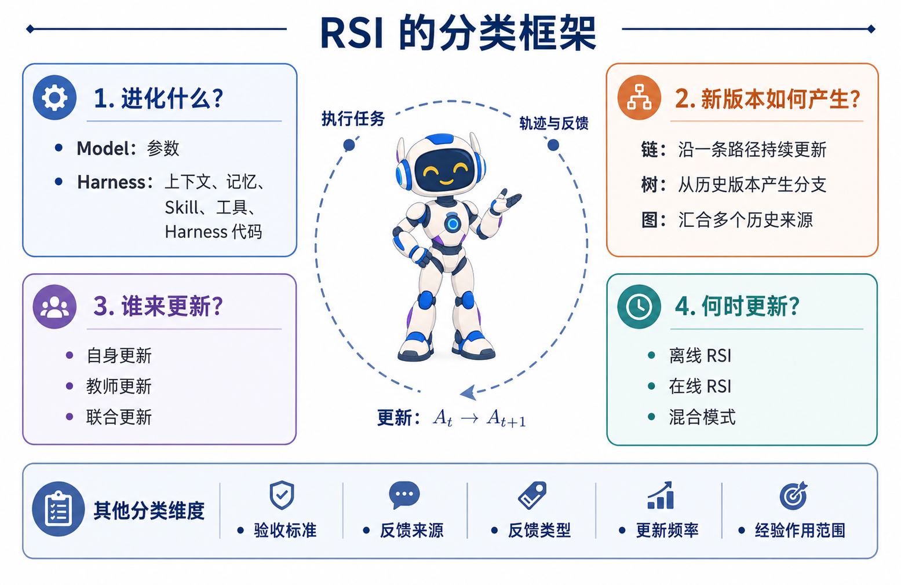
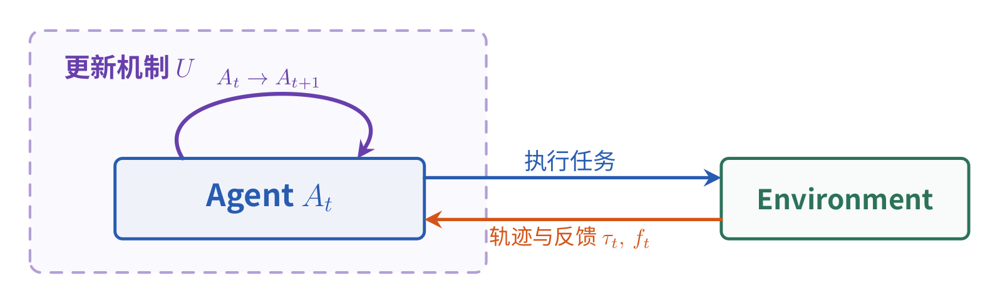

# 万字长文带你读懂 RSI（自进化，Self-Evolving）

## 来源信息

| 项 | 内容 |
| --- | --- |
| 标题 | 万字长文带你读懂 RSI（自进化，Self-Evolving）；英文版题名 *Understanding RSI: A Comprehensive Guide to Self-Evolving AI* |
| 作者 | Prism-Shadow（站点与仓库署名，未披露个人姓名；仓库 BibTeX 的 `author` 字段即 `Prism-Shadow`，2026） |
| 站点 | [Awesome RSI](https://prism-shadow.github.io/awesome-rsi/#blog/understanding-rsi)，一个 RSI 论文精选集（站点自称收录 100 篇 method、31 篇 benchmark、3 个 system）；本文属其「导读」栏目 |
| 原文 | 中文源文件 [`site/src/data/blog/rsi-guide.zh.md`](https://github.com/Prism-Shadow/awesome-rsi/blob/main/site/src/data/blog/rsi-guide.zh.md)（38,168 B，sha256 `22666c24e9b06bee…`），基准 commit [`36e91f8`](https://github.com/Prism-Shadow/awesome-rsi/commit/36e91f8fed67e2cd0c761126f91042513df5d6ae)（2026-09-30）；另有[英文版](https://github.com/Prism-Shadow/awesome-rsi/blob/main/site/src/data/blog/rsi-guide.en.md)（44,182 B） |
| 仓库编号 | 00192（非论文条目，与论文共用序列；无 PDF 可归档） |
| 发布日期 | 2026-09-03 |
| 阅读日期 | 2026-10-06 |
| 许可 | 站点与仓库未标注许可（GitHub API 的 `license` 为 `null`）；文中配图版权归原作者，引用请注明出处 |

---

## 核心结论

一句话：**这不是一篇提出新方法的工作，而是一篇给「RSI / 自进化」建立坐标系的导读**——它先把 RSI 收成一个「本轮 Agent + 本轮轨迹 + 反馈 → 更新机制 → 下一轮 Agent」的闭环，再用四组主维度（进化什么 / 新版本如何产生 / 谁来更新 / 何时更新）加五组次级维度，把近年涌现的自进化工作摆进同一张图。

- **解决什么问题**：RSI 被宽泛使用，不同作者说的往往不是同一件事；研究增长速度超过整理速度，缺少便于横向比较的组织方式。
- **核心想法**：明确放弃裁决"什么才算真正的 RSI"，改用一组相互独立的维度界定概念，并标出每篇论文在维度上的位置。
- **怎么做到**：每类先给判据，再给一个代表工作。五类被改对象、三种进化结构、三类更新者、三种更新时机，加上五个次级维度，构成一张可定位的坐标系。
- **关键发现**：四组主维度覆盖的类别里，唯一没有代表工作的是 §4.1「自身更新」——只有示意图；此外"自我"的判据落在**产物是否被后续任务复用**，而不是更新由谁执行。
- **怎么用**：再遇到一篇自进化论文，先问四件事——改的是什么？新版本怎么来的？谁动手改？什么时候改？

*图：导读自绘的 RSI 分类框架总览（来源：Awesome RSI 导读，许可未标注）。*

---

## 问题

导读本身只用开篇一段话交代动机：领域仍在飞速发展、尚未形成统一技术范式、不同工作的改进对象与实现路径差异很大。真正把问题拆开的是同站姊妹篇《Awesome RSI：递归自我改进基准与方法精选集》（2026-08-21），以下三条与历史脉络都来自它（**补充背景**，非导读正文）。

1. **术语未稳定**：RSI（recursive self-improvement，递归自我改进）与 "world model" 一样被宽泛使用，不同作者说的往往不是同一件事。于是同一个词下面既有改权重的训练，也有改提示词、改记忆、改工具代码的做法。
2. **研究增长速度超过整理速度**：姊妹篇援引 2026 年 7 月的一篇综述（[arXiv:2607.07663](https://arxiv.org/abs/2607.07663)，标题 *Recursive Self-Improvement in AI: From Bounded Self-Refinement to Autonomous Research Loops*），称其收录了 2024–2026 年间的 **1,250 篇** arXiv 论文，但这些工作缺少便于横向比较的统一组织方式。
3. **教学材料没跟上**：既无共识课程，也无成熟教材。

作者给出的应对不是更严格的判据，而是换一种问法：

> 我们不试图裁决什么才算"真正的" RSI，而是用一组相互独立的维度来界定概念，并标出每篇论文在这些维度上的位置。

这条自我限定（出自姊妹篇，原文大意）是理解全文的钥匙：下文的所有分类都是**作者构造的坐标**，不是领域共识。读者可以按坐标定位、比较，但不能把"落在某一格"当成"被领域承认"。

**历史脉络**（姊妹篇）：I. J. Good 1965 年提出"智能爆炸"（第一台超智能机器将是人类需要完成的最后一项发明）→ Yudkowsky 的可自我改写"种子 AI" → Bostrom 2014《超级智能》。此后几十年 RSI 主要是思想实验，LLM 才让它变得触手可及。

**导读依赖的两个前提**，第一个写在 §1–§2，第二个是姊妹篇的补充视角：

- **Agent = Model + Harness**。Model 提供基础的理解、推理与生成能力；Harness 负责组织模型如何接收信息、积累经验、调用工具并完成任务，具体含上下文、记忆、Skill、工具、Harness 代码五项。这个分解直接决定了"进化什么"怎么分类。
- **参数式与非参数式作用于同一个输出分布**。姊妹篇把 Agent 的输出写成"给定模型参数与上下文时输出的分布"：参数式改进改变参数，所有非参数式改进最终都改变上下文，两者作用于同一个分布。所以"参数 vs 非参数"的差别没有表面看起来那么大。

导读 §2.1 还给参数式 RSI 划了两条范围边界，读论文时值得照搬：① 每轮可以从初始模型重新训练，不必继承上一轮 Student 的参数；② 不要求存在独立的 Teacher——只要 Student 的表现反馈继续用于改进后续训练，就属于参数 RSI。

---

## 核心想法

### 一句话

不争"谁更算 RSI"，只问"它在这张图的哪一格"。

### 直觉

自进化工作看起来五花八门，但它们其实在回答四个彼此独立的问题：**改的是什么、新版本怎么来、谁动手改、什么时候改**。把四个问题拆开，原本无法比较的工作就落在同一组坐标上；反过来，把四个问题混在一起问，就会陷入"这个算不算 RSI"的定义之争——而定义之争没有出口，因为各方在回答不同的问题。

### 为什么成立

关键在于"自我"的判据被换掉了。直觉上，"自我改进"似乎要求 Agent 自己动手改自己；导读的判据是**更新后的产物被后续任务复用**。只要满足这一条，更新机制由 Student 自己、独立 Teacher、Meta-Agent 还是外部训练程序执行，都不影响它是不是 RSI。

这个判据把一大批"看起来不像自我改进"的工作收了进来，也把一批"看起来像"的工作挡在外面：一个只给分数或验收结果的模块不算 Teacher，因为它没有决定"写回什么"；Student 只执行任务、或 Teacher 只负责评分，都不构成"联合更新"。

同样的思路贯穿每个维度：**每个取值都对应一种代价**。链式实现简单但直接继承上一轮的错误；树/图能保留分支但评测成本随分支增长；参数进化把知识内化进权重，但贵、难撤销、一次坏训练污染面大；上下文与记忆便宜，但依赖检索质量与写入判断。坐标不是标签，而是一组权衡的索引。

### 闭环为什么正好需要四个问题

闭环本身只说了"有更新、更新产物被复用"，没有说更新的对象、新版本的产生方式、执行者与时机。四个问题正好把这四个空位逐个填上：改什么对应"自身状态"是哪一部分，怎么产生对应"新版本与旧版本的关系"，谁动手对应更新机制的归属，何时对应更新发生在评测之前、之中还是两段都有。所以四组主维度不是外加的分类法，而是把一句定义拆成了可回答的问句。

这也是为什么它们必须**分开**问：一个工作可以在"改 Skill"的同时"由 Teacher 更新"、"用树结构探索"、"在线生效"，四个答案互不推导。把它们压成一个标签，就会丢掉真正决定成本与效果的那几项。

### 与已有做法的区别

- **不做术语裁决**：不先给 RSI 下定义再筛选工作，而是用维度界定概念、允许一个工作同时落在多格。
- **不是方法综述**：每个格子只给一个代表工作，举例而非穷尽；它给出机制位置，不给方法间的性能排名。
- **不把"自己改自己"当门槛**：把 Teacher、Meta-Agent、外部训练程序都算进更新机制，因此能覆盖参数式 RSI。

### 一个走通的例子

姊妹篇给了一个经典的误判：PostTrainBench（[arXiv:2603.08640](https://arxiv.org/abs/2603.08640)）里，一个教师 Agent 训练学生模型，并多轮提升学生的准确率。直觉上很容易把学生模型当成"自我改进的系统"，因为它一轮比一轮强。

按四问走一遍就会发现问题：改的是**学生模型的参数**，可动手改的是**教师 Agent**（它决定训练什么、怎么写回），学生只执行任务。于是正确的归类是"教师更新"，而不是"自身更新"——被改进的对象和执行更新的主体不是同一个。**我的推断**：导读 §2.1 之所以开篇先做范围界定（可以从初始模型重新训练、不要求独立 Teacher），很可能就是针对这类误判。

### 代价

坐标系的代价是**它不替你判断**。维度之间没有判定优先级，一个工作可以同时落在多格（导读的"修改对象 × 更新模式"矩阵图里，SkillSmith 就同时出现在记忆、Skill、Harness 代码三行）；同一维度的取值也需要分别判断，同一种方法可能采用多种方式。读者拿到的是定位工具，不是结论。

---

## 核心论证链

导读的论证是"先立闭环 → 再拆结构 → 然后沿四组主维度逐层展开 → 最后用五个次级维度补齐细节"，每一步都在缩小"什么算 RSI"的含糊地带。

### 第 1 步：把 RSI 收成一个闭环

定义只说一件事：Agent 与环境交互后，利用任务轨迹（trajectory，这次任务从开始到结束的执行记录）与反馈，通过更新机制修改自身状态，并让更新后的状态参与后续任务，以提升未来表现。其中两个限定最容易被跳过：

- **更新机制不必由 Agent 自己执行**。它可以是 Teacher、Meta-Agent 或外部训练程序——这是后面"谁来更新"能分出三类的依据。
- **更新产物必须被后续任务复用**。没有这一环，一次性的自我修补不构成导读所说的 RSI。这是全篇最硬的一条判据。

*图：导读自绘的 RSI 循环，更新机制与环境侧的"执行任务 / 轨迹与反馈"构成闭环（来源同上，许可未标注）。*

### 第 2 步：拆开 Agent，才知道"在改什么"

| 组成 | 谁提供什么 | 对应的进化类型 |
| --- | --- | --- |
| Model | 基础的理解、推理与生成能力 | 参数进化 |
| Harness：上下文 | 本次推理直接看到的材料 | 上下文进化 |
| Harness：记忆 | 存放在外部、按需检索的信息 | 记忆进化 |
| Harness：Skill | 同类问题的可复用做法 | Skill 进化 |
| Harness：工具与代码 | 动作空间与控制流程 | Harness 代码进化 |

这张表是全篇的操作性基础。最实用的一条判据也在这里：**记忆是存放在外部、等待检索的信息；记忆被取出并放入模型输入后，才成为当前上下文**。同一个东西在检索前后属于两个不同的类别。

### 第 3 步：四组主维度

**维度 1**：进化什么（§2）。按被改对象分五类，每类导读只给一个代表工作。

| 被改对象 | 优势 | 代价 | 代表工作 |
| --- | --- | --- | --- |
| 参数（模型权重） | 知识内化进权重，不必每次检索外部材料 | 更新昂贵、难定位与撤销、一次错误训练可影响大量无关任务 | SEAL（2506.10943） |
| 上下文 | 改动即时生效、无需训练 | 受窗口限制，需不断压缩/重写 | Prime Agent（2608.23552） |
| 记忆 | 可跨任务积累，容量不受窗口约束 | 需筛选、抽象与修订，错误归因会持续污染 | ReasoningBank（2509.25140） |
| Skill | 比单条记忆更抽象、可重复使用 | 需在多次任务后判断该改哪一条 | TRACE（2608.22793） |
| Harness 代码 | 能改变动作空间与控制流程，突破"只改说明文字"的天花板 | 改动面大，需成套测试避免修一处坏一处 | SkillSmith（2606.01314） |

- **SEAL**（参数）是两层结构。模型面对新输入时除了答案还生成一份 **self-edit**（自我更新方案：重组原始信息、生成训练样本、指定优化超参、调用工具做数据增强或梯度更新）；系统按 self-edit 做 SFT，把"临时文本"变成持久权重变化。又因为模型起初不知道什么样的 self-edit 有效，外面再套一层 RL，**以更新后模型的下游表现为奖励**，训练它以后生成更有用的 self-edit。代价是候选 self-edit 的微调与评测开销高。
- **Prime Agent**（上下文）提供持久工作台：持久化 IPython REPL 保存代码、变量、文件与计算结果；**Continual Harness** 记录任务历史、记忆、Skill、Prompt 与子 Agent 配置。任务中断后后台进程保留工作现场，恢复时无需重读全部材料，还可以派子 Agent 并行探索。**它不更新模型参数**——这正是它被归入"上下文进化"的理由。
- **ReasoningBank**（记忆）把成功与失败轨迹都蒸馏成简短可复用的经验，而不是保存整条轨迹；新任务先检索经验，任务结束后判断是否完成再提炼写回。它提出的 **memory-aware test-time scaling**（MaTTS） 是"同一任务多试几次 → 得到更丰富的成败样本 → 提炼质量更高的记忆 → 再指导后续尝试"的正反馈。
- **TRACE**（Skill）按"一类具体情况"组织多个 Skill 组成 Skill Bank，每轮评测后把调用过同一 Skill 的成功/失败轨迹分组做**对比式精修**；失败模式包括没问清必要信息、过早执行操作、承诺做不到的事。好处是一类任务出问题只改相关 Skill，不必重写整套 Prompt。
- **SkillSmith**（Harness 代码）有三个机制：① Skill 与工具**同时改**——若失败源于工具能力不足，只改工具说明文字无解，所以反思模块生成"成套修改"（编辑/组合/拆分/停用工具 + 调整 Skill）；② 借生态系统"合作与竞争"的思路，从执行轨迹中记录哪些 Skill 常互相帮助、哪些易干扰，据此决定优先调用/修改/淘汰；③ 保存历史失败模式（问题表现、原因、修复方法），新方案若重蹈覆辙会被提前排除。

**维度 2**：进化结构——链、树、图（§3）。这一维看的是"新版本与历史版本的继承关系"，直接影响探索范围、评测成本与从错误更新中恢复的能力。

| 结构 | 定义 | 代价 | 代表工作 |
| --- | --- | --- | --- |
| 链 | 始终只有一个在用版本，依次迭代 | 实现简单，但上一轮的错误被下一轮直接继承 | SkillFlow（2604.17308） |
| 树 | 保留多个历史版本，一个版本可产生多个子版本，后续可从任意历史版本继续 | 选择父代与评测新版本的时间/算力随分支增长 | DGM（2505.22954） |
| 图 | 一次修改可同时参考多个来源（同一 Agent 在不同任务上的轨迹，或另一分支的结果） | 需要维护跨任务/跨分支的对照与检索 | MGM（2608.07645） |

- **SkillFlow**（链）：每个任务族从空的 Skill 库开始，Agent 完成一个任务后由模型根据轨迹与验证反馈生成 **Skill patch**（新增/改写/删除 Skill 与辅助脚本），更新后的库直接用于下一项任务。导读记录了一个很有价值的观察：**表现好的配置通常反复修订少量通用 Skill，表现差的配置容易不断新增相似 Skill 使库越来越碎**；错误 Skill 一旦写入会被后续任务继续沿用——这正是链式的失败形态。
- **DGM**（树）：维护已生成版本的集合（archive），每轮从中采样一个版本作父代，修改它的提示词、工具或工作流代码生成子版本；**底层模型保持不变**，只进化 scaffold（模型之外的脚手架：提示词、工具与工作流代码）。新版本须通过基本检查（代码能跑、仍具备编辑代码库的能力），再用 SWE-bench / Polyglot 评测；**得分低于父代的版本也会保留**，父代与其他历史版本不被覆盖，之后仍可被选中再次演化。名字来自 Gödel Machine——后者要求先证明修改有益才执行，复杂编程 Agent 做不到形式证明，DGM 改为直接运行修改后的版本、用 Benchmark 得分检验。
- **MGM**（图）：沿用 DGM 的版本树，改变的是"生成新版本时用什么信息"。除保留**克隆式变异**（clonal mutation，只依据单条失败轨迹改进当前版本）外，新增两种：**reaction-norm mutation** 比较同一 Agent 在不同任务上的轨迹（多项任务反复出现相似问题，更可能是 Agent 自身缺陷而非题目特殊性）；**cross-lineage hybridization** 比较不同分支的 Agent 在同一任务上的表现（一方失败一方成功时用成功轨迹作参考，两方都失败则比较两条轨迹找互补的失败模式）。导读的解释是：这两种更新都使用版本集合中已有的评测轨迹，跨任务/跨分支对照能提供更具体的故障线索，**缩小需要排查的范围**。

**维度 3**：谁来更新——自身、教师与联合（§4）。导读把执行任务的 Agent 叫 **Student**，把分析轨迹并参与修改的另一个 Agent 叫 **Teacher**（原文写明是"为了方便讨论"而设定的称法）。

| 类型 | 谁动手 | 判据 | 代表工作 |
| --- | --- | --- | --- |
| 自身更新 | Student 自己总结并修改自身 | 环境可给分，但没有另一个 Agent 分析轨迹或编写更新 | （导读未给，仅配示意图） |
| 教师更新 | Student 执行任务，独立的 Teacher 完成更新 | Teacher 决定写回什么以及怎么改；只给分/给验收结果的模块不算 | Recuris（2608.24876） |
| 联合更新 | 两者都参与，分工不固定 | 两者是否都影响了最终写回的内容 | Evo-Harness（2608.15071） |

两处边界值得记住：**教师不一定是 Agent**，也可能是反思模块、优化器或带验证规则的更新流程；它可以生成或整理新的记忆/Skill/工具/Harness 代码，也可以制定训练方案、通过训练程序更新 Student 的参数。**联合更新的分工可正可反**：Student 先总结候选经验再由 Teacher 筛选写入，或 Teacher 先诊断、Student 再实现修改，都算。

- **Recuris**（教师）：用 **Working Memory** 记录当前目标、已完成步骤与下一步计划，用 **Experiential Memory** 保存跨任务可复用的经验与 Skill；依据 Working Memory 中的进度与未完成目标来选择 Skill，使选择与当前步骤对齐。失败时把失败与本轮用到的记忆组件关联定位；同类问题在多个任务中反复出现时，固定的 **Meta-Agent** 分析这些记录并对相关 Skill 提出局部修改，候选修改通过验证后才写入 Skill Memory。
- **Evo-Harness**（联合）：Solver（约等于 Student）完成任务后自己先总结候选经验并标明适用情况与依据；每批任务结束后 Evolver（约等于 Teacher）把候选经验与当前 Harness 对照，决定新增/合并/修改/舍弃，整理成跨任务规则或特定任务类型的操作流程。它处理的是连续任务流，执行记录里既有可复用做法，也包含只与当前任务有关的路径、文件名与具体条件——这正是需要 Evolver 做提炼的原因。

**维度 4**：更新时机——离线、在线与混合（§5）。这一维决定的是评测协议，而不是方法本身。

| 模式 | 协议 | 评测方法 | 代表工作 |
| --- | --- | --- | --- |
| 离线 | 训练任务中完成更新，进入测试阶段后保持不变 | 训练题与测试题不能完全重复（否则只是记住答案），也不能分布完全不同（否则无法判断经验是否有用） | GDPevo（2608.03764） |
| 在线 | 处理任务的同时持续更新，前面任务的经验影响后续任务 | 必须沿任务序列观察，才看得出经验是否起作用 | FinEvo-Bench（2608.06144） |
| 混合 | 先离线建立初始版本，上线后根据新任务继续调整 | 兼有两阶段 | Mem²Evolve（2604.10923） |

- **GDPevo 的 Rule Hybridization**（离线）：从 CRM、ERP、金融、医疗、法律、数据处理等真实业务流程中拆出**原子规则**，同一批基础规则先以不同组合出现在 5 个训练任务中，再重新组合形成 5 个测试任务。这样测试任务虽未出现，但含训练期接触过的规则，**涨分可以归因于经验复用而非见过原题**。规模为 12 组 × (5 训练 + 5 测试) = 120 个任务，另有自动生成流程可在两天内再生成 12 组，用于定期换题以降污染风险。
- **FinEvo-Bench 的对照设计**（在线）：120 个金融任务、6 个领域、20 个业务场景，每场景 6 个任务共用同一流程但数据与问题不同；同场景的 6 个任务不连续出现，而是与其他场景交错，且任务顺序被独立随机打乱三次。为单独测出"保留经验"的贡献，设置**状态重置对照组**：两组同模型、同框架、同任务顺序、同评分方式，实验组保留经验、对照组每任务前清空状态，**两组分差即经验带来的提升**。
- **Mem²Evolve 的双 Memory**（混合）：Experience Memory 存从成败任务中总结的经验，Asset Memory 存可直接调用的工具与专家 Agent。新任务先拆成子任务 → 从 Asset Memory 找组件（找到就复用）→ 找不到就检索经验并结合外部信息创建新工具或专家 Agent → 新工具须先通过自动生成的单元测试 → 任务结束后新经验与通过验证的组件分别写回两类 Memory。

### 第 4 步：五个次级维度补齐细节（§6）

导读强调这些维度**需要分别判断，同一种方法可能在同维度里采用多种方式**。

| 维度 | 取值 | 回答什么 |
| --- | --- | --- |
| 验收标准 | 产物验证（单测/编译/接口检查）· 单题结果（本任务是否成功、Reward 是否更高）· Benchmark 得分（一组题的总体表现）· 组合指标（表现+成本+速度+稳定性+新颖性）· 无独立验证（生成后直接写入） | 改动凭什么被保留 |
| 反馈来源 | Benchmark · 训练/验证集（与最终测试分离）· 环境（状态变化、Observation、原生 Reward）· 可执行验证器（单测、编译器、容器、形式检查器）· LLM 反馈（评审/自我批评/自洽性/辩论）· 人工 | 演化过程中实际使用了哪些证据 |
| 反馈类型 | 分数（二值 / 非二值）· 非分数（标准答案 / LLM 评审 / 其他信息如 Observation、日志、诊断、责任定位、约束） | 反馈是刻度还是判断 |
| 更新频率 | 单步（一次动作—Observation 后）· 事件触发（失败、发现能力缺口、收到提示、完成子目标）· 完整轨迹（一条任务轨迹结束）· 批次（多条轨迹/多组候选/一轮离线收集后统一更新） | 多久改一次 |
| 经验作用范围 | 通用（跨任务类型/跨领域）· 专用（特定实例、任务类型、主题、领域） | 学到的东西能用在哪 |

三条容易记错的口径：**LLM 给的标量仍属"分数"**，只有文字判断、解释、批评才算"LLM 评审"；**只用于演化 Teacher 的反馈不计入**；**按代更新与离线集中整理统一归入"批次"**，且不记录 Teacher 自身的演化周期。

### 论证的收束

四组主维度按 §2 → §5 的固定顺序问下来，正好是从"改什么"到"何时改"的一条链：前三问定位机制，第四问定位评测协议。最后用五个次级维度补齐"验收标准 / 反馈来源 / 反馈类型 / 更新频率 / 作用范围"，一篇新工作就能和已有工作对齐到同一组坐标上。这也是导读开篇写下的目标——再遇到新的自进化工作时，可以迅速判断它与已有工作的联系和区别。

---

## 主要结论

1. **RSI 是一族，不是一条路线**。被改对象可以是参数、上下文、记忆、Skill、Harness 代码五类；不先说清"改的是什么"就争论某个工作算不算 RSI，没有意义。
2. **"自我"的判据是复用，不是自己动手**。更新机制可以由 Student、Teacher、Meta-Agent 或外部训练程序执行；只要更新产物被后续任务复用，就落在 RSI 的范围内。
3. **每类更新者有硬边界**。只给分数或验收结果的模块不算 Teacher；Student 只执行任务、或 Teacher 只负责评分，都不构成联合更新。判据是"谁影响了最终写回的内容"。
4. **结构买的是可恢复性，代价是评测预算**。链式实现最省，但错误会被下一轮直接继承；树与图保留历史版本、能从任意旧版本继续，因此能从坏更新中回退，但每个分支都要一次真实评测。
5. **时机决定评测协议**。离线要保证训练题与测试题"规则相同、组合不同"，在线要沿任务序列观察并设状态重置对照；否则涨分无法归因于经验复用。
6. **维度是权衡的索引**。参数进化把知识内化进权重，但贵、难撤销；上下文与记忆便宜，但依赖检索质量与写入判断；Harness 代码改动力度最大，也最容易修一处坏一处。

| 主维度 | 一句话判据 | 直接代价 |
| --- | --- | --- |
| 进化什么 | 改的是参数，还是 Harness 中可积累的状态/动作空间 | 参数贵且难撤销；非参数依赖检索与写入判断 |
| 进化结构 | 只保留一个在用版本，还是保留可回溯的多个版本 | 链式继承错误；树/图评测成本随分支增长 |
| 谁来更新 | 谁影响了最终写回的内容 | 只评分不算教师；联合更新需两方都影响写回 |
| 更新时机 | 更新发生在测试前、测试中，还是两段都有 | 离线受训练-测试设计约束；在线需序列级对照 |

---

## 边界与局限

- **坐标是作者构造的，不是领域共识**。作者在姊妹篇里声明不裁决术语；同一工作可以被合理地放在不同格子里，导读也没有给出多标签冲突时的判定优先级。
- **§4.1「自身更新」没有代表工作**，只有示意图。四组主维度覆盖的类别里唯一的空缺，读者想找该类实例需另去站点目录检索。
- **两组 Polyglot 数字并列易被误读**：DGM 的 14.2% → 30.7% 与 MGM 的 50.8% → 93.2% 看似同一任务上的"代际飞跃"，实则初始 Agent、backbone（底层模型）与评测子集都不同（MGM 用的是 -60 子集，即 60 题版，backbone 为 Qwen3.6-35B-A3B），导读没有提示这一点。
- **数字都是各论文自报，未做第三方复现**；本笔记核对的是"转引是否忠实"，不是"结论是否成立"。转引还省略了若干更强的结果，也有省略限定词的情形。
- **可能的自我引用倾向**：GDPevo 的代码仓库位于 Prism-Shadow 组织下，而导读由该组织维护，"离线 RSI"的代表工作正是 GDPevo。这不构成错误，但读者应知道选例与维护方的关系。
- **没有可执行的标注流程**。九维坐标没有定量验证（例如不同标注者对同一论文的一致性如何），因此它是阅读辅助框架，而非可复现的分类学。
- **领域仍在快速变化**：导读发布于 2026-09-03，本笔记读的 commit 为 2026-09-30，期间仓库仍在扩充；较新版本可能已改动正文。

---

## 与其他工作的关系

- **同站姊妹篇**（2026-08-21）：提供动机、定义、历史脉络、"参数/非参数作用于同一输出分布"的统一视角，以及 PostTrainBench 这个误判案例。这些内容大多不在导读正文里，本笔记已标为补充背景。
- **站点目录与 explorer**：坐标系不只是文章结构，也是站点的检索界面——explorer 支持按维度组合筛选（README 的例子是"更新 Skill + 运行模式 Online + 反馈来源 Environment"），是这套分类的落地形态。
- **被点名的 13 篇代表工作**：它们是导读的举例而非穷尽（站点目录有 100 篇 method）；逐篇的转引核对结果见同目录 `audit.md`。

<!-- 复核档案见同目录 audit.md（不随站点发布） -->
