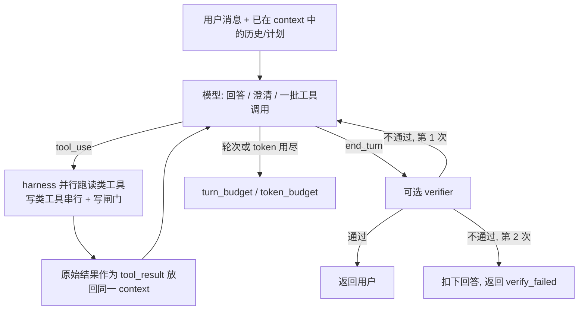
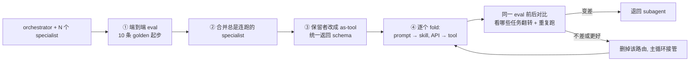

# 把 subagent 折回主循环：什么时候该用子代理，什么时候该用 skills + tools

## 来源信息

| 项 | 内容 |
| --- | --- |
| 标题 | Building agents: When to fold subagents into your main agent loop（本次未发现官方中文版：`/zh-CN/…` 返回 404，`/ja/…` 返回的仍是英文正文；页面无 hreflang 链接，语言切换是站点级入口，其他语言正文未取回） |
| 作者 | Diane Sarkis（站点仅署姓名；文中以 "the Applied AI team" 的第一人称复数叙述经验） |
| 站点 | [claude.com / Resources / Articles](https://claude.com/resources/articles/building-agents-when-to-fold-subagents-into-your-main-agent-loop)，产品线标注 Claude Platform；分类 Best practices / Perspectives |
| 仓库编号 | **00219**（非论文条目，与论文共用序列；无 PDF 可归档，README 编号列直接指向原文地址） |
| 原文 | <https://claude.com/resources/articles/building-agents-when-to-fold-subagents-into-your-main-agent-loop> |
| 发布日期 | 2026-10-22（站点元数据；站点标注阅读时间 18 min） |
| 阅读日期 | 2026-10-28 |
| 版本锚点 | 页面无版本号、无更新记录，`…/article.md` 之类的 markdown 直链返回 404。本节记的是 2026-10-28 抓取的页面：取 `<article>` 区块，标签替换为空格、解 HTML 实体、连续空白折叠为单空格后为 **18,577 字符**（含标题、导语与元信息行），sha256 `5ed796580193d78f40c6f9146a4a97e22dea2ee2213c31c40cc22a2cff5fe366`（按同一口径重抓可复算；复核时重抓结果一致） |
| 阅读范围 | **正文全文**（引言、五节正文、结尾，含 3 张配图所在段落的上下文）。配图未复制、未做像素测量。外部交叉核对见下一行 |
| 交叉核对 | ① 配套工具仓 [`anthropics/single-agent-loop-kit`](https://github.com/anthropics/single-agent-loop-kit)：`release` 分支的 `README.md`、`reference_loop/loop.py`、`skill/steps/00-audit.md`、`skill/steps/03-fold.md`、`examples/support-desk/example-run/README.md` 与 `example-run/plan/inventory.tsv` 取回并逐条比对（重点核对了审计判决表、阈值动因、提示的五个去处与预算/写闸门实现，未逐行通读全文）；同目录的 `results/`（24 条打分记录）、`PLAN.md`、`as-tool/` 与 diff **未逐份读完**；② 文中"系统提示减少 80%"的出处 [claude.dev 上下文工程文](https://claude.dev/blog/the-new-rules-of-context-engineering-for-claude-5-generation-models/) 全文（核对 80% 原句与渐进披露相关削减）；③ 文中引用的 [commerce agents 指南](https://claude.com/resources/articles/the-anatomy-of-effective-commerce-agents) 全文；④ Anthropic 2026-01 的 [多智能体系统指南](https://claude.com/resources/articles/building-multi-agent-systems-when-and-how-to-use-them)（重点核对三条条件、3–10x token 成本与 20+ 工具阈值）；⑤ Claude Code 命令文档（核对 `/skill-doctor`、`/claude-api` 是否存在） |
| 许可 | 文章页面未标注许可；配图为 `assets.claude.com` 上的 GIF/PNG，页面同样未标注许可，故本笔记不复制任何配图。配套工具仓为 **Apache-2.0**（GitHub API `license` 字段 + 仓库 `LICENSE`，11,358 B） |
| 未核 | 文中关于模型的表述（"Opus 4.5 起……"、"Opus 5.5 与 Fable 5.1 无法关闭 thinking"）没有给链接或数据，本笔记只按原文转述；`/skill-creator` 不在 Claude Code 内置命令表里，工具仓 README 说它是插件（`/plugin install skill-creator@claude-plugins-official`），本轮未安装验证；两张 Mermaid 图最初只做了语法与 GitHub 围栏识别检查（`npx` 安装 mermaid-cli 超时），站点排障时已用本机 Playwright Chromium 实际渲染验证 |
| 复核记录 | 2026-10-28 按 check-paper-note 复核。基准：同日重抓页面，按 `<article>` 去标签 / 解实体 / 空白折叠口径复算得 18,577 字符、sha256 `5ed7965…`，与首读一致（页面未更新）。方式：①笔记内全部英文引文与 6 个 `§` 小节（7 处引用）按 `<h2>` 分段逐条检索；②工具仓 `release` 分支的 `README.md`、`loop.py`、`00-audit.md`、`03-fold.md`、`templates/PLAN.md`、`example-run/README.md`、`inventory.tsv` 逐项比对；③commerce 指南、2026-01 多智能体文、claude.dev 文重取原文核对关键句；④另派独立子 agent 审计（快照 md5 `bbf0121800de…`）。本轮修正：①示例仓的 24 条打分记录仍在 `results.jsonl`、`compare.py` 可离线打印，原写"只能自己复跑"错误；②Break map 实际在 `templates/PLAN.md` 而非 `03-fold.md`；③"导语比正文强"方向不成立，改为"导语省略三条例外"；④"差了两个数量级"改为 10–90 倍（1–2 个数量级）；⑤补入"单循环需要纪律"、终局论证、"走多 agent 时从最简模式开始"、客户案例与作者自用 subagent；⑥"19 行"改为 19 个任务行 + 汇总行；⑦tool owner 标为本笔记补充；⑧"量化只有两个数字"改为"可测量的量化结果只有两个"。未修/未核：`/skill-creator` 未安装；`example-run/results/` 只核了文件规模与样例行，未逐份读；未运行工具仓代码。另（同日站点渲染复核）：图 2 的 `1.`/`3.`/`4.` 标签在站点 `htmlLabels:false` 下（这几条标签较宽）触发了 Mermaid 11.12 的 `splitLineToFitWidth does not support newlines` 错误、整页渲染失败，已把标签改为 ①②③④，并用无头 Chromium 复验两张图均渲染通过 |

> 说明：这是一篇厂商最佳实践文章，不是论文。它没有新方法、没有公开数据集、也没有可复现的对照实验（只有零散的前后对比与客户自评）；可验证的部分主要是**架构主张**与**配套工具仓的代码**，可测量的量化结果只有两个（2x、80%），其余数字是阈值、建议值或案例规模，下文逐条标了证据层级。

---

## 核心结论

一句话：**作者主张把"路由器 + 领域 subagent"的设计折叠成一个模型、一个上下文窗口、一个开放式工具循环，用"渐进披露的 skills 和 tools"替代"多开上下文窗口"，理由是当代模型已经能在一个循环里承担原先需要拆出去的工作，而每一次跨 agent 交接都在丢信息、加延迟。**

四条主张：

1. **组织架构的失败模式是多 agent 泛滥的真正来源**（§"Agent building failure modes for large organizations"）。每个团队交一个 subagent、每人往系统提示里加一句，最后得到几百个重叠 subagent、一个互相冲突的"Frankenprompt"、和一堆只对自己子任务过拟合的 eval。这一节是文章里最有解释力的部分，也最不依赖模型能力假设。
2. **折叠的技术手段是渐进披露**（§"Using an agent loop with progressive disclosure"）：系统提示里只放 skills/tools 的简短描述，真正需要时才加载。作者称这移除了团队过去拆分工作的主要理由（即为了控制上下文加载量）。
3. **折叠要用实验逐步做，不能一把梭**（§"How to fold subagents into the main agent loop"）：先建端到端 eval → 合并总是连跑的 specialist → 保留的改成 as-tool → 再逐个 fold。文章给了一个具体的回归案例：折叠后延迟降了，但一条原本能走通的流程断了，而且**两次跑只暴露一次**。
4. **组织上要把所有权从 "agent" 迁到 "skill/tool"**（§"How several teams can contribute to a single agent"）：中央小团队拥有系统提示与端到端质量，领域团队拥有自己的 skill、tool 和对应的 eval。

值得注意的是，文章并没有否定 subagent：它开头就把 subagent 称为 agent 设计的核心组件，并说自己家的多个 agent（包括多智能体研究系统）仍在用；它反对的是**按组织架构或问题类型拆**这种用法。

作者自己给的结论也是过程性的，而不是架构性的："**任何单一架构都没有它背后的原则重要：测量、一次只改一件事、留下经得起检验的部分**"（原文：any one architecture less important than the principle behind it: measure, change one thing at a time, and keep what holds up；结尾节）。

### 证据层级一览

| 主张 | 原文依据 | 证据层级 |
| --- | --- | --- |
| 单 agent + skills 在质量上常胜过"全塞一个提示"和"subagent"两种设计，成本与延迟常更低 | 转引 commerce agents 指南的"several enterprise deployments" | **厂商经验，无数字、无任务分布**；本篇与被转引的 commerce 指南措辞强度还不一致（见"表述张力"） |
| 多 agent 架构的复杂度带来延迟，某客户对比单循环"快约 2x" | 一家客户自评 | **单案例**，未说明模型、任务、p50/p99、是否同预算 |
| Claude Code 对更高级模型的系统提示削减了 80% 以上 | 链接 claude.dev 文 | **可核到另一篇官方文**（该文原句："removed over 80% of Claude Code's system prompt for models like Claude Opus 5 and Claude Fable 5 with no measurable loss on our coding evaluations"），仍是内部工程数据 |
| 从 Opus 4.5 起模型能在单循环里承担更多 | 无链接、无数据 | **厂商判断** |
| 系统提示里工具定义超过 30–50 个后，工具选择开始退化 | 无出处 | **经验阈值**；与 Anthropic 九个月前那篇的"常常 20+ 就难以选择"不是同一个阈值（见"与 Anthropic 自家既有指导的关系"） |
| 折叠一个 subagent 后延迟下降但流程断裂，两次运行只翻车一次 | "a sample support agent" | **单案例 + 作者自述**；但这条正好说明"看翻转任务 + 重复跑"的必要性 |

---

## 文章要解决的问题：agent 架构复制了组织架构

文章的观察起点很具体：企业想让一个 agent 统合多个产品能力，而这些能力分属不同团队，于是最自然的做法是**每个团队各建一个 agent，再由中央平台团队在上面搭一个 orchestrator**——形式可以是 orchestrator-subagent，也可以是把各 subagent 暴露成 MCP 工具、由单 agent 调用的形态。

作者认为这"看起来是最简单的方案，却立刻引入复杂度"，并列出五个失败模式：

- **Context management**：要决定 agent 之间交换什么上下文，而这个来回过程经常把细节丢掉。
- **Subagent sprawl**：每个团队都发自己的 subagent，最后是几百个功能重叠、没有强制标准、也没有明确 owner 的 subagent。
- **The Frankenprompt**：每个团队往系统提示里加一句，最终规则互相冲突、没有统一声音。
- **Unvetted, overly localized evals**：每个团队加自己的 eval，只对子任务过拟合；没人拥有整套 eval，管理层基于"被稀释、过度局部化"的分数做决策。
- **Latency**：多 agent 的架构复杂度本身增加延迟；某客户对比自己的多 agent harness 与单循环，后者"runtime 约快 2x"。

作者举了一个客户例子：其客户-facing agent 里十几个 specialist，让"统一、符合品牌"的体验难以维持，还增加了伤害用户体验的延迟。

文章还点名了一种常见的"设计进阶路径"：**意图分类器 → 固定多步推理流水线 → 用户分层桶 → 独立的推荐分支 → 顶上的多 agent orchestrator**。而反馈往往是：这些结构里的大部分，是在做模型已经不需要人替它做的工作；"一个清晰的系统提示、4–5 个薄的数据工具、硬的输出护栏，就能覆盖大部分用例"。

作者用 **Conway's law** 概括这种现象：agent 架构变成了组织架构的复印件。

> **解读（本笔记）**：这五个失败模式要分两类看——`latency` 与 `context management` 是**拆分本身的性质**（多一次嵌套循环、多一次有损交接）；`subagent sprawl`、`Frankenprompt`、`overly localized evals` 则是**多 owner 系统缺少统一权威**的后果。这条区别很重要：如果一家公司本来就是单团队、单一 owner，subagent 架构不会自动长出 Frankenprompt 和局部化 eval；反过来，即使不折成单循环，只要能对系统提示和 eval 建立单一权威，也能消掉后三个。文章把这两件事捆在一起讲，读者需要自己拆开。

---

## 为什么现在可以折叠：三条论据

作者给了三条理由，逻辑上它们是"替代关系成立的三个前提"，不是三个并列好处。

### 1. 共享上下文产生更好的答案

对长时运行的 agent，作者希望多个任务产出的上下文**留在主上下文窗口里**：看过前面每一步结果的 agent 能把它们连起来，"比一组由 subagent 交回来的摘要更丰富"。这就是"更少的上下文窗口、更少的丢信息交接"。

原文用"传话游戏"（telephone game）描述反面：**按问题类型切分 agent 时，信息在来回传递中逐次降质**；正确的切法是**按上下文切分**——给每个 subagent 一块"几乎不需要系统其余部分"的工作，只交回一个紧凑结果。

### 2. 渐进披露消除上下文膨胀

skills 与 tools 都只在系统提示里放简短描述，需要时再全文加载。作者称这"移除了团队过去拆分工作的主要理由"，并举了自家数据：为更高级模型削减 Claude Code 系统提示 80% 以上，其中就包括与渐进披露 skills/tools 相关的削减。

### 3. 模型更有能力

作者的经验判断：从 Opus 4.5 起，模型能在单循环里管的事情"远超多数团队的预期"；Opus 5.5、Fable 5.1 已无法关闭 thinking，且新模型会边做边叙述进度、自己检查结果，这让一些 harness 组件变得多余；而且**越简单的循环越容易迁移到下一个模型**——在作者参与过的迁移里，"僵化的多 agent 结构常常正是新模型无法承担更多工作的原因"。

> **解读（本笔记）**：第 3 条是整篇文章的**承重墙**，也是唯一没有证据的一条。如果模型能力停止进步，"为了省上下文而拆 subagent"立刻重新成立，第 1、2 条只是把这个成本压低了一部分，并没有取消它。读这篇文章时应当把它读成"当前模型代际下的权衡"，而不是"多 agent 是错的"。

---

## 单循环到底长什么样

### 文章给出的定义（§"How to fold subagents into the main agent loop"）

- **一个模型、一个上下文窗口**跑一个开放式工具循环，**限制放在 harness 里**：轮次预算、成本预算、写操作闸门。
- 每轮模型发出一批工具调用，harness 并行执行，把**原始结果**交回**同一个模型**；模型决定下一步：再来一批、向用户提问、还是回答。
- 循环在模型给出回答或撞上预算时停止；回答之后可以选择跑一次目标检查或 verifier。
- 模型**在第一轮把计划写进上下文**，随结果到达而修改。
- 上下文仍然要加载，但由 agent 自己管理。

其中最关键的一句是：**"写计划的模型和执行的模型是同一个，所以它可以在轮次中途（mid-turn）改计划"**——这是相对 orchestrator + specialist 结构的**主要变化**。对照来看（本笔记）：原结构里路由是代码、阶段是固定的，计划在交接那一刻被冻结；单循环把 planner 与 executor 合并，计划的修订不再需要一次跨 agent 的消息。

但文章紧接着强调：**单循环设计需要纪律**——系统提示要精心管理，skill 与 tool 的描述要在正确的时机触发，上下文窗口、记忆与笔记要有意识地处理。这不是"拆掉 orchestrator 就完事"。

作者还给了个终局论证：单循环把 agent 学到的一切留在同一个上下文里，更接近很多团队想要的终态——"理解用户的高层目标并代为行动"的 agent。

### 循环的数据流

### 内容往哪里归位

文章的这段列表可以整理成一张归位表（原文这一节列了四条主 bullet，下表把"tool 内部实现"单独拆成一行，共五行）：

| 内容 | 去向 | 理由（原文该节 + 前文渐进披露的论证） |
| --- | --- | --- |
| 顺序、领域流程（"这个团队怎么做事"） | **skills** | 只在需要时加载全文，不占常驻上下文 |
| 硬限制（校验、审批闸门）与对话中途才需要的能力（如记忆查询） | **tools** | 规则要在能被强制执行的地方，而不是提示里 |
| 便宜且几乎总是相关的加载（如实体解析） | **代码** | 仍可用代码做，但由循环调用 |
| 机械性环节（拼 payload、解析流、恢复一次澄清） | **tool 内部实现** | 不需要模型判断 |
| "用规则目录重写计划"的那一步 | **删掉** | 现在每一步由模型决定 |

配套工具仓的 `03-fold.md` 把"拆一个 subagent 的提示"写得更狠，逐行判定五个去处：流程/领域知识 → skill 正文；硬限制 → 移进 tool 里强制执行（skill 仍可解释规则，让 agent 能解释结果）；事实与参考资料 → skill 内的参考文件或查询 tool；语气/人设/问候 → **删掉**（声音由主系统提示统一拥有）；写给旧模型的指令（大喊、think step by step、提醒用工具）→ **删掉**。若正文什么都不剩，"那就没有 skill"——薄 subagent 常常只变成 tools，这是好结果。

### 参考实现里的具体参数

配套仓的 `reference_loop/loop.py` 是文章主张的可读实现（Apache-2.0，作者写明"Copy the parts your harness is missing."，不是框架）。它把文章里"限制放 harness"落成了这些具体机制：

| 机制 | 实现（`loop.py`） |
| --- | --- |
| 轮次/token 预算 | `Budget(max_turns=25, max_tokens=400_000, max_batch=16)`；token 预算把输入+输出、含 cache 读写一起计入，并在一次 `run()` 内累加 |
| 子 agent 计入预算 | 运行 subagent 的 tool 用 `charge(usage)` 把子 agent 的用量记到同一预算上；返回 `False` 时子 agent 就停 |
| 批量并行 | 读类工具最多 8 个线程并行；写类工具串行、按模型请求顺序执行；超过 `max_batch` 的调用直接收到错误结果，请模型下一轮再发 |
| 写闸门 | 只要有 tool 声明 `writes=True` 而没传 `approve` 回调，构造时就报错（默认拒绝，而不是默认放行）；被拒绝时回一句"用户拒绝了，不要重试，问他想怎么做" |
| 渐进披露 skills | 系统提示里只列 `名字: 描述`，另加一个 `load_skill` 工具返回正文；同名 skill 直接报错，指向目录外的 skill 也报错 |
| 渐进披露 tools | `deferred=True` 的工具用 `defer_loading` + 一个 BM25 tool search 工具按需取 schema；不允许全部工具都 deferred |
| verifier | 可选回调；被拒两次就扣下回答（`verify_failed`），只给一次改正机会 |
| 中断处理 | `pause_turn` 继续下一轮（服务端工具如 tool search 需要）；`refusal`/`max_tokens`/上下文超限时，把被截断的工具调用补上"未执行"结果，否则对话无法继续 |
| 缓存 | 默认给请求加 `cache_control: ephemeral`，让增长的前缀从缓存读 |

这些数字是**工具仓的默认值，不是文章的处方**——文章只说"设置轮次与成本预算"，没给具体数额。把它们当起点，而不是标准。

### 折叠省下了什么、又付出了什么

原文的对照是"交接成本" vs "上下文增长"。可以把它写成更清楚的一笔账（**本笔记的整理，不是原文表述**）：

- **省下**：每次交接的一次嵌套模型循环（多轮请求 + 自己的系统提示）、跨 agent 的上下文重复、以及把结果压成摘要时丢掉的细节。
- **付出**：主上下文随任务推进单调增长，每轮都要重读；技能/工具的按需加载本身**要花一次模型轮次**（这一点 commerce 指南写得很明确："Loading a skill costs a model turn"）。tool search 也一样：模型要先调检索工具取 schema，才能调真正的工具（**本笔记推断**；机制见 `loop.py` 把 tool search 作为工具插入请求）。

所以"折叠一定更快"并不成立；成立的是"在把这些加载成本控制住、且前缀可缓存的前提下，折叠往往更快"。文章给的 2x 是某个客户的具体对比，不是这条账的普遍结论。

---

## 迁移路径：四步，每一步都有验收物

文章的迁移建议可以还原成一条带门槛的流水线：

### 第 1 步：先有任务完成度 eval

推荐结构是**一个中央团队拥有的端到端集合 + 每个 skill 自带的小集合（由拥有该 skill 的团队交付）**；"哪怕只有 10 条 golden 示例也够开始"。

- 起步指标：**用 rubric 给 agent 的最终消息打分**。
- 还留着 orchestrator 时，**同时跟踪路由准确率**（有没有选对 subagent）；某个 subagent 折进去之后，改看"有没有加载对的 skill / 调到对的 tool"。这一步把"路由质量"翻译成了"选择质量"，是迁移期间能继续用同一套 eval 的关键。
- 内部系统难以重放时的一个办法：**给重要事件打时间戳**，之后可以重放成定向 eval。作者说这在 Anthropic 内部奏效。

> **解读（本笔记）**：10 条示例能"开始"，但撑不起"折叠 vs 保留"的判决。文章后面自己要求"每条任务跑不止一次"，而配套仓的示例运行用的是 12 条任务 × 2 次重复，其 README 明说"Two reps is thin. One flip moves a task by half."。所以 10 条是**启动阈值**，不是**决策阈值**；真正的门槛是"每条生产链路都有任务 + 每条不能破的规则都有任务"。

### 第 2 步：合并总是连跑的 specialist

按**共享上下文**折叠，从**用得最多**的开始。判据是三条之一：彼此衔接输出、碰同一份数据、经常一起被调用。文章的例子很具体：如果生产流量里有相当比例是"某个 specialist 后面紧跟另一个"，这就是紧耦合对，适合先合成一个领域 agent。

配套仓把合并排在 fold 之前，理由写得比文章更清楚：**合并让主 agent 改动最小**（列表里少一项），去掉一次交接和随之丢失的摘要，因此"便宜且相对安全"。

### 第 3 步：先改成 as-tool，作为中间态

当某个 subagent 满足"值得独立上下文"的三条件之一（见下文"适用边界"）而你又想保留它时，**让主 agent 把它当工具调用**，而不是做完整 handoff。

- 只有"需要直接和用户对话"时才建议完整 handoff；其余都可以是主循环里的 skills 加 tools（原文：a skill plus tools）。
- 好处：可以给所有 subagent 定义**统一的返回 schema**；主 agent 可以拿真实数据核对结论；可以在最终综合前裁剪输入；**不需要重写 subagent**；并且能给后面的 fold 提供一个**基线分数**。
- 代价（原文列了三条）：每个 specialist 仍有自己的提示、上下文、owner 团队和 eval；每次调用仍交回有损摘要；每次调用仍是一次嵌套模型循环，加延迟。

### 第 4 步：逐个 fold，比较，再决定去留

把一个 subagent 的**提示变成 skill、API 调用变成 MCP tool**，然后比较有/无该 subagent 的 eval 表现。

两条方法论要求是全文最硬的部分：

1. **不要只看总分，要看哪些任务翻转了**（which tasks flipped）。
2. **每条任务跑不止一次**，因为"这类断裂两次里只出现一次"。

作者给的案例：在一个样例客服 agent 上折叠某个 subagent，**延迟降了，但一条本来能通过的流程断了**——主 agent 手里有订单查询工具，于是自己答了，**没有去问 shipping specialist 要送达日期**。（原文写的是"folding one subagent into another"，措辞本身有点含混，从上下文看指折进主循环。）**本笔记判断**：这个失败不是"模型不会"，而是"路由消失后，原本由 subagent 拥有的职责没有被任何 skill 或工具承接"——原文只陈述了现象与主 agent 的行为，没有给这个因果解释。

配套仓把这条教训固化成两个检查：

- `chain_coverage.py`：从生产 trace 里抽出**总是连着跑的子 agent 链**，检查 eval 里有没有覆盖整条链、并给链的终点打分的任务；没有就停下来说，**先补任务再改代码**。
- `templates/PLAN.md` 的"Break map"（`03-fold.md` 要求改动前先读它）：先列出这类改动可能造成的断裂行，逐条确认有任务覆盖。`03-fold.md` 的原话是"A change measured on an eval that cannot see its chains has not been measured"。

### 配套命令（原文 §"Tools to accelerate this work"）

文章最后给了一组已经发布为 Claude API skill 的斜杠命令，恰好对着迁移的每一步：

| 命令 | 用途（原文） | 对应步骤 |
| --- | --- | --- |
| `/claude-api build-eval` | 建第一套中央团队拥有的端到端 eval，或每个团队随 skill 交付的小集 | 第 1 步 |
| `/claude-api prompt-audit` | 找出提示、skill、tool 描述里"写给旧模型"的指令，以 diff 形式提修改建议；可对系统提示与各团队的 skill 分别跑 | 第 4 步 / 收尾（提示只减不增） |
| `/claude-api hillclimb` | 对着已有 eval 迭代改进——折叠后让它在 skill 与 tool 描述上迭代，看折叠版能否追平或超过原 subagent；也可用于系统提示 | 第 4 步 |
| `/claude-api cost-optimize` | 分析调用花在哪，逐项提出 prompt caching、裁剪输入输出 token、effort、模型选择等节省项，一次改一项 | 设计稳定之后 |

`/claude-api` 及其 `build-eval`、`hillclimb`、`prompt-audit`、`cost-optimize` 子命令已能在 Claude Code 命令文档中查到；配套仓 README 的说明是"The steps hand off to these Claude Code commands instead of rebuilding them."

---

## 多团队怎么继续往一个循环里贡献

这一节回答的是"折成单循环之后，团队自治去哪了"。作者的答案是：**所有权从 agent 迁到 skill / tool / 知识库，中央团队保留系统提示与端到端质量**。

| 载体 | 适用条件（原文） | 关键做法 |
| --- | --- | --- |
| **MCP tools** | 需要执行动作、读实时数据、或返回固定形状的结果 | **按用户意图分组，而不是一个 API 一个 tool**；"系统提示里的工具定义超过 30–50 个，工具选择就开始退化"；用 tool search 做延迟加载；**把硬前置条件放进 tool**（Y 需要 X 的输出时，Y 自己检查并返回一句模型能照做的指令）；**权限也放进 tool**——每个 tool 检查调用者能看/能做什么，返回一句模型能读懂的拒绝，于是一个循环就能服务不同权限的用户，不必按权限级别各建一个 agent；迁移期也可用 tool 继续调 subagent |
| **Skills** | 需要知道"一个团队怎么做事"——即原先写在 specialist 提示里的步骤、规则、判断 | 每个 skill 有团队 DRI，保证写得对、彼此不重复、自带 eval；让 Claude 参与维护（"skills that can build, test, and prune other skills"）；`/skill-creator` 起草与审计，`/skill-doctor` 看每个 skill 的上下文成本与实际使用频率、清理死重 |
| **知识库** | 只是偶尔需要的参考资料（政策、指标定义、产品规格） | 放在搜索/查询 tool 后面，或作为 skill 内的参考文件；**不要用代码把上下文检索出来再粘进提示** |

组织侧的两条硬约束：

- **中央团队要小**：拥有端到端质量与系统提示，新 tool、新 eval 上线前都要审；小才能迭代快、跨大组织的协调成本低。
- **每个 skill 有单一 owner**：原文要求每个团队设 DRI 拥有自己的 skill。**tool 也应有单一 owner**（本笔记补充；配套仓的审计表就带 owner 列，未知时允许写 `unknown`）。否则就是另一种 sprawl——只不过从 subagent sprawl 变成 skill sprawl。

> **解读（本笔记）**：这套安排实际上是把"模块边界"从进程/上下文搬到了**文件与接口**：skill 是有 owner 的文档，tool 是有 owner 的 API，eval 是随交付物一起提交的测试。文章没说但很关键的一点是：**这三类交付物都必须可评审**，否则中央小团队会变成瓶颈。配套仓的 `templates/` 里给了 contribution rules 的模板，算是补上了这一块。

---

## 配套工具仓：这篇文章里最可验证的部分

文章开头就用斜体提示：如果你已经在 Claude Platform 上建了多 subagent 的 agent，可以用配套的 [migration kit](https://github.com/anthropics/single-agent-loop-kit) 跑一个引导式流程，识别模式、评估替代方案、验证最佳方案，并且**先在 mock 系统上试**。

我核过的事实（2026-10-28，GitHub API + 仓库文件）：

| 项 | 值 |
| --- | --- |
| 仓库 | `anthropics/single-agent-loop-kit`，公开，默认分支 `release`（不是 `main`——`main` 上的 raw README 返回 404） |
| 许可 | Apache-2.0 |
| 时间 | 创建 2026-10-15，最后 push 2026-10-21（文章发布前一天） |
| 定位 | README 用引用块注明"**Reference implementation. Not maintained and not accepting contributions.**"；并写明"The kit does not assume a single loop always wins. It measures." |
| 结构 | `skill/`（`SKILL.md` + `steps/00-audit…05-upkeep` + `scripts/coupling_map.py`、`compare.py`、`chain_coverage.py`、`estimate.py` + `templates/`）、`reference_loop/loop.py`、`examples/support-desk/`（改前 `app/`、改后 `single_loop/`、真实运行记录 `example-run/`）、`tests/` |
| 十分钟试用 | `cd examples/support-desk && KIT_MODEL=fake python3 evals/run_eval.py --variant smoke`，不需要 API key、不花钱；会为 19 个任务各打一行，随后是汇总行 `smoke: 19 tasks ran on the offline stand-in model, 0 harness errors. The plumbing works.`（stand-in 按关键词规则走，**不计分**） |
| 它自己的缺口清单 | README 明列 **未在真实模型上跑过** 的部分：合并步骤与 upkeep 步骤、未跑过完整的 `single_loop/` 版本、未跑过 t18/t19、未从"没有 eval 的仓库"起步、未在示例之外的系统上跑过；两次运行之后措辞改过、改写后的步骤还没有任何会话走过；另列 4 类"两次运行后才改、只做了离线验证"的改动（参考循环、skill 加载器、脚本、示例） |

### 审计输出的样子（来自示例，不是生产部署）

`example-run/plan/inventory.tsv` 是一个 mock 客服系统（router + 6 个 subagent）的审计结果，正好把五种判决都用上了。它记录的是 2026-10-08 用 `claude-opus-5`、每个 variant 两次重复、12 条任务（`results/baseline/results.jsonl` 里 24 条打分记录）的一次运行；另有一次 17 条任务上的 as-tool 运行。分数保留在 `results/` 的日志里，被删掉的是 write-up 里的汇总结论：

| agent | 每次调用读入（中位） | 流量占比 | 判决 | 依据 |
| --- | --- | --- | --- | --- |
| router | 不在 trace 里 | 100% | `main` | 每轮都路由、并且重写 specialist 的摘要；提示里写着"禁止自己回答" |
| orders | 926 tokens | 56% | `merge:shipping` | coupling map 显示 orders→shipping 出现在 96 条 trace 里、耦合 100%，且都是小读、只读工具 |
| shipping | 763 tokens | 48% | `merge:orders` | 每次 shipping 调用都紧跟 orders；它需要的 tracking id 只有 orders 能返回 |
| returns | 2,674 tokens | 25% | `fold` | 提示是固定流程 + 三条 API 上的政策，没有大读 |
| account | 1,056 tokens | 15% | `fold` | 两行规则套三个 API，读入很小 |
| diagnostics | 31,164 tokens | 12%（占 subagent 时间 31%） | `as-tool` | 后端返回 900 行日志，其中只有约 7 行有用；一次简要就能交回结果 |
| claims | 3,177 tokens | 5% | `keep` | 由外部保险公司（Harbor Mutual）拥有提示，且要求 transcript 是客户与该 agent 自己的对话；需要与用户多轮交互 |

这张表的密度比文章正文高得多：**判决不是按"团队"给的，是按"读入多少 token、和谁连跑、要不要自己对话"给的**。`diagnostics` 那条尤其值得记：31k tokens 的中位读入才是它保住独立上下文的理由，而"日志太长"本身不是——审计记录自己把它标成 open："a filtered log tool could make this a fold"，也就是说判别标准应当是"过滤之后主 agent 还需要留下的量"。

---

## 与 Anthropic 自家既有指导的关系（本笔记补充）

这是理解全文定位的关键：**它不是推翻九个月前那篇，而是把边界收紧并给出退路**。

Anthropic 2026-01-23 的《Building multi-agent systems: When and how to use them》给了三条"多 agent 稳定胜出"的条件——上下文污染、可并行、专业化改善工具选择——并说"在这三种情形之外，协调成本通常超过收益"，同文已经链回本篇（"See when to fold subagents back into the main agent loop"）。（本笔记的对照）本篇的三条"仍该用 subagent"的条件与那三条同源，没有新增条件；真正的变化落在判据的量级与措辞上（见下表）：

| 维度 | 2026-01 文 | 2026-10 本篇 |
| --- | --- | --- |
| 上下文隔离的触发量 | "subtask 产生超过 1,000 tokens 的高上下文量、且大部分与主任务无关"时最有效 | "单次调用读到数万 token 才算，几千不算"（工具仓 `00-audit.md`）；正文只写"可测量的上下文膨胀导致性能下降" |
| 工具过多的阈值 | "一个 agent 工具太多（常常 20+）就难以选择" | "超过 30–50 个工具定义后，工具选择开始退化" |
| 多 agent 的 token 成本 | "同等任务通常多用 3–10x tokens" | 未重复该数字，只提嵌套循环加延迟 |
| 主结论 | 先单 agent，三种情形才上多 agent | 已在多 agent 上的，按 eval 逐个折回 |

两篇都把边界写得很明确，所以这不是"翻案"，而是**同一条判断线在模型变强后向单 agent 一侧移动**。真正值得注意的是这个移动的**速度**：九个月里，"1,000 tokens 就值得隔离"（2026-01 文）变成"几万才值得"（2026-10 的判据出自配套仓的审计步骤，正文没给数字）。两者口径不完全相同——前者说的是"上下文隔离最有效"的场景，后者是"够格拥有独立上下文"的门槛——但量级从千级升到万级（约 10–90 倍，即 1–2 个数量级）。若按这个速度外推，今天写死的阈值一年后大概都失效——所以文章结尾那句"测量、一次只改一件事"比任何具体阈值都更耐用。

---

## 原文的表述张力与证据缺口

1. **导语省略了正文的三条例外。** 页面导语（standfirst/description）只写"用更少的 subagent……可以提升质量，同时降低成本与延迟"，没有带正文的三条 keep 条件；单看导语容易把结论读成无条件的。不过导语用的是 "can"，正文的 "frequently outperformed" 在结论强度上反而更硬——两处口径不同，引用应以正文为准。
2. **转引的强度被下调。** 本篇写"a single agent with skills frequently outperformed…"，而它链接的 commerce 指南原文是"consistently has outperformed"。同一组内部对比，两篇给了不同强度的措辞；两篇都没有给任务数、模型、成本口径。
3. **"2x 更快"没有口径。** 只有"一家客户"、"多 agent harness vs 单 agent loop"、"roughly 2x faster runtime"；没说是 p50 还是 p99、是否同预算、是否同模型、是否同 eval。它只能当"方向性轶事"。
4. **"质量"没有定义。** 全文反复出现 quality，但没给指标；eval 一节只建议"用 rubric 给最终消息打分"作为起点，并未说明那组跨部署对比用的是哪种口径。成本也没说清是 per task 还是 per turn。
5. **模型表述无法核。** "Opus 4.5 起"、"Opus 5.5 与 Fable 5.1 无法关闭 thinking"没有链接，属于厂商对自家模型的说法，本轮未独立验证。
6. **"modular permissioning" 与后文的权限做法互相抵消。** 开头把"模块化权限"列为 subagent 的优点，后文却建议把权限检查放进 tool（每个 tool 自己检查调用者能看/能做什么），于是一个循环就能服务不同权限的用户——那"按权限拆 agent"这个理由就淡了。原文只是把两件事分别陈述，并没有把它们设为对立（**本笔记判断**）：实践中**权限更像 tool 的属性，而不是 agent 的属性**。
7. **加载技能要花一轮，与"更低延迟"存在张力。** 文章主张折叠降低延迟，但 skill 的按需加载要一次模型轮次（commerce 指南明说 "Loading a skill costs a model turn"），tool search 也要先取 schema 才能调真正的工具。折叠省掉的是嵌套循环与重复上下文，付出的是加载轮次与增长的前缀；净收益依任务而定，不能从架构直接推出。
8. **示例仓修正过记录。** `example-run/README.md` 明确写：跑完后**删掉了"测量结果与由此得出的结论"**，零售商名字也换过，其余记录未改、也没重跑。所以 write-up 里看不到汇总结论；但 `results/baseline/results.jsonl` 的 24 条打分记录仍在，`compare.py` 可直接从日志打印对比（不需要重跑），README 也给了命令。缺的是作者对这些数字的解读，而不是数字本身。

---

## 适用边界：什么时候别折

文章明确说 subagent 仍有其位置，包括研究前沿；它给出的三条"仍该用 subagent"的条件，配合工具仓的判据，可以整理成一张决策卡：

**保留独立上下文，需要满足其中一条（工具仓要求逐条写出证据）：**

1. **上下文**：它读的远比主 agent 之后需要留下的多（数量级：单次数万 token；几千不算）。**先问"让工具少返回一点"能不能解决**——能的话更好的方案是 fold + 更好的 tool。
2. **并行/独立工作**：多个干净上下文分头探索以换取覆盖度，或由一个在**看不到生成过程**的前提下检查另一个的工作。
3. **工具过载或指令冲突**：全部加载时主 agent 可测量地选错工具，或指令真的互相矛盾。

**如果最后仍走多 agent 路线**（原文在渐进披露这一节末尾给的退路）：从能工作的最简单模式开始——generator-verifier、orchestrator-subagent 或其他；切分按上下文，好的候选是独立研究路径、接口清晰的分组件、黑盒验证，这些几乎不需要系统其余部分的信息。

**不构成理由（工具仓明确列出）：**

- 公司内部另一个团队拥有它 → 所有权迁给 skill + 它的 eval。
- 它有自己的"人格/声音" → 一个 agent 应该只有一个声音。
- 它的提示很长 → skill 正文只在需要时加载。
- 它的工具很多 → tool search 按需加载。
- 它的步骤是固定的 → 固定步骤是工作流，是普通代码；固定部分进 tool，仍需判断的部分进 skill。

**工具仓还给了 `keep`（完整 handoff）的窄口子**：只有"必须自己与用户多轮对话"或"由外部方控制（另一家公司、合同、监管）"时才用；其余落在 `fold`（默认）或 `as-tool`（需要保留独立上下文、且能一次简报交回结果）。

> **补充（本笔记，非原文）**：还有几类边界文章没覆盖但实践中常见——(a) **合规隔离**要求"某个域的上下文不得进入主上下文"（不是性能问题而是数据边界问题）；(b) **故障隔离**要求某个不稳定组件不能污染主循环；(c) **成本硬上限**按子任务计费时，独立循环更容易归账。这些理由与"模型够不够强"无关，折叠也解决不了。

---

## 落地清单

| 步骤 | 产物 | 验收信号 |
| --- | --- | --- |
| 1. 盘点 | 每个 agent 一行：owner、提示大小、工具数、调用方式（handoff/tool_call/pipeline/entry）、返回形式、是否直接对用户说话、每次读入 token、流量占比、连跑对象、覆盖它的 eval、判决与证据 | 每个判决都有文件行号或 trace 数字；`unknown` 允许，猜测要标 `(inferred)` |
| 2. 打分 | 端到端 eval（中央团队拥有）+ 每个 skill 自带小集 | 每条生产链路有任务；每条"不能破的规则"有任务；会查路由准确率 |
| 3. 合并 | 合成后的领域 agent | 主 agent 只少一项，先拿到一次"少一次交接"的收益 |
| 4. as-tool | 统一返回 schema 的 subagent 工具 | 主 agent 能核对结论；拿到 fold 的基线分 |
| 5. fold | 一个 skill（描述写清"何时加载"）+ 若干按意图分组的 tool | 同一 eval 有/无对比；**看翻转任务**；每条任务跑 ≥2–3 次；提示变短 |
| 6. 收尾 | 删路由、删旧模型专属指令、清 dead skill | 系统提示只减不增；`/skill-doctor` 显示 skill 使用率与成本；工具定义控制在 30–50 以内，或已用 tool search |

---

## 待确认问题

1. **"可测量的上下文膨胀导致性能下降"具体测什么？** 文章给了条件却没给指标（长上下文准确率？任务完成率随轮次的斜率？），也没有"到什么程度该拆"的数值。这一条不解决，"什么时候该保留 subagent"仍然靠感觉。
2. **2x 延迟来自哪里？** 是省掉了嵌套循环的轮次、省掉了跨 agent 的重复上下文、还是省掉了路由的分类调用？拆不开就无法迁移到别的系统。
3. **折叠后主上下文的增长成本谁来兜？** 文章只在纪律要求里点了"deliberate handling of context windows, memory, and note-taking"，没有展开具体手段（prompt caching、压缩、会话切分）；commerce 指南里那套"global/session/volatile 三段 + 缓存断点前移"是否适用于单循环长任务，本篇没有回答。
4. **中央小团队会不会成为瓶颈？** 文章要求它审所有新 tool 与 eval，却没给吞吐机制（评审 SLA、模板、自动化门禁）。工具仓的 templates 与 `/claude-api prompt-audit` 是半个答案。
5. **示例仓为什么删掉解读、而不是数字？** README 说删掉了"测量结果与由此得出的结论"、也没重跑；但 24 条打分记录还在，`compare.py` 能离线打印。所以这个 mock 样例的前后对比是可复算的——真正没有公开材料的是**文章正文那组企业对比**（没有任务数、模型、口径）。
6. **eval 的"翻转任务"如何统计才算显著？** 2 次重复、12 条任务，一次翻转就把某任务从 100% 拉到 50%；这种粒度下"变差"与"噪声"很难分开。工具仓自己承认 "Two reps is thin. One flip moves a task by half."，但没有给最小重复次数或置信口径。
