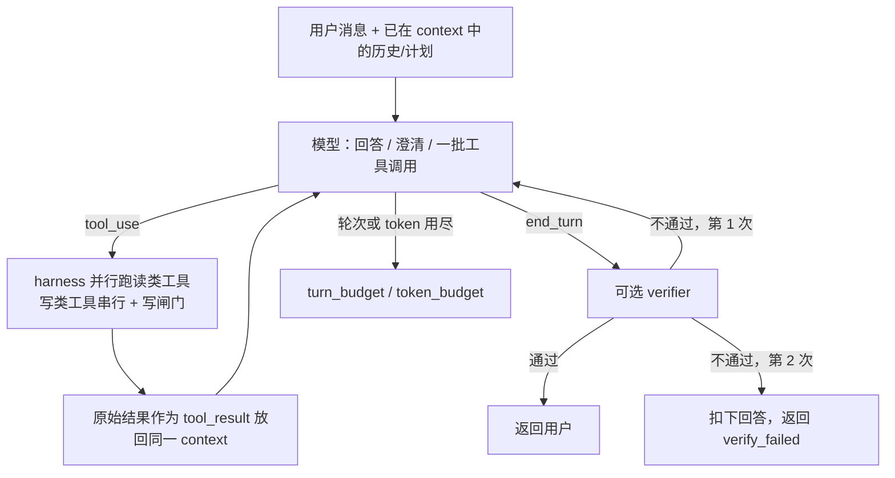
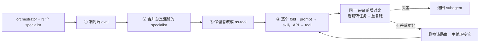

# 把 subagent 折回主循环：什么时候该用子代理，什么时候该用 skills + tools

## 来源信息

| 项 | 内容 |
| --- | --- |
| 标题 | Building agents: When to fold subagents into your main agent loop |
| 作者 | Diane Sarkis（站点仅署姓名；文中以 "the Applied AI team" 的第一人称复数叙述经验） |
| 站点 | Anthropic · [claude.com / Resources / Articles](https://claude.com/resources/articles/building-agents-when-to-fold-subagents-into-your-main-agent-loop)，产品线标注 Claude Platform；分类 Best practices / Perspectives |
| 原文 | <https://claude.com/resources/articles/building-agents-when-to-fold-subagents-into-your-main-agent-loop> |
| 发布日期 | 2026-10-22（站点元数据；标注阅读时间 18 min） |
| 阅读日期 | 2026-10-28 |
| 条目 | 博客 00219（非论文，无 PDF 归档）；版本锚点、逐节核对与工具仓细节见同目录 `audit.md` |

---

## 核心结论

一句话：**作者主张把「路由器 + 领域 subagent」的设计折成一个模型、一个上下文窗口、一个开放式工具循环，用渐进披露的 skills 和 tools 替代「多开上下文窗口」；理由是当代模型已经能在一个循环里承担原先要拆出去的工作，而每次跨 agent 交接都在丢信息、加延迟。**

- **问题**：企业按团队分工建 subagent，再由中央团队搭 orchestrator，agent 架构变成组织架构的复印件——换来有损的上下文交接、subagent 泛滥、互相冲突的 Frankenprompt、只对子任务过拟合的 eval 和额外延迟。
- **核心想法**：subagent 原本的主要理由是「控制上下文加载量」；如果 skills/tools 只在需要时加载全文，这个理由就消失，而交接的有损性还在。
- **怎么做到**：不是一次性重写，而是四步流水线——先建端到端 eval，合并总是连跑的 specialist，把保留者改成 as-tool，再逐个 fold 并用同一套 eval 比较去留。
- **关键结果**：某客户对比多 agent harness 与单循环，后者 runtime 约快 2x；Claude Code 为更高级模型削减系统提示 80% 以上；一个折叠案例里延迟降了但流程断了，且两次运行只暴露一次。
- **定位**：文章不否定 subagent，反对的是「按组织架构或问题类型拆」；作者自己的结论是过程性的——measure, change one thing at a time, keep what holds up。

---

## 问题

文章的观察起点很具体：企业想让一个 agent 统合多个产品能力，而这些能力分属不同团队。最自然的做法是**每个团队各建一个 agent，再由中央平台团队在上面搭一个 orchestrator**——形式可以是 orchestrator-subagent，也可以把各 subagent 暴露成 MCP 工具、由单 agent 调用。

这看起来是最简单的方案：复用团队已有的 agent，边界清晰，各自迭代。作者说它「立刻引入复杂度」，并列出五个失败模式：

- **Context management**：要决定 agent 之间交换什么上下文，而这个来回过程经常把细节丢掉。
- **Subagent sprawl**：每个团队都发自己的 subagent，最后是几百个功能重叠、没有强制标准、也没有明确 owner 的 subagent。
- **The Frankenprompt**：每个团队往系统提示里加一句，最终规则互相冲突、没有统一声音。
- **Unvetted, overly localized evals**：每个团队加自己的 eval，只对子任务过拟合；没人拥有整套 eval，管理层基于被稀释、过度局部化的分数做决策。
- **Latency**：多 agent 的架构复杂度本身增加延迟；某客户对比自己的多 agent harness 与单循环，后者 runtime 约快 2x。

作者举了一个客户例子：其客户-facing agent 里十几个 specialist，让「统一、符合品牌」的体验难以维持，还增加了伤害用户体验的延迟。

文章还点名一种常见的「设计进阶路径」：**意图分类器 → 固定多步推理流水线 → 用户分层桶 → 独立的推荐分支 → 顶上的多 agent orchestrator**。而反馈往往是：这些结构里的大部分，是在做模型已经不需要人替它做的工作；「一个清晰的系统提示、4–5 个薄的数据工具、硬的输出护栏，就能覆盖大部分用例」。作者用 **Conway's law** 概括这种现象：agent 架构变成了组织架构的复印件。

**要把五个失败模式拆成两类**（本笔记的解读）：`latency` 与 `context management` 是**拆分本身的性质**——多一次嵌套循环、多一次有损交接；`subagent sprawl`、`Frankenprompt`、`overly localized evals` 则是**多 owner 系统缺少统一权威**的后果。这条区别有用：单团队、单一 owner 的公司不会自动长出后三者；反过来，即使不折成单循环，只要能对系统提示和 eval 建立单一权威，也能消掉它们。文章把两件事捆在一起讲，读者需要自己拆开。

**本文的设定与前提**：它是一篇厂商最佳实践，不是论文——没有新方法、没有公开数据集、没有可复现的对照实验，可验证的部分主要是架构主张与配套工具仓的代码；面向的是已经在 Claude Platform 上建了多 subagent、准备收缩的团队。

---

## 核心想法

### 一句话

subagent 原本是「省上下文」的手段；当上下文可以按需加载时，它剩下的主要就是交接成本。

### 直觉

多 agent 的分工有一个隐含前提：主 agent 的上下文窗口装不下所有领域知识，所以把每块知识关进一个独立的上下文窗口，只让摘要穿墙回来。这个前提在工程上通常成立，于是拆分看起来是唯一解。

作者的观察是：真正需要常驻的只是「有哪些能力」的简短描述，而不是能力本身的全文。skills 和 tools 让模型在需要时把某一篇正文、某一个工具 schema 拉进当前窗口——加载是**按需、发生在同一个窗口里**的，不需要另开一个 agent。于是「为了控制上下文而拆」这个理由被抽掉了，而交接带来的信息损失没有任何补偿。

### 为什么这个替代在逻辑上成立

它依赖三个前提，缺一不可：

1. **共享上下文确实更好**：看过前面每一步结果的 agent 能把它们连起来，比读一组由 subagent 交回来的摘要更丰富。
2. **按需加载确实够用**：描述常驻、正文按需，常驻部分足够小，需要时又能取到全文。
3. **模型确实能在单循环里承担这些工作**：计划、执行、检查、改计划都由同一个模型完成。

第 3 条是承重墙。如果模型能力停止进步，「为了省上下文而拆 subagent」立刻重新成立；第 1、2 条只是把这个成本压低了一部分，并没有取消它。所以这篇文章应当读成「当前模型代际下的权衡」，而不是「多 agent 是错的」。

### 与「orchestrator + specialist」的区别

原结构里路由是代码、阶段是固定的：orchestrator 选一个 specialist，把任务和一份摘要交过去，specialist 在自己的窗口里跑完再交回摘要。计划在交接那一刻被冻结，因为改计划意味着再发一次跨 agent 的消息。

单循环把 planner 与 executor 合成同一个模型：计划在第一轮就写进上下文，之后随每个工具结果到达而修改。原结构省下的是主窗口的常驻体积，付出的是每次交接的摘要损失与一次嵌套循环；单循环省下交接，付出的是主上下文随任务单调增长。

### 一个走通的例子

配套工具仓的示例是一个 mock 客服系统（router + 6 个 subagent），它的审计把五种判决都用上了。读入量是每次调用的中位 token 数：

- **orders（926）与 shipping（763）**：每次 shipping 调用都紧跟 orders，它需要的 tracking id 只有 orders 能返回，96 条 trace 里耦合 100%——判决是合并，不是折叠。
- **returns（2,674）与 account（1,056）**：前者是固定流程加三条 API 上的政策，后者是两行规则套三个 API，都没有大读——判决是 fold，提示变 skill、API 变 tool。
- **diagnostics（31,164）**：后端返回 900 行日志，其中只有约 7 行有用，一次简要就能交回结果——判决是 as-tool，保留独立上下文。
- **claims（3,177）**：提示由外部保险公司拥有，且要求 transcript 是客户与该 agent 自己的对话——判决是 keep，完整 handoff。

这个例子的价值在于判决**不是按团队给的，而是按「读入多少、和谁连跑、要不要自己对话」给的**。diagnostics 那条尤其能说明判据：让它保住独立上下文的不是「日志太长」，而是「单次调用真的读进三万 token」；审计记录自己把它标成 open——如果做一个过滤日志的工具，它也可以 fold。

### 代价

- **主上下文单调增长**：每一步的原始结果都留在同一个窗口里，每轮都要重读；省掉的摘要损失变成了前缀长度。
- **加载本身要花轮次**：skill 的按需加载是一次模型轮次（commerce 指南的原话是 "Loading a skill costs a model turn"）；tool search 也要先调检索工具取 schema，才能调真正的工具。
- **需要纪律**：系统提示要精心管理，skill 与 tool 的描述要在正确的时机触发，上下文窗口、记忆与笔记要有意识地处理——不是「拆掉 orchestrator 就完事」。

所以「折叠一定更快」并不成立；成立的是「在把这些加载成本控制住、且前缀可缓存的前提下，折叠往往更快」。文章给的 2x 是某个客户的具体对比，不是这条账的普遍结论。

---

## 核心论证链

### 三条论据：替代关系成立的三个前提

文章给的三条理由不是三个并列好处，而是「折叠可行」的三个前提，证据强度差很多。

**① 共享上下文产生更好的答案。** 对长时运行的 agent，作者希望多个任务产出的上下文留在主上下文窗口里，看过前面每一步结果的 agent 能把它们连起来。反面是「传话游戏」：按问题类型切分 agent 时，信息在来回传递中逐次降质。正确的切法是**按上下文切分**——给每个 subagent 一块「几乎不需要系统其余部分」的工作，只交回一个紧凑结果。这一条是机制论证，没有数字。

**② 渐进披露消除上下文膨胀。** skills 与 tools 都只在系统提示里放简短描述，需要时再全文加载。作者称这「移除了团队过去拆分工作的主要理由」，并举自家数据：为更高级模型削减 Claude Code 系统提示 80% 以上，其中就包括与渐进披露 skills/tools 相关的削减。这个 80% 能核到另一篇官方文（原句是 "removed over 80% of Claude Code's system prompt for models like Claude Opus 5 and Claude Fable 5 with no measurable loss on our coding evaluations"），但仍是内部工程数据。

**③ 模型更有能力。** 作者的经验判断：从 Opus 4.5 起，模型能在单循环里管的事情「远超多数团队的预期」；Opus 5.5、Fable 5.1 已无法关闭 thinking，新模型会边做边叙述进度、自己检查结果，这让一些 harness 组件变得多余；而且越简单的循环越容易迁移到下一个模型——在作者参与过的迁移里，「僵化的多 agent 结构常常正是新模型无法承担更多工作的原因」。这条没有任何链接或数据，却是整篇文章的承重墙。

### 单循环怎么工作

文章给的定义可以拆成五条：

- **一个模型、一个上下文窗口**跑一个开放式工具循环，**限制放在 harness 里**：轮次预算（最多跑几轮）、成本预算（累计 token 上限）、写操作闸门（写类工具需要批准）。
- 每轮模型发出一批工具调用，harness 并行执行，把**原始结果**交回**同一个模型**；模型决定下一步：再来一批、向用户提问、还是回答。
- 循环在模型给出回答或撞上预算时停止；回答之后可以选择跑一次目标检查或 verifier。
- 模型**在第一轮把计划写进上下文**，随结果到达而修改。
- 上下文仍然要加载，但由 agent 自己管理。

最关键的一句是：**写计划的模型和执行的模型是同一个，所以它可以在轮次中途（mid-turn）改计划**。这是相对 orchestrator + specialist 结构的主要变化。

*图 1（据原文单循环一节与配套仓 `loop.py` 整理）：单循环的数据流。*

**内容往哪里归位。** 折叠不是把 specialist 的提示整段塞进主提示，而是逐块判定它该变成什么：

| 内容 | 去向 | 理由 |
| --- | --- | --- |
| 顺序、领域流程（「这个团队怎么做事」） | **skills** | 只在需要时加载全文，不占常驻上下文 |
| 硬限制（校验、审批闸门）与对话中途才需要的能力（如记忆查询） | **tools** | 规则要在能被强制执行的地方，而不是提示里 |
| 便宜且几乎总是相关的加载（如实体解析） | **代码** | 仍可用代码做，但由循环调用 |
| 机械性环节（拼 payload、解析流、恢复一次澄清） | **tool 内部实现** | 不需要模型判断 |
| 「用规则目录重写计划」的那一步 | **删掉** | 现在每一步由模型决定 |

这张表是全文最可操作的机制：它把「一个 subagent 的提示」翻译成 skill、tool（含 tool 内部实现）、代码与「删掉」四类去向，而不是翻译成一个更长的提示。

### 四步迁移路径

*图 2：迁移是一条带门槛的流水线，每一步都有验收物；只有第 ④ 步会真正删掉一个 subagent。*

四步各自的产物与验收信号：

| 步骤 | 做什么 | 验收物 |
| --- | --- | --- |
| ① | 建端到端 eval：中央团队拥有整套，每个 skill 自带小集 | 「哪怕只有 10 条 golden 示例也够开始」；用 rubric 给 agent 的最终消息打分 |
| ② | 合并彼此衔接输出、碰同一份数据、经常一起被调用的 specialist | 主 agent 的清单少一项，先拿到一次「少一次交接」的收益 |
| ③ | 让主 agent 把保留的 subagent 当工具调用，而不是完整 handoff | 所有 subagent 统一的返回 schema；主 agent 能拿真实数据核对结论 |
| ④ | 提示变成 skill、API 调用变成 MCP tool，逐个替换 | 同一 eval 的有/无对比；**看哪些任务翻转**；每条任务跑不止一次 |

四个步骤各自有一个容易踩错的细节。

**第 1 步：10 条是启动阈值，不是决策阈值。** 还留着 orchestrator 时，要同时跟踪路由准确率（有没有选对 subagent）；某个 subagent 折进去之后，改看「有没有加载对的 skill / 调到对的 tool」——这一步把「路由质量」翻译成「选择质量」，是迁移期间能继续用同一套 eval 的关键。内部系统难以重放时，可以给重要事件打时间戳，之后重放成定向 eval。但 10 条撑不起「折叠 vs 保留」的判决：文章后面自己要求每条任务跑不止一次，配套仓的示例是 12 条任务 × 2 次重复，其 README 明说 "Two reps is thin. One flip moves a task by half."

**第 2 步：从用得最多的开始合并。** 判据是三条之一：彼此衔接输出、碰同一份数据、经常一起被调用。如果生产流量里有相当比例是「某个 specialist 后面紧跟另一个」，这就是紧耦合对。配套仓把合并排在 fold 之前，理由写得比文章更清楚：合并让主 agent 改动最小（列表里少一项），去掉一次交接和随之丢失的摘要，因此「便宜且相对安全」。

**第 3 步：as-tool 是中间态，不是终态。** 当某个 subagent 满足「值得独立上下文」的三条件之一而你又想保留它时，让主 agent 把它当工具调用，而不是做完整 handoff。好处是可以统一返回 schema、主 agent 能核对结论、能在最终综合前裁剪输入、不需要重写 subagent，并且能给后面的 fold 提供一个基线分数。代价是原文列的三条：每个 specialist 仍有自己的提示、上下文、owner 团队和 eval；每次调用仍交回有损摘要；每次调用仍是一次嵌套模型循环，加延迟。

**第 4 步：判决看翻转任务，且要重复跑。** 作者给的案例是：在一个样例客服 agent 上折叠某个 subagent，延迟降了，但一条本来能通过的流程断了——主 agent 手里有订单查询工具，于是自己答了，没有去问 shipping specialist 要送达日期。**这个断裂两次运行只出现一次**。原文只陈述了现象与主 agent 的行为；本笔记的判断是，这不是「模型不会」，而是「路由消失后，原本由 subagent 拥有的职责没有被任何 skill 或工具承接」。配套仓把这条教训固化成两个检查：从生产 trace 里抽出总是连着跑的子 agent 链、检查 eval 有没有覆盖整条链，以及改动前先读 Break map、逐条确认断裂行有任务覆盖；它的原话是 "A change measured on an eval that cannot see its chains has not been measured"。

### 折叠之后：所有权从 agent 迁到 skill / tool

折成单循环后，团队自治去哪了？作者的答案是：**所有权从 agent 迁到 skill、tool 和知识库，中央团队保留系统提示与端到端质量**。

- **MCP tools**：需要执行动作、读实时数据、或返回固定形状的结果时用。**按用户意图分组，而不是一个 API 一个 tool**；系统提示里的工具定义超过 30–50 个，工具选择就开始退化；用 tool search 做延迟加载；**把硬前置条件和权限都放进 tool**——Y 需要 X 的输出时 Y 自己检查并返回一句模型能照做的指令，每个 tool 检查调用者能看/能做什么并返回一句模型能读懂的拒绝，于是一个循环就能服务不同权限的用户，不必按权限级别各建一个 agent。
- **Skills**：需要知道「一个团队怎么做事」时用——原先写在 specialist 提示里的步骤、规则、判断。每个 skill 有团队 DRI，保证写得对、彼此不重复、自带 eval；让 Claude 参与维护（"skills that can build, test, and prune other skills"）；`/skill-creator` 起草与审计，`/skill-doctor` 看每个 skill 的上下文成本与实际使用频率、清理死重。
- **知识库**：只是偶尔需要的参考资料（政策、指标定义、产品规格）放在搜索/查询 tool 后面，或作为 skill 内的参考文件；不要用代码把上下文检索出来再粘进提示。

组织侧有两条硬约束：**中央团队要小**（拥有端到端质量与系统提示，新 tool、新 eval 上线前都要审），**每个 skill 有单一 owner**（原文要求每个团队设 DRI；tool 也应有单一 owner 是本笔记的补充，否则只是把 subagent sprawl 换成 skill sprawl）。

---

## 主要结论

1. **真正的病根常常是所有权，而不是架构。** 五个失败模式里，sprawl、Frankenprompt、局部化 eval 都来自「多 owner 但没有统一权威」。先把系统提示和端到端 eval 收到一个 owner 手里，再决定要不要折；只折架构不动所有权，问题会以 skill sprawl 的形式回来。
2. **折叠的技术杠杆是渐进披露，不是删代码。** 让描述常驻、正文按需，才使「单窗口装得下」成立；没有这一层，折叠只是把上下文压力从交接点搬到主循环。
3. **折叠是一条带 eval 门槛的流水线，不是一次性重写。** 先有任务完成度 eval，再合并、再 as-tool、再逐个 fold；每一步都要有可比较的分数才允许进下一步。判决看哪些任务翻转，且每条任务跑不止一次。
4. **单循环不是免费的。** 加载 skill、检索 tool schema 都要花模型轮次，主上下文随任务单调增长；文章给的 2x 是单客户对比，不是架构的固有属性。
5. **作者自己的结论是过程性的。** 原文结尾：任何单一架构都没有它背后的原则重要——measure, change one thing at a time, and keep what holds up。这比任何具体阈值都更耐用。

| 判决 | 适用条件 | 依据 |
| --- | --- | --- |
| `merge` | 两个 specialist 总是连跑、共享数据或输出直接衔接 | 合并最便宜：主 agent 只少一项，先去掉一次交接 |
| `fold`（默认） | 提示是流程/规则，读入不大，没有必须独立上下文的需求 | 提示变 skill、API 变 tool，主循环接管 |
| `as-tool` | 值得独立上下文（单次读入数万 token），且能一次简报交回结果 | 保留独立窗口，但由主 agent 当工具调用，可核对结论 |
| `keep` | 必须自己与用户多轮对话，或由外部方控制（另一家公司、合同、监管） | 完整 handoff 的窄口子 |

---

## 边界与局限

**作者承认的**：

- subagent 仍有位置，包括研究前沿；文章开头就把 subagent 称为 agent 设计的核心组件，并说自家多个 agent（包括多智能体研究系统）仍在用。若最后还是走多 agent，从能工作的最简单模式开始（generator-verifier、orchestrator-subagent 等），按上下文切分；好的候选是独立研究路径、接口清晰的分组件、黑盒验证。
- 保留独立上下文要满足三条之一：① **上下文**——它读的远比主 agent 之后需要留下的多（配套仓的数量级是单次数万 token，几千不算），且先问「让工具少返回一点」能不能解决；② **并行/独立工作**——多个干净上下文分头探索换覆盖度，或一个在看不到生成过程的前提下检查另一个；③ **工具过载或指令冲突**——全部加载时主 agent 可测量地选错工具，或指令真的互相矛盾。

**不构成保留理由**（配套仓明确列出）：公司内部另一个团队拥有它；它有自己的「人格/声音」；它的提示很长；它的工具很多；它的步骤是固定的——固定步骤是工作流，是普通代码。

**读者视角的判断**：
- 「2x 更快」没有口径（p50 还是 p99、是否同预算/同模型/同 eval），只能当方向性轶事；全文反复出现的 quality 也没有指标定义；模型表述（Opus 4.5 起、Opus 5.5 与 Fable 5.1 无法关闭 thinking）没有链接或数据，属于厂商对自家模型的说法。
- 文章没覆盖三类与模型能力无关的边界：合规隔离要求某域上下文不得进入主上下文、故障隔离要求不稳定组件不污染主循环、按子任务计费时独立循环更容易归账。折叠解决不了这些。

---

## 与其他工作的关系

- **vs Anthropic 2026-01 的多智能体指南**：不是翻案，而是同一条判断线在模型变强后向单 agent 一侧移动。那篇给的三条「多 agent 稳定胜出」条件（上下文污染、可并行、专业化改善工具选择）与本文的三条保留条件同源；变化在判据的量级——上下文隔离的触发量从「超过 1,000 tokens」变成「单次数万才算」（后者出自配套仓的审计步骤，正文只写「可测量的上下文膨胀导致性能下降」），工具阈值从「常常 20+」变成「30–50」，而「同等任务多用 3–10x tokens」这个数字本文没有重复。
- **vs commerce agents 指南**：本文转引它的内部对比时把强度从 "consistently has outperformed" 下调为 "frequently outperformed"，两篇都没给任务数、模型与成本口径。
- **vs 配套工具仓**：`anthropics/single-agent-loop-kit`（Apache-2.0；README 自述 "Reference implementation. Not maintained and not accepting contributions."，并写明 "The kit does not assume a single loop always wins. It measures."）是这篇文章里最可验证的部分，它把「限制放 harness」落成预算、写闸门、渐进披露与 verifier 的具体实现。
