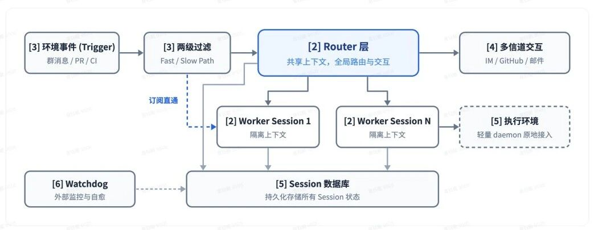
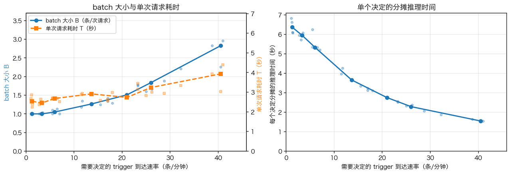

# Super-agent 设计探索：迈向更自主的 Agent 系统

## 来源信息

| 项 | 内容 |
| --- | --- |
| 标题 | Super-agent 设计探索：迈向更自主的 Agent 系统 |
| 署名 | 微信公众号「DeepSeek Harness 团队」；页面署名「DeepSeek 产品部」；文末注明 Yujia Qiao 完成系统实现与本文写作 |
| 原文 | <https://mp.weixin.qq.com/s/zoS7GlReWPhfCjENGxXCdg> |
| 发布 | 2026-10-31 20:29（+08:00；页面另标「修改于」，未给出具体时间） |
| 阅读日期 | 2026-11-01 |
| 性质 | 面向工程实践的架构思路探讨，不是产品功能介绍，也不是论文；第 7 节是合成负载下的初步实验 |
| 版本 | 文章无版本号；逐字转载时的字符数、哈希与配图清单见同目录 `audit.md` |

---

## 核心结论

一句话：**限制 Agent 继续扩张的瓶颈已从模型能力转向人的注意力——一个人只能同时跟进 3 到 5 个活跃 Session，而主流 Agent 把「一个 Session」当成了工作单位。** 解法是把 Session 降级为系统实现细节：常驻 Router 统一承接人类交互，上下文隔离的 Worker 池并发执行。

- **问题**：单 Session 既是上下文边界又是产品界面，多任务时用户被迫手动切换、自己记上下文；在本地 Agent 上接 CLI / MCP 只能让消息进来，解决不了同步阻塞、上下文混乱、离线即停。
- **核心想法**：把「维护全局连续性」和「高并发执行」拆到两层。Router 只做交互与分派、不执行具体任务（甚至可以不配 Bash 工具），Worker 挂完整工具、在独立上下文里专注单一任务。
- **怎么做到**：输入从提示词换成环境事件（Trigger），经两级过滤、Thread 订阅直通、Inline & Spill 与链式召回、投机执行进入 Worker；交互改成 `start()` / `stop()` 的异步 ReAct Loop；计算无状态、状态进数据库、执行环境留在原地；主系统之外再挂一个 Watchdog。
- **关键结果**：约 300 条消息、5 次重复的合成负载上，Super-agent 的任务完成时间 p50 / p95 为 12.4 / 15.7 分钟；中性提示下的单 Session 方案 5 次里 0 次调用 Subagent、p95 达 29.5 分钟。去掉订阅直通后完成时间基本不变，但 Router 的决定数增加约 30%、读缓存 token 从 2323 万涨到 3177 万（约 +37%）。
- **定位**：文章没有提出新理论，而是把 Fast / Slow Path、Cache、Locality、投机执行、存算分离等经典系统思想搬到 Agent 架构上；随文提到的 `dsh-superagent-prototype` 只是验证技术路线的插件原型，不是正式产品。

---

## 问题

过去一年，以 Coding Agent 为代表的单任务 Agent 已经证明，模型能够使用工具解决复杂问题，且越来越少需要人类持续监控和逐步干预。人的角色正逐步上移到更高层的决策与验收。与此同时，个人助手（Personal Agent）开始集中涌现，直接接入消息、日程、邮件与工作平台，持续观察信息流并协助处理事务。这种「持续在线、事件驱动」的工作模式并不局限于个人场景，在软件开发等商业场景同样有价值。

问题出在主流 Agent 的工作单位上：**Agent 仍然以一个 Session 为基本单位，不同 Session 彼此独立。** 用户并行推进多项工作时，必须手动切换，并自己记住各个 Session 的上下文。作者据观察给出一个经验数字：一个人通常只能同时跟进 **3 到 5 个活跃 Session**。于是单任务的上限取决于模型能力，多任务的上限取决于人的注意力。

在现有本地单会话 Agent 上借助 CLI、MCP 或外部连接器做简单扩展，只能让 Agent 接入外部消息，仍受制于三件事：

- **单会话同步阻塞**：一次工具调用没返回，会话就无法响应新的输入；
- **多任务上下文混乱**：所有任务挤在同一个窗口里，中间细节互相干扰；
- **本地设备离线即停**：设备休眠或断网，Agent 就停止运行。

作者把根因归到一处：**Session 同时承担了技术上的上下文管理与面向用户的项目管理。** 两者绑死后，想多推进一个项目就得开一个新 Session，Session 数量爆炸，用户被迫当调度器。把产品形态与底层 Session 解耦之后，「向用户暴露什么样的任务视图」才会变成一个独立的产品问题——文章把它留到开放问题里，没有回答。

因此需要打破 Agent 与单次手动会话的绑定，使它成为一个能跨会话保持上下文、同时推进多项复杂任务且互不干扰的连续实体。作者把这种形态及其系统架构称为 **Super-agent**，并给出四个基础特征：

- **连续**：用户直接在 IM、GitHub 评论等熟悉界面交互，感觉始终只有一个 Agent；在 IM 上提出采用方案 A、随后在 PR 评论里改为方案 B，它能理解并调整方向。
- **高效**：响应迅速，能并行、高质量地完成多个复杂任务；不必等上一条命令或任务结束就能接新指令。
- **主动**：持续观察环境事件并主动推进值得处理的事项，不需要介入时保持安静。
- **持久**：始终在线、直接接入真实工作环境，长期运行遇到异常能自动恢复。

单个 ReAct Loop 无法同时支持这四个特征。文章的主张是：只要目标是构建持续在线、并发响应环境事件的系统，相似的设计约束会导出相似的架构选择；而这些问题与传统计算机系统长期探讨的问题高度相似，经典设计思想在这里同样适用。五个模块因此不是随意拼装，而是每个模块对应一组约束（见下一节的机制表）。

---

## 核心想法

### 一句话

连续性与吞吐量不该在同一个会话里解决；把两者拆到不同层级，Session 才会从产品界面退成实现细节。

### 直觉

如果每条事件都交给同一个 Session，上下文最连续，但受单个 ReAct Loop 串行执行的速度上限约束，任务完成慢、吞吐低，多任务的中间细节混在一起还会拉低质量。反过来，每条事件都新开独立 Session，并发吞吐最高，但任务之间一旦不独立，缺少全局上下文会让结果彼此割裂；多个 Session 各自向用户回复也会造成交互混乱。

拆法很直接：**常驻的 Router 层负责「维护全局连续性」，上下文隔离的 Worker 层负责「高并发执行」。** 用户面对的始终是同一个 Super-agent，底下的会话数量与归属由系统管理。所以真正的问题不是「Session 够不够多」，而是「谁负责连续、谁负责并发」——把这两件事放进同一个会话，无论怎么调提示词都只能在其中一端让步。

### 为什么成立

- **职责分离让 Router 的上下文保持窄**：Router 不执行具体任务，只处理任务之间的高层关联与分派，因此它的上下文里装的是「谁在做什么」，而不是某个任务的细节；也正因如此，较轻量的模型往往就能兼顾速度与效果。
- **拥堵可以被批处理吸收**：上一轮推理期间到达的 Trigger 会积压，在下一轮合并进同一次 LLM 调用。Router 每步是长输入、短输出，多条 Trigger 在 Prefill 阶段并行计算，单次请求耗时的增长远慢于 batch 大小——在一定范围内，积压越多，单个决定分摊的推理时间反而越低。
- **计算无状态后，连续性可以交给存储**：推进 Agent Loop 的计算放进云端弹性容器，会话状态进数据库；容器可扩展、重启、替换，会话连续性由持久化存储保障。
- **信息路径可以绕开全局节点**：已归属任务的事件由程序按 Thread 直通 Worker，Router 只处理尚未订阅的新事件；细节不经过 Router，既省掉一次转发调用，也避免 Router 的上下文被任务内容填满。
- **上下文可以按局部性管理**：窗口当 Cache 用，近期可能要用的信息 Inline，超出预算的低频信息 Spill 到窗口外只留引用，模型需要时再按引用逐跳取回。
- **恢复可以由外部回路负责**：主系统只保证「尽量不出错」，长期可靠性交给独立于主系统的 Watchdog——它能看到主循环自己看不见的停滞。

### 与已有做法的区别

- **vs 单 Session + Subagent 工具**：那条路把「要不要分工」交给模型临场判断，结果高度依赖提示词；双层架构让 Router 不直接执行、Worker 只接收所订阅 Thread 的消息，把分工变成系统结构。
- **vs 每条事件都新开 Session**：后者吞吐最高，但没有跨任务的全局上下文，多个会话各自回复用户也会造成交互混乱；双层架构用常驻 Router 补回连续性。
- **vs 常见 Agent Team**：Agent Team 通常拆的是一个复杂任务内部的步骤与角色，子步骤耦合紧，Team Lead 要深入细节、高频协调；Super-agent 的 Router 只处理任务之间的分派，不介入单任务内部拆解。
- **vs 本地单机 Agent**：后者把计算、状态、执行环境绑在同一台设备上；Super-agent 分两步解开，设备休眠不再等于 Agent 停机。
- **vs Anthropic 的「脑手分离」**：思路一致——harness 保持无状态、会话日志放在 harness 之外、通过统一接口按需接入执行环境；区别在场景。那篇讲托管服务（按需沙箱、客户 VPC 内资源），这里首先要接的是用户日常使用、可能间歇在线的个人机器，因此强调 **BYOM（Bring Your Own Machine）**。

### 一个走通的例子

把文中几处描述串起来（本笔记的串联，不是原文实验）：开发者在 IM 群里提出一个需求，Router 判断后创建 Worker，并让这个 Worker 订阅该 IM 话题对应的 Thread；任务推进到 GitHub 后，Worker 再订阅对应 PR 的 Thread。此后 IM 里的后续消息、CI 结果与 PR 评审评论都由程序直接投递给这个 Worker，不再经 Router 转发；另一个 Worker 若也订阅了同一个 PR Thread，会收到同一批事件，从而自己发现两边改动冲突。Worker 不直接对外说话，只把关键结论汇报给 Router，由 Router 在 IM 里用不超过 100 词的回复同步给用户。与此同时，群里有人提到类似缺陷，投机执行让 Agent 先在后台复现并尝试修复；只有确认问题、且找到简单修复方案时，才把 PR 交付出来，否则全程保持安静。

### 代价

- **token 变多**：维护多个独立会话使 Super-agent 单次实验的读缓存 token 高于单 Session 方案；文章把差别归因于多会话，没有拆分到每个会话。
- **Router 上下文会膨胀**：单个常驻 Session 迟早装不下全部任务历史，链式召回是缓解而非根治；跨月级别的长程记忆被作者自己列为可扩展性的主要瓶颈。
- **多了一套需要维护的状态**：Thread 与 Worker 是多对多订阅，Worker 可以取消订阅或交回 Router 重新分派，订阅关系要与全局记忆保持一致；扇出只保证同一 Thread 的事件被所有订阅者看到，并不构成锁（本笔记判断）。
- **后台行动可能变成噪音源**：投机执行依赖明确的交付条件，否则持续产出的草稿与 PR 会变成新的注意力负担（本笔记判断）。
- **信任边界被拉宽**：云端 Loop 要接不可信事件，端侧设备上又有私有代码与凭据；这一层风险文章只提出，没有解决。

---

## 核心论证链

文章的论证顺序是「四个特征 → 五个模块 → 一组初步实验」，每个模块解决一组具体约束：

| 目标特征 | 模块（原文节号） | 关键机制 | 解决的约束 |
| --- | --- | --- | --- |
| 连续 + 高效 | 双层架构（§2） | 常驻 Router + 隔离 Worker；订阅直通；Router 侧批处理 | 全局连续性与并发吞吐量的权衡 |
| 主动 | 事件驱动（§3） | Trigger 两级过滤、Thread 订阅、Inline & Spill 与链式召回、投机执行 | 环境事件「高噪音、低触发率」，窗口有限 |
| 连续 + 高效（交互层） | 面向人的交互（§4） | 异步 ReAct Loop（`start()` / `stop()`）、按信道定制输出 | 前台对话被后台任务阻塞、群聊信息过载 |
| 持久 | 计算 / 状态 / 环境分离（§5） | 无状态计算容器 + 数据库 + 端侧轻量 daemon | 设备生命周期限制、真实环境难以复制上云 |
| 持久（异常自愈） | Watchdog（§6） | 主系统之外的外部 Control Loop | 进程活着但任务陷入循环或偏离目标 |

*图 1（原文配图）：五个模块的整体结构，图中标号 [2]–[6] 分别对应原文第 2–6 节。*

### 双层架构：把连续性与吞吐量分到两层

权衡在原文里写得很直白：一条会话处理所有事件最连续但吞吐最低；每条事件新开会话吞吐最高但全局上下文割裂、回复混乱。折中是逻辑上的两层职责，每一层在实现上都不必局限于单个 Session。

**Router 层**是常驻的全局路由层，承接所有入口的人类交互，充当全局的序点（Sequence Point）、协调点和记忆。为了不成为性能瓶颈，它不直接执行具体任务，只负责人类交互与任务分派，甚至可以不配备 Bash 工具。它与常见 Agent Team 的主会话形似而神不同：Team Lead 往往要理解任务细节、规划子任务、高频协调成员；Router 只处理任务之间的高层关联。原文还补了一句实现观察——Router 的任务常常没有想象中复杂，用较轻量的模型往往就能兼顾速度与效果。

单个 Router Session 之所以没有立刻成为瓶颈，靠的是批处理：事件流平稳时 Trigger 逐条进入，单次响应延迟低；事件密集时上一轮推理期间积压的多条 Trigger 会在下一次 LLM 调用中一并注入。因为 Router 每步是长输入、短输出，合并后的 Prefill 计算是并行的，单次请求耗时的增长远慢于批处理大小。上限取决于上下文长度，以及模型一轮能准确处理多少条 Trigger。规模再大时，Router 层内部可以做成多层过滤，或水平切分（Sharding）为多个会话；切得越细吞吐越高，但分片之间的记忆与上下文连续性越低。

**Worker 层**由负责具体执行的会话组成：彼此上下文隔离、挂载完整执行工具、在独立上下文中专注单一任务，因此通常配置能力最强的模型。Worker 不直接与人类交互，推理过程与工具调用不输出到外部信道，只向 Router 汇报状态，由 Router 统一回复。Worker 内部还可以再开 Subagent，甚至本身就是一个 Agent Team，这些对 Router 保持透明。

同层 Worker 之间通常不直接通信。多个 Worker 的交集往往出现在同一个 PR 等共享工作环境里；只要它们都订阅了对应的 Thread，就会收到相同的事件通知，从而有机会自行发现和解决冲突，少数跨任务协同由 Router 中转。

这一结构在个人助手场景同样成立：界面上通常只有一个聊天页，用户在同一对话框里讨论多个话题时，前端维持交互的连续性，底层则可以为每个话题分别派发 Worker，并行推进任务、起草回复。可见「双层」是逻辑职责，不是固定的两层会话。

### 事件驱动：从「人下指令」到「环境产生事件」

驱动源从人逐条键入的提示词，换成群聊消息、邮件与日程提醒、代码审查评论、CI 运行结果等半结构化环境事件，文章统一称为 **Trigger**。围绕一条事件的生命周期，原文依次处理四个问题。

**① 过滤：程序层 Fast Path + 语义层 Slow Path。** 真实事件流是「高噪音、低触发率」，逐个调大模型判断既慢又贵。程序层针对事件来源、群组范围、用户或机器人白名单做确定性准入，例如对不同来源分别设置「仅响应明确请求」「作为候选事件」「直接忽略」，在调用模型前滤掉大部分无关消息；通过准入的候选事件再交给 LLM，按提示词里的策略与上下文判断是否需要行动。语义层同时是面向人的自然语言扩展点——加策略只需改提示词。

**② 路由：Thread 与订阅直通。** 同一个 PR、同一个 IM 话题或同一封往来邮件串下的连续事件构成一条 **Thread**。Router 根据某个 Thread 的初始事件创建 Worker 后，该 Worker 直接订阅这个 Thread，于是路由分成两条路径：已订阅的事件由程序直通 Worker，不再经 Router 调用工具转发；未订阅的事件仍由 Router 观测和分派。若新事件超出当前任务范围，Worker 也可以取消订阅或交回 Router 重新分派。Thread 与 Worker 是多对多订阅——一个 Worker 可订阅多个 Thread，一个 Thread 可被多个 Worker 订阅；新事件会同时直通给所有订阅者，这也是上节「冲突自发现」的前提。输出侧仍由 Worker 汇报、Router 统一回复并同步全局记忆。

**③ 上下文组织：Inline & Spill 与链式召回。** 注入过多会挤占窗口、稀释注意力，注入过少又迫使模型反复调工具读取，文章的原则是「浪费上下文窗口，就是浪费模型的智能」。两个基本操作：**Inline** 把近期很可能用到的信息直接内联进当前窗口，省去工具往返；**Spill** 把超出预算或低频使用的完整信息留在窗口外，只保留引用或摘要。配合局部性（Locality），优化路径分三步：从最少信息开始，只给对象 ID 与内容摘要；按局部性逐步 Inline，先附紧密关联对象的 ID，再附时空相邻内容（内容前 50 字、IM 消息的前后相邻消息与被回复消息、代码评论所在讨论的相邻评论）；超出上限则 Spill，截断并保留续读入口。

把同一套规则应用到 Trigger、Thread、Worker Session 等各类对象上，就得到**链式召回（Chain of Recall）**：每个对象有唯一 ID，注入时内联下一跳关联对象的 ID，底层构成一张引用图。模型可以从当前消息读到所在 Thread，再沿 Thread 内联的 ID 找到相关的 Worker Session，进而找到该 Worker 关联的另一个代码评审 Thread，逐跳按需展开。这解决的是 Router 装不下全部历史、又要在用户提起旧任务时找回上下文的问题。

**④ 提前行动：投机执行。** 借鉴 Speculative Execution：结果还不确定是否会被采用时，先根据环境信号在后台尝试，有价值就交付，没价值就丢弃。个人助手场景是收到会议邀约后先核对日程冲突、搜集背景、备好回复草稿；研发场景的例子更具体——内部 Harness 用户群配置了一条「静默复现并修复」策略：有人反馈问题或讨论改动方案时，Agent 先在后台复现并寻找修复，只有确认问题且找到简单修复方案后才交付，否则全程保持安静。

四步连起来是一条完整的事件流水线：事件先被程序层挡掉大部分，候选交给语义层判断；Router 只为新 Thread 冷启动 Worker，之后同一 Thread 的事件直通；进入会话的内容按 Inline & Spill 组织，缺失的历史沿引用图逐跳召回；在结果尚未确定时，后台的投机执行已经把可能的交付物准备好。四个机制各自解决一个环节，缺一个都会让「主动」退化成「多收几条通知」。

### 面向人的交互：全双工与多信道

经典 ReAct Loop 里，模型发起一次同步的 `run()` 后循环阻塞，直到工具返回，期间无法响应新输入。文章把它改成异步的 `start()` 和 `stop()`：`start()` 立即返回「已启动（Started）」，循环不再等待；后台工具完成后，最终结果作为一条新事件消息投递回会话；模型也可以对跑得太久的命令调用 `stop()`。前台响应与后台执行由此解耦，新输入在当前推理步结束后就能处理。原文明确说，这套异步任务机制已经在 DeepSeek Harness 中实现，但尚未默认开启。

多信道的问题则由双层架构先解决一半：冗长的推理与密集的工具调用被隔离在 Worker 内，不会直接输出到外部信道。剩下的是按信道定制输出——IM 等即时信道侧重低打扰，像人类同事一样只在需要决策或验收时通知，只问直接问题、给简短结论，作者验证过的一条硬性规定是单次回复不超过 100 词；GitHub、邮件与文档等异步信道侧重结构化、高信息密度，例如按项目规范写清问题背景、改动说明与验证结果。

### 计算、状态与环境的分离

本地 Agent 默认把三样东西绑在一台设备上：推进 Agent Loop 的**计算**、需要持久保存的会话**状态**、代码仓库与本地工具链构成的执行**环境**。设备休眠或离线，Agent 就停止运行，也碰不到其他设备上的环境。文章分两步解耦。

**第一步，计算与状态分离。** 推进 Loop 的计算做成无状态，放进云端弹性计算容器；Session 等持久化状态存入数据库。容器可以水平扩展、重启或替换，会话与任务的连续性由存储保障，Agent 因此摆脱单台设备的生命周期限制。

**第二步，计算与执行环境分离。** 模型工作所需的上下文很大一部分要通过工具调用从代码仓库、本地文件、依赖服务中获取，从这个意义上说，广义的上下文也包含执行环境本身。真实工作环境里往往有未提交的本地修改、私有凭据、内网服务依赖以及特定硬件或工具链。云端起沙箱重建环境成本高且容易遗漏；要求用户整体迁到云端又迁移成本过高。既然难以复制的是环境本身，就不必让环境跟着 Loop 上云：Loop 在云端，重状态的执行环境留在原地，端侧只部署一个不保存会话状态的轻量 daemon，负责执行命令并返回结果。这样既支持把日常开发机或个人电脑接入云端 Agent（BYOM），也支持云端托管机器或按需创建的环境；甚至能支持间歇在线的设备——某台个人设备重新上线后，再由云端 Agent 触发并完成需要在该设备上执行的任务。

### Watchdog：主系统之外的控制回路

长期在线的分布式系统很难仅靠主系统内部逻辑保证可靠，需要在主系统之外引入独立的外部控制回路（Control Loop）。Agent 系统还多一层困难：许多异常不是进程崩溃，而是模型在执行中陷入无效循环或偏离目标。因此只监控基础设施存活不够，还要监控任务本身的进展。

实现上是在主系统外配置一个独立的 **Watchdog Session**，用定时消息驱动。它既处理接口报错、状态恢复失败等基础设施故障，也由模型判断各个 Worker 是否有实质进展、方向是否偏离整体目标；发现异常及时介入，遇到外部偶发故障则持续复查直至恢复。由于 Watchdog 本身也是具备完整工具能力的 Agent Session，维护者可以用自然语言向它询问故障原因，也可以让它在线修正主系统的行为，例如增删提示词、调整触发规则。

---

## 主要结论

| 观察 | 原文给出的数字 | 出处 |
| --- | --- | --- |
| Super-agent 的任务完成时间 | p50 12.4 分钟、p95 15.7 分钟 | §7.1，5 次重复 |
| 单 Session + Subagent，中性提示 | 5 次中 0 次调用 Subagent；p95 29.5 分钟 | §7.1 |
| 单 Session + Subagent，提示优先委派 | 5 次中 4 次委派；整体仍慢于 Super-agent；1 次自判工作「很小」而自己执行，形成长尾 | §7.1 |
| 去掉订阅直通 | 完成时间基本不变；Router 决定数增加约 30%；读缓存 token 2323 万 → 3177 万（约 +37%） | §7.1 |
| Router 批处理压测 | 触发速率约 1 → 40 条/分钟：平均 batch 1.0 → 2.8；单次请求 2.5 → 3.9 秒；单决定分摊 6.4 → 1.6 秒 | §7.2 |

1. **双层架构改善了任务完成时间。** 在约 300 条消息、约 20 条工作请求的合成负载上，Super-agent 的 p50 / p95 为 12.4 / 15.7 分钟；中性提示下的单 Session 方案 p95 为 29.5 分钟。作者把差距归因于单 Session 方案里主会话常常决定「自己干」，所有工作都在主会话中被新消息反复打断。
2. **分工是否发生，取决于结构而不是提示词。** 中性提示下模型 5 次里一次都没调用 Subagent；改成明确要求委派后 4 次委派，但仍有 1 次自行判断工作「很小」而自己执行。作者据此认为，把分工交给提示词工程和模型临场判断并不可靠，双层架构是在系统层面消除这个选择。
3. **订阅直通是纯开销优化，不改变完成质量与速度。** 去掉直通后完成时间几乎不变，但 Router 需要做的决定增加约 30%，读缓存 token 从 2323 万涨到 3177 万。直通省下的是 Router 的 token 与推理开销。
4. **单个 Router 在实验负载下够用，拥堵时反而更划算。** 触发速率从每分钟约 1 条升到约 40 条时，平均 batch 从 1.0 升到 2.8，单次请求耗时只从 2.5 秒增到 3.9 秒，增长慢于 batch 大小，于是单个决定分摊的推理时间从 6.4 秒降到 1.6 秒。这解释了为什么去掉直通使 Router 峰值负载增加后仍未触及吞吐瓶颈，也支撑了「当前团队规模下无需过早水平切分」的判断。

*图 2（原文配图）：不同 Trigger 到达速率下 Router 的平均 batch、单次请求耗时与单决定分摊时间；速率上升时 batch 变大、单次请求只小幅变慢。*

---

## 边界与局限

**作者明确承认的**：

- 第 7 节基于合成负载与简化环境，「部分设置还可以更加严谨」，结果只作初步参考。
- 架构扩展与长期运行都还没有答案：Router 何时需要水平切分、切分粒度如何、Worker 之间何时需要直接通信与何种拓扑，都待更多场景检验；长程记忆、安全与隐私、脱离 Session 后的交互形态、跨实例的 A2A 协作也均未解决。

**读者判断（非作者结论）**：

- **实验测的是调度，不是执行质量**：编码工作被替换成一个只消耗时间的工具，所以 12.4 分钟不能读成「Super-agent 代码写得更好」。
- **样本与成本口径都有限**：每种方案只重复 5 次，p95 由 5 个样本支撑，结果对提示词高度敏感；成本只报了读缓存 token，不含生成侧、工具调用与多会话存储，而 Super-agent 的 token 更高。
- **Watchdog 没有效果证据**：文章只描述机制，没有给误报、漏报、误唤醒或恢复时间的任何测量。

---

## 与其他工作的关系

- **Anthropic「脑手分离」**：同样让 harness 无状态、会话日志外置、按需接入执行环境；差异在接入对象——托管沙箱与客户 VPC，还是用户自己可能间歇在线的机器。
- **常见 Agent Team**：拆分对象是单任务内部的步骤与角色，Lead 负载重；Super-agent 的 Router 只做任务间分派，Worker 之间通常不直接通信。
- **单 Session + Subagent 工具**：同属「一个主循环 + 若干执行单元」，但分工靠提示词；本文把分工固化成 Router / Worker 的结构约束。
- **经典系统思想**：Fast / Slow Path、Cache 与 Locality、投机执行、存算分离、外部 Control Loop 都被直接借用，文章自己也说「没有提出全新的理论」。
