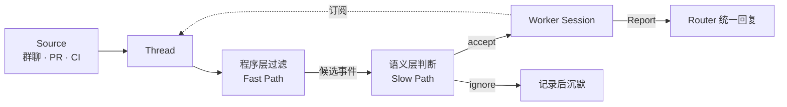
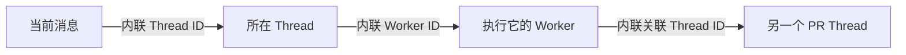

# Super-agent：把 Session 变成实现细节

> **原文全文（逐字转载，含 14 张配图）**：[打开本站转载页](../deepseek-super-agent-original/note.md) ｜ [微信原文 ↗](https://mp.weixin.qq.com/s/zoS7GlReWPhfCjENGxXCdg)

## 来源信息

| 项 | 内容 |
| --- | --- |
| 标题 | Super-agent 设计探索：迈向更自主的 Agent 系统 |
| 署名 | 微信公众号「DeepSeek Harness 团队」，页面署名「DeepSeek 产品部」；文末注明 Yujia Qiao 完成系统实现与本文写作，并列出一组参与审阅讨论的同事 |
| 站点 | 微信公众号（`mp.weixin.qq.com`） |
| 原文 | <https://mp.weixin.qq.com/s/zoS7GlReWPhfCjENGxXCdg> |
| 逐字转载 | [原文逐字转载页](../deepseek-super-agent-original/note.md)（本站独立条目 00222，正文逐字保留，14 张正文配图原样保留） |
| 发布 | 2026-10-31 20:29（+08:00，页面 `createTime`；页面另标「修改于」，未给具体时间与 diff） |
| 阅读日期 | 2026-11-01 |
| 版本锚点 | 文章无版本号。2026-11-01 抓取 `#js_content`：正文按「块级元素记为空格、行内元素不记空格、连续空白折叠」口径为 **16,091 字符**，sha256 `6b2029a8e0eaac2e…`；该区块原始 HTML 111,156 字节，sha256 `fda73dc290fcb4ff…`。复核时按同一口径重算即可判断是否更新 |
| 阅读范围 | 正文全文（9 节 + 致谢）。14 张配图逐张打开核对，确认与各自图注及上下文对应（含 fig-03 整体架构、fig-05 两级过滤、fig-12 累计曲线、fig-13 结果表、fig-14 批处理曲线）。**未做像素测量**：曲线只作定性描述，定量结论引作者原文，或对结果表放大后逐格复核 |
| 交叉核对 | ① 原型仓库 [`deepseek-ai/dsh-superagent-prototype`](https://github.com/deepseek-ai/dsh-superagent-prototype)（MIT，`main` @ `6337fc8`，2026-10-31）：README 与 `docs/` 下全部 9 篇取回，逐节阅读的是 `001`（领域模型）、`002`（授权）、`003`（执行）、`007`（架构）的相关章节，`000`、`004`、`005`、`006`、`008` 只按关键词检索（`watchdog` / `daemon` / `cloud` / `remote` / `ssh` / `container`）；`src/` 代码未读，也未运行；② 本仓库 00219（Anthropic《把 subagent 折回主循环》）笔记，用于架构对照 |
| 许可 | 文章页面未标注许可，配图为 `mmbiz.qpic.cn` 图床、同样未标注许可。逐字转载页按用户要求生成，版权归原作者所有 |
| 复核记录 | 2026-11-02：重抓原文，`#js_content` sha256 未变；用 Chromium 渲染原 HTML 后取 `innerText`，与转载页正文逐字符比对（含空格）一致；14 张配图逐张核对位置与图注；结果表放大逐格复核；据此修订 7.1 结论的强度表述与事件生命周期图的术语 |
| 未核 | 文中关于内部实例持续运行、当前团队规模下单个 Router 够用的说法没有外部证据；原型 README 亦声明其经过改编，与文中描述的实现并不完全一致，部分设计只是未来方向（原文为英文，此处为意译） |

> 说明：这是一篇架构设计文章，不是论文。它没有新训练方法，也没有可复现的公开基准；7.1 / 7.2 是合成负载下的初步实验，作者自己也写了「部分设置还可以更加严谨」。本文可验证的部分主要是**架构主张**与**原型代码里能对上号的机制**，下文逐条标了证据层级。

---

## 核心结论

一句话：**限制 Agent 继续扩张的瓶颈，已经从模型能力转移到人的注意力——一个人只能同时跟进 3 到 5 个活跃 Session，而主流 Agent 把「一个 Session」当成了工作单位。** 解法是把 Session 降级为系统实现细节，在上面加一层常驻的 Router 和一个上下文隔离的 Worker 池。

四条要素与对应模块：

1. **连续 + 高效 → 双层架构**：Router 只做人类交互与任务分派、不直接执行具体工作；Worker 上下文隔离、挂满工具、并发执行；两者之间的上下文管理对用户不可见。
2. **主动 → 事件驱动**：输入从「人敲的提示词」换成环境里的 **Trigger**（群消息、CI 结果、PR 评论），再用两级过滤、Thread 订阅直通、Inline & Spill 与投机执行把「高噪音、低触发率」的事件流变成可处理的工作。
3. **连续 + 高效（交互层）→ 异步 ReAct Loop**：`run()` 换成 `start()`/`stop()`，后台任务不再阻塞前台对话；输出按信道定制（IM 低打扰、GitHub/邮件高密度）。
4. **持久 → 计算/状态/环境分离 + Watchdog**：计算无状态、状态进数据库、执行环境留在原地（端侧 daemon，BYOM）；主系统之外再挂一个独立的 Watchdog Session 做外部控制回路。

这篇文章真正有价值的判断不是「要多开几个 agent」，而是三个更底层的取舍：

- **让用户手动管理 Session 是从 LLM API 延续下来的设计惯性**，Session 不该是用户的认知负担（§2）。
- **上下文窗口要当 Cache 来管**，不是能塞多少塞多少（§3.3：「浪费上下文窗口，就是浪费模型的智能」）。
- **多任务的吞吐上限由调度结构决定，而不是由模型速度决定**（§2.1 的批处理与 §7.2 的压测都在说这件事）。

### 证据层级一览

| 主张 | 原文依据 | 证据层级 |
| --- | --- | --- |
| 双层架构的任务完成时间明显更短 | §7.1，合成负载 5 次重复：p50/p95 = 12.4/15.7 分钟 vs 20.4/29.5 与 13.8/29.0 | **初步实验**；编码工作被替换为「只消耗时间的工具」，测的是调度不是执行质量 |
| 订阅直通不提升质量，但省 Router 的决策与 token | §7.1 去直通对照：决策 +30%，读缓存 token 2323 万 → 3177 万 | **同一实验**，增幅为作者自报，本笔记复算 (3177−2323)/2323 ≈ 36.8% |
| 批处理让 Router 在事件拥堵时「越堵越划算」 | §7.2 压测：1 → 40 条/分钟，batch 1.0 → 2.8，单次请求 2.5 s → 3.9 s，单决定分摊 6.4 s → 1.6 s | **单点压测**，Worker 用 Mock 模型，未说明上下文长度与模型版本 |
| 一个人通常只能跟进 3–5 个活跃 Session | 「据我们观察」 | **经验判断**，无数据、无样本说明 |
| 内部实例已持续参与问题复现、代码审查与自身迭代 | 开篇与结语 | **自述**，无外部可查证据 |
| 异步 ReAct Loop 已在 DeepSeek Harness 实现但未默认开启 | §4.1 | **产品状态自述**；原型里能看到对应的后台任务机制（见下） |

---

## 问题与动机：Session 同时承担了两件不该绑在一起的事

作者的观察链条很短，但每一环都指向同一个结论：

1. **单任务 Agent 已经不需要人盯着了**——Coding Agent 证明了模型能用工具解决复杂问题，人的角色在往「决策与验收」上移。
2. **新的应用形态是持续在线的**——个人助手接入消息、日程、邮件，事件驱动、长期运行；这个模式在软件开发场景同样成立。
3. **但现有 Agent 的工作单位还是「一个 Session」**——Session 之间彼此独立，并行推进多项工作时，人得手动切换并自己记住「Session X 里有没有 Y 信息」。
4. **于是多任务的上限落在人的注意力上**：据他们观察，一个人同时只能跟进 3–5 个活跃 Session。

文章点出的根因很关键：**Session 同时承担了技术上的上下文管理，和面向用户的项目管理。** 这两件事被绑死后，你只要想「项目管理」就得开一个新 Session，于是 Session 数量爆炸，用户被迫当调度器。把产品形态与底层 Session 解耦之后，「向用户暴露什么样的任务视图」才变成一个独立的产品问题（这个问题他们留到了 §8.2，没有解）。

顺带否掉了两条捷径：在本单会话 Agent 上接 CLI / MCP / 连接器，消息能进来，但**单会话同步阻塞、多任务上下文混乱、本地设备离线即停**这三件事一个都没解决。

---

## 五个模块逐一拆解

### 1. 双层架构：连续性与吞吐量的拆分

这是全文的地基。权衡写得很直白：

- 每条事件都丢给同一个 Session → 上下文最连续，但受单个 ReAct Loop 串行速度限制，吞吐低，且多任务中间细节混杂会拉低质量。
- 每条事件都新开独立 Session → 吞吐最高，但任务之间一旦不独立，缺少全局上下文会让结果割裂；多个 Session 各自回复用户又会造成交互混乱。

他们的做法是把「维护全局连续性」和「高并发执行」分到两层：

**Router 层**是常驻的全局路由层，承接所有入口的人类交互，充当全局的**序点（Sequence Point）**、协调点和记忆。为了不成为瓶颈，它**不直接执行具体任务**，只做交互与分派，「甚至可以不配备 Bash 工具」。值得一提的是，Router 的任务常常没想象中复杂，**较轻量的模型往往就能兼顾速度与效果**。

**Worker 层**负责执行：上下文隔离、挂完整工具、在独立上下文里专注单一任务，因此通常配最强模型。Worker **不直接与人交互**，推理与工具调用不外泄到信道，只向 Router 汇报状态，由 Router 统一回复。

两个细节值得记下来：

- **Worker 内部可以再嵌套**：执行复杂单任务时，Worker 可以自己开 Subagent，甚至本身就是一个 Agent Team，这些对 Router 透明。也就是说「双层」是逻辑职责，不是固定两层会话。
- **Worker 之间通常不直接通信**。多 Worker 的冲突主要发生在同一个 PR 这类共享环境里，靠「都订阅了同一个 Thread」让它们收到相同事件、自行发现冲突；少数跨任务协同由 Router 中转。

与常见的 Agent Team 相比，两者形似而神不同：

| 维度 | Agent Team（单任务内拆解） | Super-agent 双层架构 |
| --- | --- | --- |
| 拆分对象 | 一个复杂任务内部的步骤与角色 | 多个任务之间的分派 |
| Lead 的负载 | 深入理解细节、规划子任务、高频协调 | 只处理任务间的高层关联与分派 |
| 子节点关系 | 子步骤耦合紧，需要频繁通信 | Worker 上下文隔离，通常不互相通信 |
| 失败模式（本笔记推断） | Lead 上下文被细节淹没 | Router 上下文被任务历史淹没（用链式召回缓解） |

**为什么单个 Router 没有立刻成为瓶颈**，是全文最像系统论文的一段：上一轮推理期间到达的 Trigger 会积压，在下一轮**合并成一次 LLM 调用**（Batching）；Router 每步是「长输入、短输出」，多条 Trigger 合并后会在 Prefill 阶段并行计算，单次请求耗时的增长远慢于 batch 大小。所以拥堵时「积压越多，单个决定分摊的推理时间越低」，上限取决于上下文长度和单轮能准确处理多少条 Trigger。7.2 节用压测把这条曲线画了出来（见下）。

扩展路径也交代了：规模再大就把 Router 内部做成多层过滤，或做**水平切分（Sharding）**：拆成多个会话——切得越细吞吐越高、全局记忆的连续性越差，「在全局记忆问题被解决之前，这一权衡始终存在」。

### 2. 事件驱动：从「人下指令」到「环境产生事件」

驱动源换成半结构化的环境事件（群聊消息、邮件与日程提醒、代码审查评论、CI 结果），文章统一叫 **Trigger**。作者按一条事件的生命周期讲了四个递进的问题。

**① 过滤：Fast Path / Slow Path（§3.1）。** 真实事件流是「高噪音、低触发率」，逐个调模型判断既慢又贵。于是把确定性的高频判断固化成代码做 **Fast Path**（来源、群组范围、用户/机器人白名单，按来源分别设「仅响应明确请求」「作为候选事件」「直接忽略」），只把需要语义理解的候选交给 LLM 做 **Slow Path**。语义层同时是面向人的**自然语言扩展点**——想加策略就改提示词，不用发版。

**② 路由：订阅与直通（§3.2）。** 同一个 PR、同一个 IM 话题、同一封往来邮件串下的连续事件构成 **Thread**。Router 根据初始事件创建 Worker 后，该 Worker 直接**订阅**这个 Thread：后续事件由程序直通 Worker，不再经 Router 转发；Router 仍能观测所有事件，但只负责判断和分派**尚未被订阅**的新事件。Thread 与 Worker 是**多对多**订阅，一个 Worker 可订阅多个 Thread，一个 Thread 可被多个 Worker 订阅——这就是上面说的「冲突自发现」得以成立的前提。

**③ 上下文组织：Inline & Spill 与链式召回（§3.3）。** 这一段是全文工程含量最高的部分。作者把上下文窗口当 Cache 管，两个基本操作：**Inline** 把近期很可能用到的信息直接塞进窗口，省掉工具往返；**Spill** 把超出预算或低频的完整信息留在窗口外，只留引用或摘要。配合**局部性（Locality）**，优化路径是：

1. 从最少信息开始：只给对象 ID 和内容摘要；
2. 按局部性逐步 Inline：先附带紧密关联对象的 ID，再附带时空相邻内容（前 50 字、IM 前后相邻消息与被回复消息、代码评论所在讨论的相邻评论）；
3. 超出上限就 Spill：设一个较小的长度上限，截断并保留续读入口，需要时再调工具读。

把同一套规则应用到系统里的各类对象后，就得到**链式召回（Chain of Recall）**：Trigger、Thread、Worker Session 各有唯一 ID，注入时内联下一跳的 ID，底层构成一张引用图；模型从当前事件出发，沿引用逐跳展开上下文。这解决的是 Router 在长程运行中装不下全部历史、又要在用户提起旧任务时找回上下文的问题。

**④ 提前行动：投机执行（§3.4）。** 借鉴 Speculative Execution：结果不确定是否被采用时，先在后台按环境信号试，有价值就交付，没价值就丢弃。个人助手的例子是收到会议邀约就先核对日程、搜集背景、备好草稿；研发场景的例子更具体——在他们内部的 Harness 用户群里配了一条「静默复现并修复」策略：有人反馈问题或讨论方案时，Agent 先在后台复现并找修复，**只有确认问题且修复方案简单时**才把结果交付，否则全程安静。

> 我的解读：投机执行的真正难点不是「能不能提前算」，而是**收敛条件**。作者给出的收敛条件是：确认问题，并且找到简单的修复方案——这既是质量控制，也是噪音控制——否则一个持续在后台行动的系统会变成注意力黑洞，恰好违背它要解决的问题。

### 3. 面向人的交互：全双工与多信道

**异步 ReAct Loop（§4.1）** 解决的是经典 `run()` 的同步阻塞：模型调用一次 `run()`，循环就卡到工具返回，期间无法响应新输入。改成 `start()` / `stop()` 后，`start()` 立即返回「已启动（Started）」，后台完成后结果作为一条**新事件消息**投递回会话，模型也可以 `stop()` 掉跑太久的命令。这样前台响应与后台执行解耦，新输入在当前推理步结束后就能处理。

一个容易被忽略的工程事实：**这套异步任务机制已经在 DeepSeek Harness 里实现了，但没有默认开启**（§4.1 原文）。也就是说这不是纸面设计，而是产品开关问题。

**多信道（§4.2）** 的前提是双层架构已经把冗长的推理与工具调用隔离在 Worker 内；剩下的是按信道定制输出：

- **IM 等即时信道**：低打扰、像人类同事，只在需要决策或验收时通知，只问直接问题、给简短结论。一条他们验证过的硬性规定是**单次回复不超过 100 词**。
- **GitHub、邮件、文档等异步信道**：结构化、高信息密度，例如 PR 按项目规范写清问题背景、改动说明与验证结果。

> 原型对照：这个「100 词」在代码里落成了 `Acknowledgements are limited to 100 words`（`docs/007`，主 Session、评估、`orchestrator_ack` 三条路径共用），是我在原型里找到的、与正文数字完全对齐的一处。

### 4. 计算、状态与环境的分离

本地 Agent 把三样东西绑在一台机器上：推进 Loop 的**计算**、要持久保存的**会话状态**、代码仓库与本地工具链构成的**执行环境**。设备一休眠，Agent 就停，而且碰不到别的设备上的环境。

**第一层：计算与状态分离（§5.1）。** Loop 计算做成无状态、放进云端弹性容器；Session 等状态进数据库。容器可水平扩展、重启、替换，连续性由存储保证。

**第二层：计算与执行环境分离（§5.2）。** 真实工作环境里有未提交的本地修改、私有凭据、内网依赖、特定硬件与工具链，上云的两种常规做法（云端起沙箱重建环境 / 要求用户迁到云端）都不可行：前者成本高且必然遗漏，后者迁移成本高。所以让 Agent Loop 在云端、环境留在原地，端侧只装一个**不保存会话状态的轻量 daemon**，负责执行命令与返回结果。

这与 Anthropic 提出的「脑手分离」（Decoupling the brain from the hands）一致，区别在场景：那篇讲的是托管服务（按需沙箱、客户 VPC），这里首先要接的是**用户日常使用、可能间歇在线的个人机器**。因此设计同时支持 **BYOM（Bring Your Own Machine）** 与云端托管机器。

> 原型对照：这一层在原型里没有。原型是以 bundle 形式挂进 DeepSeek Harness 的插件，执行环境是配置的**本地执行根目录**（默认 `<stateDir>/work`），每个 Ticket 一个目录；部署文档只讲在操作员自己的机器上安装与启动。全部 9 篇文档与仓库文件清单里都检索不到 daemon、云端 Loop 或跨设备切换的实现——按 README 的说法，属于「文章中讨论、但原型未实现」的那类设计。

### 5. Watchdog：主系统之外的控制回路

作者的前提判断是：**长期在线的分布式系统很难只靠主系统内部逻辑保证可靠**，需要外部 **Control Loop**。而 Agent 系统还有额外一层：很多异常不是进程崩溃，而是**模型在执行中陷入无效循环或偏离目标**，所以进程存活探测不够，还要监控任务本身的进展。

实现上是在主系统外配一个独立的 **Watchdog Session**，用定时消息驱动，既处理接口报错、状态恢复失败等基础设施故障，也由模型判断各 Worker 是否**有实质进展、方向是否偏离整体目标**，发现异常及时介入，外部偶发故障则持续复查。

一个有意思的性质：Watchdog 本身是具备完整工具能力的 Agent Session，所以维护者可以用自然语言问它故障原因，也可以让它**在线改主系统的行为**（增删提示词、调整触发规则）。

> 我的判断：这是全文最「想当然」的一块。把判断 Worker 有没有实质进展这件事交给另一个模型，等于把误判风险从一个模型转移到另一个模型，而且 Watchdog 自己也可能陷入循环；文章没有给任何 Watchdog 的实测数据。它能解决「谁来看着看着的人」的问题，但没有回答「谁来看着 Watchdog」。

---

## 实验与证据

### 7.1 消融：Super-agent vs 单 Session + Subagent

设置：群聊 + GitHub CI 消息流同时驱动，单次实验约 **300 条消息**，其中约 **20 条**是工作请求，其余是闲聊、跟进、叫停与 CI 消息；编码工作用一个**只消耗时间的工具**代替（所以测的是调度与协作，不是执行质量）；每种方案重复 **5 次**；消息间隔与工作时长按 1/4 缩放，模型调用耗时为真实值。

四种方案（表中数值取自原文结果表的图片，正文只复述了部分数值）：

| 方案 | 任务完成时间 P50 / P95（分钟） | 单次实验读缓存 Token（全部 Session） |
| --- | --- | --- |
| Super-Agent | **12.4 / 15.7** | 2323 万 |
| Super-Agent，去掉直通 | 12.6 / 15.5 | 3177 万 |
| 单 Session + Subagent 工具，中性提示 | 20.4 / 29.5 | 605 万 |
| 单 Session + Subagent 工具，提示优先委派 | 13.8 / 29.0 | 1082 万 |

读法有三层：

1. **双层架构在中位数和尾部都更好，尾部差距更大**。中位数 12.4 vs 20.4 分钟（慢 65%），p95 15.7 vs 29.5 分钟（慢 88%）。作者的解释是：单 Session 方案受提示词影响较大，主 Session 常常决定「自己干」，于是所有工作都在主会话里被新消息反复打断。
2. **提示词工程在这里很不稳定**。中性提示（*Use a subagent for a piece of work when appropriate…*）下，模型 5 次里**一次都没调用 Subagent**；改成明确要求委派（*Prefer handing each piece of work to a subagent of its own…*）后，5 次里 4 次委派，但剩下 1 次它判断工作「很小」又自己做了，形成图中那条紫色长尾（p95 仍 29.0）。这组对比是全文最有说服力的一点：**要不要分工，不该由模型临场判断，而该由系统结构保证。**
3. **直通是纯开销优化**。去掉直通后完成时间几乎不变（12.6/15.5 vs 12.4/15.7，差异很小），但 Router 需要做的决定多了约 30%，读缓存 token 从 2323 万涨到 3177 万（本笔记复算 +36.8%）。作者由此说直通「不提高任务完成质量与速度，但为 Router Session 节省了可观的 token 与推理开销」。

**代价也要看清**：Super-agent 的读缓存 token 是中性提示那组单 Session 方案的 **3.8 倍**（2323 万 vs 605 万；对比委派组 1082 万则是 2.1 倍）。我的解释是多开隔离会话牺牲了跨任务的缓存复用——原文只给了数字，没有给归因。

### 7.2 Router 的批处理

单独压测 Router：Router 调真实模型，Worker 用 Mock；需要决定的 Trigger 到达速率从每分钟约 1 条逐步升到约 40 条。

| 到达速率 | 平均 batch 大小 | 单次请求耗时 | 单个决定分摊的推理时间 |
| --- | --- | --- | --- |
| 约 1 条/分钟 | 1.0 | 2.5 s | 6.4 s |
| 约 40 条/分钟 | 2.8 | 3.9 s | 1.6 s |

作者结论：batch 涨到 2.8 倍，单次请求只涨 56%，所以单决定分摊时间降到约 1/4；这解释了 7.1 里「即使去掉直通使 Router 的峰值负载增加，仍未触及单 Router 的吞吐瓶颈」，也支撑了作者「无需过早对 Router 层做水平切分」的判断。

> 口径提示：分摊时间并不严格等于「单次请求耗时 ÷ batch 大小」——按表中数字算是 3.9/2.8 ≈ 1.39 s，而报告值是 1.6 s；低速率端 2.5 s 与 6.4 s 也对不上（差 3.9 s）。原文没有说明分母里是否还包含排队等待或每次 Eval 的多次模型调用，所以这张表应当读作**趋势证据**（拥堵时有效吞吐上升），而不是一个可直接复算的公式。

### 哪些结论不能外推

- **合成负载**：20 条工作请求 / 5 次重复，单团队规模；p95 只有 5 个样本支撑，置信度有限。
- **执行被替换成「耗时的空工具」**：能证明调度结构影响完成时间，**不能**证明双层架构能提升代码质量。
- **模型版本与提示词敏感**：中性提示与委派提示的差异说明结果对提示词高度敏感，换模型可能重排。
- **成本口径是读缓存 token**：只反映上下文复用，不含生成侧与工具调用成本。

---

## 工程视角：如果要照着做

### 最小可行骨架

1. **一个 Source + 一张 Thread 表**：先把事件幂等化（同一事件只产生一个 Trigger），否则后面所有重试都会变成重复工单。
2. **两级过滤**：先用确定性规则（谁可以发起、哪个群、是否 @、白名单）把噪音挡掉，再上模型判断。原型里这两层叫 **Gate** 与 **Assessment**，Gate 的输出是「强度」——`explicit`（本人明确请求）还是 `inferred`（推断出的候选），后者权限更小。
3. **Router + 一个 Worker**：Router 不干活，只分派与回复；Worker 每个任务一个会话、一个目录。先不做并发，验证「用户是否感觉只有一个 Agent」。
4. **订阅直通**：Worker 创建后把 Thread 订阅关系写下来，后续事件由程序直接投递。这是省 Router token 的最大单项。
5. **再补上下文预算**：Inline 什么、Spill 什么，定成固定数字，别让模型自己决定。

### 原型里能直接对齐的实现细节

`deepseek-ai/dsh-superagent-prototype` 把文中概念落成了领域模型（`docs/001`）：Source → Trigger → Thread → Eval → Decision（`accept` / `stop` / `ignore` / `unavailable`）→ Ticket（授权的工作单元）→ Assignment → Executor。几个直接可抄的数字与机制：

| 机制 | 实现 |
| --- | --- |
| Router 的「不等待」纪律 | 主 Session 禁止 `sleep`、禁止 `timeoutMs > 30 s` 的 shell、禁止超过 5 s 的 job 等待；报告与后台结果自动到达 |
| 异步 ReAct | Worker 前台 shell 命令 **5 秒后转后台**，下一轮仍可收消息；每轮结束后后台工作最多 **30 分钟**，到点杀 job 并报 `waiting` |
| Inline & Spill 预算 | 评估上下文里的 Trigger 正文 ≤4,000 字符；Thread 窗口取首 5 条 + 前后各 5 条（400 字符，紧邻两条 1,200）；其余消息只给 50 字符 stub，用 `orchestrator_eval_read` 展开 |
| 汇报带宽 | Worker 报告摘要 ≤600 字符；派工说明 ≤1,500 字符；读资源分页 20/50 条 |
| 人工优先 | 并发槽位之外**额外留 1 个槽**给「人的消息 / 状态查询」，保证新工作挤不掉正在跟进的任务 |
| 订阅语义 | 订阅投递**绕过 Gate 且不授予任何权限**；人停掉的 Ticket 不再接收；结束的 Ticket 保留订阅，人再来消息可以续做 |

注意原型与文章的差距：原型是**单个 GitHub 仓库 + 飞书**的常驻 coding agent，没有个人助手场景，也没有 §5 的云端/daemon 与 §6 的 Watchdog。README 自己写明它经过改编、与文中描述的实现不完全一致，部分设计只是方向。

### 复用时的坑

1. **Router 上下文膨胀**：单个常驻 Session 的上下文会被任务历史填满。链式召回是缓解，不是根治；跨月记忆在 §8.1 里被作者自己列为「制约可扩展性的主要瓶颈」。
2. **订阅泄漏**：Thread 结束、任务转移、Worker 被替换时若忘了退订，事件会持续投给不该处理的会话。原型专门有约束：Executor 只能退掉自己 Ticket 对无关 Thread 的订阅，不能退自己起始的 Thread，也不能退 Source 要求它跟随的 Thread。
3. **投机执行的噪音**：必须有明确的交付条件，否则后台产出会变成新的信息过载源。
4. **多 Worker 冲突**：靠「同一 Thread 事件扇出给所有订阅者」让它们互相看见，这**不是锁**，只在冲突最终落回共享环境（PR、Issue）时有效。
5. **成本结构变化**：从「一个会话省缓存」变成「多个会话各跑各的」，读缓存 token 上去了，要靠直通与批处理把 Router 侧压回来。
6. **安全边界被拉宽**：能收不可信输入、又能触达真实设备。§8.4 自己也写明：云端的 Agent Loop 一旦被服务端入侵或提示词注入攻破，「其连接的全部端侧设备都面临被控制的潜在风险」。

---

## 与 00219 的对照：折叠还是分层？

本仓库 00219 是 Anthropic 的《把 subagent 折回主循环》，主张**一个模型、一个上下文窗口、一个开放式工具循环**，用渐进披露的 skills 与 tools 替代多开 subagent。两篇摆在一起，结论看起来正好相反。我的判断是：它们回答的不是同一个问题。

| 维度 | 00219（折叠） | 本文（分层） |
| --- | --- | --- |
| 要解决的问题 | 单个复杂任务内的上下文管理 | 多个独立任务 + 持续在线带来的注意力管理 |
| 失败模式 | 每次跨 agent 交接都丢信息、加延迟；subagent 按组织架构泛滥 | 人被迫在 3–5 个 Session 之间当调度器；主会话被新消息反复打断 |
| 主会话角色 | 什么都干，靠渐进披露控制加载量 | 什么都不干，只分派与回复 |
| 上下文策略 | 需要时加载 skill / tool | Inline & Spill + 引用图（链式召回） |
| 评价指标 | 质量、延迟、token | 任务完成时间的 p50/p95、Router 的决策成本 |

两篇有两条共同的底线：都不信任「主会话自己顺手干」；都主张先测量再改架构（00219 的原话是 "measure, change one thing at a time"；本文则先用 7.1 / 7.2 验证调度结构、再谈扩展）。

关键差异在**交接成本**：00219 反对多 agent 的核心论据是「交接丢细节」；本文的 Router 恰恰**不搬运细节**——它只决定「这活归谁」，Worker 自己订阅 Thread、自己读原始事件。所以「交接丢信息」在双层架构里被结构性地绕开了：信息不走 Router，走订阅。

反过来说，00219 的结论在本文的 Worker 内部依然成立：**Worker 内部执行一个复杂任务时，多开 subagent 仍然会丢信息**，那时该用 skills + tools 折叠。所以我读下来的结论是「**层内折叠，层间分层**」：

- 瓶颈是「一个人盯不过来 N 件事」→ 分层，Router 只分派。
- 瓶颈是「一个任务里 subagent 交接掉细节」→ 折叠，单循环 + 渐进披露。
- 两者都成立时，就是本文的结构：Router 是一个极窄的循环，Worker 内部是一个宽的单循环。

---

## 开放问题与我的判断

作者列了四条，我按「离落地多远」重排：

1. **长程记忆（§8.1）**：跨月甚至更长时间的检索。链式召回解决的是「近期任务与会话历史」，不是「三个月前的为什么这么决定」。我认为这是这套架构最先撞上的墙，而且它不是一个工程问题——需要决定「什么值得记、记在哪、何时遗忘」。
2. **安全与隐私（§8.4）**：云端 Loop + 端侧 daemon 的信任假设是「彼此受信任」，但云端要接不可信事件、端侧有凭据。文中给的方向是「让 Agent 能够在完全不接触凭据本身的情况下使用凭据」，没有给方案。
3. **脱离 Session 之后的产品形态（§8.2）**：作者自己承认「以聊天窗口为中心的交互在一定程度上是路径依赖的结果」，但也没给出替代形态，只提到「交互可能可以更多地发生在领域特化的交互界面中」。这一条其实是整篇文章的未完成部分：**拆掉了 Session，用户看到什么？**
4. **上下文边界与 A2A（§8.3）**：组织内多个隔离实例之间如何安全协作。离单团队落地比较远。

我自己的两点保留：

- **「单个 Router 够用」是规模相关的结论**。7.2 压测的是 Trigger 到达速率，不是**任务多样性**。真实团队里 Router 要维护的可能是几十个任务的「谁在做什么」，这与「每分钟 40 条事件」是两种负载，文章没有区分。
- **收益主要来自「结构」而不是「模型」**。7.1 最有说服力的地方不是 12.4 分钟，而是中性提示下 0/5 次委派——同样的模型、同样的工具，只因为主会话有「自己干」的选项，系统就退化了。这条对多 agent 设计普遍适用：**只要主循环保留执行权，系统就有退回单循环的倾向。**

---

## 本笔记的局限

- 没有运行原型，也没有复现 7.1 / 7.2；实验数字全部来自原文（表格取自结果图，正文只复述了部分）。
- 未做像素测量，7.2 的曲线只用于定性描述；表中的分摊时间口径问题已在相应位置标注。
- 原型只逐节读了 `docs/001`–`003`、`007` 的相关章节，`000`、`004`、`005`、`006`、`008` 只做关键词检索，未读 `src/` 实现，也未运行；因此「原型如何实现」的表述以文档为准，可能与代码有出入。
- 与 00219 的对照基于该篇笔记的结论部分，未重读其全文。
