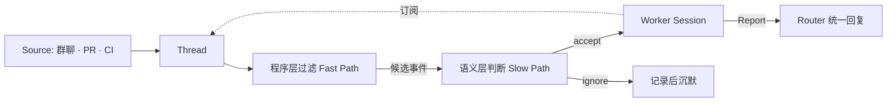
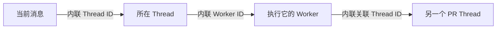

# Super-agent：把 Session 变成实现细节

> **原文全文（逐字转载，含 14 张配图）**：[打开本站转载页](../deepseek-super-agent-original/note.md)（本站条目 00222）｜ [微信原文 ↗](https://mp.weixin.qq.com/s/zoS7GlReWPhfCjENGxXCdg)

## 来源信息

| 项 | 内容 |
| --- | --- |
| 标题 | Super-agent 设计探索：迈向更自主的 Agent 系统 |
| 署名 | 微信公众号「DeepSeek Harness 团队」；页面署名「DeepSeek 产品部」；文末注明 Yujia Qiao 完成系统实现与本文写作，并列出一组参与审阅讨论的同事 |
| 站点 | 微信公众号（`mp.weixin.qq.com`） |
| 原文 | <https://mp.weixin.qq.com/s/zoS7GlReWPhfCjENGxXCdg> |
| 发布 | 2026-10-31 20:29（+08:00，页面 `createTime`） |
| 阅读日期 | 2026-11-01 |
| 性质 | 架构设计文章，非论文：没有新训练方法，也没有可复现的公开基准；7.1 / 7.2 是合成负载下的初步实验。版本锚点、阅读范围、原型仓库核对与复核记录见同目录 `audit.md` |

---

## 核心结论

一句话：**限制 Agent 继续扩张的瓶颈已经从模型能力转移到人的注意力——一个人只能同时跟进 3 到 5 个活跃 Session，而主流 Agent 把「一个 Session」当成了工作单位。** 解法是把 Session 降级为系统实现细节，在它上面加一层常驻的 Router 和一个上下文隔离的 Worker 池。

- **解决什么问题**：多任务并行时，人被迫在若干 Session 之间手动切换，还要自己记住「哪个 Session 里有哪条信息」。给单会话 Agent 接上 CLI / MCP / 连接器只让消息进得来，单会话同步阻塞、多任务上下文混杂、设备离线即停这三件事一件都没解决。
- **核心想法**：Session 同时承担了技术上的上下文管理，和面向用户的项目管理。把这两件事拆开——连续性交给常驻 Router，执行交给隔离的 Worker——Session 的数量就不再等于用户要操心的任务数量。
- **怎么做到**：五个模块配合：双层架构定分工、事件驱动换输入源、异步 ReAct Loop 换交互方式、计算/状态/环境分离换取持久在线、Watchdog 在主系统之外做控制回路。
- **关键结果**：合成负载、5 次重复下，双层架构的任务完成时间 p50/p95 为 12.4/15.7 分钟；单 Session + Subagent 是 20.4/29.5（中性提示）与 13.8/29.0（委派提示）。代价是读缓存 token 为后者的 2.1–3.8 倍。
- **定位**：这是一份架构主张加原型交叉验证，不是产品评测。真正可迁移的判断是「要不要分工不该由模型临场决定」和「上下文窗口要当 Cache 管」，而不是具体那几个模块。

---

## 问题：Session 同时承担了两件不该绑在一起的事

作者的观察链条很短，但每一环都指向同一个结论：

1. **单任务 Agent 已经不需要人盯着了**。Coding Agent 证明了模型能用工具解决复杂问题，人的角色在往「决策与验收」上移。
2. **新的应用形态是持续在线的**。个人助手接入消息、日程、邮件，事件驱动、长期运行；作者认为同样的模式在软件开发场景也成立。
3. **但现有 Agent 的工作单位还是「一个 Session」**。Session 之间彼此独立，并行推进多项工作时，人得手动切换，还要自己记住「Session X 里有没有 Y 信息」。
4. **于是多任务的上限落在人的注意力上**：据作者观察，一个人同时只能跟进 3–5 个活跃 Session。

第 4 条是「据我们观察」，没有数据与样本说明；但它决定了整篇文章要解决的问题有多大——如果这个数字成立，再多模型能力也换不来线性增长的多任务吞吐。

根因不是「Agent 不够强」，而是**产品形态与底层 Session 绑死了**：Session 同时是技术上的上下文容器，和面向用户的项目单位。于是你只要想「项目管理」——给这件事起个名字、记着它在推进——就得开一个新 Session。Session 数量爆炸，用户被迫当调度器，真正的调度逻辑却不在系统里。

把产品形态与 Session 解耦之后，「向用户暴露什么样的任务视图」才第一次成为一个独立的产品问题。作者在 §8.2 把这个问题留了下来，没有解——这是理解全文边界的关键：文章拆掉了旧的工作单位，但没有完全给出新的。

顺带否掉了两条捷径：在本单会话 Agent 上接 CLI / MCP / 连接器，消息能进来，但**单会话同步阻塞、多任务上下文混乱、本地设备离线即停**这三件事一个都没解决；把 Session 多开几个，也只是把调度负担原样交给用户。

本文的设定与前提可以归成三条：

- **输入侧的常态是环境事件**，不是人坐下来敲的一段提示词——群聊、PR 评论、CI 结果都在持续产生，且绝大多数与当前任务无关。
- **执行侧的环境不能搬走**：真实工作环境里有未提交的本地修改、私有凭据、内网依赖和特定工具链，把这套东西重建到云端既不便宜也不完整。
- **要撑住的规模是「一个人同时跟进多项工作」**，不是成千上万个并发任务；更大规模作者只给了水平切分的方向，没有给实验。

---

## 核心想法

### 一句话

Session 不该是用户的认知负担，它应该是系统内部的调度与隔离单位。

### 直觉：拆的是两件被绑死的事

一个 Agent 系统同时要满足两个互相拉扯的要求：

- **连续性**：记得住全局——谁在做什么、上次聊到哪、这个 PR 的前因后果。这要求一个地方看到尽可能多的历史。
- **吞吐**：很多事能同时推进，互不污染上下文。这要求把工作切到彼此隔离的执行单元里。

单 Session 架构把这两件事压在同一个上下文里：想连续就得串行，想并发就得断开。双层架构的直觉是——**连续性和吞吐本来就不需要由同一个上下文提供**。Router 的上下文很窄（只装任务间的关系），Worker 的上下文很深（只装一个任务），两者用不同的模型、不同的工具集。

### 为什么成立

四个支点，缺一个这套结构就退化成「多开几个窗口」：

1. **上下文窗口可以当 Cache 管**。近期很可能用到的信息 Inline 进窗口，低频或超预算的 Spill 到窗口外只留引用；配合局部性——先给 ID 和摘要，再给紧邻内容，超限就截断留续读入口——Router 的上下文增长是可控的。原文的说法是「浪费上下文窗口，就是浪费模型的智能」。
2. **事件流是「高噪音、低触发率」的**，所以模型调用必须花在候选上：确定性规则先挡掉大部分，语义判断只处理剩下的；已经被 Worker 订阅的 Thread 直接由程序投递，不再占 Router 的一次决策。
3. **调度结构决定吞吐上限，而不是模型速度**。Router 每步是「长输入、短输出」，多条 Trigger 合并成一次调用时，Prefill 阶段可以并行算，单次请求耗时的增长远慢于 batch 大小。所以拥堵时「积压越多，单个决定分摊的推理时间越低」。
4. **持久在线靠解耦，不靠一台不休眠的机器**。推进 Loop 的计算可以无状态、可替换；会话状态进数据库；执行环境留在原地由一个轻量 daemon 代理。三者各自扩展，互不牵制。

### 与已有做法的区别

- **vs Agent Team**：Agent Team 拆的是一个复杂任务内部的步骤与角色，Lead 要深入细节、规划子任务、高频协调；本文拆的是多个任务之间的分派，Router 只处理任务间的高层关联，Worker 之间通常不直接通信。
- **vs 单 Session + Subagent 工具**：那套结构里主会话保留执行权，于是「要不要委派」变成模型的临场判断——7.1 的对照说明这个判断很不可靠。本文把分工写进结构：Router 不配 Bash，想干活只能派出去。
- **vs Anthropic 的「脑手分离」**：方向一致，但对象不同。那边讲的是托管服务（按需沙箱、客户 VPC），本文首先要接的是用户日常使用、可能间歇在线的个人机器，因此设计同时支持 BYOM（Bring Your Own Machine）与云端托管机器。

### 一个走通的例子（§7.1 的 5 次重复）

群聊 + GitHub CI 两条事件流同时驱动，单次实验约 300 条消息，其中约 20 条是工作请求；编码工作被换成一个只消耗时间的工具，所以测的是调度与协作，不是代码质量；每种方案跑 5 次。

- 单 Session + Subagent 工具、中性提示（*Use a subagent for a piece of work when appropriate…*）：5 次里**一次都没调用 Subagent**，所有工作堆在主会话里被新消息反复打断，p50/p95 = 20.4/29.5 分钟。
- 同一结构、改成明确要求委派（*Prefer handing each piece of work to a subagent of its own…*）：5 次里 4 次委派，剩 1 次模型判断工作「很小」又自己做了，形成一条长尾，p50/p95 = 13.8/29.0 分钟。
- 双层架构：Router 不干活，工作天然落到 Worker，p50/p95 = 12.4/15.7 分钟。

这个例子的价值不在 12.4 分钟，而在中间那两行：**同样的模型、同样的工具，只因为主会话保留「自己干」的选项，系统就退化了。** 所以「要不要分工」不该是模型的决策，应该是系统的结构。

### 代价

- **token 变贵**：多开隔离会话牺牲了跨任务的缓存复用，读缓存 token 是单 Session 组的 2.1–3.8 倍。要靠订阅直通与批处理把 Router 侧压回来。
- **Router 上下文会膨胀**：单个常驻 Session 迟早被任务历史填满；链式召回是缓解，不是根治，跨月记忆被作者自己列为制约可扩展性的主要瓶颈。
- **一致性靠约定而不是锁**：多 Worker 冲突靠「同一 Thread 的事件扇出给所有订阅者」让它们互相看见，只在冲突最终落回共享环境（PR、Issue）时有效。
- **安全边界被拉宽**：系统能收不可信输入，又能触达真实设备；云端 Loop 一旦被攻破，连接的全部端侧设备都面临风险（§8.4）。
- **多了一个要维护的元系统**：Watchdog 自己也是 Agent，也会陷入循环，文章没有回答「谁来看着 Watchdog」。

---

## 核心论证链：五个模块

先把五个模块、各自解决的问题和证据层级摆在一起：

| 模块 | 解决什么 | 关键机制 | 证据层级 |
| --- | --- | --- | --- |
| 双层架构 | 连续性 vs 吞吐 | 常驻 Router 只分派；Worker 上下文隔离、并发执行、不直接对话 | §7.1 初步实验 |
| 事件驱动 | 输入从「人下指令」变成「环境产生事件」 | Trigger、两级过滤、Thread 订阅直通、Inline & Spill、投机执行 | §7.1 / 7.2 部分实验 + 设计论证 |
| 异步交互 | 经典 ReAct Loop 的同步阻塞 | `start()` / `stop()`，按信道定制输出 | 产品状态自述（已实现、未默认开启） |
| 计算/状态/环境分离 | 设备休眠即停、跨设备不可达 | 无状态 Loop、状态入库、端侧 daemon、BYOM | 设计论证，原型未实现 |
| Watchdog | 主系统看不见自己的失效 | 主系统之外一个定时消息驱动的独立 Session | 无实测数据 |

### 1. 双层架构：连续性与吞吐量的拆分

权衡写得很直白：每条事件都丢给同一个 Session，上下文最连续，但受单个 ReAct Loop 的串行速度限制，吞吐低，多任务中间细节混杂还会拉低质量；每条事件都新开独立 Session，吞吐最高，但任务之间一旦不独立，缺全局上下文会让结果割裂，多个 Session 各自回复用户又造成交互混乱。

**Router 层**是常驻的全局路由层，承接所有入口的人类交互，充当全局的序点（Sequence Point）、协调点和记忆。为了不成为瓶颈，它不直接执行具体任务，只做交互与分派，甚至可以「不配备 Bash 工具」。作者还提了一句反直觉的观察：Router 的任务常常没想象中复杂，**较轻量的模型往往就能兼顾速度与效果**。

**Worker 层**负责执行：上下文隔离、挂完整工具、在独立上下文里专注单一任务，因此通常配最强模型。Worker 不直接与人交互，推理与工具调用不外泄到信道，只向 Router 汇报状态，由 Router 统一回复。

两个容易看漏的细节：

- **Worker 内部可以再嵌套**：执行复杂单任务时，Worker 可以自己开 Subagent，甚至本身就是一个 Agent Team，这些对 Router 透明。所谓「双层」是逻辑职责，不是固定的两层会话。
- **Worker 之间通常不直接通信**：冲突主要发生在同一个 PR 这类共享环境里，靠「都订阅了同一个 Thread」让它们收到相同事件、自行发现冲突；少数跨任务协同由 Router 中转。

单个 Router 为什么没有立刻成为瓶颈，是全文最像系统论文的一段。上一轮推理期间到达的 Trigger 会积压，在下一轮**合并成一次 LLM 调用**（Batching）；Router 每步是「长输入、短输出」，多条 Trigger 合并后会在 Prefill 阶段并行计算，单次请求耗时的增长远慢于 batch 大小。于是拥堵时「积压越多，单个决定分摊的推理时间越低」，上限取决于上下文长度和单轮能准确处理多少条 Trigger。扩展路径也交代了：规模再大就把 Router 内部做成多层过滤，或者做**水平切分（Sharding）**——切得越细吞吐越高、全局记忆的连续性越差，「在全局记忆问题被解决之前，这一权衡始终存在」。

### 2. 事件驱动：从「人下指令」到「环境产生事件」

驱动源换成半结构化的环境事件：群聊消息、邮件与日程提醒、代码审查评论、CI 结果，文章统一叫 **Trigger**。作者按一条事件的生命周期讲了四个递进的问题。

*图：一条 Trigger 的生命周期（据原文 §3 重绘）。程序层挡掉大部分噪音，语义层只判断候选事件；被 Worker 订阅的 Thread 后续直通 Worker，不再经过 Router。*

**① 过滤：Fast Path / Slow Path（§3.1）。** 真实事件流是「高噪音、低触发率」，逐个调模型判断既慢又贵。于是把确定性的高频判断固化成代码做 Fast Path——来源、群组范围、用户/机器人白名单，按来源分别设「仅响应明确请求」「作为候选事件」「直接忽略」——只把需要语义理解的候选交给 LLM 做 Slow Path。语义层同时是面向人的自然语言扩展点：想加策略就改提示词，不用发版。

**② 路由：订阅与直通（§3.2）。** 同一个 PR、同一个 IM 话题、同一封往来邮件串下的连续事件构成 **Thread**。Router 根据初始事件创建 Worker 后，该 Worker 直接**订阅**这个 Thread：后续事件由程序直通 Worker，不再经 Router 转发；Router 仍能观测所有事件，但只负责判断和分派尚未被订阅的新事件。Thread 与 Worker 是多对多订阅，一个 Worker 可订阅多个 Thread，一个 Thread 可被多个 Worker 订阅——这也是「冲突自发现」得以成立的前提。

**③ 上下文组织：Inline & Spill 与链式召回（§3.3）。** 这一段是全文工程含量最高的部分。作者把上下文窗口当 Cache 管，两个基本操作：**Inline** 把近期很可能用到的信息直接塞进窗口，省掉工具往返；**Spill** 把超出预算或低频的完整信息留在窗口外，只留引用或摘要。配合**局部性（Locality）**，优化路径是三步：

1. 从最少信息开始：只给对象 ID 和内容摘要。
2. 按局部性逐步 Inline：先附带紧密关联对象的 ID，再附带时空相邻内容——前 50 字、IM 前后相邻消息与被回复消息、代码评论所在讨论的相邻评论。
3. 超出上限就 Spill：设一个较小的长度上限，截断并保留续读入口，需要时再调工具读。

把同一套规则应用到系统里的各类对象，就得到**链式召回（Chain of Recall）**：Trigger、Thread、Worker Session 各有唯一 ID，注入时内联下一跳的 ID，底层构成一张引用图。

*图：链式召回（据原文 §3.3 重绘）。模型从当前事件出发，沿引用逐跳展开，不必把全部历史装进 Router 的窗口。*

这解决的是 Router 在长程运行中装不下全部历史、又要在用户提起旧任务时找回上下文的问题。

**④ 提前行动：投机执行（§3.4）。** 借鉴 Speculative Execution：结果不确定是否被采用时，先在后台按环境信号试，有价值就交付，没价值就丢弃。个人助手的例子是收到会议邀约就先核对日程、搜集背景、备好草稿；研发场景的例子更具体——在内部的 Harness 用户群里配了一条「静默复现并修复」策略：有人反馈问题或讨论方案时，Agent 先在后台复现并找修复，**只有确认问题且修复方案简单时**才把结果交付，否则全程安静。

投机执行的真正难点不是「能不能提前算」，而是**收敛条件**。作者给出的条件是「确认问题 + 修复方案简单」：这既是质量控制也是噪音控制，否则一个持续在后台行动的系统会变成注意力黑洞，恰好违背它要解决的问题。

### 3. 面向人的交互：全双工与多信道

**异步 ReAct Loop（§4.1）** 解决的是经典 `run()` 的同步阻塞：模型调用一次 `run()`，循环就卡到工具返回，期间无法响应新输入。改成 `start()` / `stop()` 后，`start()` 立即返回「已启动（Started）」，后台完成后结果作为一条**新事件消息**投递回会话，模型也可以 `stop()` 掉跑太久的命令。这样前台响应与后台执行解耦，新输入在当前推理步结束后就能处理。

一个容易被忽略的工程事实：**这套异步任务机制已经在 DeepSeek Harness 里实现了，但没有默认开启**（§4.1 原文）。也就是说这不是纸面设计，而是产品开关问题。

**多信道（§4.2）** 的前提是双层架构已经把冗长的推理与工具调用隔离在 Worker 内；剩下的是按信道定制输出：

- **IM 等即时信道**：低打扰、像人类同事，只在需要决策或验收时通知，只问直接问题、给简短结论。一条他们验证过的硬性规定是**单次回复不超过 100 词**。
- **GitHub、邮件、文档等异步信道**：结构化、高信息密度，例如 PR 按项目规范写清问题背景、改动说明与验证结果。

这套「按信道决定带宽」的做法，把「模型越想越久」和「用户被打断」解耦：Worker 可以想很久，但只在必要时占用人的注意力。

### 4. 计算、状态与环境的分离

本地 Agent 把三样东西绑在一台机器上：推进 Loop 的**计算**、要持久保存的**会话状态**、代码仓库与本地工具链构成的**执行环境**。设备一休眠，Agent 就停，而且碰不到别的设备上的环境。

**第一层：计算与状态分离（§5.1）。** Loop 计算做成无状态、放进云端弹性容器；Session 等状态进数据库。容器可水平扩展、重启、替换，连续性由存储保证。

**第二层：计算与执行环境分离（§5.2）。** 真实工作环境里有未提交的本地修改、私有凭据、内网依赖、特定硬件与工具链，上云的两种常规做法都不可行：云端起沙箱重建环境，成本高且必然遗漏；要求用户迁到云端，迁移成本高。所以让 Agent Loop 在云端、环境留在原地，端侧只装一个**不保存会话状态的轻量 daemon**，负责执行命令与返回结果。这与 Anthropic 提出的「脑手分离」一致，区别在场景：那篇讲的是托管服务（按需沙箱、客户 VPC），这里首先要接的是**用户日常使用、可能间歇在线的个人机器**，因此设计同时支持 BYOM 与云端托管机器。

### 5. Watchdog：主系统之外的控制回路

作者的前提判断是：**长期在线的分布式系统很难只靠主系统内部逻辑保证可靠**，需要外部 **Control Loop**。而 Agent 系统还有额外一层：很多异常不是进程崩溃，而是**模型在执行中陷入无效循环或偏离目标**，所以进程存活探测不够，还要监控任务本身的进展。

实现上是在主系统外配一个独立的 **Watchdog Session**，用定时消息驱动：既处理接口报错、状态恢复失败等基础设施故障，也由模型判断各 Worker 是否**有实质进展、方向是否偏离整体目标**，发现异常及时介入，外部偶发故障则持续复查。

一个有意思的性质：Watchdog 本身是具备完整工具能力的 Agent Session，所以维护者可以用自然语言问它故障原因，也可以让它**在线改主系统的行为**（增删提示词、调整触发规则）。

这是全文最「想当然」的一块。把「判断 Worker 有没有实质进展」交给另一个模型，等于把误判风险从一个模型转移到另一个模型，而且 Watchdog 自己也可能陷入循环；文章没有给任何 Watchdog 的实测数据。它能解决「谁来看着看着的人」，但没有回答「谁来看着 Watchdog」。

### 回到标题：Session 变成实现细节

五个模块合起来做的事，是把 Session 从**用户的工作单位**降级为**系统的调度与隔离单位**：

- 连续性由一个常驻的 Router Session 提供，它窄到可以一直活着；
- 执行由每个任务一个 Worker Session 承担，它深到可以专心，且用完即弃；
- 两者之间的路由、订阅、上下文搬运全部由程序与引用图维护，用户看不见。

用户在理论上只需要面对「任务视图」和「验收」，不再需要知道「这是第几个 Session、那个 Session 里有没有这条信息」。这就是标题的主张。

但要如实说：**这个主张在系统侧只有部分证据，在用户侧还只是一个方向。** 系统侧的证据是 7.1 / 7.2 的调度实验与原型里能对上号的机制；用户侧则停在作者自己的承认上——「以聊天窗口为中心的交互在一定程度上是路径依赖的结果」，替代形态「可能可以更多地发生在领域特化的交互界面中」，但文章没有给出。拆掉了 Session，用户看到什么，这篇没有答。

## 主要结论

**设置**（§7.1）：群聊 + GitHub CI 双驱动，单次实验约 300 条消息，其中约 20 条是工作请求；编码工作被换成一个**只消耗时间的工具**，所以测的是调度与协作，不是执行质量；每种方案重复 5 次。

| 方案 | 完成时间 p50 / p95（分钟） | 读缓存 token（全部 Session） |
| --- | --- | --- |
| Super-Agent | **12.4 / 15.7** | 2323 万 |
| Super-Agent，去掉订阅直通 | 12.6 / 15.5 | 3177 万 |
| 单 Session + Subagent 工具，中性提示 | 20.4 / 29.5 | 605 万 |
| 单 Session + Subagent 工具，提示优先委派 | 13.8 / 29.0 | 1082 万 |

- **双层架构在中位数和尾部都更好，尾部差距更大**。中位数 12.4 vs 20.4 分钟（慢 65%），p95 15.7 vs 29.5 分钟（慢 88%）。作者的解释是单 Session 方案受提示词影响大，主 Session 常常决定「自己干」，于是所有工作都在主会话里被新消息反复打断。
- **结构比提示词可靠**。中性提示 5 次里 0 次委派，委派提示 5 次里 4 次，剩下 1 次仍自己做了。这条结论对多 agent 设计普遍适用：只要主循环保留执行权，系统就有退回单循环的倾向。
- **订阅直通是纯开销优化**。去掉直通后完成时间几乎不变（12.6/15.5 vs 12.4/15.7），但 Router 需要做的决定多了约 30%，读缓存 token 从 2323 万涨到 3177 万（本笔记复算 +36.8%）。作者由此说直通「不提高任务完成质量与速度，但为 Router Session 节省了可观的 token 与推理开销」。
- **批处理让拥堵变成优势**（§7.2）。Trigger 到达速率从约 1 条/分钟升到约 40 条/分钟，平均 batch 1.0 → 2.8，单次请求耗时 2.5 s → 3.9 s（+56%），单个决定分摊的推理时间 6.4 s → 1.6 s。作者据此认为不必过早对 Router 层做水平切分（「分摊时间」与「单次耗时 ÷ batch」对不上，原文未给分母口径，详见 `audit.md`）。
- **代价要一起看**。Super-Agent 的读缓存 token 是中性提示单 Session 组的 3.8 倍（2323 万 vs 605 万），对比委派组是 2.1 倍。原文只给数字没有归因；本笔记的解释是多开隔离会话牺牲了跨任务的缓存复用。

---

## 边界与局限

**作者自己承认的**：
- 7.1 是合成负载、单团队规模，作者也写了「部分设置还可以更加严谨」。
- 长程记忆（§8.1）被列为「制约可扩展性的主要瓶颈」；链式召回解决近期任务与会话历史，不解决「三个月前为什么这么决定」。
- §8.2 承认聊天窗口为中心的交互「在一定程度上是路径依赖的结果」但没给替代形态；§8.4 写明云端 Loop 一旦被入侵或提示词注入攻破，「其连接的全部端侧设备都面临被控制的潜在风险」。

**读者视角的判断（非作者结论）**：
- p95 只有 5 个样本支撑；编码被换成耗时空工具，只能证明调度结构影响完成时间，**不能**证明双层架构提升代码质量；成本口径只含读缓存 token，不含生成侧与工具调用。
- 结果对提示词和模型版本敏感——0/5 与 4/5 的对比本身就是证据，换模型可能重排；「单个 Router 够用」也只是**到达速率**维度的结论，真实团队里 Router 要维护几十个任务的「谁在做什么」，与「每分钟 40 条事件」是两种负载。
- 一个人只能跟进 3–5 个 Session 是经验判断，没有样本说明；Watchdog 没有任何实测，只是把误判风险转移给另一个模型。

---

## 与其他工作的关系

- **vs 本仓库 00219（Anthropic《把 subagent 折回主循环》）**：那篇主张一个模型、一个上下文窗口、一个开放式工具循环，用渐进披露的 skills 与 tools 替代多开 subagent。两篇结论看似相反，其实回答的不是同一个问题：00219 管**单个复杂任务内**的上下文管理，本文管**多个任务 + 持续在线**带来的注意力管理。合起来是「层内折叠，层间分层」——瓶颈是「一个人盯不过来 N 件事」就分层，瓶颈是「一个任务里 subagent 交接掉细节」就折叠。关键差异在交接成本：本文的 Router 不搬运细节，Worker 自己订阅 Thread、自己读原始事件，于是「交接丢信息」被绕开了。完整对照表见 `audit.md`。
- **vs Agent Team**：Agent Team 拆的是一个复杂任务内部的步骤与角色，Lead 要深入细节、高频协调；本文拆的是多个任务之间的分派，Router 只处理高层关联，Worker 之间通常不直接通信。
- **vs Anthropic 的「脑手分离」**：方向一致，但对象不同——那边是托管服务（按需沙箱、客户 VPC），本文首先要接的是用户日常使用、可能间歇在线的个人机器，因此同时支持 BYOM 与云端托管机器。

<!-- 复核档案见同目录 audit.md（不随站点发布） -->
