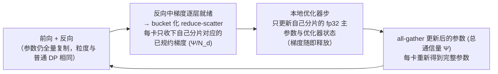
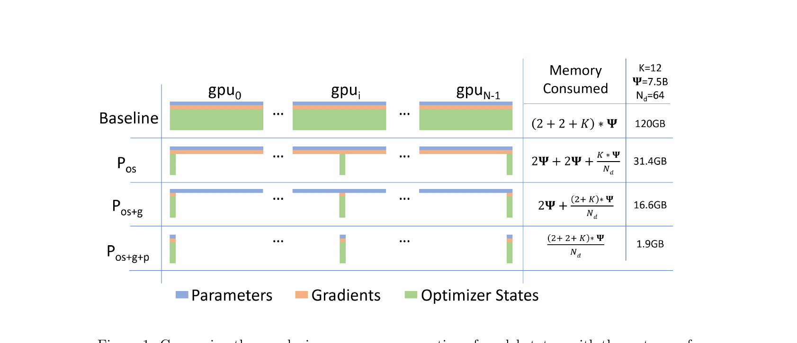
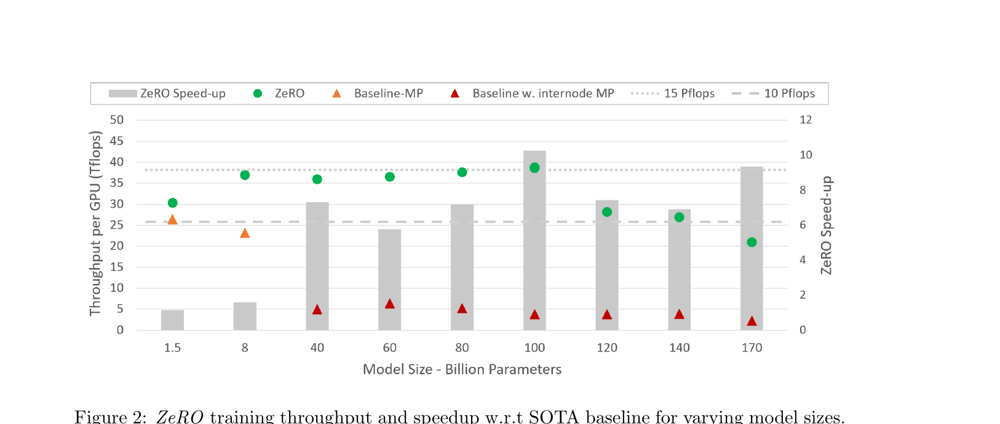

# ZeRO: Memory Optimizations Toward Training Trillion Parameter Models

## 来源信息

| 项 | 内容 |
| --- | --- |
| 标题 | ZeRO: Memory Optimizations Toward Training Trillion Parameter Models |
| 作者 | Samyam Rajbhandari\*, Jeff Rasley\*, Olatunji Ruwase, Yuxiong He（\* 同等贡献） |
| 机构 | Microsoft |
| 来源 | [arXiv:1910.02054v3](https://arxiv.org/abs/1910.02054v3)（cs.LG; cs.DC; stat.ML） |
| 版本 | 本笔记基于 v3（2020-05-13）；v1 已撤回，v2 内容差异见 `audit.md` |
| 阅读日期 | 2026-10-04 |

---

## 核心结论

一句话：**ZeRO 在数据并行（DP）框架内把「模型状态」从每卡复制一份改为按 DP 度数切分、用时再通信聚合，从而在不牺牲计算/通信效率的前提下拿到接近模型并行（MP）的内存效率。**

- **问题**：混合精度 + Adam 训练时，每个参数要占 16 字节（参数、梯度、fp32 主参数、两个 Adam 状态），1.5B 的 GPT-2 光模型状态就要 24GB；DP 又在每张卡上复制全部状态，单卡很快装不下。
- **核心想法**：模型状态并非每一刻都需要全量——某层参数只在该层前向/反向时用，优化器状态只在更新时用。既然如此，就可以把它们按 DP 度数切分到各卡，用到时再 all-gather；DP 的通信量本来就不大，切分后仍能保持同一量级。
- **方法**：ZeRO-DP 分三步累积启用——切优化器状态 $P_{\mathrm{os}}$、切梯度 $P_{g}$、切参数 $P_{p}$；每卡模型状态分别降到 1/4、1/8、$1/N_d$。ZeRO-R 再处理激活、临时缓冲和内存碎片。
- **关键结果**：400 张 V100 上训练 170B 模型（比当时 SOTA 大 8 倍）；8B–100B 平均吞吐 15 PFlops（>30% 峰值），100B 时 38 TFlops/GPU；64–400 卡出现超线性加速；不借助 MP 即可训练 13B（同配置 DDP 上限 1.4B）。
- **边界**：1T 参数是**内存分析**结论，不是实测；论文实现只覆盖 $P_{\mathrm{os}}+g$，参数切分 $P_{p}$ 未实现、未评测。

---

## 问题

大模型训练首先撞上的是单卡显存墙，而不是算力墙。以混合精度 + Adam、模型参数量 $\Psi$ 为例，每个参数要维护五份状态：

| 组成 | 精度 | 字节数 |
| --- | --- | ---: |
| 参数（params） | fp16 | 2Ψ |
| 梯度（gradients） | fp16 | 2Ψ |
| fp32 主参数副本 | fp32 | 4Ψ |
| Adam 动量（momentum） | fp32 | 4Ψ |
| Adam 方差（variance） | fp32 | 4Ψ |
| **合计** | | **16Ψ**，其中优化器状态 $K\Psi$，$K=12$ |

也就是说，1.5B 的 GPT-2 权值本身只占 3GB，训练却至少要 24GB 模型状态；再叠加激活与临时缓冲，完整训练远超单张 32GB 卡。

当时的几种解法各有硬伤：

| 方案 | 内存 | 计算/通信效率 | 易用性 |
| --- | --- | --- | --- |
| 基础 DP | 每卡复制全部模型状态；32GB GPU 上 >1.4B 参数就 OOM | 高（通信量小、计算粒度粗） | 最简单 |
| MP（如 Megatron-LM） | 切分模型状态，省内存 | 每层都要大量通信，跨节点带宽骤降后效率崩坏 | 需改模型/算子，支持的算子集有限 |
| PP（G-pipe / PipeDream） | 切层 | 需要与流水线分段数成比例的 batch 来填气泡 | tied-weights、batch-norm 等难实现 |
| CPU offload | 省 GPU 内存 | PCI-E 带宽受限，最多 50% 时间花在 GPU↔CPU 传输 | — |
| 内存高效优化器 | 省优化器状态 | — | 改变优化算法，可能影响收敛 |

论文的切入点是：**DP 的内存效率差来自冗余**——模型状态被完整复制到每张卡，而其中大部分在任一时刻并不被用到。

---

## 核心想法

### 一句话

把「复制」换成「切分 + 用时聚合」，同时保留 DP 的计算粒度和通信量级。

### 三个观察

1. **DP 的扩展效率优于 MP**：MP 把计算粒度切细，又在每层前后插入大量通信，跨节点尤其明显；DP 计算粒度粗、通信量小。
2. **DP 内存差是因为复制，MP 内存好是因为切分**：同样的模型状态，MP 按张量维度切开，DP 则每卡一份。
3. **DP 和 MP 都静态持有全生命周期所需的状态，但任一时刻并不需要全部**：某层参数只在该层前向/反向时需要，优化器状态只在参数更新时需要。

第三条是全文的支点。它意味着：状态可以「用时借、用完还」，内存占用从「峰值总和」变成「当前正在用的那一块」。

### 一个具体的账（7.5B 模型，$N_d=64$）

- baseline：$16\Psi = 120$GB/卡；
- 只切优化器状态 $P_{\mathrm{os}}$：保留完整 fp16 参数与梯度（4Ψ = 30GB），优化器状态切成 1/64（12Ψ/64 ≈ 1.4GB），合计 **31.4GB**；
- 再切梯度 $P_{\mathrm{os}}+g$：参数仍完整（2Ψ = 15GB），梯度与优化器状态都切成 1/64（14Ψ/64 ≈ 1.6GB），合计 **16.6GB**；
- 再切参数 $P_{\mathrm{os}}+g+p$：全部状态都切成 1/64，合计 **1.9GB**。

这组数字就是 Figure 1 的内容。注意每一步都不是「免费」的：切分后，别的卡要用自己缺的那部分状态时，必须通过集合通信取回来。

### 为什么通信没有爆炸

关键在于 DP 本来就要做一次全量梯度规约：

- baseline DP：一次 all-reduce，通信量 2Ψ。
- $P_{\mathrm{os}}+g$：把 all-reduce 换成 **reduce-scatter（Ψ）+ all-gather 更新后的参数（Ψ）**，总量仍是 2Ψ。
- $P_{\mathrm{os}}+g+p$：参数也要在前后向各取一次，前向 all-gather（Ψ）+ 反向 all-gather（Ψ）+ 梯度 reduce-scatter（Ψ）= 3Ψ，只比 baseline 多 50%。

$P_p$ 看起来要频繁广播参数，但把一次 all-gather **摊到前向逐层进行**——用到某层参数时，持有该分片的卡再广播，用完即弃——整步合计仍是一份 Ψ，只不过反向还得再来一次。这正是第三条观察（时间局部性）在通信上的直接体现。

### 与 MP / PP / offload 的区别

| 方案 | 切什么 | 通信 | 改模型代码 |
| --- | --- | --- | --- |
| MP | 张量维度 | 每层密集，跨节点差 | 要 |
| PP | 层 | 流水线气泡 | 要 |
| CPU offload | 搬到 CPU | PCI-E 带宽 | 通常要 |
| **ZeRO-DP** | 模型状态（按 DP 度数） | 与 DP 同量级 | 不要 |

ZeRO 不是要取代 MP，而是把 DP 的内存效率补到接近 MP；两者可以组合，每卡内存最多再降 $N_m$ 倍（$N_m$ 为 MP 度数）。

### 代价与前提

- **通信量与消息大小**：分析假设带宽受限（消息足够大）；小消息、延迟敏感的场景不成立。
- **batch 不能无限放大**：超线性扩展靠「卡变多→每卡显存宽松→batch 可放大」，但 batch 放大会碰到 critical batch size，影响收敛。
- **参数切分的实现复杂度**：$P_p$ 要在前向/反向按层 all-gather，工程上比前两步难；论文只实现了前两步。

---

## 方法

### 符号表

| 符号 | 含义 | 取值 / 说明 |
| --- | --- | --- |
| $\Psi$ | 模型参数量 | 以「参数个数」计 |
| $N_d$ | DP 度数（数据并行进程数） | |
| $N_m$ | MP 度数（模型并行进程数） | |
| $K$ | 每个参数的优化器状态字节数 | Adam fp32：$K=12$ |
| $P_{\mathrm{os}}$ | 优化器状态切分 | optimizer state partitioning |
| $P_g$ | 梯度切分 | gradient partitioning |
| $P_p$ | 参数切分 | parameter partitioning |
| $P_a$ | 激活检查点切分 | activation checkpoint partitioning |
| $C_B$ | 常量大小缓冲区 | constant-size buffer |
| $M_D$ | 内存碎片整理 | memory defragmentation |

### 3.1 ZeRO-DP 的三个阶段

按「每卡模型状态内存」记账：

| 阶段 | 每卡内存 | 大 $N_d$ 时 | 相对 baseline 降幅 |
| --- | --- | --- | --- |
| Baseline DP | $(2+2+K)\Psi = 16\Psi$ | — | 1x |
| $P_{\mathrm{os}}$ | $2\Psi + 2\Psi + K\Psi/N_d$ | ≈ 4Ψ | 4x |
| $P_{\mathrm{os}}+g$ | $2\Psi + (2+K)\Psi/N_d$ | ≈ 2Ψ | 8x |
| $P_{\mathrm{os}}+g+p$ | $(2+2+K)\Psi/N_d = 16\Psi/N_d$ | 线性 | $N_d$ |

逐行读法：

- **Baseline**：参数 2Ψ + 梯度 2Ψ + 优化器状态 $K\Psi$（$K=12$）。
- **$P_{\mathrm{os}}$**：优化器状态只保留自己负责的 $1/N_d$，参数与梯度仍完整复制。$N_d$ 很大时，$12\Psi/N_d$ 趋近于 0，剩下 4Ψ。
- **$P_{\mathrm{os}}+g$**：梯度也只保留自己负责的那一份。$N_d$ 很大时，剩下完整的 2Ψ 参数。
- **$P_{\mathrm{os}}+g+p$**：连参数也切，全部状态都变成 $1/N_d$。

三个阶段的机制：

1. **$P_{\mathrm{os}}$（优化器状态切分）**：把优化器状态均分为 $N_d$ 份，第 $i$ 个 DP 进程只保存、只更新第 $i$ 份对应的参数分片；每步末尾一次 all-gather 把更新后的参数同步回所有进程。论文没有单独推导只启用 $P_{\mathrm{os}}$ 时的通信量；§7 只给了 $P_{\mathrm{os}}+g$ 与 $P_{\mathrm{os}}+g+p$ 的结论。
2. **$P_g$（梯度切分）**：既然每卡只更新自己那份参数，就只需要自己那份**已规约**的梯度。做法是把 all-reduce 换成 **reduce-scatter**：某层梯度在反向传播中一就绪就规约到它该去的进程，规约完即释放。实现上用 bucket 化（把同一分片的梯度攒成桶一次性规约）来重叠通信与计算，论文明确把它与 NVIDIA AMP 的梯度 bucket 做法类比（§5.2）。
3. **$P_p$（参数切分）**：每卡只存自己负责更新的参数分片；前向/反向需要别的分片时，由持有者广播/聚合。原文在「broadcast」与「all-gather」两种说法间混用，本质是把一次完整 all-gather 摊到各层使用点上按需取用、用完即弃，反向再按逆序来一遍。

### 3.2 通信量

约定：通信量按**每个进程发送+接收的元素数**计，且只考虑带宽受限的集合通信。

| 方案 | 通信构成 | 总量 | 相对 baseline |
| --- | --- | --- | --- |
| Baseline DP | all-reduce = reduce-scatter (Ψ) + all-gather (Ψ) | 2Ψ | 1x |
| $P_{\mathrm{os}}+g$ | reduce-scatter 梯度 (Ψ) + all-gather 更新后参数 (Ψ) | 2Ψ | **1x** |
| $P_{\mathrm{os}}+g+p$ | reduce-scatter 梯度 (Ψ) + 前向 all-gather 参数 (Ψ) + 反向 all-gather 参数 (Ψ) | 3Ψ | **1.5x** |

逐项读法：一次 all-reduce 可以拆成「reduce-scatter + all-gather」，各 Ψ；$P_{\mathrm{os}}+g$ 只是把这次 all-reduce 的两半换了个顺序，所以总量不变。$P_{\mathrm{os}}+g+p$ 额外多了一次参数 all-gather（反向再取一次），所以是 3Ψ。

**$P_a$ 的通信开销（§8）**：以 Megatron-LM + 激活检查点为基准，一个 transformer block 前向 2 次 all-reduce、重算 2 次、反向 2 次，共 6 次 all-reduce；all-reduce 通信量为 2×消息大小，故每 block 通信 $12 \times \text{batch} \times \text{seq} \times \text{hidden}$。$P_a$ 每 block 只多一次 all-gather（1× 消息大小），即 **<10%**。反过来，$P_a$ 把激活内存降到 $1/N_m$，可支撑 batch 最多放大 $N_m$ 倍，而 DP 通信量与 batch 成反比——因此它能把 DP 通信量压下一个量级。

### 3.3 ZeRO-R：三项残余内存优化

1. **$P_a$（切分激活检查点）**：MP 天然要求激活在各 MP 进程上冗余复制（按列切分线性层时每个进程都需要完整输入激活）。ZeRO 只保留切分后的激活检查点，用到时 all-gather 现场重建，激活内存随 MP 度数下降。例子：100B 模型、batch 32、seq 1024、MP=16，每层一个检查点原本约 33GB/卡，$P_a$ 后约 2GB/卡。可行性依据是这类模型的算术强度（每轮计算量 / 每轮检查点数据量）$\ge 10K$ 且随 hidden size 线性增长，检查点的搬运成本可被计算掩盖（§4.2.1）。进一步可 $P_a+cpu$ 卸载到 CPU，激活占用趋近于零，代价是额外通信（约为 $P_a$ 的 2 倍 CPU 往返数据量）。
2. **$C_B$（常量大小缓冲区）**：把随模型规模增长的 fused buffer 换成固定大小（足够大以维持集合通信效率）。否则 3B 模型的 fp32 融合缓冲就要 12GB。
3. **$M_D$（碎片整理）**：为激活检查点和梯度**预分配连续内存块**，张量一产生就拷入预分配区。既避免「还剩 >30% 空闲显存却 OOM」，也省下分配器找连续空间的时间。

### 3.4 一个训练步的数据流（$P_{\mathrm{os}}+g$）

*解读（非原文图）：$P_{\mathrm{os}}+g$ 把「一次全量 all-reduce (2Ψ)」换成「reduce-scatter (Ψ) + 更新后参数 all-gather (Ψ)」，通信量不变而每卡存储的梯度与优化器状态降到 $1/N_d$。*

### 3.5 与 MP 的关系

- 单论「装下模型」，ZeRO-DP 不弱于 MP（模型不能被 MP 整除时甚至更好），且扩展效率相当或更优、无需改模型。
- 需要 MP 的场合：配合 ZeRO-R 进一步压缩超大模型的激活；或小模型场景下 DP 的聚合 batch 会超过 critical batch size 影响收敛时，用 MP 换取可接受的 batch。
- 两者可组合，每卡内存最多再降 $N_m$ 倍：论文给的组合方案是每节点内 16-way MP + 跨节点 64-way DP，在 1024 卡上装下 1T 模型。

---

## 主要结果

**设置**（§10.1）：400 张 V100（25 台 DGX-2），节点间 800 Gbps。ZeRO 一侧 MP 始终 ≤16-way、不跨节点，跨节点扩展全部交给 ZeRO-DP；baseline 在 40B 以上必须用跨节点 MP。因此 Figure 2 比较的实际是「跨节点 ZeRO-DP vs 跨节点 MP」。被评系统 ZeRO-100B = $P_{\mathrm{os}}+g$ + ZeRO-R；模型为 GPT-2 风格 Transformer。

| 指标 | 结果 | 说明 |
| --- | --- | --- |
| 最大可训练模型 | **170B**（400 卡） | 比当时 SOTA 大 8 倍；Megatron 单独难以高效扩展到 40B 以上 |
| 吞吐 | 8B–100B 平均 **15 PFlops**（>30% 峰值）；100B 时 **38 TFlops/GPU** | 同规模最多约 **10×** 加速 |
| 超线性扩展 | 60B 模型 64→400 卡 | 128 卡总吞吐约 4.8 PFlops，约为 64 卡的 2.9 倍 |
| 无 MP 训练 | 128 卡纯 DP 训练 **13B** | 同配置无 ZeRO 的 DDP 上限 1.4B |
| Turing-NLG | 17B，Webtext-103 perplexity **10.21**，**41.4 TFlops/GPU** | 当时最大的语言模型 |
| 1T 外推 | 1024 卡可装下 1T（16TB/1024 ≈ 16GB/卡） | **仅内存分析**，没有 1T 训练实验 |

*Figure 1（来源：arXiv:1910.02054v3）：7.5B 模型、$N_d=64$、$K=12$。Baseline 每卡复制全部状态（120GB）；$P_{\mathrm{os}}$ 后 31.4GB；$P_{\mathrm{os}}+g$ 后 16.6GB；$P_{\mathrm{os}}+g+p$ 后 1.9GB。*

*Figure 2（来源：arXiv:1910.02054v3）：绿色 ZeRO 在 8B–100B 区间稳定在同一量级（图中读数约 36–39 TFlops/GPU）；橙/红为 Megatron-LM（节点内/跨节点 MP），40B 起迅速跌到个位数。*

**结果要一起读的口径**：

- **baseline 的卡数更少**：部分 baseline 只用了 384 或 256 张卡（卡数须为 MP 的整数倍，集群只有 400 张），且卡少时通信压力更小（170B 时 baseline 甚至 DP=1、无 DP 通信）。论文明确说这些安排**对 baseline 有利**，比较口径是每卡吞吐。
- **100B 之后吞吐回落**：120B/140B/170B 时 ZeRO 吞吐降到约 28.2/26.9/20.9 TFlops/GPU（图中读数），论文归因于**显存不足以开更大 batch**（§10.2）。
- **超线性来自 batch 可放大**：这是「固定模型、随卡数变多」的曲线；每卡吞吐本身在 256→400 卡还略有回落（38.8→36.4 TFlops/GPU），不是算法本身的免费午餐。
- **13B 是「最大可训练规模」对比**：不是同一模型的开销对比；论文用它论证易用性（不需要 MP/PP、不需要高速节点内互联）。
- **消融的结论**：$P_a$ 把最大可训练模型从 40B 推到 60B；$P_{\mathrm{os}}+g$ 再推到 140B；$P_a+cpu$ 再挤出到 150B；但 $P_a+cpu$ 在模型装得下时反而变慢（60B），实现里只在收益为正时开启。
- **内存模型验证只覆盖 $P_{\mathrm{os}}$**：Table 2 的实测列是 ZeRO-OS（只切优化器状态），64/128/256/512/1024 卡分别 6.2B/12.5B/25B/50B/100B，约为理论 $P_{\mathrm{os}}$ 上界的 82%；$P_{\mathrm{os}}+g$ 与 $P_{\mathrm{os}}+g+p$ 的规模数字是分析值。

---

## 边界与局限

**作者明说的**：

- 完整版 ZeRO 的 1T 能力是**内存分析**结论；算力不足使 1T 端到端训练仍不现实（同硬件效率下 140 天，含数据量增长则 >1 年）（§9）。
- 论文实现只覆盖 $P_{\mathrm{os}}+g$；参数切分 $P_p$ 未实现、未评测（§1 称计划 2020 年 5 月底发布全部实现，之后再扩展）。
- $P_a+cpu$ 存在性能回退场景，只能按需开启。

**读者视角的判断（非作者结论）**：

- 超线性扩展是「固定模型、增加卡数→batch 可放大」的产物，其可持续性依赖收敛侧仍处于小 batch 区间；论文没有给出大 $N_d$（如 1024 卡）下收敛曲线的实验。
- 通信分析理想化：全部按带宽受限估计，忽略 latency、同步与负载不均；没有给出 1.5× 通信量在真实集群上的端到端代价分解。
- 与 MP 的公平对比受硬件限制（baseline 卡数更少、跨节点 MP 效率本就差），论文自己也承认这点；「ZeRO 优于跨节点 MP」的直接证据仍局限于这台 400 卡集群与这些模型配置。
- 论文没有讨论 $P_p$ 在真实实现中的参数 all-gather 与计算重叠质量、通信与计算比例失衡等工程细节。

---

## 与其他工作的关系

- **DeepSpeed 的工程命名**：Stage 1 = $P_{\mathrm{os}}$、Stage 2 = $P_{\mathrm{os}}+g$、Stage 3 = $P_{\mathrm{os}}+g+p$；Stage 3 另含可卸载到 CPU/NVMe 的 infinity offload engine。
- **后续工作**：本仓库的 ZeRO-Offload、ZeRO-Infinity、ZeRO++ 都沿「通信–显存权衡」这条主线继续推进。
- **vs MP / PP**：ZeRO 保留 DP 的计算粒度与通信量级，对模型代码零改动；它不取代 MP，而是让 DP 在显存上接近 MP，并可与 MP 组合。

<!-- 复核档案见同目录 audit.md（不随站点发布） -->
