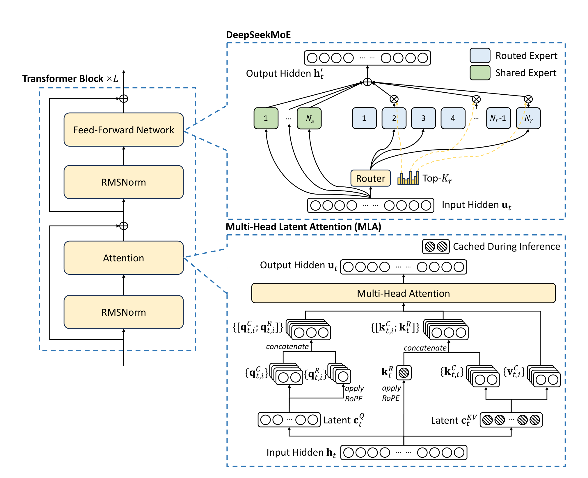

# DeepSeek-V3 Technical Report

## 来源信息

| 项 | 内容 |
| --- | --- |
| 标题 | DeepSeek-V3 Technical Report |
| 作者 | DeepSeek-AI（arXiv 元信息记 “DeepSeek-AI and 199 other authors”；Appendix A 按三节字母序排列） |
| 机构 | DeepSeek-AI |
| 来源 | [arXiv:2412.19437v2](https://arxiv.org/abs/2412.19437)（[PDF](https://arxiv.org/pdf/2412.19437v2)） |
| 版本 | v2（2025-02-18 提交；53 页）；本笔记按 v2 阅读 |
| 阅读日期 | 2026-11-22 |

---

## 核心结论

一句话：**DeepSeek-V3 不是靠一个新模块取胜，而是把 671B 总参 / 37B 激活的 MoE、MLA、无辅助损失负载均衡、MTP、FP8 混合精度、DualPipe 双向流水线和 R1 蒸馏一起工程化，在 14.8T token 上把预训练 + 上下文扩展 + 后训练的全流程压到 2.788M H800 GPU 小时（约 557.6 万美元），同时把开源模型的评测推到 GPT-4o / Claude-3.5-Sonnet 附近。**

- **架构**：沿用 DeepSeek-V2 已验证的 MLA + DeepSeekMoE；新增按专家维护的偏置 $b_i$ 做无辅助损失负载均衡，只保留极小的序列级辅助损失（$\alpha=10^{-4}$）；MTP 深度 $D=1$。
- **训练系统**：2048 张 H800；16-way PP × 64-way EP（跨 8 个节点）× ZeRO-1 DP；DualPipe 把 attention、dispatch、MLP、combine 切成可重排的块并双向灌 micro-batch；20 个 SM、10 个通信通道做跨节点 all-to-all。
- **精度与成本**：所有 GEMM 用 FP8（E4M3），激活按 1×128 tile、权重按 128×128 block 量化，每 $N_C=128$ 个 MMA 把部分和提升到 CUDA core 的 FP32；预训练 2,664K + 上下文扩展 119K + 后训练 5K = 2,788K GPU 小时。
- **后训练**：1.5M SFT 实例；用内部 R1 生成推理数据并经「领域专家 SFT+RL → 两类样本 → 拒绝采样」蒸馏；规则 RM + 模型 RM；GRPO；开放任务用 constitutional AI + 自投票做 self-rewarding。
- **结果与边界**：chat 版 MMLU 88.5、GPQA 59.1、MATH-500 90.2、SWE-bench Verified 42.0、Arena-Hard 85.5；但 SimpleQA 24.9 明显低于 GPT-4o 的 38.2，SWE 也低于 Claude 的 50.8，base 版在若干英语/中文任务上并非最高。

---

## 问题

DeepSeek-V2 已经验证了 MLA 与 DeepSeekMoE 的可行性；V3 的问题不是「要不要换架构」，而是**在 671B 总参、14.8T token 的规模上，如何把训练成本、通信开销和数值稳定性同时压住**。原文的问题意识可以拆成五条：

1. **负载均衡与模型性能的冲突**。MoE 需要均衡专家负载，否则会路由坍缩、EP 下计算效率下降；传统 auxiliary loss 通过梯度把负载推向均衡，但权重太大会损害模型性能。V3 想要一种「只影响路由、不影响 gating 权重」的均衡手段。

2. **跨节点 all-to-all 是主要瓶颈**。64-way EP 跨 8 个节点，计算/通信比约 1:1；不把通信藏进计算，扩模型就会被网络卡住。DualPipe 与自定义 all-to-all kernel 都为这一点服务。

3. **FP8 在超大模型上的可行性未知**。激活/权重/梯度都有 outliers，Hopper 的 FP8 GEMM 累加精度只有约 14 bit；直接上 FP8 可能训练不稳。V3 需要细粒度量化 + 高精度累加，并证明在万亿 token 级别不崩。

4. **每个 token 只有一个 next-token 监督信号**。MTP 让每个位置多预测一个未来 token，既加密训练信号，也可能让表示提前规划；推理时还能把 MTP 模块当投机解码的 draft。

5. **R1 的长 CoT 很强但啰嗦**。直接把 R1 输出拿来 SFT 会带来 overthinking、格式差、过长；V3 需要把 R1 的反思/验证模式蒸馏进普通模型，同时控制输出长度。

评测层面的动机也明确：开源模型在知识、代码、数学上仍落后闭源；V3 想用 base + chat 两套结果证明「开源也能接近 GPT-4o / Claude-3.5-Sonnet」。

这份报告还刻意把训练成本公开到 GPU 小时与美元，让「便宜」成为可核对的工程结论，而不只是评测分数。

---

## 核心想法

### 一句话

不换范式，只在 V2 已验证的 MLA + MoE 上，把「规模放大时最先卡住的四个环节」逐个换成可工程化的机制。

### 四个瓶颈，四个机制

- **负载均衡**：auxiliary loss 把均衡写进梯度，权重一大就伤模型。V3 改成给每个专家一个只参与 Top-K 选择的偏置 $b_i$：过载减 $\gamma$、欠载加 $\gamma$。gating 仍用原始 affinity，$b_i$ 不参与 gating。
- **通信**：EP 很大时 all-to-all 与计算几乎 1:1。DualPipe 把 forward/backward chunk 拆成 attention、dispatch、MLP、combine，重排后双向灌 micro-batch，让 all-to-all 与 PP 通信都躲进计算。
- **数值**：FP8 的动态范围靠「小组共享一个 scaling factor」解决——激活 1×128、权重 128×128；累加精度靠每 128 个 MMA 把部分和搬到 CUDA core 的 FP32 寄存器解决。
- **监督**：MTP 在主模型每个位置之后接一个轻量模块，用共享 embedding/输出头多预测一个 token；训练时加密信号，推理时可当 draft。

### 为什么这些机制能一起成立

- **稀疏激活决定了成本口径**：671B 总参但每 token 只激活 37B，训练成本主要由激活部分与通信决定，所以「把总参做大、把激活压住」在工程上是划算的。
- **每个机制都有受控证据**：MTP 与无辅助损失均衡各做了 10 个 benchmark × 2 个规模的消融，20 个组合里各 17 个改善；FP8 在 16B / 230B 上与 BF16 对比，相对 loss error <0.25%。
- **省下的显存可以换 batch**：MLA 压缩 KV cache、FP8 压缩权重与激活、DualPipe 让两份参数在 EP 很大时不显著——这些省下来的空间最终都变成更大的 batch 或更长的序列。

### 与已有做法的区别

| 环节 | 常见做法 | V3 的做法 |
| --- | --- | --- |
| 负载均衡 | auxiliary loss 压 gating | 路由偏置 $b_i$，不碰 gating |
| 低精度训练 | per-tensor scaling | 1×128 / 128×128 分组 + FP32 累加 |
| 流水线 | 1F1B / ZB1P 单向 | DualPipe 双向、通信计算重排 |
| 投机解码 | 单独训练 draft 模型 | 复用 MTP 模块，共享 embedding/head |

### 一个走通的账

预训练 2.664M H800 小时、上下文扩展 0.119M、后训练 0.005M，合计 2.788M；按 2 美元/GPU·小时是 5.576M 美元。每万亿 token 180K 小时，按 2048 卡满利用率折算约 3.7 天；按同一口径，14.8T token 的预训练约 54.2 天——原文只说「less than two months」，与这组数字一致。

FP8 的账更能说明「为什么需要细粒度」：原文的例子是两个随机矩阵、内维 $K=4096$，不做累加精度提升时最大相对误差接近 2%；把每 $N_C=128$ 个 MMA 的部分和提升到 FP32 后，16B / 230B 规模上的相对 loss error 保持在 0.25% 以下。

### 代价

- **工程复杂度高**：DualPipe 要手调通信/计算占用的 SM 比例，FP8 要自定义 PTX 与 kernel，MLA 与 MTP 都要改训练图；这不是「打开一个开关」。
- **依赖 Hopper 的硬件特性**：FP8 的累加精度问题是 Hopper Tensor Core 的缺陷，V3 的绕法是妥协；换硬件要重做。
- **部署门槛高**：prefill 最小 32 GPU、decode 最小 320 GPU；「训练便宜」不等于「推理便宜」。
- **收益依赖任务结构**：MTP 与负载均衡的消融都是「多数改善、少数变差」，不是每一项都更好。

---

## 方法

### 符号表

| 符号 | 含义 | 维度 / 取值 |
| --- | --- | --- |
| $t,j,i$ | token / 位置下标；$t_{i+k}$ 为位置 $i+k$ 的 token | — |
| $d,d_h,d_h^R$ | hidden、每头 content、解耦 RoPE 维度 | 7,168 / 128 / 64 |
| $n_h,d_c,d'_c$ | 注意力头数、KV / Query 压缩维度 | 128 / 512 / 1,536 |
| $\mathbf{h}_t,\mathbf{u}_t,\mathbf{h}'_t$ | 注意力输入 / FFN 输入 / FFN 输出 | $\mathbb{R}^d$ |
| $W^{DKV},W^{UK},W^{UV},W^{KR}$ | KV 下投影、K/V 上投影、RoPE key 投影 | 原文 Eq (1)–(5) |
| $\mathbf{c}_t^{KV},\mathbf{k}_t^C,\mathbf{k}_t^R,\mathbf{v}_t^C$ | KV 压缩 latent、content key、RoPE key、content value | — |
| $W^{DQ},W^{UQ},W^{QR}$；$\mathbf{c}_t^Q,\mathbf{q}_{t,i}$；$\mathbf{o}_{t,i},W^O$ | Query 下/上/RoPE 投影；压缩 latent 与第 $i$ 头 query；注意力输出与输出投影 | 原文 Eq (6)–(11) |
| $N_s,N_r,K_r,M$ | 共享专家数、路由专家数、每 token 激活路由专家数、最多节点数 | 1 / 256 / 8 / 4 |
| $\mathrm{FFN}_i^{(s)},\mathrm{FFN}_i^{(r)}$；$s_{i,t},e_i$ | 第 $i$ 个共享 / 路由专家；token 与专家的 affinity、专家 centroid | intermediate 2,048 |
| $g_{i,t},g'_{i,t}$ | 归一化 gating、未归一化 gating | — |
| $b_i,\gamma$ | 第 $i$ 个专家的路由偏置、bias 更新速度 | 前 14.3T token $\gamma=0.001$ |
| $\alpha,\mathcal{L}_{Bal},f_i,P_i,T$ | 序列级平衡损失权重、平衡损失、路由比例、平均归一化 affinity、序列 token 数 | $\alpha=10^{-4}$ |
| $D,\lambda$ | MTP 深度、MTP 损失权重 | $D=1$；$\lambda=0.3\to0.1$ |
| $M_k,\mathrm{Emb},\mathrm{TRM}_k,\mathrm{OutHead}$ | 第 $k$ 层投影、embedding、Transformer block、输出头 | embedding/head 与主模型共享 |
| $\mathbf{h}_i^k,\mathbf{h}_i'^k,\mathcal{L}_{MTP}^k$ | 第 $k$ 个预测深度在位置 $i$ 的表示 / 融合后输入、该深度的损失 | $k=0$ 为主模型 |
| $N_C,K$ | FP8 部分和提升到 FP32 的 MMA 间隔、GEMM 内维 | 128 / — |
| $\pi_\theta,\pi_{old},\pi_{ref},\mathcal{J}_{GRPO},D_{KL}$ | 当前 / 采样 / 参考策略、GRPO 目标、KL 估计器 | — |
| $G,o_i,q,r_i,A_i$ | 组大小、第 $i$ 条回答、问题、奖励、优势 | — |
| $\rho_i,\epsilon,\beta$ | 重要性采样比、clip 范围、KL 系数 | 原文未给 $\epsilon,\beta$ 数值 |
| $\alpha,\beta,s,t$（YaRN）；$\beta_1,\beta_2$（AdamW） | YaRN 的缩放参数与缩放项；AdamW 矩系数 | $s=40$、$\alpha=1$、$\beta=32$；$\beta_1=0.9$、$\beta_2=0.95$ |
| $P,F,B,W,F\&B$ | PP 阶段数、forward chunk、backward chunk、仅权重 backward、重叠后的 F&B | 原文 Table 2 |

### 1. 总体架构

V3 仍是 Transformer 框架，但把 FFN 换成 DeepSeekMoE、把注意力换成 MLA。Figure 2 是原文的架构图：左侧是 Transformer block，右上角是 DeepSeekMoE（1 个共享专家 + 256 个路由专家，每个 token 选 8 个路由专家），右下角是 MLA（只缓存 $c_t^{KV}$ 与 $k_t^{R}$）。



*Figure 2（原文 p7）：绿色为共享专家，蓝色为路由专家；MLA 中标 “Cached During Inference” 的 $c_t^{KV}$ 与 $k_t^{R}$ 是推理时只需缓存的量。*

主模型配置（§4.2）：61 层、hidden 7,168、128 头 × 每头 128、$d_c=512$、$d'_c=1,536$、$d_h^R=64$、1 个共享专家 + 256 个路由专家、每 token 激活 $K_r=8$、每个专家 intermediate 2,048、前 3 层为 dense FFN、$D=1$、词表 128K、总参数 / 激活参数 671B / 37B、每 token 最多去 $M=4$ 个节点。注意「8 个专家」只算路由专家，共享专家另算；「671B / 37B」是总参数 / 每 token 激活参数，不是训练时的显存占用。前向数据流是 $h_t\to$ MLA $\to u_t\to$ MoE $\to h'_t$，MTP 在 $h_i^0$ 之后接一个模块。

### 2. MLA：只缓存压缩 latent 和 RoPE key

MLA 的核心是「KV 联合低秩压缩」：不缓存完整的 per-head key/value，而是缓存一个压缩 latent $c_t^{KV}$，推理时再上投影出 key/value；同时单独保留一个带 RoPE 的解耦 key $k_t^{R}$。

**原文 Eq (1)–(5)**

```math
\mathbf{c}_t^{KV}=W^{DKV}\mathbf{h}_t,\qquad
\mathbf{k}_t^C=W^{UK}\mathbf{c}_t^{KV},\qquad
\mathbf{k}_t^R=\mathrm{RoPE}(W^{KR}\mathbf{h}_t),\qquad
\mathbf{k}_{t,i}=[\mathbf{k}_{t,i}^C;\mathbf{k}_t^R]
```

**逐项读法**：$c_t^{KV}$ 是 KV 的压缩向量（维度 $d_c=512$），$W^{UK}$ 把它上投影成所有头的 content key；$k_t^{R}$ 是单独走 RoPE 的 key，拼接在每个头的 key 后面。推理时只需缓存 $c_t^{KV}$ 与 $k_t^{R}$，这是 MLA 省 KV cache 的来源；value 由同一 latent 上投影得到（$v_t^C=W^{UV}c_t^{KV}$，原文 Eq (5)）。

Query 侧也做低秩压缩，目的是省训练时的激活显存，而不是省推理 cache：$c_t^Q=W^{DQ}h_t$，再上投影得到 $q_t^C$ 与走 RoPE 的 $q_t^R$，每个头的 query 为 $q_{t,i}=[q_{t,i}^C;q_{t,i}^R]$（原文 Eq (6)–(9)）。

**原文 Eq (10)–(11)**

```math
\mathbf{o}_{t,i}=\sum_{j=1}^{t}\mathrm{Softmax}_j\left(\frac{\mathbf{q}_{t,i}^\top\mathbf{k}_{j,i}}{\sqrt{d_h+d_h^R}}\right)\mathbf{v}_{j,i}^C,\qquad
\mathbf{u}_t=W^O[\mathbf{o}_{t,1};\dots;\mathbf{o}_{t,n_h}]
```

**逐项读法**：分母同时包含 content 维度 $d_h$ 与 RoPE 维度 $d_h^{R}$；value 只用 content 部分 $v_{j,i}^{C}$，不带 RoPE；最后把所有头的输出拼接后过 $W^O$ 得到注意力输出 $u_t$。原文只给公式与「只缓存蓝框向量」的说明，没有给 MLA 与 MHA 的逐项 FLOPs 对比。

### 3. DeepSeekMoE：把负载均衡从损失里拿出来

DeepSeekMoE 的 FFN 输出是「共享专家 + Top-K 路由专家」：

**原文 Eq (12)–(15)**

```math
\mathbf{h}'_t=\mathbf{u}_t+\sum_{i=1}^{N_s}\mathrm{FFN}_i^{(s)}(\mathbf{u}_t)+\sum_{i=1}^{N_r}g_{i,t}\mathrm{FFN}_i^{(r)}(\mathbf{u}_t),\qquad
g_{i,t}=\frac{g'_{i,t}}{\sum_{j=1}^{N_r}g'_{j,t}},\qquad
s_{i,t}=\mathrm{Sigmoid}(\mathbf{u}_t^\top e_i)
```

**逐项读法**：$g_{i,t}$ 是归一化后的 gating 值，$s_{i,t}$ 是 token 与专家 centroid $e_i$ 的 affinity；$g'$ 只保留 Top-$K_r$ 个专家（未选中的为 0），再在所有路由专家上归一化，所以实际是在被选中的专家之间归一化。与 V2 的差异是：V3 用 sigmoid 算 affinity，并在被选中的专家之间做归一化。

**无辅助损失负载均衡**（§2.1.2）是 V3 的关键改动。为每个专家引入偏置 $b_i$，只加在「选 Top-K」这一步（原文 Eq (16)）：

```math
g'_{i,t}=\begin{cases}
s_{i,t}, & s_{i,t}+b_i\in\mathrm{Topk}\left(\{s_{j,t}+b_j\}_{j=1}^{N_r},K_r\right),\\
0, & \text{otherwise}
\end{cases}
```

**逐项读法**：$b_i$ 只决定「这个专家是否被选中」，真正乘到 FFN 输出上的 gating 仍由原始 affinity $s_{i,t}$ 归一化得到，$b_i$ 不参与 gating。训练时每个 step 统计整个 batch 的专家负载：某个专家过载就把 $b_i$ 减 $\gamma$，欠载就加 $\gamma$；$\gamma$ 是 bias update speed。这样负载均衡通过「路由偏置」实现，不会像 auxiliary loss 那样把梯度压到 gating 权重上。

V3 仍保留一个极小的序列级辅助损失（原文 Eq (17)）：$\mathcal{L}_{Bal}=\alpha\sum_{i=1}^{N_r}f_iP_i$，其中 $f_i$ 是路由到专家 $i$ 的 token 比例（按 $N_r/K_r$ 缩放），$P_i$ 是该专家在所有 token 上的平均归一化 affinity。V3 取 $\alpha=10^{-4}$，原文说这「只是为了避免任何单序列内的极端不平衡」。

另外两条工程约束：

- **Node-limited routing 与 no token dropping**：每个 token 最多送到 $M=4$ 个节点，节点按「该节点上最高的 $K_r/M$ 个 affinity 之和」选择，从而控制跨节点 IB 流量、保留节点内 NVLink 带宽；训练与推理全程不丢 token，推理侧靠冗余专家部署保证均衡。原文没有给「丢 token 率」的对照数字，这是设计声明而非测量结果。

### 4. MTP：每个位置多预测一个 token

MTP 用 $D$ 个顺序模块预测 $D$ 个额外 token；每个模块共享 embedding 与输出头，但有自己的 Transformer block。第 $k$ 层的输入把「上一层在位置 $i$ 的表示」与「位置 $i+k$ 的 token embedding」拼起来（原文 Eq (21)）：

```math
\mathbf{h}_i'^{k}=M_k\left[\mathrm{RMSNorm}\left(\mathbf{h}_i^{k-1}\right);\mathrm{RMSNorm}\left(\mathrm{Emb}(t_{i+k})\right)\right]
```

**逐项读法**：$M_k$ 是一个 $d\times 2d$ 的线性投影，把上一层的 hidden 与「未来第 $k$ 个 token」的 embedding 融合；然后过第 $k$ 层的 Transformer block，用共享输出头预测 $t_{i+k+1}$。$k=1$ 时，$h_i^{0}$ 就是主模型在位置 $i$ 的表示。

训练目标是各深度交叉熵的平均，再乘权重 $\lambda$（原文 Eq (25)）：$\mathcal{L}_{MTP}=\frac{\lambda}{D}\sum_{k=1}^{D}\mathcal{L}_{MTP}^k$。V3 取 $D=1$，即只多预测一个 token；$\lambda$ 在前 10T token 为 0.3，后 4.8T 降为 0.1。原文的 Figure 3 用 $D=2$ 的通用形式示意（Module 1 / Module 2，Next2 / Next3）；V3 实际只训练一个 MTP 模块（$D=1$），不要把示意图读成两个模块。

推理时有两种用法：直接丢掉 MTP 模块，主模型独立工作；或把 MTP 模块当投机解码的 draft，提升生成速度。原文在 §5.4.3 报告第二个 token 的接受率在 85%–90%，带来 1.8× TPS；这两个数字没有分主题表，也没有说明测量协议。

### 5. 训练基础设施：DualPipe、all-to-all、显存

**集群与并行**（§3.1–3.2）：2048 张 H800，每节点 8 张，节点内 NVLink/NVSwitch，节点间 IB。训练用 16-way PP、64-way EP（跨 8 个节点）、ZeRO-1 DP；按 2048 卡反推 DP=2（原文只写 ZeRO-1 DP，没有给 degree，这是本笔记的复算）。64-way EP 正好覆盖 8 节点 × 8 卡。

**DualPipe**（§3.2.1）：把每个 chunk 拆成 attention、all-to-all dispatch、MLP、all-to-all combine 四个组件；backward 再拆成「对输入的梯度」与「对权重的梯度」。一对 forward/backward chunk 内部重新排列这些组件，并手动调整通信/计算占用的 SM 比例，让 all-to-all 与 PP 通信都藏进计算。完整调度是双向的：micro-batch 从流水线两端同时灌入。Table 2 的 bubble 对比是 $\text{bubble}_{1F1B}=(P-1)(F+B)$、$\text{bubble}_{ZB1P}=(P-1)(F+B-2W)$、$\text{bubble}_{DualPipe}=(P/2-1)(F\&B+B-3W)$；DualPipe 把与 $P$ 相关的项从 $P-1$ 降到 $P/2-1$，代价是保存两份模型参数和略高的峰值激活（$P+1$ vs $P$）。原文说在 EP 很大时两份参数的内存开销不显著；DualPipe 只要求 PP 阶段与 micro-batch 能被 2 整除，不要求 micro-batch 能被 PP 阶段整除。

**跨节点 all-to-all**（§3.2.2）：NVLink 160 GB/s，IB 50 GB/s，约 3.2 倍差距。V3 限制每个 token 最多去 4 个节点；先按「同节点同卡号」经 IB 发到目标节点，再在节点内用 NVLink 转发到具体专家。这样平均每个 token 每节点选 3.2 个专家，8 个路由专家最多可扩到 13 个（4 节点 × 3.2）而不增加通信成本。通信只用 20 个 SM（H800 有 132 个），分成 10 个 channel，用 warp specialization 分别处理 IB 发送、IB→NVLink 转发、NVLink 接收等任务；还用自定义 PTX 与自动调 chunk size 降低 L2 干扰。

**显存**（§3.2.3）：重算所有 RMSNorm 与 MLA up-projection，不持久保存它们的输出激活；EMA 参数放 CPU，异步更新；DualPipe 把最浅层（embedding）与最深层（输出头）放同一个 PP rank，从而让 MTP 模块与主模型物理共享 embedding/输出头的参数和梯度。这样训练可以不用 TP。

### 6. FP8：细粒度量化 + 精度提升

- **混合精度框架**（§3.3.1、§3.3.3）：所有 GEMM（Fprop、Dgrad、Wgrad）用 FP8，输入 FP8，输出 BF16 或 FP32；embedding、输出头、MoE gating、normalization、attention 保持 BF16/FP32；master weights 与 weight gradients 用 FP32，AdamW 一阶/二阶矩用 BF16。Wgrad 的激活缓存用 FP8；attention 后 Linear 的输入用自定义 E5M6，且 scaling factor 取 2 的整数次幂；MoE 的 SwiGLU 输入缓存后用 FP8 重算输出；MoE up-projection 前的激活量化成 FP8 再 dispatch，combine 仍用 BF16。
- **细粒度量化与累加精度**（§3.3.2）：激活按 1×128 tile（每 token 每 128 个 channel）分组缩放；权重按 128×128 block（每 128 个输入 channel × 128 个输出 channel）分组缩放。所有 tensor 都用 E4M3，因为细粒度分组把指数位「共享」给了小组元素，动态范围够用。量化是 online 的：对每个 tile/block 现算最大绝对值，得到 scaling factor，再量化，不依赖历史最大值。Hopper 的 FP8 GEMM 在 Tensor Core 内只保留约 14 bit 的累加精度，$K$ 很大时误差会放大；V3 每 $N_C=128$ 个 MMA（约 4 个 WGMMA）把部分和从 Tensor Core 拷到 CUDA core 的 FP32 寄存器，做全精度累加，再乘 scaling factor 反量化。$N_C=128$ 是「能显著改善精度、又不引入明显开销」的最小间隔。
- **失败模式**（Appendix B.2）：如果对 Dgrad 的激活梯度也按 128×128 block 量化（像权重那样），16B MoE 训练约 300B token 后会发散。作者推测原因是激活梯度在 token 间高度不平衡，产生 token-correlated outliers，block-wise 量化压不住；所以 Dgrad 仍用 1×128 / 128×1 的 tile-wise 分组。

### 7. 预训练：数据、超参、长上下文

- **数据与超参**（§4.1–4.2）：14.8T token；相比 V2 提高数学/代码比例，扩展英中之外的多语言；文档打包但不做跨样本 attention mask；FIM 用 PSM 格式，比例 0.1；Byte-level BPE，128K 词表；新 pretokenizer 引入「标点+换行」组合 token，但训练时随机拆分一部分，缓解 token boundary bias。序列长度 4K；AdamW，$\beta_1=0.9$、$\beta_2=0.95$、weight decay 0.1；学习率 0 → $2.2\times10^{-4}$（前 2K 步线性 warmup），保持到 10T token，在 4.3T token 内 cosine 降到 $2.2\times10^{-5}$，最后 500B 中前 333B 保持 $2.2\times10^{-5}$、后 167B 用 $7.3\times10^{-6}$；batch 前 469B token 从 3,072 增到 15,360，之后保持；gradient clipping 1.0；$\gamma$ 前 14.3T 为 0.001、最后 500B 为 0；$\lambda$ 前 10T 为 0.3、后 4.8T 为 0.1。
- **长上下文**（§4.3）：预训练 4K；之后用 YaRN 做两阶段扩展，每阶段 1000 步：4K → 32K（batch 1920）→ 128K（batch 480）。YaRN 只作用在解耦 key $k_t^{R}$ 上；$s=40$、$\alpha=1$、$\beta=32$、$\sqrt{t}=0.1\ln s+1$；两阶段学习率都是 $7.3\times10^{-6}$。

### 8. 后训练：SFT、R1 蒸馏、GRPO、self-rewarding

- **SFT**（§5.1）：1.5M 指令数据，覆盖多个域。推理数据用内部 DeepSeek-R1 生成；R1 的输出准确但 overthinking、格式差、过长。做法是先训练一个领域专家模型（SFT + RL），让它生成两类样本：`<problem, original response>` 与 `<system prompt, problem, R1 response>`；system prompt 引导模型做反思与验证。RL 阶段用高温采样，让模型在无显式 system prompt 时也能把 R1 的模式融进自己的输出；最后用拒绝采样挑高质量数据训练最终模型。非推理数据用 V2.5 生成，再人工核验。SFT 训 2 个 epoch，学习率 $5\times10^{-6}$ → $1\times10^{-6}$，cosine；单序列由多个样本打包，但用 sample masking 让样本互相不可见。**奖励模型**（§5.2.1）方面，规则 RM 用于可验证任务（数学最终答案放在 box 里、LeetCode 用编译器跑测试）；模型 RM 从 V3 SFT checkpoint 训练，用于自由形式答案与无标准答案的任务。模型 RM 的偏好数据不仅给最终 reward，还给「得到 reward 的 CoT」，以降低 reward hacking；原文没有给 RM 的规模、数据量或训练细节。
- **GRPO**（§5.2.2）：不训练 critic，用同一问题的一组输出估计 baseline。原文 Eq (26)：

```math
\mathcal{J}_{GRPO}(\theta)=\mathbb{E}\left[\frac{1}{G}\sum_{i=1}^{G}\left(\min\left(\rho_i(\theta)A_i,\mathrm{clip}\left(\rho_i(\theta),1-\epsilon,1+\epsilon\right)A_i\right)-\beta D_{KL}\left(\pi_\theta\|\pi_{ref}\right)\right)\right]
```

**逐项读法**：$\rho_i(\theta)=\pi_\theta(o_i\mid q)/\pi_{old}(o_i\mid q)$ 是重要性采样比；$A_i$ 是第 $i$ 条回答的优势，由奖励 $r_i$ 在组内标准化得到，$A_i=(r_i-\operatorname{mean}(r))/\operatorname{std}(r)$（原文 Eq (28)）；对 $\rho_i$ 做 clip；再减到参考模型的 KL。KL 用原文 Eq (27) 的估计器：$D_{KL}(\pi_\theta\|\pi_{ref})=\frac{\pi_{ref}(o_i\mid q)}{\pi_\theta(o_i\mid q)}-\log\frac{\pi_{ref}(o_i\mid q)}{\pi_\theta(o_i\mid q)}-1$，不是简单的 log ratio。$\epsilon$、$\beta$ 的具体数值没有给。
- **Self-rewarding**（§5.4.2）：开放任务没有硬编码的验证器，V3 用 constitutional AI 的思路，把模型自己对多个候选的投票结果作为反馈源；再加 constitutional inputs 可以让模型朝指定方向优化。原文把这视为「LLM 作为通用处理器，把非结构化信息转成 reward」的一种范式，但没有给投票数、prompt 模板或独立消融。

### 9. 与已有方法的结构差异

- **vs auxiliary loss / per-tensor FP8**：$b_i$ 只改 Top-K 选择，gating 仍用原始 affinity；FP8 用 1×128 / 128×128 分组 scaling + 每 128 MMA 的 FP32 累加，解决 outliers 与 Hopper 的 14-bit 累加限制。
- **vs 1F1B / ZB1P 与单独 draft 模型**：DualPipe 双向灌 micro-batch，把 bubble 的 $P$ 项减半，代价是两份参数与略高激活；MTP 复用主模型的 embedding 与输出头，推理时可丢弃，也可当 draft。

---

## 主要结果

**评测口径**（§4.4.1、§5.3.1）：base 的多选题用 perplexity，生成类用 generation，Pile 用 BPB。Chat 的 MMLU/DROP/GPQA/SimpleQA 用 simple-evals 的 prompt，MMLU-Redux 用 Zero-Eval 的 zero-shot 格式，其他数据集按各自原始协议；HumanEval-Mul 覆盖 8 种语言；LCB 取 2024-08 至 2024-11 的题，分 CoT 与非 CoT；Codeforces 用 percentile；SWE-bench Verified 用 agentless；Aider 用 diff；AIME/CNMO 温度 0.7、16 次平均；MATH-500 greedy；所有模型最多输出 8192 token。Baselines 为 DeepSeek-V2-0506、V2.5-0905、Qwen2.5 72B Instruct、LLaMA-3.1 405B Instruct、Claude-3.5-Sonnet-1022、GPT-4o-0513。

**结论**：

1. **Base 模型在多数 benchmark 领先，尤其 code/math**：HumanEval 65.2、MBPP 75.4、LiveCodeBench-Base 19.4、GSM8K 89.3、MATH 61.6、CMath 90.7、MGSM 79.8；MMLU 87.1、MMLU-Pro 64.4、BBH 87.5、DROP 89.0、C-Eval 90.1、MMMLU 79.4。但它不是全面领先：LLaMA-3.1 405B 在 HellaSwag 89.2（V3 88.9）、PIQA 85.9（84.7）、WinoGrande 85.2（84.9）、RACE-Middle 74.2（67.1）、RACE-High 56.8（51.3）更高，Pile BPB 0.542 也优于 V3 的 0.548；中文侧 Qwen2.5 的 CMMLU 89.5 高于 88.8，V2-Base 的 CMRC 77.4、CCPM 93.0 高于 76.3、92.0。RACE 是 V3-Base 最明显的短板。
2. **Chat 版在多数 benchmark 接近或超过 GPT-4o / Claude-3.5-Sonnet，但事实性与工程任务仍有明显差距**：MMLU 88.5、MMLU-Pro 75.9、GPQA 59.1、DROP 91.6、MATH-500 90.2、AIME 2024 39.2、Codeforces 51.6 percentile、IF-Eval 86.1；SimpleQA 24.9 明显低于 GPT-4o 38.2 与 Claude 28.4，SWE-bench Verified 42.0 低于 Claude 50.8，Aider-Edit 79.7 低于 84.2；但 Aider-Polyglot 49.6 高于 Claude 的 45.3。
3. **开放式对话领先**：Arena-Hard 85.5（Claude 85.2、GPT-4o 80.4、V2.5 76.2）；AlpacaEval 2.0 length-controlled 70.0（Claude 52.0、GPT-4o 51.1、V2.5 50.5）。
4. **两个关键消融都是「多数改善、少数变差」**：MTP 在 10 个 benchmark × 2 个规模上 17 个改善、1 个持平、2 个变差；无辅助损失均衡同样 17 个改善、1 个持平、2 个变差，两处 MMLU 下降。不是「每一项都更好」。
5. **R1 蒸馏提升推理但显著加长输出**：在 V2.5 上，LiveCodeBench-CoT 31.1 → 37.4（+6.3），平均长度 718 → 783（+9.1%）；MATH-500 74.6 → 83.2（+8.6），平均长度 769 → 1510（+96.4%）。
6. **长上下文**：YaRN 扩展到 128K；SFT 后的 NIAH 在 2K–128K、0–100% 深度上基本全是 10 分，但 NIAH 只测「找针」，不等价于长上下文推理。

**主表**（Table 6/7 的代表性行；「对照」是该行在笔记记录的基线中最高者，不是全部基线）：

| 基准 | DeepSeek-V3 | 对照（最强已知） |
| --- | ---: | --- |
| MMLU | 88.5 | LLaMA-3.1 405B 88.6 |
| MMLU-Pro | 75.9 | Claude-3.5-Sonnet 78.0 |
| GPQA | 59.1 | Claude-3.5-Sonnet 65.0 |
| SimpleQA | 24.9 | GPT-4o 38.2 |
| MATH-500 | 90.2 | Qwen2.5 72B 80.0 |
| AIME 2024 | 39.2 | Qwen2.5 72B 23.3 |
| SWE-bench Verified | 42.0 | Claude-3.5-Sonnet 50.8 |
| Arena-Hard | 85.5 | Claude-3.5-Sonnet 85.2 |
| AlpacaEval 2.0 | 70.0 | Claude-3.5-Sonnet 52.0 |

---

## 边界与局限

**作者明确承认的**：

- 部署单元大：prefill 最小 32 GPU、decode 最小 320 GPU，对小团队是负担；端到端生成速度虽 >2× V2，作者仍认为不够（§6）。动态冗余也仍在探索：prefill 与 decode 都只给出设想，decode 侧还需要优化全局路由算法并与 dispatch kernel 融合（§3.4.2）。

**读者根据证据提出的**：

- 英语事实性与工程任务仍是短板：SimpleQA 24.9 vs GPT-4o 38.2、SWE 42.0 vs Claude 50.8、Aider-Edit 79.7 vs 84.2；base 的 RACE-Middle/High、HellaSwag、PIQA、WinoGrande、CMMLU、CMRC、C3、CCPM 也不是最高。
- 评测缺少方差/置信区间：小于 1000 样本的 benchmark 会多次运行，但没给重复次数、方差或 CI；闭源模型通过 API 评测，版本与解码参数不完全可控。MTP 的 85%–90% 接受率与 1.8× TPS 也不可复算：没有分主题接受率、测量 batch size、硬件与 baseline 定义。
- FP8 的全规模证据只证明训练稳定，不证明与 BF16 等价：受控对比只在 16B（1.33T token）/ 230B（0.9T token），671B 全量没有 BF16 对照。全文也没有训练 FLOPs（`FLOPs` 0 次），只有 GPU 小时与美元；数据配比、SFT 域比例、GRPO 的 $\epsilon$/$\beta$、RM 规模、self-rewarding 的投票数都没给。
- 128K 是 YaRN 扩展，不是原生训练；长上下文评测除 NIAH 外只有 DROP、LongBench v2、FRAMES，没有按 128K 长度分层、多跳、摘要或代码库级任务。「不丢 token」则是设计声明：训练与推理都没有丢 token 的对照测量。

---

## 与其他工作的关系

- **DeepSeek-V3.2**（00133，[笔记](../2512.02556-v1-deepseek-v3.2/note.md)）：V3 的后续独立版本，在 V3.1-Terminus 上继续预训练植入 DSA，再用混合 RL 推到 GPT-5 附近；读 DSA 前先看本笔记的 MLA 压缩，会更容易理解「为什么 DSA 要建在 MLA 的 MQA 模式上」。
- **DeepSeek-V4 / V4.1-Flash**（00172 / 00191，[V4 笔记](../deepseek-v4/note.md)、[V4.1-Flash 笔记](../deepseek-v4.1-flash/note.md)）：更后面的代际；V3 把 V2 的 MLA/DeepSeekMoE 推到 671B 并新增 MTP，V3.2/V4 是后续代际，不能拿 V4 的数字回填 V3。
- **Kimi K2**（00083，[笔记](../2507.20534-v2-kimi-k2/note.md)）：把 V3 当作直接架构基线：61 层、MLA、8 激活专家、1 共享专家相同；不同点是总专家 256→384、激活参数 37B→32.6B、头数 128→64、dense layer 3→1，并去掉 expert grouping。
- **GLM-5 / DSpark / mHC**：GLM-5 在 MLA 头数上引用 V3 的 H800 roofline 经验，其 MTP 用 3 个共享参数层，与 V3 的 $D=1$ 单层形成对照；DSpark 的 baseline MTP-1 引自 V3；mHC 把 baseline 描述为 V3 风格的 MoE，但 V3 的残差流是标准残差，不要混为同一模型。
- **同名不同文提醒**：V3、V3-0324、V3.1、V3.1-Terminus、V3.2 是不同 checkpoint/报告；本笔记只覆盖 2024-12 的 V3 技术报告（v2 是 2025-02 的编辑修订，不是新模型）。

<!-- 复核档案见同目录 audit.md（不随站点发布） -->
