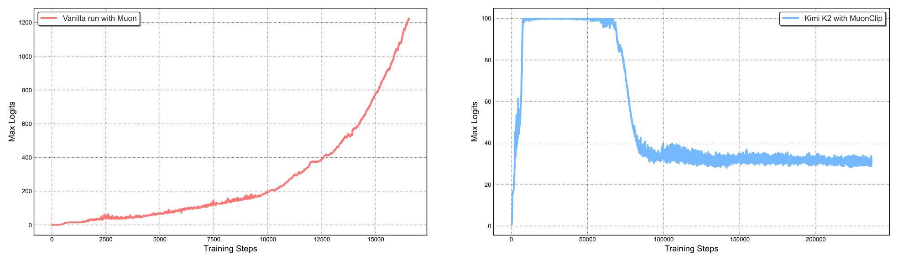

# Kimi K2: Open Agentic Intelligence

## 来源信息

| 项 | 内容 |
| --- | --- |
| 标题 | Kimi K2: Open Agentic Intelligence（Technical Report of Kimi K2） |
| 作者 | Kimi Team（199 位作者） |
| 机构 | Moonshot AI（Kimi Team） |
| 来源 | [arXiv:2507.20534v2](https://arxiv.org/abs/2507.20534v2)（2026-02-03） |
| 许可 | CC BY-NC-ND 4.0 |
| 版本 | 本笔记基于 v2（32 页）；v1 与 v2 差异见 `audit.md` |
| 阅读日期 | 2026-11-07 |

---

## 核心结论

一句话：**K2 把「超稀疏 MoE + MLA + 64 个注意力头」推到 1.04T 总参数 / 32.6B 激活，用 MuonClip（Muon + 逐头 QK-Clip）在 15.5T token 上做到零 loss spike；再用「大规模合成工具调用轨迹 + 可验证奖励与自我批评 rubric 的 RL」把非思考模式下的 agentic 能力推到开源模型前列。**

- **解决什么问题**：Muon 在大规模训练时注意力 logit 会爆炸，而 QK-Norm 要求推理时物化 K，偏偏不适用于 MLA；同时高质量 agentic 轨迹在自然数据里又稀疏又昂贵。
- **核心想法**：不改前向，只在优化器更新后按头缩放 Q/K 投影，把最大 logit 压到阈值 $\tau$；agentic 数据则用「合成工具 / agent / 任务 + 真实 sandbox 校正」造出来，再叠加 RL。
- **怎么做到**：384 个路由专家、每 token 激活 8 个（外接 1 个共享专家），64 头 MLA；15.5T token 的 WSD 预训练 + 128k YaRN；SFT 后用 K1.5 的平方误差 RL 目标，加 budget control、PTX 辅助 loss 与 temperature decay。
- **关键结果**：SWE-bench Verified 65.8（多次尝试 71.6）、SWE-bench Multilingual 47.3、Tau2-Bench 66.1（micro）、ACEBench 76.5、LiveCodeBench v6 53.7、AIME 2025 49.5、GPQA-Diamond 75.1；LMSYS Arena 2025-07-17 快照为开源第 1、总榜第 5。
- **定位与边界**：「开源 SOTA」要按 Table 3 逐项拆：ACEBench、Tau2 micro、Aider-Polyglot、MMLU-Pro、Arena-Hard 的 hard prompt、MRCR 都有更强的对照；QK-Clip 的「不伤质量」目前只有小规模 loss 曲线支撑。

---

## 问题

论文的出发点不是「再做一个更大的 MoE」，而是三个约束同时收紧。

**一、高质量人类数据有限。** 预训练的边际收益取决于每个 token 能提供多少学习信号（token efficiency）。K2 的选择是用 Muon 替代 AdamW——Moonlight 的结果显示同算力下 Muon 更好——再用数据重述把高质量 token 的效用榨干。

**二、Muon 在大规模下会炸注意力 logit。** 论文在 9B 激活 / 53B 总参的 MoE 上用 vanilla Muon，最大 logit 很快超过 1000；原文说这个量级通常会导致训练不稳定，包括显著的 loss spike 甚至偶发发散，但没有说这次 9B/53B 运行实际出现了 spike 或发散。已有的 logit soft-cap 是在点积之后才截断，数值问题已经发生；QK-Norm 又要求推理时能物化 K，而 MLA 恰恰不物化 K。

**三、agentic 能力在自然数据里稀疏且昂贵。** 多步推理、长程规划、工具调用很难从网页文本里直接学到；真实环境又受成本、隐私、可访问性限制。K2 的解法是「合成工具、agent、任务、轨迹」+「真实 sandbox 校正」，再叠加 RL。

在架构层面，DeepSeek-V3 的 256 专家 / 128 头也不是显然的最优解：在总参数放大时，应该继续加专家还是加头，需要 scaling law 来回答，而不是照抄上一代配置。

在评测层面，K2 要证明的是「非思考模式」下的能力：所有模型都在 non-thinking 配置下比较，避免 test-time compute 带来的额外增益，也避免把「会多想几步」误当成模型本身更强。

对照也按这个口径选：开源侧是 DeepSeek-V3-0324 与 Qwen3-235B-A22B（no-thinking），闭源侧是 Claude Sonnet 4、Claude Opus 4、GPT-4.1 与 Gemini 2.5 Flash Preview（2025-05-20）。

因此论文的分数只与这些非思考基线比较，不与开了 test-time compute 的推理模型混在一起。

这些问题把论文的工作拆成四块：MuonClip、agentic 数据合成管线、可验证奖励 + 自我批评 rubric 的 RL 框架，以及一套面向 1T 模型的训练/RL 基础设施。

---

## 核心想法

### 一句话

不换掉 MoE/MLA 这套骨架，而是把「规模放大时最先失控的三个环节」——注意力数值、专家/头数取舍、agentic 数据——分别换成可工程化的机制。

### 直觉：把控制信号从计算图里拿出来

Muon 的更新矩阵接近满秩，权重奇异值容易一起长大；注意力 logit 是 $W_qW_k^\top$ 的双线性量，奇异值一涨就被平方放大，很快从几百冲到上千。softmax 一饱和，梯度就坏，接着是 loss spike 甚至发散。

已有的两种办法都卡在「前向」里：logit soft-cap 在点积之后才截断，数值问题已经发生；QK-Norm 要归一化 K，可 MLA 推理时只保留压缩 latent，K 根本不物化。

QK-Clip 换了个位置：它不改当前 step 的前向，而是在优化器更新完权重之后，用「这个 batch 里每个头的最大 logit」当反馈，把 Q/K 投影乘一个小因子。因为 logit 对 $W_q$、$W_k$ 是双线性的，Q 乘 $\gamma^\alpha$、K 乘 $\gamma^{1-\alpha}$，点积大约乘 $\gamma$，下一步的最大 logit 就被拉回阈值 $\tau$。代价是它只对下一步生效——当前 step 已经发生的 logit 不会被救回来。

### 为什么按头、按 MLA 分量裁

论文先写「所有头一起裁」，随后观察到只有一小部分头会爆炸，于是改成逐头因子 $\gamma_h=\min(1,\tau/S_\max^h)$。这一步对普通 MHA 很直接；MLA 不行，因为 MLA 的 K 由头相关的压缩分量与跨头共享的 RoPE 分量拼成。

K2 的做法是只裁「非共享」的部分：$q_C$、$k_C$ 各乘 $\sqrt{\gamma_h}$，$q_R$ 乘 $\gamma_h$，共享的 $k_R$ 不动。直觉很直白——$k_R$ 是所有头共用的，动它等于用一个头的爆炸信号改所有头的表示；只缩 $q_R$ 同样能把 $q_R\cdot k_R$ 压下来。

### 架构：两个反直觉取舍

**专家数从 256 增到 384。** 在固定激活参数（即固定 FLOPs）下，增加总专家数会同时降低训练与验证 loss。以验证 loss 1.5 为目标，稀疏度 48 相对 8/16/32 分别省 1.69×/1.39×/1.15× FLOPs。K2 因此选 384 个路由专家、每 token 激活 8 个；按 DeepSeek-V3 的表格惯例再加 1 个共享专家，实际参与计算的是 8 路由 + 1 共享 = 9 个（原文没有明说「9」，这是按惯例的解读）。

**注意力头从 128 减到 64。** 在等 token 条件下，头数翻倍只带来 0.5%–1.2% 的验证 loss 改善；但在固定 384 专家、128k 序列的例子中，头数从 64 增到 128 会让推理 FLOPs 增加 83%。长上下文下这笔账不划算。

两个取舍都不是拍脑袋：它们各自有一条 scaling law 曲线支撑；反过来，K2 报告没有给 MLA 的压缩维度、head dim、RoPE 维度与 tokenizer，这些是复现时最缺的形状信息。

### 数据：重述、合成、RL 三件事

**重述**解决「高质量知识只训一遍不够、多训几遍又过拟合」。做法是让模型在不同风格/视角下重写原文，长文档切块、带上下文重写，再做保真度校验。SimpleQA 上，原文重复 10 遍是 23.76；先重述一次再重复 10 遍是 27.39；重述 10 次、只训 1 遍是 28.94。论文没有说明三种设置的 token 预算是否对齐，所以不能把这组对比直接当成等算力实验。

**agentic 数据**解决「真实工具调用轨迹太贵」。管线分三段：先造工具（3,000+ 个真实 MCP 工具、20,000+ 个合成工具），再给数千个 agent 配任务与 rubric，最后用 user simulator、tool simulator 与 judge 生成并过滤轨迹；编码任务接真实 sandbox，用测试通过率做 rejection sampling。规模是「数万条」高质量示例，不是百万级。

**RL** 沿用 K1.5 的平方误差目标：每个问题采样 K 条回答，把「去基线的奖励」当目标、把「策略比率」当步子，最小化两者差的平方。它不是 PPO 的 clipped surrogate，也不是 GRPO 的组相对形式。K2 在规模上再加三个稳定器：per-sample token budget、PTX 辅助 loss、temperature decay。

### 一个走通的账

MuonClip 的证据是 Figure 2：vanilla Muon 在 9B 激活 / 53B 总参的中等规模实验里，最大 logit 一路涨到约 1,220；K2 用 $\tau=100$ 的 MuonClip，logit 很快顶到 100，维持到约 6.5 万–6.8 万步后自行下降，8.6 万–9 万步后稳定在 30–35。

触发比例也说明它只在前期干活：前 70,000 步只有 12.7% 的头至少触发过一次 QK-Clip；70,000 步之后所有头都低于阈值，QK-Clip 不再生效。论文的说法是「transiently active」，稳定后「deactivated and has no effect at all」。

---

## 方法

### 符号表

| 符号 | 含义 | 维度 / 取值 |
| --- | --- | --- |
| $h$ | 注意力头下标 | K2 共 64 头 |
| $d$ | 每个头的打分缩放维度 | 原文未定义；按上下文理解为 head dim |
| $\mathcal{B}$ | 一个 batch 的样本集合 | 原文未给大小 |
| $\mathbf{X}$ | batch 中的一个样本 | — |
| $i,j$ | token 位置下标 | — |
| $\mathbf{Q}_i^h,\mathbf{K}_j^h$ | 第 $h$ 头在位置 $i$/$j$ 的 query / key 向量 | 原文未给维度 |
| $S_\max^h$ | 第 $h$ 头在一个 batch 内的最大注意力打分 | 标量 |
| $\tau$ | QK-Clip 的阈值 | K2 取 100 |
| $\alpha$ | Q/K 缩放分配指数 | 0.5（MHA 写法） |
| $\gamma_h$ | 第 $h$ 头的缩放因子 | $(0,1]$ |
| $\mathbf{W}_q^h,\mathbf{W}_k^h$ | 第 $h$ 头的 Q / K 投影权重 | 原文未给形状 |
| $\mathbf{W}_t$ | 第 $t$ 步（及上一步 $\mathbf{W}_{t-1}$）的权重 | 与梯度同形 |
| $\mathbf{M}_t$ | 第 $t$ 步的动量 | 与权重同形 |
| $\mathbf{G}_t$ | 第 $t$ 步的梯度 | 与权重同形 |
| $\mu$ | momentum 系数 | 原文未给数值 |
| $\mathbf{O}_t$ | 正交化后的更新 | 与权重同形 |
| $n,m$ | 被更新权重矩阵的两个维度 | 原文未定义；按上下文理解为行数、列数 |
| $\mathrm{NewtonSchulz}(\cdot)$ | Newton–Schulz 正交化 | — |
| $\eta$ | 学习率 | 预训练 $2\times10^{-4}\to2\times10^{-5}$，退火 $2\times10^{-5}\to7\times10^{-6}$ |
| $\lambda$ | weight decay | 0.1 |
| $q_C,k_C,q_R,k_R$ | MLA 中头相关的压缩 Q/K 分量与 RoPE Q/K 分量 | 原文未给维度 |
| $x$ | RL 中的问题 | — |
| $L_{\mathrm{RL}}(\theta)$ | RL 目标函数 | 标量 |
| $\mathcal{D}$ | 问题分布 | — |
| $K$ | 每题采样回答数 | 原文未给数值 |
| $y_i$ | 第 $i$ 条回答 | — |
| $r(x,y_i)$ | 回答的奖励 | 标量 |
| $\bar r(x)$ | $K$ 条回答的平均奖励 | 标量 |
| $\tau$（RL） | 平方误差目标的正则系数 | 原文只写 $\tau>0$；与 QK-Clip 的阈值同名但含义不同 |
| $\theta$ | 策略参数 | — |
| $\mathbb{E}$ | 对问题分布的期望 | — |
| $\pi_\theta,\pi_{\mathrm{old}}$ | 当前策略、采样时的旧策略 | — |

### 数据流

```text
知识/数学语料 → 重述与保真度校验 → 4,096 上下文预训练（MuonClip）
        → 退火 400B@4k + 60B@32k → YaRN 128k
        → SFT（通用 + agentic 轨迹）→ RL（可验证奖励 + rubric）
```

一次 Muon 更新走：计算梯度 → 动量累积 → Newton–Schulz 正交化 → RMS 匹配 → weight decay → 更新权重 → 按头检查 $S_\max^h$ → 超过 $\tau$ 才缩放 Q/K。QK-Clip 发生在权重更新之后，所以不改变当前 step 的前向/反向，只影响下一步。

### 1. MuonClip：把 Muon 的 logit 爆炸按住

**Muon 更新**

```math
\mathbf{M}_t=\mu\mathbf{M}_{t-1}+\mathbf{G}_t,\qquad
\mathbf{O}_t=\mathrm{NewtonSchulz}(\mathbf{M}_t)\cdot\sqrt{\max(n,m)}\cdot 0.2,\qquad
\mathbf{W}_t=\mathbf{W}_{t-1}-\eta\left(\mathbf{O}_t+\lambda\mathbf{W}_{t-1}\right)
```

**逐项读法**：$\mathbf{M}_t$ 是动量，$\mu$ 是 momentum 系数，$\mathbf{G}_t$ 是本步梯度；$\mathrm{NewtonSchulz}(\cdot)$ 把动量矩阵正交化，乘 $\sqrt{\max(n,m)}\cdot0.2$ 是为了把更新的 RMS 缩放到与 Adam 一致（$n,m$ 是权重矩阵的两个维度，原文未定义，按上下文理解为行数与列数）；最后连同 weight decay（$\lambda$）一起更新 $\mathbf{W}_t$。论文引用 Moonlight 的结论：同算力、同模型规模下 Muon 明显优于 AdamW，所以它被当作「token 效率」的一部分。

**最大注意力 logit**

```math
S_{\max}^{h}=\frac{1}{\sqrt{d}}\max_{\mathbf{X}\in\mathcal{B}}\max_{i,j}\mathbf{Q}_i^h\mathbf{K}_j^{h\top}
```

**逐项读法**：$h$ 是头，$d$ 是每个头的打分缩放维度（原文未定义，按上下文理解为 head dim），$\mathcal{B}$ 是一个 batch；$\mathbf{Q}_i^h$ 与 $\mathbf{K}_j^h$ 是第 $h$ 头在位置 $i$、$j$ 的 query 与 key。整个式子在「所有样本 × 所有 token 对」上取 softmax 前的最大打分，得到一个头一个标量。vanilla Muon 的中等规模实验里，这个值很快超过 1000；一旦继续涨，softmax 会饱和、梯度数值变差。

**QK-Clip（MHA 写法）**

```math
\gamma_h=\min\left(1,\frac{\tau}{S_{\max}^{h}}\right),\qquad
\mathbf{W}_q^h\leftarrow\gamma_h^{\alpha}\mathbf{W}_q^h,\qquad
\mathbf{W}_k^h\leftarrow\gamma_h^{1-\alpha}\mathbf{W}_k^h
```

**逐项读法**：$\gamma_h$ 是「把这个头的最大 logit 拉回 $\tau$ 需要缩多少」，$\tau$ 是阈值（K2 取 100）。$\alpha=0.5$ 时 Q 和 K 各乘 $\sqrt{\gamma_h}$，点积大约乘 $\gamma_h$，正好把 $S_\max^h$ 压到 $\tau$。这一步发生在优化器更新之后，不改变当前 step 的前向/反向，只是给下一步的权重增长踩刹车。这个 $\alpha$ 版本是论文对普通 MHA 的逐头写法。

**MLA 的三分量处理**：MLA 不按 $\alpha$ 二分，而是只裁「非共享」的头相关分量——$q_C$ 与 $k_C$（头相关的压缩分量）各乘 $\sqrt{\gamma_h}$；$q_R$（头相关的 RoPE 分量）乘 $\gamma_h$；$k_R$（跨头共享的 RoPE 分量）不动。理由是 $k_R$ 被所有头共享，动它等于用一个头的爆炸信号改所有头的表示；只缩 $q_R$ 同样能把 $q_R\cdot k_R$ 压下来，因为乘积里只有 $q_R$ 被缩。



*左图：vanilla Muon 的最大 logit 持续上升；右图：K2 用 $\tau=100$ 的 MuonClip 把 logit 压在 100 附近，训练中后段自行降到 30–35。逐点读数见 `audit.md`。*

### 2. 架构与预训练

K2 是 1.04T 总参 / 32.6B 激活的 MoE Transformer，结构跟 DeepSeek-V3 类似：61 层，hidden 7,168，专家 hidden 2,048，MLA 注意力。与 DeepSeek-V3 的差异是：总专家 256→384（+50%），每 token 仍激活 8 个路由专家（外接 1 个共享专家），总参数 +54%、激活参数 −13%（原文的 Δ 列；按表内数字复算约 +55% / −12%）；注意力头 128→64（−50%）；dense layer 3→1；去掉 expert grouping。论文没有解释后两个改动的原因，只给了表格差异。

**「8 out of 384」与「稀疏度 48」都只算路由专家；把共享专家并进去会得到 384/9 ≈ 42.7，那不是论文的口径。**

预训练配方：4,096 上下文、15.5T token、每步 67M token 的 batch，WSD schedule；前 10T 用 500 步 warm-up 后常数 $2\times10^{-4}$，后 5.5T 余弦降到 $2\times10^{-5}$，weight decay 0.1。退火阶段再训练 400B token（4k）与 60B token（32k），学习率 $2\times10^{-5}\to7\times10^{-6}$，最后用 YaRN 扩到 128k。Figure 3 的 per-step loss 从约 2.0 降到约 1.3（图中读数）；图注称训练全程没有尖峰，并明确说「为了清晰省略了训练最开始的一小段」，约 11T 处有一个很小的上冲，按原文口径不算 loss spike。

**数据重述**分知识数据与数学数据两条。知识数据用三个组件：风格/视角多样化提示（受 WRAP 启发）、分块自回归生成（长文档先切段，带上下文重写再拼回；图 4 标 256 token 的 partial input 与 4096 token 的 full input）、保真度校验（比较重述段落与原文的语义对齐）。数学文档改写成「学习笔记」风格（沿用 SwallowMath），并把其他语言的高质量数学材料翻成英文。论文说这套方法扩到其他大规模知识语料也有类似收益，每个语料最多重述两次。

### 3. 后训练（一）：SFT 与 agentic 数据合成

SFT 数据的原则是「prompt 多样性 + 回答质量」；管线混合人工标注、prompt engineering 与验证，用 K1.5 和内部领域专家模型生成候选回答，再用 LLM/human judge 过滤。

真正的重点是 **agentic 数据合成**，分三段：

1. **工具规格生成**：从 GitHub 抓 3,000+ 个真实 MCP 工具；用层级式领域演化合成 20,000+ 个合成工具——先定金融交易、软件应用、机器人控制等大类，再演化子领域，最后为每个领域生成接口、描述与操作语义。
2. **agent 与任务生成**：合成不同的 system prompt，给每个 agent 配不同的工具组合，生成数千个 agent；为每个 agent 配置从简单到复杂的任务，每个任务配一份显式 rubric（成功标准、期望的工具调用模式、评测检查点）。
3. **轨迹生成与过滤**：user simulator 生成不同风格/偏好的用户画像，与 agent 多轮对话；tool simulator 功能上等价于 world model，维护并更新状态，支持多步交互与持久效果，并引入受控随机性（成功、部分失败、边界情况）；judge 按 rubric 评轨迹，只保留满足成功标准的轨迹。

对编码与软件工程，K2 不只靠模拟：它接真实执行 sandbox，跑真实代码、真实开发环境，用测试套件通过率做 ground truth。这条混合管线本质上是大规模 rejection sampling；论文给的规模是「数万条」高质量示例（tens of thousands），不是百万级。

### 4. 后训练（二）：RL

对每个问题 $x$，从旧策略 $\pi_{\mathrm{old}}$ 采样 $K$ 条回答，最小化：

```math
L_{\mathrm{RL}}(\theta)=\mathbb{E}_{x\sim\mathcal{D}}\left[\frac{1}{K}\sum_{i=1}^{K}\left(r(x,y_i)-\bar{r}(x)-\tau\log\frac{\pi_\theta(y_i\mid x)}{\pi_{\mathrm{old}}(y_i\mid x)}\right)^2\right]
```

**逐项读法**：$r(x,y_i)$ 是第 $i$ 条回答的奖励，$\bar r(x)=(1/K)\sum_i r(x,y_i)$ 是这 $K$ 条回答的平均奖励（基线），$\tau>0$ 是正则系数（与 QK-Clip 的阈值同名但无关）。把「去基线的奖励」当成目标、把「策略比率」当成可调的步子，最小化平方项会把 $\log(\pi_\theta/\pi_{\mathrm{old}})$ 往 $(r-\bar r)/\tau$ 拉：奖励高的回答提高概率、奖励低的降低概率，$\tau$ 控制步子大小。它和 PPO 的 clipped surrogate 不是同一个目标，也不是 GRPO 的组相对形式。

在 K2 的规模上，论文还加了三件事：**budget control** 按任务类型设 per-sample 最大 token 预算，超出的回答截断并罚分，防止 RL 把回答越写越长；**PTX loss** 把一份手工挑选的高质量数据以辅助 loss 的形式混进 RL 目标，防止在有限任务上过拟合并忘记通用能力；**temperature decay** 早期用高采样温度鼓励探索，后期逐步降低转向利用。

**可验证奖励 gym** 覆盖五类任务：数学/STEM/逻辑用专家标注、内部 QA 抽取与公开数据（NuminaMath、AIMO-2 等），逻辑题包括多跳表格推理、24 点、数独、谜语、密码算术、摩斯码解码，难度用 SFT 模型的 pass@k 筛到「中等」；复杂指令遵循用规则验证 + LLM judge + hack-check（检测模型「声称完成但实际没做」）；忠实性用受 FACTS Grounding 启发的句级 faithfulness judge；编码/SWE 用公开与合成竞赛题、人工单元测试，SWE 环境从 GitHub 的 PR/issue 构建，Kubernetes sandbox 支持 10,000+ 并发实例；安全用人工种子 prompt 覆盖暴力、诈骗、歧视等风险类别，再用 attack model / target model / judge model 做自动化 prompt 演化。

**Self-critique rubric reward** 用于没有可验证奖励的主观任务（创意写作、开放问答）：actor 生成、critic 成对比较并按三类 rubric 排序——core rubrics（AI 助手的基本价值）、prescriptive rubrics（消除 reward hacking，例如「不许以恭维开头」）、数据团队为具体场景写的人工 rubric；某些 rubric 可设为 mandatory，但模型仍可结合内部先验权衡。closed-loop critic refinement 用可验证奖励 prompt 的 on-policy rollout 持续更新 critic，把 RLVR 的客观信号蒸馏进 critic。附录 F.3 自己指出副作用：这套 rubric 偏好自信、果断的回答，可能惩罚「我不确定」这类 epistemic humility，在歧义场景下让模型过度自信。

### 5. 训练与 RL 基础设施

集群是 NVIDIA H800，每节点 2 TB RAM、8 张 GPU（节点内 NVLink/NVSwitch），跨节点 8×400 Gbps RoCE。并行用 Pipeline Parallelism（带 virtual stages）+ 16-way Expert Parallelism + ZeRO-1 Data Parallelism，目标是任意「32 的倍数」个节点都能跑；BF16 参数 + FP32 梯度累积缓冲约 6 TB，分布在 256 张卡的 model-parallel group 上，优化器状态按节点数分布，节点少时把一部分 offload 到 CPU。K2 不用 DualPipe（它会把参数与梯度的显存翻倍），而用 interleaved 1F1B，并增加 warm-up micro-batch 来重叠 EP all-to-all。EP=16 是能保持计算-通信完全重叠的最小可行值，因为 64 头让注意力计算变短，必须把 EP 通信时间也压小。

激活侧对 LayerNorm、SwiGLU、MLA up-projection 做 selective recomputation，MoE down-projection 也重算；MoE up-projection 的输入与 SwiGLU 用 FP8-E4M3 存储（1×128 tile、FP32 scale），但计算不用 FP8。RL 侧用 colocated 架构（训练与推理引擎在同一批 worker 上，谁工作时另一方释放/offload GPU），checkpoint engine 让每个 checkpoint engine worker 从训练引擎拿本地副本再广播，完整更新一次 K2 的参数 < 30 秒；agentic rollout 把重环境（VM、代码解释器）做成独立服务，用 partial rollout 把超长轨迹暂停、下一轮继续。

### 6. 工具调用模板与 enforcer

附录 B 把工具调用拆成三段 token 结构：tool declaration、tool invocation、tool result。工具声明用 TypeScript 表达（比 JSON 短，类型系统能表达参数约束），部分训练数据也用 JSON 以兼容第三方框架。并行工具调用放在同一个 assistant turn 里，每个调用有唯一 id：`functions.{tool-name}:{counter}`，counter 在对话内从 0 自增。推理时模型可能生成意外 token 导致解析失败，K2 用受 lm-format-enforcer 启发的 **enforcer** 做约束解码：一旦生成 `<|tool_call_section_begin|>`，后续工具相关 token 必须符合模板，JSON 参数必须符合声明的 schema。

### 7. 与已有方法的结构差异

- **vs AdamW + QK-Norm/logit soft-cap**：Muon 对动量做正交化；QK-Clip 在优化器更新后按头改权重，不改前向，且能用在「推理时不物化 K」的 MLA 上。
- **vs DeepSeek-V3**：同为 61 层 MLA + MoE，但 K2 把总专家 256→384、头数 128→64、dense layer 3→1，并去掉 expert grouping；这不是照抄，而是在「更稀疏 + 更少头」方向上重新做 scaling law。
- **vs PPO/GRPO**：RL 目标不是 clipped surrogate，也不是组相对优势，而是「去基线奖励 − $\tau$×对数比率」的平方误差；稳定器（budget、PTX、temperature decay）独立于具体算法。

---

## 主要结果

**设置**：非思考模式；除 SWE-bench Verified（Agentless）用 16,384 外，其余输出上限 8,192 token；统一 128K 窗口，超出截断；Tau2 用 Avg@4，AIME 2024/2025 用 Avg@64，HMMT 用 Avg@32，CNMO 用 Avg@16，PolyMath 用 Avg@4，GPQA 用 Avg@8；SWE-bench Verified 分 Agentless Single Patch、Agentic Single Attempt、Agentic Multi Attempt 三种口径，SWE-bench Multilingual 只测 Agentic Single Attempt。

**结论**：

1. **agentic 与编码是 K2 最强的面**：SWE-bench Verified 65.8（single attempt）、71.6（multi attempt + 内部 verifier）、SWE-bench Multilingual 47.3、Tau2-Bench 66.1（micro）、ACEBench 76.5。相比开源基线，SWE Verified 的 65.8 远高于 DeepSeek-V3-0324 的 38.8 与 Qwen3-235B-A22B 的 34.4。
2. **数学与知识也进入第一梯队**：LiveCodeBench v6 53.7、OJBench 27.1、AIME 2025 49.5、GPQA-Diamond 75.1、MMLU 89.5、SimpleQA 31.0、IFEval 89.8。
3. **长上下文检索是明显弱项**：MRCR 55.0，低于 Claude Sonnet 4 的 74.4、GPT-4.1 的 66.9、Gemini 2.5 Flash 的 81.7；DROP 93.5 则是全场最高。说明「128k 可用」与「128k 检索强」不是一回事。
4. **「全面领先」有多个反例**：ACEBench 上 GPT-4.1 的 80.1 高于 K2 的 76.5；Tau2 micro（Figure 1）上 Claude Opus 4 的 67.6 高于 66.1；Aider-Polyglot 上 Qwen3 的 61.8 高于 60.0；MMLU-Pro 上 DeepSeek-V3 的 81.2 高于 81.1；Arena-Hard hard prompt 上 Opus 的 59.7 高于 54.5。
5. **Arena 只代表一个时间点**：LMSYS Arena 2025-07-17 快照为开源第 1、总榜第 5（3,000+ 盲投票数）；v2 发布于 2026-02，但引用的仍是 2025-07 的快照。

**主表**（Table 3 节选，p16；完整表共 44 个数据行，本表摘 16 行，省略的 28 行清单与逐表读数见 `audit.md`）：

| Benchmark | Kimi-K2-Instruct | DeepSeek-V3-0324 | Qwen3-235B-A22B | Claude Sonnet 4 | Claude Opus 4 | GPT-4.1 | Gemini 2.5 Flash |
| --- | --- | --- | --- | --- | --- | --- | --- |
| LiveCodeBench v6 (Pass@1) | 53.7 | 46.9 | 37.0 | 48.5 | 47.4 | 44.7 | 44.7 |
| SWE-bench Verified Agentic-Single (Pass@1) | 65.8 | 38.8 | 34.4 | 72.7* | 72.5* | 54.6 | — |
| SWE-bench Verified Agentic-Multi (Pass@1) | 71.6 | — | — | 80.2* | 79.4* | — | — |
| SWE-bench Multilingual (Pass@1) | 47.3 | 25.8 | 20.9 | 51.0 | — | 31.5 | — |
| Aider-Polyglot (Acc.) | 60.0 | 55.1 | 61.8 | 56.4 | 70.7 | 52.4 | 44.0 |
| Tau2 retail (Avg@4) | 70.6 | 69.1 | 57.0 | 75.0 | 81.8 | 74.8 | 64.3 |
| Tau2 airline (Avg@4) | 56.5 | 39.0 | 26.5 | 55.5 | 60.0 | 54.5 | 42.5 |
| Tau2 telecom (Avg@4) | 65.8 | 32.5 | 22.1 | 45.2 | 57.0 | 38.6 | 16.9 |
| AceBench (Acc.) | 76.5 | 72.7 | 70.5 | 76.2 | 75.6 | 80.1 | 74.5 |
| AIME 2025 (Avg@64) | 49.5 | 46.7 | 24.7* | 33.1* | 33.9* | 37.0 | 46.6 |
| GPQA-Diamond (Avg@8) | 75.1 | 68.4* | 62.9* | 70.0* | 74.9* | 66.3 | 68.2 |
| MMLU (EM) | 89.5 | 89.4 | 87.0 | 91.5 | 92.9 | 90.4 | 90.1 |
| SimpleQA (Correct) | 31.0 | 27.7 | 13.2 | 15.9 | 22.8 | 42.3 | 23.3 |
| IFEval (Prompt Strict) | 89.8 | 81.1 | 83.2* | 87.6 | 87.4 | 88.0 | 84.3 |
| MRCR (Acc.) | 55.0 | 50.8 | — | 74.4 | — | 66.9 | 81.7 |
| DROP (Acc.) | 93.5 | 91.2 | 84.3 | 92.0 | — | 79.1 | 81.7 |

*带 `*` 的数字直接取自对应模型的技术报告或博客，不是 K2 自己复跑；完整表里粗体表示全场 SOTA、粗体加下划线表示开源最优，本表未复现这两种格式。Tau2 的 66.1 是 micro-average，不是 retail/airline/telecom 三个 domain 分数的算术平均（三者的简单平均是 64.3，本笔记复算）。*

---

## 边界与局限

**作者明确讨论的**：
- 在困难推理任务或工具定义不清晰时，模型会生成过多 token，导致输出被截断或工具调用不完整；在某些任务上，如果没必要地启用工具，性能反而下降。
- 构建完整软件项目时，一次性 prompt 的成功率不如把 K2 放在 agentic coding framework 里用；自动红队也有主观性，某些 plugin 涉及 API misuse 或外部工具，对 base LLM 的相关性有限，更适合评 agent 模型。

**读者根据证据提出的**：

- **QK-Clip 的「不伤质量」证据偏弱**：只有 0.5B/3B 的 loss 曲线与一句「no statistically significant degradation」，没有下游表、方差或置信区间；「zero loss spike」的 Figure 3 又省略了训练最开始的一小段。
- **agentic 数据规模与安全样本都不大**：「数万条」合成轨迹 + 数千 agent，相对于 1T 模型的后训练不算大，论文没有做数据规模消融；Table 6 每个 plugin-strategy 只有 3 条（双语 6 条）prompt，单个数字不宜当稳定指标。
- **长上下文是短板**：MRCR 55.0 与 Gemini 2.5 Flash 的 81.7、Claude Sonnet 4 的 74.4 差距明显；论文没有解释 64 头 + MLA 在检索任务上的具体损失机制。
- **复现缺口**：报告没有 MLA 的 `q_lora_rank`、`kv_lora_rank`、head dim、RoPE 维度、tokenizer、数据配比、集群卡数、训练时长、总 GPU-hours；权重页面在本机不可达，未验证权重格式与许可。

---

## 与其他工作的关系

- **Kimi Linear（00132）**：K2 是它的直接基础；Kimi Linear 的 1.4T 对照训练沿用 K2 的 MuonClip、WSD、数据管线与 MLA，但 1.4T 是它自己的预算，不是 K2 的 15.5T。
- **Kimi K2.5（00156）**：底座就是 K2（1.04T / 32B 激活 / 384 专家 / 8 激活 / MuonClip），在其上加 MoonViT-3D 视觉编码器、DEP 编码器复制与 PARL agent 编排；K2.5 笔记说「底座细节需查 K2 技术报告」，但 MLA 的压缩维度仍是这份报告的缺口。
- **Kimi K3（00225）**：K2 的后继，注意力从纯 MLA 换成「69 层 KDA + 24 层 MLA（每 4 层一组 3 KDA + 1 MLA，末尾再补一层 MLA）」的 3:1 混合，规模推到 2.78T / 104.2B 激活。
- **DeepSeek-V3（00042）/ V3.2（00133）**：V3 是 K2 的直接架构基线；V3.2 走 DSA 稀疏注意力路线，与 K2 的 MLA + 64 头 + YaRN 128k 形成同期对照。K1.5 提供 RL 目标，Moonlight 提供 Muon 的 scaling 证据。

<!-- 复核档案见同目录 audit.md（不随站点发布） -->
