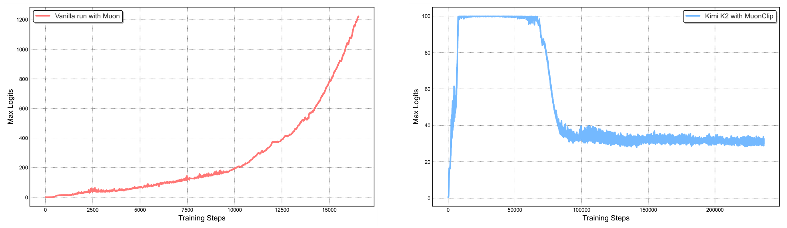

# Kimi K2: Open Agentic Intelligence

## 来源信息

| 项 | 内容 |
| --- | --- |
| 标题 | Kimi K2: Open Agentic Intelligence（PDF 首页全大写；副标题 Technical Report of Kimi K2） |
| 作者 | Kimi Team（arXiv 元信息写「Yifan Bai and 198 other authors」，即 199 位个人作者；PDF 附录 A 按姓氏字母序；v1 用 `*` 标注已离开团队的作者，v2 删除了这条说明并改动了名单） |
| 机构 | Kimi Team（Moonshot AI；PDF 首页不列 affiliation，「Moonshot AI」由 checkpoint 的 `moonshotai` 组织与 GitHub `MoonshotAI` 组织推得）；署名即团队 |
| 来源 | [arXiv:2507.20534v2](https://arxiv.org/abs/2507.20534v2)（cs.LG；cs.AI；cs.CL），v2 日期 2026-02-03；abs 页 Comments 写「tech report of Kimi K2, with minor updates」 |
| 许可 | arXiv 页面标注 CC BY-NC-ND 4.0 |
| 版本历史 | v1 2025-07-28（32 页，6,335,018 B，sha256 `b838917cf0a475d2e1b2f1ba4d0b4c91b6f6c8be95f15aa0d4f3ea76e4ef60f5`）→ v2 2026-02-03（32 页，5,872,335 B，sha256 `035062b5e1ab865ffad9f90f81d6c8332f8af805063fac54cc6f2cca1fe608b5`）。本笔记基于 v2；v1 与 v2 逐页 diff 后，差异只在参考文献编号与补充、作者名单、checkpoint-engine 链接与排版，Table 3/4/6 和正文数字未变 |
| 阅读日期 | 2026-11-07 |
| 阅读范围 | v2 全文 32 页：正文 §1–§7（p2–20）、References（p21–24）、附录 A–G（p25–32）。Table 1/2/3/4/6 已对渲染页核对；Figure 1/2/3/4 已看渲染页，Figure 8/9 在 p10 渲染页上目检；Figure 2 已裁剪为资产；Figure 5/6/12 只按正文与图注引用，Figure 7/10/11/13 未单独查看；所有图都未做像素测量；References 未逐条阅读 |
| 核对凭据 | 本次抓取 PDF 32 页、5,872,335 字节、sha256 `035062b5e1ab865ffad9f90f81d6c8332f8af805063fac54cc6f2cca1fe608b5`（2026-11-07）。Table 1 用 p5（170 dpi）、Table 2 用 p6、Table 3 用 p16（170 dpi，并与 arXiv HTML 表格交叉核对）、Table 4 用 p18、Table 6 用 p19。Figure 2 从 p4 裁剪（300 dpi，裁剪框 70–542 × 316–453 pt；成品 1968×572 px），逐项确认两块面板、图例、纵轴标题与刻度都在框内，边缘无黑边。Figure 1 的柱标签按 x 坐标与柱配对核对。否定性断言检索词：`MLA`/`RoPE`/`q_lora`/`kv_lora`、`error bar`/`variance`/`seed`、`GPU`/`H800`/`H100`、`tokenizer`、`cost`/`GPU-hours` |
| 归档说明 | arXiv 来源，按仓库策略不归档 PDF；仓库清单编号 00083。README 编号列指向的上游归档 `papers/00083-Kimi-K2.pdf` 为 **v1**（6,335,018 B，sha256 `b838917cf0a475d2e1b2f1ba4d0b4c91b6f6c8be95f15aa0d4f3ea76e4ef60f5`），与本笔记的 v2 基准不同；两版数字一致，按 minor updates 处理 |

---

## 复核记录

**2026-11-07–08（第 1 轮，依 check-paper-note，基准 arXiv:2507.20534v2）**：从 arXiv 重新下载 v2 PDF（32 页，5,872,335 B，sha256 `035062b5e1ab865ffad9f90f81d6c8332f8af805063fac54cc6f2cca1fe608b5`），与来源信息记录一致；abs 页确认 v2 仍为最新（无 v3），Comments 为「tech report of Kimi K2, with minor updates」，许可 CC BY-NC-ND 4.0。另下载 v1（32 页，6,335,018 B，sha256 `b838917cf0a475d2e1b2f1ba4d0b4c91b6f6c8be95f15aa0d4f3ea76e4ef60f5`）逐页 diff：v2 对正文的实质补充是 checkpoint-engine 链接，另有 WRAP 归因、工具调用模板修正与段落位置调整；参考文献与作者名单有增删；Table 3/4/6 与正文数字未变。README 编号列指向的上游 `papers/00083-Kimi-K2.pdf` 经 GitHub API 取回并比 sha，确认是 v1。

核对方式：Table 1（p5）、Table 2（p6）、Table 3（p16）、Table 4（p18）、Table 6（p19）对 170 dpi 渲染页核对，Table 3 另与 arXiv HTML 表格交叉核对；Figure 1 的柱标签按 x 坐标与柱配对；Figure 2 从 p4 以 300 dpi 重裁（70–542 × 316–453 pt），与资产 sha256 一致（`ec8216039bdebb561c571e6aead875f09f8766913fd19f0a6492df0fae44e515`）。像素测量（资产坐标）用 PDF 刻度中心定标：左图 x(0)=113 px、x(15000)=823 px，y(0)=494 px、74.2 px/200；右图 x(0)=1119 px、x(50000)=1287 px，y(0)=497 px、4.5 px/单位。读数：左图末端约 16.5k 步、约 1,220；右图 50k–65k 约 100，70k 约 88，80k 约 48，90k 后约 35，200k 约 32；曲线延伸到约 237k 步。Figure 3/4 对 p5/p6 渲染页；Figure 8/9 在 p10 渲染页目检。公式按 PDF 渲染页与 HTML `alttext` 对照：Muon 更新（含动量递推）、`S_max`、QK-Clip、MLA 缩放、RL 目标均一致。检索词：`MLA`/`RoPE`/`q_lora`/`kv_lora`、`tokenizer`、`GPU`/`H800`/`H100`、`error bar`/`variance`/`seed`、`all baselines`、`state-of-the-art`、`zero loss spike`、`deactivated`、`12.7%`。

本轮修正：

- 来源信息补「上游归档为 v1」；机构补「Moonshot AI 由 checkpoint/GitHub 组织推得」。
- Figure 2 读数改为「左图末端约 16.5k 步、约 1,220；右图维持到约 6.5 万–6.8 万步，7 万步约 88，8 万步约 48，约 8.6 万–9 万步后稳定在 30–35，曲线延伸到约 23.7 万步」；初稿曾误用 50k=1317 px 的横轴定标，导致步数整体偏小，已按 PDF 刻度中心 50k=1287 px 重测。
- 补 Tau2 的「all baselines」反例：Figure 1 的 Tau2 micro 面板里 Claude Opus 4 是 67.6 > 66.1；Table 3 的 retail/airline 也是 Opus 更高。
- 补 Arena-Hard hard prompt 的反例（Opus 59.7 > 54.5），并把 §4.1.2 的引文改回 `τ2-Bench`。
- 把「vanilla Muon 随后出现 loss spike 甚至发散」改回原文的「这个量级通常会导致不稳定」；把「QK-Clip deactivated」的出处从「正文」改为「附录 D」。
- 数据重述段改为「论文没有说明三种设置的 token 预算是否对齐」，不再断言预算不同。
- 引言/摘要的 1T/1.04T 分开表述；Table 2 的 Δ 列补复算（+55%/−12% vs 原文 +54%/−13%）。
- Muon 公式补 `M_t = μM_{t-1}+G_t`；QK-Clip 公式注明 α 版本是 MHA 写法，MLA 按三分量处理。
- Table 3/4/6 的节选补全省略行清单（44/23/25 个数据行）；Table 3 补粗体/下划线图例；SWE Multilingual 补「只测 single-attempt」与 Opus 缺测原因。
- Figure 4 改为「4096 标在 full input，输出端未单独标 4096」；Figure 11 的数字改注「p29 正文与 Figure 11」。
- 6 TB 复算改为「与 1.04T 相容，但不能唯一反推」；v2 差异补 WRAP 归因与工具模板修正；K3 的 69/24 补「每 4 层一组 3 KDA + 1 MLA，末尾再补一层 MLA」。
- 核心结论的 QK-Clip 概括补 MLA 例外；9 专家口径标明是 DeepSeek-V3 惯例推断；Figure 3 补「11T 处小上冲、按原文口径不算 spike」。

未修 / 未核：HF `moonshotai/Kimi-K2-Instruct` 页面本机不可达（curl 000），权重格式与许可未验证；Figure 5/6/12 未逐张渲染，Figure 7/10/11/13 未单独查看；References 未逐条阅读；没有运行 K2 代码或复跑评测；checkpoint-engine 的 GitHub 元数据（MIT、日期、stars）按 2026-11-07 查询记录，未复核其与实验的可复现性。独立子 agent 只读审计（1 个全篇 + 1 个关键断言复核）的主要发现已并入上列修正；其未复核项与本记录一致。

---

## 核心结论

一句话：**K2 把「超稀疏 MoE + MLA + 64 个注意力头」推到 1.04T 总参数 / 32.6B 激活，用 MuonClip（Muon + 逐头 QK-Clip）在 15.5T token 上做到零 loss spike；再用「大规模合成工具调用轨迹 + 可验证奖励与自我批评 rubric 的 RL」把非思考模式下的 agentic 能力推到开源模型前列。** 最可复用的两个点是 QK-Clip 的「不改前向、按头缩放 Q/K 投影」和 384 专家 / 稀疏度 48 的架构取舍。

- **MuonClip 是全文最硬的方法贡献**：Muon 在大规模训练时注意力 logit 会爆炸，QK-Norm 又不适用于 MLA（推理时 K 不物化）。对普通 MHA，QK-Clip 在优化器更新后按头把 `W_q`/`W_k` 乘 `γ^α`/`γ^{1-α}`；MLA 则按 `q_C`/`k_C`/`q_R`/`k_R` 三分量缩放。它把最大 logit 压到阈值 `τ`；K2 用 `τ=100`，训练中只有 12.7% 的头在前 70k 步触发过，之后全部低于阈值，等于自动失效。
- **架构上的两个反直觉取舍都有 scaling law 支撑**：专家数从 DeepSeek-V3 的 256 增到 384（稀疏度 48），在同样验证 loss 1.5 下比稀疏度 8/16/32 分别省 1.69×/1.39×/1.15× FLOPs；注意力头从 128 减到 64，因为翻倍头只带来 0.5%–1.2% 的验证 loss 改善，却在 128k 上下文让推理 FLOPs 增加 83%。
- **预训练配方是「WSD + 大 batch + 长上下文退火」**：4,096 上下文、15.5T token、67M token/step 的 batch；前 10T 用常数 2e-4，后 5.5T 余弦降到 2e-5；退火阶段再训练 400B token（4k）与 60B token（32k），学习率 2e-5→7e-6，最后用 YaRN 扩到 128k。
- **后训练的 agentic 数据规模是「数万条」而不是「数百万条」**：3,000+ 个真实 MCP 工具、20,000+ 个合成工具、数千个 agent，按 rubric 生成任务，再用 user simulator + tool simulator + judge 过滤轨迹；编码/SWE 任务接真实 sandbox，用测试通过率做 rejection sampling。
- **RL 沿用 K1.5 的平方误差目标，不是 PPO/GRPO**：每个问题采样 K 条回答，最小化「去基线奖励 − `τ`×对数比率」的平方；再加 budget control、PTX 辅助 loss、temperature decay，以及可验证奖励 gym 与 self-critique rubric reward。
- **主结果**：SWE-bench Verified 65.8（多次尝试 71.6）、SWE-bench Multilingual 47.3、Tau2-Bench 66.1（micro）、ACEBench 76.5、LiveCodeBench v6 53.7、OJBench 27.1、AIME 2025 49.5、GPQA-Diamond 75.1；LMSYS Arena 2025-07-17 快照为开源第 1、总榜第 5（3,000+ 票）。
- **但「全面领先」要打折**：ACEBench 上 GPT-4.1 的 80.1 高于 K2 的 76.5；Tau2 micro 上 Claude Opus 4 的 67.6 高于 66.1；Aider-Polyglot 上 Qwen3 的 61.8 高于 60.0；MMLU-Pro 上 DeepSeek-V3 的 81.2 高于 81.1；Arena-Hard hard prompt 上 Opus 的 59.7 高于 54.5；MRCR 上 K2 的 55.0 明显低于 Claude Sonnet 4 的 74.4 与 Gemini 2.5 Flash 的 81.7。

---

## 版本关系：v1 与 v2 只差「minor updates」

arXiv Comments 写的是「with minor updates」，逐页 diff 验证了这一点：

- **页数与全部实验数字不变**：两版都是 32 页，Table 3/4/6 的每个数字相同，摘要、§2–§6 的结论句相同。
- **v2 对正文的实质补充主要是 checkpoint-engine 链接**：p14 加了「The source code for the checkpoint engine is available on Github」与脚注 `https://github.com/MoonshotAI/checkpoint-engine`；另有 p5 增加「Inspired by WRAP [50]」的归因、p27 把 `<tool_call_section_begin|>` 修正为 `<|tool_call_section_begin|>`，以及 p14–p15 的段落位置调整。
- **其余是参考文献与编辑性改动**：参考文献新增 WRAP、OpenAI Gym、NuminaMath、Aimo-2、Megatron-LM、SimpleQA、LiveBench 等条目并整体重编号；作者名单增删（v1 的「`*` 表示已离开团队」说明被删除）；少量公式排版与断行修正（如 `√γ` 的空格、`∑` 的排版）。
- **对既有笔记的影响**：Kimi Linear 笔记里「1.4T 预训练语料、MuonClip、WSD、SFT/RL 配方都沿用 K2」仍然成立；这里的 1.4T 是 Kimi Linear 自己的对照训练预算，不是 K2 的预训练量（K2 是 15.5T）。K2.5 笔记说「底座 K2 的架构/训练细节需查 K2 技术报告」，但 K2 报告本身没有给全 MLA 的压缩维度（见「局限与待确认」）。

---

## 问题与动机

论文的出发点不是「再做一个更大的 MoE」，而是三个约束同时收紧：

1. **高质量人类数据有限**，预训练的边际收益取决于「每个 token 能提供多少学习信号」（token efficiency）。K2 的选择是用 Muon 替代 AdamW（Moonlight 的结果显示同算力下 Muon 更好），再用数据重述把高质量 token 的效用榨干。
2. **Muon 在大规模下会炸注意力 logit**。论文在 9B 激活 / 53B 总参的 MoE 上用 vanilla Muon，最大 logit 很快超过 1000；原文说这个量级通常会导致训练不稳定，包括显著的 loss spike 甚至偶发发散，但没有说这次 9B/53B 运行实际出现了 spike 或发散。已有的 logit soft-cap 是在 dot product 之后才截断，QK-Norm 又要求推理时能物化 K，而 MLA 恰恰不物化 K。
3. **agentic 能力在自然数据里稀疏且昂贵**。多步推理、长程规划、工具调用很难从网页文本里直接学到；真实环境又受成本、隐私、可访问性限制。K2 的解法是「合成工具、agent、任务、轨迹」+「真实 sandbox 校正」，再叠加 RL。

在这个框架下，K2 的贡献可以分成四条：MuonClip、agentic 数据合成管线、可验证奖励 + 自我批评 rubric 的 RL 框架、以及一套面向 1T 模型的训练/RL 基础设施。

---

## 方法与机制

### 1. MuonClip：把 Muon 的 logit 爆炸按住

#### 1.1 Muon 是什么，为什么 token 效率高

Muon 对权重矩阵的动量做 Newton–Schulz 正交化，再把更新缩放到与 Adam 一致的 RMS。Algorithm 1 的写法是：

```math
\mathbf{M}_t=\mu\mathbf{M}_{t-1}+\mathbf{G}_t,\qquad
\mathbf{O}_t=\mathrm{NewtonSchulz}(\mathbf{M}_t)\cdot\sqrt{\max(n,m)}\cdot 0.2,\qquad
\mathbf{W}_t=\mathbf{W}_{t-1}-\eta\left(\mathbf{O}_t+\lambda\mathbf{W}_{t-1}\right)
```

读法：动量按 `M_t = μM_{t-1} + G_t` 累积（`M_0=0`，`G_t` 是梯度，`μ` 是 momentum）；再把动量正交化，乘 `sqrt(max(n,m)) * 0.2` 做 RMS 匹配，最后连同 weight decay 一起更新。论文引用 Moonlight 的结论：同算力、同模型规模下 Muon 明显优于 AdamW，所以它被当作「token 效率」的一部分。

#### 1.2 问题：logit 爆炸与 MLA 的特殊性

对每个头 `h`，注意力输出是 `softmax(Q_h K_h^T / sqrt(d)) V_h`。论文把 softmax 前的最大输入定义成每个头一个标量：

```math
S_{\max}^{h}=\frac{1}{\sqrt{d}}\max_{\mathbf{X}\in\mathcal{B}}\max_{i,j}\mathbf{Q}_i^h\mathbf{K}_j^{h\top}
```

读法：在一个 batch 里，取所有样本、所有 token 对中最大的那个注意力打分。vanilla Muon 的中等规模实验里，这个值很快超过 1000；一旦它继续涨，softmax 会饱和、梯度数值变差，接着就是 loss spike 或发散。

两个现成方案都不合用：

- **logit soft-cap** 直接截断注意力 logit，但 Q 与 K 的点积在截断之前已经变得很大，数值问题仍然存在。
- **QK-Norm** 对 Q、K 做归一化，但它要求 K 能被显式物化；MLA 在推理时只保留压缩后的 latent，K 不是完整矩阵，所以不能直接套。

#### 1.3 QK-Clip：在优化器更新后缩放权重

QK-Clip 的核心是「把最大 logit 当作控制信号，而不是在前向里改计算」。当 `S_max^h > τ` 时，按头计算缩放因子，再把 Q/K 的投影权重乘回去：

```math
\gamma_h=\min\left(1,\frac{\tau}{S_{\max}^{h}}\right),\qquad
\mathbf{W}_q^h\leftarrow\gamma_h^{\alpha}\mathbf{W}_q^h,\qquad
\mathbf{W}_k^h\leftarrow\gamma_h^{1-\alpha}\mathbf{W}_k^h
```

读法：`γ_h` 是「把这个头的最大 logit 拉回 `τ` 需要缩多少」；`α=0.5` 时 Q 和 K 各乘 `sqrt(γ_h)`，点积大约乘 `γ_h`，正好把 `S_max^h` 压到 `τ`。这一步发生在优化器更新之后，**不改变当前 step 的前向/反向**，只是给下一步的权重增长踩刹车。这个 `α` 版本是论文对普通 MHA 的逐头写法；MLA 不按 `α` 二分，而是按下面的 `q_C`/`k_C`/`q_R`/`k_R` 三分量处理。

论文先给了「所有头一起裁」的朴素版本，随后观察到**只有一小部分头会爆炸**，于是改成逐头 `γ_h = min(1, τ/S_max^h)`。逐头裁剪对普通 MHA 很直接；对 MLA，论文只裁「非共享」的头相关分量：

- `q_C` 与 `k_C`（头相关的压缩分量）：各乘 `sqrt(γ_h)`；
- `q_R`（头相关的 RoPE 分量）：乘 `γ_h`；
- `k_R`（跨头共享的 RoPE 分量）：**不动**，避免一个头的缩放影响其他头。

直觉：MLA 的 `k_R` 是所有头共享的，如果把它也乘 `γ_h`，等于用一个头的爆炸信号去改所有头的表示；只裁 `q_R` 同样能把该头的点积压下来，因为 `q_R · k_R` 里只有 `q_R` 被缩。

Algorithm 1 把 Muon 与 QK-Clip 串成一个优化器：先做 Muon 更新，再对每个注意力头检查 `S_max^h` 是否超过 `τ`，超过就按上面的规则缩放。K2 取 `τ=100`。

#### 1.4 证据：logit 被压住，训练没有 spike



- **左图（图中读数，近似）**：vanilla Muon 的最大 logit 在前 2,500 步上升缓慢，之后持续上升，到约 1.65 万步达到约 1,220；论文说这个量级通常会导致不稳定。
- **右图（图中读数，近似）**：K2 用 MuonClip、`τ=100`，logit 很快顶到 100，维持到约 6.5 万–6.8 万步；随后下降，7 万步约 88，8 万步约 48，约 8.6 万–9 万步后稳定在 30–35。论文的图注说「约 30% 的训练步数后才衰减到稳定区间」；横轴最后一个刻度是 20 万步，曲线延伸到约 23.7 万步（比 20 万刻度多约 18%），下降大致从训练中段开始。
- **触发比例**：前 70,000 步只有 **12.7%** 的注意力头至少触发过一次 QK-Clip；70,000 步之后，所有头都曾把 `S_max` 降到 100 以下，QK-Clip 不再生效。论文的说法是「transiently active」，训练稳定后「deactivated and has no effect at all」。
- **消融**：在 0.5B 激活 / 3B 总参的两个 MoE 上，一个用 vanilla Muon，一个用 MuonClip 且把阈值压到 `τ=30`（更激进），Figure 12 的 loss 曲线几乎重合；论文称下游评测没有统计显著退化。注意这里只给了 loss 曲线与一句「no statistically significant degradation」，没有给下游数字、方差或置信区间，证据强度有限。

#### 1.5 为什么 Muon 更容易炸：一个假设

附录 E 的解释是「假设」而不是定理：

- Muon 的 `msign` 更新让更新矩阵的所有奇异值相等、有效秩接近满秩；Adam 的更新矩阵通常只有少数大奇异值、有效秩低。
- 权重 `W_{t-1}` 与更新 `ΔW_t` 都有较高有效秩时，它们的奇异向量更容易对齐，对应奇异值可能「加性」增长。
- 注意力 logit 是 `(x_i W_q)·(x_j W_k)`，而 `W_q W_k^T` 会把谱范数平方；所以 `W_q` 或 `W_k` 的奇异值一旦增长，logit 会以更快的速度放大。

论文在 16B 的 Moonlight 上观察到 Muon 训练的权重奇异值熵更高（有效秩更高），作为这个假设的旁证；但没有做因果实验证明「有效秩高 → logit 爆炸」就是唯一原因。

---

### 2. 预训练数据：用「重述」提高 token utility

K2 的预训练语料是 15.5T token，分四类：Web Text、Code、Mathematics、Knowledge；大部分处理管线沿用 K1.5。真正的新东西是**合成重述**，用来缓解「高质量知识只训一遍不够、多训几遍又过拟合」的矛盾。

#### 2.1 知识数据重述

三个组件：

1. **风格与视角多样化提示**：受 WRAP 启发，用一组提示让模型在不同风格、不同视角下重述原文，同时保持事实不变。
2. **分块自回归生成**：长文档先切成小段（图 4 标 256 token 的 partial input），每段带着上下文重写，再拼回完整段落（图 4 标 4096 token 的 full input；输出端只标 full output，未单独标 4096）；这样绕开 LLM 的隐式输出长度限制。
3. **保真度校验**：比较重述段落与原文的语义对齐，作为训练前的质量控制。

效果用 SimpleQA 测（Table 1，p5）：

| # Rephrasings | # Epochs | SimpleQA Accuracy |
| --- | --- | --- |
| 0（原始 wiki 文本） | 10 | 23.76 |
| 1 | 10 | 27.39 |
| 10 | 1 | 28.94 |

读法：在「原文重复 10 遍」的基础上，先重述一次再重复 10 遍，SimpleQA 高 3.63 分；把重述次数加到 10 次、只训 1 遍，再高 1.55 分。论文没有说明这三种设置的 token 预算是否对齐；重述会放大数据量，所以不能把这组对比直接当成等算力实验，也不能据此断言「同样的 token 数下重述一定更好」。论文的结论是重述式增广有效，它没有在等 token 预算下单独隔离「重述」与「多 epoch」的贡献。论文说这套方法扩到其他大规模知识语料也有类似收益，每个语料最多重述两次。

#### 2.2 数学数据重述

数学文档被改写成「学习笔记」风格（沿用 SwallowMath 的方法），并把其他语言的高质量数学材料翻成英文。论文自己也承认：合成数据作为继续 scaling 的手段仍是 active area，难点是跨领域泛化、事实准确性、幻觉/毒性控制和大规模可扩展性。

---

### 3. 模型架构：384 专家、64 头、稀疏度 48

K2 是 1.04T 总参 / 32.6B 激活的 MoE Transformer，结构跟 DeepSeek-V3 类似，用 MLA 做注意力；hidden 7,168，专家 hidden 2,048。Table 2（p6）给了与 DeepSeek-V3 的逐项对比：

| 项 | DeepSeek-V3 | Kimi K2 | 变化 |
| --- | --- | --- | --- |
| #Layers | 61 | 61 | = |
| Total Parameters | 671B | 1.04T | ↑54% |
| Activated Parameters | 37B | 32.6B | ↓13% |
| Experts (total) | 256 | 384 | ↑50% |
| Experts Active per Token | 8 | 8 | = |
| Shared Experts | 1 | 1 | = |
| Attention Heads | 128 | 64 | ↓50% |
| Number of Dense Layers | 3 | 1 | ↓67% |
| Expert Grouping | Yes | No | — |

Table 2 的 Δ 列按原文抄录；按表内数字复算，1.04T/671B ≈ +55%、(37−32.6)/37 ≈ −12%，与原文的 +54%/−13% 有 1 个百分点差异（原文的取整/口径未说明）。

两个关键设计都有 scaling law 实验：

- **稀疏度 48**：固定激活参数量（即固定 FLOPs），增加总专家数会同时降低训练与验证 loss。以验证 loss 1.5 为目标，稀疏度 48 相对 8/16/32 分别把所需 FLOPs 降低 **1.69× / 1.39× / 1.15×**。K2 因此选 384 个路由专家、每 token 激活 8 个；按 DeepSeek-V3 的表格惯例，再加上 1 个共享专家，实际参与计算的是 8 路由 + 1 共享 = 9 个专家（原文没有明说「9」，这是按 DeepSeek-V3 表格惯例的解读）。**注意「8 out of 384」和「稀疏度 48」都只算路由专家**，把共享专家并进去会得到 384/9 ≈ 42.7，那不是论文的口径。
- **64 个注意力头**：DeepSeek-V3 把头数设成约两倍层数（128 头 / 61 层），但长上下文下头数翻倍会让推理开销显著上升。论文在等 token 条件下比较「头数 = 层数」与「头数翻倍」：翻倍只带来 **0.5%–1.2%** 的验证 loss 改善；另外，在固定 384 专家、128k 序列的例子中，头数从 64 增到 128 会让推理 FLOPs 增加 **83%**。所以 K2 选 64 头。

Table 2 还显示 K2 去掉了 DeepSeek-V3 的 expert grouping、把 dense layer 从 3 减到 1。论文没有解释这两个改动的原因，只给了表格差异。

**一个重要的信息缺口**：K2 报告只给了层数、hidden、专家 hidden、头数、专家数，没有给 MLA 的 `q_lora_rank`、`kv_lora_rank`、head dim、RoPE 维度、tokenizer 词表等配置。K2.5 笔记说「底座 K2 的架构细节需查 K2 技术报告」，但这份报告本身并不足以复原 MLA 的完整形状。

---

### 4. 训练基础设施：为「任意 32 的倍数节点」设计

- **集群**：NVIDIA H800，每节点 2 TB RAM、8 张 GPU（节点内 NVLink/NVSwitch），跨节点 8×400 Gbps RoCE。
- **并行**：Pipeline Parallelism（带 virtual stages）+ 16-way Expert Parallelism + ZeRO-1 Data Parallelism；目标是任意「32 的倍数」个节点都能跑，同一套并行配置复用于小规模实验和大规模训练。
- **显存**：BF16 参数 + FP32 梯度累积缓冲约 6 TB，分布在 256 张卡的 model-parallel group 上；优化器状态按节点数分布，节点少（如 32）时把一部分 offload 到 CPU；每张卡给「所有状态」留约 30 GB，其余给激活。
- **不用 DualPipe**：DualPipe 会把参数与梯度的显存翻倍，需要更高并行度来补；对 1T 模型不划算。K2 用 interleaved 1F1B，并增加 warm-up micro-batch 来重叠 EP all-to-all；还把 weight-gradient 计算从每个 micro-batch 的 backward 里解耦出来，与 PP 通信并行。
- **EP=16**：K2 只有 64 个注意力头（DeepSeek-V3 是 128），注意力计算时间变短，必须把 EP 通信时间也压小；EP=16 是能保持计算-通信完全重叠的最小可行值，同时放松专家均衡约束。
- **激活**：对 LayerNorm、SwiGLU、MLA up-projection 做 selective recomputation，MoE down-projection 也重算；对 MoE up-projection 的输入与 SwiGLU 用 FP8-E4M3 存储（1×128 tile、FP32 scale），但**计算不用 FP8**（预实验看到性能风险）；剩余激活 offload 到 CPU，copy engine 与计算/通信重叠。

论文没有给集群规模、训练时长、总 GPU-hours 或成本，这些是复现与横向比较时最缺的数字。

---

### 5. 预训练配方

- 上下文 4,096，总 token 15.5T，WSD 学习率 schedule。
- 前 10T：500 步 warm-up 后常数 **2e-4**。
- 后 5.5T：余弦从 **2e-4** 降到 **2e-5**。
- weight decay **0.1**，全局 batch **67M token**。
- 退火阶段：先 400B token、4k 序列，再 60B token、32k 序列；学习率从 2e-5 降到 **7e-6**；最后用 **YaRN** 扩到 128k。
- 后训练（SFT 与 RL）都用 Muon；论文说 Muon 预训练的 checkpoint 用 Muon 微调效果最好。

Figure 3（p5）是未平滑、未抽样的 per-step loss，从约 2.0 降到约 1.3（图中读数）；图注称训练全程没有尖峰，并明确说「为了清晰省略了训练最开始的一小段」。图中约 11T 处有一个很小的上冲，按原文口径不算 loss spike。所以「zero loss spike」的完整证据并不全在这张图里。

---

### 6. 后训练（一）：SFT 与 agentic 数据合成

SFT 数据的原则是「prompt 多样性 + 回答质量」；管线混合人工标注、prompt engineering 与验证，用 K1.5 和内部领域专家模型生成候选回答，再用 LLM/human judge 过滤。

真正的重点是 **agentic 数据合成**，分三段：

1. **工具规格生成**：
   - 从 GitHub 抓 **3,000+ 个真实 MCP 工具**；
   - 用层级式领域演化合成 **20,000+ 个合成工具**：先定金融交易、软件应用、机器人控制等大类，再演化子领域，最后为每个领域生成接口、描述与操作语义。
2. **agent 与任务生成**：
   - 合成不同的 system prompt，给每个 agent 配不同的工具组合，生成数千个 agent；
   - 为每个 agent 配置生成从简单到复杂的任务，每个任务配一份显式 rubric（成功标准、期望的工具调用模式、评测检查点）。
3. **轨迹生成与过滤**：
   - **user simulator**：LLM 生成不同风格/偏好的用户画像，与 agent 多轮对话；
   - **tool simulator**：功能上等价于 world model，维护并更新状态，支持多步交互与持久效果，并引入受控随机性（成功、部分失败、边界情况）；
   - **judge**：按 rubric 评轨迹，只保留满足成功标准的轨迹。

对编码与软件工程，K2 不只靠模拟：它接真实执行 sandbox，跑真实代码、真实开发环境，用测试套件通过率做 ground truth。这条混合管线本质上是大规模 rejection sampling。论文给的规模是「数万条」高质量示例（tens of thousands），不是百万级；这一点在评估「数据规模是否撑得起结论」时很重要。

---

### 7. 后训练（二）：RL

#### 7.1 目标函数：K1.5 的平方误差形式

对每个问题 `x`，从旧策略 `π_old` 采样 K 条回答，最小化：

```math
L_{\mathrm{RL}}(\theta)=\mathbb{E}_{x\sim\mathcal{D}}\left[\frac{1}{K}\sum_{i=1}^{K}\left(r(x,y_i)-\bar{r}(x)-\tau\log\frac{\pi_\theta(y_i\mid x)}{\pi_{\mathrm{old}}(y_i\mid x)}\right)^2\right]
```

其中 `r̄(x) = (1/K) Σ r(x,y_i)` 是这 K 条回答的平均奖励，`τ > 0` 是正则系数。读法（本笔记解读）：把「去基线的奖励」当成目标，把「策略比率」当成可调的步子；最小化平方项会把 `log(π_θ/π_old)` 往 `(r − r̄)/τ` 拉，也就是奖励高的回答提高概率、奖励低的降低概率，同时用 `τ` 控制步子大小。它和 PPO 的 clipped surrogate 不是同一个目标，也不是 GRPO 的组相对形式；笔记里不要把它写成 PPO/GRPO。

在 K2 的规模上，论文还加了三件事：

- **Budget control**：按任务类型设 per-sample 最大 token 预算；超出的回答截断并罚分。目的是防止 RL 把回答越写越长，在非推理任务上浪费推理成本。
- **PTX loss**：把一份手工挑选的高质量数据以辅助 loss 的形式混进 RL 目标，防止在有限任务上过拟合、忘记通用能力。
- **Temperature decay**：早期用高采样温度鼓励探索，后期逐步降低，转向利用。

#### 7.2 可验证奖励 gym

- **数学 / STEM / 逻辑**：专家标注、内部 QA 抽取、公开数据集（NuminaMath、AIMO-2 等）；用 tagging 系统补足覆盖不足的领域；逻辑题包括多跳表格推理、24 点、数独、谜语、密码算术、摩斯码解码。难度用 SFT 模型的 pass@k 筛到「中等」，太简单或太难都少给信号。
- **复杂指令遵循**：规则验证（代码解释器检查长度、格式等）+ LLM judge（细粒度约束）+ **hack-check**（检测模型「声称完成但实际没做」的欺骗行为）；数据来自专家手写、AutoIF 式 agentic augmentation、以及专门探测失败模式的微调模型。
- **忠实性**：受 FACTS Grounding 启发，训练句级 faithfulness judge，检测「没有上下文证据的事实断言」，并把它当奖励模型。
- **编码 / SWE**：竞赛题来自公开数据与合成数据，用人工单元测试保证奖励正确；SWE 环境从 GitHub 的 PR/issue 构建，Kubernetes sandbox 支持 **10,000+ 并发实例**。
- **安全**：人工种子 prompt 覆盖暴力、诈骗、歧视等风险类别；用 attack model / target model / judge model 的自动化 prompt 演化模拟越狱；每个交互按任务 rubric 给二分类通过/失败。

#### 7.3 Self-critique rubric reward

对没有可验证奖励的主观任务（创意写作、开放问答），K2 用「actor 生成、critic 成对比较」的框架：

- critic 按三类 rubric 排序：core rubrics（AI 助手的基本价值，附录 F.1）、prescriptive rubrics（消除 reward hacking，附录 F.2，例如「不许以恭维开头」「不许解释自己为什么好」）、以及数据团队为具体场景写的人工 rubric；
- 某些 rubric 可以设为 mandatory，但模型仍可结合内部先验权衡；
- **closed-loop critic refinement**：用可验证奖励 prompt 的 on-policy rollout 持续更新 critic，把 RLVR 的客观信号蒸馏进 critic，让主观判断跟着策略一起校准。

附录 F.3 自己指出这套 rubric 的副作用：它偏好自信、果断的回答，可能惩罚「我不确定」这类 epistemic humility，在歧义场景下让模型过度自信。

#### 7.4 RL 基础设施

- **Colocated 架构**：训练引擎与推理引擎在同一批 worker 上，谁工作时另一方释放/offload GPU。
- **Checkpoint engine**：参数更新不经过网络文件系统，而是每个 checkpoint engine worker 从训练引擎拿本地副本，再向所有 worker 广播完整参数；推理引擎只取自己需要的 shard。论文称完整更新一次 K2 的参数 **< 30 秒**，对典型 RL iteration 可忽略。代价是广播的数据量比理论最优多几倍，但换来训练/推理引擎解耦。源码在 `MoonshotAI/checkpoint-engine`（MIT；GitHub API 2026-11-07 查询：创建 2025-09-08，最后 push 2026-10-22，1,023 stars）。
- **启动**：训练 worker 选择性读 checkpoint，保证所有 worker 合计只读一次；推理副本通过 checkpoint engine 启动，单点故障不影响其他副本。
- **Agentic rollout**：重环境（VM、代码解释器）做成独立服务，便于扩容；用大量并发 rollout 摊薄长尾延迟；用 partial rollout 把超长轨迹暂停、下一轮继续；提供 Gym 式统一接口接新环境。

---

### 8. 工具调用模板与 enforcer

附录 B 给了工具调用的三段 token 结构：tool declaration、tool invocation、tool result。工具声明用 TypeScript 表达（比 JSON 短，类型系统能表达参数约束），部分训练数据也用 JSON 以兼容第三方框架。

并行工具调用放在同一个 assistant turn 里，每个调用有唯一 id：`functions.{tool-name}:{counter}`，counter 在对话内从 0 自增。推理时模型可能生成意外 token 导致解析失败，K2 用受 lm-format-enforcer 启发的 **enforcer** 做约束解码：一旦生成 `<|tool_call_section_begin|>`，后续工具相关 token 必须符合模板，JSON 参数必须符合声明的 schema。

---

## 实验与证据

### 1. 评测设置

- **非思考模式**：所有模型都在 non-thinking 配置下评测，避免 test-time compute 带来的额外增益。
- **输出长度**：除 SWE-bench Verified（Agentless）用 16,384 外，其余上限 8,192 token。
- **长上下文**：统一 128K 窗口，超出截断。
- **重复采样**：高方差基准用 Avg@k；Tau2 用 Avg@4；AIME 2024/2025 用 Avg@64；HMMT 用 Avg@32；CNMO 用 Avg@16；PolyMath 用 Avg@4；GPQA 用 Avg@8。
- **SWE-bench Verified**：Agentless Single Patch（Acc）、Agentic Single Attempt（Acc）、Agentic Multi Attempt（best-of-N + 内部 verifier）三种口径。
- **SWE-bench Multilingual**：只测 Agentic Single Attempt；Table 3 里 Claude Opus 4 的「—」是因为成本过高（p1 脚注 2），不是模型不支持。
- **基线**：开源 DeepSeek-V3-0324、Qwen3-235B-A22B（no-thinking）；闭源 Claude Sonnet 4、Claude Opus 4、GPT-4.1、Gemini 2.5 Flash Preview（2025-05-20）。
- **数据来源标记**：Table 3 里带 `*` 的数字直接取自对应模型的技术报告或博客，不是 K2 自己复跑。

### 2. 主结果（Table 3 节选）

下表只摘 16 行；完整表在 p16，共 44 个数据行。**省略的 28 行包括**：OJBench、MultiPL-E、SWE-bench Verified Agentless-Single、Multi-SWE-bench、SWE-Lancer、PaperBench、TerminalBench（In-House 与 Terminus）、AIME 2024、MATH-500、HMMT 2025、CNMO 2024、PolyMath-en、ZebraLogic、AutoLogi、SuperGPQA、Humanity's Last Exam、MMLU-Redux、MMLU-Pro、Multi-Challenge、LiveBench、Arena Hard v2.0（Hard Prompt 与 Creative Writing）、FACTS Grounding、HHEM v2.1、FaithJudge、LongBench v2、FRAMES。列序与原文一致。

| Benchmark | Kimi-K2-Instruct | DeepSeek-V3-0324 | Qwen3-235B-A22B | Claude Sonnet 4 | Claude Opus 4 | GPT-4.1 | Gemini 2.5 Flash |
| --- | --- | --- | --- | --- | --- | --- | --- |
| LiveCodeBench v6 (Pass@1) | 53.7 | 46.9 | 37.0 | 48.5 | 47.4 | 44.7 | 44.7 |
| SWE-bench Verified Agentic-Single (Pass@1) | 65.8 | 38.8 | 34.4 | 72.7* | 72.5* | 54.6 | — |
| SWE-bench Verified Agentic-Multi (Pass@1) | 71.6 | — | — | 80.2* | 79.4* | — | — |
| SWE-bench Multilingual (Pass@1) | 47.3 | 25.8 | 20.9 | 51.0 | — | 31.5 | — |
| Aider-Polyglot (Acc.) | 60.0 | 55.1 | 61.8 | 56.4 | 70.7 | 52.4 | 44.0 |
| Tau2 retail (Avg@4) | 70.6 | 69.1 | 57.0 | 75.0 | 81.8 | 74.8 | 64.3 |
| Tau2 airline (Avg@4) | 56.5 | 39.0 | 26.5 | 55.5 | 60.0 | 54.5 | 42.5 |
| Tau2 telecom (Avg@4) | 65.8 | 32.5 | 22.1 | 45.2 | 57.0 | 38.6 | 16.9 |
| AceBench (Acc.) | 76.5 | 72.7 | 70.5 | 76.2 | 75.6 | 80.1 | 74.5 |
| AIME 2025 (Avg@64) | 49.5 | 46.7 | 24.7* | 33.1* | 33.9* | 37.0 | 46.6 |
| GPQA-Diamond (Avg@8) | 75.1 | 68.4* | 62.9* | 70.0* | 74.9* | 66.3 | 68.2 |
| MMLU (EM) | 89.5 | 89.4 | 87.0 | 91.5 | 92.9 | 90.4 | 90.1 |
| SimpleQA (Correct) | 31.0 | 27.7 | 13.2 | 15.9 | 22.8 | 42.3 | 23.3 |
| IFEval (Prompt Strict) | 89.8 | 81.1 | 83.2* | 87.6 | 87.4 | 88.0 | 84.3 |
| MRCR (Acc.) | 55.0 | 50.8 | — | 74.4 | — | 66.9 | 81.7 |
| DROP (Acc.) | 93.5 | 91.2 | 84.3 | 92.0 | — | 79.1 | 81.7 |

Table 3 的原文图例：粗体 = 全场 SOTA，粗体加下划线 = 开源最优；本笔记的节选是纯文本，未复现这两种格式。

几个读表要点：

- **Tau2 的 66.1 是 micro-average，不是三个 domain 分数的算术平均**。把 retail 70.6、airline 56.5、telecom 65.8 直接平均是 64.3（本笔记复算）；论文用的是「micro Pass@1」（跨任务/实例聚合），所以摘要、Figure 1 与正文都写 66.1。引用时不要把 64.3 当成论文数字，也不要用 66.1 去反推三个 domain 分数。
- **SWE-bench Verified 的 65.8 是 single attempt，71.6 是 multi attempt**；Claude Sonnet 4/Opus 4 的 72.7/72.5 与 80.2/79.4 都带 `*`（来自其技术报告/博客）。Figure 1 的柱状图里 K2 是 65.8、Claude Opus 是 72.5，和 Table 3 一致；不要把柱状图的标签顺序读反。
- **ACEBench 上 GPT-4.1 的 80.1 高于 K2 的 76.5**；Aider-Polyglot 上 Qwen3 的 61.8 高于 60.0；MMLU-Pro 上 DeepSeek-V3 的 81.2 高于 81.1。另外，Tau2 micro（Figure 1）上 Claude Opus 4 是 67.6 > 66.1，Arena-Hard hard prompt 上 Opus 是 59.7 > 54.5。这些都是「SOTA/全面领先」类全称断言的反例。
- **长上下文检索是弱项**：MRCR 55.0 明显低于 Claude Sonnet 4 的 74.4、GPT-4.1 的 66.9、Gemini 2.5 Flash 的 81.7；DROP 93.5 则是全场最高。说明「128k 可用」与「128k 检索强」不是一回事。

### 3. 基座模型（Table 4 节选）

K2-Base 对比 DeepSeek-V3-Base、Llama 4-Maverick-Base、Qwen2.5-72B-Base。论文的总结是：英文 12 个基准里 10 个 SOTA，数学 4 个里 3 个领先，中文 3 个全部 SOTA。核对后成立：丢掉的两个英文基准是 GPQA-Diamond（48.11 vs DeepSeek 50.51）与 HellaSwag（94.60 vs Qwen2.5 95.27）；数学丢掉的是 CMATH（90.26 vs 90.53）。下表只摘 10 行；完整表共 23 个数据行，省略 MMLU-Redux、SuperGPQA、TriviaQA、BBH、AGIEval、ARC-Challenge、WinoGrande、CRUXEval-I、CRUXEval-O、GSM8k、GSM8k-platinum、CMMLU、CSimpleQA。

| Benchmark | Kimi-K2-Base | DeepSeek-V3-Base | Llama4-Maverick-Base | Qwen2.5-72B-Base |
| --- | --- | --- | --- | --- |
| MMLU (5-shots) | 87.79 | 87.10 | 84.87 | 86.08 |
| MMLU-Pro (5-shots) | 69.17 | 60.59 | 63.47 | 62.80 |
| GPQA-Diamond (avg@8) | 48.11 | 50.51 | 49.43 | 40.78 |
| SimpleQA (5-shots) | 35.25 | 26.49 | 23.74 | 10.31 |
| HellaSwag (5-shots) | 94.60 | 89.44 | 86.02 | 95.27 |
| EvalPlus | 80.33 | 65.61 | 65.48 | 66.04 |
| LiveCodeBench v6 (1-shot) | 26.29 | 24.57 | 25.14 | 22.29 |
| MATH (4-shots) | 70.22 | 61.70 | 63.02 | 62.68 |
| CMATH (6-shots) | 90.26 | 90.53 | 88.07 | 86.98 |
| C-Eval (5-shots) | 92.50 | 90.04 | 80.91 | 90.86 |

表中的「# Activated Params」写 32B、「# Total Params」写 1043B，与 Table 2 的 32.6B/1.04T 是同一组数的不同取整；引用时统一用 32.6B/1.04T 或都写约数。

### 4. 安全评测（Table 6 节选）

设置：Promptfoo 生成对抗 prompt，覆盖 Harmful、Criminal、Misinformation、Privacy、Security 五类 plugin，策略包括 Basic、Base64、Prompt Injection、Iterative Jailbreak、Crescendo；每个 plugin-strategy 组合生成 3 条攻击 prompt，支持中英双语的组合各 3 条（共 6 条）；人工多轮复核，同一测试集由同一评审员评。样本量很小，只能当方向性信号。下表只摘 5 行；完整表共 25 个 plugin-strategy 组合（5 类 plugin × 5 种策略），省略 Criminal、Misinformation、Privacy 三组与其余策略。

| Plugin | Strategy | Kimi-K2-Instruct | DeepSeek-V3-0324 | DeepSeek-R1 | Qwen3-235B-A22B |
| --- | --- | --- | --- | --- | --- |
| Harmful | Basic | 98.04 | 90.45 | 99.02 | 98.53 |
| Harmful | Iterative Jailbreak | 92.16 | 66.67 | 72.55 | 74.51 |
| Harmful | Crescendo | 64.71 | 64.71 | 80.39 | 86.27 |
| Security | Iterative Jailbreak | 43.90 | 60.97 | 43.90 | 78.04 |
| Security | Crescendo | 68.29 | 87.80 | 68.29 | 87.80 |

K2 在 Harmful–Iterative Jailbreak 上明显高于其他模型（92.16），但在 Security–Iterative Jailbreak 上只有 43.90，是四个模型里最低/并列最低；Crescendo 策略也普遍拉低通过率。论文的结论「some complex cases 的通过率相对更高」是限定过的，不能读成「安全全面领先」。

### 5. 开放评测与 Arena

- Arena-Hard-Auto v2.0：hard prompt 胜率 54.5，creative writing 胜率 85.0；后者全场最高，前者低于 Claude Opus 4 的 59.7。
- 中文内部 held-out 基准（p29 正文与 Figure 11）：对 ChatGPT-4o-latest 65.4% 胜率、Claude Sonnet 4 64.6%、DeepSeek-V3-0324 59.6%，loss 约 17%。
- LMSYS Arena：2025-07-17 快照，开源第 1、总榜第 5，3,000+ 盲投票数。v2 发布于 2026-02，但引用的仍是 2025-07 的快照，时效性要注意。

---

## 工程视角

### 可以直接复用的东西

1. **MuonClip 的实现顺序**：先做 Muon（Newton–Schulz + RMS 匹配 + weight decay），再在**优化器更新后**按头检查 `S_max`，超过 `τ` 才缩放 `W_q`/`W_k`。不要在前向里改 logit，否则会改变当前 step 的梯度。
2. **MLA 的 QK-Clip 只裁非共享分量**：`q_C`/`k_C` 乘 `sqrt(γ)`，`q_R` 乘 `γ`，共享的 `k_R` 不动。这一条对任何 MLA 变体都适用；如果误裁 `k_R`，会把一个头的爆炸信号扩散到所有头。
3. **`τ=100` 是一个保守的起点**：K2 的 logit 很快顶到 100，随后训练自己把它降到 30–35；QK-Clip 只在前期 12.7% 的头上触发。换模型/换数据时，`τ` 要按自己的 logit 量级重新标定，不能直接照搬。
4. **稀疏度 48 与 64 头的组合**：384 路由专家、8 激活、1 共享、64 头，是在「固定激活参数」下用 scaling law 选的；如果推理侧长上下文是主要成本，64 头比 128 头更划算——论文的读数是 128k 下头数从 64 增到 128 会让推理 FLOPs 增加 83%，反过来 64 头省掉的是这部分增量。
5. **数据重述的最小可行管线**：分块（图 4 标 256 token）+ 带上下文重写 + 保真度校验；每个语料最多重述两次，避免过拟合。
6. **Agentic 数据合成的三段式**：工具规格 → agent/任务/rubric → 轨迹生成与 judge 过滤；模拟环境负责规模，真实 sandbox 负责真实性。编码任务用测试通过率做 rejection sampling，比纯 LLM judge 稳。
7. **RL 的三个稳定器**：per-sample token budget、PTX 辅助 loss、temperature decay。这三个都不依赖具体算法，搬到别的 RL 管线也能用。
8. **Checkpoint engine**：参数更新走「本地副本 + 全量广播 + 推理引擎取 shard」，用带宽换解耦；K2 的实测是 <30 秒/次。仓库 MIT，可直接读实现。

### 复现缺口

- **MLA 完整形状**：报告没有 `q_lora_rank`、`kv_lora_rank`、head dim、RoPE 维度；只靠这份报告无法重建注意力层。
- **Tokenizer**：没有词表大小、分词规则、特殊 token 全集；只有工具调用的 token 模板。
- **数据配比**：15.5T 的 Web/Code/Math/Knowledge 比例、重述数据占比、退火数据配方都没给。
- **算力**：集群卡数、训练天数、总 GPU-hours、成本都没给；只能从「6 TB 状态 / 256 卡」反推显存布局，不能反推总算力。
- **RL 规模**：任务数、rollout 数、K 值、训练步数、reward model/critic 的规模都没给；「数万条 agentic 示例」也不足以估计 RL 数据总量。
- **权重**：HF `moonshotai/Kimi-K2-Instruct` 页面在本机不可达（curl 000），权重格式、许可、量化版本未核验。

---

## 局限与待确认

### 作者明确讨论的局限（§5）

- 在困难推理任务或工具定义不清晰时，模型会生成过多 token，导致输出被截断或工具调用不完整。
- 在某些任务上，如果没必要地启用工具，性能反而下降。
- 构建完整软件项目时，一次性 prompt 的成功率不如把 K2 放在 agentic coding framework 里用。
- §4.3.2 还承认自动红队有主观性；某些 plugin 涉及 API misuse 或外部工具，对 base LLM 的相关性有限，更适合评 agent 模型。

### 本笔记补充的判断

- **QK-Clip 的「不伤质量」证据偏弱**：只有 0.5B/3B 的 loss 曲线与一句「no statistically significant degradation」，没有下游表、方差、置信区间；「zero loss spike」的 Figure 3 又省略了训练最开始的一小段。
- **Agentic 数据规模与结论的匹配度**：「数万条」合成轨迹 + 数千 agent，相对于 1T 模型的后训练不算大；论文没有做数据规模消融，无法判断收益中有多少来自数据量、多少来自数据质量/多样性。
- **安全评测样本太小**：每个 plugin-strategy 只有 3 条（双语 6 条）prompt，人工复核也只能降低而不能消除方差；Table 6 的单个数字不宜当稳定指标。
- **长上下文是短板**：MRCR 55.0 与 Gemini 2.5 Flash 的 81.7、Claude Sonnet 4 的 74.4 差距明显；论文没有解释 64 头 + MLA 在检索任务上的具体损失机制。
- **没有与 K2.5/K3 的同套件对照**：K2 是 2025 年的模型，K2.5（视觉 agentic）与 K3（KDA + MLA）是后续工作；本笔记不把它们的数字混进来比较。
- **Arena 快照时效**：2025-07-17 的排名不能代表 2026-02 的竞争格局。
- **未独立复现**：本笔记没有运行任何 K2 代码、没有下载权重、没有复跑评测；所有数字都来自论文表格与图。

---

## 原文自身的表述张力

1. **ACEBench/Tau2 的「all baselines」**：§4.1.2（p17）写「It achieves 66.1 Pass@1 on τ2-Bench and 76.5 on ACEBench, substantially outperforming all baselines.」但 Table 3 的 AceBench 里 GPT-4.1 是 **80.1**，高于 K2 的 76.5；附录 C（p28）自己也写「remains competitive with GPT-4.1 (80.1)」。同一篇论文的正文与附录口径不一致，引用时以 Table 3/附录 C 为准。**同一句里的 Tau2 也不成立**：Figure 1 的 Tau2 micro 面板里 Claude Opus 4 是 **67.6**，高于 K2 的 66.1；Table 3 的三个 domain 中，Opus 在 retail（81.8 vs 70.6）与 airline（60.0 vs 56.5）也更高，K2 只在 telecom 更高（65.8 vs 57.0）。
2. **「开源 SOTA」与逐项反例**：摘要说「state-of-the-art performance among open-source non-thinking models」。按 Table 3，Aider-Polyglot 上 Qwen3 是 61.8 > 60.0，MMLU-Pro 上 DeepSeek-V3 是 81.2 > 81.1（带 `*`，来自其报告）；Arena-Hard v2.0 的 hard prompt 上 Claude Opus 4 是 59.7 > 54.5，而 p29 写「state-of-the-art win-rate on both hard prompts and creative writing」。这更像「多数基准领先」，不是「每一项都领先」。
3. **Tau2 的 66.1 口径**：论文写的是「micro Pass@1」，三个 domain 分数的简单平均是 64.3（本笔记复算）。摘要/Figure 1 只给 66.1，读者容易误以为 66.1 是三个 domain 的均值。
4. **32B vs 32.6B、1T vs 1.04T**：摘要用 32B、1 trillion；引言用 32B、1.04 trillion；Table 2 用 32.6B、1.04T，Table 4 用 32B、1043B。都是取整差异，不是矛盾；写「约 1.04T / 32.6B」最稳。
5. **「zero loss spike」的证据边界**：Figure 3 的图注明确说省略了训练最开始的一小段；「全程零尖峰」的断言没有被这张图完整展示。
6. **QK-Clip 的质量结论**：附录 D 的标题是「QK-Clip Does Not Impair Model Quality」，证据是 0.5B/3B 的 loss 曲线 + 下游「no statistically significant degradation」；没有给下游表与统计量，结论强于展示。
7. **安全结论的适用范围**：正文说「some complex cases（如 Harmful–Iterative Jailbreak）的通过率相对更高」，但 Security–Iterative Jailbreak 只有 43.90，是四个模型里最低/并列最低；「some」的限定必须保留。
8. **「8 out of 384」与共享专家**：正文说「activating 8 out of 384 experts per forward pass」，Table 2 又单列「Shared Experts 1」。按 DeepSeek-V3 的惯例，这是 8 个路由专家 + 1 个共享专家；稀疏度 48 只按路由专家算。不要把共享专家并进 8 里，也不要用 384/9 去算稀疏度。
9. **「QK-Clip deactivated」与 Algorithm 1**：附录 D 说训练稳定后 QK-Clip「deactivated and has no effect at all」，但 Algorithm 1 仍然每个 step 检查 `S_max`；实际是「条件不满足、分支不执行」，不是把模块从优化器里删掉。
10. **「1T 参数」与 1.04T 的训练显存**：论文说 6 TB 的 BF16 参数 + FP32 梯度缓冲；1.04T × 2 B ≈ 2.08 TB，1.04T × 4 B ≈ 4.16 TB，合计约 6.24 TB（本笔记复算），与「approximately 6 TB」相容。但不能反过来由 6 TB 唯一确定 1.04T：1T × 6 B 也约 6 TB，原文没有给逐项显存拆分。

---

## 与本仓库其他条目的关系

- **Kimi Linear（00132，arXiv:2510.26692v2，本仓库已有笔记）**：K2 是它的直接基础。Kimi Linear 的 1.4T 对照训练沿用 K2 的 MuonClip、WSD、数据管线与 MLA；K2 本身是 15.5T。读完 K2 再回看 Kimi Linear 的 §2.1/§6.2，能更清楚「KDA 的逐通道门 + 分块并行」是在 K2 的 MLA 基线上替换注意力，而不是从零开始。Kimi Linear 笔记里的 K2 条目已同步为链接本笔记。
- **Kimi K2.5（00156，arXiv:2602.02276v2，本仓库已有笔记）**：K2.5 的底座就是 K2（1.04T 总参 / 32B 激活 / 384 专家 / 8 激活 / MuonClip + QK-Clip）；K2.5 在此之上加 MoonViT-3D 视觉编码器、DEP 编码器复制、PARL agent 编排等。K2.5 笔记说「底座 K2 的架构/训练细节需查 K2 技术报告」，本笔记补上了大部分，但 MLA 的压缩维度仍是缺口。
- **Kimi K3（00225，arXiv:2607.24653v2，本仓库已有笔记）**：K3 是 K2 的后继，注意力从「纯 MLA」换成「69 层 KDA + 24 层 MLA（每 4 层一组 3 KDA + 1 MLA，末尾再补一层 MLA）的 3:1 混合」，并把规模推到 2.78T 总参 / 104.2B 激活。K2 是理解 K3 之前「MLA 基线」的最好参照；K3 笔记里的 00132 条目已在本次一并改为链接本仓库笔记。
- **DeepSeek-V3（00042，arXiv:2412.19437，本仓库尚未生成笔记）**：K2 的直接架构基线。相同点：61 层、MLA、8 激活专家、1 共享专家。不同点：K2 把总专家 256→384、激活参数 37B→32.6B、头数 128→64、dense layer 3→1，并去掉 expert grouping。K2 的 scaling law 与 64 头消融，本质上是在 DeepSeek-V3 的架构上做「更稀疏 + 更少头」的再权衡。
- **DeepSeek-V3.2（00133，arXiv:2512.02556v1，本仓库已有笔记）**：K2 没有引用它（K2 v1 早于 V3.2），但两者是非思考 agentic 模型的同期对照。V3.2 走 DSA 稀疏注意力路线，K2 走 MLA + 64 头 + YaRN 128k；K2 的头数取舍与 V3.2 的长上下文效率问题可以互相对照。
- **DeepSeek-V4 / V4.1-Flash（00172 / 00191，后者本仓库已有笔记）**：长上下文 KV cache 压缩路线。K2 的 128k 靠 YaRN 扩窗，没有做 KV cache 压缩；V4.1-Flash 的 CED/CSA2/FP4 KV 是另一条「把长上下文成本降下来」的路线。三者可以放在「长上下文效率」这个主题下横向比较，但不要把 K2 的 128k 与 V4 的百万 token 混为一谈。
- **Kimi K1.5（不在本仓库清单）**：K2 的 RL 基础（平方误差目标、partial rollout 等）来自 K1.5；budget control、PTX loss、temperature decay 是 K2 在 K1.5 基础上加的。K2 的工作是把 K1.5 的 RL 扩到更广的任务与更大的模型。引用 K2 的 RL 目标时，应同时注明 K1.5 是出处。
- **Moonlight（不在本仓库清单）**：Muon 的 scaling 证据（16B 模型、奇异值熵）来自 Moonlight；K2 的 MuonClip 是在 Moonlight 的 Muon 基础上加 QK-Clip。

---

## 一句话取舍

如果只记一件事：**K2 的价值不在「1T 参数」本身，而在「MuonClip 让 Muon 在 1T 规模可用」+「384 专家/64 头的架构取舍有 scaling law 支撑」+「合成 agentic 数据 + 可验证/自我批评 RL 把非思考 agentic 能力推上去」这三件事同时成立。** 但「开源 SOTA」「全面领先」要按 Table 3 逐项拆开：ACEBench、Tau2、Aider-Polyglot、MMLU-Pro、Arena-Hard、MRCR 都有反例；Tau2 的 66.1 是 micro-average，不是三个 domain 的均值；QK-Clip 的「不伤质量」目前只有小规模 loss 曲线支撑。

---

## 附：一页速查

| 维度 | 数字 / 结论 |
| --- | --- |
| 总参数 / 激活 | 1.04T / 32.6B（摘要常写 1T / 32B） |
| 层数 / hidden / 专家 hidden | 61 / 7,168 / 2,048 |
| 专家 | 384 路由，8 激活 + 1 共享；稀疏度 48（只看路由） |
| 注意力 | MLA，64 头（DeepSeek-V3 是 128） |
| 预训练 | 15.5T token，4,096 上下文，WSD，batch 67M；前 10T 常数 2e-4，后 5.5T 余弦到 2e-5；退火 400B@4k + 60B@32k，LR 2e-5→7e-6；YaRN 到 128k |
| 优化器 | MuonClip（Muon + QK-Clip），`τ=100`；前 70k 步 12.7% 头触发，之后自动失效 |
| 数据重述 | SimpleQA：原文 10 epoch 23.76 → 重述 1 次 27.39 → 重述 10 次 28.94 |
| Agentic 数据 | 3,000+ 真实 MCP 工具、20,000+ 合成工具、数千 agent、数万条轨迹 |
| RL | K1.5 平方误差目标；budget control、PTX loss、temperature decay；可验证奖励 gym + self-critique rubric |
| 主结果 | SWE Verified 65.8（multi 71.6）、SWE Multilingual 47.3、Tau2 66.1 micro、ACEBench 76.5、LCB 53.7、OJBench 27.1、AIME 2025 49.5、GPQA 75.1 |
| Arena | 2025-07-17：开源第 1、总榜第 5（3,000+ 票） |
| 主要反例 | ACEBench GPT-4.1 80.1 > 76.5；Tau2 Opus 67.6 > 66.1；Aider Qwen3 61.8 > 60.0；MMLU-Pro DeepSeek 81.2 > 81.1；Arena-Hard hard Opus 59.7 > 54.5；MRCR 55.0 < 74.4/81.7 |
