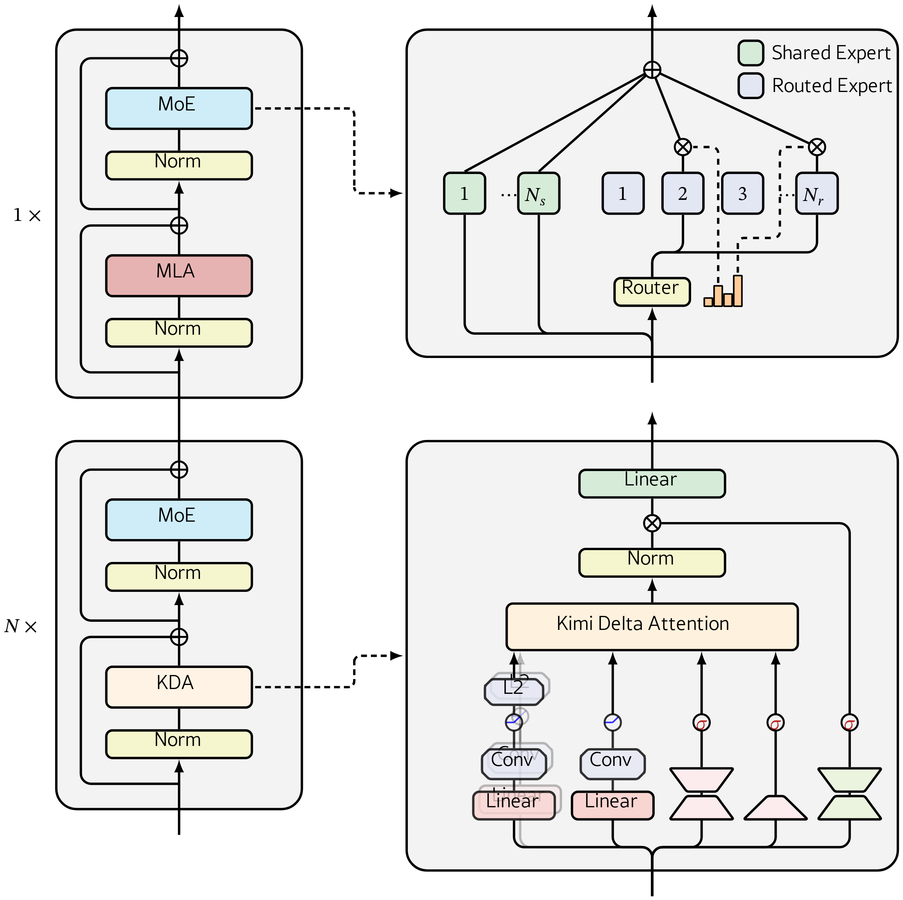

# Kimi Linear: An Expressive, Efficient Attention Architecture

## 来源信息

| 项 | 内容 |
| --- | --- |
| 标题 | Kimi Linear: An Expressive, Efficient Attention Architecture（PDF 首页全大写） |
| 作者 | Kimi Team（59 位个人作者；`∗` 表示已离开团队，`#` 表示外部合作者；未标通讯作者） |
| 机构 | Kimi Team（Moonshot AI）；附录 A 另列 Soochow University、HKUST (Guangzhou)、MIT、Hangzhou Institute of Medicine, CAS 四个单位 |
| 来源 | [arXiv:2510.26692v2](https://arxiv.org/abs/2510.26692v2)（cs.CL; cs.LG），v2 日期 2025-11-01；许可 CC BY-NC-ND 4.0；v1 2025-10-30 → v2，本笔记基于 v2（28 页），未下载 v1 比对 |
| 阅读日期 | 2026-11-07 |
| 归档说明 | arXiv 来源，按仓库策略不归档 PDF；仓库清单编号 00132 |

---

## 核心结论

一句话：**Kimi Linear 把 Gated DeltaNet 的标量遗忘门换成逐通道门（KDA），用受限 DPLR（把 $a$、$b$ 都绑到 $k$ 上）加 UT 变换把它做成可分块并行的核；再按 3:1 交错 KDA 与 NoPE 的 MLA，在同配方、同 1.4T token 的对照里多数基准超过全注意力基线（作者称「首次」），并把 1M 上下文相对 full-MLA 的 KV cache 按层数比例降到约四分之一、解码吞吐在更大 batch 下最高提到 6.3×。**

- **改了什么**：在 delta rule 的 rank-1 修正前加逐通道对角门 $\operatorname{Diag}(\alpha_t)$，$\alpha$ 有 $d_k$ 个分量而不是一个标量；作者把它解释为「更细粒度的权重衰减」。
- **怎么做到可分块**：把递推展开成块内/块间两部分，用 WY 表示与 UT 变换把 rank-1 更新压成矩阵乘；转移矩阵写成受限 DPLR，使二级分块矩阵计算从 4 个减到 2 个、再省约 3 个矩阵乘，算子效率约提升 100%。
- **架构**：骨干沿用 Moonlight，48B 总参 / 3B 激活，256 专家中激活 8 个（原文写「含 1 个共享专家」），首层 dense；每 3 层 KDA 接 1 层 MLA，所有 MLA 用 NoPE，位置与近因交给 KDA；输出门为低秩 Sigmoid，保留短卷积。
- **关键结果**：预训练 14 项里 12 项单独最优（MATH 并列、EvalPlus 落后 GDN-H 60.2 vs 63.1）；SFT 后 12 项里 9 项最优；长上下文平均 54.5，高于 MLA 52.2、GDN-H 51.2、Kimi Linear (RoPE) 51.8。
- **效率**：预填充在 512K / 1M 为 2.3× / 2.9×；batch=1 的 TPOT 为 1.8× / 2.2×；6.3× 是 Figure 1b 更大 batch 下的系统数字（1.84 ms vs 11.48 ms），不是单序列 TPOT；KV cache 约为 full-MLA 基线的 25%。
- **适合谁**：要在 1M 上下文、解码密集的 agent/RL 场景里换掉全注意力、又不想放弃全局检索的团队。不宜把「全面超过全注意力」当结论直接引用——论文自己的表格有明确反例，主结果也只在 3B 激活规模、1.4T token 上成立。

---

## 问题

### 线性注意力的两个老瓶颈

softmax 注意力的成本随序列长度二次增长，KV cache 线性增长；在长程 agent、工具调用、RL rollout 这些解码密集的场景里，这两项直接压住吞吐与上下文长度。线性注意力把状态压成固定大小的矩阵，推理变成常数时间与常数内存，代价是**有限状态容量**：精确复制、长距离检索、细粒度选择都弱于全注意力。

过去几年缩小差距主要靠两条线：

- **门控/衰减**：从数据无关的标量衰减（RetNet）到数据相关的标量门（Mamba2），再到逐通道对角门（GLA）。门控决定「旧记忆以多快速度被忘掉」，是线性注意力表达力的核心旋钮。
- **delta rule**：DeltaNet 把状态更新解释成对重构损失 $\lVert S^\top k - v\rVert^2$ 的在线梯度下降，因而有 rank-1 的「写错就改」修正；GDN 在此基础上加标量遗忘门，相当于对 fast weight 做权重衰减。

Kimi Linear 的出发点很直接：**GDN 的门是每个 head 一个标量，粒度太粗；GLA 有逐通道门但没有 delta rule**。把两者合起来，就是 KDA。

### 为什么还要混合，而不是纯线性

纯线性注意力的固定状态再大，精确复制与长距离检索仍然吃紧。已有做法是混合：大部分层用线性注意力，少数层保留全注意力，负责全局内容交互。混合有两种切法：

- **层内混合**（intra-layer）：同一层里混不同 head 或不同机制。表达灵活，但异构计算路径让分布式并行、KV 管理、核融合都更复杂。
- **层间混合**（inter-layer）：按固定比例堆叠不同层。基础设施简单，KV cache 只存在于全注意力层，适合工程落地。

本文选层间混合，比例做消融后取 **3:1**（3 层 KDA 对 1 层 MLA）。作者称这是质量—吞吐的最佳折中，且规则重复的结构便于 KV 管理与并行优化。

### 位置编码也要重排

RoPE 是当前全注意力的事实标准，但它对 base frequency 敏感，扩上下文时常要调频率或上 YaRN。本文让**所有 MLA 层用 NoPE**，位置与近因信息完全交给 KDA 的衰减门；§6.1 的理由是门控 delta rule 的转移矩阵数据相关、可学习，可看成比 RoPE 正交旋转更一般的「乘性位置编码」，逐通道 $\alpha$ 又提供了类似 RoPE 逐维频率的细粒度。NoPE 还带来一个工程好处：MLA 在推理时可以转成纯 MQA。

### 本文的设定与前提

对照必须同骨干、同参数量、同配方、同 1.4T token——否则「混合线性追平全注意力」的结论会被参数量或数据差异污染。这条前提也决定了主结果只在 48B 总参 / 3B 激活这一档成立；更早的对照（纯 MLA、混合 GDN）则分别代表「保检索但费 KV」与「省 KV 但门控粗」两个极端。

---

## 核心想法

### 一句话

线性注意力的表达力来自「状态怎么被改写」，而不是状态有多大：给每个通道一个独立的遗忘速度，同时保留 delta rule 的写入修正，就能在不放弃分块并行的前提下把检索能力补回来。

### 直觉

把状态矩阵 $S_t$ 想成一张「key 维度 × value 维度」的记忆表。每次读入 $(k_t, v_t)$，delta rule 做两件事：先沿当前 key 方向擦掉旧内容（$\mathbf{I}-\beta_t k_t k_t^\top$），再写入 $v_t$。GDN 在擦除前整体乘一个标量 $\alpha_t$，所有通道同速变旧；KDA 换成 $\operatorname{Diag}(\alpha_t)$，第 $j$ 个 key 通道有自己的 $\alpha_t^{(j)}$，于是「这一维还记得、那一维已经该忘」可以同时发生。

### 一个具体读法

以「记住上一个 token 的位置」为例：若某个通道的 $k$ 分量在这个 token 上很强，delta rule 会把近期内容写进对应行；$\alpha_t^{(j)}$ 大表示这一维还没到该忘的时候，小则下一批 token 就会把它冲掉。位置信息不必依赖 RoPE 那种固定旋转频率，而是由「这一维衰减得多慢」隐式编码——这正是 §6.1 把 KDA 称为「乘性位置编码」的意思。

### 为什么这样能成立

- **逐通道门把「遗忘」变成可分辨的操作**：标量门只能整体衰减，模型无法同时做到「保留位置信息」和「丢弃过时内容」；逐通道后这两件事可以分配给不同维度。
- **delta rule 保住了「写错就改」**：纯门控（GLA）只有衰减没有 rank-1 修正，写错的记忆要等衰减掉；KDA 二者都有。
- **受限 DPLR 让分块可行**：分块并行要求转移矩阵能写成 $D - a b^\top$ 并在块内求逆。KDA 把 $a,b$ 都绑到 $k$ 上，形式仍是 DPLR，但 $1/\Gamma$ 的数值敏感与二级分块开销都可控。
- **3:1 混合补最后一块短板**：固定状态再精细也做不了精确复制；每 4 层留 1 层全注意力，把这部分能力交回 MLA。

### 与已有做法的区别

| 机制 | 遗忘 | 写入修正 | 本笔记中的定位 |
| --- | --- | --- | --- |
| GLA | 逐通道对角门 | 无 | 门够细，但没有 delta rule |
| GDN | 每个 head 一个标量门 | rank-1 | 有修正，但门粒度粗 |
| 一般 DPLR | 对角 $D$ + 两个自由 rank-1 向量 | rank-1 | 表达力最全，但二级分块要 4 个矩阵乘、对 $1/\Gamma$ 敏感 |
| **KDA** | 逐通道对角门 | rank-1 | 二级分块 2 个矩阵乘，再省约 3 个矩阵乘 |

### 一个走通的账（本笔记复算）

只看单 head 的注意力部分，令 $d_k=d_v=d_h=128$、块长 $C=64$，KDA 的每 token 成本约为 $6Td_h^2+3TCd_h+TC^2$，全注意力为 $2T^2d_h$，两者在 $T\approx 496$ token 处相当。也就是说 496 token 之后线性成本低于二次成本——这是「二级分块 4→2」值得做的量级来源。实际 crossover 还受投影、kernel 效率与并行度影响，不能直接当成端到端结论。

### 代价

- **工程复杂度**：块内要对下三角矩阵做前向替换求逆，这是逐行的非矩阵乘，无法完全交给 Tensor Core；预填充与解码要维护两套 kernel（分块核与循环核）。
- **NoPE 依赖门控学得好**：位置信息全部押在 $\alpha$ 上；Table 5 的 RoPE 对照说明在这套架构与数据里 NoPE 是加分的，但这是本架构内的结论。
- **推理收益不平均**：KDA 层是常数状态，但 MLA 层仍要读随序列增长的 KV cache，长序列解码成本由这 1/4 的层主导。
- **规模未验证**：主结果只有 3B 激活；5.7T 发布版只与 16B 的 Moonlight 比，不是等参数对照。

---

## 方法

### 符号表

| 符号 | 含义 | 维度 / 取值 |
| --- | --- | --- |
| $t$、$[t]$ | token 下标；$[t]$ 表示第 $t$ 个块的块下标 | — |
| $T$ | 序列长度（token 数） | — |
| $\mathbf{S}_t$、$\mathbf{S}_{[t]}$ | KDA 状态矩阵（逐 token / 块末） | $d_k\times d_v$ |
| $\mathbf{k}_t,\mathbf{v}_t,\mathbf{q}_t$ | 单 head 的 key / value / query | $d_k$ / $d_v$ / $d_k$ |
| $\mathbf{o}_t$ | 单 head 输出 | $d_v$ |
| $\alpha_t$ | 逐通道遗忘门，第 $j$ 个分量为 $\alpha_t^{(j)}$ | $d_k$ 维，取值 $[0,1]$ |
| $\beta_t$ | delta rule 的写入强度 | 标量，由 Sigmoid 给出 |
| $\mathbf{I}$、$\operatorname{Diag}(\cdot)$ | 单位阵、对角矩阵算子 | $d_k\times d_k$ |
| $d_k,d_v,d_h$ | key / value 每头维度；原文也用 $d_h$ 记 head 维 | 均 128 |
| $C$ | 分块并行的块长 | 64 |
| $\gamma$、$\gamma^C_{[t]}$ | 逐 token 累计衰减；一个块长 $C$ 上的累计衰减 | — |
| $\Gamma^{i\to C}_{[t]}$、$\Gamma^{1\to C}_{[t]}$ | 块内按位置 $i$ 堆叠的累计衰减 | $C\times d_k$ |
| $\mathbf{Q}_{[t]},\mathbf{K}_{[t]},\mathbf{V}_{[t]},\mathbf{U}_{[t]},\mathbf{W}_{[t]},\mathbf{O}_{[t]}$ | 第 $t$ 块的 $Q$ / $K$ / value 堆叠 $V$ / 伪 value $U$ / UT 修正项 $W$ / 输出 $O$；$V$ 只出现在 $U=MV$ | $C\times d_k$ 或 $C\times d_v$ |
| $\odot$、$\operatorname{Tril}(\cdot)$ | 逐元素乘；下三角（含对角）掩码 | — |
| $M$、$P$、$H$ | UT 变换要用的下三角矩阵；WY 表示的两个矩阵 | 原文未给维度；按上下文理解为块内矩阵 |
| $D,\mathbf{a}_t,\mathbf{b}_t$ | DPLR 转移矩阵的对角项与两个 rank-1 向量 | $D$ 为 $d_k\times d_k$ 对角；$\mathbf{a}_t,\mathbf{b}_t$ 为 $d_k$ 维 |
| $\mathbf{x}_t$、$W_o$ | 层输入、输出投影 | — |
| $W^{\uparrow}_g,W^{\downarrow}_g$、$W^{\uparrow}_\alpha,W^{\downarrow}_\alpha$ | 输出门 / 遗忘门的低秩上下投影 | 门秩原文未给数值；$\alpha$ 的秩等于 head 维 |
| $\operatorname{RMSNorm}$、$\operatorname{Sigmoid}$、$\operatorname{KDA}(\cdot)$ | head-wise 归一化、Sigmoid 门算子；整个 KDA 层 | — |
| $N_s,N_r$ | 共享专家数、路由专家数 | $N_s=1$；$N_r=256$（激活 8） |

### 一层的数据流

$\mathbf{x}_t$ 进层后分成四路：`q`/`k` 各过 ShortConv + Swish 再做 L2Norm；`v` 过 ShortConv + Swish；$\alpha$ 由低秩投影 $W^{\uparrow}_\alpha W^{\downarrow}_\alpha \mathbf{x}_t$ 加一个与 GDN/Mamba 类似的衰减函数得到，$\beta$ 由 Sigmoid 得到。KDA 核输出先做 head-wise RMSNorm，再乘低秩 Sigmoid 门，最后过 $W_o$。**预填充走分块并行核（块长 64）、解码走循环核**；层间按 3 层 KDA + 1 层 MLA 重复，MLA 全部 NoPE。

### KDA 的递推（原文 Eq (1)）

先把三条更新规则排在一起（沿用原文符号、省略归一化）：线性注意力是 $S_t=S_{t-1}+k_tv_t^\top$，没有遗忘；DeltaNet 是 $S_t=(I-\beta_tk_tk_t^\top)S_{t-1}+\beta_tk_tv_t^\top$，有 rank-1 修正；GDN 在修正前乘标量 $\alpha_t$。KDA 把标量换成对角矩阵，并放在 Householder 修正之前：

```math
\mathbf{S}_t = \left(\mathbf{I} - \beta_t \mathbf{k}_t \mathbf{k}_t^\top\right)\operatorname{Diag}(\alpha_t)\mathbf{S}_{t-1} + \beta_t \mathbf{k}_t \mathbf{v}_t^\top,
\qquad
\mathbf{o}_t = \mathbf{S}_t^\top \mathbf{q}_t
```

**逐项读法**：$\operatorname{Diag}(\alpha_t)\mathbf{S}_{t-1}$ 先按 key 通道各自衰减（每个通道一个遗忘系数）；$\mathbf{I}-\beta_t\mathbf{k}_t\mathbf{k}_t^\top$ 是沿当前 key 方向的投影擦除，$\beta_t$ 决定擦多深；$+\beta_t\mathbf{k}_t\mathbf{v}_t^\top$ 写入新值。输出 $\mathbf{o}_t$ 是状态对 query 的投影。$\alpha_t$ 是 $d_k$ 维、$\beta_t$ 是标量，这是 KDA 与 GDN 的唯一形式差异。

### 分块并行：块间项 + 块内项

把递推按块长 $C$ 展开，块末状态写成「前序块状态 × 转移矩阵 + 块内 rank-1 更新之和」。WY 表示把一串 rank-1 更新压成 $P$、$H$，再用 UT 变换把非矩阵乘的 FLOPs 降下来。块间项：

```math
\mathbf{S}_{[t+1]} = \operatorname{Diag}\left(\gamma^C_{[t]}\right)\mathbf{S}_{[t]} + \left(\Gamma^{i\to C}_{[t]}\odot \mathbf{K}_{[t]}\right)^\top\left(\mathbf{U}_{[t]} - \mathbf{W}_{[t]}\mathbf{S}_{[t]}\right)
```

**逐项读法**：第一项把整块状态按块长 $C$ 的累计衰减 $\gamma^C$ 缩放后传下去；第二项把块内所有写入一次性叠到状态上——$\Gamma^{i\to C}$ 给每个位置配上「到块末还剩多少」，$\mathbf{K}^\top$ 做 key 方向投影，$\mathbf{U}-\mathbf{W}\mathbf{S}$ 是扣掉已有状态贡献后的「伪 value」。

```math
\mathbf{O}_{[t]} = \underbrace{\left(\Gamma^{1\to C}_{[t]}\odot \mathbf{Q}_{[t]}\right)\mathbf{S}_{[t]}}_{\text{inter-chunk}}
+ \underbrace{\operatorname{Tril}\left(\left(\Gamma^{1\to C}_{[t]}\odot \mathbf{Q}_{[t]}\right)\left(\mathbf{K}_{[t]}/\Gamma^{1\to C}_{[t]}\right)^\top\right)\left(\mathbf{U}_{[t]} - \mathbf{W}_{[t]}\mathbf{S}_{[t]}\right)}_{\text{intra-chunk}}
```

**逐项读法**：第一项是块间项，用上一块留下的状态做全局交互；第二项是块内项，退化成带因果掩码的 $QK^\top$ 注意力，$\operatorname{Tril}$ 保证只看块内前文；`U − W S` 把 delta rule 的修正吸收进矩阵乘。$W$、$U$ 由 UT 变换得到——先构造下三角矩阵 $M$，前向替换求逆，再令 $W=M(\Gamma\odot K)$、$U=MV$。因此块内绝大多数计算都是 Tensor Core 友好的矩阵乘，只有求逆是逐行的非矩阵乘。

### 受限 DPLR：把 $a$、$b$ 都绑到 $k$ 上

一般 DPLR 的转移矩阵是 $D-a_tb_t^\top$，其中 $a_t,b_t$ 自由。KDA 用同一形式，但令 $D=\operatorname{Diag}(\alpha_t)$、$a_t=\beta_tk_t$、$b_t=k_t\odot\alpha_t$：

```text
S_t = (D − a_t b_t^⊤) S_{t−1} + k_t v_t^⊤
D = Diag(α_t),  a_t = β_t k_t,  b_t = k_t ⊙ α_t
```

**逐项读法**：$D$ 承担逐通道衰减，$a_tb_t^\top$ 承担 delta rule 的 rank-1 修正；把两个向量都绑到 $k_t$ 上之后，二者只差一个标量 $\beta_t$ 和一个逐通道因子 $\alpha_t$，块内就只需处理「同一个 $k$ 方向」的更新。作者称这保留了 DPLR 的细粒度衰减，同时避免一般 DPLR 对 $1/\Gamma$ 的数值敏感与二级分块开销：矩阵乘从 4 个减到 2 个，再省约 3 个，算子效率约提升 100%。严格说这是**受限** DPLR——§6.2 自己用的是 constrained variant，表达力不等于一般 DPLR。

### 架构与参数化



*图 3（原文 p6）：下方 $N\times$ 块为 KDA + MoE、上方 $1\times$ 块为 MLA + MoE，本文 $N=3$；右侧上为 MoE（$N_s$ 个共享专家 + $N_r$ 个路由专家，$N_s=1$），右侧下为 KDA 的参数化。*

模型配置（§5.4）：48B 总参 / 3B 激活；256 专家中激活 8 个（原文写「含 1 个共享专家」，按路由专家算是 7 个）；首层 dense、无 MoE；每 3 层 KDA 接 1 层 MLA；MLA 全部 NoPE；head 维固定 128。预训练用 4,096 上下文、MuonClip、WSD、lr $1.1\times10^{-3}$、全局 batch 32M token、K2 语料，并沿用 K2 的 annealing 与 long-context activation；对照实验 1.4T token，发布 checkpoint 扩到 5.7T token、支持 1M 上下文。3:1 的消融在 16 层 / 16 heads 的第一档 scaling 模型上做：3:1 的验证 PPL 5.65 最低，纯 MLA 5.77、1:1 5.66、7:1 5.70、15:1 5.82；去掉输出门 5.67、换 Swish 门 5.81、去掉卷积 5.70——三项保留都有方向一致的证据（数值见 `audit.md`）。

### 输出门（原文 Eq (10)）

```math
\mathbf{o}_t = W_o\left(\operatorname{Sigmoid}\left(W^{\uparrow}_{g} W^{\downarrow}_{g}\mathbf{x}_t\right)\odot \operatorname{RMSNorm}\left(\operatorname{KDA}(\mathbf{q}_t,\mathbf{k}_t,\mathbf{v}_t,\alpha_t,\beta_t)\right)\right)
```

**逐项读法**：$\operatorname{KDA}(\cdot)$ 是上面那条递推的全部计算；$\operatorname{RMSNorm}$ 按 head 归一化，防止状态尺度漂移；$W^{\uparrow}_g W^{\downarrow}_g$ 是一条低秩支路，从同一个输入算出逐通道门，Sigmoid 后逐元素乘到注意力输出上；最后 $W_o$ 投影回模型维度。低秩参数化是为了与遗忘门做公平的参数量对比，作者称它与全秩门性能相当，并能缓解 Attention Sink。

### 与已有方法的结构差异

- **vs GLA / GDN**：不是再换一种门，而是把「逐通道门」与「delta rule 修正」叠在同一递推里，并把结果整理成受限 DPLR，使分块算法成立。
- **vs 一般 DPLR**：用 $a=\beta k$、$b=k\odot\alpha$ 牺牲一部分表达力，换二级分块矩阵乘 4→2 与更好的数值行为；这是效率换表达力的显式取舍。
- **vs 纯 MLA / 层内混合**：层间 3:1 让 KV cache 只存在于 1/4 的层，基础设施按普通多头结构堆叠，不需要为异构 head 单独设计并行。

---

## 主要结果

**设置**（§5.4）：主对照为 MLA（全注意力）、GDN-H（混合 Gated DeltaNet）、Kimi Linear 三组，同骨干、同参数量、同训练配方、均 1.4T token。温度 1.0，高方差基准报 Avg@k；base 的 MMLU、MMLU-Redux、GPQA-Diamond、C-Eval 用 perplexity，其余生成式；GPQA-Diamond 报 8 次独立运行均值；全部走内部 LM-Harness-Evaluation 框架。

1. **短上下文：多数领先，但不是每一项**。预训练 base（Table 3）14 项里 12 项单独最优，MATH 与 MLA 并列 54.7，EvalPlus 落后 GDN-H（60.2 vs 63.1）；SFT 后 instruct（Table 4）12 项里 9 项最优，LiveBench 45.2、MATH500 81.2、EvalPlus 61.0 分别落后 GDN-H 46.4、GDN-H 83.0、MLA 62.6。这组数字证明的是「同配方下 3:1 混合能整体追平并多数略超全注意力」，不是全面超越。
2. **长上下文：增益集中在检索型任务**（Table 5，主表）。平均 54.5，高于 MLA 52.2、GDN-H 51.2、Kimi Linear (RoPE) 51.8；RULER 84.3（+3.0）、MRCR 29.6（+7.0）领先最多，LongBench V2、Frames、Long Code Arena Commit 则低于 MLA。NoPE 版比 RoPE 版高 2.7，说明这套架构里「位置交给 KDA」是加分的。
3. **合成任务：机制层面成立**。2 层 / 2 heads 的小模型上，256 token 时三者并列 100；512–2048 token 区间 KDA 在 palindrome、MQAR、stack 上保持最高或与 GDN 并列，且收敛更快；Mamba2 在 Palindrome/MQAR 从 512、Stack 从 1024 起降到 0（作者归因于只有乘法衰减、没有 delta rule）。这能证明机制可行，不能证明大规模下同样有效。
4. **效率随序列长度增长**。核速度（Figure 2，batch=1、16 heads）16K–32K 约 2×、64K 约 1.6×（原文措辞 nearly 2× up to 64k）；预填充 512K / 1M 为 2.3× / 2.9×；batch=1 的 TPOT 为 1.8× / 2.2×；6.3× 来自 Figure 1b 的更大 batch。内存侧 KDA 每 head 状态固定 $128\times128$，混合模型只有 1/4 层需要 KV cache，按层数比例约为 full-MLA 的 25%（理论值，未给实测显存）。
5. **scaling law 给出固定水平差距**。5 个 Moonlight 式 MoE（激活 653M–1.7B）拟合出约 1.16× 计算效率；两条曲线的指数几乎相同（0.0536 vs 0.0527），即曲线基本平行，1.16× 是水平方向的固定差距。作者承认 KDA 未做超参调优，所以这更像下限。
6. **5.7T 发布版只与 16B 的 Moonlight 比**（Appendix D）：激活参数同为 3B，但总参 48B vs 16B，MMLU-Pro 54.8 vs 42.4、MATH 58.5 vs 45.3、LiveCodeBench v6 20.0 vs 14.3 的领先同时来自「更多总参数 + 3:1 混合 + KDA」，不能全部归因于注意力结构；1M 上下文也只有 RULER 94.8 一个数字。

**主表**（Table 5，p12；8 个基准行，Long Code Arena 的 Lib/Commit 各算一项；末行是原文的平均列，本笔记转置为一行）：

| 基准 | MLA | GDN-H | Kimi Linear (RoPE) | Kimi Linear |
| --- | --- | --- | --- | --- |
| RULER | 81.3 | 80.5 | 78.8 | **84.3** |
| MRCR | 22.6 | 23.9 | 22.0 | **29.6** |
| HELMET-ICL | 88.0 | 85.5 | 88.0 | **90.0** |
| LongBench V2 | **36.1** | 32.6 | 35.4 | 35.0 |
| Frames | **60.5** | 58.7 | 59.9 | 58.8 |
| RepoQA | 63.0 | 63.0 | 66.5 | **68.5** |
| Long Code Arena Lib | 32.8 | 34.7 | 31.3 | **37.1** |
| Long Code Arena Commit | **33.2** | 30.5 | 32.5 | 32.7 |
| **平均** | 52.2 | 51.2 | 51.8 | **54.5** |

8 个基准中 Kimi Linear 5 个最优（平均也最高）；平均分领先 MLA 2.3，主要来自 RULER 与 MRCR 两个检索型基准。

---

## 边界与局限

**作者明确承认的**：

- **scaling law 未调超参**：KDA 侧严格沿用 MLA 配置，作者说调优后可能更好，因此 1.16× 是下限。
- **DPLR 是受限形式**：§6.2 自称 constrained variant，不是一般 DPLR 的完整表达力。

**读者根据证据判断的**：

- **规模与对照**：主结果 48B 总参 / 3B 激活，没有在更大激活规模上验证 KDA 与 3:1 是否仍最优；5.7T 版只与 16B 的 Moonlight 比，缺同规模的 MLA / GDN-H 对照，「发布版仍优于全注意力」没有直接证据。
- **长上下文与内存的证据都薄**：Table 5 在 128k；1M 只有 Appendix D 的 RULER 94.8，没有 MRCR / RepoQA / LongBench；KV cache 75% 减少按 3:1 层数比例推算，没有实测显存或随 batch 的吞吐曲线。
- **统计与复现**：没有随机种子、误差棒、重复次数，有些差距只有 0.1–0.5 分；正文也没给 48B 的层数、头数、总训练算力与硬件。
- **「首次」是作者声明**：本文没有独立复核此前所有混合线性注意力工作，不能当成已证实的历史结论。

---

## 与其他工作的关系

- **Kimi K3**（00225）：直接后继。K3 采用 69 层 KDA + 24 层 MLA 的 3:1 块、全部 MLA NoPE、KDA 的全秩输出门与 FP32 注意力输出，规模推到 2.78T / 104.2B 激活；本文的 Eq (1)–(9) 与 §6.2 是它的公式与分块算法出处。
- **Kimi K2**（00083，[笔记](../2507.20534-v2-kimi-k2/note.md)）：本文的 1.4T 语料、MuonClip、WSD、SFT/RL 配方都沿用 K2，MLA 也是 K2 用的注意力。
- **DeepSeek-V3.2**（00133）：本文 §7.1 引的是 V3.2-Exp（DSA，token-level sparse attention），与正式报告同族但不同一份。本文的对照论点是：稀疏注意力检索更细但要存全量 KV cache，线性注意力状态固定更省内存，二者不互斥。
- **Moonlight**：Appendix D 的基线（16B 总参 / 3B 激活），也是本文 scaling law 的架构来源；不在本仓库清单中。

<!-- 复核档案见同目录 audit.md（不随站点发布） -->
