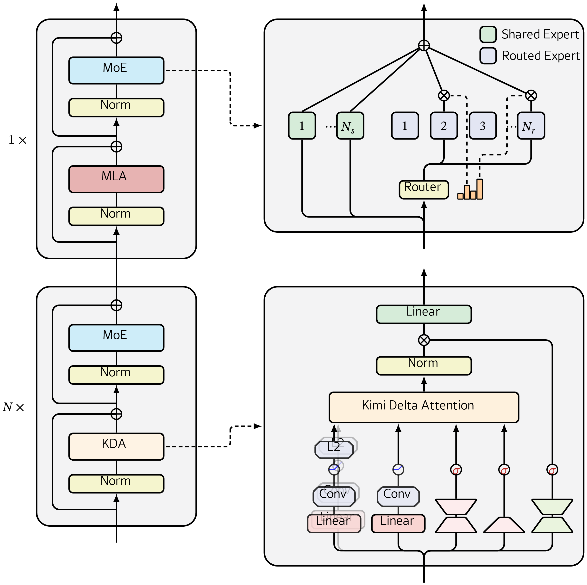

# Kimi Linear: An Expressive, Efficient Attention Architecture

## 来源信息

| 项 | 内容 |
| --- | --- |
| 标题 | Kimi Linear: An Expressive, Efficient Attention Architecture（PDF 首页全大写） |
| 作者 | Kimi Team（59 位个人作者；arXiv 页写「Yu Zhang and 58 other authors」；附录 A 按贡献重要性排序、项目领导列在最后；未标通讯作者，`∗` 表示已离开团队，`#` 表示外部合作者） |
| 机构 | Kimi Team（Moonshot AI）；附录 A 标 4 个单位：1 Soochow University、2 The Hong Kong University of Science and Technology (Guangzhou)、3 MIT、4 Hangzhou Institute of Medicine, CAS；第一作者 Yu Zhang 属 Soochow University，项目在 Moonshot AI 开发 |
| 来源 | [arXiv:2510.26692v2](https://arxiv.org/abs/2510.26692v2)（cs.CL；cs.LG），v2 日期 2025-11-01 |
| 许可 | arXiv 页面标注 CC BY-NC-ND 4.0（版面内图片按引用使用） |
| 版本历史 | v1 2025-10-30 → v2 2025-11-01（本笔记基于 v2，为阅读时最新版；未下载 v1 比对） |
| 阅读日期 | 2026-11-07 |
| 阅读范围 | v2 全文 28 页：正文 §1–§7 与 Conclusion（p2–18）、附录 A–D（p24–28）；References（p19–23）未逐条阅读；图 1–7、表 1–5 与 8–9 已逐项对照渲染页；表 6–7 只按文本抽取阅读（未逐格渲染核对）；Listing 1 与 8a/8b 已读（未运行） |
| 核对凭据 | 本次抓取的 PDF 共 28 页、1,354,769 字节、sha256 `e2e23a449fc9bb27e34e783d20b2e6cd0f1ac67d58efdc0479c03c54db956a17`（2026-11-07）。表 1 用 p8 渲染页（150 dpi）逐行核对；表 2 与 Figure 5 用 p9；表 3/4 用 p11；表 5 用 p12；表 8/9 用 p28；Figure 1 用 p1、Figure 2 用 p5、Figure 4 用 p7、Figure 6 用 p12、Figure 7 用 p13。公式 1/2/8/9 对 p4–p5 的 170 dpi 渲染页，式 12 对 p13（150 dpi），式 13/14 对 p15（170 dpi）。Figure 3 由 arXiv HTML 的内联 `<svg>` 在 Chromium 中以 4× 截图（2480×2596 px），裁白边后资产为 2442×2436 px，再与 p6 的 300 dpi 渲染页（裁剪 70–542 × 56–442 pt）逐元素对照；两版都显示顶部/底部的 Outputs/Inputs 标签为白色（白底上不可见），本图保留原文渲染。否定性断言检索词：`GPU`/`H100`/`A100`/`hardware`、`seed`/`variance`/`error bar`、`layer`/`heads`、`sparsity` |
| 归档说明 | arXiv 来源，按仓库策略不归档 PDF；仓库清单编号 00132 |

---

## 复核记录

**2026-11-07（第 1 轮，依 check-paper-note）**：基准为 arXiv:2510.26692v2；重新下载的 PDF 28 页、sha256 `e2e23a449fc9bb27e34e783d20b2e6cd0f1ac67d58efdc0479c03c54db956a17`，与首读记录一致；arXiv abs 页确认 v2 仍为最新。核对 A–H 全项；Table 1/2/3/4/5/8/9 用 150–400 dpi 渲染页逐格复核，Table 6/7 按文本抽取阅读；Eq. 1/8/9/13/14 对 p4–p5/p15 渲染页；Figure 2/4/7b 用 700–900 dpi 裁剪读图；另派独立子 agent 只读审计，其结论逐条回原文复验后采纳。检索词：`all evaluated tasks`、`consistently`、`across the board`、`lowest training`、`RoPE`、`2.3×`、`6.3×`、`66.9`、`33.2`、`sparsity`、`GPU`/`seed`/`error bar`。

修正（本轮）：

- Figure 7b 的 512K/1M 加速比对调：512K=1.8×、1M=2.2×（5 处）；相应把「1M 有四个版本」改为「两种口径」，删除「2.3× 串到 prefill@512K」的推断；§6.3 的 2.3× 与 Fig 7b 的 2.2× 视为取整差异（本笔记判断）。
- Table 5 的 Long Code Arena Commit 反例基线从 GDN-H 改为 MLA（32.7 vs 33.2，2 处）。
- Table 9 的 RULER@128k 行 Moonlight 值从 66.9 改为「—（超过 8K 未评）」；66.9 属 MMLU-Redux，并加注防错配。
- Figure 4 的 2048 token 结论改为「Palindrome/MQAR 下降、Stack 上 KDA/GDN 仍为 100」；Mamba2 的失败点改为 Palindrome/MQAR 512、Stack 1024。
- Figure 3 图注的共享专家数改为 `N_s`（本文 `N_s=1`）。
- Figure 2 的 64K 读数补充「约 1.6×」，与原文 nearly 2× up to 64k 的措辞并列。
- KV cache 25% 明确为相对 full-MLA 基线；成本 crossover 的「token/head」改为「T ≈ 496 token」。
- 专家数口径改为：total/activated 下 256/8=32 自洽，但「8 含 1 共享」意味着路由 7 个。
- 补 Table 3/4 caption 的 consistently 与表内反例；补 §3.2 与 §6.2 对 DPLR 的措辞张力（第 9 条）；补 Appendix B/Table 6/7、Fig 1a 3.98×、Table 8 base 数值。
- 来源信息里 Figure 3 资产尺寸补「截图 2480×2596、裁白边后 2442×2436」。

未修 / 未核：Hugging Face 两个 checkpoint 页面仍不可达（curl 000），权重格式与许可未验证；MoonshotAI/Kimi-Linear 仓库的 MIT/日期/star 与 `fla/ops/kda` 目录按本次查询记录，未复核其与实验的可复现性；vLLM 集成未验证；Table 6/7 未逐格渲染核对；Figure 2 的 64K 比值依赖图顶外推（约 1.5–1.7×）。

---

## 核心结论

一句话：**Kimi Linear 把 Gated DeltaNet 的标量遗忘门换成逐通道门（KDA），用受限 DPLR（把 `a`、`b` 都绑到 `k` 上）加 UT 变换把它做成可分块并行的核；再按 3:1 交错 KDA 与 NoPE 的 MLA，在同配方、同 1.4T token 的对照里多数基准超过全注意力基线（作者称「首次」），并把 1M 上下文相对 full-MLA 基线的 KV cache 按层数比例降到约四分之一、解码吞吐在更大 batch 下最高提到 6.3×。**

- **KDA（§2.2、§3）**：在 delta rule 的 rank-1 修正前加一个逐通道的对角遗忘门 `Diag(α_t)`，`α` 有 `d_k` 个分量而不是一个标量；作者把这一改动解释为「更细粒度的权重衰减」，并用合成任务说明它比 GDN 收敛更快、比 Mamba2 更能记住历史。
- **分块并行（§3.1、§6.2）**：把递推展开成块内/块间两部分，用 WY 表示与 UT 变换把 rank-1 更新压成稠密矩阵乘；转移矩阵写成 DPLR 的受限形式（把 `a`、`b` 绑到 `k` 上），使二级分块矩阵计算从 4 个减到 2 个，并再省掉约 3 个矩阵乘。作者称算子效率约提升 100%，原文称核在 64K 以内近 2×（图上 16K–32K 约 2×，64K 约 1.6×，图内读数）。
- **架构（§4、§5.2）**：骨干沿用 Moonlight，48B 总参数 / 3B 激活，256 专家中激活 8 个（作者写法是「含 1 个共享专家」），首层为 dense；每 3 层 KDA 接 1 层 MLA，所有 MLA 用 NoPE，位置与近因信息交给 KDA；输出门用低秩 Sigmoid，卷积层保留。
- **证据（§5）**：主对照是 1.4T token、同骨干同参数量的 MLA / GDN-H / Kimi Linear 三组；Table 3（预训练）14 项中 12 项单独最优、MATH 并列、EvalPlus 落后 GDN-H；Table 4（SFT）12 项中 9 项最优，LiveBench、MATH500、EvalPlus 落后；Table 5（长上下文）平均 54.5，高于 MLA 52.2、GDN-H 51.2、Kimi Linear (RoPE) 51.8。
- **效率（§5.6、§6.3）**：预填充在 512K / 1M 分别为 2.3× / 2.9×；batch=1 的 TPOT 在 512K / 1M 为 1.8× / 2.2×；6.3× 是 Fig 1b 的数字（1.84 ms vs 11.48 ms，原文归因于 larger batches；摘要/结论称 decoding throughput，Fig 1b 标的是 TPOT），不是 batch=1 的 TPOT。
- **适合谁**：要在 1M 上下文、解码密集的 agent/RL 场景里换掉全注意力、又不想放弃全局检索能力的团队。**不适合**把「全面超过全注意力」当作结论直接引用——论文自己的表格有明确反例，且主结果只在 3B 激活规模、1.4T token 上成立。

---

## 问题与动机

### 线性注意力的老问题：容量与检索

softmax 注意力的成本随序列长度二次增长，KV cache 线性增长；在长程 agent、工具调用、RL rollout 这些解码密集的场景里，这两项直接压住吞吐与上下文长度。线性注意力把状态压成固定大小的矩阵，推理变成常数时间与常数内存，但代价是**有限状态容量**：精确复制、长距离检索、细粒度选择都弱于全注意力。

过去几年缩小差距主要靠两条线：

- **门控/衰减**：从数据无关的标量衰减（RetNet）到数据相关的标量门（Mamba2），再到逐通道对角门（GLA）。门控决定「旧记忆以多快速度被忘掉」，是线性注意力表达力的核心旋钮。
- **delta rule**：DeltaNet 把状态更新解释成对重构损失 `‖S^⊤k − v‖²` 的在线梯度下降，因而有 rank-1 的「写错就改」修正；GDN 在此基础上加标量遗忘门，相当于对 fast weight 做权重衰减。

Kimi Linear 的出发点很直接：**GDN 的门是每个 head 一个标量，粒度太粗；GLA 有逐通道门但没有 delta rule**。把两者合起来，就是 KDA。

### 为什么还要混合，而不是纯线性

纯线性注意力的固定状态再大，精确复制与长距离检索仍然吃紧。已有做法是混合：大部分层用线性注意力，少数层保留全注意力，负责全局内容交互。混合有两种切法：

- **层内混合**（intra-layer）：同一层里混不同 head 或不同机制。表达灵活，但异构计算路径让分布式并行、KV 管理、核融合都更复杂。
- **层间混合**（inter-layer）：按固定比例堆叠不同层。基础设施简单，KV cache 只存在于全注意力层，适合工程落地。

本文选层间混合，比例做消融后取 **3:1**（3 层 KDA 对 1 层 MLA）。作者称这是质量—吞吐的最佳折中，且规则重复的结构便于 KV 管理与并行优化。

### 位置编码：让 KDA 承担「位置」，MLA 用 NoPE

RoPE 是当前全注意力的事实标准，但它对 base frequency 敏感，扩上下文时常要调频率或上 YaRN。本文的选择是：**所有 MLA 层用 NoPE，位置与近因信息完全交给 KDA 的衰减门**。理由在 §6.1 展开：门控 delta rule 的转移矩阵是数据相关、可学习的，可以看成一种比 RoPE 更一般的「乘性位置编码」；逐通道的 `α` 又提供了类似 RoPE 逐维频率的细粒度。NoPE 还带来一个工程好处：MLA 在推理时可以转成纯 MQA。

---

## 方法与贡献

### 1. KDA：把标量遗忘门换成逐通道门（§2.2、§3，Eq. 1）

先把三条更新规则排在一起（都用原文符号，省略归一化）：

- 线性注意力：`S_t = S_{t−1} + k_t v_t^⊤`，没有遗忘。
- DeltaNet：`S_t = (I − β_t k_t k_t^⊤) S_{t−1} + β_t k_t v_t^⊤`，rank-1 修正。
- GDN：`S_t = α_t (I − β_t k_t k_t^⊤) S_{t−1} + β_t k_t v_t^⊤`，标量门 `α_t`。
- KDA：把标量 `α_t` 换成 `Diag(α_t)`，并放在 Householder 修正之前：

```math
\mathbf{S}_t = \left(\mathbf{I} - \beta_t \mathbf{k}_t \mathbf{k}_t^\top\right)\operatorname{Diag}(\alpha_t)\mathbf{S}_{t-1} + \beta_t \mathbf{k}_t \mathbf{v}_t^\top,
\qquad
\mathbf{o}_t = \mathbf{S}_t^\top \mathbf{q}_t
```

读法：状态先按通道乘一个遗忘系数（每个 key 维度独立衰减），再减去「沿当前 key 方向的分量」（delta rule 的写错修正），最后写入 `β_t k_t v_t^⊤`；输出是状态对 query 的投影。`α` 是 `d_k` 维，`β` 是标量式写入强度。

**参数化（§4）**：每个 head 的 `q/k` 先过 ShortConv + Swish，再做 L2Norm；`v` 过 ShortConv + Swish；`α` 用低秩投影 `W↑_α W↓_α x_t`（秩等于 head 维）加一个与 GDN/Mamba 类似的衰减函数，落在 `[0,1]^{d_k}`；`β` 用 Sigmoid。输出先做 head-wise RMSNorm，再乘一个低秩 Sigmoid 门，最后过 `W_o`。head 维固定 128，`d_k = d_v = 128`。

**为什么逐通道**：作者把 RoPE 的逐维频率与 GDN 的单标量门对比，认为标量门缺少「每个特征维度独立调节遗忘速度」的能力；KDA 的 `Diag(α)` 补上这一维，让有限状态能更精细地保留/丢弃信息。合成任务（§5.1）是这一论点的直接证据：在 palindrome、MQAR、stack 三个任务上，256 token 时三者并列 100，512→2048 token 区间 KDA 保持最高或并列，且比 GDN 收敛更快；Mamba2 只有乘法衰减、没有 delta rule：Palindrome/MQAR 从 512 token 起降到 0，Stack 从 1024 token 起降到 0。

### 2. 分块并行：WY/UT + 受限 DPLR（§3.1、§6.2）

把递推按块长 `C` 展开，块内状态可以写成「前序块状态 × 转移矩阵 + 块内 rank-1 更新之和」。WY 表示把一串 rank-1 更新压成 `P`、`H` 两个矩阵，再用 UT 变换把非矩阵乘的 FLOPs 降下来。记 `γ` 为累计衰减、`Γ` 为按块的累计衰减堆叠、`⊙` 为逐元素乘，则状态更新与输出可以写成：

```math
\mathbf{S}_{[t+1]} = \operatorname{Diag}\left(\gamma^C_{[t]}\right)\mathbf{S}_{[t]} + \left(\Gamma^{i\to C}_{[t]}\odot \mathbf{K}_{[t]}\right)^\top\left(\mathbf{U}_{[t]} - \mathbf{W}_{[t]}\mathbf{S}_{[t]}\right)
```

```math
\mathbf{O}_{[t]} = \underbrace{\left(\Gamma^{1\to C}_{[t]}\odot \mathbf{Q}_{[t]}\right)\mathbf{S}_{[t]}}_{\text{inter-chunk}}
+ \underbrace{\operatorname{Tril}\left(\left(\Gamma^{1\to C}_{[t]}\odot \mathbf{Q}_{[t]}\right)\left(\mathbf{K}_{[t]}/\Gamma^{1\to C}_{[t]}\right)^\top\right)\left(\mathbf{U}_{[t]} - \mathbf{W}_{[t]}\mathbf{S}_{[t]}\right)}_{\text{intra-chunk}}
```

读法：第一项是块间项，用上一块留下的状态 `S_[t]` 做全局交互；第二项是块内项，用带因果掩码的 `QK^⊤` 做块内注意力；`U − W S` 是「伪 value」，把 delta rule 的修正吸收进矩阵乘。`W`、`U` 由 UT 变换得到：先构造下三角矩阵 `M`，用前向替换求逆，再令 `W = M(Γ⊙K)`、`U = MV`（Eq. 6–7）。这样块内大部分计算都是 Tensor Core 友好的矩阵乘，只有求逆是逐行的非矩阵乘。

**受限 DPLR（§6.2）**：一般 DPLR 的转移矩阵是 `D − a_t b_t^⊤`。KDA 把它写成同一形式，但令 `D = Diag(α_t)`、`a_t = β_t k_t`、`b_t = k_t ⊙ α_t`——也就是把 `a`、`b` 都绑到 `k` 上：

```text
S_t = (D − a_t b_t^⊤) S_{t−1} + k_t v_t^⊤
D = Diag(α_t),  a_t = β_t k_t,  b_t = k_t ⊙ α_t
```

作者称这保留了 DPLR 的细粒度衰减，同时避免一般 DPLR 在分块形式里对 `1/Γ` 的数值敏感与二级分块开销：KDA 把二级分块矩阵计算从 4 个减到 2 个，再省掉约 3 个矩阵乘，算子效率约提升 100%。严格说这是**受限** DPLR，不是一般 DPLR 的完整表达力（§6.2 自己也用 constrained variant 这个说法）。图 2 的 kernel 实测：batch=1、16 heads，16K–32K 约 2×，64K 约 1.6×（原文措辞是 nearly 2× up to 64k；64K 点接近图顶，读数有外推成分）。

**附录与对照表**：Appendix B 用归纳法给出 Prop. 1/2（`P`、`H` 的 WY 形式）的证明；Table 6 把 SA、SA+RoPE、LA、Mamba2、GLA、DeltaNet、FoX、DeltaFormer、PaTH-FoX、GDN、Comba、RWKV7、KDA 的递推/并行形式并列；Table 7 用 TTT 框架对比各机制的目标函数与更新规则。想快速定位 KDA 相对 GDN/GLA/DPLR 的位置，这两张表比正文更直观。

### 3. 架构：3:1 混合 + NoPE + 低秩输出门（§4、§5.2）



*Figure 3（arXiv:2510.26692v2，CC BY-NC-ND 4.0，由 arXiv HTML 内联 SVG 以 4× 截图，并与 p6 渲染页逐元素对照）：下方 `N×` 块 = KDA + MoE，上方 `1×` 块 = MLA + MoE；`N = 3`。右侧上为 MoE 细节（`N_s` 个共享专家 + `N_r` 个路由专家，Router 打分；本文 `N_s = 1`），右侧下为 KDA 细节（q/k 经 Linear→Conv→L2，v 经 Linear→Conv，α/β 经 σ，输出再乘 Sigmoid 门）。原文顶部/底部的 Outputs/Inputs 标签为白色，白底上不可见；本图保留原文渲染。*

模型配置（§5.4）：

| 项 | 值 |
| --- | --- |
| 总参数 / 激活参数 | 48B / 3B（每 forward） |
| MoE | 256 专家中激活 8 个（原文写「含 1 个共享专家」）；首层 dense，无 MoE |
| 注意力 | 每 3 层 KDA 接 1 层 MLA（Full MLA） |
| MLA 位置编码 | 全部 NoPE |
| KDA head 维 | `d_k = d_v = 128` |
| 对照训练 token | 1.4T（MLA / GDN-H / Kimi Linear 同配方） |
| 发布 checkpoint | 5.7T token，支持 1M 上下文 |
| 预训练 | 4,096 上下文；MuonClip；WSD；lr `1.1 × 10^-3`；batch 32M token；K2 语料 |
| 长上下文 | 沿用 K2 的 annealing 与 long-context activation 阶段 |

**3:1 的消融（Table 1，p8）**：在 16 heads、16 layers 的第一档 scaling 模型上，同 FLOPs、同超参比较训练/验证 PPL（越低越好）：

| 配置 | 训练 PPL | 验证 PPL |
| --- | --- | --- |
| 3:1（采用） | 9.23 | 5.65 |
| 0:1（纯 MLA） | 9.45 | 5.77 |
| 1:1 | 9.29 | 5.66 |
| 7:1 | 9.23 | 5.70 |
| 15:1 | 9.34 | 5.82 |
| 去掉输出门 | 9.25 | 5.67 |
| 换成 Swish 输出门 | 9.43 | 5.81 |
| 去掉卷积层 | 9.29 | 5.70 |

读表：3:1 的验证 PPL 最低；7:1 的训练 PPL 与 3:1 持平，但验证更差；1:1 的验证接近 3:1，但推理开销更大；纯 MLA（0:1）最差。输出门用 Sigmoid 的验证 PPL 最低（5.65），换成 Swish 明显更差（5.81）；去掉门只差 0.02（5.67），作者仍保留 Sigmoid。卷积层去掉也会变差（5.70），作者据此保留短卷积。

**NoPE（§4、§6.1）**：所有 MLA 层不加位置编码，位置信息由 KDA 的衰减门承担。作者的理由有三层：① 门控 delta rule 的转移矩阵是数据相关、可学习的，比 RoPE 的正交旋转更一般；② 逐通道 `α` 提供类似 RoPE 逐维频率的细粒度；③ NoPE 让 MLA 在推理时转成纯 MQA，且扩上下文不用调 RoPE base 或上 YaRN。

**输出门（§4、Eq. 10）**：`o_t = W_o(Sigmoid(W↑_g W↓_g x_t) ⊙ RMSNorm(KDA(q_t,k_t,v_t,α_t,β_t)))`。低秩参数化是为了与遗忘门做公平参数量对比；作者称它与全秩门性能相当，并能缓解 Attention Sink。

### 4. 训练配方与 scaling law（§5.3、§5.4）

**预训练（§5.4.1）**：1.4T token 的对照实验用 4,096 上下文、MuonClip、WSD、lr `1.1 × 10^-3`、全局 batch 32M token，数据来自 K2 预训练语料，并沿用 K2 的 annealing 与 long-context activation。发布的 checkpoint 扩到 5.7T token（与 Moonlight 对齐），支持 1M 上下文。

**Scaling law（§5.3）**：5 个 Moonlight 式 MoE 模型，激活参数 653M–1.7B，8/64 专家，Muon，4,096 上下文，训练 token 38.8B–128B（Table 2）。MLA 侧按 Chinchilla 方法对每个规模做超参网格搜索；KDA 侧固定 3:1，其余「严格沿用 MLA 配置，不做修改」。拟合曲线为：

```text
MLA:          loss = 2.3092 × C^(−0.0536)
Kimi Linear:  loss = 2.2879 × C^(−0.0527)
```

作者据此称约 **1.16×** 计算效率。注意两个指数几乎相同（0.0536 vs 0.0527），曲线基本平行，1.16× 是水平方向的固定差距；作者也承认 KDA 没做超参调优，调优后可能更好——换句话说，1.16× 更像下限而非上限。

**后训练（§5.4.2）**：SFT 在 K2 SFT 数据上加入更多推理任务，多阶段训练（先广泛指令跟随，再推理密集数据）。RL 的 prompt 集来自数学、代码、STEM，先按中等难度筛选；用 K1.5 的算法，加三项稳定化：① 截断重要性采样（缓解训练/推理引擎精度不一致导致的 policy mismatch）；② 动态 KL 惩罚；③ 动态 mini-batch（每次迭代的更新数），避免熵塌缩。RL 期间同时加 PTX loss，在高质、分布多样数据上做并发 SFT，防止通用能力退化。

---

## 实验与证据

### 1. 评测设置（§5.4）

- 主对照：MLA（全注意力）、GDN-H（混合 Gated DeltaNet）、Kimi Linear，三者同骨干、同参数量、同训练配方，均 1.4T token。
- 温度 1.0；高方差基准报 Avg@k；base 模型的 MMLU、MMLU-Redux、GPQA-Diamond、C-Eval 用 perplexity 评测，其余用生成式评测；GPQA-Diamond 报 8 次独立运行的均值；全部走内部 LM-Harness-Evaluation 框架。
- 基准覆盖：语言理解/推理（HellaSwag、ARC-Challenge、Winogrande、MMLU、TriviaQA、MMLU-Redux、MMLU-Pro、GPQA-Diamond、BBH、LiveBench）、代码（LiveCodeBench v6、EvalPlus）、数学（AIME 2025、MATH 500、HMMT 2025、PolyMath-en）、长上下文（MRCR、RULER、Frames、HELMET-ICL、RepoQA、Long Code Arena、LongBench v2）、中文（C-Eval、CMMLU）。
- 原文的小瑕疵：评测清单最后一项只写了 `[105]`，没写基准名；查参考文献 [105] 是 **LiveBench**。

### 2. 合成任务与消融（§5.1、§5.2）

- 合成任务用 2 层、2 heads、head 维 128 的小模型，最多 20,000 步，学习率在 `{5×10^-5, 1×10^-4, 5×10^-4, 1×10^-3}` 中搜；比较 256→2048 token 的峰值准确率，以及 1024 token 固定长度下的收敛速度。
- 结果（Figure 4）：256 token 时三者并列 100；512→2048 token 区间 KDA 在 palindrome、MQAR、stack 三个任务上保持最高或与 GDN 并列，2048 token 时 Palindrome 与 MQAR 上各模型都下降，Stack 上 KDA 与 GDN 仍为 100；各任务上 KDA 都不低于 GDN；Mamba2 在 Palindrome/MQAR 从 512 token 起、在 Stack 从 1024 token 起降到 0（作者归因于它只有乘法衰减、没有 delta rule）。
- 消融（Table 1）：见上一节的表；3:1、Sigmoid 输出门、短卷积三项都被保留。

**证据强度**：合成任务只有 2 层/2 heads，且只报最佳学习率下的曲线，能证明「机制可行」，不能证明「大规模下同样有效」；消融也只有 16 层/16 heads 一档。

### 3. 主结果：短上下文（Table 3、Table 4，p11）

Table 3 是 1.4T 预训练后的 base 模型对照。原文 14 行，这里保留 9 行，省略 ARC-Challenge、Winogrande、TriviaQA、CRUXEval-I-cot、CEval 五行：

| Type | 基准 | MLA | GDN-H | Kimi Linear |
| --- | --- | --- | --- | --- |
| General | HellaSwag | 81.7 | 82.2 | 82.9 |
| General | MMLU | 71.6 | 72.2 | 73.8 |
| General | MMLU-Pro | 47.2 | 47.9 | 51.0 |
| General | BBH | 71.6 | 70.6 | 72.9 |
| Math & Code | GSM8K | 83.7 | 81.7 | 83.9 |
| Math & Code | MATH | 54.7 | 54.1 | 54.7 |
| Math & Code | EvalPlus | 59.5 | 63.1 | 60.2 |
| Math & Code | CRUXEval-O-cot | 61.5 | 58.1 | 62.0 |
| Chinese | CMMLU | 79.5 | 80.7 | 80.8 |

按全表 14 项数（本笔记复算）：Kimi Linear 单独最优 12 项，MATH 与 MLA 并列 54.7，EvalPlus 落后 GDN-H（60.2 vs 63.1）。

Table 4 是同配方 SFT 后的 instruct 模型。原文 12 行，这里保留 9 行，省略 MMLU-Redux、HMMT 2025、PolyMath-en 三行：

| Type | 基准 | MLA | GDN-H | Kimi Linear |
| --- | --- | --- | --- | --- |
| General | BBH | 68.2 | 68.5 | 69.4 |
| General | MMLU | 75.7 | 75.6 | 77.0 |
| General | MMLU-Pro | 65.7 | 64.8 | 67.4 |
| General | GPQA-Diamond (Avg@8) | 57.1 | 58.6 | 62.1 |
| General | LiveBench (Pass@1) | 45.7 | 46.4 | 45.2 |
| Math & Code | AIME 2025 (Avg@64) | 20.6 | 21.1 | 21.3 |
| Math & Code | MATH500 (Acc.) | 80.8 | 83.0 | 81.2 |
| Math & Code | LiveCodeBench v6 (Pass@1) | 25.1 | 25.4 | 26.0 |
| Math & Code | EvalPlus | 62.6 | 62.5 | 61.0 |

按全表 12 项数（本笔记复算）：Kimi Linear 最优 9 项；LiveBench 45.2 低于 GDN-H 46.4 与 MLA 45.7，MATH500 81.2 低于 GDN-H 83.0，EvalPlus 61.0 低于 MLA 62.6。

### 4. 长上下文（Table 5，p12）

所有模型 1.4T token，评测在 128k 上下文，最后一列是 8 个数值列的平均（Long Code Arena 的 Lib/Commit 各算一项）：

| 基准 | MLA | GDN-H | Kimi Linear (RoPE) | Kimi Linear |
| --- | --- | --- | --- | --- |
| RULER | 81.3 | 80.5 | 78.8 | **84.3** |
| MRCR | 22.6 | 23.9 | 22.0 | **29.6** |
| HELMET-ICL | 88.0 | 85.5 | 88.0 | **90.0** |
| LongBench V2 | **36.1** | 32.6 | 35.4 | 35.0 |
| Frames | **60.5** | 58.7 | 59.9 | 58.8 |
| RepoQA | 63.0 | 63.0 | 66.5 | **68.5** |
| Long Code Arena Lib | 32.8 | 34.7 | 31.3 | **37.1** |
| Long Code Arena Commit | **33.2** | 30.5 | 32.5 | 32.7 |
| **平均** | 52.2 | 51.2 | 51.8 | **54.5** |

读表：Kimi Linear 在 9 列中 6 列最优；LongBench V2、Frames、Long Code Arena Commit 低于 MLA（Commit 32.7 vs 33.2）。RULER 的 84.3 比 MLA 81.3 高 3 点，MRCR 的 29.6 比 MLA 22.6 高 7 点，这两个检索型基准的差距最明显；这也符合作者的叙事——KDA 的通道门补上了纯线性注意力最弱的检索环节。Table 5 的长上下文上 NoPE 版明显更好：Kimi Linear (RoPE) 平均只有 51.8，低于 NoPE 版的 54.5；短上下文没有对应表格，见「表述张力」第 6 条。

### 5. RL（Figure 6，p12）

同一 RLVR 数学训练集、同一算法与超参，比较 Kimi Linear@1.4T 与 MLA@1.4T；三个面板分别是训练集、MATH 500 test、AIME 2025，横轴 20–100 步。曲线显示 Kimi Linear 从相近起点出发，训练集准确率上升更快、差距逐渐拉大；两个测试集也是更快更高。作者据此称「reasoning-intensive long-form generation 下显著更好」。

**证据强度**：只有曲线，没有给最终数值、重复次数、方差或显著性；这是单次训练对比，不能排除种子/数据顺序的影响。RL 部分也没有报告训练成本或吞吐。

### 6. 效率（Figure 2、Figure 7，p5/p13）

- **核速度（Figure 2）**：batch=1、16 heads，输入 2K–64K；16K–32K 约 2×，64K 约 1.6×（原文称 nearly 2× up to 64k）。作者在 §3.2 解释为「二级分块矩阵 4→2、再省 3 个矩阵乘」带来的算子效率约 100% 提升。
- **预填充（Figure 7a）**：4K–16K 与 MLA 相当，从 128K 起明显更快；512K 为 2.3×，1M 为 2.9×。
- **图注数字（Figure 1a）**：图注称 RULER@128k 有 3.98× 加速，正文没有解释这个数字的口径；它与 Fig 7 的 prefill 2.3×/2.9× 不是同一张图。
- **解码（Figure 7b，batch=1）**：512K 为 1.8×，1M 为 2.2×；TPOT 曲线在长序列上明显低于 MLA。
- **更大 batch（Figure 1b）**：1M 上下文、更大 batch 下，作者称 6.3× 更快 TPOT（1.84 ms vs 11.48 ms）。按两值相除为 6.24×（本笔记复算），原文写 6.3×。
- **内存**：KDA 每 head 的状态固定为 `d_k × d_v = 128 × 128`，不随序列增长；混合模型只有 1/4 层是 MLA、需要 KV cache，因此按层数比例 KV cache 约为 full-MLA 基线的 25%，即最高减少 75%。这是架构比例的理论值，论文没有给实测显存。

### 7. 5.7T 附录（Appendix D，Table 8/9，p28）

发布的 5.7T checkpoint 与 Moonlight（16B 总参数 / 3B 激活）比较。Table 9（instruct）节选 4 行，原文 13 行：

| 基准 | Kimi-Linear-Instruct (48B) | Moonlight-Instruct (16B) |
| --- | --- | --- |
| RULER@128k | 95.4 | —（超过 8K 未评） |
| RULER@1M | 94.8 | —（超过 8K 未评） |
| MATH500 (Acc.) | 94.6 | 58.0 |
| LiveCodeBench v6 (Pass@1) | 45.7 | 11.9 |

Moonlight-Instruct 超过 8K 的任务未评，所以 RULER@128k 与 @1M 两行没有对照；66.9 是 MMLU-Redux 的值，不要错配到 RULER。

读表要小心：**这不是等参数对照**。两者激活参数都是 3B，但总参数 48B vs 16B；Kimi Linear 的领先同时来自「更多总参数 + 3:1 混合 + KDA」，不能全部归因于注意力结构。Table 8（base）的差距同样明显：MMLU-Pro 54.8 vs 42.4、MATH 58.5 vs 45.3、LiveCodeBench v6 20.0 vs 14.3；同样不是等参数对照。

作者在 Appendix D 开头写「3× sparsity」，但没有给这个口径的定义（相对 Moonlight 的专家稀疏度？还是别的），不宜直接引用。

### 8. 证据强度小结

**较硬的部分**：1.4T token、同骨干同参数量的三组对照，Table 3/4/5 的数值完整；KDA 的分块算法有推导、伪代码和核速度；3:1、输出门、卷积三项消融方向一致；长上下文平均分与 RULER/MRCR 的提升幅度较大。

**较软的部分**：主结果只在 3B 激活规模；5.7T 只与 16B 的 Moonlight 比，没有与 MLA/GDN-H 的同规模对照；1M 上下文只有 Appendix D 的一个 RULER 数字（94.8），没有完整的 1M 长上下文套件；scaling law 只有 5 个 0.65B–1.7B 激活的小模型，且 KDA 未调超参；没有随机种子、误差棒、训练硬件与总算力；RL 只有三条曲线。

---

## 工程视角

- **两套 kernel**：预填充走分块并行核（chunk kernel，块长 64），解码走循环核（recurrent kernel）。KDA 的状态固定为每 head `128 × 128`，解码时每个 KDA 层只做常数级的状态更新；MLA 层仍然要读随序列增长的 KV cache，所以长序列下解码成本由 1/4 的 MLA 层主导。
- **KV cache 与 batch**：混合结构把相对 full-MLA 的 KV cache 压到约 25%，省下的显存可以换更大的 batch。论文的 6.3× 就是这么来的：它不是单条序列的 TPOT 加速，而是「同样的显存能塞更多请求」带来的系统级收益；单条序列、batch=1 时只有 2.2×（1M）。原文在 throughput 与 TPOT 之间混用措辞，见「表述张力」第 1 条。
- **UT 变换的代价**：块内要对下三角矩阵 `M` 做前向替换求逆，这是逐行的非矩阵乘，无法完全用 Tensor Core；论文用 UT 变换把大部分 rank-1 更新转成矩阵乘，并用二级分块处理 `1/Γ` 的数值稳定性。Listing 1（p27）给了完整的 PyTorch 风格伪代码，是复现时最该先读的部分。
- **NoPE 的推理红利**：MLA 去掉位置编码后可以在推理时转成纯 MQA，减少 KV 头数；扩上下文也不用重调 RoPE base 或加 YaRN。代价是位置信息完全依赖 KDA 的衰减门，如果 KDA 的门学不好，长上下文检索会直接受损——Table 5 的 RoPE 对照说明 NoPE 在这套架构里是加分的，但这是在本架构、本数据上的结论。
- **成本量级（本笔记复算）**：按式 13/14，只算单 head 的注意力部分，令 `d_h = 128`、`C = 64`，KDA 与全注意力的 FLOPs 在 `T ≈ 496` 时相当（`6T d_h^2 + 3TCd_h + TC^2 = 2T^2 d_h`）。也就是说，T 超过约 496 token 后 KDA 的线性成本低于全注意力的二次成本；实际 crossover 还受投影、kernel 效率、并行度影响，不能直接当成端到端结论。
- **落地边界**：论文称 KDA kernel 与 vLLM 实现已开源、且与现有缓存/调度接口 drop-in 兼容；本笔记只核实到 `fla-org/flash-linear-attention` 的 `fla/ops/kda` 目录存在（含 chunk/recurrent/WY 等文件），没有验证 vLLM 集成与端到端吞吐。MoonshotAI/Kimi-Linear 仓库本身只有 README、LICENSE、figures 与 tech_report.pdf，不含训练/推理代码。

---

## 局限与待确认

1. **规模**：主结果 48B 总参数 / 3B 激活，属于中等规模；论文没有在更大激活规模上验证 KDA 与 3:1 是否仍最优。K3 后来把它推到 2.78T/104.2B，但那是另一篇报告，不能反过来证明本文的 scaling 结论。
2. **5.7T 对照不公平**：Appendix D 只与 Moonlight（16B）比，总参数差 3×；没有 5.7T 的 MLA/GDN-H 同规模对照，因此「发布版仍优于全注意力」缺少直接证据。
3. **1M 证据薄**：Table 5 的长上下文评测在 128k；1M 只有 RULER 94.8 一个数字（Appendix D），没有 1M 的 MRCR/RepoQA/LongBench 等。
4. **scaling law 的适用范围**：5 个模型、0.65B–1.7B 激活、38.8B–128B token；KDA 未调超参；1.16× 是固定水平差距，不能外推到 3B 以上。
5. **统计强度**：没有随机种子、误差棒、重复次数；Table 3/4 的差异有的只有 0.1–0.5 分（如 CMMLU 80.8 vs 80.7），在没有方差信息时不宜过度解读。基准侧对 GPQA 做了 8 次平均、对高方差基准用了 Avg@k，但训练侧没有重复。
6. **复现信息缺失**：正文没有给 48B 模型的层数、头数、总训练算力与硬件；Table 2 只覆盖 scaling 小模型。效率数字没有说明 GPU 型号、显存、batch 配置（Fig 2 与 Fig 7b 给了 batch=1；Fig 1b/7a 的 batch 未给），6.3× 的具体 batch 大小也未给。
7. **KV cache 75% 是理论值**：按 3:1 的层数比例推算，论文没有给实测显存或吞吐随 batch 的曲线。
8. **开源状态**：MoonshotAI/Kimi-Linear 仓库核实为 MIT（2025-10-29 创建，2025-11-17 最后 push，本次查询 1,631 stars），但只有 README/LICENSE/figures/tech_report.pdf；KDA kernel 在 `fla-org/flash-linear-attention` 的 `fla/ops/kda` 下存在；vLLM 集成未验证。Hugging Face 的两个 checkpoint 页面在本环境不可达（curl 000），权重格式、许可与实际可用性未验证。
9. **专家数口径**：原文写「activates 8 out of 256 experts, including one shared expert」，同一段又说「MoE sparsity is increased to 32」。按 total/activated 的定义，256/8=32 正好自洽；但「8 个含 1 个共享」意味着路由专家只有 7 个，若按路由专家数算稀疏度则是 256/7。原文没有说明 sparsity 用的是哪个口径，跨文比较「激活专家数」时要注意。
10. **「首次」是作者声明**：论文称「for the first time, outperforms full attention under fair comparisons」，本文没有独立复核此前所有混合线性注意力工作，不能把「首次」当成已证实的历史结论。

---

## 原文自身的表述张力

1. **1M 解码加速比的两种口径**：摘要与结论写 6×/6.3×（Fig 1b，1.84 ms vs 11.48 ms；Fig 1 caption 说这是 larger batches 带来的 6.3× faster TPOT）；Fig 7b（batch=1）在 1M 标的是 **2.2×**，§6.3（p16）写 2.3×、§7.1（p17）写「over 2×」，与 2.2× 在取整/措辞范围内一致。真正要区分的是「更大 batch 的系统级数字 6.3×」与「单序列 TPOT 2.2×」；**1.8× 是 512K 的读数，不是 1M**。原文没有把这两个口径写在同一句里，引用时容易把 1.8× 误配给 1M。
2. **摘要的「all evaluated tasks」与表格反例**：摘要（p1）称「outperforms full MLA ... across all evaluated tasks」，但 Table 4 中 EvalPlus（61.0 vs 62.6）、MATH500（81.2 vs 83.0）、LiveBench（45.2 vs 45.7）都低于 MLA；Table 3 的 EvalPlus 也低于 GDN-H。正文 §5.5.1 用的是「almost all categories」，比摘要谨慎。Table 3/4 的 caption 也各自写了「Kimi Linear consistently outperforms both MLA and GDN-H」；Table 3 的 EvalPlus（60.2 vs 63.1）和 Table 4 的 LiveBench/MATH500/EvalPlus 就是表内反例。
3. **「general tasks 全面领先」与 LiveBench**：§5.5.1 说「In general tasks, Kimi Linear leads across the board」，但 Table 4 的 general 组里 LiveBench 45.2 低于 GDN-H 46.4 与 MLA 45.7；同段的「minor exceptions like MATH500 and EvalPlus」也漏掉了 LiveBench。
4. **Table 5 的「consistently」与反例**：正文（p12）说「It consistently outperformed MLA and GDN-H」，同一段又承认 LongBench V2 与 Frames 例外；实际还有 Long Code Arena Commit 低于 MLA（32.7 vs 33.2）。「consistently」应读成「多数列」。
5. **Table 1 的「lowest training and validation losses」**：3:1 的训练 PPL 9.23 与 7:1 完全相同，只有验证 PPL 5.65 是唯一最低；原文的「lowest training and validation」把并列说成了单独最低。结论（选 3:1）不受影响，但措辞不精确。
6. **NoPE vs RoPE 的短上下文证据缺失**：§5.2 说「Kimi Linear (RoPE) attains similar scores on short-context tasks」，但全文没有给出 RoPE 版的短上下文表；Table 5 只有长上下文。这个短上下文对比无法从论文表格复核。
7. **6.3× 与 6.24×**：Fig 1 caption 给的 1.84 ms vs 11.48 ms 相除是 6.24×，原文写 6.3×；差异很小，可能来自未舍入的原始值，但按给出的数字复算对不上。
8. **「3× sparsity」未定义**：Appendix D 开头写「With 3× sparsity」，没有说明是相对 Moonlight 的专家稀疏度、还是 48B/16B 的总参数比；这个数字不宜单独引用。
9. **§3.2 与 §6.2 对 DPLR 的措辞不一致**：§3.2（p5）说「In terms of representational capacity, KDA aligns with the generalized DPLR formulation」；§6.2（p14）说「KDA introduces a constrained variant of DPLR」。前者容易被读成表达力等同，后者明确是受限形式；引用时以 §6.2 的 constrained variant 为准。

---

## 与本仓库其他条目的关系

- **Kimi K3（00225，arXiv:2607.24653v2）**：直接后继。K3 采用 69 层 KDA + 24 层 MLA 的 3:1 块、全部 MLA NoPE、KDA 的全秩输出门与 FP32 注意力输出，并把规模推到 2.78T 总参数 / 104.2B 激活；K3 的 FlashKDA 与 KCP（KDA Context Parallelism）直接延续这条 KDA 工程线；MoonEP 则是另一条 MoE 通信线。读 K3 笔记的 §2.1 时，本文的 Eq. 1–9 与 §6.2 是公式和分块算法的出处。
- **Kimi K2（00083，arXiv:2507.20534）**：本文的 1.4T 预训练语料、MuonClip、WSD、SFT/RL 配方都沿用 K2；MLA 也是 K2 使用的注意力。K2 笔记尚未生成。
- **Kimi K2.5（00156，arXiv:2602.02276v2）**：同门后续（视觉 agentic），本文没有直接引用；如果关心 KDA 在多模态/agent 场景的延续，可在读完本文后接 K2.5 与 K3。
- **DeepSeek-V3.2（00133，arXiv:2512.02556v1）**：本文 §7.1 引的是 **DeepSeek-V3.2-Exp**（参考文献 [18]，DSA，token-level sparse attention），与仓库已读的 DeepSeek-V3.2 正式报告同族但不是同一份；后者可作为「稀疏注意力」这条对照的另一端。本文的核心论点是：稀疏注意力检索更细，但要存全量 KV cache；线性注意力状态固定、更省内存，二者不互斥，未来可以混合。
- **Moonlight**：Appendix D 的基线（16B 总参数 / 3B 激活），不在本仓库清单中；它也是本文 scaling law 的架构来源（参考文献 [62] 是 Muon 论文，Moonlight 是该论文的模型）。

---

## 一句话取舍

如果只记一件事：**KDA 的价值不在「又一个线性注意力变体」，而在「逐通道门 + delta rule + 受限 DPLR」这三件事同时成立，使 3:1 混合在同配方、同 1.4T token 的对照里把全注意力的质量追平/超过（作者称「首次」），同时把长上下文相对 full-MLA 的 KV cache 压到约 25%。** 但「6.3×」「1M」「全面超过」这些标题数字要按口径拆开看：6.3× 是更大 batch 下的系统数字（原文在 throughput 与 TPOT 之间混用），1M 的 batch=1 TPOT 只有 2.2×，主结果也只在 3B 激活规模上成立。
