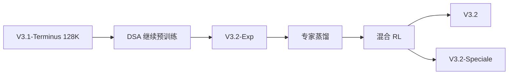
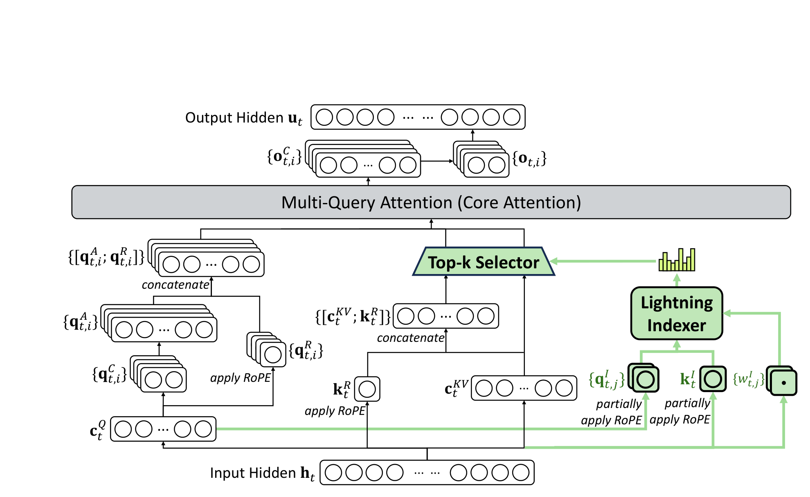
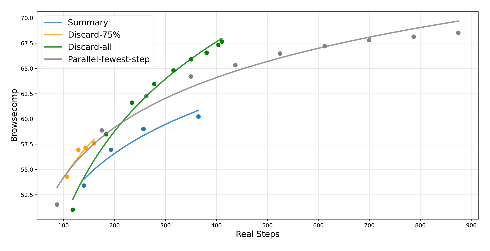

# DeepSeek-V3.2: Pushing the Frontier of Open Large Language Models

## 来源信息

| 项 | 内容 |
| --- | --- |
| 标题 | DeepSeek-V3.2: Pushing the Frontier of Open Large Language Models |
| 作者 | DeepSeek-AI（arXiv 元信息记 "DeepSeek-AI and 263 other authors"；未标通讯作者） |
| 机构 | DeepSeek-AI |
| 来源 | [arXiv:2512.02556v1](https://arxiv.org/abs/2512.02556)（[PDF](https://arxiv.org/pdf/2512.02556v1)） |
| 版本 | v1（2025-12-02 提交，23 页）；仓库 00133 是同一稿的 HF 副本，差异见 `audit.md` |
| 阅读日期 | 2026-11-05 |

---

## 核心结论

一句话：**V3.2 不是重新预训练一个模型，而是在 V3.1-Terminus 上通过继续预训练植入 DSA（稀疏注意力），再用超过预训练成本 10% 的后训练算力、约 8.5 万条 agent 任务做 RL，把开源模型在 reasoning 上推到 GPT-5 附近、在 agentic 任务上明显拉近，同时把 128K 上下文的服务成本压到 V3.1-Terminus 的约 1/3.5（prefill）与 1/8.5（decode）。**

- **问题**：作者认为闭源模型在复杂任务上的领先仍在扩大，原因有三——vanilla attention 的长序列成本、后训练算力不足、agent 环境与指令遵循落后。
- **核心想法**：主注意力只对每个 query 的 top-2048 个历史 KV entry 计算，选谁由一个小而便宜的 lightning indexer 打分；其余部分沿用 V3.1-Terminus，所以能从它继续训练。
- **怎么做到**：先冻结主模型、用 2.1B token 只训 indexer，再放开全模型用 943.7B token 做稀疏训练；后训练把 reasoning、agent、alignment 合成一个 GRPO 阶段，配四个针对训练/推理不一致的稳定化手段。
- **关键结果**：Table 2 的 19 个基准里 15 个是开源模型最高（本笔记按表复算）；Speciale 在 8 项推理/代码基准上对 GPT-5 七胜一平，IMO/CMO/IOI/ICPC 均达金牌线。
- **定位**：不是完整架构报告（不披露参数量、层数、预训练数据）；适合做长上下文推理、稀疏注意力、MoE RL 稳定性、agent 数据与测试时上下文管理的工程读者，价值在把「效率、RL 稳定性、agent 数据」三条线接起来。

---

## 问题

**开源与闭源的分叉（§1）**。作者的判断是：reasoning model 之后开源社区仍在进步，但闭源模型的性能轨迹上升更快，差距在复杂任务上扩大而不是收敛。他们把这归因于三个具体缺陷：

1. **架构效率**：主流仍是 vanilla attention，长序列的训练与部署成本都受限，也拖累了后训练的规模化。
2. **后训练算力**：开源模型在 post-training 上的投入不足，硬任务上打不过闭源。
3. **Agent 泛化与指令遵循**：开源模型在真实工具环境中明显落后，影响部署。

**这三个缺陷对应的具体卡点**：

- **长上下文的成本结构**：$O(L^{2})$ 的注意力让 128K 下的 prefill 与 decode 都变贵；decode 每步都要重读 KV，序列越长，单位 token 的成本越高。
- **换架构的代价**：直接换一套新注意力通常要从头预训练，等于放弃 V3.1-Terminus 已经花掉的算力。论文要的是「保持长上下文质量、只降计算」且能续训的方案。
- **RL 的规模与稳定性**：多阶段 RL（reasoning → agent → alignment）会带来灾难性遗忘；训练框架与推理框架在 MoE 路由、top-p/top-k 截断上的不一致，会让重要性采样的假设失效。
- **Agent 数据的供给**：真实工具（搜索 API、代码执行、Jupyter）覆盖的领域有限，难以大规模构造「难而可验证」的任务；合成环境可以批量生成 `<environment, tools, task, verifier>` 四元组。

**本文的设定与前提**：

- 起点是 V3.1-Terminus（128K），只做继续预训练，不换 base、不重训。
- DSA 建在 MLA 的 MQA 模式上：一个 KV entry 服务该 query 的所有 query head。前提是 kernel 能从一个共享 entry 批量取数；否则 top-k 之后的访存碎片化会吃掉收益。
- top-k 在训练设置里固定为 2048，不随序列长度变。
- 「超过预训练成本 10%」是相对比例：原文没有给绝对 FLOPs，也没有说明是否含 rollout 采样。
- 作者观察到，随着 RL 训练预算增加，性能持续提升，且当前预算已超过预训练成本的 10%；原文没有说这个门槛是由该观察直接推导出来的（本笔记对 §1–2 取舍的归纳）。

---

## 核心想法

### 一句话

把「看全部历史」改成「先花很小的代价挑 2048 个，再认真看这 2048 个」。

### 直觉

- 128K 上下文里，真正决定下一个 token 的历史位置是少数；full attention 把 $O(L^{2})$ 花在「全都看一遍」上。
- 挑的工作交给 indexer：$H^{I}$ 个头、ReLU 点积、可跑 FP8。它自身仍是 $O(L^{2})$，但头数少、没有 softmax，实际开销远小于被替换掉的主注意力。
- 被选中的 entry 送进主注意力，主注意力只做 $O(Lk)$；$k=2048$ 在 128K 下只占 1.6%（本笔记复算 `2048/131072`）。
- 这套做法是否成立，取决于「选得准不准」；indexer 不是启发式，它被主注意力的分布监督着训练（见方法）。

### 为什么成立

- **可续训**：DSA 只改注意力的取数范围，参数形状不变，所以能在 V3.1-Terminus 上继续训练，不用重训。
- **可监督**：dense 阶段主注意力看全部历史，可以把它沿序列 L1 归一化后的分布当作 indexer 的目标；稀疏阶段只在被选中的集合上算同样的 KL。
- **解耦**：indexer 的输入 detach，梯度只从 KL 损失来；主模型只从语言建模损失来。两套目标分开调 lr（`1e-3` / `7.3e-6`），避免主损失把选路器拉向与检索质量无关的方向。
- **kernel 友好**：MLA 的 MQA 模式让一个 KV entry 服务多个 query head，top-k 选出的 entry 才能被批量取用；这正是选 MQA 而不是 MHA 的原因。

### 与已有做法的区别

- **vs 换一套新注意力**：不改变「内容寻址」的语义，只缩小寻址范围；不必从头预训练，目标是保持原有长上下文质量。
- **vs 继续堆 SFT 数据**：作者观察到 RL 预算增加时性能持续提升；蒸馏只用来给 RL 一个好起点。
- **vs 多阶段 RL**：合成一个 GRPO 阶段，避免阶段性遗忘；四个稳定化手段处理的都是「训练/推理不一致」，不是新的 RL 目标。
- **vs 只靠真实环境**：合成 `<environment, tools, task, verifier>` 四元组，可以批量造「难而可验证」的任务。

### 一个走通的账

- **训练**：2.1B（warm-up）+ 943.7B（稀疏）token；后训练算力超过预训练成本的 10%。
- **服务成本**：128K 下 prefill 约 0.19 对 0.66 美元/百万 token（约 1/3.5），decode 约 0.25 对 2.14–2.16（约 1/8.5）（Figure 3 读数）。
- **数据**：Table 1 四类任务合计 85,267 条（本笔记按表求和），与引言「85,000 complex prompts」一致；general agent 经 pass@100 过滤后是 1,827 个环境 / 4,417 条任务。
- **收益的方向**：decode 省得比 prefill 多，因为 decode 每步都要重读 KV，长上下文下 KV 读取是主成本。

### 代价

- indexer 自身仍是 $O(L^{2})$，只是常数小；序列越长，它的绝对开销也在涨。
- $k$ 固定 2048：128K 下只看到 1.6% 的历史，更长上下文时这个比例继续下降；论文没有给 $k$ 的消融。
- 两套 lr、detach 的计算图、MQA 模式都是实现约束；短 prefill 还要用 masked MHA 模拟 DSA 才有收益。
- RL 的四个手段都依赖推理框架把路由与采样 mask 交回训练框架；换框架要重新对齐。
- 上下文管理是模型侧规则，依赖工具输出放在 `tool` 角色；把工具交互模拟成 user message 的框架吃不到这个收益。

---

## 方法

### 符号表

| 符号 | 含义 | 维度 / 取值 |
| --- | --- | --- |
| $t,s$ | token 位置下标；$s$ 是历史 token 的位置 | — |
| $I_{t,s}$ | indexer 给「query $t$ 看历史 $s$」打的标量分数 | — |
| $H^{I}$ | indexer 的头数 | — |
| $w^{I}_{t,j}$ | 第 $j$ 个 indexer 头在位置 $t$ 的权重（原文未给定义式；按公式读作加权系数） | — |
| $q^{I}_{t,j},k^{I}_{s}$ | indexer 第 $j$ 头的 query 向量、历史 $s$ 的 key 向量（原文未给投影式；按公式读作点积的两侧） | — |
| $k$ | 主注意力保留的 KV entry 数（top-k） | 2048 |
| $\mathbf{h}_{t}$ | 位置 $t$ 的注意力输入隐藏态 | — |
| $\mathbf{c}_{s},\mathbf{c}_{t}^{\mathrm{KV}},k_{t}^{R}$ | MLA 的 KV entry（压缩 latent）；位置 $t$ 的 KV latent 与共享 RoPE key（Figure 2 记法） | — |
| $\mathbf{u}_{t}$ | 主注意力的输出 | — |
| $\mathrm{Attn},\mathrm{Top}$-k,$\mathrm{ReLU},\mathrm{Softmax},\min,\mathrm{clip},\log$ | 注意力、取分数最高的 $k$ 个、激活、归一化、取最小、裁剪、对数 | — |
| $\mathcal{L}^{I}$ | indexer 的 KL 损失（warm-up 与稀疏阶段各一条，共用记号） | — |
| $D_{\mathrm{KL}}$ | KL 散度 | — |
| $p_{t,:},p_{t,\mathcal{S}_{t}}$ | 主注意力沿序列 L1 归一化后的目标分布；限制在被选集合上的版本 | — |
| $I_{t,:},I_{t,\mathcal{S}_{t}}$ | indexer 对全部历史 / 被选集合的分数 | — |
| $\mathcal{S}_{t}$ | 位置 $t$ 选中的 KV entry 集合 | $\lvert\mathcal{S}_{t}\rvert=k$ |
| $\theta,\mathcal{J}_{\mathrm{GRPO}}(\theta)$ | 策略参数、GRPO 的训练目标 | — |
| $q,P(Q)$ | 训练问题、问题分布 | — |
| $o_{i},o_{i,<t},o_{i,t}$ | 第 $i$ 条回答、其前 $t-1$ 个 token、第 $t$ 个 token | — |
| $G$ | 同一问题的回答数（组大小） | — |
| $\pi_{\theta},\pi_{\mathrm{old}},\pi_{\mathrm{ref}}$ | 当前策略、采样时的旧策略、参考策略 | — |
| $r_{i,t}(\theta)$ | 重要性采样比 | — |
| $\hat{A}_{i,t}$ | 第 $i$ 条回答在第 $t$ 个 token 上的优势 | — |
| $R_{i},\mathbf{R},\mathrm{mean}(\mathbf{R})$ | 第 $i$ 条回答的奖励、一组的奖励向量、组内奖励均值 | — |
| $\varepsilon,\beta$ | PPO 式裁剪范围、KL 惩罚系数 | — |
| $M_{i,t}$ | off-policy 序列 mask（整条序列共享一个 0/1） | $\{0,1\}$ |
| $\delta$ | 判为「过度 off-policy」的 KL 阈值 | — |
| $\lvert o_{i}\rvert$ | 第 $i$ 条回答的 token 数 | — |

表中标「—」的维度或取值，现有笔记没有记录。

### 数据流



### 1. DSA：把核心注意力从 $O(L^{2})$ 变成 $O(Lk)$

DSA 由两个组件构成：**lightning indexer** 对每个 query token 与每个历史 token 算一个标量分数；**fine-grained token selection** 只把分数最高的 $k$ 个 KV entry 送进主注意力。

```math
I_{t,s}=\sum_{j=1}^{H^{I}} w^{I}_{t,j}\cdot \mathrm{ReLU}\left(q^{I}_{t,j}\cdot k^{I}_{s}\right),
\qquad
\mathbf{u}_{t}=\mathrm{Attn}\left(\mathbf{h}_{t},\left\{\mathbf{c}_{s}\mid I_{t,s}\in \mathrm{Top}\text{-}k(I_{t,:})\right\}\right).
```

**逐项读法**：$I_{t,s}$ 是位置 $t$ 的 query 给历史 $s$ 打的分；它由 $H^{I}$ 个头的 ReLU 点积按 $w^{I}_{t,j}$ 加权求和得到，$q^{I}_{t,j}$ 与 $k^{I}_{s}$ 是第 $j$ 个 indexer 头的 query/key。用 ReLU 而不是 softmax 是为了吞吐：分数不需要归一化，选 top-k 只看相对大小；indexer 头数少、可跑 FP8，因此它自身虽然仍是 $O(L^{2})$，实际计算远小于被替换掉的 MLA。第二式里 $\mathbf{h}_{t}$ 是当前隐藏态，$\mathbf{c}_{s}$ 是 MLA 的 KV entry，$\mathrm{Attn}$ 只在 $I_{t,s}$ 落在 top-$k$ 集合里的 entry 上计算，输出 $\mathbf{u}_{t}$。

**MLA 下的实例化（§2.1）**：DSA 建在 MLA 的 MQA 模式上——每个 latent vector（MLA 的 KV entry）被该 query token 的所有 query head 共享。原因是 kernel 层要求一个 KV entry 服务多个 query，否则稀疏选择带来的访存收益会被抵消。附录 A 的 Figure 7 说明，V3.1-Terminus 在训练/预填时用 MHA 模式、解码时用 MQA 模式，两者可以互相转换；V3.2 则直接把 DSA 放在 MQA 模式上。



*Figure 2（原文 p4）：输入隐藏态同时进入主注意力的 Q/KV 与 lightning indexer；indexer 打分后由 Top-k Selector 选出 $[c_{t}^{\mathrm{KV}}; k_{t}^{R}]$ 对，送入 Multi-Query Attention。绿色部分为 DSA 的选路。*

### 2. 两阶段训练

| 阶段 | 训练什么 | 数据量 | 关键超参 |
| --- | --- | --- | --- |
| dense warm-up | 冻结主模型，只训 indexer；保持 dense attention | 1000 步 × 16 条 × 128K ≈ 2.1B token | lr `1e-3` |
| sparse training | 放开全模型 + indexer；启用 top-k=2048 | 15000 步 × 480 条 × 128K ≈ 943.7B token | lr `7.3e-6` |

```math
\mathcal{L}^{I}=\sum_{t} D_{\mathrm{KL}}\left(p_{t,:}\,\|\,\mathrm{Softmax}(I_{t,:})\right),
\qquad
\mathcal{L}^{I}=\sum_{t} D_{\mathrm{KL}}\left(p_{t,\mathcal{S}_{t}}\,\|\,\mathrm{Softmax}(I_{t,\mathcal{S}_{t}})\right).
```

**逐项读法**：$p_{t,:}$ 是主注意力沿序列做 L1 归一化得到的分布，$\mathrm{Softmax}(I_{t,:})$ 是 indexer 的预测分布，KL 让后者逼近前者；这是 warm-up 阶段（左式）。稀疏阶段（右式）只在被选集合 $\mathcal{S}_{t}$ 上算同一条 KL：$p_{t,\mathcal{S}_{t}}$ 与 $I_{t,\mathcal{S}_{t}}$ 都是限制到该集合后的版本。两个阶段共用 $\mathcal{L}^{I}$ 这个记号，读的时候按阶段区分。indexer 的输入从计算图中 detach，训练信号只来自 $\mathcal{L}^{I}$；主模型只按语言建模损失优化——两者解耦，避免主损失把选路器拉向与检索质量无关的方向。

### 3. 后训练：专家蒸馏 + 混合 RL（§3）

**专家蒸馏**：每个域先训练一个专家（都从同一个 V3.2 base checkpoint 微调），覆盖数学、编程、通用逻辑、通用 agent、agentic coding、agentic search 六个域，另加写作与通用问答，并支持 thinking / non-thinking 两种模式；thinking 的长 CoT 与 non-thinking 的直接回答由不同模型生成数据。蒸馏后的模型略低于专家，后续 RL 把差距抹平。

**混合 RL**：不再分「reasoning RL → agent RL → alignment RL」多阶段，而是合成一个 GRPO 阶段，避免多阶段带来的灾难性遗忘。奖励由三部分组成：规则化的结果奖励、长度惩罚、语言一致性奖励；通用任务用生成式奖励模型，每个 prompt 有自己的 rubric。

**原文 Eq (8)：GRPO 目标**

```math
\mathcal{J}_{\mathrm{GRPO}}(\theta)=\mathbb{E}_{q\sim P(Q),\,\{o_i\}_{i=1}^{G}\sim\pi_{\mathrm{old}}(\cdot\mid q)}\left[\frac{1}{G}\sum_{i=1}^{G}\frac{1}{|o_i|}\sum_{t=1}^{|o_i|}\min\left(r_{i,t}(\theta)\hat{A}_{i,t},\ \mathrm{clip}\left(r_{i,t}(\theta),1-\varepsilon,1+\varepsilon\right)\hat{A}_{i,t}\right)M_{i,t}-\beta D_{\mathrm{KL}}\left(\pi_\theta(o_{i,t})\,\|\,\pi_{\mathrm{ref}}(o_{i,t})\right)\right],
```

**逐项读法**：$q$ 从问题分布 $P(Q)$ 采样，对每个问题用旧策略 $\pi_{\mathrm{old}}$ 采 $G$ 条回答 $\{o_{i}\}$；每条回答按 token 数 $\lvert o_{i}\rvert$ 取平均，再对 $G$ 条取平均。$r_{i,t}(\theta)$ 是当前策略与旧策略在 token $o_{i,t}$ 上的概率比；$\hat{A}_{i,t}$ 是优势；$\min$ 与 $\mathrm{clip}$ 是 PPO 式的保守更新，$\varepsilon$ 控制裁剪宽度。$M_{i,t}$ 是下文的 off-policy 序列 mask（没有它时就是标准 GRPO），乘在整个 `min(...)` 上；KL 惩罚项带系数 $\beta$，以参考策略 $\pi_{\mathrm{ref}}$ 为锚，不受 mask 影响。

```math
r_{i,t}(\theta)=\frac{\pi_\theta(o_{i,t}\mid q,o_{i,<t})}{\pi_{\mathrm{old}}(o_{i,t}\mid q,o_{i,<t})},
\qquad
\hat{A}_{i,t}=R_i-\mathrm{mean}(\mathbf{R}).
```

**逐项读法**：分母是采样时旧策略给该 token 的概率，分子是当前策略的概率；比值偏离 1 越多，说明这一步更新越 off-policy。优势 $\hat{A}_{i,t}$ 用「第 $i$ 条回答的奖励 $R_{i}$ 减去组内均值」——原文只减均值，没有除以组内标准差。这个优势定义与一些 GRPO 实现不同，读代码时要对齐。

### 4. 四个稳定化手段（§3.1）

它们分别针对训练/推理不一致的不同来源：

1. **Unbiased KL estimate**：样本来自旧策略 $\pi_{\mathrm{old}}$，K3 估计器的梯度会有偏；乘上 $\pi_\theta/\pi_{\mathrm{old}}$ 后梯度无偏。原文指出，当 $\pi_\theta \ll \pi_{\mathrm{ref}}$ 时，原 K3 会给这些 token 过大的无界权重，导致噪声梯度累积、样本质量下降。

```math
D_{\mathrm{KL}}\left(\pi_\theta(o_{i,t})\,\|\,\pi_{\mathrm{ref}}(o_{i,t})\right)=\frac{\pi_\theta(o_{i,t}\mid q,o_{i,<t})}{\pi_{\mathrm{old}}(o_{i,t}\mid q,o_{i,<t})}\left(\frac{\pi_{\mathrm{ref}}(o_{i,t}\mid q,o_{i,<t})}{\pi_\theta(o_{i,t}\mid q,o_{i,<t})}-\log\frac{\pi_{\mathrm{ref}}(o_{i,t}\mid q,o_{i,<t})}{\pi_\theta(o_{i,t}\mid q,o_{i,<t})}-1\right).
```

**逐项读法**：括号内是 K3 估计器，记 $u=\pi_{\mathrm{ref}}/\pi_{\theta}$，它就是 $u-\log u-1$，在 $u=1$ 处取 0 且非负；外面乘重要性权重 $\pi_{\theta}/\pi_{\mathrm{old}}$，把「按旧策略采样」的期望换回当前策略，从而让梯度无偏。代价是方差：权重很大时单样本影响被放大，这也正是原文要处理的失效模式。

2. **Off-policy sequence masking**：把负优势、且旧/新策略 KL 超过阈值 $\delta$ 的序列整条 mask 掉；正优势样本不 mask。直觉是「从自己的错误里学」最有效，但高度 off-policy 的负样本会误导优化。

```math
M_{i,t}=\begin{cases}0, & \hat{A}_{i,t}<0\ \text{and}\ \frac{1}{|o_i|}\sum_{t=1}^{|o_i|}\log\frac{\pi_{\mathrm{old}}(o_{i,t}\mid q,o_{i,<t})}{\pi_\theta(o_{i,t}\mid q,o_{i,<t})}>\delta,\\ 1, & \text{otherwise}.\end{cases}
```

**逐项读法**：条件里的求和是对整条回答的逐 token log 概率比取平均，衡量这条序列整体有多 off-policy；只有「优势为负」且「漂移超过 $\delta$」时才置 0。虽然记号写成逐 token 的 $M_{i,t}$，统计量是序列级的，读的时候按「整条序列共享一个 0/1」理解。

3. **Keep routing**：MoE 在推理框架与训练框架中的专家路由可能不一致，即使输入相同。把采样时的路由路径保留下来、训练时强制走同一路径，保证优化的是同一组专家参数。该做法自 DeepSeek-V3-0324 起进入 RL 流水线。

4. **Keep sampling mask**：top-p / top-k 截断会让 $\pi_{\mathrm{old}}$ 与 $\pi_\theta$ 的动作空间不一致，违反重要性采样假设。保留采样时的截断 mask 并在训练时套用，使两个策略共享同一动作子空间；原文说 top-p + keep sampling mask 能保住语言一致性。

**V3.2 与 V3.2-Speciale**：V3.2 用 reasoning + agent + alignment 的蒸馏数据做数千步 RL；Speciale 是实验变体，只用 reasoning 数据、降低长度惩罚，并加入 DeepSeekMath-V2 的数据与奖励来加强数学证明。

### 5. 把 thinking 放进 tool-use（§3.2）

**上下文管理（§3.2.1）**：R1 式「第二轮消息到达就丢掉 reasoning」在工具调用里会造成大量重复推理。V3.2 的规则是：

- 只有**新的 user message** 出现时才丢弃历史 reasoning；
- 如果只是追加工具消息（工具输出），reasoning 全程保留；
- reasoning 被丢弃时，工具调用及其结果仍保留在上下文里。

工程含义很直接：多轮工具调用不需要每轮重算问题；但它依赖框架把工具输出放在 `tool` 角色里。Roo Code、Terminus 这类把工具交互模拟成 user message 的框架吃不到这个收益，原文因此建议这类架构直接用 non-thinking 模型。

**冷启动（§3.2.2）**：把 reasoning 数据（带 thinking 标注）与 agent 数据（带 tool-call format）用不同的 system prompt 拼起来，先让模型偶尔生成「在 thinking 里调用工具」的轨迹，作为 RL 的起点。附录 B 的 Table 6–8 给了三类 system prompt 示例；Table 8 的示例把单次轨迹的代码执行上限设为 20 次。

**大规模 agent 任务（§3.2.3）**：Table 1 四类任务合计 85,267 条。Code agent 从 GitHub 挖 issue-PR 对，要求「打 gold patch 后 F2P>0 且 P2F=0」才算环境构建成功；search agent 用「标准答案正确、且所有候选都可验证为错」筛样本；general agent 由自动环境合成 agent 依次生成数据库与工具、任务、solution 与 verifier，RL 时只保留 pass@100 非零的实例，最终 1,827 个环境 / 4,417 条任务；code interpreter 用 Jupyter Notebook，覆盖数学、逻辑、数据科学。

### 6. 与已有方法的结构差异

- **vs full attention**：不改注意力的语义（仍是内容寻址），只把每个 query 的可见历史从全部压到 top-$k$；省的是主注意力的 $O(L^{2})$，代价是多一个 $O(L^{2})$ 的轻量 indexer。
- **vs 从头训练稀疏注意力模型**：参数形状不变，可以从 V3.1-Terminus 续训，2.1B + 943.7B token 就完成切换。

---

## 主要结果

**设置（§4.1）**：温度 1.0、上下文 128K；tool-use 基准用标准 function call 格式、模型处于 thinking 模式；数学类统一要求把最终答案放进 $\boxed{}$；MCP-Universe 与 MCP-Mark 在内部环境评测。Table 2 的开源对比只选支持 thinking in tool use 的模型。

| 基准 | V3.2 | 备注 |
| --- | ---: | --- |
| GPQA Diamond | 82.4 | 开源最高是 Kimi-K2-Thinking 84.5 |
| AIME 2025 | 93.1 | Kimi 94.5 |
| IMOAnswerBench | 78.3 | Kimi 78.6 |
| HLE（search） | 40.8 | Kimi 44.9 |
| Terminal Bench 2.0 | 46.4 | Claude Code 框架；对 Kimi +10.7 |
| SWE Verified | 73.1 | 内部框架主分 |
| MCP-Mark | 38.0 | 内部环境；对 Kimi +17.6 |
| MCP-Universe | 45.9 | GPT-5 47.9 |
| BrowseComp | 51.4（67.6*） | GPT-5 54.9（不带 `*`） |
| τ2-Bench | 80.3 | 三个分类的平均 |

*`*` 表示带上下文管理；差额为本笔记按 Table 2 复算。*

1. **开源内 15/19 最高，但不是全部**：19 个基准中 15 个是开源模型最高（本笔记按表复算）；落后的四个是 GPQA、AIME 2025、IMOAnswerBench 与 search 版 HLE，全部输给 Kimi-K2-Thinking。所以「推向前沿」成立，但不能写成「开源全面第一」。
2. **Agentic 的进步是真实的，但不是全面领先**：对 Kimi 的 Terminal +10.7、SWE Multilingual +9.1、MCP-Mark +17.6；但 MCP-Universe 对 GPT-5 仍是 45.9 对 47.9，BrowseComp 同口径 51.4 对 54.9（67.6 是加了上下文管理后的分数）。Terminal 的 46.4 用 Claude Code 框架取得，与 Terminus 下的数字不是同一 scaffold。
3. **Speciale 用更多 token 换分数**：8 项推理/代码基准对 GPT-5-High 七胜一平（GPQA 85.7 平），对 Gemini-3.0-Pro 4 胜 4 负——数学四项更高，GPQA 低 6.2、HLE 低 7.1。竞赛成绩（IMO 35/42、CMO 102/126、IOI 492/600、ICPC 10/12）不是单次生成：附录 D 说明 IOI 每题采样 500 个候选、过滤后取 50 个「thinking 最长」的提交，IMO/CMO 用 generate-verify-refine 循环。
4. **token 效率是双向的**：V3.2-Thinking 在 7 个可比基准上比 Kimi-K2-Thinking 省（7k–27k 对 12k–37k），但 Speciale 比 Gemini 费（HLE 35k 对 15k）。
5. **上下文管理值得单独部署**：BrowseComp 不做管理 51.4，做之后 67.6；Discard-all 的 67.6 与并行扩展可比，但步数少得多（Figure 6）。只在合成 general agent 数据上做 RL，在 9 个 agent 面板上整体高于 SFT 与 V3.2-Exp（non-thinking 模式）；这组消融不能直接外推到 thinking。



*Figure 6（原文 p17）：BrowseComp 上四种策略的准确率—真实步数曲线；Summary 的散点 60.2 约在 364 步，Discard-all 到 67.6 且步数明显少于并行采样。*

---

## 边界与局限

**作者明确承认的（§5）**：

- 世界知识广度仍落后于领先闭源模型，原因是总训练 FLOPs 更少；计划靠扩大预训练算力解决。
- Token 效率与复杂任务仍是短板：V3.2 需要更长的生成轨迹才能匹配 Gemini-3.0-Pro 的质量；§4.2 说 Speciale 的 token 效率显著低于 Gemini，并用更严格的 token 约束缓解部署成本；复杂任务也仍不如前沿模型。

**读者根据证据提出的**：

- **DSA 的质量保持与自身消融都缺**：§2.2 的 parity evaluation 只有定性描述与零散数字（AA-LCR 高 4 分、Fiction.liveBench 一致更好），没有与 V3.1-Terminus 的逐项对比；$k=2048$、indexer 头数、FP8、warm-up 数据量都没扫，四个 RL 稳定化手段也没有去掉任一项的对比曲线或方差。
- **规模与评测细节缺失**：没有参数量、层数、专家数、预训练 token 数；Table 5 只在 50 条 general 任务上测 pass@K，Figure 5 未披露各面板样本量，两者都没有置信区间。
- **安全与复现条件缺位**：没有有害内容、越狱、agent 权限滥用的评测；搜索 API 只说 "standard commercial search API"，检索质量无法对齐。

---

## 与其他工作的关系

- **DeepSeek-V3（00042，[笔记](../2412.19437-v2-deepseek-v3/note.md)）**：MLA 与 DeepSeekMoE 的来源；DSA 建在 MLA 的 MQA 模式上，先读 V3 的 KV 压缩更容易理解「为什么稀疏选择要求 KV entry 共享」。
- **DeepSeek-V4.1-Flash（00191）**：同族后续工作；V4.1 的 CSA2 与 FP4 主 KV 是在 DSA 之后再压 KV 存储，两篇连起来是「先稀疏计算（V3.2）→ 再压 KV 存储（V4/V4.1）」。
- **DeepSeek-R1（00045 / 00095）**：thinking 能力与冷启动方法的基础；本文的 thinking 标签与 R1 的 reasoning 数据格式一脉相承。
- **DeepSeekMath-V2（00136）**：Speciale 的数学证明数据与奖励直接取自这篇。
- **Super-agent 设计探索（00221 / 00222）**：与本文「模型侧 tool-use 上下文管理」是同一问题的两个层面（模型规则 vs harness 设计），可对照阅读，两篇没有直接引用关系。
