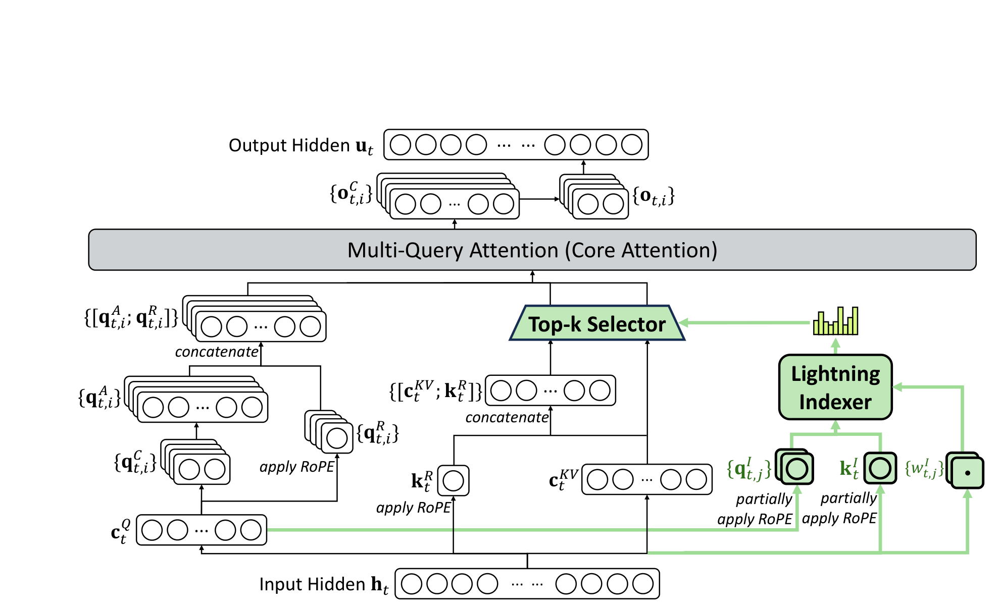
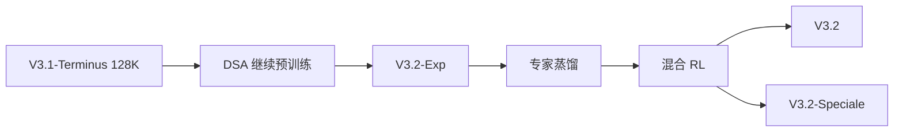
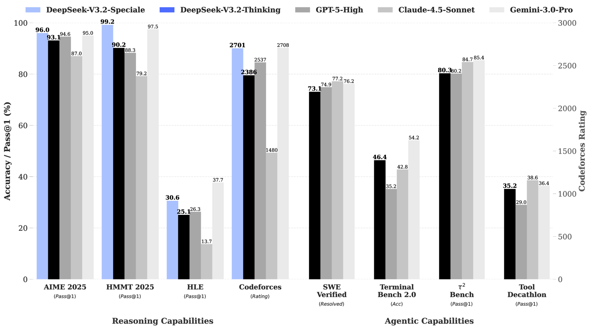
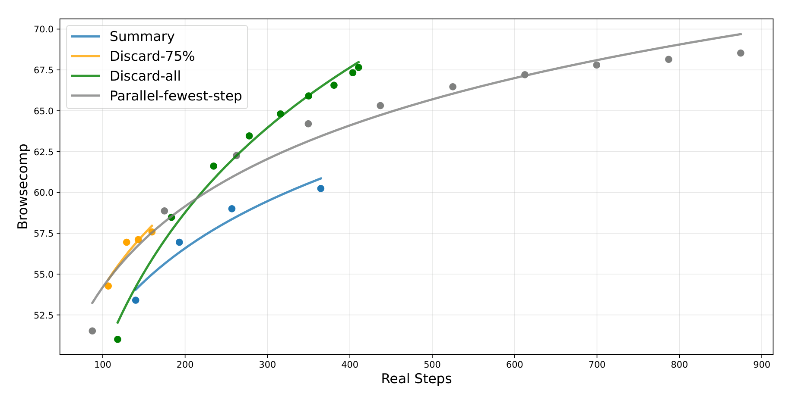

# DeepSeek-V3.2: Pushing the Frontier of Open Large Language Models

## 来源信息

| 项 | 内容 |
| --- | --- |
| 标题 | DeepSeek-V3.2: Pushing the Frontier of Open Large Language Models |
| 作者 | DeepSeek-AI（arXiv 元信息记 "DeepSeek-AI and 263 other authors"；附录 E 按 Research & Engineering / Data Annotation / Business & Compliance 三节、名字字母序列出，`*` 标注已离职；未标通讯作者，联系方式 research@deepseek.com） |
| 机构 | DeepSeek-AI |
| 来源 | [arXiv:2512.02556v1](https://arxiv.org/abs/2512.02556)（[PDF](https://arxiv.org/pdf/2512.02556v1)）；本笔记按 v1 阅读 |
| 日期 | arXiv v1 提交 2025-12-02；正文 §2.2 提到 2025-09 的 parity evaluation、ChatbotArena Elo 取自 2025-11-10 |
| 阅读日期 | 2026-11-05 |
| 许可 | arXiv 页 "view license" 指向 `nonexclusive-distrib/1.0`（非 CC） |
| 版本关系 | 本仓库行 00133 的编号单元格指向本地归档 [`papers/00133-DeepSeek-V3.2.pdf`](../../../papers/00133-DeepSeek-V3.2.pdf)（HF 技术报告副本，23 页，sha256 `f6fda575…`，PDF 元数据 CreationDate 2025-12-01）；本次读 arXiv v1（23 页，sha256 `2bec0671…bd17b`）。两版仅 4 页文本不同，见下「版本关系」。截至 2026-11-05，arXiv 只有 v1；HF 当前版本未能核验（本机访问 huggingface.co 超时） |
| 阅读范围 | 全文 23 页：正文 §1–5、参考文献、附录 A–E。Table 1–5、9 与 Figure 1/2/3/6 在 170–400 dpi 渲染页核对；Table 6–8 的 system prompt 示例按文本层核对；Figure 3 做像素测量；Table 2/3 的加粗用字体信息核对。Figure 5 按图注、正文与整图（9 个面板）核对图例、面板名与首点/基线关系，未逐点读数；Figure 7（MLA 的 MHA/MQA 模式）只按图注引用，未逐点核对 |
| 核对凭据 | 逐页抽取文本与 00133 副本比对（4 页差异，见下）；Table 1/2/3/4/5/9 在渲染页逐格核对；Table 2/3 的加粗用 `get_text('dict')` 的 `URWPalladioL-Bold` 核对（Table 2 有两处不符合表注规则，见「原文自身的表述张力」#8）；Figure 3 在 400 dpi 下按网格线定标做像素测量（panel a：0.7→y 541.5 px、0→y 1269.5 px，0.1/104.0 px；panel b：2.4→y 541.5 px、0→y 1269.5 px，0.4/121.3 px）；Figure 6 在 400 dpi 下定标（x：100 步=362 px、900 步=2397 px；y：70.0=145.5 px、52.5=1029.5 px）；Figure 2 裁剪框 (45,24,520,316) pt、Figure 6 裁剪框 (78,80,518,306) pt；Figure 1 用 arXiv HTML 资产 `2512.02556v1/v32_performance.svg`（300 dpi 渲染）并与 PDF p1 数值逐项对照。未做：运行代码、复现、Figure 5 曲线逐点读数、Figure 7 图形细节、HF 链接核验（本机访问 huggingface.co 超时） |

### 版本关系：arXiv v1 与仓库 00133 的 HF 副本

两份都是 23 页，逐页抽取文本比对后只有 4 页不同：

- p1：arXiv 版多一行水印 `arXiv:2512.02556v1 [cs.CL] 2 Dec 2025`。
- p2：arXiv 版在开源社区引用列表里补了 `Qwen, 2025`，整段因此重排。
- p19：参考文献相应补入 `Qwen. Qwen3 technical report, 2025.`。
- p17：HF 版写 "Summary extends the average steps from 140 to 364, improving performance from 53.4 to 60.2"；arXiv v1 改为 "Summary extends the average steps to 364, achieving a performance improvement of up to 60.2"，去掉了 140 步与 53.4 这两个基线数字。

主表与图中的数字、表格与图号在两版间没有差异，可视为同一稿的编辑修订；唯一被删掉的实验数字是 p17 的 140 与 53.4（见上条）。本笔记的页码、图号与引文均按 **arXiv v1**；若拿 00133 的 HF 副本复核 p17，会看到多出的 140 / 53.4。本机无法访问 HF，无法确认其当前版本；此处比对的是仓库归档副本（sha256 `f6fda575…`）。

> `assets/` 下的图：Figure 1 取自 arXiv HTML 的独立 SVG 资产（数值与 PDF p1 一致；PDF 版 Thinking 用蓝色斜纹、HTML 资产用黑色柱），Figure 2 与 Figure 6 裁自 arXiv v1 PDF（300 dpi）。按 arXiv 非独占分发许可引用，请注明出处。

### 复核记录

**2026-11-05（首轮复核；基准 arXiv v1，sha256 `2bec0671…bd17b`）**

- 逐页文本 diff 00133 副本：仅 p1、p2、p17、p19 不同；p17 删掉的 140 / 53.4 是唯一被删的实验数字。
- Table 1/2/3/4/5/9 在渲染页逐格核对；Table 2/3 的加粗用 `URWPalladioL-Bold` 核对。发现 Table 2 的 Codeforces 开源最优 2386 与 BrowseCompZh 闭源最优 GPT-5 63.0 未加粗，与表注「两类各自最优」不符（原文自身不一致，已记入「原文自身的表述张力」#8）。
- Figure 3 在 400 dpi 下定标（panel a：0.1/104.0 px；panel b：0.4/121.3 px）；末端读数 0.187 / 0.666、0.249 / 2.154 美元每百万 token。
- Figure 6 在 400 dpi 下定标（x：100 步=362 px、900 步=2397 px；y：70.0=145.5 px、52.5=1029.5 px）；Summary 散点 60.2 约在 364 步，拟合线末端约 60.9；Discard-all 末端 67.6 约 410 步。
- Figure 2/6 与 PDF 同坐标 300 dpi 重裁像素差 0；Figure 5 的图例（蓝=RL-Synthetic-Data、绿虚线=SFT、灰虚线=Exp）与 9 个面板标题按 600 dpi 裁剪核对。
- 本轮修正：版本关系里「实验数字无差异」的反例；Table 2 加粗规则；Figure 6 的散点/拟合线区分；Figure 5 的图例颜色、面板名、「持续高于」与 50 条任务的归属；GRPO 式 (8) 的 `M_{i,t}`；§3.2.3 的名称归因；Table 2 表注 `*` 的范围；τ2 user-agent、non-thinking、SWE 内部框架、HLE text-only、MCP tool 角色等口径；以及若干措辞与笔误。
- 未修/未核：HF 当前版本（本机超时）；Figure 5 逐点读数；Figure 7 图形细节；代码复现。

---

## 核心结论

一句话：**V3.2 不是重新预训练一个模型，而是在 V3.1-Terminus 上通过继续预训练植入 DSA（稀疏注意力），再用超过预训练成本 10% 的后训练算力、约 8.5 万条 agent 任务做 RL，把开源模型在 reasoning 上推到 GPT-5 附近、在 agentic 任务上明显拉近，同时把 128K 上下文的服务成本压到 V3.1-Terminus 的约 1/3.5（prefill）与 1/8.5（decode）。**

- **DSA（§2.1）**：lightning indexer 给每个历史 token 打分，主注意力只对 top-k（2048）个 KV entry 计算。核心注意力复杂度从 O(L²) 降到 O(Lk)；indexer 仍是 O(L²)，但头数少、可用 FP8，实际开销远小于原来的 MLA。DSA 实例化在 MLA 的 MQA 模式上，KV entry 在所有 query head 间共享。
- **继续预训练（§2.1.1）**：先冻结主模型、只用 2.1B token 训练 indexer（dense warm-up），再放开全模型、用 943.7B token 做稀疏训练。indexer 的输入被 detach，只由 KL 损失单独优化；主模型只受语言建模损失。
- **后训练（§3）**：专家蒸馏（数学、编程、通用逻辑、通用 agent、agentic coding、agentic search 六个域，加写作与通用问答）之后，把 reasoning、agent、human alignment 合并进一个 GRPO 阶段；四个稳定化手段是 unbiased KL、off-policy sequence masking、keep routing、keep sampling mask。
- **Agent 数据（§3.2.3）**：经 pass@100 过滤后保留 1,827 个 general agent 环境 / 4,417 条任务；Table 1 四类任务合计 85,267 条（本笔记按表求和），与引言「85,000 complex prompts」一致。
- **主结果（Table 2）**：V3.2 在 19 个基准中的 15 个是开源模型最高（本笔记按表复算；低于 Kimi-K2-Thinking 的是 GPQA、AIME 2025、IMOAnswerBench 与 search 版 HLE）。相对 GPT-5-High 有胜有负，原文用 "similar"。
- **Speciale（Table 3/4）**：只训 reasoning、降低长度惩罚、加入 DeepSeekMath-V2 的数据与奖励；8 项推理/代码基准对 GPT-5 七胜一平（GPQA 85.7 平），IMO/CMO/IOI/ICPC 均达金牌线，但输出 token 明显多于 Gemini-3.0-Pro。
- **适合谁读**：做长上下文推理、稀疏注意力、MoE RL 训练稳定性、agent 数据合成与测试时上下文管理的工程读者。它不是模型架构的完整技术报告（不披露参数量、层数、预训练数据），价值在「把效率、RL 稳定性、agent 数据」三条线接起来。

---

## 问题与动机

### 开源与闭源的分叉（§1）

作者的判断是：reasoning model 之后，开源社区仍在进步，但闭源模型的性能轨迹上升更快，差距在复杂任务上扩大而不是收敛。他们把这归因于三个具体缺陷：

1. **架构效率**：主流仍是 vanilla attention，长序列的训练与部署成本都受限，也拖累了后训练的规模化。
2. **后训练算力**：开源模型在 post-training 上的投入不足，硬任务上打不过闭源。
3. **Agent 泛化与指令遵循**：开源模型在真实工具环境中明显落后，影响部署。

### 三个设计选择

以下三条是读者对 §1–2 设计取舍的归纳，不是原文分节。

- **用 DSA 而不是换一套全新注意力**：目标是「保持长上下文质量、只降计算」，并且能从 V3.1-Terminus 继续训练，不必从头预训练。MLA 的 MQA 模式让 KV entry 在多个 query 间共享，正好满足稀疏选择在 kernel 层的要求。
- **用 RL 而不是继续堆 SFT 数据**：作者观察到，随着 RL 训练预算增加，性能持续提升，且当前预算已超过预训练成本的 10%；原文没有说 10% 这个门槛是由该观察直接推导出来的。
- **用合成 agent 环境而不是只靠真实环境**：真实工具（搜索 API、代码执行、Jupyter）覆盖的领域有限，且难以大规模构造「难而可验证」的任务；合成环境可以批量生成 `<environment, tools, task, verifier>` 四元组。

---

## 方法与贡献

### 1. DSA：把核心注意力从 O(L²) 变成 O(Lk)

DSA 由两个组件构成：

- **lightning indexer**：对每个 query token 与每个历史 token 算一个标量分数，决定哪些 token 被选中。
- **fine-grained token selection**：只把分数最高的 k 个 KV entry 送进主注意力。

```math
I_{t,s}=\sum_{j=1}^{H^{I}} w^{I}_{t,j}\cdot \mathrm{ReLU}\left(q^{I}_{t,j}\cdot k^{I}_{s}\right),
\qquad
\mathbf{u}_{t}=\mathrm{Attn}\left(\mathbf{h}_{t},\left\{\mathbf{c}_{s}\mid I_{t,s}\in \mathrm{Top}\text{-}k(I_{t,:})\right\}\right).
```

白话读法：indexer 用 `H^I` 个头的 ReLU 点积加权求和，给每个历史 token 一个分数；主注意力只对分数最高的 k 个 KV entry 计算输出。「ReLU 而不是 softmax」是为了吞吐——分数不需要归一化，选 top-k 只看相对大小；indexer 头数少、可跑 FP8，因此虽然它自身仍是 O(L²)，实际计算远小于被替换掉的 MLA。

**MLA 下的实例化（§2.1）**：DSA 建在 MLA 的 MQA 模式上——每个 latent vector（MLA 的 KV entry）被该 query token 的所有 query head 共享。原因是 kernel 层要求一个 KV entry 服务多个 query，否则稀疏选择带来的访存收益会被抵消。附录 A 的 Figure 7 说明，V3.1-Terminus 在训练/预填时用 MHA 模式、解码时用 MQA 模式，两者可以互相转换；V3.2 则直接把 DSA 放在 MQA 模式上。



*Figure 2（原文 p4）：绿色部分是 DSA 的选路。输入隐藏态同时进入主注意力的 Q/KV 与 lightning indexer；indexer 输出分数，Top-k Selector 选出被选中的 `{[c_t^KV; k_t^R]}` 对，送入 Multi-Query Attention（`c^KV` 与共享 RoPE key 拼接）。裁剪自 arXiv v1 PDF p4，300 dpi。*

**两个训练阶段（§2.1.1）**：

| 阶段 | 训练什么 | 数据量 | 关键超参 |
| --- | --- | --- | --- |
| dense warm-up | 冻结主模型，只训 indexer；保持 dense attention | 1000 步 × 16 条 × 128K ≈ 2.1B token | lr `1e-3` |
| sparse training | 放开全模型 + indexer；启用 top-k=2048 | 15000 步 × 480 条 × 128K ≈ 943.7B token | lr `7.3e-6` |

```math
\mathcal{L}^{I}=\sum_{t} D_{\mathrm{KL}}\left(p_{t,:}\,\|\,\mathrm{Softmax}(I_{t,:})\right),
\qquad
\mathcal{L}^{I}=\sum_{t} D_{\mathrm{KL}}\left(p_{t,\mathcal{S}_{t}}\,\|\,\mathrm{Softmax}(I_{t,\mathcal{S}_{t}})\right).
```

白话读法：warm-up 时，把主注意力沿序列做 L1 归一化得到目标分布 `p_{t,:}`，让 indexer 的 softmax 去逼近它；稀疏阶段只在被选中的集合 `S_t` 上算同样的 KL。indexer 的输入从计算图中 detach，训练信号只来自 `L^I`；主模型只按语言建模损失优化——两者解耦，避免主损失把选路器拉向与检索质量无关的方向。

### 2. 后训练：专家蒸馏 + 混合 RL（§3）

**专家蒸馏**：每个域先训练一个专家（都从同一个 V3.2 base checkpoint 微调），覆盖六个域，并支持 thinking / non-thinking 两种模式；thinking 的长 CoT 与 non-thinking 的直接回答由不同模型生成数据。蒸馏后的模型略低于专家，后续 RL 把差距抹平。

**混合 RL**：不再分「reasoning RL → agent RL → alignment RL」多阶段，而是合成一个 GRPO 阶段，避免多阶段带来的灾难性遗忘。奖励由三部分组成：规则化的结果奖励、长度惩罚、语言一致性奖励；通用任务用生成式奖励模型，每个 prompt 有自己的 rubric。

**GRPO 目标与四个稳定化手段（§3.1）**：

```math
\mathcal{J}_{\mathrm{GRPO}}(\theta)=\mathbb{E}_{q\sim P(Q),\,\{o_i\}_{i=1}^{G}\sim\pi_{\mathrm{old}}(\cdot\mid q)}\left[\frac{1}{G}\sum_{i=1}^{G}\frac{1}{|o_i|}\sum_{t=1}^{|o_i|}\min\left(r_{i,t}(\theta)\hat{A}_{i,t},\ \mathrm{clip}\left(r_{i,t}(\theta),1-\varepsilon,1+\varepsilon\right)\hat{A}_{i,t}\right)M_{i,t}-\beta D_{\mathrm{KL}}\left(\pi_\theta(o_{i,t})\,\|\,\pi_{\mathrm{ref}}(o_{i,t})\right)\right],
```
```math
r_{i,t}(\theta)=\frac{\pi_\theta(o_{i,t}\mid q,o_{i,<t})}{\pi_{\mathrm{old}}(o_{i,t}\mid q,o_{i,<t})},
\qquad
\hat{A}_{i,t}=R_i-\mathrm{mean}(\mathbf{R}).
```

白话读法：GRPO 在同一个问题的 G 条回答之间比较，优势就是「这条回答的奖励减去组均值」——原文只减均值，没有除以组内标准差；然后对重要性采样比做裁剪，再减 KL。式 (8) 里的 `M_{i,t}` 是下文的 off-policy 序列 mask（没有它时就是标准 GRPO）；这个优势定义与一些 GRPO 实现不同，读代码时要对齐。

四个稳定化手段分别针对训练/推理不一致的不同来源：

1. **Unbiased KL estimate**：样本来自旧策略 `π_old`，K3 估计器的梯度会有偏；乘上 `π_θ/π_old` 后梯度无偏。原文指出，当 `π_θ << π_ref` 时，原 K3 会给这些 token 过大的无界权重，导致噪声梯度累积、样本质量下降。
```math
D_{\mathrm{KL}}\left(\pi_\theta(o_{i,t})\,\|\,\pi_{\mathrm{ref}}(o_{i,t})\right)=\frac{\pi_\theta(o_{i,t}\mid q,o_{i,<t})}{\pi_{\mathrm{old}}(o_{i,t}\mid q,o_{i,<t})}\left(\frac{\pi_{\mathrm{ref}}(o_{i,t}\mid q,o_{i,<t})}{\pi_\theta(o_{i,t}\mid q,o_{i,<t})}-\log\frac{\pi_{\mathrm{ref}}(o_{i,t}\mid q,o_{i,<t})}{\pi_\theta(o_{i,t}\mid q,o_{i,<t})}-1\right).
```
2. **Off-policy sequence masking**：把负优势、且旧/新策略 KL 超过阈值 `δ` 的序列整条 mask 掉；正优势样本不 mask。直觉是「从自己的错误里学」最有效，但高度 off-policy 的负样本会误导优化。
```math
M_{i,t}=\begin{cases}0, & \hat{A}_{i,t}<0\ \text{and}\ \frac{1}{|o_i|}\sum_{t=1}^{|o_i|}\log\frac{\pi_{\mathrm{old}}(o_{i,t}\mid q,o_{i,<t})}{\pi_\theta(o_{i,t}\mid q,o_{i,<t})}>\delta,\\ 1, & \text{otherwise}.\end{cases}
```
   `M_{i,t}` 乘在式 (8) 的策略梯度项（整个 `min(...)`，未裁剪与裁剪两支都在内）上；KL 惩罚项不受 mask 影响。原文这里的记号把序列级统计量写进了逐 token 的 `M_{i,t}`，读的时候按「整条序列共享一个 0/1」理解。
3. **Keep routing**：MoE 在推理框架与训练框架中的专家路由可能不一致，即使输入相同。把采样时的路由路径保留下来、训练时强制走同一路径，保证优化的是同一组专家参数。该做法自 DeepSeek-V3-0324 起进入 RL 流水线。
4. **Keep sampling mask**：top-p / top-k 截断会让 `π_old` 与 `π_θ` 的动作空间不一致，违反重要性采样假设。保留采样时的截断 mask 并在训练时套用，使两个策略共享同一动作子空间；原文说 top-p + keep sampling mask 能保住语言一致性。

**V3.2 与 V3.2-Speciale**：V3.2 用 reasoning + agent + alignment 的蒸馏数据做数千步 RL；Speciale 是实验变体，只用 reasoning 数据、降低长度惩罚，并加入 DeepSeekMath-V2 的数据与奖励来加强数学证明。

### 3. 把 thinking 放进 tool-use（§3.2）

**上下文管理（§3.2.1）**：R1 式「第二轮消息到达就丢掉 reasoning」在工具调用里会造成大量重复推理。V3.2 的规则是：

- 只有**新的 user message** 出现时才丢弃历史 reasoning；
- 如果只是追加工具消息（工具输出），reasoning 全程保留；
- reasoning 被丢弃时，工具调用及其结果仍保留在上下文里。

这条规则的工程含义很直接：多轮工具调用不需要每轮重算问题；但它依赖框架把工具输出放在 tool 角色里。Roo Code、Terminus 这类把工具交互模拟成 user message 的框架吃不到这个收益，原文因此建议这类架构直接用 non-thinking 模型。

**冷启动（§3.2.2）**：把 reasoning 数据（用 ` thinking` / `</think>` 标注）与 agent 数据（带 tool-call format）用不同的 system prompt 拼起来，先让模型偶尔生成「在 thinking 里调用工具」的轨迹，作为 RL 的起点。附录 B 的 Table 6–8 给了三类 system prompt 的示例；Table 8 的示例提示把单次轨迹的代码执行上限设为 20 次。

**大规模 agent 任务（§3.2.3）**：Table 1 是四类任务的全部规模。

| 任务类 | 任务数 | 环境 | prompt 来源 |
| --- | ---: | --- | --- |
| code agent | 24,667 | real | extracted |
| search agent | 50,275 | real | synthesized |
| general agent | 4,417 | synthesized | synthesized |
| code interpreter | 5,908 | real | extracted |

- **Search agent**：从大规模网页语料采样长尾实体，问题构造 agent 用搜索工具按可配置的深度/广度探索，多个异构答案生成 agent 产出候选回答，最后由带搜索能力的验证 agent 多轮校验——只保留「标准答案正确、且所有候选都可验证为错」的样本。此外还混入既有 helpful-RL 数据中经筛选的实例，并用多维度 rubric + 生成式奖励模型打分，兼顾事实可靠性与实用性。前半段的筛选保证答案可验证、候选可判错；原文没有逐字说「唯一正确答案」。
- **Code agent**：从 GitHub 挖数百万 issue-PR 对，用启发式规则 + LLM 判断过滤，要求 issue 描述合理、有 gold patch、有 test patch；环境搭建 agent 负责装包、解依赖、跑测试，测试结果统一成 JUnit 格式。只有「打 gold patch 后 F2P>0 且 P2F=0」才算环境构建成功。最终覆盖 Python、Java、JavaScript、TypeScript、C、C++、Go、PHP。
- **General agent**：自动环境合成 agent 先生成数千个任务环境。流程是「建数据库与工具 → 合成任务 → 生成 solution 与 verifier」，solution 只能调用工具函数或做逻辑计算，不能调用其他函数、也不能直接读数据库，保证任务必须通过工具接口解决；verifier 必须能验证 solution；然后迭代加难度、按需扩工具集。RL 时只保留 pass@100 非零的实例，最终得到 1,827 个环境、4,417 条任务。
- **Code interpreter**：Jupyter Notebook 作为代码解释器，题目覆盖数学、逻辑、数据科学。

### 4. 数据流小结



---

## 实验与证据

### 评测口径（§4.1）

- 温度 1.0，上下文 128K；tool-use 基准用标准 function call 格式，模型处于 thinking 模式。
- MCP-Universe 与 MCP-Mark 在**内部环境**评测，因为官方环境的 search / playwright 配置可能不同——这两行的数字不等于官方 leaderboard。
- 数学类（AIME、HMMT、IMOAnswerBench、HLE）用统一模板：先逐步推理，最终答案放进 `\boxed{}`。
- HLE 另用官方模板测了 V3.2-Thinking，得 23.9；Table 2 里的 25.1 是自定义模板口径。
- HLE 是 text-only 子集；MCP 基准把工具输出放在 `tool` 角色；Table 2 的开源对比只选支持 thinking in tool use 的模型。
- τ2 用模型自己扮演 user agent（§4.1），跨模型比较时 user simulator 不同，分数不完全可比。
- SWE Verified 主分用内部框架；Claude Code / RooCode / non-thinking 的稳健性区间是 72–74（§4.1）。

### 主结果（Table 2 / Figure 1）



*Figure 1（原文 p1）：Reasoning 与 Agentic 两组基准。Codeforces 用右轴（Rating），其余用左轴（Accuracy / Pass@1）。数值与 PDF p1 逐项对照一致；图取自 arXiv HTML 资产 `v32_performance.svg`。注意 HMMT 柱的 V3.2-Thinking 值 90.2 与 Table 2/3 的 Feb 92.5 不一致（90.2 是 Nov 值），见「原文自身的表述张力」#9。*

Table 2 的表注说加粗是「开源/闭源两类各自的最优」。用 PDF 字体信息核对，大多数行符合，但有两处例外：Codeforces 行只有 Gemini 的 2708 加粗，开源列 V3.2 的 2386 未加粗；BrowseCompZh 行只有 V3.2 的 65.0 加粗，闭源列 GPT-5 的 63.0 未加粗。引用时不要把这套加粗当成严格规则（见「原文自身的表述张力」#8）。V3.2 的关键数字：

- 推理：MMLU-Pro 85.0、GPQA Diamond 82.4、HLE 25.1、LiveCodeBench 83.3、Codeforces 2386、AIME 2025 93.1、HMMT Feb 92.5、HMMT Nov 90.2、IMOAnswerBench 78.3。
- Agent：Terminal Bench 2.0 46.4、SWE Verified 73.1、SWE Multilingual 70.2、BrowseComp 51.4 / 67.6*、BrowseCompZh 65.0、HLE 40.8、τ2 80.3、MCP-Universe 45.9、MCP-Mark 38.0、Tool-Decathlon 35.2。

**本笔记复算**：19 个基准里，V3.2 在 15 个上是开源模型最高；不是最高的四个是 GPQA（Kimi 84.5 > 82.4）、AIME 2025（Kimi 94.5 > 93.1）、IMOAnswerBench（Kimi 78.6 > 78.3）、search 版 HLE（Kimi 44.9 > 40.8）。所以「显著推进 agentic 能力」在 Terminal（+10.7 对 Kimi）、SWE Multilingual（+9.1）、MCP-Mark（+17.6）上成立，但不能写成「所有 agent 基准都领先」——MCP-Universe 对 GPT-5 仍是 45.9 对 47.9。

**τ2 的口径**：Table 2 注说 τ2-Bench 取各分类平均；正文给出 Airline 63.8、Retail 81.1、Telecom 96.2。本笔记复算 `(63.8+81.1+96.2)/3 = 80.37`；表中取 80.3（截断/取整，差 0.07）。

**非 thinking 模式（附录 C / Table 9）**：同一批 agent 基准上略低但仍可用——Terminal 37.1（thinking 46.4）、SWE Verified 72.1（73.1）、SWE Multilingual 68.9（70.2）、τ2 77.2（80.3）、MCP-Universe 38.6（45.9）、MCP-Mark 26.5（38.0）、Tool-Decathlon 25.6（35.2）。差距在 MCP-Mark（−11.5）与 Tool-Decathlon（−9.6）上最大，说明 thinking 对长尾工具任务更关键；Terminal 的 37.1 与 thinking 的 46.4 都来自 Claude Code 框架，Terminus 下 non-thinking 是 39.3（Table 9 注）。

### Speciale：更多 token 换分数（Table 3/4）

Table 3 同时给准确率与输出 token 数（千）。Speciale 在 8 项上对 GPT-5-High 七胜一平：

| 基准 | GPT-5 High | Gemini-3.0 Pro | Kimi-K2 Thinking | V3.2 Thinking | V3.2 Speciale |
| --- | --- | --- | --- | --- | --- |
| AIME 2025 | 94.6 (13k) | 95.0 (15k) | 94.5 (24k) | 93.1 (16k) | **96.0 (23k)** |
| HMMT Feb 2025 | 88.3 (16k) | 97.5 (16k) | 89.4 (31k) | 92.5 (19k) | **99.2 (27k)** |
| HMMT Nov 2025 | 89.2 (20k) | 93.3 (15k) | 89.2 (29k) | 90.2 (18k) | **94.4 (25k)** |
| IMOAnswerBench | 76.0 (31k) | 83.3 (18k) | 78.6 (37k) | 78.3 (27k) | **84.5 (45k)** |
| LiveCodeBench | 84.5 (13k) | **90.7 (13k)** | 82.6 (29k) | 83.3 (16k) | 88.7 (27k) |
| Codeforces | 2537 (29k) | **2708 (22k)** | - | 2386 (42k) | 2701 (77k) |
| GPQA Diamond | 85.7 (8k) | **91.9 (8k)** | 84.5 (12k) | 82.4 (7k) | 85.7 (16k) |
| HLE | 26.3 (15k) | **37.7 (15k)** | 23.9 (24k) | 25.1 (21k) | 30.6 (35k) |

对 Gemini 则是 4 胜 4 负：数学四项（AIME、HMMT Feb、HMMT Nov、IMOAnswer）更高，代码两项（LiveCodeBench、Codeforces）与知识两项（GPQA、HLE）更低，GPQA 差 6.2、HLE 差 7.1。原文摘要写 "reasoning proficiency on par with Gemini-3.0-Pro"，按这张表应理解为「竞赛数学同级」，不是所有推理项都同级。

Table 4 的竞赛结果：IMO 2025 35/42 金牌、CMO 2025 102/126 金牌、IOI 2025 492/600 金牌（第 10 名）、ICPC WF 2025 10/12 金牌（第 2 名）。**这些成绩不是单次生成**：附录 D 说明 IOI 每题采样 500 个候选、过滤后取 50 个「thinking 最长」的提交；ICPC 每题 32 个候选；IMO/CMO 用 generate-verify-refine 循环。最大生成长度 128K，不用工具/联网，遵守比赛时间与提交次数。因此「无针对性训练」说的是训练，不是推理预算。

**Token 效率**：V3.2-Thinking 与 Kimi-K2-Thinking 在 7 个可比基准上的输出 token 是 7k–27k 对 12k–37k，确实更省；但 Speciale 反过来比 Gemini 更费（如 HLE 35k 对 15k）。§4.2 说 Speciale 的 token 效率显著低于 Gemini，并在训练正式版 V3.2 时用更严格的 token 约束来缓解部署成本与延迟。

### 合成 agent 任务的难度与泛化（Table 5 / Figure 5）

Table 5 在 50 条 general synthesized 任务上测 pass@K：

| Pass@K | DeepSeek-V3.2-Exp | Sonnet-4.5 | Gemini-3.0 Pro | GPT-5-Thinking |
| --- | ---: | ---: | ---: | ---: |
| 1 | 12% | 34% | 51% | 62% |
| 2 | 18% | 47% | 65% | 75% |
| 4 | 26% | 62% | 74% | 82% |

说明合成任务对 V3.2-Exp 与前沿闭源模型都不容易。Figure 5 的 9 个面板（τ2-bench 的 Airline/Retail/Telecom/Overall、MCP-Mark 的 Filesystem/PostgreSQL、MCP-Universe 的 Financial-Analysis/Location-Navigation/3D-Designing）显示：只在合成 general agent 数据上做 RL，蓝线（V3.2-RL-Synthetic-Data）整体高于绿虚线（V3.2-SFT）与灰虚线（V3.2-Exp）；个别面板（如 τ2-bench/Retail、MCP-Universe/Financial-Analysis）的起点与 SFT 很接近，但仍在基线之上；只在 code/search 环境做 RL 的 V3.2-Exp 没有这些提升。这组消融在 **non-thinking 模式**下做（§4.3），结论不能直接外推到 thinking 模式；Table 5 的难度测试只有 50 条任务，Figure 5 的评测样本量原文未披露，两者都没有置信区间，效应大小不宜过度引用。

### 测试时上下文管理（§4.4 / Figure 6）



*Figure 6（原文 p17）：BrowseComp 上四种策略的准确率—真实步数曲线。Summary 的散点 60.2 约在 364 步，拟合线末端约 60.9；Discard-all 到 67.6，且步数明显少于并行采样；Parallel-fewest-step 采样 N 条轨迹取步数最少者。裁剪自 arXiv v1 PDF p17，300 dpi。*

策略在 token 用量超过上下文窗口 80% 时触发：

- **Summary**：总结溢出的轨迹并重新开始 rollout；
- **Discard-75%**：丢掉最早的 75% 工具调用历史；
- **Discard-all**：丢掉全部历史，相当于开一个新上下文；
- **Parallel-fewest-step**：并行采样 N 条轨迹，选步数最少者。

原文的结论是：串行（上下文管理）与并行都能扩展测试时算力，但效率不同；Discard-all 简单，67.6 与并行扩展可比但步数少得多。一个重要的评测含义是：**看 agent 分数时必须同时看步数/算力**，否则不同策略不可比。

### 推理成本（Figure 3）

Figure 3 是 H800 上实际部署的每百万 token 成本，按 token 位置画，租金 2 美元/GPU 小时。**图中读数**（400 dpi 渲染 + 网格线定标，取曲线末端；质心口径，近似 ±0.01 美元）：

- Prefill 在 128K：DeepSeek-V3.2 约 0.19 美元/百万 token，V3.1-Terminus 约 0.66，约 3.5 倍差距。
- Decode 在 128K：V3.2 约 0.25，V3.1-Terminus 约 2.14–2.16，约 8.5 倍差距。
- 在 0K 附近两条曲线接近，差距随 token 位置拉大；decode 的收益大于 prefill，因为 decode 每步都要读更长的 KV。

注意纵轴是「该位置的每百万 token 成本」，不是整条请求的累计成本；短序列 prefill 还用了 masked MHA 模式模拟 DSA，以在短上下文下取得更高效率（§2.3）。

---

## 工程视角

### DSA 的实现约束

- **KV entry 必须跨 query 共享**：这是选 MQA 模式而非 MHA 模式的原因。若每个 query head 有自己的 KV，top-k 选择后的访存会碎片化，kernel 拿不到收益。
- **indexer 与主模型解耦**：indexer 的输入 detach，梯度只从 KL 损失来；主模型只从语言建模损失来。这样做的好处是选路器不会被主损失「带偏」，代价是两套优化目标需要分别调 lr（warm-up `1e-3`，稀疏阶段 `7.3e-6`）。
- **top-k = 2048**：在 128K 上下文下约占 1.6%（本笔记复算 `2048/131072`）。从训练设置看 k 固定为 2048，不随序列长度变；这意味着极长上下文下「能看到的历史比例」会下降，论文没有给出 k 的消融。
- **短序列的 masked MHA**：短 prefill 时 DSA 的稀疏选择未必比 dense 快，所以用 masked MHA 模拟 DSA，避免小规模下的 kernel 开销。

### RL 基础设施的启示

这篇文章关于 RL 的部分，本质上是在处理 **训练/推理不一致**：

- 推理框架为了吞吐会做 kernel 融合、并行采样、top-p/top-k 截断；训练框架复现同样的前向时，数值与动作空间都可能不同。
- **Keep routing** 解决 MoE 路由不一致；**Keep sampling mask** 解决截断导致动作空间不一致；**off-policy sequence masking** 解决多样本、多 mini-batch 更新带来的策略漂移；**unbiased KL** 解决 KL 估计器在 `π_θ << π_ref` 时的有偏梯度。
- 这四件事都不是「算法创新」，但对 MoE 的大规模 RL 是稳定性前提。做同类系统时，优先检查这四处是否对齐，往往比换 RL 算法更有效。

### Agent 运行时的工程细节

- **上下文管理是模型侧规则，不是框架侧**：保留/丢弃 reasoning 的判定依赖消息角色（user vs tool）。框架若把工具输出塞进 user message，模型的规则会误判。
- **80% 阈值**：上下文管理在 token 用量超过窗口 80% 时触发，留 20% 给总结/重开后的输出。这个阈值是工程折中，论文没有给敏感性分析。
- **失败模式**：模型会过度自检，生成很长的轨迹，在 MCP-Mark 的 GitHub / Playwright 任务上尤其容易超过 128K，直接拉低分数。作者把这列为未来工作，也提醒使用者「上下文管理能进一步提升这类任务的成绩」。
- **BrowseComp 的 20%+ 超限**：即使 128K，也有两成以上测试用例超窗；不做上下文管理时分数只有 51.4，做之后 67.6。这条对部署搜索 agent 很实际：先上上下文管理，再谈模型能力。

### 成本口径

- Figure 3 的成本是「按 token 位置」的边际成本，适合比较两种注意力在长上下文下的斜率，不适合直接乘 token 数算账单。
- 论文没有给吞吐/首 token 延迟的数值（§2.3 只有定性的 end-to-end speedup），也没有 HBM 占用与集群规模；这些是部署评估必需的，但报告没有覆盖。
- 后训练算力「超过预训练成本 10%」是相对比例，没有绝对 FLOPs，也没有说明是否含 rollout 采样；无法据此复算预算。

---

## 局限与待确认问题

**作者明确承认的（§5）**：

1. 世界知识广度仍落后于领先闭源模型，原因是总训练 FLOPs 更少；计划靠扩大预训练算力解决。
2. Token 效率仍是问题：V3.2 需要更长的生成轨迹才能匹配 Gemini-3.0-Pro 的质量（§5）；此外 §4.2 说 Speciale 的 token 效率显著低于 Gemini，并用更严格的 token 约束来缓解部署成本与延迟。
3. 复杂任务仍不如前沿模型，需要继续改基础模型与后训练 recipe。

**读者根据证据提出的**：

- **DSA 的质量保持缺少表格**：§2.2 的 parity evaluation 只有定性描述（"similar performance"、"Elo closely matched"、AA-LCR 高 4 分、Fiction.liveBench 一致更好），没有给出与 V3.1-Terminus 的逐项对比表。因此「稀疏注意力不损长上下文质量」目前是作者陈述 + 零散数字，不是可复算的证据。
- **没有 DSA 自身的消融**：k=2048 的选择、indexer 头数、FP8 的影响、warm-up 数据量，都没有扫参；无法判断这些超参的敏感度。
- **没有四个 RL 稳定化手段的单独消融**：原文说它们「improve stability」，但没有给出去掉任一项的对比曲线或方差。
- **模型规模与训练细节缺失**：正文只说「与 V3.2-Exp 同架构」「从 V3.1-Terminus 继续训练」，没有参数量、层数、专家数、预训练 token 数；对不熟悉 V3 系列的读者，这篇不足以复现或估算成本。
- **没有安全/风险评测**：作为开放模型报告，缺少有害内容、越狱、agent 权限滥用等评估。
- **合成任务的规模效应未测**：1,827 个环境是「pass@100 非零」过滤后的结果；没有说明过滤掉了多少、难度分布如何，也没有扫合成数据量。
- **Table 5 的评测样本太小**：Table 5 只在 50 条 general 任务上测 pass@K，没有置信区间；Figure 5 的 9 个面板未披露各基准样本量，也没有置信区间。「合成数据可泛化」的方向可信，但效应大小不宜过度引用。
- **搜索 API 未具名**：§4.1 只说 "standard commercial search API"，复现时无法对齐检索质量，而检索质量会直接影响 BrowseComp 分数。

---

## 原文自身的表述张力

以下差异不影响主结论，但影响「怎么引用这些数字」。

1. **"on par with Gemini-3.0-Pro" 是选择性成立**：摘要说 Speciale 的 reasoning proficiency 与 Gemini 同级；Table 3 里 8 项是 4 胜 4 负，GPQA 低 6.2、HLE 低 7.1、Codeforces 低 7 分。按竞赛数学看是同级，按知识密集与代码看不是。引用时应写清「数学四项同级/更高」，不要泛化成全部推理。
2. **Terminal Bench 2.0 的 46.4 不是同一 scaffold 下的对比**：§4.1 明说 46.4 用 Claude Code 框架取得，因为 V3.2 的 thinking 上下文管理与 Terminus 不兼容；Terminus + non-thinking 只有 39.3。Table 2 没有标注基线用的是哪个框架，所以 46.4 与 Claude 42.8、GPT-5 35.2 的横比不是受控比较。
3. **BrowseComp 的 67.6 带上下文管理，GPT-5 的 54.9 不带**：表注把带上下文管理的分数标 `*`（V3.2 的 67.6、Gemini 的 60.2），但 GPT-5 的 54.9 不带 `*`，仍容易读成「67.6 对 54.9」。同口径下 V3.2 是 51.4，低于 GPT-5 的 54.9；原文正文也给了 51.4，但标题级数字仍可能被误读。
4. **MCP 两行是内部环境**：MCP-Universe 与 MCP-Mark 用内部 search/playwright 环境评测，不是官方 leaderboard 口径；跨模型比较只在「同一内部环境」内成立。
5. **「超过预训练成本 10%」没有定义**：是 FLOPs 比例、GPU 小时比例，还是含 rollout 的总成本？这句话在引言与 §4.1 各出现一次，但没有绝对数或口径说明。
6. **"over 1,800 distinct environments and 85,000 complex prompts" 的口径**：Table 1 的任务合计是 85,267（本笔记求和），与 85,000 对得上；但 1,827 个环境是 general agent 经 pass@100 过滤后的环境数，code/search 的真实环境没有计入「distinct environments」。这句话容易被读成「总共只有 1,800 个环境」。
7. **Table 5 的「合成模型」命名不一致**：§3.2.3 的 Search Agent 段说流水线 "based on DeepSeek-V3.2"（Code Agent 的环境搭建 agent 也写 "powered by DeepSeek-V3.2"），General Agent 段只说 "automatic environment-synthesis agent"、没有点名基座；Table 5 的对照列却是 DeepSeek-V3.2-Exp，§4.3 又说「evaluate both the model used for synthesis」。从上下文看，general 任务的合成与评测可能都用 V3.2-Exp，但原文没有把这一点写死。
8. **Table 2 的加粗有两处不符合表注**：表注说加粗是「开源/闭源两类各自的最优」，但 Codeforces 行只加粗了 Gemini 的 2708，开源唯一分数 V3.2 2386 未加粗；BrowseCompZh 行只加粗了 V3.2 的 65.0，闭源最优 GPT-5 63.0 未加粗。引用时不要把加粗当成严格的类内最优标记。
9. **Figure 1 的 HMMT 柱混用了 Feb 与 Nov**：图注说 HMMT 统一报 February，但 V3.2-Thinking 的柱子标 90.2（Table 2/3 的 Nov 值），其余模型（GPT-5 88.3、Claude 79.2、Gemini 97.5、Speciale 99.2）是 Feb 值。引用 HMMT 时以 Table 2/3 的 Feb 92.5 为准。
10. **§4.1 的评测清单列了 Aider-Polyglot，但 Table 2/3 没有它的结果**：这是原文自身的小问题，引用「评测了 Aider-Polyglot」时要注明没有报告数字。

---

## 与本仓库其他条目的关系

- **00133 DeepSeek-V3.2**：同一篇论文的 HF 版本（本地归档 23 页，PDF CreationDate 2025-12-01）。本笔记补上了该行缺失的笔记单元格；两版的差异见「版本关系」，主表数字一致，p17 的 140 / 53.4 除外。若以后要改 00133 的编号单元格指向 arXiv，需要用户明确要求（`CLAUDE.md` 修改边界例外 ③）。
- **00191 DeepSeek-V4.1-Flash**：同族后续工作。V4.1 笔记里的 Figure 1(b) 给出 V3.2 的全局 KV 占用 48,068 bytes/token；V4.1 的 CSA2 与 FP4 主 KV 是在 DSA 之后的又一轮「存储 × 精度」压缩。两篇连起来看，能看到「先稀疏计算（V3.2）→ 再压 KV 存储（V4/V4.1）」的路线。
- **00045 / 00095 DeepSeek-R1 / 00042 DeepSeek-V3**：V3.2 的 thinking 能力与冷启动方法分别建立在这两篇上（本文引的是 R1 的 Nature 版，即仓库 00095；00045 是同一工作的技术报告）。本文的 `<think>` 标签与 R1 的 reasoning 数据格式一脉相承。
- **00136 DeepSeekMath-V2**：Speciale 的数学证明数据与奖励方法直接取自这篇；本仓库已归档 PDF 但尚未生成笔记。
- **00221 / 00222 Super-agent 设计探索**：DeepSeek Harness 团队的 agent 系统文章，与本文的「模型侧 tool-use 上下文管理」是同一问题的两个层面（模型规则 vs harness 设计），可对照阅读；两篇没有直接引用关系。

---

## 附：一句话记忆

- **DSA**：先让一个小 indexer 学会「看哪些历史」，再让主注意力只看这 2048 个 entry；indexer 自己仍贵，但便宜在头少、FP8。
- **两阶段训练**：2.1B token 只训 indexer（dense），943.7B token 全模型稀疏训练；indexer detach，各学各的。
- **RL 稳定**：KL 无偏、负样本按策略漂移 mask、MoE 路由与采样 mask 强制对齐。
- **Agent 数据**：搜索靠「标准答案对 + 候选全错」筛，代码靠 F2P/P2F 筛，通用靠 verifier 筛；只留 pass@100 非零。
- **结果**：reasoning 接近 GPT-5，agentic 明显拉近；Speciale 靠更多 token 拿竞赛金牌；成本在 128K decode 上约省 8.5 倍。
