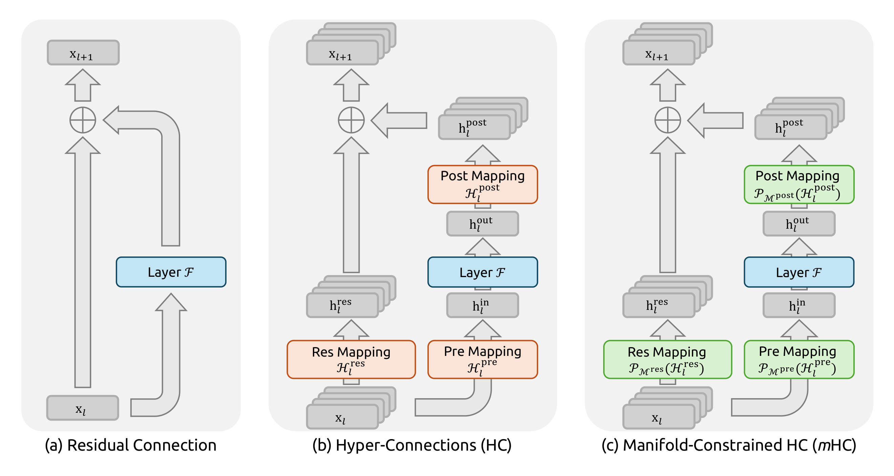
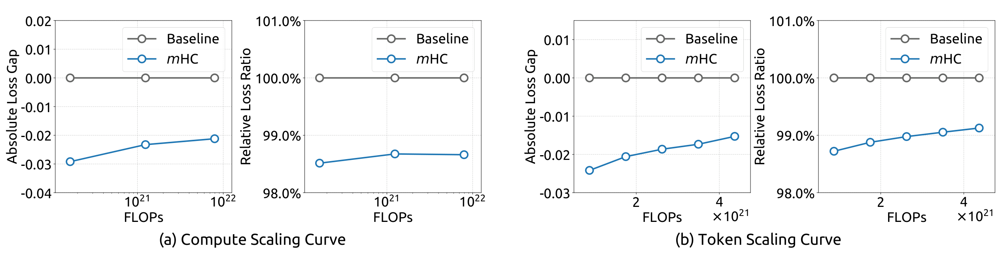
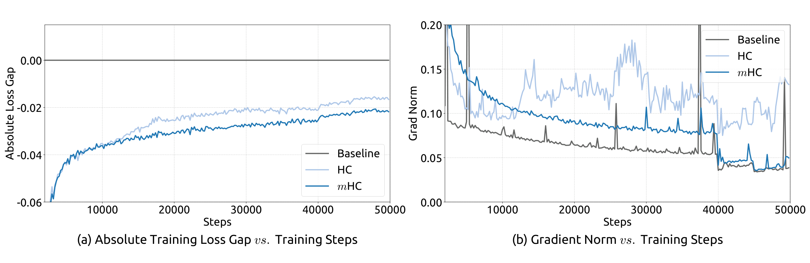
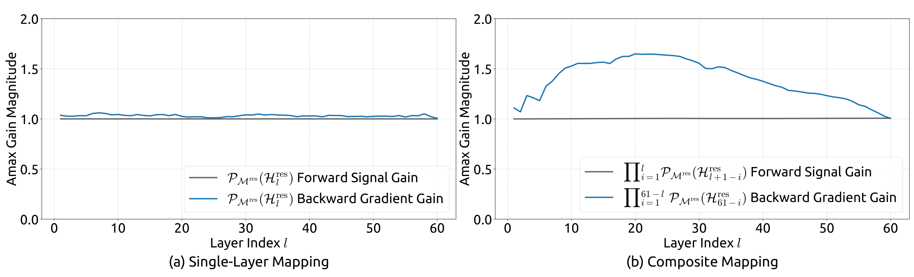

# mHC: Manifold-Constrained Hyper-Connections

## 来源信息

- **标题**：mHC: Manifold-Constrained Hyper-Connections
- **作者**：Zhenda Xie\*†、Yixuan Wei\*、Huanqi Cao\*、Chenggang Zhao、Chengqi Deng、Jiashi Li、Damai Dai、Huazuo Gao、Jiang Chang、Kuai Yu、Liang Zhao、Shangyan Zhou、Zhean Xu、Zhengyan Zhang、Wangding Zeng、Shengding Hu、Yuqing Wang、Jingyang Yuan、Lean Wang、Wenfeng Liang（20 人；\* 核心贡献者（core contributors），† 通讯作者 `xie.zhenda@deepseek.com`）
- **机构**：DeepSeek-AI
- **arXiv**：[2512.24880v2](https://arxiv.org/abs/2512.24880v2)，2026-01-05；v1 为 2025-12-31
- **原文 PDF**：<https://arxiv.org/pdf/2512.24880v2>
- **页数 / 体积 / sha256**：19 页 / 635,294 B / `d849f4709ed29bfb2751f51e24dc836403f31271d1764dddfba0768d326a75d9`
- **许可**：arXiv 页面标注 `nonexclusive-distrib/1.0`（不是 CC 许可）
- **阅读日期**：2026-11-08
- **版本关系**：逐页文本 diff v1 与 v2，唯一差异是 v2 的作者列表新增 Kuai Yu，以及版本水印从 v1/2025-12-31 变为 v2/2026-01-05；正文、公式、表格与实验数字未变。本笔记以 v2 为基准。
- **上游归档**：README 00148 行的上游 PDF 与 arXiv v2 逐字节一致（sha256 相同；19 页 / 635,294 B）。
- **阅读范围**：全文 19 页；第 1、3、4、5、6、7、8、9、10、11、12、13、14、19 页按 220 dpi 渲染核对；公式 (1)–(20)、表 1–5 逐项对照，图 1–8 均回渲染页核对（正文引用并放大核对图 1/5/6/7，图 2/3/4/8 按需引用）。图 1、5、6、7 从 PDF 按 400 dpi 裁剪并逐项核元素；图 6、图 7 的读数为本笔记按轴刻度与矢量 marker/路径坐标复算，与论文文字区分。未运行代码、未训练模型、未复现实验。

## 核心结论

mHC 是 Hyper-Connections（HC）的约束版本：保留 HC「把残差流加宽到 n 倍、学习跨流混合」的拓扑收益，但把残差映射 `H_res` 投影到双随机矩阵（Birkhoff 多面体）上，使信号传播满足均值守恒与非扩张性，从而恢复深层训练的稳定性。配套的 kernel 融合、选择性重算与 DualPipe 重叠，把 n=4 时的额外训练时间压到 6.7%。

在 27B MoE 上：

- mHC 在 8 个下游基准上**全部高于 baseline**；对 HC 是 **7/8 更高**，MATH 低 0.4（26.0 vs 26.4）。
- 相对 HC，BBH 高 2.1 个百分点、DROP 高 2.3 个百分点；其余多数差距不超过 1.3 个百分点。
- 复合残差映射的 Amax 增益（最大绝对行/列和）从 HC 的约 3000 降到 mHC 的反向梯度增益约 1.6（前向信号增益保持 ≈1.0），约三个数量级。
- 计算 scaling 从 3B 到 27B，绝对 loss gap 从约 −0.029 收窄到约 −0.021，相对 loss ratio 约 98.5%→98.7%。

一句话：**mHC 不是「更强的残差」，而是「给 HC 的跨流混合加一个保守性约束」——用双随机矩阵把残差流变成凸组合，牺牲一部分混合自由度，换取深层可训练性；真正的难点是把 Sinkhorn 与 n 流残差的 I/O 压进 6.7%。**

## 1. 问题与动机

### 1.1 残差连接的 identity mapping

标准残差层写成：

```math
\mathbf{x}_{l+1}=\mathbf{x}_l+\mathcal{F}\left(\mathbf{x}_l,\mathcal{W}_l\right)
```

递归展开后，深层输出等于浅层输入加上中间各层的残差函数：

```math
\mathbf{x}_L=\mathbf{x}_l+\sum_{i=l}^{L-1}\mathcal{F}\left(\mathbf{x}_i,\mathcal{W}_i\right)
```

原文把 `x_l` 这一项称为 identity mapping：浅层信号不加修改地直达深层。它不是「恒等函数」这一种实现细节，而是深层可训练性的保守机制——信号既不被系统性放大，也不被系统性衰减。

### 1.2 HC 做了什么，又破坏了什么

HC 把残差流从 `C` 维扩展到 `n×C` 维，并用三个可学习映射控制读入、写出与流间更新：

```math
\mathbf{x}_{l+1}=\mathcal{H}_l^{\mathrm{res}}\mathbf{x}_l
+\mathcal{H}_l^{\mathrm{post}\top}\mathcal{F}\left(\mathcal{H}_l^{\mathrm{pre}}\mathbf{x}_l,\mathcal{W}_l\right)
```

其中 `x_l, x_{l+1} ∈ R^{n×C}`，`H_res ∈ R^{n×n}` 混合各条流，`H_pre ∈ R^{1×n}` 把 n 条流聚合成 C 维层输入，`H_post ∈ R^{1×n}` 把层输出写回 n 条流。



*Figure 1（原文 p1）：(a) 标准残差；(b) HC 的 pre/post/res 三个映射；(c) mHC 把三个映射投影到受约束的流形（绿色）。*由于 `n`（典型值 4）远小于 `C`，这些映射的 FLOPs 很小；HC 实际上把「残差流宽度」从「层输入宽度」中解耦出来，增加了一条 FLOPs 增量很小、近似独立于 FLOPs 的 scaling 轴。

递归展开后，HC 的深层传播是：

```math
\mathbf{x}_L=\left(\prod_{i=1}^{L-l}\mathcal{H}_{L-i}^{\mathrm{res}}\right)\mathbf{x}_l
+\sum_{i=l}^{L-1}\left(\prod_{j=1}^{L-1-i}\mathcal{H}_{L-j}^{\mathrm{res}}\right)
\mathcal{H}_i^{\mathrm{post}\top}\mathcal{F}\left(\mathcal{H}_i^{\mathrm{pre}}\mathbf{x}_i,\mathcal{W}_i\right)
```

与标准残差不同，复合映射 `∏ H_res` 没有任何约束。只要 `H_res` 的行/列和偏离 1（不再保持均值），复合信号就会沿深度被系统性放大或衰减；这就是 HC 在深层训练中不稳定、难以 scale 的根本原因。原文还指出第二个问题：HC 虽然省 FLOPs，却把每 token 的残差流 I/O 放大到约 O(n)（Table 2 口径：前向、仅残差流维护，不含层函数 `F` 的内部 I/O；n=4 时总算约 11×，其中残差合并本身约 n 倍），形成「memory wall」；同时 n 流残差在流水线并行中需要 n 倍通信，并增加激活显存。

### 1.3 为什么盯住 H_res

原文在 HC 上做了一个组件消融（Table 1）：按 `H_res` → `+H_pre` → `+H_post` 逐项启用；被禁用的映射用固定映射保持维度一致（`H_pre` 用 1/n 均匀权重，`H_post` 用全 1，`H_res` 用单位阵）。结果（绝对 loss gap，越负越好）：

| `H_res` | `H_pre` | `H_post` | Absolute Loss Gap |
|:-:|:-:|:-:|:-:|
| — | — | — | 0.0 |
| ✓ | — | — | −0.022 |
| ✓ | ✓ | — | −0.025 |
| ✓ | ✓ | ✓ | −0.027 |

按表值做算术分解，`H_res` 单独一行就占 full gap 的 0.022 / 0.027 ≈ 81%，`H_pre` 与 `H_post` 各只再贡献 0.003 与 0.002；这是累积消融的差值，不是因果分解。原文据此判断：**`H_res` 是性能增益最大的组件，说明残差流内部的信息交换很关键**；原文同时说，`H_res` 的顺序应用构成显著的数值稳定性风险。把这两点合称「最有效也最危险」是笔记的概括。这也符合 mHC 的设计选择：对 `H_res` 做强约束，而对 `H_pre`/`H_post` 只加非负约束（因果方向是笔记推断，原文没有做「只约束 H_res」的对照实验）。

需要区分：Table 1 是 **HC 的组件消融**，不是 mHC 的超参消融；它说明「H_res 重要」，不说明「mHC 的 Sinkhorn 迭代数/流数/n 选得最优」。原文没有给出后者的消融。

原文用图 2 与图 3 给出不稳定性的直接证据：27B 上 HC 在约 12k 步出现 loss surge（图 2(a)），梯度范数在同期明显抬升（图 2(b)）；图 3(b) 的复合映射 Amax 增益峰值约 3000，而理想值应为 1。Amax 增益的定义是复合映射的最大绝对行和（前向）/列和（反向），在一条选定序列上对所有 token 平均；图 3/7 的横轴 0–60 是把 27B 的 30 个 block 拆成 Attention/FFN 两层，不是 60 个 Transformer block（图 8 的层索引 1/30/60 同样是 unrolled layer，但没有 0–60 横轴）。

## 2. 方法：把 H_res 投到 Birkhoff 多面体

### 2.1 约束的定义

mHC 把 `H_res` 限制为双随机矩阵：元素非负，且每行、每列之和都为 1。

```math
\mathcal{P}_{\mathcal{M}^{\mathrm{res}}}\left(\mathcal{H}_l^{\mathrm{res}}\right)
:=\left\{\mathcal{H}_l^{\mathrm{res}}\in\mathbb{R}^{n\times n}\mid
\mathcal{H}_l^{\mathrm{res}}\mathbf{1}_n=\mathbf{1}_n,\;
\mathbf{1}_n^\top\mathcal{H}_l^{\mathrm{res}}=\mathbf{1}_n^\top,\;
\mathcal{H}_l^{\mathrm{res}}\ge 0\right\}
```

这个集合就是 Birkhoff 多面体，也就是所有置换矩阵的凸包。它有四个对深层训练有用的性质：

1. **均值守恒**：行和、列和都为 1，因此 `H_res x` 的每个输出流都是输入流的凸组合，跨流平均恒被保持（不要求各流均值相同）。
2. **非扩张**：双随机矩阵的谱范数不超过 1（`||H_res||_2 ≤ 1`），映射不会放大 L2 信号，直接缓解梯度爆炸。
3. **乘法封闭**：双随机矩阵相乘仍是双随机矩阵，因此任意深度的复合映射 `∏ H_res` 仍满足同样的行/列和约束，稳定性不随深度累积而失效。
4. **几何解释**：Birkhoff 多面体是置换矩阵的凸包，`H_res` 可以读成「以软权重对 n 条流做置换/混合」；原文认为重复应用会趋于增强流间混合（tends to increase ... monotonically），起到特征融合的作用。

当 `n=1` 时，双随机条件退化为标量 1，正好回到原始 identity mapping。这是 mHC 与标准残差在 n=1 处的连续性。

### 2.2 参数化：先算系数，再投影

mHC 先把 `x_l ∈ R^{n×C}` 展平成 `x̃_l = vec(x_l) ∈ R^{1×nC}`，再做 RMSNorm。与 HC 的关键差别是：HC 的 `H_pre/H_post/H_res` 由每条流各自的 C 维向量算出（`θ ∈ R^{1×C}` 或 `R^{n×C}`），而 mHC 让动态系数看到**全部 n 条流**的拼接向量（`φ ∈ R^{nC×n}` 或 `R^{nC×n²}`）。原文的说法是「preserve full context information」：跨流混合的系数本身也应该跨流计算。

```math
\begin{aligned}
\tilde{\mathbf{x}}_l&=\mathrm{vec}\left(\mathbf{x}_l\right),\qquad
\tilde{\mathbf{x}}'_l=\mathrm{RMSNorm}\left(\tilde{\mathbf{x}}_l\right)\\
\tilde{\mathcal{H}}_l^{\mathrm{pre}}&=\alpha_l^{\mathrm{pre}}\cdot
\left(\tilde{\mathbf{x}}'_l\varphi_l^{\mathrm{pre}}\right)+\mathbf{b}_l^{\mathrm{pre}}\\
\tilde{\mathcal{H}}_l^{\mathrm{post}}&=\alpha_l^{\mathrm{post}}\cdot
\left(\tilde{\mathbf{x}}'_l\varphi_l^{\mathrm{post}}\right)+\mathbf{b}_l^{\mathrm{post}}\\
\tilde{\mathcal{H}}_l^{\mathrm{res}}&=\alpha_l^{\mathrm{res}}\cdot
\mathrm{mat}\left(\tilde{\mathbf{x}}'_l\varphi_l^{\mathrm{res}}\right)+\mathbf{b}_l^{\mathrm{res}}
\end{aligned}
```

其中 `α` 是可学习的门控标量，初始化为 0.01；`b` 是静态 bias；`mat(·)` 把 `1×n²` 重塑为 `n×n`。随后做流形投影：

```math
\mathcal{H}_l^{\mathrm{pre}}=\sigma\left(\tilde{\mathcal{H}}_l^{\mathrm{pre}}\right),\qquad
\mathcal{H}_l^{\mathrm{post}}=2\sigma\left(\tilde{\mathcal{H}}_l^{\mathrm{post}}\right),\qquad
\mathcal{H}_l^{\mathrm{res}}=\mathrm{SinkhornKnopp}\left(\tilde{\mathcal{H}}_l^{\mathrm{res}}\right)
```

`σ` 是 Sigmoid。`H_pre` 落在 (0,1)，`H_post` 落在 (0,2)，两者都非负，避免正负系数相互抵消。`H_res` 则用 Sinkhorn-Knopp 迭代投影到双随机矩阵：先把所有元素取指数保证为正，再交替做行归一化与列归一化。

```math
\mathbf{M}^{(0)}=\exp\left(\tilde{\mathcal{H}}_l^{\mathrm{res}}\right),\qquad
\mathbf{M}^{(t)}=\mathcal{T}_r\left(\mathcal{T}_c\left(\mathbf{M}^{(t-1)}\right)\right)
```

`T_r`、`T_c` 分别是行、列归一化；理论上 `t_max → ∞` 时收敛到双随机矩阵，实践中固定 `t_max = 20`。这是「近似投影」，也是后文图 7 中单层增益略微偏离 1 的原因。

### 2.3 与 HC 参数化的三个差异

把 HC 的式 (5) 与 mHC 的式 (7) 并排看，有三处结构性变化：

- **输入范围**：HC 用每条流自己的 `C` 维向量算系数；mHC 先 flatten 成 `nC` 维，再算系数。后者让 `H_pre/H_post/H_res` 的系数能看到所有流；代价是 `φ` 的参数量从 HC 的 `O((n+2)C)` 变为 `O(n²(n+2)C)`：n=4 时约 6C→96C（16×），但相对 `C²` 的层参数仍然很小。
- **去掉 tanh**：HC 的动态项是 `α·tanh(θ x̃^T)+b`；mHC 的式 (7) 是 `α·(x̃'φ)+b`，没有 tanh。原文没有解释这一改动，也没有消融。一个合理的解读是：`H_pre/H_post` 后面已经有 Sigmoid，`H_res` 后面有 Sinkhorn 的指数/归一化，动态项本身不需要再被 tanh 压一次；但这只是笔记推断。
- **流形投影**：HC 只加 bias/门控，mHC 在系数之后显式投影。投影是非线性的、逐层执行的，且 `H_res` 的投影依赖一个迭代算法。

### 2.4 「恢复 identity mapping」到底恢复了什么

原文反复说 mHC「restore the identity mapping property」，但需要精确理解：mHC 并没有把 `H_res` 变成单位阵 `I`（除非 n=1）。它恢复的是 identity mapping 的**保守性**：

- 行/列和为 1 → 各流均值不被系统性放大或衰减；
- 谱范数 ≤1 → 不会指数放大；
- 乘法封闭 → 复合映射仍有同样的界。

在 n>1 时，`H_res` 仍然可以混合各条流，这正是 HC 的表达力来源；mHC 只是把「混合」限制在凸组合里。换句话说，它用「保守的混合」替代「无约束的混合」，而不是用「不混合」替代「混合」。这一点原文的措辞容易读成「mHC 退化成标准残差」，实际不是。

另外，`H_pre`/`H_post` 只被约束为非负，并没有行/列和为 1 的约束；`H_post` 的上界是 2，`H_pre` 的每个元素上界是 1。因此保守性保证主要作用在 `H_res` 这条残差路径上，层分支 `F(H_pre x)` 仍可能放大信号。原文没有给出「整个 block 的增益上界」，只给了 `H_res` 的谱范数界。

## 3. 工程实现：6.7% 是怎么来的

### 3.1 Kernel 融合

mHC 的系数计算涉及 `x̃ ∈ R^{1×nC}`、`φ ∈ R^{nC×(n²+2n)}`，以及 RMSNorm、Sigmoid、Sinkhorn 等一串小操作。原文用三个专用 kernel 计算 `H_pre/H_post/H_res`，再用两个 kernel 应用映射：

- 把 `φ`、bias、RMSNorm 权重合并；`φ` 用 tfloat32，`x̃` 用 bfloat16，`α/b` 用 float32；
- 先算 `x̃φ`，再除以 `r = ||x̃||_2 / sqrt(nC)`，把 RMSNorm 的除法移到矩阵乘之后，数学等价但减少高维归一化的延迟；
- Sinkhorn 的 20 次迭代放在一个 kernel 内，反向用自定义 kernel 在片上重算中间结果，避免存 20 步的中间矩阵；
- 应用 kernel 把 `H_post` 与 `H_res` 的写回和残差合并融合，读从 `(3n+1)C` 降到 `(n+1)C`，写从 `3nC` 降到 `nC`。

### 3.2 选择性重算

n 流残差的主要显存开销不是权重，而是每层的 `x_l`、`H_pre x_l`、`RMSNorm(H_pre x_l)` 等激活。mHC 在前向之后丢弃这些中间激活，反向时只重跑 mHC 的轻量 kernel，不重跑计算密集的 `F`。对于连续 `L_r` 层，只需持久保存第一层的输入 `x_{l0}`；块内的瞬态激活约为 `(n+2)C·L_r`（Table 3）。最优块长由「持久保存的块首输入」与「块内瞬态激活」的权衡给出：

```math
L_r^*=\arg\min_{L_r}\left[nC\left\lceil\frac{L}{L_r}\right\rceil+(n+2)C\,L_r\right]
\approx\sqrt{\frac{nL}{n+2}}
```

原文观察到理论最优值通常与每个流水线 stage 的层数接近，因此直接把重算块边界对齐到 pipeline stage 边界。这样既减少显存，又不让重算跨越 stage 造成额外通信。

### 3.3 DualPipe 重叠

n 流残差在 pipeline stage 边界处会增加通信量，重算也会在边界处引入计算尖峰。原文扩展了 DualPipe 调度（图 4；图中块长仅示意，不代表实际时长）：

- 把 MLP 的 `F_post,res` kernel 放到独立的高优先级计算流，避免阻塞通信流；
- 不对 attention 的长耗时算子使用 persistent kernel，使重叠的 attention 计算可以被抢占，减少长 stall；
- 重算与 pipeline 通信解耦，因为每个 stage 的首个激活 `x_{l0}` 已经本地缓存。

### 3.4 6.7% 的口径

原文两处都写 6.7%：引言说「in-house large-scale training ... introduces only a 6.7% additional time overhead when n=4」，原文 §4.3 说「marginal training overhead of only 6.7%」。但原文**没有说明这 6.7% 是相对标准残差 baseline 还是相对 HC**，也没有给出 forward/backward、通信/计算的拆分。按上下文更像「相对 baseline 的端到端训练时间」，但这是推断，引用时应保留「原文未说明基准」这一限定。

## 4. 实验与证据

### 4.1 实验设置

四个模型变体，均为 DeepSeek-V3 风格的 MoE，`n=4`；baseline 按 Figure 1(a) 理解为标准残差（原文未显式定义）：

| 项 | 3B | 9B | 27B | 3B（1T tokens） |
|:-:|:-:|:-:|:-:|:-:|
| Total / Active params | 2.97B / 612M | 9.18B / 1.66B | 27.0B / 4.14B | 2.97B / 612M |
| Layers | 12 | 18 | 30 | 12 |
| Routed / active / shared experts | 64 / 6 / 2 | 64 / 6 / 2 | 72 / 6 / 2 | 64 / 6 / 2 |
| d_model / FFN | 1280 / 896 | 1920 / 1280 | 2560 / 1536 | 1280 / 896 |
| Training tokens | 39.3B | 105B | 262B | 1.05T |
| Batch size / steps | 320 / 30k | 512 / 50k | 1280 / 50k | 2560 / 100k |
| Base LR | 8.6e−4 | 5.9e−4 | 4.0e−4 | 9.0e−4 |

其余共同设置（Table 5）：MLA（KV rank 512）、RoPE（dim 64，θ=10000）、RMSNorm、序列长度 4096、词表 129280、AdamW（β=(0.9, 0.95)，ε=1e−20）、weight decay 0.1、warmup 2000、Step scheduler（0.8×/0.9× 处 decay，rate 0.316/0.1）、mHC/HC 的 `n=4`、`α` 初始化 0.01、Sinkhorn `t_max=20`；attention heads 16/24/32/16、attention dim 128（表中仅摘主要超参）。27B 是主实验；3B/9B 用于 compute scaling；3B 的 1T token run 用于 token scaling。3B/9B/27B 的 compute scaling 三个点是 compute-optimal 的模型/数据配比：数据量随参数同比增加，不是固定数据量下的纯模型规模扫描（原文 §5.1、Figure 6 caption）。

### 4.2 主结果：27B 下游基准

Table 4 的 8 个基准（粗体为原文每个基准列内的最优）：

| Benchmark | BBH (EM) | DROP (F1) | GSM8K (EM) | HellaSwag (Acc.) | MATH (EM) | MMLU (Acc.) | PIQA (Acc.) | TriviaQA (EM) |
|:-:|:-:|:-:|:-:|:-:|:-:|:-:|:-:|:-:|
| # Shots | 3 | 3 | 8 | 10 | 4 | 5 | 0 | 5 |
| 27B Baseline | 43.8 | 47.0 | 46.7 | 73.7 | 22.0 | 59.0 | 78.5 | 54.3 |
| 27B w/ HC | 48.9 | 51.6 | 53.2 | 74.3 | **26.4** | 63.0 | 79.9 | 56.3 |
| 27B w/ mHC | **51.0** | **53.9** | **53.8** | **74.7** | 26.0 | **63.4** | **80.5** | **57.6** |

读法：

- **对 baseline**：8/8 更高，增益从 +1.0（HellaSwag）到 +7.2（BBH）个百分点。
- **对 HC**：7/8 更高；BBH +2.1、DROP +2.3、GSM8K +0.6、HellaSwag +0.4、MMLU +0.4、PIQA +0.6、TriviaQA +1.3；MATH 低 0.4。原文写「2.1% / 2.3%」，按表值是**百分点**，不是相对提升。
- 除 BBH 与 DROP 外，其余差距都在 1.3 个百分点以内；原文没有给方差/误差棒，无法判断 0.4–0.6 的差距是否超出随机波动。
- 原文说「comprehensive improvements」是相对 baseline 的；相对 HC 并非全面（MATH 是反例），引用时不要写成「全面超过 HC」。

### 4.3 Scaling：优势随规模的变化

图 6 有两组 scaling 曲线：compute scaling（3B/9B/27B）与 token scaling（固定 3B，1T token），每组含绝对 gap 与相对 ratio 两个 panel。按轴刻度与 marker 坐标读数（本笔记复算）：

| 曲线 | 绝对 loss gap | 相对 loss ratio |
|:-:|:-:|:-:|
| compute：3B → 9B → 27B | 约 −0.029 → −0.023 → −0.021 | 约 98.5% → 98.7% → 98.7% |
| token：3B 早期 → 后期 | 约 −0.024 → −0.015~−0.016 | 约 98.7% → 99.1% |



*Figure 6（原文 p13）：左两图为 compute scaling、右两图为 token scaling；每组的左 panel 为绝对 loss gap，右 panel 为相对 loss ratio。图中读数为本笔记按轴刻度复算。*

解读：

- 绝对 gap 随 compute 从 −0.029 收窄到 −0.021（约缩小 28%），随 token 从 −0.024 收窄到约 −0.015~−0.016（约缩小 33%–37%）；也就是说，**绝对优势不是恒定的，规模越大/token 越多，绝对 gap 越小**。
- 相对 loss ratio 基本维持在 98.5%–99.1%，所以原文说「robustly maintained, only marginal attenuation」在相对口径下成立；但如果引用「优势保持」，要说明是相对 ratio 保持，而非绝对 gap 不变。
- 图 6(b) 的横轴标签写的是 `FLOPs ×10^21`，而图注说这是 token scaling。固定 3B 模型时 FLOPs 与训练 token 数成正比，二者可以互换，但轴标签与图注的口径并不一致；读图时按图注理解为「训练 token 增加」更合适。

### 4.4 稳定性：从 3000 到 1.6

图 5 是 27B 的训练稳定性：



*Figure 5（原文 p12）：(a) 相对 baseline 的绝对 loss gap；(b) 梯度范数。三条曲线均为 27B。*

- mHC 相对 baseline 的最终 loss reduction 为 0.021（原文 §5.2）；图 5(a) 在约 50k 处 mHC 约 −0.021、HC 约 −0.016，baseline 为 0。
- 图 5(b) 中 mHC 的梯度范数从约 0.20 平滑降到约 0.05，除个别小尖峰外贴近 baseline；HC 在约 13k 有约 0.15 的尖峰，最大尖峰在 26–30k（约 0.18），另有约 38k、49k 的次尖峰（约 0.14–0.15）。
- **图 5 与图 2 不要混读**：图 5(a) 的 gap 曲线本身较平滑，不直接显示 loss spike；HC 的不稳定主要体现在图 5(b) 的梯度尖峰，以及图 2 的 loss surge / 梯度不稳。图 2 是 HC 相对 mHC 的对比：约 5k–9k HC 的 gap 短暂为负（6.6k 附近最低，图轴下限 −0.002 被裁切），约 10k 转正，15k 约 +0.004、18k 约 +0.006；原文 §3.1 说 12k 附近的 loss surge 与梯度不稳相关，但图 5(b) 的 12–13k 尖峰约 0.15，最大尖峰在 26–30k（约 0.18）；12k 的 loss surge 在图 2(a)，不要混读。

图 7 是传播稳定性：



*Figure 7（原文 p14）：(a) 单层 `P_Mres(H_res)` 的前向信号增益与反向梯度增益；(b) 复合映射 `∏ P_Mres(H_res)` 的增益。灰线为前向信号增益（≈1.0），蓝线为反向梯度增益。*

- 单层映射：前向信号增益（灰线）≈1.0；反向梯度增益（蓝线）在约 1.006–1.06 之间轻微波动，来自 Sinkhorn 20 次迭代的近似误差。
- 复合映射：前向信号增益仍 ≈1.0；反向梯度增益在中间层升到约 1.6–1.65（原文写 approximately 1.6；本笔记按轴刻度读到峰值约 1.65），随后在末端回落到 ≈1.0。
- 与 HC 的约 3000（图 3(b)）相比，mHC 的复合反向增益低了约三个数量级。这里的 1.65 不是「双随机矩阵的非交换/非正规性」造成的：精确双随机矩阵对乘法封闭，行/列和都精确为 1；偏差来自 Sinkhorn 只跑 20 步，且式 (9) 以行归一化结束——行和精确为 1，列和只是近似为 1。从图 8 的读数看，误差在复合中放大，但**并非随深度单调累积**：第 31–60 层的 30 层复合列和可到 0.41–1.50，而全 60 层复合回到 0.88–1.11；图 7(b) 也是先升到 1.65 再回落到 ≈1.0。（行/列不对称与深度非单调都是笔记从图 7/8 读数推出的，原文只归因于迭代次数限制。）

图 8 的矩阵可视化要按层/段看，不能把单层 HC 一概说成 ±20：`H_res^1` 与 `H_res^60` 的矩阵元素约 ±5–7、行和可达约 ±22（列和约 −12..−7），但 `H_res^30` 接近单位阵（元素约 −0.14..0.94，行/列和约 0.5–1.0）。复合 HC 也不是一律放大：前 30 层复合的行/列和约 −1.4..6.5 / 1.0..1.2，后 30 层与全 60 层复合才出现 −489/+509 量级。mHC 单层行/列和约 0.96–1.04；复合行和约 1.00，后 30 层列和 0.41–1.50、全 60 层 0.88–1.11（Sinkhorn 近似误差在复合中放大，但不随深度单调），非对角项承担流间混合。图 8 的每个矩阵是选定序列上所有 token 的平均；左侧行和是前向信号增益，底部列和是反向梯度增益。原文用这张图说明「HC 在最大增益很大时，其他路径也不稳定；mHC 则整体稳定」。

### 4.5 消融的边界

Table 1 只回答了「HC 的三个映射哪个重要」，答案是 `H_res`。它没有回答：

- `n` 取 2/4/8 的取舍；
- Sinkhorn `t_max` 取 10/20/50 的精度-成本权衡；
- `α` 初始化、`H_pre/H_post` 非负约束的必要性；
- 去掉 tanh、改为 flatten 输入这两个参数化变化的贡献；
- 双随机约束与其他约束（正交、谱归一化、残差缩放）的对比。

这些空白使得「mHC 的哪个设计真正带来增益」无法从本文的实验里分解。原文的结论主要是「HC 的 H_res 重要 + 双随机约束能让 27B 稳定训练」，而不是「双随机是唯一/最优的约束」。

## 5. 工程视角：如果要落地

### 5.1 适用场景

- 已经在用 HC 或类似的 multi-stream residual，且遇到深层训练不稳定（loss spike、grad norm 尖峰）——mHC 是最直接的替换。
- 想把残差流宽度作为一条独立于 FLOPs 的 scaling 轴，但不想承担无约束 HC 的稳定性风险。
- 有较强的 kernel/并行工程能力：从 Table 2 的 I/O 量级看，若不融合，n 流残差的读写会显著放大；因此融合、重算与 DualPipe 重叠是 6.7% 成立的前提（笔记推断），不是可选的工程细节。

### 5.2 实现顺序

1. **先做数学等价的最小实现**：flatten 输入、算三个系数、Sigmoid/2Sigmoid/20 步 Sinkhorn、按式 (3) 更新。先用小模型确认 loss/grad norm 正常。
2. **再做 kernel 融合**：把系数计算、Sigmoid、Sinkhorn 分别融成 kernel；Sinkhorn 的反向在片上重算，避免存 20 步中间矩阵。
3. **再做重算**：按 `L_r* ≈ sqrt(nL/(n+2))` 选块长，并对齐 pipeline stage 边界。
4. **最后做通信重叠**：把 MLP 的 `F_post,res` 放到高优先级流；不要在 attention 里用不可抢占的 persistent kernel。
5. **测量口径**：分别报告 forward/backward、通信/计算、以及相对 baseline 与相对 HC 的开销；本文只给了 6.7% 一个总数。

### 5.3 推理侧

原文只报告训练时间开销，没有报告推理吞吐/显存。n 流残差会把激活宽度从 `C` 增到 `nC`（27B、C=2560、n=4 时为 10240），推理时即使 batch 较小，激活显存与带宽也会增加；`H_res` 还会在每层增加一个 `n×n` 小矩阵乘。部署前应单独测 decode 阶段，不能把 6.7% 的训练开销直接当成推理开销。

## 6. 局限与待确认

- **规模**：主实验最大 27B；原文提到「in-house large-scale training」支持 scale，但没有给出该运行的模型规模、token 数、吞吐或稳定性指标。因此「supports training at scale」的公开证据只到 27B。
- **硬件/并行规模**：论文没有给出 GPU 型号、卡数或集群规模；6.7% 与 scaling 结果的硬件环境不可复现。
- **统计**：没有随机种子、误差棒或重复次数；Table 4 中 0.4–0.6 个百分点的差距是否显著未知。Table 1 也没有说明模型规模与训练 token 数，只能支撑「H_res 最重要」的定性结论。
- **消融**：没有 mHC 自身的超参消融（n、t_max、α、非负约束、去 tanh、flatten 输入），也没有与其他流形约束的对比。
- **Sinkhorn 近似**：固定 20 次迭代，没有给出迭代收敛误差曲线或 `t_max` 消融；只给了 `t_max=20` 时的偏差示例/峰值（图 7 的复合反向增益约 1.65；图 8 第 31–60 层复合列和 0.41–1.50，全 60 层 0.88–1.11；图 8 是 representative mappings，不保证是最大偏差）。
- **理论边界**：只给了 `H_res` 的谱范数与复合封闭性，没有给整个 block（含 `H_pre/H_post/F`）的增益上界；`H_post` 最大为 2，层分支仍可能放大。
- **过度混合/秩坍缩**：原文认为双随机矩阵重复相乘会趋于增强流间混合（tends to），并把它描述为「robust feature fusion」；但没有分析深层（例如 60 层以上）是否会出现流间表示同质化、或置换矩阵导致的周期性。这是一个开放问题，不是原文已证实的缺陷。
- **推理成本**：未测。
- **6.7% 的基准**：未说明是相对 baseline 还是 HC，也未拆分。
- **代码/复现**：论文全文未给出代码仓库或复现说明（PDF 正文检索 `github`/`code`/`release` 均无命中；HTML 中的 `github` 命中来自 arXiv 页面模板）；本笔记未复现实验。

## 7. 原文自身的表述张力与读图注意

| 位置 | 表述 | 读法 |
|:-:|:-:|:-:|
| 引言 / 原文 §4.3 | 「6.7% additional time overhead」 | 未说明相对 baseline 还是 HC；引用时保留「原文未说明基准」 |
| 全文 | 「restore the identity mapping property」 | 实际恢复的是行/列和为 1 的保守性，不是 `H_res=I`；n=1 才严格退化为 1 |
| 原文 §5.2 | 「2.1% on BBH and 2.3% on DROP」 | 按 Table 4 是百分点（51.0−48.9、53.9−51.6），不是相对百分比 |
| 原文 §5.2 | 「comprehensive improvements」 | 相对 baseline 成立（8/8），相对 HC 不成立（MATH 26.0 vs 26.4） |
| 图 6(b) | 图注说 token scaling，横轴写 `FLOPs ×10^21` | 固定 3B 模型时二者成正比；按图注理解为 token 增加，但轴标签与图注口径不一致 |
| 图 2(a) | HC 相对 mHC 的 gap 在约 5k–9k 短暂为负（6.6k 附近最低，图轴下限 −0.002 被裁切），约 10k 转正 | 不能据此说 HC 更好；图 2(b) 的 12k 梯度不稳与图 5(b) 的 26–30k 尖峰才是稳定性证据 |
| 图 7(b) | 1.6 是**反向梯度增益**，不是前向 | 前向信号增益 ≈1.0；1.65 来自 Sinkhorn 20 步近似，不是精确双随机矩阵的性质 |
| 原文 §5.4 | 「maximum value of approximately 1.6」 | 本笔记按轴刻度读到约 1.65；差异来自读数/近似，不影响「约三个数量级」的结论 |

## 8. 与本仓库其他条目的关系

- **DeepSeek-V4（00172，[笔记](../deepseek-v4/note.md)）**：V4 的残差模块直接用 mHC（`n_hc=4`、Sinkhorn 20 步）；V4 笔记里的 6.7% 口径是「重叠后 1F1B 阶段的额外开销」。V4 笔记覆盖的是「V4 怎么用、工程上怎么嵌进 CSA/HCA 与 DualPipe」，本笔记补的是「mHC 为什么这样设计、理论性质与消融边界」。两篇可以互相替换二手描述。
- **DeepSeek-V4.1-Flash（00191，[笔记](../deepseek-v4.1-flash/note.md)）**：V4.1-Flash 把 mHC 进一步做成 Single-Pass mHC 与 Mega-mHC（相邻 block 间维持 n 条残差流，更新式 `X_{l+1}=B_l X_l + C_l F_l(A_l X_l)`；Mega-mHC 把激活访存减半）。本笔记的式 (3)/(7)/(9) 是理解那一节的前置。
- **DeepSeek-V3.2（00133，[笔记](../2512.02556-v1-deepseek-v3.2/note.md)）**：V3.2 的 DSA 改的是 attention 的稀疏选择；mHC 改的是 block 之间的残差拓扑。两者是正交的 scaling 轴，可以叠加（V4 同时用了 CSA/HCA 与 mHC）。
- **Kimi K2（00083，[笔记](../2507.20534-v2-kimi-k2/note.md)）**：K2 用 MuonClip/QK-Clip 控制 attention logit 的增长；mHC 用双随机约束控制残差路径的增益。两者都在解决「大规模训练稳定性」，但作用点不同：一个是 QK 乘积，一个是跨层残差复合。
- **Engram（00150，尚未读）**：V4.1-Flash 的 196B Engram 是另一条稀疏化路线（条件记忆/查表），与 mHC 的残差拓扑无关；若继续读 V4.1-Flash 的架构，Engram 是下一个前置。

## 9. 一句话取舍

如果你已经在用 HC 或准备把残差流加宽，**优先抄 mHC 的 `H_res` 双随机投影（Sinkhorn 20 步）与 `H_pre/H_post` 非负约束**；如果只是普通残差模型、没有多流残差，mHC 的收益不适用，反而会引入 O(n) 的 I/O 与 Sinkhorn 的工程复杂度。mHC 的价值不在「一个新模块」，而在「把 macro-design 的稳定性问题变成一个有明确几何约束、可 kernel 化的问题」。

## 附：一页速查

| 项 | 数值 |
|:-:|:-:|
| 残差流扩展率 `n` | 4 |
| Sinkhorn 迭代 `t_max` | 20 |
| 门控初始化 `α` | 0.01 |
| 额外训练时间 | 6.7%（n=4；原文未说明基准） |
| 27B 模型 | 27.0B total / 4.14B active，30 层，72 routed / 6 active / 2 shared |
| 27B 训练 | 262B tokens，batch 1280，50k steps，lr 4.0e−4，AdamW |
| 下游基准 | 8 个；mHC 对 baseline 8/8，对 HC 7/8（MATH 26.0 vs 26.4） |
| 对 HC 的增益 | BBH +2.1 pp，DROP +2.3 pp |
| 复合反向增益 | HC 约 3000 → mHC 约 1.6（本笔记读数约 1.65）；前向保持 ≈1.0 |
| 每 token 残差流 I/O（前向，不含 F 内部；n=4） | HC 读 21C+24、写 13C+24；标准残差读 2C、写 C |
| 重算块长 | `L_r* ≈ sqrt(nL/(n+2))` |

## 复核记录

**2026-11-08 第一轮（独立审计，对照 PDF 渲染页与矢量坐标）**

确认并修复：

- **图 5/图 2 混读**：原稿把图 2 的 12k loss surge 与梯度不稳写成图 5 的读数；已改为图 5(a) 平滑、图 5(b) 尖峰在 26–30k，图 2(a)(b) 单独描述。
- **图 7 前向/反向**：1.6/1.65 是反向梯度增益，灰线是前向增益（≈1.0）；已改图注与正文。
- **1.65 的归因**：不是「非交换/非正规性」，而是 Sinkhorn 20 步近似（行和精确、列和近似）；已改，并标注行/列不对称是笔记推断。
- **证据范围**：「图 7(a) 是唯一证据」改为图 7(a)/(b)/图 8 多重证据。
- **图 8 单层/复合**：±20 是行/列和而不是矩阵元素；复合列和 0.41–1.50 只属于第 31–60 层的 30 层复合，全 60 层回到 0.88–1.11，不能写「随深度累积」。
- **`φ` 参数量**：HC `(n+2)C` → mHC `n²(n+2)C`，n=4 约 6C→96C。
- **其他**：Table 1 改为累积启用；Table 4 粗体为列内最优；「重复应用单调混合」改为原文 tends to；V4/V4.1 交叉引用措辞；图 6 末点与 panel 描述；阅读范围补 p4。

**2026-11-08 第二轮（独立审计复查）**

确认并修复：

- **图 2(a)**：负区间约 5k–9k（6.6k 最低，图轴下限被裁切），约 10k 转正，15k 约 +0.004、18k 约 +0.006；原稿「15k 后转正」不准确。
- **图 8**：单层 HC 矩阵元素约 ±5–7、行/列和约 15–22（第三轮进一步限定：仅 `H_res^1`/`H_res^60`；`H_res^30` 接近单位阵）；复合 HC 行/列和出现 −489/+509 量级；mHC 第 31–60 层复合列和 0.41–1.50、全 60 层 0.88–1.11。
- **图 5(b)**：HC 在 13k 约 0.15、26–30k 约 0.18，另有 39k/49k 次尖峰；原稿只写 26–30k。
- **均值守恒**：双随机矩阵保持跨流平均，不要求各流均值相同；已改。
- **I/O**：原文是 O(n)，n=4 总算约 11×，不是恰好 n 倍；已区分「残差合并 n 倍」与「总算 11×」。
- **Sinkhorn 局限**：删去「没有给最大行/列和偏差」的矛盾，改为「没有收敛曲线/`t_max` 消融」。
- **V4 交叉引用**：补「1F1B stage」口径；图 6 caption 改为「每组左绝对/右相对」。

**2026-11-08 第三轮（check-paper-note 复核，重新下载 v2 + 官方 HTML）**

确认并修复：

- **图 8 的单层 HC 概括**：不能一概写成 ±20；`H_res^1` 与 `H_res^60` 才放大，`H_res^30` 接近单位阵；复合也只有后 30 层/全 60 层出现 −489/+509，前 30 层仍约 −1.4–6.5。已按层/段重写，并补「矩阵为选定序列 token 平均、行和=前向、列和=反向」。
- **推断标注**：图 8 的「非单调」与「最大偏差」改为从图读数推出的判断；原文只归因于迭代次数限制。
- **节号引用**：论文节号统一加「原文」，避免与笔记自身 §3.1/§4.3/§5.2 重名。
- **口径与遗漏**：补 compute-optimal 数据配比、Table 2 前向/不含 F 内部的口径、baseline 定义、Table 3/5 表号、Table 5 warmup/decay、图 4 块长示意、硬件/并行规模未说明。
- **读数**：图 5 的 50k 读数改为约 −0.021/−0.016；38k/49k 次尖峰改为约 0.14–0.15。
- **否定性断言**：代码检索限定为 PDF 正文（HTML 的 `github` 命中来自 arXiv 页面模板）。

**核对凭据**

- 页面渲染：220 dpi；图 1/5/6/7 从 PDF 400 dpi 裁剪，clip（PDF pt）分别为 (60,444,535,697)、(70,476,525,624)、(70,378,525,496)、(70,80,525,218)。
- 图 6 定标：panel (a) 左 0.00 在 y=413.533、−0.01 在 y=426.613；marker 中心按 `get_drawings()` 读取。图 7 定标：1.0 在 y=139.3、2.0 在 y=89.3（50 px/1.0）；峰值按路径顶点读取。
- 表格核对：Table 1 p6、Table 2 p8、Table 3 p11、Table 4 p13、Table 5 p19 均在渲染页逐格核对；公式 (1)–(20) 在 p3–p11 逐条对照。
- 否定性断言：全文检索 `github`/`code`/`release` 无命中，才写「论文未给代码仓库」；未把「未检索到」写成「不存在」。
- 未做：未运行代码、未训练/复现；未做像素差比对（图 1/5/6/7 采用裁剪后目检元素清单 + 与整页渲染对照）。
