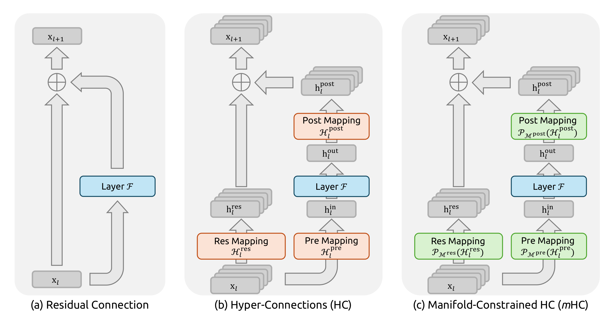
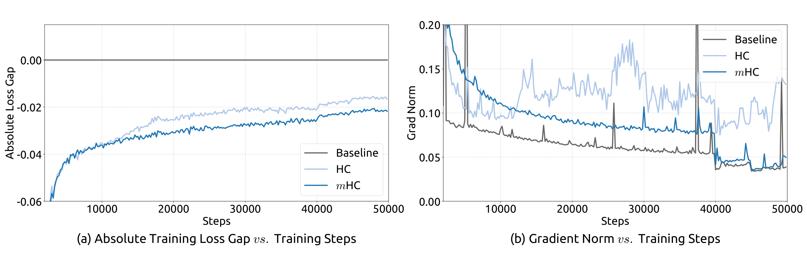

# mHC: Manifold-Constrained Hyper-Connections

## 来源信息

| 项 | 内容 |
| --- | --- |
| 标题 | mHC: Manifold-Constrained Hyper-Connections |
| 作者 | Zhenda Xie\*†、Yixuan Wei\*、Huanqi Cao\*、Chenggang Zhao、Chengqi Deng、Jiashi Li、Damai Dai、Huazuo Gao、Jiang Chang、Kuai Yu、Liang Zhao、Shangyan Zhou、Zhean Xu、Zhengyan Zhang、Wangding Zeng、Shengding Hu、Yuqing Wang、Jingyang Yuan、Lean Wang、Wenfeng Liang（20 人；\* 核心贡献者，† 通讯作者） |
| 机构 | DeepSeek-AI |
| 来源 | [arXiv:2512.24880v2](https://arxiv.org/abs/2512.24880v2)（2026-01-05）；v1 为 2025-12-31 |
| 版本 | 本笔记基于 v2（19 页）；v2 相对 v1 只多了作者 Kuai Yu 与版本水印，正文/公式/数字未变，详见 `audit.md` |
| 阅读日期 | 2026-11-08 |

---

## 核心结论

一句话：**mHC 不是「更强的残差」，而是「给 Hyper-Connections 的跨流混合加一个保守性约束」——用双随机矩阵把残差流变成凸组合，牺牲一部分混合自由度，换取深层可训练性；真正的难点是把 Sinkhorn 与 n 流残差的 I/O 压进 6.7%。**

- **解决什么问题**：HC 把残差流加宽到 $n$ 倍并学习跨流混合，但残差映射 $H_{\mathrm{res}}$ 无约束，复合后信号会被系统性放大（27B 上 Amax 增益约 3000），深层训练出现 loss surge 与梯度尖峰。
- **核心想法**：把 $H_{\mathrm{res}}$ 投影到 Birkhoff 多面体（双随机矩阵集合），保留混合、去掉放大；$n=1$ 时严格退回标准残差的 identity mapping。
- **怎么做到**：先由全部 $n$ 条流的拼接向量算出三个映射的系数，再用 Sigmoid / 2·Sigmoid / 20 步 Sinkhorn 投影；工程上靠 kernel 融合、选择性重算与 DualPipe 重叠把开销压下来。
- **关键结果**：27B MoE 上 8 个下游基准全部高于 baseline，对 HC 是 7/8 更高（MATH 低 0.4）；复合反向增益从约 3000 降到约 1.6；$n=4$ 时额外训练时间 6.7%。
- **一句话定位**：它改的是 block 之间的残差拓扑，不是层内算子；收益只在「已经在用多流残差」的场景成立，代价是 $O(n)$ 的 I/O 与 Sinkhorn 的实现复杂度。

---

## 问题

标准残差层是 $\mathbf{x}_{l+1}=\mathbf{x}_l+\mathcal{F}(\mathbf{x}_l,\mathcal{W}_l)$。递归展开后，深层输出等于浅层输入加上各层残差：

```math
\mathbf{x}_L=\mathbf{x}_l+\sum_{i=l}^{L-1}\mathcal{F}\left(\mathbf{x}_i,\mathcal{W}_i\right)
```

逐项读法：$\mathbf{x}_l$ 这一项不加修改地直达第 $L$ 层，原文称之为 identity mapping。它不是某一种实现细节，而是深层可训练性的保守机制——信号既不被系统性放大，也不被系统性衰减。

**HC 做了什么**。Hyper-Connections（HC）把残差流从 $C$ 维扩成 $n\times C$ 维，用三个可学习映射控制读入、写出与流间更新（原文式 (3)）：

```math
\mathbf{x}_{l+1}=\mathcal{H}_l^{\mathrm{res}}\mathbf{x}_l+\mathcal{H}_l^{\mathrm{post}\top}\mathcal{F}\left(\mathcal{H}_l^{\mathrm{pre}}\mathbf{x}_l,\mathcal{W}_l\right)
```

逐项读法：$\mathcal{H}_l^{\mathrm{res}}\in\mathbb{R}^{n\times n}$ 混合 n 条流；$\mathcal{H}_l^{\mathrm{pre}}\in\mathbb{R}^{1\times n}$ 把 n 条流聚合成 C 维层输入；$\mathcal{H}_l^{\mathrm{post}}\in\mathbb{R}^{1\times n}$ 把层输出写回 n 条流。由于 $n$（典型值 4）远小于 $C$，这些映射的 FLOPs 很小——HC 等于把「残差流宽度」从「层输入宽度」里解耦出来，多出一条近似独立于 FLOPs 的 scaling 轴。



*Figure 1（原文 p1）：(a) 标准残差；(b) HC 的 pre/post/res 三个映射；(c) mHC 把三个映射投影到受约束的流形（绿色）。*

**它破坏了什么**。递归展开后，HC 的深层传播是复合映射 $\prod_i\mathcal{H}_{L-i}^{\mathrm{res}}$ 作用在 $\mathbf{x}_l$ 上、再加上各层的加权贡献；这个乘积**没有任何约束**。只要 $\mathcal{H}^{\mathrm{res}}$ 的行/列和偏离 1，复合信号就会沿深度被系统性放大或衰减，这是 HC 深层不稳定的根本原因。27B 上的直接证据是复合映射的 Amax 增益峰值约 3000（理想值为 1）；HC 在约 12k 步出现 loss surge，梯度范数同期明显抬升。

**为什么盯住 $H_{\mathrm{res}}$**。原文在 HC 上做累积消融：只启用 $H_{\mathrm{res}}$ 时绝对 loss gap 已是 −0.022，再加 $H_{\mathrm{pre}}$ 到 −0.025、再加 $H_{\mathrm{post}}$ 到 −0.027；$H_{\mathrm{res}}$ 一项占 full gap 约 81%（本笔记按表值复算）。原文据此判断残差流内部的信息交换最关键，同时指出 $H_{\mathrm{res}}$ 的顺序应用也是最大的数值稳定性风险。需要区分：这是 **HC 的组件消融**，不是 mHC 的超参消融（逐项表见 `audit.md`）。

**第二个问题是 I/O**。HC 省 FLOPs，却把每 token 的残差流读写放大到约 $O(n)$：按 Table 2 的口径（前向、只算残差流维护、不含层函数 $F$ 的内部 I/O），n=4 时总计约 11×，其中残差合并本身约 n 倍。再加上 n 流残差在流水线并行中要 n 倍通信、并占用更多激活显存，就形成 memory wall。

**本文的设定**：不改层内算子（仍是 DeepSeek-V3 风格 MoE + MLA），只改 block 之间的残差拓扑；要求 $n>1$ 时既保留跨流混合，又恢复 identity mapping 的保守性。

---

## 核心想法

### 直觉

HC 的不稳定不是「混合」本身造成的，而是「混合矩阵不受约束」造成的。一个 $n\times n$ 矩阵如果元素非负、每行每列之和都是 1，它作用在 n 条流上就是「把每个输出流写成输入流的凸组合」：总质量不变，最坏情况也只是把几条流平均，不会把某条流放大。mHC 的全部想法就是把这个条件强加到 $H_{\mathrm{res}}$ 上。

### 为什么这四条性质够用

双随机矩阵（Birkhoff 多面体）有四个对深层训练有用的性质：

1. **均值守恒**：行和、列和都为 1，$\mathcal{H}^{\mathrm{res}}\mathbf{x}$ 的每个输出流都是输入流的凸组合，跨流平均恒被保持（不要求各流均值相同）。
2. **非扩张**：谱范数不超过 1（$\|\mathcal{H}^{\mathrm{res}}\|_2\le 1$），单层不会放大 L2 信号，直接缓解梯度爆炸。
3. **乘法封闭**：两个双随机矩阵相乘仍是双随机矩阵，所以任意深度的复合映射仍满足同样的行/列和约束——稳定性不随深度累积而失效。这一条是「复合增益 3000」被消掉的关键。
4. **几何解释**：双随机矩阵是置换矩阵的凸包，可以读成「以软权重对 n 条流做置换/混合」；原文认为重复应用会趋于增强流间混合（tends to），起到特征融合的作用。

当 $n=1$ 时双随机条件退化为标量 1，正好回到标准残差的 identity mapping——mHC 在 n=1 处与原模型连续。

### 与已有做法的区别

**不是「退化成标准残差」**。原文反复说 mHC「restore the identity mapping property」，恢复的不是 $\mathcal{H}^{\mathrm{res}}=I$（除非 n=1），而是保守性：行/列和为 1、谱范数 ≤1、乘法封闭。n>1 时 $H_{\mathrm{res}}$ 仍可混合各条流，只是混合被限制在凸组合里。一句话：用「保守的混合」替代「无约束的混合」，而不是用「不混合」替代「混合」。

**与 HC 参数化的三处结构差异**：

- **输入范围**：HC 用每条流自己的 C 维向量算系数；mHC 先把 $\mathbf{x}_l$ 展平成 $nC$ 维再算，让跨流混合的系数本身也能看到全部流。代价是 $\phi$ 的参数量从 $O((n+2)C)$ 变成 $O(n^2(n+2)C)$，n=4 时约 6C→96C，但相对 $C^2$ 的层参数仍很小。
- **去掉 tanh**：HC 的动态项是 $\alpha\cdot\tanh(\theta\tilde{x}^\top)+b$，mHC 改为 $\alpha\cdot(\tilde{x}'\phi)+b$。原文没有解释也没有消融；合理的解读是后面已有 Sigmoid/Sinkhorn 归一化，不需要再压一次（笔记推断）。
- **显式投影**：HC 只加 bias/门控，mHC 在系数之后逐层做非线性投影，$H_{\mathrm{res}}$ 的投影还依赖一个迭代算法。

### 一个走通的算例（本笔记构造）

取 $n=2$，$H_{\mathrm{res}}$ 用「对角 0.75、非对角 0.25」的双随机矩阵，两条流的值是 1 和 3。输出为 $[0.75\times1+0.25\times3,\ 0.25\times1+0.75\times3]=[1.5,2.5]$：均值仍是 2，L2 范数从 3.16 降到 2.92，没有放大；再乘一次（对角变 0.625）两条流向 2 靠拢，正是原文说的「重复应用趋于增强混合」。换成 HC 学出来的无约束矩阵，重复相乘就可能把 3 推到几十、几百，复合 60 层后就是图 3 的约 3000 倍。

工程上的账同样具体：残差流宽度从 $C$ 扩到 $nC$（$n=4$、27B 的 $C=2560$ 时是 10240），Sinkhorn 固定 20 次迭代，重算块长按 $L_r^*\approx\sqrt{nL/(n+2)}$ 选；这些额外开销最终被压到 6.7% 的训练时间。

### 代价

- **混合自由度**：凸组合不能放大，也就学不出「某条流更重要、要加权放大」这种无约束映射；表达力的一部分被主动放弃。
- **I/O 与显存**：残差流仍是 n 倍宽，读写与激活显存按 $O(n)$ 增长，必须靠融合与重算抵消。
- **实现复杂度**：Sinkhorn 是迭代算法，反向要重算中间结果；不融合就会把省下的 FLOPs 全赔进访存。

---

## 方法

### 符号表

| 符号 | 含义 | 维度 / 取值 |
| --- | --- | --- |
| $l,L,i$ | 层索引 | $L$ 为总层数 |
| $\mathbf{x}_l,\mathbf{x}_L$ | 第 $l$ 层 / 第 $L$ 层的残差流状态 | mHC 下 $\mathbb{R}^{n\times C}$；标准残差下 $\mathbb{R}^{C}$ |
| $\mathcal{F}$（也写作 $F$） | 层函数 | 本文为 attention / MoE block |
| $\mathcal{W}_l$ | 第 $l$ 层函数的参数 | — |
| $\mathcal{H}_l^{\mathrm{res}}$ | 流间混合矩阵（残差映射） | $\mathbb{R}^{n\times n}$，双随机 |
| $\mathcal{H}_l^{\mathrm{pre}},\mathcal{H}_l^{\mathrm{post}}$ | 读入 / 写出映射 | $\mathbb{R}^{1\times n}$；取值 (0,1)、(0,2) |
| $n$ | 残差流条数（扩展率） | 4 |
| $C$ | 单条流宽度（= d_model） | 27B 时 2560 |
| $\tilde{\mathbf{x}}_l$ | 展平后的残差流 | $\mathbb{R}^{1\times nC}$ |
| $\mathrm{vec}(\cdot)$ | 把 $n\times C$ 展平为 $1\times nC$ | — |
| $\tilde{\mathcal{H}}_l^{\mathrm{pre/post/res}}$ | 投影前的未约束系数 | 与对应映射同形 |
| $\varphi_l^{\mathrm{pre}},\varphi_l^{\mathrm{post}}$ | 动态系数投影矩阵 | $\mathbb{R}^{nC\times n}$ |
| $\varphi_l^{\mathrm{res}}$ | 动态系数投影矩阵 | $\mathbb{R}^{nC\times n^2}$ |
| $\alpha_l^{\bullet}$ | 各映射的门控标量 | 可学习，初始 0.01 |
| $\mathbf{b}_l^{\bullet}$ | 各映射的静态 bias | 原文未给维度；按上下文理解为与对应映射同形 |
| $\mathrm{mat}(\cdot)$ | 把 $1\times n^2$ 重塑为 $n\times n$ | — |
| $\sigma$ | Sigmoid | — |
| $\mathbf{M}^{(t)}$ | Sinkhorn 第 $t$ 次迭代的矩阵 | $n\times n$ |
| $\mathcal{T}_r,\mathcal{T}_c$ | 行归一化、列归一化 | — |
| $t_{\max}$ | Sinkhorn 迭代次数 | 20 |
| $\mathbf{1}_n$ | 全 1 向量 | $\mathbb{R}^n$ |
| $\mathcal{P}_{\mathcal{M}^{\mathrm{res}}}$ | 到 Birkhoff 多面体的投影算子 | — |
| $L,L_r$ | 总层数、选择性重算的块长 | 27B 时 $L=30$；$L_r^*$ 为最优块长 |

### 数据流

一个 block 内：① $\mathbf{x}_l$（$n\times C$）展平成 $1\times nC$ 并做 RMSNorm；② 三组线性投影得到未约束系数 $\tilde{\mathcal{H}}^{\mathrm{pre}},\tilde{\mathcal{H}}^{\mathrm{post}},\tilde{\mathcal{H}}^{\mathrm{res}}$；③ 分别过 Sigmoid、2·Sigmoid、Sinkhorn 得到三个映射；④ 按原文式 (3) 更新：$\mathcal{H}^{\mathrm{pre}}\mathbf{x}_l$ 送入层函数，输出经 $\mathcal{H}^{\mathrm{post}\top}$ 写回，与 $\mathcal{H}^{\mathrm{res}}\mathbf{x}_l$ 相加得到 $\mathbf{x}_{l+1}$。

### 约束目标：Birkhoff 多面体

```math
\mathcal{P}_{\mathcal{M}^{\mathrm{res}}}\left(\mathcal{H}_l^{\mathrm{res}}\right):=\left\{\mathcal{H}_l^{\mathrm{res}}\in\mathbb{R}^{n\times n}\mid
\mathcal{H}_l^{\mathrm{res}}\mathbf{1}_n=\mathbf{1}_n,\;
\mathbf{1}_n^\top\mathcal{H}_l^{\mathrm{res}}=\mathbf{1}_n^\top,\;
\mathcal{H}_l^{\mathrm{res}}\ge 0\right\}
```

逐项读法：三个条件合起来就是「元素非负、每行之和为 1、每列之和为 1」。$\mathbf{1}_n$ 是全 1 向量，右乘 $\mathcal{H}\mathbf{1}_n=\mathbf{1}_n$ 逐行要求行和为 1，左乘 $\mathbf{1}_n^\top\mathcal{H}=\mathbf{1}_n^\top$ 要求列和为 1。这个集合是所有置换矩阵的凸包，因此每个元素都可以读成「若干种流的重排方式的加权平均」；约束的作用不是禁止混合，而是禁止任何会改变总量的混合。

### 原文式 (7)：先算系数，再投影

```math
\begin{aligned}
\tilde{\mathbf{x}}_l&=\mathrm{vec}\left(\mathbf{x}_l\right),\qquad
\tilde{\mathbf{x}}'_l=\mathrm{RMSNorm}\left(\tilde{\mathbf{x}}_l\right)\\
\tilde{\mathcal{H}}_l^{\mathrm{pre}}&=\alpha_l^{\mathrm{pre}}\cdot
\left(\tilde{\mathbf{x}}'_l\varphi_l^{\mathrm{pre}}\right)+\mathbf{b}_l^{\mathrm{pre}}\\
\tilde{\mathcal{H}}_l^{\mathrm{post}}&=\alpha_l^{\mathrm{post}}\cdot
\left(\tilde{\mathbf{x}}'_l\varphi_l^{\mathrm{post}}\right)+\mathbf{b}_l^{\mathrm{post}}\\
\tilde{\mathcal{H}}_l^{\mathrm{res}}&=\alpha_l^{\mathrm{res}}\cdot
\mathrm{mat}\left(\tilde{\mathbf{x}}'_l\varphi_l^{\mathrm{res}}\right)+\mathbf{b}_l^{\mathrm{res}}
\end{aligned}
```

逐项读法：$\mathrm{vec}(\cdot)$ 把 $n\times C$ 展平成 $1\times nC$，这样每个映射的系数都依赖全部 n 条流，而不是某一条流自己的 C 维向量；RMSNorm 把尺度归一，工程上还把除法移到矩阵乘之后以降低延迟。$\alpha$ 是门控标量、初始化为 0.01，使动态项在训练初期接近 0，映射主要由静态 bias 决定，避免一上来就打乱残差流。$\varphi$ 是三组可学习投影矩阵（pre/post 为 $nC\times n$，res 为 $nC\times n^2$），$\mathbf{b}$ 是对应的静态 bias。$\mathrm{mat}(\cdot)$ 把 $1\times n^2$ 的输出重塑成 $n\times n$。注意此时得到的是**未约束**系数，可正可负，投影在下一步。

### 三个映射的投影

```math
\mathcal{H}_l^{\mathrm{pre}}=\sigma\left(\tilde{\mathcal{H}}_l^{\mathrm{pre}}\right),\qquad
\mathcal{H}_l^{\mathrm{post}}=2\sigma\left(\tilde{\mathcal{H}}_l^{\mathrm{post}}\right),\qquad
\mathcal{H}_l^{\mathrm{res}}=\mathrm{SinkhornKnopp}\left(\tilde{\mathcal{H}}_l^{\mathrm{res}}\right)
```

逐项读法：$\sigma$ 是 Sigmoid。$H_{\mathrm{pre}}$ 落在 $(0,1)$，$H_{\mathrm{post}}$ 落在 $(0,2)$，两者都非负，避免正负系数在求和时相互抵消；$H_{\mathrm{post}}$ 乘 2 只是把上界抬到 2，原文没有解释为何取 2，只说两者都非负。$H_{\mathrm{res}}$ 则交给 Sinkhorn-Knopp 迭代投影到双随机矩阵。三个映射里只有 $H_{\mathrm{res}}$ 被要求行/列和为 1；`pre`/`post` 只约束非负，因此保守性保证作用在残差路径上，层分支 $F(H_{\mathrm{pre}}\mathbf{x})$ 仍可能放大信号。

### 原文式 (9)：Sinkhorn-Knopp 迭代

```math
\mathbf{M}^{(0)}=\exp\left(\tilde{\mathcal{H}}_l^{\mathrm{res}}\right),\qquad
\mathbf{M}^{(t)}=\mathcal{T}_r\left(\mathcal{T}_c\left(\mathbf{M}^{(t-1)}\right)\right)
```

逐项读法：$\mathbf{M}^{(0)}$ 对所有元素取指数，保证严格为正——否则行/列归一化可能把某些元素停在 0 或产生除零。$\mathcal{T}_r$ 把每一行除以该行之和，使行和为 1；$\mathcal{T}_c$ 把每一列除以该列之和，使列和为 1。交替执行时，理论上 $t_{\max}\to\infty$ 才收敛到双随机矩阵；实践中固定 $t_{\max}=20$，所以这是一个**近似投影**。由于迭代以行归一化结束，行和精确为 1，列和只是近似为 1；单层增益因此略微偏离 1，复合后误差还会被放大（图 7/图 8 的逐项读数见 `audit.md`）。

### 选择性重算的块长

```math
L_r^*=\arg\min_{L_r}\left[nC\left\lceil\frac{L}{L_r}\right\rceil+(n+2)C\,L_r\right]
\approx\sqrt{\frac{nL}{n+2}}
```

逐项读法：第一项是持久保存的块首输入——把 $L$ 层切成若干块后，每块要留一份 $nC$ 的输入，共 $\lceil L/L_r\rceil$ 份；第二项是块内瞬态激活，约 $(n+2)C$ 乘块长 $L_r$。两项一个随块长下降、一个随块长上升，极小值给出最优块长，约 $\sqrt{nL/(n+2)}$。原文观察到理论最优值通常接近每个 pipeline stage 的层数，于是直接把重算块边界对齐 stage 边界：既省显存，又不让重算跨 stage 引入额外通信。

### 与已有方法的结构差异

- **相对 HC**：输入从「每条流各自 C 维」改为「全部流拼接的 $nC$ 维」，去掉动态项里的 tanh，并在系数之后加一层显式投影；$\phi$ 参数量随之从 $O((n+2)C)$ 涨到 $O(n^2(n+2)C)$。
- **相对标准残差**：$n=1$ 时严格退化；$n>1$ 时不是恒等映射，而是「凸组合式的混合」。
- **相对其他约束**：原文只做了双随机约束，没有与正交、谱归一化或残差缩放做对照，因此不能从本文得出「双随机是最优约束」的结论。

---

## 主要结果

**设置**：DeepSeek-V3 风格 MoE，四个变体 3B / 9B / 27B / 3B（1T token），均为 $n=4$；baseline 按 Figure 1(a) 理解为标准残差（原文未显式定义）。27B 是主实验（27.0B total / 4.14B active、30 层、72 routed / 6 active / 2 shared、262B token、50k step）；3B/9B 用于 compute scaling，3B 的 1T token run 用于 token scaling，三个 compute 点是 compute-optimal 配比（数据量随参数同比增加）。

Table 4（8 个基准，粗体为原文列内最优）：

| Benchmark | BBH (EM) | DROP (F1) | GSM8K (EM) | HellaSwag (Acc.) | MATH (EM) | MMLU (Acc.) | PIQA (Acc.) | TriviaQA (EM) |
| --- | --- | --- | --- | --- | --- | --- | --- | --- |
| # Shots | 3 | 3 | 8 | 10 | 4 | 5 | 0 | 5 |
| 27B Baseline | 43.8 | 47.0 | 46.7 | 73.7 | 22.0 | 59.0 | 78.5 | 54.3 |
| 27B w/ HC | 48.9 | 51.6 | 53.2 | 74.3 | **26.4** | 63.0 | 79.9 | 56.3 |
| 27B w/ mHC | **51.0** | **53.9** | **53.8** | **74.7** | 26.0 | **63.4** | **80.5** | **57.6** |



*Figure 5（原文 p12）：(a) 相对 baseline 的绝对 loss gap；(b) 梯度范数。mHC 的 gap 平滑降到约 −0.021，梯度范数从约 0.20 降到约 0.05，贴近 baseline；HC 在 13k 与 26–30k 有明显尖峰。*

- **对 baseline 是全面领先**：8/8 更高，增益从 +1.0（HellaSwag）到 +7.2（BBH）个百分点。
- **对 HC 不是全面领先**：7/8 更高；BBH +2.1、DROP +2.3、TriviaQA +1.3，其余多数在 0.6 以内，MATH 低 0.4（26.0 vs 26.4）。原文的「comprehensive improvements」只对 baseline 成立。
- **稳定性是主结论**：复合映射的 Amax 增益从 HC 的约 3000 降到 mHC 的反向梯度增益约 1.6（前向信号增益保持 ≈1.0），约三个数量级；降幅来自双随机约束的乘法封闭性，1.6 相对 1.0 的偏离则来自 Sinkhorn 20 步近似，不是精确双随机矩阵本身的非交换/非正规性。
- **绝对优势随规模收窄，相对优势基本维持**：compute scaling 上绝对 loss gap 从约 −0.029（3B）到 −0.021（27B），相对 loss ratio 约 98.5%→98.7%；token scaling 上绝对 gap 从约 −0.024 收窄到约 −0.015~−0.016，相对 ratio 约 98.7%→99.1%。
- **开销**：$n=4$ 时额外训练时间 6.7%；原文两处都写 6.7%，但没有说明是相对 baseline 还是 HC，也没有给出前向/反向、通信/计算的拆分（按上下文更像相对 baseline，属推断）。

---

## 边界与局限

- **6.7% 的口径不明**：原文没说基准是谁、没拆分，也没有给硬件与并行规模，无法复核这个数字；引用时要保留限定。
- **规模只到 27B**：原文提到「in-house large-scale training」支持 scale，但没有给出该运行的模型规模、token 数、吞吐或稳定性指标。
- **没有统计信息**：论文未给随机种子、误差棒或重复次数，Table 4 中 0.4–0.6 个百分点的差距是否显著未知（未说明是否多次运行取平均）。
- **mHC 自身几乎没有消融**：$n$、Sinkhorn 的 $t_{\max}$、$\alpha$ 初始化、去 tanh、flatten 输入、非负约束的贡献都没有拆开；也没有与正交、谱归一化等其他约束对比。
- **Sinkhorn 是近似**：固定 20 步，没有收敛曲线或 $t_{\max}$ 消融；图 7/图 8 只给出 20 步时的偏差，不足以判断更少或更多步的取舍。
- **理论只覆盖 $H_{\mathrm{res}}$**：没有给整个 block（含 `pre`/`post`/`F`）的增益上界；$H_{\mathrm{post}}$ 最大为 2，层分支仍可能放大。
- **过度混合未分析**：原文只说重复应用「tends to」增强流间混合并称之为特征融合，没有分析更深时是否出现流间表示同质化。
- **推理侧未测**：只报告训练开销；n 流激活与每层小矩阵乘对 decode 的影响未知，不能把 6.7% 当成推理开销。论文也未给代码仓库，本笔记未复现。

---

## 与其他工作的关系

- **DeepSeek-V4（00172，[笔记](../deepseek-v4/note.md)）**：V4 的残差模块直接用 mHC（$n_{\mathrm{hc}}=4$、Sinkhorn 20 步）；V4 笔记里的 6.7% 是「重叠后 1F1B 阶段的额外开销」，与本篇未说明基准的 6.7% 口径不同，不宜直接对比。
- **DeepSeek-V4.1-Flash（00191，[笔记](../deepseek-v4.1-flash/note.md)）**：把 mHC 进一步做成 Single-Pass mHC 与 Mega-mHC，本笔记的式 (3)/(7)/(9) 是理解那一节的前置。
- **DeepSeek-V3.2（00133，[笔记](../2512.02556-v1-deepseek-v3.2/note.md)）**：DSA 改的是 attention 的稀疏选择，mHC 改的是 block 之间的残差拓扑，两者是正交的 scaling 轴。
- **Kimi K2（00083，[笔记](../2507.20534-v2-kimi-k2/note.md)）**：K2 用 MuonClip/QK-Clip 控制 attention logit，mHC 用双随机约束控制残差路径，作用点不同但都在处理大规模训练稳定性。

<!-- 复核档案见同目录 audit.md（不随站点发布） -->
