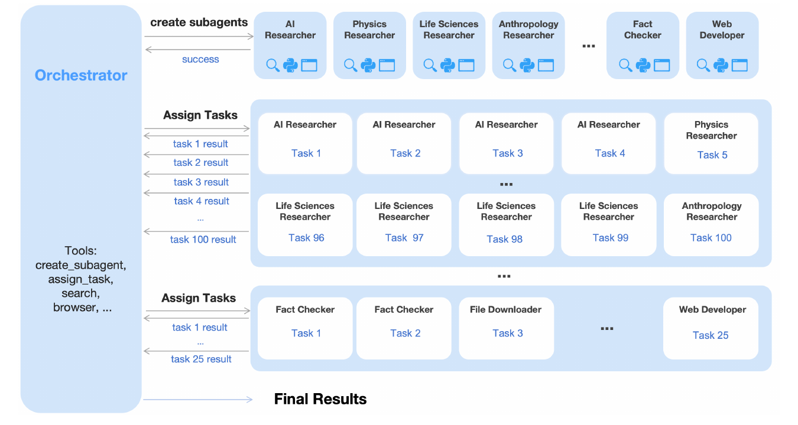

# Kimi K2.5: Visual Agentic Intelligence

## 来源信息

| 项 | 内容 |
| --- | --- |
| 标题 | Kimi K2.5: Visual Agentic Intelligence（Technical Report of Kimi K2.5） |
| 作者 | Kimi Team（arXiv 提交人 Yulun Du；附录 A 按姓氏字母序列出全部作者） |
| 机构 | Kimi Team（论文无 affiliation 行；checkpoint 发布于 Hugging Face `moonshotai` 组织） |
| 来源 | [arXiv:2602.02276v2](https://arxiv.org/abs/2602.02276v2)（cs.CL; cs.AI; cs.LG），v2 日期 2026-08-07，CC BY-NC-ND 4.0 |
| 版本 | v1 2026-02-02 → v2 2026-08-07；本笔记基于 v2，论文未说明 v2 相对 v1 的改动 |
| 阅读日期 | 2026-10-05 |

---

## 核心结论

一句话：**K2.5 = Kimi K2（1T MoE 语言底座）+ 原生多模态（MoonViT-3D，约 15T 图文混合 token 联合预训练）+ Agent Swarm（用 PARL 训练并行多智能体编排）**；论文的两个主张是「文本与视觉联合优化让两个模态互相增强」和「并行编排把任务复杂度从线性串行变为并行处理」。

- **解决什么问题**：串行 agent（思考→调工具→再思考）同时撞上延迟墙与上下文墙；把视觉当事后插件注入会打断已成型的语言表征；预训练好的 VLM 不会自发调用视觉工具。
- **核心想法**：固定视觉-文本 token 总预算时，**早期融合 + 较低视觉比例**（消融最低一档 10%:90%）优于「后期注入 + 高比例」；后训练只用纯文本 SFT 点亮视觉工具使用（zero-vision SFT），再按**能力**而非模态组织联合多模态 RL；编排层用一个可训练 orchestrator 调度一组冻结 subagent。
- **怎么做到**：PARL 奖励 = 任务结果分 + 子代理实例化奖励 + 子任务完成率奖励（后两项系数退火到 0）；预算按 **critical steps**（关键路径式步数）而非总步数计，使「有效并行、缩短最长分支」才被激励。
- **关键结果**：BrowseComp 60.6→**78.4**（超过 GPT-5.2 Pro 的 77.9）、WideSearch 72.7→**79.0**，达到同一目标 Item-F1 的墙钟时间最多省 **4.5×**；视觉/文档/长视频多项全表最优（OCRBench 92.3、InfoVQA 92.6、LVBench 75.9、LongVideoBench 79.8、HLE w/ tools 50.2）。
- **定位**：视觉与 agentic 搜索是强项；编码与纯推理只是「接近」Claude/GPT/Gemini，编码榜无一项最优。开源的是后训练 checkpoint，不是训练过程。

---

## 问题

### 串行 agent 的两堵墙

现有 agentic 模型（含 Kimi K2-Thinking）本质是**串行**执行「思考→调工具→再思考」。单次任务可以跑到几百步，但**推理时间随步数线性增长**：任务越复杂（大量信息搜集、多分支推理），延迟越不可接受；同时上下文不断累积，单个 agent 的推理深度与工具调用预算被逐步耗尽。§3 开头把问题定义为：任务复杂度与异构性上来之后，串行范式同时撞上**延迟墙**和**上下文墙**。

### 已有上下文管理都是「反应式」的

§5.2 末给出一个有用的视角：Hide-Tool-Result、Summary、Discard-all 这类手段都在上下文**溢出之后**才压缩或丢弃历史，属于反应式管理，代价是牺牲结构信息与中间推理。K2.5 想做的是**主动式上下文管理**——context sharding 而非 context truncation：长任务被拆成语义隔离的并行子任务，每个 subagent 只持有自己的局部上下文，只有任务相关输出回传 orchestrator。

### 多模态「后融合」的代价

主流做法是把视觉当作语言能力之上的**事后插件**（late fusion，训练后段按 50%+ 比例注入视觉 token）。K2.5 的消融（Table 1、附录 B.1）给出相反观察：固定总 token 预算时，早期、低比例的融合反而最强；晚融合在视觉数据刚引入时会出现文本能力的 **"dip-and-recover"**（先掉后恢复），作者解释为模态域漂移打断了已经成型的语言表征空间。

### 视觉工具的冷启动

预训练好的 VLM 不会自发做视觉工具调用；而人工标注或提示工程构造的视觉 CoT 数据多样性差，基本局限于裁剪、旋转、翻转这类原始操作。这构成后训练的第一个问题：怎样在没有高质量视觉轨迹的情况下把视觉推理「点亮」。

### 本文的设定与前提

- 底座是已经训好的 Kimi K2，不是从零开始的语言模型；
- 视觉与文本在**预训练阶段**就共享一个表征空间（约 15T 图文 token），后训练才有资格只给纯文本数据。

---

## 核心想法

### 一句话

不改底座、不换强化学习算法，而是换三个「配方」：什么时候把视觉混进来、后训练按什么维度分域、以及把并行拆解本身变成可训练的动作。

### 直觉一：早混比晚混好，因为表征空间还没定型

late fusion 先在纯文本上把语言能力训好，再在后段注入 50%+ 的视觉 token。K2.5 的消融显示，视觉数据一进来，文本三项在 Mid/Late 配置上先掉再恢复（"dip-and-recover"）；Early（10:90）曲线最平稳。作者的解释是域漂移打断了已成型表征。换句话说：**表征空间的「地基」一旦按纯文本浇好，再掺另一个模态就要付重建成本**。全程恒定比例混合，代价是训练早期就要为视觉付算力，收益是没有这次重建。

至于「低比例」，消融里 10:90 在六项能力上五项最高（文本推理 58.5 略低于 Mid 的 58.6），作者据此说「视觉比例本身影响很小」，真正起作用的是**注入时点**。这点证据强度有限（见后文），但方向明确：不必为了视觉能力把视觉 token 堆到 50%。

### 直觉二：zero-vision SFT 能成立，靠预训练已经对齐

后训练 SFT 阶段不放任何人工视觉轨迹，全部用纯文本数据；视觉操作通过 IPython 里的程序化操作代理完成（如用二值化估计物体尺寸、计数），相当于把裁剪/旋转这类专用视觉工具泛化成通用代码操作。作者的观察是：纯文本 SFT 就足以「点亮」视觉推理与工具使用，随后接视觉 RL，MMMU-Pro、MathVision、CharXiv(RQ)、OCRBench 一路上升（Figure 2）；反过来，「文本+视觉」混合 SFT 在视觉 agentic 任务上更差。

成立的前提被作者写得很清楚：联合预训练已经建立了图文对齐，能力可以自然跨模态泛化。也就是说，zero-vision SFT 不是「文本数据更万能」，而是「对齐已经在预训练里付过费，后训练不必再付一次」。

### 直觉三：并行不会自发出现，得塑形，还得防刷

把任务交给 orchestrator 自由决定「自己干还是开 subagent」，RL 会收敛到最省事的局部最优：**serial collapse**，永远单 agent 干活。所以 PARL 在结果奖励之外加两项——鼓励实例化的 $r_{\text{parallel}}$ 与鼓励把子任务做完的 $r_{\text{finish}}$。但只鼓励并行又会诱导另一种奖励黑客：**spurious parallelism**，疯狂 spawn 但不做有意义的分解。两项辅助奖励都随训练退火到 0，最终只优化任务结果。

真正让「并行必须有用」的是资源口径：预算按 critical steps 而不是总步数计。开一堆子任务但最长分支没变短，关键路径不变，收益接近零；只有**均衡的分解**才真正缩短关键路径。

### 与已有做法的区别

| 环节 | 常见做法 | K2.5 的做法 |
| --- | --- | --- |
| 视觉融合 | 后段注入、50%+ 视觉比例 | 全程恒定比例、早期注入、视觉占比低 |
| 视觉后训练 | 人工视觉 CoT / 专用视觉工具轨迹 | zero-vision SFT + 程序化视觉操作 |
| 多模态 RL 分域 | 按输入模态分域 | 按能力分域，每个域专家同时吃文本与多模态 |
| 多智能体训练 | 端到端共优化所有 agent | 只训 orchestrator，subagent 冻结 |
| 并行资源口径 | 总步数 / 总 token | critical steps（关键路径） |

### 一个走通的账

WideSearch 上「达到同一目标 Item-F1」的墙钟时间：目标从 30% 抬到 70% 时，单 agent 从约 1.7× 涨到约 7.2×，Agent Swarm 维持在 0.6×~1.6×，图上标注的节省倍数为 ×3.0/×3.0/×3.2/×3.7/×4.5。BrowseComp 上以步数为横轴时，达到 75% 准确率约需 200 步（Swarm）对约 780 步（Discard-all），约 3.8×。

两个账说的是同一件事：收益不在「并行让单步更快」，而在**相同质量下把关键路径压短**。视频侧的 4× 时间压缩是同一逻辑的另一半——MoonViT-3D 把最多 4 个连续帧打包成一个时空体积、过 projector 前做轻量时间池化，于是同一上下文窗口能装 4× 长的视频。

### 代价

- **credit assignment 变粗**：只训 orchestrator，subagent 的好坏只能通过「任务成不成」间接体现，冻结策略的能力上限就是整套系统的上限。
- **辅助奖励必须退火**：$\lambda_1,\lambda_2\to0$ 是设计的一部分，不退火最终策略会被代理指标带偏。
- **上下文分片有信息损失**：子任务之间本可以互相启发的线索被隔离在各自局部上下文里，只能靠 orchestrator 汇总。

---

## 方法

### 符号表

| 符号 | 含义 | 维度 / 取值 |
| --- | --- | --- |
| $x$ | 一个任务或问题 | — |
| $y$、$y_j$ | 任务输出/轨迹；式 (1) 中 $y_j$ 为第 $j$ 条采样回复 | — |
| $K$ | 每个问题采样的回复条数 | 原文未给数值 |
| $N$ | 式 (1) 中的归一化分母 | 原文未定义；按上下文理解为 token 级归一化常数 |
| $i,j$ | 下标：$j$ 为回复序号，$i$ 为 token 位置（critical steps 中 $i$ 为 subagent 序号） | $i=1,\dots,\lvert y_j\rvert$ |
| $y_j^{i}$、$y_j^{0:i}$ | 第 $j$ 条回复的第 $i$ 个 token、其之前的 token 前缀 | — |
| $\pi_\theta$、$\pi_{\mathrm{old}}$ | 当前策略（参数 $\theta$）、采样时的旧策略 | — |
| $\alpha,\beta$ | 式 (1) 中 log-ratio 的 clip 下界与上界 | 原文未给数值 |
| $r(x,y)$ | 任务级奖励 | 标量 |
| $\bar r(x)$ | batch 内平均奖励（基线） | 标量 |
| $\tau$ | log-ratio 平方惩罚的系数 | 原文未给数值 |
| $\mathcal{D}$ | RL 的问题分布 | — |
| $r_{\mathrm{PARL}}$ | PARL 总奖励 | 标量 |
| $r_{\text{perf}}$ | 任务级结果奖励（主目标） | 标量 |
| $r_{\text{parallel}}$ | 子代理实例化奖励 | 标量 |
| $r_{\text{finish}}$ | 子任务完成率奖励 | 标量 |
| $\lambda_1,\lambda_2$ | 上两项奖励的系数，训练中退火到 0 | $\ge 0$ |
| $T$ | 一个任务被分解的阶段数 | — |
| $S_{\mathrm{main}}^{(t)}$ | 主 agent 在第 $t$ 阶段自身的步数 | 通常为 1 |
| $S_{\mathrm{sub},i}^{(t)}$ | 第 $t$ 阶段第 $i$ 个 subagent 的步数 | — |
| $\mathrm{CriticalSteps}$ | 关键路径式累计步数 | 预算与评测口径 |
| $B$ | 式 (2) 给出的 token 预算 | 标量，训练开始时固定 |
| $\rho$ | 式 (2) 取分位数的分位点 | 原文未给数值 |
| $\lambda$ | Toggle Phase 0 施加预算约束的平均正确率阈值 | 原文未给数值 |
| $m$ | Toggle 两种模式的切换间隔（迭代数） | 原文未给数值 |

### 数据流：三件套 + 三阶段

**架构**（§4.2）：MoonViT-3D 视觉编码器 + MLP projector + Kimi K2 MoE 语言模型。语言底座是 Kimi K2（1.04T 总参数 / 32B 激活 / 384 专家 / 每 token 激活 8 个 / sparsity 48），文本预训练 15T token，优化器 MuonClip + QK-Clip。

MoonViT-3D 从 SigLIP-SO-400M 初始化，承接 Kimi-VL 的 native-resolution 路线与 NaViT 的 **patch n' pack**（原分辨率切 patch、展平、拼成 1D 序列，从而混训不同分辨率）。视频方向把该思想推到时间维：**最多 4 个连续帧打包成一个时空体积**，同一套注意力在时空上共用；过 MLP projector 前做**轻量时间池化**，得到 4× 时间压缩。图像与视频编码器完全共享权重与 embedding 空间，没有专门的视频模块。



*Figure 3：orchestrator（左，工具含 create_subagent / assign_task / search / browser）动态创建领域 subagent，再把任务切成并行子任务分派（图中示例一次分派 100 个子任务）。*

**三阶段预训练**（Table 3）：

| 阶段 | ViT Training | Joint Pre-training | Joint Long-context Mid-training |
| --- | --- | --- | --- |
| 数据 | Alt text、合成 caption、grounding、OCR、视频 | 上述 + 文本/知识/交错图文、视频、OS 截图 | 上述 + 高质量文本与多模态、长文本、长视频、推理、Long-CoT |
| 序列长度 | 4096 | 4096 | 32768 → 262144 |
| token 量 | 1T | 15T | 500B → 200B |
| 训练部分 | ViT | ViT & LLM | ViT & LLM |

ViT 阶段只保留交叉熵 caption loss（相比 Kimi-VL 去掉对比损失），先对齐到 Moonlight-16B-A3B（约 1T token），再用很短一阶段只训 MLP projector 桥接 1T LLM；联合预训练从「接近训练末端的 K2 checkpoint」续训 15T 图文 token；第三阶段用 YaRN 逐段外推 32K→256K，并混入更高质量 mid-training 数据。

### PARL 奖励（原文该式未编号）

```math
r_{\mathrm{PARL}}(x,y)=\lambda_1\, r_{\text{parallel}}+\lambda_2\, r_{\text{finish}}+r_{\text{perf}}(x,y)
```

**逐项读法**

- $r_{\text{perf}}$：任务级结果奖励，是唯一贯穿全程的主目标；其余两项都是塑形项。
- $r_{\text{parallel}}$：奖励「确实实例化了子代理」。没有它，orchestrator 会收敛到 serial collapse（永远自己干）。
- $r_{\text{finish}}$：奖励子任务被真正完成，而不是开出来就丢。没有它，策略会学会 spawn 一堆 subagent 刷实例化奖励（spurious parallelism）。
- $\lambda_1,\lambda_2$：随训练退火到 0，保证最终策略只对任务结果负责；退火速率原文未给。

这一项的设计关键不在权重，而在「两个塑形项方向相反」——一个推着多开，一个推着做完，中间的可行域才是「有意义的分工」。

### Critical steps 资源约束（原文该式未编号）

```math
\mathrm{CriticalSteps}=\sum_{t=1}^{T}\Big(S_{\mathrm{main}}^{(t)}+\max_i S_{\mathrm{sub},i}^{(t)}\Big)
```

**逐项读法**

- $T$：任务被分解出的阶段数；每个阶段包含主 agent 的一步决策与它派发的一批子任务。
- $S_{\mathrm{main}}^{(t)}$：主 agent 在第 $t$ 阶段自己的步数，通常为 1（想清楚怎么拆、派发、收结果）。
- $\max_i S_{\mathrm{sub},i}^{(t)}$：该阶段里最慢那个 subagent 的步数。取最大值而非求和，等价于把并行组当成整体、按最长分支计时。
- 外层求和：各阶段串行叠加，得到整条关键路径。

以总步数计预算时，「开 100 个子代理、每个 2 步」和「开 2 个子代理、各 100 步」代价相近；以 critical steps 计时，前者便宜、后者贵。于是奖励结构迫使策略寻找**均衡的分解**——只有把工作切得足够均匀、让最长分支真正变短，预算才会下降。

### 后训练 RL 目标（原文 Eq (1)）

```math
L_{\mathrm{RL}}(\theta)=\mathbb{E}_{x\sim\mathcal{D}}\Big[\frac{1}{N}\sum_{j=1}^{K}\sum_{i=1}^{|y_j|}\mathrm{Clip}\Big(\frac{\pi_\theta(y_j^i\mid x,y_j^{0:i})}{\pi_{\mathrm{old}}(y_j^i\mid x,y_j^{0:i})},\alpha,\beta\Big)\big(r(x,y_j)-\bar r(x)\big)-\tau\big(\log\tfrac{\pi_\theta}{\pi_{\mathrm{old}}}\big)^2\Big]
```

**逐项读法**

- 外层 $\mathbb{E}_{x\sim\mathcal{D}}$：对问题分布采样；内层对每题 $K$ 条回复、每条回复的每个 token 求和，再除以 $N$。
- $\pi_\theta(y_j^i\mid x,y_j^{0:i})/\pi_{\mathrm{old}}(\cdot)$：逐 token 的重要性比，衡量当前策略相对采样策略在这一步偏移了多少。
- $\mathrm{Clip}(\cdot,\alpha,\beta)$：把比值截到 $[\alpha,\beta]$。原文的用法是**基于 log-ratio 的梯度掩码**：比值落在区间外的 token 梯度置零，**不看 advantage 的符号**——这与 PPO 的 clip 不同（PPO 按 advantage 符号只裁一侧）。目的是抑制训练与推理框架不一致带来的 off-policy 漂移。
- $r(x,y_j)-\bar r(x)$：序列级 advantage，用 batch 内平均奖励做基线（类似 GRPO）。
- $-\tau(\log\frac{\pi_\theta}{\pi_{\mathrm{old}}})^2$：对 log-ratio 的平方惩罚，把策略拉在采样策略附近；$\tau$ 原文未给数值。

作者称这套机制对长程多步工具使用推理的稳定性是必需的；优化器仍用 MuonClip。

### Toggle：token 效率与推理能力的交替优化（原文 Eq (2)）

**动机**：刚性 token 预算训练会造成**长度过拟合**——模型学不会在更高算力下花更多 token 解题，因为训练里从没允许它这么做。

**机制**：每 $m$ 次迭代在两种模式间切换。Phase 0（预算受限）只在**该题平均正确率超过阈值 $\lambda$** 时才施加预算约束；Phase 1（标准缩放）只给最大 token 上限，鼓励用推理时算力换质量。预算定义为：

```math
B=\operatorname{Percentile}\big(\{|y_j| : r(x,y_i)=1\},\rho\big)
```

**逐项读法**

- $\{|y_j|\}$：回复的 token 长度集合；条件 $r(x,y_i)=1$ 只保留**答对**的回复（原文该式左侧下标为 $y_j$、条件里为 $y_i$，按上下文理解为同一条正确回复）。
- $\rho$：取哪个分位数，即「正确回复里第 $\rho$ 分位的长度」作为预算；原文未给数值。
- $B$：训练开始时算一次后固定的预算值，不随训练动态调整。

实测在 **K2 Thinking** 上（不是 K2.5）：输出长度平均降 **25~30%**，性能影响可忽略；只在数学/代码上训练时，模型在 GPQA、MMLU-Pro 上也有 token 降幅（域泛化）。

### 结构差异：与已有做法的三处不同

- **融合**：不是「先语言后视觉」，而是固定总预算下全程恒定比例、早期注入、低视觉占比；视觉编码器与语言主干共享一个 embedding 空间，不需要单独的视频模块。
- **编排**：不是端到端共优化多智能体，而是**可训练 orchestrator + 冻结 subagent**。理由是 credit assignment 模糊（结果对不代表每个 subagent 都对，错也不代表全错）与训练不稳定；subagent 输出被当作环境观测而非可微决策点。
- **clip**：不是 PPO 的单侧 clip，而是按 log-ratio 的双侧梯度掩码加平方惩罚，针对的是训推框架不一致而非纯策略更新幅度。

### 训练与实现要点

- **配方顺序**：ViT 对齐 → 15T 图文联合预训练 → 长上下文 mid-training → zero-vision SFT → 按能力分域的联合多模态 RL（含 Toggle 的 token 效率控制）。
- **Agent Swarm 训练**：先用小尺寸 subagent 训 orchestrator，再过渡到大模型；RL 框架支持动态调整 subagent 与 orchestrator 的推理实例配比。工具接口只有两个：`create_subagent(name, system_prompt)` 与 `assign_task(agent, prompt)`（附录 E.8）。
- **步数预算**：BrowseComp orchestrator≤15 步、subagent≤100 步；WideSearch 均为 100；In-house Bench orchestrator≤100、subagent≤50。orchestrator 的步数远少于 subagent，职责是「想清楚怎么拆」而不是「自己干」。
- **Prompt 构造**：合成 wide search（许多独立信息源的并行探索）与 deep search（多推理分支 + 延迟聚合）两类压力 prompt，外加真实工作负载（长文档分析、大批量下载）；**不显式要求并行**，只让任务在串行预算下天然完不成，让并行分解在 RL 探索中自发出现。
- **多模态训练基础设施**：Decoupled Encoder Process（DEP）把每个训练步拆成「视觉前向（编码器复制到所有 GPU、均摊负载、只留输出）→ 主干训练 → 视觉重算与反传」三步，多模态训练效率达纯文本的 90%（细节见 `audit.md`）。

---

## 主要结果

**设置**（§5.1.1、附录 E）：默认 temperature 1.0、top-p 0.95、上下文 256k；推理类最长 completion 96k；方差大的任务多次平均（AIME/HMMT Avg@64、GPQA Avg@8、图像/视频 Avg@3、编码 Avg@5）。视频短片段 128 帧，长视频 **2048 帧 / 448 分辨率**。对照模型取各家高性能推理配置（Claude 扩展思考、GPT-5.2 xhigh、Gemini 3 Pro high、DeepSeek-V3.2 thinking、Qwen3-VL thinking）；带 `*` 的为作者复测。

**读数口径**：编码类分数取 non-thinking 模式（SWE 三个变体的峰值出现在该模式，Terminal Bench 2.0 因 thinking 模式的上下文管理与会话状态处理不兼容也跑 non-thinking），与 thinking 模式的对照模型不完全同口径。

| 任务 | 单 agent | Agent Swarm | 同表最强对照 |
| --- | ---: | ---: | --- |
| BrowseComp | 60.6（有上下文管理 74.9） | **78.4** | GPT-5.2 Pro 77.9；GPT-5.2 单 agent 65.8 |
| WideSearch | 72.7 | **79.0** | — |
| In-house Swarm Bench | 41.6 | **58.3** | 内部基准，无公开对照 |
| WideSearch 达目标 Item-F1 的墙钟 | 约 1.7×→7.2× | 约 0.6×→1.6× | 目标 30%→70%，最多省 4.5× |

**表外两点**：BrowseComp 上达到 75% 准确率约需 200 步（Swarm）对约 780 步（Discard-all），约 3.8×，且 Swarm 的准确率上限更高（末段约 78.4% vs 75.0%）；Figure 6 的词云显示实际涌现出的 subagent 类型（Biography Researcher、Timeline Researcher、Cross Reference Analyst 等）是学出来的，不是预定义的。

1. **并行编排本身是能力来源，不只是加速手段**：单 agent 口径下 BrowseComp 60.6 低于 GPT-5.2 的 65.8；上 Agent Swarm 后 78.4 反超 GPT-5.2 Pro 的 77.9。同一底座、同一工具，差别只在「能不能把任务拆开并行做」。
2. **视觉、文档与长视频是强项区**：OCRBench 92.3、InfoVQA 92.6、OmniDocBench 1.5 88.8、MathVista 90.1、BLINK 78.9；长视频 LVBench 75.9、LongVideoBench 79.8（2048 帧设置下与 Gemini 3 Pro 的差距拉开）。Gemini 3 Pro 仍在基础感知与学科题上领先（MMMU-Pro 81.0、MathVision 86.1、BabyVision 49.7、MMVP 90.0）。
3. **编码与纯推理只是「接近」**：SWE-bench Verified 76.8、Terminal Bench 2.0 50.8、PaperBench 63.5 均低于 Claude Opus 4.5（80.9 / 59.3 / 72.9）；AIME 2025 96.1、GPQA-D 87.6 低于 GPT-5.2（100 / 92.4），MMLU-Pro 87.1 低于 Gemini 3 Pro 的 90.1。编码榜无一项最优，无工具的推理项也没有加粗。
4. **联合优化的收益是双向的**：视觉 RL 之后文本指标不降反升（MMLU-Pro 84.7→86.4、GPQA-Diamond 84.3→86.4、LongBench v2 56.7→58.9）；但这是训练中途快照，机制只有「Analysis suggests」级别的解释。
5. **效率是设计目标而非副产品**：MoonViT-3D 的 4× 时间压缩让长视频进同一上下文；critical steps 让 Swarm 的收益体现为墙钟（最多 4.5×）。反过来，token 用量对比里 K2.5 每一行都比 Gemini-3.0 Pro / DeepSeek-V3.2 更多，说明分数有一部分来自更长的推理。
6. **搜索子榜与工具增强推理同样领先**：DeepSearchQA 77.1、FinSearchComp T2&T3 67.8、Seal-0 57.4 均为全表最优；推理/知识行里 K2.5 唯一的全表最优项是 HLE w/ tools 50.2（无工具版 30.1 不是）。

---

## 边界与局限

**作者承认**：

- GPT-5.2 在视觉评测中约 10% 请求失败、失败计为错答，WideSearch 等昂贵评测因 API 不稳定被跳过——对照数字有系统性噪声。
- zero-vision SFT 优于 mixed SFT 是「preliminary experiments」，机制解释（缺高质量视觉数据）是猜测；视觉 RL 提升文本的机制是「Analysis suggests」，无因果实验。
- 编码类评测在 non-thinking 模式报分，与 thinking 模式的对照模型不完全同口径；K2.5 相对 v1 的变更未在报告中说明。

**读者判断（论文无相应实验）**：

- **消融混淆**：Table 1 三行同时改了注入时点与视觉比例（0%↔10%、50%↔20%、80%↔50%），无法分离两个因素；「比例影响很小」只建立在 3 个配置点上，且没有方差与多次运行。
- **跨模态迁移缺同成本对照**：Table 2 的 +1.7/+2.1/+2.2 是「视觉 RL 前后」，没有「等量文本 RL」对照，收益有多少来自视觉、多少来自继续 RL 无法区分。
- **Swarm 对照公平性未说明**：GPT-5.2 Pro 的 77.9 是否在同步数/同工具预算下取得、swarm 的步数预算如何影响与单 agent 的可比性，原文未交代；In-house Swarm Bench 与 image-to-code SOTA 声明均无公开数据与评审协议。
- **开源的边界**：权重已开源（仅后训练 checkpoint），但 15T 联合 token 的视觉:文本比例、SFT 数据规模、PARL 与 Toggle 的超参（$\lambda$、$m$、$\rho$ 等）均未公布。

---

## 与其他工作的关系

- **Kimi K2**：直接底座，架构与训练细节（MuonClip、QK-Clip、384 专家）引 K2 技术报告；K2.5 在其上加视觉与编排。
- **Kimi-VL / NaViT / SigLIP**：MoonViT-3D 从 SigLIP-SO-400M 初始化，承接 Kimi-VL 的 native-resolution 路线与 NaViT 的 patch n' pack；视频侧把打包推广到时间维。
- **PPO / GRPO**：式 (1) 的 clip 与 PPO 不同（按 log-ratio 而非 advantage 符号裁），基线用 batch 平均奖励，接近 GRPO 的思路。
