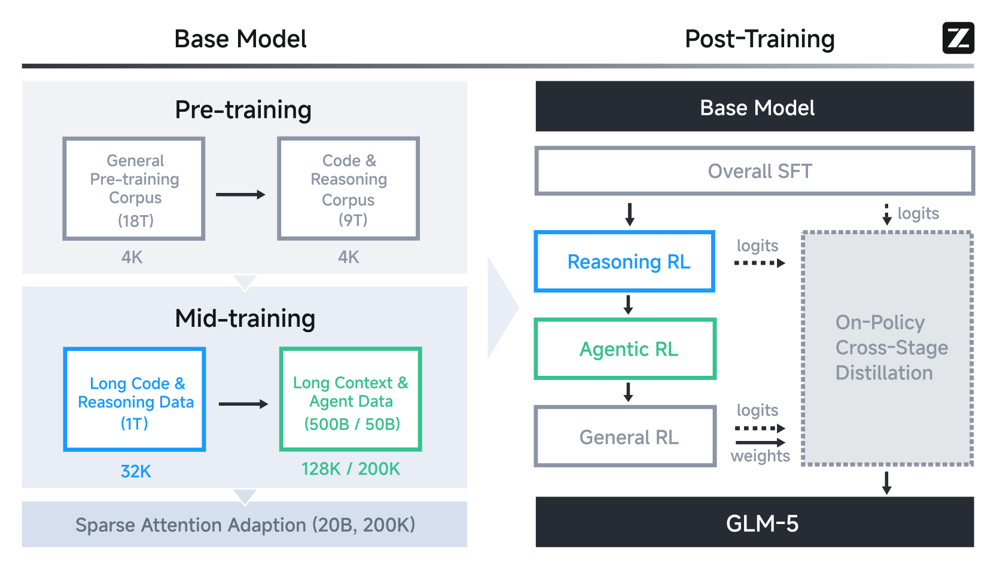
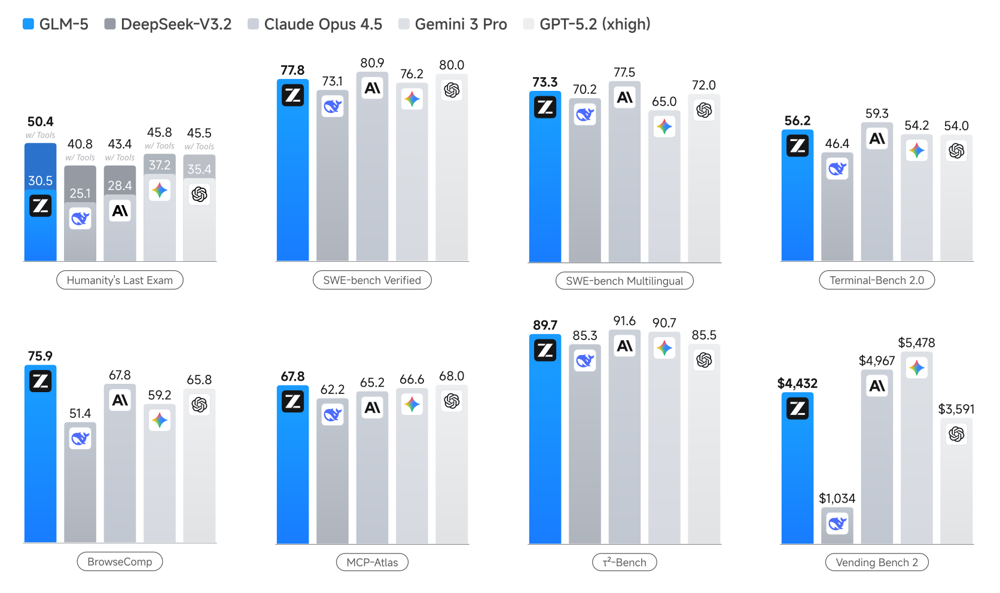

# GLM-5：从 Vibe Coding 到 Agentic Engineering

## 来源信息

| 项 | 内容 |
| --- | --- |
| 标题 | GLM-5: from Vibe Coding to Agentic Engineering |
| 作者／团队 | 首页署名 **GLM-5 Team**；单位行写 **Zhipu AI & Tsinghua University**（p1，按此顺序）。arXiv 元信息把 `GLM-5-Team` 列为作者并展开一长串个人署名（另有 "86 additional authors not shown"）；p31「9 Contribution」的 **Core Contributors 与 Contributors** 按首名字母序排列（p31 原话只声明这一点），Tech Leads（Aohan Zeng、Xin Lv、Zhenyu Hou、Zhengxiao Du、Qinkai Zheng、Bin Chen、Da Yin）与 Advisors（Jie Tang、Yuxiao Dong、Juanzi Li、Hongning Wang、Minlie Huang、Bin Xu）另列，**不按字母序** |
| 来源 | [arXiv:2602.15763v2](https://arxiv.org/abs/2602.15763v2)（cs.LG; cs.CL），v1 2026-02-17、v2 2026-02-24（本次阅读的版本） |
| 许可 | CC BY 4.0（abs 页 "view license" 指向 `creativecommons.org/licenses/by/4.0/`，核验日期 2026-11-03） |
| 项目／代码 | <https://github.com/zai-org/GLM-5>（GitHub API 核验 2026-11-03：公开、Apache-2.0、创建 2026-02-09、最后 push 2026-10-15、7,430 stars；顶层为 `README.md`／`README_zh.md`／`example/`／`resources/`／`skills/`／`requirements.txt`，**未验证其与本文实验的可复现性对应**）。README 的 Download Model 表列出 GLM-5／GLM-5-FP8（744B-A40B）等权重链接到 Hugging Face 与 ModelScope；**HF 链接本机不可达（`huggingface.co` 无法验证），只核到 README 的声明层面** |
| 页数 | 40 页（p1 标题＋摘要＋Figure 1；§1 p2–4；§2 p4–10；§3 p10–15；§4 p15–21；§5 p21–22；§6 p22–30（§6.3.5 末段跨到 p30 顶）；§7–9 p30–31；参考文献 p32–35；附录 A p36；附录 B p36–40） |
| 阅读日期 | 2026-11-03 |
| 阅读范围 | v2 全文 40 页均读到：正文 §1–9、附录 A–B。文档内 13 张表（Table 1–13，pp. 5/5/5/7/7/8/23/25/27/36/37/39/39）逐格比对；公式 (1)–(5)（pp. 11/14/17）在渲染页核对上下标；Figure 1（p1）与 Figure 5（p4）按元素清单逐项核对后裁剪；Figure 4 右panel（p3）400 dpi 放大核对；Figure 3 的榜位（Text #11 / Code #6）按截图目视；Figure 2/6/7/8/9/10/11/12/13 仅按正文或图注引用，未逐点读数 |
| 归档说明 | arXiv 来源，按仓库策略不归档 PDF；仓库清单编号 **00157**（编号单元格指向上游归档仓库 `paper-is-all-you-need` 的 `00157-GLM-5.pdf`，该文件 6,177,650 B，与本次下载的 v2 同尺寸；本仓库不另存） |

**阅读范围与核对凭据**（供下次复核复用）

- **版本锚点**：本次下载 `https://arxiv.org/pdf/2602.15763v2` 得 **6,177,650 B / 40 页 / sha256 `e20742ff36e08dc361de6973f7f72ad38e107edf8fd92d2a777a8428fc9b8f0e`**（下载完整：字节数稳定、文件尾 `%%EOF`、`pymupdf` 可解析 40 页）。注意 abs 页两版都标 "3,731 KB"，与实际文件大小明显不符（arXiv 的 size 字段滞后），**不能拿它当完整性校验**。
- **表格核对**：Table 1–13 全部用 `page.get_text()` 的版式文本抽取后在 200 dpi 渲染页对照；Table 7（p23）、Table 8（p25）、Table 9（p27）、Table 10（p36）、Table 11（p37）、Table 12–13（p39）另做了逐行目视复核（数字、行列对齐、`*`／`†` 标注）。
- **公式核对**：Eq. (1)（p11）、Eq. (2)（p14）、Eq. (3)–(5)（p17）在 200 dpi 渲染页核对变量名、上下标与分段函数写法。
- **图像读数**：Figure 1（p1）裁剪框 `Rect(106,432,507,670)`（pt）、300 dpi → `assets/fig1-results.png`（1672×992）；Figure 5（p4）裁剪框 `Rect(106,68,507,298)`、300 dpi → `assets/fig5-pipeline.png`（1672×959）。两张均按「图内标题／图例／坐标轴标签／图内注记行」清单逐项点名确认在框内，四边无黑边、无截断。Figure 4 右panel 裁剪框 `Rect(315,262,506,396)`、400 dpi（未入库），用于核对正文 "98.0% BSR" 的出处。
- **否定性检索**（PDF 全文，折行已折叠）：`FLOPs` 0 次、`GPU hours` 0 次、`H100` 0 次、`A100` 0 次、`training cost` 0 次 —— 本文**没有**给出训练 FLOPs、GPU 数或机时；`H800` 仅 1 次（§2.1 解释 DeepSeek-V3 的头数按 H800 roofline 选择），不能当作 GLM-5 的训练硬件。
- **未做**：未运行任何代码、未训练或推理模型、未复现任何基准；未核验 LMArena／Artificial Analysis 榜单（截图与文字均为作者自述）。

**复核记录**（2026-11-03，check-paper-note 首轮）

- **基准**：arXiv 2602.15763v2，sha256 `e20742ff…`、40 页，与首读副本一致；arXiv API 确认 v2 仍是当前最新版（无 v3）。核对方式：PDF 全文文本 + 200–600 dpi 渲染页；Table 1–13 逐格重核；Eq. (1)–(5) 渲染页重核；Figure 1/5 按本文裁剪框复现（300 dpi，1672×992／1672×959，与资产一致）并逐元素点名；Figure 1 的 BrowseComp／Terminal-Bench 面板 600 dpi 放大复读；另派独立子 agent 用另一套方法审计，读数与本次一致。
- **修正摘要**：① HTML CSR 76.3 vs 82.2 由「持平或略高」改为「低 5.9 分」；② §6 页界改为 p22–30（§6.3.5 跨页）；③ p31 只有 Core Contributors／Contributors 声明按首名字母序；④ §1 引用的 O(L²)/128K 改标 §2.1.1（p5）、同步 RL 空转改标 §3.3（p12）／§4.1.1（p15）；⑤ 脚注 4/5 的「受启发」改为原文措辞（interleaved 明说源自 Claude，preserved 只说 Claude 也采用）；⑥ `pop` 由「整段丢弃」改为「该 token 贡献置零」；⑦ 删除「镜像 1.25」的推断；⑧ Table 4/5 的页码改为 p7，并拆分「不做额外训练」与「190B／64K 继续训练」两套条件；⑨ 20% 复算补第二种口径（按 Figure 1 柱值 +25.3%／+16.5%，按 Table 7 主行 +26.8%／+18.2%）；⑩ 「744B 正文 4 次」改为「全文 4 次（正文 2、表 2）」；⑪ 补 BrowseComp 两档口径与 §6.1.3／§4.2.4 的矛盾（张力第 12 条）；⑫ 补 Figure 1 两个面板混用口径（张力第 11 条）。
- **另补**：Table 7 省略 DeepSeek 列与 Terminal-Bench Claude Code 行（GLM-5 61.1†、GLM-4.7 32.8）；Tool-Decathlon／BrowseComp-ZH 两项落后；slime 尾延迟工程（§3.6）；评测协议差异（MCP-Atlas 超时、τ²-Bench prompt 调整、5 次平均、single-run、Andon Labs、HLE 131k、GPT-4.1 judge）；训练成本粗算改用 40B 激活；可复现性表述收紧为「训练侧不可复现、推理侧未验证」。
- **未修项与理由**：Figure 1 的 Claude BrowseComp 标 67.8、与 Table 7 的 57.8／37.0 都不符——原文未给该面板口径，无法判断是笔误还是另有设置，保留为张力第 11 条，不代为裁决。
- **未复核**：v1 内容（未下载）、LMArena／Artificial Analysis 榜单、GitHub／HF 状态（首读时已用 API 核仓库，本轮未重跑）、权重许可。
- **可复现凭据**：Figure 1 裁剪 `Rect(106,432,507,670)`@300 dpi；Figure 5 `Rect(106,68,507,298)`@300 dpi；Figure 1 BrowseComp 面板 `Rect(105,555,300,668)`@600 dpi、Terminal-Bench 面板 `Rect(310,440,505,550)`@600 dpi；Figure 4 右panel `Rect(315,262,506,396)`@400 dpi。否定检索词：`FLOPs`／`GPU hours`／`H100`／`A100`／`training cost` 均为 0。

**版本与发布渠道**（核验日期 2026-11-03）

- arXiv 上先后有 v1（2026-02-17）与 v2（2026-02-24），两版在 abs 页标称大小相同；本笔记一律以 **v2** 为准，未逐字比对 v1（若要追溯 v1 的差异需另取 v1 原文）。
- 仓库 README 已把 GLM-5 与后续的 GLM-5.1／5.2／5.3 写在同一页，并给出各代权重表——**该 README 是活动文档**，本次只把它当作「GLM-5 权重已发布、仓库为 Apache-2.0」的旁证，正文技术内容仍以 arXiv v2 为准。
- 论文自述 GLM-5 曾在 OpenRouter 上以匿名代号 **Pony Alpha** 发布（§8，p30），属发布策略叙述，无第三方可核材料。

---

## 1. 核心结论

一句话：**GLM-5 是 GLM-4.5 的「成本压缩 + 长时程工程化」版本**——用 MLA＋DeepSeek 稀疏注意力（DSA）把 744B（40B 激活）模型的长上下文训练／推理成本压下来，用全异步 RL 基础设施和环境规模化把 agent 训练推到长时程，再用跨阶段 on-policy 蒸馏把多段 RL 的能力回退补回来。

- **架构与预算**（§2.1、§2.3）：总参数 355B→744B、激活 32B→40B、专家 160→256、层数减少（正文写 80，Table 10 相加为 78）、head 96→64；预训练 27T（18T 通用 + 9T 代码／推理）+ mid-training 约 1.55T（32K 1T、128K 500B、200K 50B）= **28.5T token**；DSA 适配另加 20B。
- **主结果**（Table 7，p23）：相对 GLM-4.7 在绝大多数基准上提升，头部数字为 SWE-bench Verified **77.8**（+4.0）、SWE-bench Multilingual **73.3**（+6.6）、Terminal-Bench 2.0 **56.2**（verified 60.7†／61.1†）、BrowseComp **62.0**（保留最近 5 轮；再叠加 discard-all 的 HCM 为 **75.9**）、MCP-Atlas **67.8**（+15.8）、CyberGym **43.2**（+19.7）、Vending-Bench 2 **4,432 美元**。相对闭源前沿是「编码／agentic 接近，推理与知识仍有差距」：Claude Opus 4.5 在 SWE-bench Verified（80.9）、Terminal-Bench（59.3）、τ²-Bench（91.6）、CyberGym（50.6）上更高；Gemini 3 Pro 在 HLE（37.2）、GPQA-Diamond（91.9）、LongBench v2（68.2）上更高。
- **真实工程**（CC-Bench-V2，Table 8／p25）：前端 check-item 完成率 **React/Vue 略高于 Claude（71.0 vs 70.7、77.1 vs 74.3），HTML 仍低 5.9 分（76.3 vs 82.2）**；整任务成功率全面落后（ISR 38.9/34.6/32.7 vs 52.2/39.7/46.9）；后端 Pass@1 25.8 vs 26.9；链式长任务 52.3 vs 61.6。作者自己把差距归因于链式任务里的误差累积。
- **工程上真正可复用的部分**是后训练系统而非单点算法：异步 RL 用 **TITO**（token-in-token-out）保证动作级对齐、用**直接双边重要性采样**替代历史策略跟踪、按 rollout 版本丢弃过旧样本；环境侧把 SWE／终端／搜索三类可验证环境做到 10k+ 量级；最后用**跨阶段蒸馏**（教师＝各阶段终态 checkpoint）收口。
- **适合谁**：做长时程 coding／terminal／search agent 的团队，尤其关心「异步 RL 怎么不被 off-policy 拖垮」与「环境怎么规模化」的人。**不适合**把本文当训练成本核算或严格无损长上下文证据的人：全文没有 FLOPs／GPU 数，且 DSA 在自家 Table 3 的 HotpotQA-128k 上仍比 MLA 低 3.3 分（见「原文自身的表述张力」）。

---

## 2. 问题与动机

**范式转变的定义**（§4 开头，p15）：vibe coding 是「人写 prompt、模型写代码」；agentic engineering 是「agent 自己 plan、implement、iterate」。这个定义决定了评测重点必须从单 commit 的静态基准（SWE-bench）转向**多步、状态递进**的真实工程。

论文把瓶颈归为两类（§1，p2）：

1. **计算成本**：长上下文下 dense attention 是 O(L²)，128K 上下文时代价不可接受。GLM-4.5 只做了 MoE，没解决注意力本身。（成本瓶颈是 §1（p2）的原话；O(L²) 与 128K 的具体表述在 §2.1.1，p5。）
2. **真实适应性**：静态 benchmark 测不出「跑几小时、跨多个 PR、上下文不断变化」的能力（p2 只讲长时程这条）；长时程 rollout 让同步 RL 出现大量 GPU 空转，见 §3.3（p12）与 §4.1.1（p15）。

对应的三项设计在引言里就已经点名（p3–4）：DSA（成本）、异步 RL 基础设施（利用率）、异步 agent RL 算法（长时程学习质量）；第四项是国产芯片全栈适配（§5）。后训练层面的第四个隐性问题是**多阶段 RL 的能力回退**，用跨阶段蒸馏处理（§3.5）——这一条更像工程经验，而不是论文标题里的卖点。

前提与背景：DSA 直接沿用 DeepSeek-V3.2 的稀疏注意力（论文引 [9]），MLA 沿用 DeepSeek 系列 [24]；GLM-5 的增量是「在 MLA 上把 DSA 训起来 + 用 Muon Split 让 MLA 追平 GQA + 用共享参数 MTP 提高投机接受率」。读者若不了解 MLA 的 latent KV cache 与 DSA 的 lightning indexer，需要先补这两块背景（本文只在 §2.1 给了结论式描述）。

---

## 3. 方法与贡献

### 3.1 训练流水线总览



*Figure 5（arXiv:2602.15763v2，CC BY 4.0，p4，300 dpi 裁剪）。左：预训练 18T 通用 + 9T 代码／推理（4K），mid-training 1T 长代码／推理（32K）→ 500B／50B 长上下文与 agent 数据（128K／200K），最后 20B token 的稀疏注意力适配（200K）。右：Overall SFT → Reasoning RL → Agentic RL → General RL，旁路的 On-Policy Cross-Stage Distillation 从各阶段取 logits／weights。*

token 预算核对：18 + 9 + 1 + 0.5 + 0.05 = **28.55T**，与正文的 28.5T 一致；DSA 适配的 20B 若计入则为 28.57T（原文未说明是否含在 28.5T 内）。这把「训练 token 数」讲清楚了，但没有讲「训练算力」。

### 3.2 架构：MLA + Muon Split + MLA-256 + 共享参数的 MTP

**规模**（§2.1，p4；Table 10，p36）：744B 总参数／40B 激活，256 专家（8 routed + 1 shared），75 个 MoE 层 + 3 个 dense 层，hidden 6144，词表 154,880，64 个 attention head（GLM-4.5 为 96），QK head dim 192、V head dim 256，Q LoRA 2048、KV LoRA 512，indexer 32 head × 128 维。层数减少被明确解释为「降低专家并行的通信开销」。

**为什么换 MLA 又要改 Muon**（pp.4–5）：MLA 用 576 维 latent KV cache，显存比 GQA 省、长序列处理更快，但解码时要对 576 维做点积（GQA 只需 128 维），计算更重；更麻烦的是在 Muon 优化器下它**追不平 GQA-8**（2048 维 KV cache）的质量（Table 1：MLA 的 BBH 48.9、HumanEval 33.5，GQA-8 为 53.3／38.5）。作者的修法是 **Muon Split**：原本对多头共享的 up-projection 矩阵 `W^{UQ}`、`W^{UK}`、`W^{UV}` 整体做矩阵正交化，现在按 head 拆成小矩阵各自正交化，使不同 head 的投影权重以不同尺度更新。效果是 MLA 追平 GQA-8（BBH 51.8、HumanEval 36.7），并让 attention logits 在预训练中保持稳定、不需要 clipping。

**MLA-256 的取舍**（p5）：MLA 解码时要做 576 维点积，而 GQA 只要 128 维；DeepSeek-V3 的头数是按 H800 roofline 选的。GLM-5 把 head dim 从 192 提到 256、head 数减少 1/3（96→64），保持训练计算量与参数量不变、降低解码计算；Table 1 显示 MLA-256 + Muon Split 与 MLA + Muon Split 基本持平（MMLU 62.0 vs 62.5、BBH 51.3 vs 51.8、HumanEval 36.6 vs 36.7）。**口径提示**：正文只说 "head dimension" 192→256，而 Table 10 列的是 QK 192、V 256——按表读，256 落在 V head dim 上，QK 仍是 192；两处措辞没有完全对齐。

**共享参数 MTP**（p5）：训练 n 个 MTP 层才能预测 n 个 token，参数和 KV cache 随投机步数线性涨；DeepSeek-V3 只训 1 层却推 2 token，训练-推理不一致导致第二个 token 接受率低。GLM-5 改为**3 个 MTP 层共享参数**——显存与 DeepSeek-V3 的 draft 模型一致，但接受率更高：同样 4 步投机，接受长度 **2.76 vs DeepSeek-V3.2 的 2.55**（Table 2；私有 prompt 集）。Table 10 的 `# MTP Layers` 仍写 1，是「按参数当量计 1 层」还是另一口径，原文未说明。

### 3.3 DSA：用 20B token 的继续预训练换稀疏注意力

DSA 的做法（§2.1.1，p5–6）：保留全注意力框架，但用轻量 indexer 对每个 query 选 top-k 个 KV（论文另一处提到 indexer 的 `k = 2048`），只对被选中的 KV 做注意力；与固定窗口不同，选择是内容相关的。GLM-5 不是从零训练，而是**从 mid-training 结束的 base 模型做继续预训练**：先 1000 步只训 indexer（每步 14 条 × 202,752 token，lr 5e-3→2e-4），再 20B token 联合适配（恒 lr 1e-5）。对照 DeepSeek-V3.2 的 943.7B token 适配预算，作者强调 20B 就够。

长上下文结果（Table 3，p5）——**这里有一个值得注意的非单调**：

| 模型 | MQ-NIAH-128k | MV-NIAH-128k | SQuAD-128k | HotpotQA-128k |
| --- | --- | --- | --- | --- |
| MLA | 100.0 | 95.5 | 79.7 | 66.3 |
| DSA | 100.0 | 97.0 | 86.0 | **63.0** |

三个指标持平或更高（SQuAD +6.3），**HotpotQA 反而低 3.3 分**。正文的表述是「DSA 的长上下文表现与 MLA 接近」，并在 §2.1.2 进一步写成 "DSA is lossless by construction"——这两句和表里 63.0 对不上，见后文「原文自身的表述张力」第 6 条。

小规模验证（Table 6，p8，GLM-4.7-Flash）：只训 indexer 的 warmup 会把 128K 从 79.21 拉到 71.35（其余档基本不动）；150B token 联合训练后，16K（+0.86）、32K（+0.49）、64K（+1.72）反超 baseline，128K 只差 0.35。这是全篇对「DSA 可训」最干净的一组证据。

### 3.4 数据与 mid-training

- **Web**（p8）：在 GLM-4.5 管线之上加一个基于句向量的 DCLM 分类器，再加一个用 Wikipedia 与 LLM 标注数据训练的 World Knowledge 分类器，专门捞长尾知识。
- **Code**（p8）：代码语料刷新快照 + 扩大含代码网页，模糊去重后的唯一 token **+28%**；修 Software Heritage 的元数据对齐问题；为 Scala／Swift／Lua 等低资源语言单独训分类器。
- **Math & Science**（p8）：网页／书／论文三路，LLM 打分只留「有教育价值」的内容，长文档用 chunk-and-aggregate 打分；**明确排除合成、AI 生成与模板化数据**——这条在 2026 年的技术报告里不常见，值得记一笔。
- **Mid-training**（p8）：上下文 32K（1T）→128K（500B）→200K（50B）；软件工程数据约 **1000 万 issue–PR 对**，过滤后约 **160B unique token**；长上下文数据分自然与合成两路，合成侧借鉴 NextLong／EntropyLong 构造长程依赖，200K 阶段混入 MRCR-like 多轮数据。作者称「先 128K 再 200K」的额外阶段连 128K 窗口内的表现都能提升。

### 3.5 训练基础设施

§2.4（pp.9–10）是标准的「大 MoE 训练系统」清单，值得工程读者注意的是几条**与 MTP／Muon 绑定的改动**：

- **Flexible MTP placement**：MTP 模块横跨 embedding／transformer／output，显存占用高导致流水线 stage 失衡；把 MTP 的 output 层与主 output 层同放最后 stage 以共享参数，embedding 与 transformer 放前一 stage。
- **Pipeline ZeRO2**：梯度在 DP rank 间分片，每个 stage 只存 1/dp；同时只用两个 full buffer 滚动累积（double buffering），同步与累积重叠。
- **Muon 分布式优化器的零冗余通信**：朴素实现会在每个 DP rank all-gather 全参数，造成瞬时显存尖峰；改为只 all-gather 本 rank 拥有的参数分片，并与本地计算重叠。
- **Pipeline activation offloading** + 细粒度重算 + **序列分块的 output projection／CE**（分块算完即释放激活）。
- 并行侧：延迟权重梯度计算、长序列的工作量重排与动态 context-parallel 分组、QKV 的层次化 all-to-all。
- **INT4 QAT 放在 SFT 阶段**，并做了训练与离线量化共用、且**训练／推理 bitwise 一致**的量化 kernel（这一条对部署很实用，但论文没给精度损失数字）。

### 3.6 后训练：SFT → 三段 RL → 跨阶段蒸馏

**SFT**（§3.1，pp.10–11）：数据分 General Chat、Reasoning、Coding & Agent 三类；上下文拉到 202,752 token；新增三种 thinking 行为——**Interleaved**（每次回复与每次工具调用前都思考）、**Preserved**（coding agent 场景跨轮保留全部 thinking block，复用已有推理而不是重推）、**Turn-level**（可按轮开关）。脚注 4 说 interleaved 最早由 Claude 提出；脚注 5 只说 preserved 自 Claude Opus 4.5 起也被采用——**原文没有说 GLM-5 反向「受其启发」**，该因果是读者容易补出来的推断。Agent 轨迹里**错误片段保留但在 loss 中 mask**，让模型学纠错而不强化错误动作。

**Reasoning RL**（§3.2，pp.11–12）：算法骨架是 GRPO + IcePop，显式区分训练策略与推理策略，并**去掉 KL 正则**以加速提升。四个域混合训练：数学、科学、代码、工具集成推理（TIR）；判分用域／来源专属的 judge 或规则，给二元结果奖励。超参：β=2、ε_low=0.2、ε_high=0.28，全 on-policy，group size 32、batch 32。

**DSA 与 RL 的相互作用**（p12）是本文少见的具体工程发现：DSA 的 indexer 选 top-k，训练与推理引擎的 top-k 实现不一致会造成训练-推理错配。MoE 用 routing replay 可以存 top-k 专家，但 indexer 的 k=2048 太大，存所有 token 的索引不现实。作者的结论是**用确定性 top-k**——SGLang 的 CUDA 实现非确定，换成朴素 `torch.topk` 稍慢但确定，RL 收益显著；CUDA／TileLang 的非确定实现会在几步内让熵骤降、性能崩掉。RL 阶段默认**冻结 indexer 参数**。

**Agentic RL**（§3.3，p12）：全异步、推理与训练解耦，靠中心化的 Multi-Task Rollout Orchestrator 调度；稳定性靠 TITO 与直接双边重要性采样（细节见 §4.1.2）；环境覆盖 SWE、终端、高难度多跳搜索三域。**General RL**（§3.4，p13）把目标拆成基础正确性、情绪智力、任务特定质量三维，奖励混合规则、ORM、GRM 三类信号，并引入人工撰写回复作为风格锚点。

**跨阶段蒸馏**（§3.5，pp.13–14）：因为顺序优化不同目标会累积回退，最后用 on-policy 蒸馏把前面 SFT／Reasoning RL／General RL 的终态 checkpoint 当教师，prompt 按比例从各教师训练集采样；优势项换成「教师与学生的 log 比值的 stop-gradient」，group size 设为 1、batch 1024（不需要组内基线，优势直接来自教师差）。

### 3.7 Agentic engineering：异步 RL 与三域环境

**异步训练循环**（§4.1，pp.15–16）：推理引擎持续生成轨迹，攒够阈值就把 batch 送给训练引擎；训练引擎每 K 次梯度更新把权重推回推理引擎，并**重置优化器**。代价是同一 batch 里的轨迹可能来自不同模型版本，形成严重 off-policy。

三个补丁（§4.1.2，pp.16–17）：

1. **TITO gateway**：训练侧直接消费推理引擎产出的 token ID 与元数据，而不是把文本重新 tokenize。重 tokenize 会在空格／归一化／截断／特殊 token 边界上产生错位，进而破坏动作与奖励的逐步对齐；TITO 还让 actor 能立即发出轨迹片段，不必等 learner 侧回处理。
2. **直接双边重要性采样**：异步下轨迹生成期间推理引擎可能已更新多次，精确跟踪行为策略 `π_old` 不可行（要存一串 checkpoint）。于是直接用 rollout 时记录的 log-prob 当行为策略，重要性比 `r_t = π_θ / π_rollout`，并把 `[1−ε_ℓ, 1+ε_h]` 之外的 token **整段 mask 掉**（不是 PPO 式裁剪）。论文称这比 IcePop 更简单、更稳。
3. **丢弃过旧与噪声样本**：记录每条轨迹的模型版本序列 `(w_0, …, w_k)`，若 `w' − w_0 > τ` 就丢；沙箱崩溃等环境失败样本剔除，组内有效样本过半就重复补齐、否则整组丢。

另有 **DP-aware routing**：多轮 agent 的后续请求共享前缀，用一致性哈希把同一 rollout 的所有请求固定到同一 DP rank，保持 KV cache 命中；再加轻量负载再平衡防止长期倾斜。

**slime 的尾延迟工程**（§3.6.2–3.6.3，pp.14–15）：RL rollout 的优化目标是端到端延迟而不是总吞吐，最慢的一条轨迹决定步进速度。三条做法——多机推理 + DP-attention（如 8 节点上的 EP64/DP64）做无排队服务；rollout 用 **FP8** 并启用 **MTP**，专门压小 batch 长尾样本的完成时间；**prefill/decode 分离（PD disaggregation）**，避免长前缀 prefill 打断正在进行的 decode。再加 **heartbeat 驱动的容错**（不健康 server 主动下线并从路由摘除，重试转到健康节点，§3.6.3）；中央 orchestrator 另支持 **>1k 并发 rollout** 的调度（§4.1.1，p16）。这一节与 §4.1 的异步算法是配套的两半：算法解决 off-policy，系统解决「等最慢样本」。

**环境规模化**（§4.2，pp.17–21）：

- **SWE**：从真实 issue–PR 对出发，按 bug fix／feature／refactor 分类，用 RepoLaunch 自动搭可执行环境并生成 F2P／P2P 测试；**10k+ 可验证环境、数千仓库、9 种语言**。
- **终端**：两条合成流水线——从种子任务用 LLM 起草、construction agent 落成 Harbor 格式（任务描述＋Docker 环境＋测试脚本）、refine agent 按 rubric 迭代；以及从代码相关网页语料构造、让 constructing agent 自己跑 Harbor 校验的闭环。Docker 构建成功率 **>90%**，产出「数千个」环境。
- **搜索**：从早期 search agent 轨迹里收 URL 建 Web 知识图谱（**200 万+ 页面**），采样低频实体扩展多跳子图生成问题；三阶段过滤（无工具模型 8 次内答对即删、基础搜索几步可解即删、验证 agent 双向校验答案与证据）。
- **推理期上下文管理**（§4.2.4，p19）：只折叠最近 k 轮之前的工具观测（keep-recent-k，k=5），把 BrowseComp 从 **55.3% 提到 62.0%**；再叠加 discard-all（总上下文超过 T=32k 就清空重开）组成分层策略，最终 **75.9**。
- **slide 生成**（§4.2.5，pp.20–21）：三级奖励（静态标记属性／运行时渲染几何／视觉感知），并专门记录了两类 reward hacking（硬截断超长内容、过度调间距），通过改渲染器堵住；再用 rejection sampling + 缺陷页 mask 把 RL 知识回灌语料。16:9 合规率 **40%→92%**，相对 GLM-4.5 的人类胜率：内容 60%、布局 57.5%、视觉 65%、总体 67.5%。

### 3.8 国产芯片适配（§5，pp.21–22）

以昇腾 Atlas 800T A3 单机为例：Attention／MLP 用 W8A8、MoE 专家压到 W4A8（QuaRot 抑制离群值 + Flex_AWQ_SSZ 校准），把「750B」模型塞进单机；写了三个融合 kernel（Lightning Indexer、Sparse Flash Attention、把 13 个预处理算子合成一个的 MLAPO）；在 vLLM-Ascend 与 SGLang 上做异步调度、RadixCache／Prefix Cache、Attention DP + MoE EP + FlashComm、MTP。作者称单台国产节点性能「与双卡国际集群相当」、长序列部署成本降低 **50%**——这两个都是没有数据支撑的定性说法，见「局限」。

---

## 4. 关键公式与直觉

全篇的数学基本集中在 RL 目标上，三处各解决一个具体问题。

### 4.1 Reasoning RL：GRPO + IcePop 的双边门控（Eq. 1，p11）

```math
\mathcal{L}(\theta)=-\,\mathbb{E}_{x\sim\mathcal{D},\;\{y_i\}_{i=1}^{G}\sim\pi^{\text{infer}}_{\theta_{\text{old}}}(\cdot\mid x)}
\left[\frac{1}{G}\sum_{i=1}^{G}\frac{1}{|y_i|}\sum_{t=1}^{|y_i|}
\operatorname{pop}(\rho_{i,t},1/\beta,\beta)\;
\min\!\Big(r_{i,t}\hat{A}_{i,t},\ \operatorname{clip}(r_{i,t},1-\epsilon_{\text{low}},1+\epsilon_{\text{high}})\,\hat{A}_{i,t}\Big)\right]
```

读法：外层是 GRPO 的组平均，内层是逐 token 的 PPO 替代目标；区别在于每个 token 的贡献先乘以一个门控 `pop`。门控的输入是**训练策略与推理策略在同一 token 上的概率比**：

```math
\rho_{i,t}=\frac{\pi^{\text{train}}_{\theta_{\text{old}}}(y_{i,t}\mid x,y_{i,<t})}{\pi^{\text{infer}}_{\theta_{\text{old}}}(y_{i,t}\mid x,y_{i,<t})},
\qquad
\operatorname{pop}(\rho,1/\beta,\beta)=
\begin{cases}\rho, & 1/\beta\le\rho\le\beta,\\ 0, & \text{otherwise.}\end{cases}
```

直觉：`β=2` 意味着训练／推理概率比落在 `[0.5, 2]` 之外时，**该 token 的贡献被置零**（逐 token 的门控，不是丢弃整条回复）——这是对**训练-推理引擎数值不一致**（而不是对策略更新幅度）的硬门控。真正的策略更新幅度仍由 `r_{i,t}` 的不对称裁剪 `[1−0.2, 1+0.28]` 控制；上下界为什么取 0.8 与 1.28，原文没有解释。

### 4.2 跨阶段蒸馏：把教师变成优势（Eq. 2，p14）

```math
\hat{A}_{i,t}=\operatorname{sg}\!\left[\log\frac{\pi^{\text{infer}}_{\theta_{\text{teacher}}}(y_{i,t}\mid x,y_{i,<t})}{\pi^{\text{train}}_{\theta}(y_{i,t}\mid x,y_{i,<t})}\right]
```

读法：把 GRPO 里的组归一化优势整个替换成「教师与当前策略的 log 概率比」，并 stop-gradient。这样梯度只推动学生提高教师偏好的 token，而不需要每个 prompt 采一组样本——这也是为什么这一阶段 group size 能降到 1、batch 放到 1024。注意教师用的是推理引擎的分布 `π^infer`，学生用训练引擎的 `π^train`，两者本就有数值差；作者把「未来统一到 MQA 模式的训练引擎」列为待办。

### 4.3 异步 Agent RL：用 rollout log-prob 当行为策略（Eq. 3–5，p17）

```math
\mathcal{L}(\theta)=\mathbb{E}_{t}\Big[f\big(r_t(\theta),\epsilon_\ell,\epsilon_h\big)\,\hat{A}_t\log\pi_\theta(a_t\mid s_t)\Big],
\qquad
r_t(\theta)=\frac{\pi_\theta(a_t\mid s_t)}{\pi_{\text{rollout}}(a_t\mid s_t)}
```

```math
f(x;\epsilon_\ell,\epsilon_h)=
\begin{cases}x, & 1-\epsilon_\ell<x<1+\epsilon_h,\\ 0, & \text{otherwise.}\end{cases}
```

读法：与 Eq. 1 的差别有两处——分母直接是 rollout 时的策略（省掉历史 `π_old`），以及区间外的 token 不是被裁剪到边界而是**置零**（完全退出梯度）。这是一个明确的设计取舍：接受有界的 off-policy 偏差，换取不用维护 checkpoint 历史；代价是落在区间外的那部分样本信息被直接丢掉。

---

## 5. 实验与证据

### 5.1 ARC 主表（Table 7，p23）

评测对象：GLM-5 对 GLM-4.7、DeepSeek-V3.2、Kimi K2.5、Claude Opus 4.5、Gemini 3 Pro、GPT-5.2 (xhigh)。下表只摘关键行、并为版面**省略了 DeepSeek-V3.2 一整列**（其数值见原文 Table 7，p23）；数值照抄原文，`*` 表示 HLE 全量集、`†` 表示 verified Terminal-Bench 2.0。



*Figure 1（arXiv:2602.15763v2，CC BY 4.0，p1，300 dpi 裁剪）。柱顶数字即得分；Vending-Bench 2 面板以账户余额（美元）计，纵轴与其它面板不可比。图例只有 GLM-5、DeepSeek-V3.2、Claude Opus 4.5、Gemini 3 Pro、GPT-5.2 (xhigh) 五个模型，不含 GLM-4.7——这与 §1 正文的措辞不一致（见「原文自身的表述张力」第 1 条）。**另注意两处数值口径混用**：BrowseComp 面板的 DeepSeek 51.4 是「无上下文管理」档、其余是 w/ CM 档，且 Claude 标 67.8（Table 7 同档为 57.8）；Terminal-Bench 面板的 DeepSeek 46.4 是 Claude Code 框架分数、其余是 Terminus-2。这两处不要直接用于跨模型比较（见张力第 11 条）。*

| 基准 | GLM-5 | GLM-4.7 | Kimi K2.5 | Claude Opus 4.5 | Gemini 3 Pro | GPT-5.2 (xhigh) |
| --- | --- | --- | --- | --- | --- | --- |
| HLE（纯文本） | 30.5 | 24.8 | 31.5 | 28.4 | 37.2 | 35.4 |
| HLE（w/ Tools） | 50.4 | 42.8 | 51.8 | 43.4* | 45.8* | 45.5* |
| GPQA-Diamond | 86.0 | 85.7 | 87.6 | 87.0 | 91.9 | 92.4 |
| LongBench v2 | 64.5 | 59.1 | 61.0 | 64.4 | 68.2 | 59.8 |
| SWE-bench Verified | 77.8 | 73.8 | 76.8 | 80.9 | 76.2 | 80.0 |
| SWE-bench Multilingual | 73.3 | 66.7 | 73.0 | 77.5 | 65.0 | 72.0 |
| Terminal-Bench 2.0（Terminus-2） | 56.2 / 60.7† | 41.0 | 50.8 | 59.3 | 54.2 | 54.0 |
| CyberGym | 43.2 | 23.5 | 41.3 | 50.6 | 39.9 | - |
| BrowseComp | 62.0 | 52.0 | 60.6 | 37.0 | 37.8 | - |
| BrowseComp（w/ Context Manage） | 75.9 | 67.5 | 74.9 | 57.8 | 59.2 | 65.8 |
| τ²-Bench | 89.7 | 87.4 | 80.2 | 91.6 | 90.7 | 85.5 |
| MCP-Atlas（Public Set） | 67.8 | 52.0 | 63.8 | 65.2 | 66.6 | 68.0 |
| Vending-Bench 2（美元） | 4,432 | 2,377 | 1,198 | 4,967 | 5,478 | 3,591 |
| GDPval-AA Elo | 1,409 | 1,198 | 1,288 | 1,400 | 1,201 | 1,462 |

未进表的推理项（同表）：AIME 2026 I 92.7（GLM-4.7 92.9、Claude 93.3、Gemini 90.6、GPT-5.2 未报）、HMMT Feb. 2025 97.9、HMMT Nov. 2025 96.9、IMO-AnswerBench 82.5。**AIME 是这些推理项里唯一低于 GLM-4.7 的**（−0.2，本笔记判断为噪声量级，原文未给方差）；引言「平均提升约 20%」的口径问题见张力第 2 条。

表内只列了 Terminal-Bench 2.0 的 Terminus-2 框架；同表**另一个框架 Claude Code** 下：GLM-5 56.2／61.1†、GLM-4.7 **32.8**、Claude Opus 4.5 57.9（后文 +23.4 的差值即 56.2 − 32.8）。

**同表还有两项虽未摘、却与「agentic 接近 Claude」相反**：Tool-Decathlon 上 GLM-5 39.2，低于 Claude 43.5 与 GPT-5.2 46.3；BrowseComp-ZH 上 GLM-5 72.7，低于 GPT-5.2 76.1。

读表要点：

- **相对 GLM-4.7**：编码／agentic 的绝对提升最大（MCP-Atlas +15.8、CyberGym +19.7、Terminal-Bench Claude Code 框架 +23.4、SWE-bench Multilingual +6.6），推理项只有小幅或零提升（GPQA +0.3、AIME −0.2）。这与「本代重点在 agentic engineering」的定位一致。
- **相对闭源**：SWE-bench Verified 落后 Claude 3.1 分、GPT-5.2 2.2 分；Terminal-Bench 落后 Claude 3.1 分（verified 口径下反超 1.4／3.2 分，但 Claude 的 verified 分数未报，**不是同口径对比**）；τ²-Bench 落后 Claude 1.9；CyberGym 落后 7.4。反过来 BrowseComp 的 62.0 大幅高于 Claude 37.0／Gemini 37.8，但各家的上下文管理设置未必一致（见下条），不宜直接当同条件比较；MCP-Atlas 与 GDPval 略高于 Claude。
- **Vending-Bench 2**：4,432 美元在开源模型里第一，但低于 Gemini（5,478 美元）与 Claude（4,967 美元），作者只说「接近 Claude」，是准确的。
- **BrowseComp 两档的口径**：Table 7 的 62.0 看似「无上下文管理」，但附录 B.2（p36）写明 “Without context management, we retain details from the most recent 5 turns”——这一档其实已保留最近 5 轮；75.9 是在此之上再叠加 discard-all 的分层策略。§4.2.4 里 55.3→62.0 的 55.3 才是更彻底的「不保留」设置（不在 Table 7 中）。读者不要把 62.0 当成完全无管理的分数；更麻烦的是 §6.1.3（p24）又说各模型统一用 discard-all，与 75.9 的 HCM 说法冲突（张力第 12 条）。

外部榜单（Figure 2 在 p2、Figure 3 在 p3）：Artificial Analysis Intelligence Index v4.0 得 50（GLM-4.7 为 42，+8）、LMArena Text 开源第一/总榜第 11、Code Arena 开源第一/总榜第 6。这些是截图与自述，本次未独立核验。

### 5.2 真实工程：CC-Bench-V2（Table 8，p25）

内部套件，完全自动：前端用 Claude Code + Claude Sonnet 4.5（装 Playwright MCP）做 Agent-as-a-Judge；后端 85 个真实开源项目任务（C++／Rust／Go／Java／TypeScript／Python，每个 5–10 条人工单测，全过才算解决）；长时程分「大仓库探索」与「多步链式任务」。

| 类别 | 任务 | 指标 | GLM-5 | GLM-4.7 | Claude Opus 4.5 |
| --- | --- | --- | --- | --- | --- |
| 前端 | HTML | ISR / CSR | 38.9 / 76.3 | 35.4 / 64.9 | 52.2 / 82.2 |
| 前端 | React | ISR / CSR | 34.6 / 71.0 | 17.2 / 49.4 | 39.7 / 70.7 |
| 前端 | Vue | ISR / CSR | 32.7 / 77.1 | 24.5 / 53.8 | 46.9 / 74.3 |
| 前端构建 | React / Vue / Svelte / Next.js | BSR | 100 / 100 / 100 / 95.0 | 65.0 / 70.0 / 60.0 / 70.0 | 95.0 / 100 / 90.0 / 80.0 |
| 后端 | Engineering | Pass@1 | 25.8 | 19.6 | 26.9 |
| 长时程 | Repo Exploration | Pass@1 | 65.6 | 47.8 | 64.5 |
| 长时程 | Chained Tasks | Pass@1 | 52.3 | 43.0 | 61.6 |

（ISR = Instance Success Rate，整任务全过的比例；CSR = Check-item Success Rate，细项完成率；BSR = Build Success Rate。）

这张表比主表更能说明位置：**GLM-5 在 React/Vue 两个栈的 check-item 完成率略高于 Claude（71.0 vs 70.7、77.1 vs 74.3），HTML 仍低 5.9 分（76.3 vs 82.2）；整任务成功率（ISR）三个栈全面落后 5–14 分**——也就是「大部分要求都做到了，但收尾/端到端整合还不行」。作者在 §6.2.3 把链式任务的差距归因于误差跨任务累积，这是自洽的解释，但没有做误差传播的定量分析。

套件规模可交叉核对：附录 B.4.1 的 Table 12（七个前端场景）任务数相加 = **220**、check-item 相加 = **949**，Table 13（HTML／React／Vue 三栈）相加同为 **220 / 949**（本笔记复算），与「最终 220 个任务」一致。

评测可靠性方面，作者给了两个自检数字（p26）：130 个 check-item 上 Agent-as-a-Judge 与人类专家的一致率 **94%**（分歧集中在主观视觉质量，而非功能规格）；8 个前沿模型上自动排名与人类排名的 Spearman 相关 **85.7%**。这两个数字支撑「judge 可用」，但仍属自报。

### 5.3 时间鲁棒性：SWE-rebench（Table 9，p27）

| 模型 | Resolved Rate (%) | SEM (±%) | Pass@5 (%) |
| --- | --- | --- | --- |
| Claude Opus 4.6 | 52.9 | 1.06 | 70.8 |
| GPT-5.2 (xhigh) | 51.7 | 1.21 | 58.3 |
| Claude Sonnet 4.5 | 47.1 | 1.69 | 60.4 |
| Gemini 3 Pro | 46.7 | 2.04 | 58.3 |
| Claude Opus 4.5 | 43.8 | 0.93 | 58.3 |
| **GLM-5** | **42.1** | **1.21** | **50.0** |
| GLM-4.7 | 41.3 | 2.12 | 56.3 |
| Kimi K2.5 | 37.9 | 1.21 | 50.0 |

这组数字和正文的措辞落差明显：作者说「GLM-5 能有效泛化到新的 SWE 问题」，但它在 8 个模型里排第 6，只比自家前代高 0.8 分；**Pass@5 甚至比 GLM-4.7 低 6.3 分**（50.0 vs 56.3）。Resolved Rate 上去了、多采样上限下来了，一种解释是单次稳定性更好而候选多样性变差（本笔记推断，原文未讨论），详见张力第 8 条。

### 5.4 效率消融与长上下文（Tables 1–6）

- **Table 1**（p5）：Muon Split 让 MLA 追平 GQA-8；MLA-256 不掉点。这是「换注意力」这条线的核心依据。
- **Table 4（p7）与 Table 5（p7）**：在 GLM-9B 上比较高效注意力变体。Table 4 是**不做额外训练**、SWA 统一 1:1、4096 窗口的 RULER 结果；Table 5 是各方法在 64K 上继续训练 190B token 后在四个长上下文基准上的结果。SWA 固定交错在最坏情况灾难性退化（RULER@128K 75.28→44.93，−30.35）；搜索式 SWA pattern（16K 上 beam search 出的一串 S/F 模式，可长度外推）把损失压到 −5.69；GDN 参数多、SimpleGDN 复用预训练权重最好，但仍有检索类损失（RepoQA@128K −7.33）。作者据此论证 DSA 的「内容选择」优于「结构近似」。
- **Table 6**（p8）：DSA 在 GLM-4.7-Flash 上的小规模验证（见 §3.3），是全篇对 DSA 最有力的证据。

### 5.5 其他量化结果

- **基础模型**（Table 11，p37）：GLM-5-Base 相对 GLM-4.5-Base，代码大涨（EvalPlus 78.1→**87.0**、LiveCodeBench-Base 28.1→**34.4**），但数学明显下降（GSM8K 79.4→**68.8**、MATH 61.0→**56.4**）。论文没有解释这个 trade-off；考虑到 §2.2 明确说数学数据「排除合成数据」，一种可能是数据构成变化，但这是**本笔记的推测，没有证据**。终态模型在推理基准上没有对应落后（AIME 92.7 vs GLM-4.7 92.9，HMMT 反而更高），但两代的 base 与 final 不可直接相减，无法判断后训练补回了多少。
- **上下文管理**（p19）：keep-recent-k 单独把 BrowseComp 55.3→62.0，叠加 discard-all 到 75.9。
- **slide 生成**（p21）：16:9 合规 40%→92%；人类胜率 60%／57.5%／65%／67.5%。
- **国产芯片**（p22）：单机部署、长序列成本 −50%，均为无数据支撑的定性结论。

---

## 6. 工程视角

**这套系统真正值得抄的三件事**：

1. **异步 RL 的「三件套」比算法更关键**。TITO（token 级对齐）、用 rollout log-prob 当行为策略（免 checkpoint 历史）、按版本丢弃 stale 样本，三者共同把「异步带来的 off-policy」压到可训练范围。如果只抄 Eq. 3 的 mask 而没有 TITO，重 tokenize 会先破坏动作-奖励对齐，后面的重要性采样再准也没用。
2. **确定性 top-k 是 DSA 上 RL 的前置条件**。这是本次读到的最具体的工程教训：同一模型在非确定 top-k 下几步内熵崩，换 `torch.topk` 就好。对照 MoE 的 routing replay 可以理解为什么——稀疏选择本身参与了策略分布，实现不一致等价于策略漂移。
3. **环境是瓶颈，不是模型**。10k+ SWE 环境、数千终端环境、200 万页知识图谱，都是「数据工程」而不是「算法创新」；论文用 §4.2 整整五页讲怎么造环境和怎么防 reward hacking（slide 生成的硬截断、加间距），说明这条路的成本主要在这里。

**推理侧的成本结构**：MLA 把 KV cache 压到 576 维 latent，DSA 再把注意力的 KV 读取量按 top-k 稀疏化；代价是每个 query 多了一次 indexer 打分与 top-k（k=2048）。省的是长上下文的注意力计算（prefill 与 decode 都受益），但 MLA 的单 token 解码点积（576 维）本身比 GQA（128 维）更重——所以「短序列不一定划算」这个判断要按具体长度算，论文没有分长度的曲线，只给了「长序列约 1.5–2×」和「128K 约一半 GPU 成本」两个粗略说法（p6）。

**训练侧**：Muon Split 把每个 head 的投影矩阵单独正交化——按元素计的参数量与优化器状态总量不变，但参数张量数、正交化次数与 kernel 调用变多；Pipeline ZeRO2 与 Muon 零冗余通信是为 744B 规模专门改的，换小模型未必值得。INT4 QAT 放在 SFT 而不是预训练，说明他们只在「可控的分布偏移」内做低精度（本笔记评价：这比很多报告更克制）。

**可复现性**：仓库是 Apache-2.0，README 给了权重与推理框架（SGLang／vLLM／Transformers／KTransformers／Unsloth），但仓库层面**未见训练代码、数据配比与环境构造脚本**；`slime` 框架另有独立仓库（README 链到 THUDM/slime）。已发布权重的推理本次未实际跑（HF 本机不可达），因此只能说「训练侧不可复现、推理侧未验证」，不能断言「推理可复现」。

---

## 7. 局限与待确认问题

**作者明确讨论的**：

- 链式长任务与 Claude 仍有显著差距，归因于误差跨任务累积，需要长上下文一致性与长时程自我纠错（p27）。
- 前端 ISR 差距（p26），即「细项都过、整任务不过」。
- 蒸馏阶段目前用推理引擎取教师 logits，未来要迁到训练引擎统一 MQA 模式（p14）。
- 国产芯片的适配细节只给了 Ascend 一个案例（p21）。

**读者角度的判断（无实验证据）**：

- **训练成本完全缺失**：没有 FLOPs、GPU 数、机时、数据配比。对想做同类系统的团队，只能按「28.5T token × 40B 激活参数」粗算量级（用 744B 总参数会高估约一个数量级），无法核算真实成本。
- **评测的封闭性**：CC-Bench-V2、ZMultiTransBench、ZMultiDialBench、IF-Badcase、ToolCall-Badcase 全是内部基准，外部无法复核；judge 依赖多个专有模型（GPT-5.2 medium 判 HLE、o3-mini 判搜索、Gemini 3 Pro 判 MCP-Atlas、GPT-4.1 判翻译、Claude Sonnet 4.5 当 GUI judge），换 judge 的敏感性只在 BrowseComp 上提了一句。
- **评测协议不统一，跨模型可比性打折**：MCP-Atlas 的每题超时从 4 分钟放宽到 10 分钟；τ²-Bench 对 Retail／Telecom 改了 user-simulator prompt、Airline 用了 Claude Opus 4.5 system card 的 domain fixes；Terminal-Bench（Claude Code 框架）取 5 次平均、CyberGym 是 single-run 1,507 题；Vending-Bench 2 由 Andon Labs 独立跑；HLE 生成长度 131,072 token（w/ tools 202,752）。细节见 §6.1.3（p24）与附录 B.2（p36–37）。全文检索 `sensitivity` 0 次，未见「换 judge／换超时」的对照实验。
- **DSA 的长期代价未知**：indexer 在 RL 阶段被冻结；top-k=2048 是否随上下文增长而失效、超过 128K 后的行为、与滑动窗口的混合是否更好，都没有数据。
- **异步 off-policy 的偏差没有量化**：只给了「稳定」的定性结论，没有与同步 RL 的对照实验（相同 token 预算下的性能差）。
- **通用能力的证据弱**：§6.3 五个域内部与外部基准混杂（内部 4 个、外部 6 个左右），但**只做 GLM-4.7 vs GLM-5 的两代自比，没有第三方模型的可比数字**；「consistent improvements」无法独立验证。
- **渠道声明**：HF 权重本机不可达，只核到 README 层面；「开源」的许可范围（权重许可 vs 代码许可）未分别核验——仓库 LICENSE 是 Apache-2.0，权重通常另有条款。

---

## 8. 原文自身的表述张力

以下都是「原文自己的文字/表格之间」的差异，不是本笔记的外部判断；顺序按影响面排。

1. **Figure 1 的对比对象前后不一致**。Figure 1 图注（p1）写的是「GLM-5, **DeepSeek-V3.2**, Claude Opus 4.5, Gemini 3 Pro, GPT-5.2 (xhigh)」，图例与柱子也是这 5 个；但 §1 正文（p2）同一段写「Figure 1 shows the results of GLM-5, **GLM-4.7**, Claude Opus 4.5, Gemini 3 Pro, and GPT-5.2 (xhigh)」。图中不含 GLM-4.7，正文这句应为笔误（本笔记按图判断）。
2. **「平均提升约 20%」没有给口径，复算结果随口径在 16–27% 之间摆动**。§1（p2）说 "On average, GLM-5 achieves about 20% improvement over our last version GLM-4.7"。本笔记按 Figure 1 所列的 8 个基准名、相对提升取等权算术平均（非百分点），两种自然口径：按 **Figure 1 的展示口径**（HLE w/ Tools、BrowseComp w/ CM；GLM-4.7 取 Table 7 同档 42.8／67.5）为 **+25.3%**（含 Vending）／**+16.5%**（不含），中位数 **+15.1%**；按 **Table 7 主行**（HLE 纯文本 30.5、BrowseComp 无 CM 62.0）为 **+26.8%**／**+18.2%**，中位数 **+21.1%**（均为本笔记复算）。原文未给平均方式，「约 20%」不算错，但无法复算到唯一值；AIME 上还是 −0.2。
3. **「better than Gemini 3 Pro」是过宽的全称判断**。§1（p2）原文如此。反例（同表，Gemini 更高）：HLE 37.2 vs 30.5、GPQA 91.9 vs 86.0、IMO-AnswerBench 83.3 vs 82.5、LongBench v2 68.2 vs 64.5、Vending-Bench 2 5,478 美元 vs 4,432 美元、τ²-Bench 90.7 vs 89.7；AIME 上 GLM-5 更高（92.7 vs 90.6），HMMT Feb./Nov. 也是 GLM-5 更高。更准确的读法是「在编码与部分 agentic 指标上领先，推理与知识落后」。
4. **「open-source SOTA」在单基准上不成立**。§6.1（p22）称 "state-of-the-art performance among open-source models"，摘要说 "state-of-the-art performance on major open benchmarks"。同表里 Kimi K2.5 在 HLE（31.5 vs 30.5）、HLE w/ Tools（51.8 vs 50.4）、GPQA（87.6 vs 86.0）上更高（AIME 上 Kimi 是 92.5，低于 GLM-5 的 92.7；93.3 是 Claude）。合理表述是「综合领先」而非「逐项 SOTA」。
5. **Table 5 的「up to 5.69」不是所有方法的界**。§2.1.2（p7）写 "all of these methods incur an inherent accuracy gap … up to 5.69 points on RULER@128K and 7.33 on RepoQA@128K"，但 Table 5 里 RULER@128K 的最大损失是 SWA Interleave 的 **30.35**、GDN 的 11.28、SimpleGDN 的 8.25；5.69 只是 SWA Pattern 一个方法的损失，7.33 也恰好是 SimpleGDN 的 RepoQA 损失。数字本身对得上表，但「up to」把单个方法的最小损失写成了全体上界。
6. **「DSA is lossless by construction」与 Table 3 冲突**。§2.1.2（p7）原文如此；Table 3（p5）里 DSA 在 HotpotQA-128k 为 63.0，比 MLA 的 66.3 低 3.3 分。若「lossless」指「不按位置丢弃长程依赖」，那是对机制的描述；但读者容易读成「性能无损」，与自家数据不符。
7. **层数与参数量有两个版本**。§2.1（p4）说 "reduces its layer count to 80"、§5（p21）说 "the 750B parameter GLM-5"；Table 10（p36）给的 3 dense + 75 MoE = **78** 层（含 MTP 为 79），总参数 **744B**。两处差 2 层、差 6B，原文未解释（744B 全文出现 4 次——正文 2 次、表 2 次；750B 只出现 1 次，按多数口径应以 744B 为准）。
8. **SWE-rebench 的结论强于数字**。§6.2.4（p27）说 "GLM-5 can effectively generalize to new SWE problems"，但 Table 9 里 GLM-5 42.1% 排第 6（8 个模型中），仅比 GLM-4.7 高 0.8 分，Pass@5（50.0）反而低于 GLM-4.7（56.3）。「能泛化」成立，「泛化得好」不成立。
9. **98.0% BSR 无法从 Table 8 直接复算**。p26 与 Figure 4 都写 98.0%，Table 8 四栈 BSR 为 100/100/100/95（简单平均 98.75）。推测差异来自按实例数加权（本笔记推断，原文未给加权口径），读者无法核对；同一张 Figure 4 的「+26%」也不能从 Table 8 的 GLM-4.7 四栈均值（66.25）与 98.0 推出来。
10. **MTP 层数：正文 3 层 vs 表 1 层**。§2.1（p5）说共享 3 个 MTP 层的参数，Table 10 的 `# MTP Layers` 对 GLM-5 仍写 1。若表按「参数当量」计则自洽，但原文没有说明这一点。
11. **Figure 1 有两个面板混用了不同口径**（500–600 dpi 复核，p1）。① BrowseComp 面板：GLM-5 75.9、Gemini 59.2、GPT-5.2 65.8 都是 **w/ CM** 值，而 DeepSeek 标 51.4（**无 CM**，w/ CM 应为 67.6）；Claude 标 **67.8**，与 Table 7 的 57.8（w/ CM）／37.0（无 CM）都对不上（67.8 恰是同表 GLM-5 的 MCP-Atlas 值，疑似串行）。② Terminal-Bench 面板：DeepSeek 标 **46.4**，这是 Table 7 的 **Claude Code 框架**分数（Terminus-2 为 39.3），而其余模型是 Terminus-2。所以 Figure 1 不能直接用来做跨模型比较，Table 7 才是可核对的口径。
12. **BrowseComp 的上下文管理口径前后矛盾**。§6.1.3（p24）写 "We use a discard-all strategy as context management for BrowseComp, which is the same as DeepSeek-V3.2, and Kimi K2.5"；但 §4.2.4（p19）与 Table 7 的 75.9 用的是 **keep-recent-5 + discard-all 的分层策略**（并明确说该策略优于单用 discard-all）。两处必有一处不准确：如果各模型都用 discard-all，75.9 就不该按 HCM 解读；如果 75.9 是 HCM，则它不是「与 Kimi 相同的设置」。

---

## 9. 与本仓库其他条目的关系（本笔记补充，非原文内容）

- **Kimi K2.5（00156，已读笔记）**：本论文 Table 7 把 Kimi K2.5 列为开源对照，其中 BrowseComp **60.6／74.9**（带上下文管理）与本仓库 K2.5 笔记记录的单 agent 数字完全一致；K2.5 笔记里更醒目的 **78.4** 是 Agent Swarm 口径，**不在本表内**。但要注意上下文管理强度并不同：GLM-5 的 **75.9** 是 keep-recent-5 + discard-all 的分层策略（§4.2.4），Kimi 的 **74.9** 是 discard-all（§6.1.3 的说法），而 §6.1.3 又声称各模型「用同样的 discard-all」——原文自身在这点上不一致（见张力第 12 条）。所以 75.9 与 74.9 只能算「同为单 agent、不同上下文管理」的对比，不能与 K2.5 的 Swarm 78.4 直接比。
- **GLM-4.5（00113，本仓库只有清单行、未读）**：GLM-5 的直接前代，架构对照（355B/32B、160 专家、89 MoE 层、GQA-8、128K 上下文）全部来自本文 Table 10 与 §2.3，若之后读 4.5 原文，应以 4.5 自述为准。
- **DeepSeek-V3.2（00133，未读）**：本文的 DSA 引自它（[9]）；MLA 引自 [24]（DeepSeek 系列），本文多处用 V3.2 的适配预算（943.7B token）与接受长度（2.55）做对照。关于 DSA 机制本身，本文只给了结论式介绍，细节应回到 V3.2 原文。
