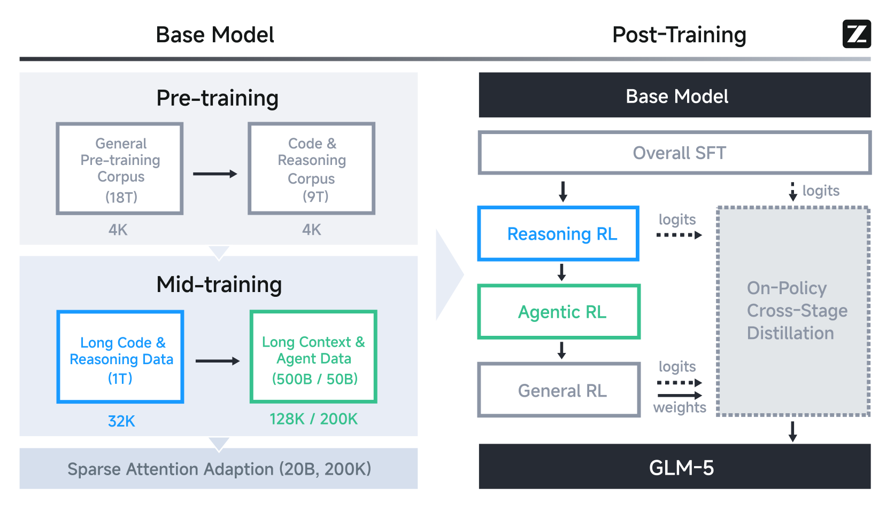
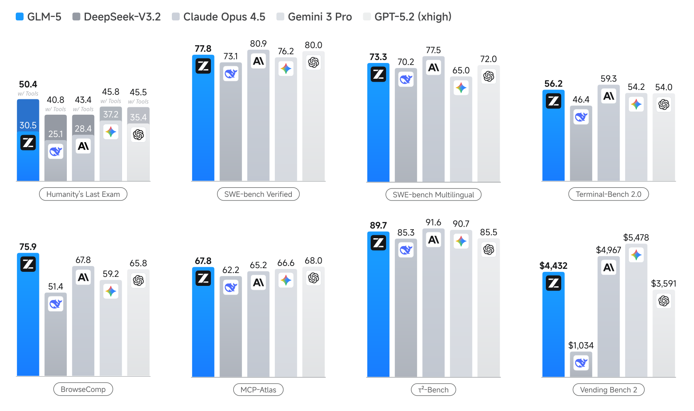

# GLM-5：从 Vibe Coding 到 Agentic Engineering

## 来源信息

| 项 | 内容 |
| --- | --- |
| 标题 | GLM-5: from Vibe Coding to Agentic Engineering |
| 作者／团队 | GLM-5 Team；p31 另列 Tech Leads 与 Advisors |
| 机构 | Zhipu AI & Tsinghua University（p1 按此顺序；README 清单行写 Tsinghua University，未改列） |
| 来源 | [arXiv:2602.15763v2](https://arxiv.org/abs/2602.15763v2)（cs.LG; cs.CL）；v1 2026-02-17、v2 2026-02-24；40 页，CC BY 4.0 |
| 项目／代码 | <https://github.com/zai-org/GLM-5>（Apache-2.0，含权重链接；未验证与实验的可复现性对应） |
| 阅读日期 | 2026-11-03 |

---

## 核心结论

一句话：**GLM-5 是 GLM-4.5 的「成本压缩 + 长时程工程化」版本——用 MLA ＋ DeepSeek 稀疏注意力（DSA）压低 744B（40B 激活）模型的长上下文训练与推理成本，用全异步 RL 基础设施和环境规模化把 agent 训练推到长时程，再用跨阶段 on-policy 蒸馏把多段 RL 的能力回退补回来。**

- **问题**：长上下文下 dense attention 是 $O(L^{2})$，128K 时代价不可接受；静态基准又测不出「跑几小时、跨多个 PR」的能力，而长时程 rollout 让同步 RL 大量空转。
- **核心想法**：在已经验证过的 MLA 上补两项（Muon Split 让 MLA 追平 GQA-8、MLA-256 降解码计算），用 20B token 的继续预训练把 DSA 装进去；后训练侧把「等最慢 rollout」的同步循环换成全异步，再用三个补丁压住 off-policy。
- **怎么做到**：TITO 保证 token 级动作对齐，rollout 时记录的 log-prob 直接当行为策略（免维护 checkpoint 历史），按模型版本丢弃过旧样本；环境侧做到 10k+ SWE、数千终端、200 万+ 搜索页。
- **关键结果**：相对 GLM-4.7，SWE-bench Verified 77.8（+4.0）、SWE-bench Multilingual 73.3（+6.6）、MCP-Atlas 67.8（+15.8）、CyberGym 43.2（+19.7）、BrowseComp 62.0（再叠 discard-all 为 75.9）。相对闭源前沿是「编码／agentic 接近，推理与知识仍有差距」。
- **定位**：适合做长时程 coding／terminal／search agent、关心「异步 RL 怎么不被 off-policy 拖垮」与「环境怎么规模化」的团队；不适合把它当训练成本核算或严格无损长上下文的证据。

---

## 问题

**范式定义**（§4 开头，p15）：vibe coding 是「人写 prompt、模型写代码」；agentic engineering 是「agent 自己 plan、implement、iterate」。这个定义直接决定评测重点要从单 commit 的静态基准（SWE-bench）转向**多步、状态递进**的真实工程。

论文把瓶颈归为两类（§1，p2），后训练里还有一条隐性的第三类：

1. **计算成本**：长上下文下 dense attention 是 $O(L^{2})$，128K 上下文时代价不可接受。GLM-4.5 只做了 MoE，没有解决注意力本身。（成本瓶颈是 §1（p2）的原话；$O(L^{2})$ 与 128K 的具体表述在 §2.1.1，p5。）
2. **真实适应性**：静态 benchmark 测不出「跑几小时、跨多个 PR、上下文不断变化」的能力。长时程 rollout 又让同步 RL 出现大量 GPU 空转（§3.3 p12、§4.1.1 p15）——训练侧要等最慢的一条轨迹。
3. **多阶段 RL 的能力回退**（§3.5）：顺序优化不同目标会累积回退，这一条更像工程经验，不在标题的卖点里。

对应的设计在引言里就已点名（p3–4）：DSA（成本）、异步 RL 基础设施（利用率）、异步 agent RL 算法（长时程学习质量），外加国产芯片全栈适配（§5）。

这三项不是可选项，而是互相卡住的：不做 DSA，128K 上的训练与 rollout 成本撑不住；不做异步，长时程轨迹会让同步循环大部分时间在等最慢样本；不做蒸馏，几段 RL 依次优化后前面的能力会被挤掉。论文的组织也大致对应这条线：注意力在 §2，RL 与蒸馏在 §3，异步 agentic 循环与环境在 §4。

**前提与背景**：DSA 直接沿用 DeepSeek-V3.2 的稀疏注意力（论文引 [9]），MLA 沿用 DeepSeek 系列 [24]。GLM-5 的增量是「在 MLA 上把 DSA 训起来 + 用 Muon Split 让 MLA 追平 GQA + 用共享参数 MTP 提高投机接受率」。读者若不了解 MLA 的 latent KV cache 与 DSA 的 lightning indexer，需要先补这两块——本文只在 §2.1 给了结论式描述。

**问题侧还差一块**：全文没有 FLOPs、GPU 数或机时，所以「省了多少」只能从 token 预算与架构取舍间接读，无法核算绝对成本。

---

## 核心想法

### 一句话

长上下文与长时程是两笔不同的账：前者用「稀疏化注意力 + 少得多的适配 token」压，后者用「异步 + 环境规模」压；两笔账都会带来副作用，于是各配一个补丁。

### 长上下文这笔账

MLA 把 KV cache 压成 576 维 latent，显存比 GQA 省、长序列处理更快；代价是解码时每个 query 要对 576 维做点积（GQA 只需 128 维），单 token 解码更重。DSA 在这之上再做一层稀疏：用轻量 indexer 对每个 query 选 top-k 个 KV（论文另一处提到 indexer 的 $k=2048$），只对被选中的 KV 做注意力；与固定窗口不同，选择是内容相关的。

关键判断是**不要从零训**：GLM-5 从 mid-training 结束的 base 模型继续预训练，先 1000 步只训 indexer，再 20B token 联合适配。对照 DeepSeek-V3.2 的 943.7B token 适配预算，作者强调 20B 就够——这是「把新注意力当成一次小型继续预训练」而不是「重训模型」。

### 为什么 MLA 必须先修 Muon

换 MLA 的障碍不在显存，而在优化器：MLA 在 Muon 下**追不平 GQA-8**（Table 1：MLA 的 BBH 48.9、HumanEval 33.5，GQA-8 为 53.3／38.5）。作者的诊断是 Muon 对多头共享的 up-projection 矩阵 $W^{UQ}$、$W^{UK}$、$W^{UV}$ 整体做矩阵正交化，抑制了不同 head 以不同尺度更新。

修法 **Muon Split** 很直接：按 head 拆成小矩阵各自正交化。效果是 MLA 追平 GQA-8（BBH 51.8、HumanEval 36.7），attention logits 在预训练中保持稳定、不需要 clipping。随后 **MLA-256** 把 head dim 从 192 提到 256、head 数减少 1/3（96→64），保持训练计算量与参数量不变、降低解码计算；Table 1 显示它与 MLA + Muon Split 基本持平（MMLU 62.0 vs 62.5、BBH 51.3 vs 51.8）。

### 投机解码：层数共享而不是层数堆叠

训练 n 个 MTP 层才能预测 n 个 token，参数和 KV cache 随投机步数线性涨；DeepSeek-V3 只训 1 层却推 2 token，训练-推理不一致导致第二个 token 接受率低。GLM-5 改成**3 个 MTP 层共享参数**——显存与 DeepSeek-V3 的 draft 模型一致，接受率更高：同样 4 步投机，接受长度 2.76 vs DeepSeek-V3.2 的 2.55（Table 2，私有 prompt 集）。

### 长时程这笔账

异步循环的形态是：推理引擎持续生成轨迹，攒够阈值就把 batch 送给训练引擎；训练引擎每 K 次梯度更新把权重推回推理引擎，并**重置优化器**。好处是不再等最慢样本；代价是同一 batch 里的轨迹可能来自不同模型版本，形成严重 off-policy。

三个补丁各治一种错配：

1. **TITO**：训练侧直接消费推理引擎产出的 token ID 与元数据，而不是把文本重新 tokenize。重 tokenize 会在空格／归一化／截断／特殊 token 边界上错位，动作与奖励的逐步对齐先坏掉，后面重要性采样再准也没用。
2. **直接双边重要性采样**：异步下精确跟踪行为策略不可行（要存一串 checkpoint），于是直接用 rollout 时记录的 log-prob 当行为策略，并把门控区间外的 token **整段 mask 掉**（不是 PPO 式裁剪）。论文称这比 IcePop 更简单、更稳。
3. **按版本丢弃**：记录每条轨迹跨过的模型版本序列，版本差超过阈值就丢；沙箱崩溃等环境失败样本剔除。

另有一条与算法配套的系统侧做法：多轮 agent 的后续请求共享前缀，用一致性哈希把同一 rollout 的所有请求固定到同一 DP rank 保 KV cache 命中；rollout 用 FP8 + MTP 压长尾，prefill/decode 分离避免长前缀 prefill 打断 decode。

### 多段 RL 的回退怎么补

SFT → Reasoning RL → Agentic RL → General RL 顺序做，每段都在改同一个策略，后面的目标会把前面的能力挤掉。收口办法是**跨阶段蒸馏**：把各阶段终态 checkpoint 当教师，prompt 按比例从各教师训练集采样，优势项换成「教师与学生的 log 比值的 stop-gradient」。因为优势直接来自教师差，不需要组内基线，group size 可以降到 1、batch 放到 1024。

### 一个走通的账

token 预算：18T 通用 + 9T 代码／推理（4K）+ 1T（32K）+ 0.5T（128K）+ 0.05T（200K）= **28.55T**，与正文的 28.5T 一致；DSA 适配的 20B 若计入则为 28.57T（原文未说明是否含在 28.5T 内）。这笔账解释了「模型怎么变大而成本没爆」：参数从 355B 涨到 744B，激活只从 32B 涨到 40B，专家 160→256，层数还减少了。

### 代价

- **工程复杂度与信息丢弃**：Muon Split 让参数张量数、正交化次数与 kernel 调用变多；异步 RL 要 TITO gateway、orchestrator、版本追踪三套东西一起上；门控区间外的 token 直接退出梯度，是有意为之的取舍。
- **前置条件**：DSA 上做 RL 必须用确定性 top-k；indexer 在 RL 阶段默认冻结，长期是否够用没有数据。

---

## 方法

### 符号表

| 符号 | 含义 | 取值／维度 |
| --- | --- | --- |
| $L$ | 上下文长度 | 用于 $O(L^{2})$ 的复杂度陈述 |
| $\theta$ | 当前训练策略参数 | — |
| $x$ | 一个 prompt | — |
| $\mathcal{D}$ | prompt 分布 | — |
| $y_i$ | 第 $i$ 条采样回复 | $i=1,\dots,G$ |
| $G$ | 每个 prompt 的采样条数（group size） | Reasoning RL 为 32；蒸馏阶段为 1 |
| $\lvert y_i\rvert$ | 回复 token 数 | — |
| $t$ | 回复内的 token 位置 | $1,\dots,\lvert y_i\rvert$ |
| $\pi^{\text{train}}_{\theta_{\text{old}}}$ | 训练引擎上的旧策略 | — |
| $\pi^{\text{infer}}_{\theta_{\text{old}}}$ | 推理引擎上的旧策略 | 采样分布 |
| $\rho_{i,t}$ | 同一 token 上训练策略与推理策略的概率比 | 式 (1) 的门控输入 |
| $\beta$ | pop 门控的对称上界 | 2（区间 $[0.5,2]$） |
| $\operatorname{pop}(\cdot)$ | 逐 token 门控函数 | 见式 (1) 下方 |
| $r_{i,t}$ | 重要性比 | 式 (1) 处原文未单独定义；按上下文与式 (3) 理解为 $\pi_\theta/\pi_{\text{rollout}}$ |
| $r_t(\theta)$ | 式 (3) 写法的重要性比 | $\pi_\theta(a_t\mid s_t)/\pi_{\text{rollout}}(a_t\mid s_t)$ |
| $\hat{A}_{i,t}$ | 该 token 的优势 | 式 (1) 为组归一化优势；式 (2) 被替换为教师 log 比；式 (3) 写作 $\hat A_t$ |
| $\epsilon_{\text{low}},\epsilon_{\text{high}}$ | 非对称裁剪下／上界 | 0.2 / 0.28 |
| $\operatorname{sg}[\cdot]$ | stop-gradient | — |
| $\pi^{\text{infer}}_{\theta_{\text{teacher}}}$ | 教师策略（各阶段终态 checkpoint） | — |
| $f(x;\epsilon_\ell,\epsilon_h)$ | 异步 RL 的门控函数 | 见式 (3) 下方 |
| $\epsilon_\ell,\epsilon_h$ | 异步门控的下／上界 | 原文未给数值 |
| $a_t,s_t$ | 第 $t$ 步的动作（token）与状态（前缀） | — |
| $\pi_{\text{rollout}}$ | rollout 时记录的行为策略 | 由 rollout 侧 log-prob 给出 |
| $w_0,\dots,w_k$；$w'$ | 一条轨迹跨过的模型版本序列；当前版本 | — |
| $\tau$ | 允许的版本差阈值 | 原文未给数值 |
| $k$ | keep-recent-k 的窗口；DSA 的 top-k 选择数（原文两处都用 $k$，含义不同） | 5；2048 |
| $T$ | discard-all 的上下文阈值 | 32k |
| $K$ | 训练引擎每 K 次梯度更新把权重推回推理引擎 | 原文未给数值 |
| $W^{UQ},W^{UK},W^{UV}$ | MLA 中多头共享的 Query／Key／Value 上投影矩阵 | 原文未给维度；Muon Split 按 head 拆开做正交化 |

### 数据流



*Figure 5（v2 p4，300 dpi 裁剪）。左：18T 通用 + 9T 代码／推理（4K）→ 1T（32K）→ 500B（128K）→ 50B（200K），末尾 20B token 的 DSA 适配（200K）。右：SFT → Reasoning RL → Agentic RL → General RL，旁路为跨阶段蒸馏。*

预训练与 mid-training 的 token 预算在图上直接可加：18 + 9 + 1 + 0.5 + 0.05 = 28.55T。后训练四段共享同一个底座，蒸馏从各段终态取教师。

### 架构：MLA + Muon Split + MLA-256 + 共享参数 MTP

规模（§2.1 p4；Table 10 p36）：744B 总参数／40B 激活，256 专家（8 routed + 1 shared），75 个 MoE 层 + 3 个 dense 层，hidden 6144，词表 154,880，64 个 attention head（GLM-4.5 为 96），QK head dim 192、V head dim 256，Q LoRA 2048、KV LoRA 512，indexer 32 head × 128 维。正文称「层数降到 80」，而 Table 10 的 3 + 75 相加为 78（含 MTP 为 79）；差 2 层，原文未解释。层数减少被明确解释为「降低专家并行的通信开销」。

**Muon Split**：把原本对多头共享的 $W^{UQ}$、$W^{UK}$、$W^{UV}$ 的整体正交化改成按 head 各自正交化，使不同 head 的投影权重以不同尺度更新；效果见 Table 1（MLA 48.9／33.5 → 51.8／36.7，GQA-8 为 53.3／38.5）。

**MLA-256**：MLA 解码要做 576 维点积，GQA 只要 128 维；DeepSeek-V3 的头数是按 H800 roofline 选的。GLM-5 提高 head dim、减少 head 数，保持训练计算量与参数量不变、降低解码计算。**口径提示**：正文只说 "head dimension" 192→256，而 Table 10 列的是 QK 192、V 256——按表读，256 落在 V head dim 上，两处措辞没有完全对齐。

**共享参数 MTP**：3 个 MTP 层共享参数，显存与 DeepSeek-V3 的 draft 模型一致；4 步投机的接受长度 2.76 vs 2.55。Table 10 的 `# MTP Layers` 仍写 1，是「按参数当量计 1 层」还是另一口径，原文未说明。

### DSA：用 20B token 换稀疏注意力

DSA 保留全注意力框架，用轻量 indexer 为每个 query 选 top-k 个 KV，只对被选中的 KV 做注意力。适配分两步：先 1000 步只训 indexer（每步 14 条 × 202,752 token，lr 5e-3→2e-4），再 20B token 联合适配（恒 lr 1e-5）。

长上下文结果（Table 3 p5）有一处非单调：MQ-NIAH-128k 100.0／100.0、MV-NIAH-128k 95.5→97.0、SQuAD-128k 79.7→86.0，但 **HotpotQA-128k 66.3→63.0（−3.3）**。正文写「与 MLA 接近」，§2.1.2 又写 "DSA is lossless by construction"，与这一格对不上（见 `audit.md`）。

小规模验证（Table 6 p8，GLM-4.7-Flash）：只训 indexer 的 warmup 会把 128K 从 79.21 拉到 71.35；150B token 联合训练后 16K（+0.86）、32K（+0.49）、64K（+1.72）反超 baseline，128K 只差 0.35。这是全篇对「DSA 可训」最干净的一组证据。

### 后训练：SFT → 三段 RL → 跨阶段蒸馏

**SFT**（§3.1 pp.10–11）：通用对话、推理、代码与 agent 三类数据；上下文 202,752 token；新增三种 thinking 行为——Interleaved（每次回复与每次工具调用前都思考）、Preserved（coding agent 跨轮保留全部 thinking block）、Turn-level（可按轮开关）。Agent 轨迹里错误片段保留但在 loss 中 mask，让模型学纠错而不强化错误动作。

**Reasoning RL**（§3.2 pp.11–12）：GRPO + IcePop，显式区分训练策略与推理策略，并去掉 KL 正则。四个域混合（数学、科学、代码、TIR），二元结果奖励；β=2、ε_low=0.2、ε_high=0.28，全 on-policy，group size 32、batch 32。

**原文 Eq (1)（p11）**

```math
\mathcal{L}(\theta)=-\,\mathbb{E}_{x\sim\mathcal{D},\;\{y_i\}_{i=1}^{G}\sim\pi^{\text{infer}}_{\theta_{\text{old}}}(\cdot\mid x)}
\left[\frac{1}{G}\sum_{i=1}^{G}\frac{1}{|y_i|}\sum_{t=1}^{|y_i|}
\operatorname{pop}(\rho_{i,t},1/\beta,\beta)\;
\min\!\Big(r_{i,t}\hat{A}_{i,t},\ \operatorname{clip}(r_{i,t},1-\epsilon_{\text{low}},1+\epsilon_{\text{high}})\,\hat{A}_{i,t}\Big)\right]
```

逐项读法：

- 外层期望对 prompt $x$ 与从**推理引擎**旧策略采样的 $G$ 条回复取；$\frac{1}{G}$ 是 GRPO 的组平均，$1/\lvert y_i\rvert$ 把每条回复按 token 数归一化。
- $\operatorname{pop}(\rho_{i,t},1/\beta,\beta)$ 是逐 token 的门控：$\rho$ 比较训练引擎与推理引擎在同一 token 上的概率，落在 $[1/\beta,\beta]=[0.5,2]$ 内保留原值，否则**该 token 的贡献置零**（不是丢弃整条回复）。它治的是训推数值不一致，不是更新幅度。
- $\min(r_{i,t}\hat{A}_{i,t},\operatorname{clip}(r_{i,t},1-\epsilon_{\text{low}},1+\epsilon_{\text{high}})\hat{A}_{i,t})$ 是 PPO 式替代目标；$\epsilon_{\text{low}}=0.2$、$\epsilon_{\text{high}}=0.28$ 给出非对称的更新幅度界。上下界为何不对称，原文没有解释。

**DSA 与 RL 的相互作用**（p12）是本文少见的具体工程发现：indexer 选 top-k，训练与推理引擎的 top-k 实现不一致会造成训练-推理错配。MoE 可以用 routing replay 存 top-k 专家，但 $k=2048$ 太大，存所有 token 的索引不现实。结论是**用确定性 top-k**——SGLang 的 CUDA 实现非确定，换成朴素 `torch.topk` 稍慢但确定，RL 收益显著；非确定实现会在几步内让熵骤降、性能崩掉。RL 阶段默认冻结 indexer 参数。

**原文 Eq (2)（p14）**

```math
\hat{A}_{i,t}=\operatorname{sg}\!\left[\log\frac{\pi^{\text{infer}}_{\theta_{\text{teacher}}}(y_{i,t}\mid x,y_{i,<t})}{\pi^{\text{train}}_{\theta}(y_{i,t}\mid x,y_{i,<t})}\right]
```

逐项读法：

- 括号内是教师与当前策略在同一 token 上的 log 概率比；教师更偏好的 token 得到正优势，$\operatorname{sg}$ 让这个优势只当常数用，梯度全部落在学生上。
- 教师取推理引擎的分布 $\pi^{\text{infer}}$、学生取训练引擎的 $\pi^{\text{train}}$，两者本就有数值差；作者把「未来统一到 MQA 模式的训练引擎」列为待办。
- 因为优势不依赖组内基线，这一阶段 group size 能降到 1、batch 放到 1024；代价是学生只被推向教师已偏好的方向，没有「组内比较」带来的相对信号。

**原文 Eq (3)–(5)（p17）**

```math
\mathcal{L}(\theta)=\mathbb{E}_{t}\Big[f\big(r_t(\theta),\epsilon_\ell,\epsilon_h\big)\,\hat{A}_t\log\pi_\theta(a_t\mid s_t)\Big],
\qquad
r_t(\theta)=\frac{\pi_\theta(a_t\mid s_t)}{\pi_{\text{rollout}}(a_t\mid s_t)}
```

```math
f(x;\epsilon_\ell,\epsilon_h)=
\begin{cases}x, & 1-\epsilon_\ell<x<1+\epsilon_h,\\ 0, & \text{otherwise.}\end{cases}
```

逐项读法：

- $a_t$ 是第 $t$ 步的动作（一个 token），$s_t$ 是此前缀；$\log\pi_\theta(a_t\mid s_t)$ 是策略梯度项，$\hat A_t$ 是该 token 的优势，由 rollout 侧算好。
- $r_t$ 的分母直接是 rollout 时记录的策略，省掉历史 $\pi_{\text{old}}$；这是相对式 (1) 的第一处差别。
- $f$ 在区间 $(1-\epsilon_\ell,1+\epsilon_h)$ 内返回 $x$、否则返回 0：区间外不是裁剪到边界，而是**完全退出梯度**。这是第二处差别，也是明确的取舍——接受有界 off-policy 偏差，换取不用维护 checkpoint 历史，代价是区间外样本的信息被丢掉。$\epsilon_\ell,\epsilon_h$ 的具体数值原文未给。

### 异步 agent RL 的执行流

推理引擎持续 rollout（多轮工具调用），攒够阈值就把 batch 送训练引擎；训练引擎每 K 次梯度更新把权重推回推理引擎并重置优化器；Multi-Task Rollout Orchestrator 统一调度，支持 >1k 并发 rollout；过旧版本与沙箱失败的样本在入 batch 前被丢掉（组内过半数有效则补齐）。

与算法配套的系统侧还有 **DP-aware routing**（多轮请求共享前缀，一致性哈希固定同一 DP rank 保 KV 命中，再加轻量再平衡）与 **slime 的尾延迟工程**（RL 的优化目标是端到端延迟，最慢一条决定步进速度）：多机推理 + DP-attention 做无排队服务，rollout 用 FP8 并启用 MTP 压小 batch 长尾，prefill/decode 分离，heartbeat 驱动容错把不健康 server 摘除。

**General RL**（§3.4 p13）把目标拆成基础正确性、情绪智力、任务特定质量三维，奖励混合规则、ORM、GRM，并引入人工撰写回复作为风格锚点。

### 环境与推理期上下文

- **SWE**：从真实 issue–PR 对出发，按 bug fix／feature／refactor 分类，用 RepoLaunch 搭可执行环境并生成 F2P／P2P 测试；**10k+ 可验证环境、数千仓库、9 种语言**。
- **终端**：两条合成流水线（LLM 起草 + construction agent 落成 Harbor 格式；从代码网页语料构造并自校验），Docker 构建成功率 >90%，产出「数千个」环境。
- **搜索**：从早期轨迹收 URL 建 200 万+ 页 Web 知识图谱，采样低频实体扩展多跳子图，三阶段过滤（无工具 8 次内答对即删、基础搜索几步可解即删、验证 agent 双向校验）。
- **推理期上下文管理**（§4.2.4 p19）：只折叠最近 $k$ 轮之前的工具观测（$k=5$），BrowseComp 55.3→62.0；再叠加 discard-all（总上下文超过 $T=32\text{k}$ 就清空重开）到 75.9。
- **slide 生成**（§4.2.5）：三级奖励（静态属性／渲染几何／视觉感知），记录并堵住两类 reward hacking（硬截断超长内容、过度调间距）；16:9 合规率 40%→92%。

### 与已有方法的结构差异

| 维度 | 常见做法 | GLM-5 的做法 |
| --- | --- | --- |
| 长上下文注意力 | dense，或 SWA／GDN 一类结构近似 | 在 MLA 上训 DSA，内容相关 top-k，20B 适配 |
| MLA 与优化器 | 直接换 MLA，Muon 下追不平 GQA | Muon Split 按 head 正交化 |
| 投机解码 | 单独 draft 模型，或 1 层 MTP 推 2 token | 3 层共享参数 MTP |
| 长时程 RL | 同步 rollout，等最慢轨迹 | 全异步 + TITO + rollout log-prob 当行为策略 |

---

## 主要结果



*Figure 1（v2 p1，300 dpi 裁剪）。Vending-Bench 2 面板以账户余额（美元）计，与其它面板不可比；BrowseComp 与 Terminal-Bench 两个面板混用了不同口径，不要直接做跨模型比较（见 `audit.md`）。*

| 基准 | GLM-5 | GLM-4.7 | Kimi K2.5 | Claude Opus 4.5 | Gemini 3 Pro | GPT-5.2 (xhigh) |
| --- | --- | --- | --- | --- | --- | --- |
| HLE（纯文本） | 30.5 | 24.8 | 31.5 | 28.4 | 37.2 | 35.4 |
| HLE（w/ Tools） | 50.4 | 42.8 | 51.8 | 43.4* | 45.8* | 45.5* |
| GPQA-Diamond | 86.0 | 85.7 | 87.6 | 87.0 | 91.9 | 92.4 |
| SWE-bench Verified | 77.8 | 73.8 | 76.8 | 80.9 | 76.2 | 80.0 |
| SWE-bench Multilingual | 73.3 | 66.7 | 73.0 | 77.5 | 65.0 | 72.0 |
| Terminal-Bench 2.0（Terminus-2） | 56.2 / 60.7† | 41.0 | 50.8 | 59.3 | 54.2 | 54.0 |
| CyberGym | 43.2 | 23.5 | 41.3 | 50.6 | 39.9 | - |
| BrowseComp | 62.0 | 52.0 | 60.6 | 37.0 | 37.8 | - |
| BrowseComp（w/ Context Manage） | 75.9 | 67.5 | 74.9 | 57.8 | 59.2 | 65.8 |
| τ²-Bench | 89.7 | 87.4 | 80.2 | 91.6 | 90.7 | 85.5 |
| MCP-Atlas（Public Set） | 67.8 | 52.0 | 63.8 | 65.2 | 66.6 | 68.0 |
| Vending-Bench 2（美元） | 4,432 | 2,377 | 1,198 | 4,967 | 5,478 | 3,591 |

*Table 7（p23）节选：省略了 DeepSeek-V3.2 一整列，以及 LongBench v2、GDPval-AA Elo 两行；`*` 为 HLE 全量集，`†` 为 verified Terminal-Bench 2.0。*

1. **相对 GLM-4.7，提升集中在编码与 agentic**：MCP-Atlas +15.8、CyberGym +19.7、Terminal-Bench（Claude Code 框架）+23.4、SWE-bench Multilingual +6.6；推理项只有小幅或零提升（GPQA +0.3，AIME 2026 I 92.7 反而 −0.2）。
2. **相对闭源前沿是「接近而非超越」**：SWE-bench Verified 落后 Claude 3.1 分、GPT-5.2 2.2 分，Terminal-Bench 落后 Claude 3.1 分，τ²-Bench 落后 1.9，CyberGym 落后 7.4；MCP-Atlas 与 GDPval 略高于 Claude，Vending-Bench 2 在开源里第一但低于 Gemini 与 Claude。
3. **长上下文与知识仍是短板**：HLE 纯文本 30.5 落后 Gemini 37.2，GPQA 86.0 落后 Gemini 91.9，BrowseComp 的 62.0 大幅领先闭源但各家上下文管理设置不同、不能当同条件比较。
4. **真实工程套件（CC-Bench-V2，Table 8 p25）暴露「细节行、收尾不行」**：前端 check-item 完成率 React／Vue 略高于 Claude（71.0 vs 70.7、77.1 vs 74.3），HTML 仍低 5.9 分（76.3 vs 82.2）；但整任务成功率全面落后（ISR 38.9／34.6／32.7 vs 52.2／39.7／46.9），后端 Pass@1 25.8 vs 26.9，链式长任务 52.3 vs 61.6。作者把差距归因于链式任务的误差累积。
5. **时间鲁棒性只是「不比前代差」**：SWE-rebench（Table 9 p27）GLM-5 42.1%、8 个模型里排第 6，只比 GLM-4.7 高 0.8 分，Pass@5 50.0 反而低于 GLM-4.7 的 56.3。

---

## 边界与局限

**作者明确讨论的**：链式长任务与 Claude 仍有显著差距，归因于误差跨任务累积（p27）；前端 ISR 差距即「细项都过、整任务不过」（p26）；蒸馏阶段目前用推理引擎取教师 logits，未来要迁到训练引擎统一 MQA 模式（p14）；国产芯片只给了 Ascend 一个案例（p21，单机「与双卡国际集群相当」、长序列成本 −50% 均无数据支撑）。

**读者角度的判断（无实验证据）**：

- **训练成本完全缺失**：没有 FLOPs、GPU 数、机时、数据配比，只能按「28.5T token × 40B 激活」粗估量级（用 744B 总参数会高估约一个数量级）。
- **评测封闭且协议不统一**：CC-Bench-V2 等内部基准外部无法复核；MCP-Atlas 超时从 4 分钟放宽到 10 分钟、τ²-Bench 改了 user-simulator prompt、Terminal-Bench 取 5 次平均、CyberGym 是 single-run，换 judge／换超时没有对照（`sensitivity` 全文 0 次）。
- **DSA 的长期代价未知**：indexer 在 RL 阶段冻结，top-k=2048 是否随上下文增长失效、超过 128K 的行为都没有数据；且自家 HotpotQA-128k 已低 3.3 分，「lossless」不宜读成性能无损。
- **异步 off-policy 的偏差没有量化**：只有「稳定」的定性结论，没有与同步 RL 在同 token 预算下的对照。

---

## 与其他工作的关系

- **GLM-4.5（00113，本仓库只有清单行、未读）**：直接前代；架构对照（355B／32B、160 专家、89 MoE 层、GQA-8、128K 上下文）全部取自本文 Table 10 与 §2.3，若之后读 4.5 原文，应以 4.5 自述为准。
- **DeepSeek-V3.2（00133，未读）**：DSA 引自它（[9]），本文用它的 943.7B 适配预算与 2.55 接受长度做对照；DSA 机制本身本文只给结论式介绍，细节应回到 V3.2 原文。
- **Kimi K2.5（00156，已读）**：Table 7 列为开源对照，BrowseComp 60.6／74.9 与 K2.5 笔记的单 agent 数字一致；K2.5 更醒目的 78.4 是 Agent Swarm 口径，不在本表内，不能与 GLM-5 的 75.9 直接比。
- **DeepSeek-V3（00042，已读）**：本文的 MLA 与 MTP 都从这条线来；V3 的 MTP 是单层推 2 token，GLM-5 改成 3 层共享参数，是同一机制的不同取舍。

<!-- 复核档案见同目录 audit.md（不随站点发布） -->
