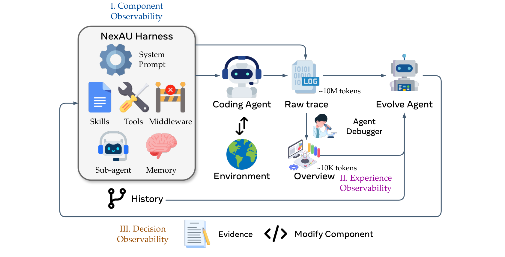
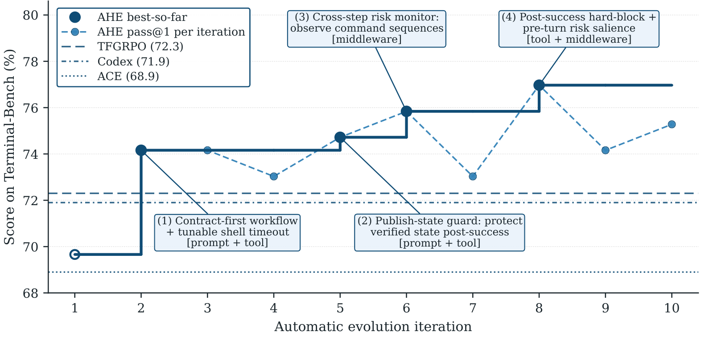

# Agentic Harness Engineering: Observability-Driven Automatic Evolution of Coding-Agent Harnesses

## 来源信息

| 项 | 内容 |
| --- | --- |
| 标题 | Agentic Harness Engineering: Observability-Driven Automatic Evolution of Coding-Agent Harnesses |
| 作者 | Jiahang Lin\*‡、Shichun Liu\*‡、Chengjun Pan\*‡、Lizhi Lin、Shihan Dou、Zhiheng Xi、Xuanjing Huang、Hang Yan、Zhenhua Han†、Tao Gui†、Yu-Gang Jiang（\* 共同一作；† 通讯作者；‡ 在 Shanghai Qiji Zhifeng Co., Ltd 实习期间完成） |
| 机构 | Fudan University（第一机构）、Peking University、Shanghai Qiji Zhifeng Co., Ltd |
| 来源 | [arXiv:2604.25850v4](https://arxiv.org/abs/2604.25850v4)（cs.CL; cs.SE）；v1 2026-04-28 → v4 2026-05-18 |
| 原文 | PDF 35 页、sha256 `299f2633…3464df`；同版 HTML 用于交叉核对；版本记录、阅读范围与配图裁剪框见 `audit.md` |
| 许可 | arXiv.org perpetual non-exclusive license 1.0（不是 CC） |
| 代码 | <https://github.com/china-qijizhifeng/agentic-harness-engineering>（MIT；仓库自报的 TB2 数字晚于 v4，见 `audit.md`） |
| 阅读日期 | 2026-11-19 |

---

## 核心结论

一句话：**AHE 把「改 coding agent 的 harness」做成一个由另一个 agent 驱动、每轮都可归因的闭环——它不靠更强的优化器，而靠把三件事变成可观测的结构化产物：可编辑组件（文件级）、执行经验（分层证据语料）、每次编辑的决策（带预测的 change manifest）；在 Terminal-Bench 2 上十轮把 pass@1 从 69.7% 提到 77.0%。**

- **解决什么问题**：harness（prompt、tools、middleware、skills、sub-agents、memory）是 coding agent 的一等变量，却仍靠人反复看轨迹手工改；已有的自动方法只动一个面，且说不清一次编辑到底修好了什么、弄坏了什么。
- **核心想法**：瓶颈不是优化器能力而是可观测性。把 7 类组件做成固定挂载点的文件、把百万级轨迹压成分层证据文件、把每条编辑写成带 `predicted_fixes` / `risk_tasks` 的 manifest，下一轮用任务级 delta 对账并回滚未兑现的编辑。
- **怎么做到**：代码 agent 跑 $k\ge2$ 条轨迹 → Agent Debugger 产出 per-task 报告与 benchmark overview → Evolve Agent 改组件并写 manifest → 下一轮 Attribute 对账 + 文件级 Rollback；外层 10 轮，base model 与 verifier 全程只读。
- **关键结果**：TB2 上 77.0%，高于种子 69.7%、Codex 71.9%、TF-GRPO 72.3%、ACE 68.9%，唯一例外是 Hard（53.3% 低于 Codex 56.7%）；冻结 harness 在 SWE-bench-verified 上 75.6%（种子 75.2%）且少 12.4% token，在五个 alternate base 上 +2.3 到 +10.1 pp。
- **定位与短板**：增益集中在 tools、middleware、long-term memory，单独换 system prompt 反而 −2.3 pp，组件之间非可加；对「会修好什么」的预测约 5× 随机基线，对「会弄坏什么」只有约 2×——回归预见是这套 loop 最明确的短板。

---

## 问题

**harness 是 coding agent 的一等变量，但仍是手工活。** 这里的 harness 指模型之外、可编辑的那一层：system prompt、tools、middleware、skills、sub-agents、long-term memory（§1、§2.1）。固定模型时，改 harness 仍能显著改变长程 coding 任务的完成率。

**它还是模型特定的。** 为一个 base model 调好的 harness 换一个模型常会变差；模型换代后还要重新适配。人工适配的循环是「看大量轨迹 → 找失败模式 → 手改多个组件」，跟不上模型更新节奏。

**自动化为什么难**，作者归为三个障碍（§1）：

1. **异构编辑空间**：可改的东西横跨 prompt、工具描述、工具实现、middleware、skill、sub-agent 配置、memory；它们互相耦合，改一处容易破坏另一处。
2. **轨迹太长**：一次 rollout 产生海量原始消息，真正可行动的失败信号被埋在百万级 token 里。
3. **效果难归因**：一个编辑修好了什么、弄坏了什么，往往说不清；说不清就无法决定保留还是回滚。

**已有方法多数只动一个面**：只改 prompt、只改 skills、把经验写成 in-context playbook，或只改程序结构的某一层。这类方法能积累经验，但没有回答「这次编辑值不值得留」——经验是文本，不是可对账的假设。

**本文的设定与前提**：

- 被优化的对象是 harness，base model 全程冻结；主线三个角色（Code Agent / Agent Debugger / Evolve Agent）共用同一个 GPT-5.4，避免把增益归给「更强的优化器」。
- harness 实例化在 NexAU 框架上；种子 `NexAU0` 刻意最小：只有一个 shell 执行工具，没有 middleware、skills、sub-agents。种子越贴近 benchmark，越看不出后续增益来自 loop 还是来自种子。
- 演化只在 Terminal-Bench 2（89 题，按官方难度 4 easy / 55 medium / 30 hard，每题 1 小时超时）上驱动；迁移在 SWE-bench-verified 与五个 alternate base 上测。
- 外层 10 轮、每题 $k$ 条轨迹（Table 4 的设置是 $k=2$）；一次 campaign 约 32 小时（§4.2）。

**这篇要证明什么**：一个通用 agent 在「只写 workspace、只读 verifier 与预算」的约束下，靠更好的观测而不是更强的模型就能稳定改进 harness；而且改出来的 harness 能跨 benchmark、跨模型迁移。

---

## 核心想法

### 一句话

瓶颈不是优化器能力，而是可观测性：把「组件、经验、决策」三样东西变成结构化、可分层的产物，一个普通 agent 就能稳定地改 harness。

### 三个「看不见」变成三个「文件」

1. **编辑空间看不见 → 组件即文件**。7 类组件挂在固定路径下，组件之间松耦合（加 middleware 不必改 prompt，加 skill 不必动 tool），所以每种失败模式可以映射到单一组件类；一次逻辑编辑就是 workspace git 历史里的一个 commit，天然有文件级 diff 与回滚粒度。这是 **component observability**。
2. **轨迹看不见 → 证据即文件系统**。每个任务用当前 harness 跑 $k$ 条 trace；每条消息是一个文件，同一 query 的轨迹放在同一环境里，Agent Debugger 用普通 shell/脚本工具按需下钻，产出 per-task 报告（含该任务的 pass/fail），再聚合成 benchmark 级 overview。原始轨迹（raw 与轻量清洗两版）也保留，供回查报告中的断言。文件形式支持 progressive disclosure，不必一次把全部 token 塞进上下文。
3. **决策看不见 → 编辑即契约**。每个编辑写一条 change manifest：失败证据、推断的根因、目标修复、`predicted_fixes`（预期下一轮修好的任务）、`risk_tasks`（可能被弄坏的任务）、`constraint_level`（middleware / tool_impl / tool_desc / skill / prompt）与选择该层的理由。下一轮把预测集合与该轮任务级 delta 求交，得到 per-edit verdict。



*图 2（原文 Figure 2，p.4）：三个可观测层——组件暴露成文件、轨迹压成分层证据、决策写成 manifest。图内 10M → 10K token 是示意数字。裁剪自 v4 PDF，许可见来源信息。*

### 为什么这套东西能成立

- **归因靠「事前预测 + 事后对账」，不靠事后讲故事**：manifest 在编辑生效前就写下了「会修好谁、会弄坏谁」，下一轮拿真实的任务级翻转去核对；没兑现的编辑按文件回滚。预测因此是可证伪的，而不是事后归因。
- **回滚需要编辑粒度**：一个逻辑编辑 = 一个 commit = 一组文件，回滚不必重跑历史，也不会把别的编辑一起丢掉。
- **观测需要压缩比**：单条轨迹进了模型上下文就挤掉推理空间；把「读轨迹」变成「读一个可导航的文件环境」，才允许每轮看几十个任务的证据。
- **增益不能来自偷换条件**：三个角色共用同一个模型，verifier、tracer、LLM 配置与 `runs/` 全部只读，种子 system prompt 不可删除——它不能靠关掉 verifier、换模型或抬高推理预算来刷分。

### 与已有做法的区别

| 做法 | 改什么 | 编辑粒度 | 事后归因 |
| --- | --- | --- | --- |
| 只改 prompt / skills | 文本层 | 一段文本 | 只能看总分 |
| ACE、TF-GRPO（自进化 baseline） | playbook / 轨迹层面的更新 | 无文件级编辑 | 只能看总分 |
| **AHE** | 7 类组件 | 文件级 commit | 按 `predicted_fixes` / `risk_tasks` 对账 |

换句话说，ACE 一类方法把经验写成「下次怎么想」，AHE 把经验连同「这次改动的假设」一起写成可对账的对象；前者积累的是文本，后者积累的是带预测的编辑历史。

### 一个走通的例子（附录 C，path-tracing）

iter 4 时 path-tracing 是 0/2：失败 rollout 已经渲染成功，却在收尾时用 `rm -rf` 清理，把交付物删掉，再按 shell 退出码提交，于是「命令成功、产物不在」。

- iter 5 的 publish-state guard 在 shell 层拦截删除动作；同一任务变成 2/2。
- 它不改 prompt，而是在 shell 层加一道硬约束——正是「失败模式映射到单一组件类」的例子。
- 附录 C 用 4 条轨迹与 8 个 manifest 条目说明机制；作者把它定位为机制示意，不是对单个编辑的因果估计。

### 代价

- **运行时**：一次 10 轮 campaign 约 32 小时（§4.2）；token 是唯一被量化的成本，没有美元成本或能耗。
- **回滚不一定及时**：编辑的副作用可能下一轮才显现，而 verdict 只看一轮的任务级 delta；回归预见弱时，坏编辑会先留在 harness 里。
- **组件非可加**：三个正的单项增益相加 +11.1 pp，大于完整 AHE 的 +7.3 pp；把组件搬到别的 harness 不能按单项增益线性外推。
- **运行点耦合**：step budget 与 per-task timeout 按 GPT-5.4 high 调，换 reasoning tier 或换厂商模型时，增益会被预算不匹配吞掉一部分。

---

## 方法

### 符号表

| 符号 | 含义 | 维度 / 取值 |
| --- | --- | --- |
| $M$ | 被冻结的 base model | 原文未在符号表定义；按上下文理解为执行 rollout 的模型，主线三角色共用 GPT-5.4 |
| $D$ | 演化所用的任务集 | 原文未在符号表定义；按上下文理解为 Terminal-Bench 2 全部 89 题 |
| $k$ | 每个任务的 rollout 条数 | $k\ge2$；Table 4 的设置是 2 |
| $N$ | 外层轮数 | 原文未在符号表定义；Algorithm 1 的循环上界，本次 campaign 跑 10 轮 |
| $t$ | 轮次下标 | $1,\dots,N$ |
| $H_0$ | 种子 harness | 即 `NexAU0` |
| $H_t$ | 第 $t$ 轮结束时的 harness（$H_{t-1}$ 为上一轮） | 7 类组件文件 + 配置 |
| $H_{\mathrm{best}}$ | 历史最优 harness | 按 pass@1 选出，是最终交付物 |
| $T_t$ | 第 $t$ 轮的原始轨迹集合 | 每任务 $k$ 条 |
| $T_t^{\mathrm{clean}}$ | 规范化后的轨迹 | 原文 `Clean(T_t)` 的输出 |
| $R_t$ | 第 $t$ 轮的 benchmark 级诊断报告 | Agent Debugger 产出 |
| $C_t$ | 第 $t$ 轮的 change manifest 集合 | 每条编辑一项 |
| $V_t$ | 上一轮编辑的对账结果 | 第 1 轮为空集 |
| $\mathrm{pass@1}$ | $k$ 条 rollout 的二元成功率均值 | 基础设施异常/超时的 trial 记 0 |
| $\mathrm{Succ/Mtok}$ | 每百万 token 的成功数 | §4.1 的派生指标 |

### 组件与种子

AHE 把 harness 实例化在 NexAU 上，把 **7 类组件**作为固定挂载点下的显式文件：

| 组件 | 作用 |
| --- | --- |
| system prompt | 工作方式与行为规则 |
| tool description | 工具的自然语言说明 |
| tool implementation | 工具的实际代码 |
| middleware | 执行前后的拦截/注入逻辑 |
| skill | 可复用的操作知识包 |
| sub-agent configuration | 子 agent 的配置 |
| long-term memory | 跨任务保留的经验条目 |

种子 `NexAU0` 只有 shell 执行工具，没有 middleware、skills、sub-agents。另有一个 one-shot Explore Agent 与第 1 轮并行，从 NexAU 源码与公开 coding-agent 参考里「播种」少量可复用 skill；这些 skill 没有特殊保护，从第 2 轮起可被保留、改写或删除。

### 一轮循环：原文 Algorithm 1（p.5）

数据流：`Rollout → Clean →（Attribute → Rollback）→ AgentDebugger → Evolve → Commit`；括号内两步从第 2 轮起才执行，因为第 1 轮没有上一轮 manifest 可对账。

```text
H_best = H_0
for t = 1..N:
    T_t       = Rollout(M, H_{t-1}, D, k)          # 每个任务 k 条轨迹
    T_t_clean = Clean(T_t)                         # 规范化轨迹
    V_t = ∅                                        # t=1 时无上一轮可对账
    if t >= 2:
        V_t     = Attribute(C_{t-1}, T_{t-1}, T_t) # 上一轮 manifest 对账
        H_{t-1} = Rollback(H_{t-1}, V_t)           # 回滚未实现的编辑
    R_t         = AgentDebugger(T_t_clean)         # 分层蒸馏
    (H_t, C_t)  = Evolve(H_{t-1}, R_t, V_t)        # 改组件 + 新 manifest
    Commit(H_t, C_t, t)                            # git 标记本轮
    if pass@1(T_t) > pass@1(H_best): H_best = H_t
return H_best
```

**逐行读法**：

- `H_best = H_0` 与末尾的 `return H_best` 说明交付物是**历史最优**，不是最后一轮的 harness；逐轮 pass@1 可以回落，最终报告的是 best-so-far。
- `Rollout(M, H_{t-1}, D, k)`：模型 $M$ 与任务集 $D$ 固定，唯一变的是 harness $H_{t-1}$；$k\ge2$ 是为了让每个任务都有 pass-rate 信号，部分通过的任务才能用于比较诊断。
- `Clean(T_t)`：把原始轨迹规范化为 debugger 可读的形式；原始版本仍保留，供回查断言。
- `V_t = ∅`（`else` 分支）：第 1 轮没有上一轮 manifest，$V_1$ 必须显式定义为空集，否则第 2 轮的 `Attribute` 没有输入。
- `if t >= 2` 两行是全 loop 的归因环节：`Attribute(C_{t-1}, T_{t-1}, T_t)` 把上一轮 manifest 的 `predicted_fixes` / `risk_tasks` 与本轮任务级翻转变交，得到 $V_t$；`Rollback` 按文件回滚没兑现的编辑，把 $H_{t-1}$ 修正后再交给本轮。
- `AgentDebugger(T_t_clean)` 只消费本轮轨迹，产出 $R_t$。
- `Evolve(H_{t-1}, R_t, V_t)` 同时吃证据 $R_t$ 与上轮对账 $V_t$——它知道上一刀哪里落空，再决定这一轮改什么、写新 manifest $C_t$。
- `Commit(H_t, C_t, t)` 把当轮 harness 与 manifest 一起打上 git 标记，使任何一轮都可复现、可回滚。
- `pass@1` 比较的对象是 $H_{\mathrm{best}}$ 而不是上一轮，所以一次坏编辑不会污染交付物。

### 四个环节各做什么

- **Attribute**：输入是上一轮 manifest、上一轮轨迹与本轮轨迹；输出是 per-edit verdict。判定依据是「编辑预测会翻转的任务集合」与「实际翻转的任务集合」的交集，输入只有两轮已记录的轨迹，不额外重跑实验。
- **Rollback**：只回滚 $V_t$ 判定为「未实现」的编辑，粒度是文件；已兑现的编辑保留，因此 harness 是逐轮累积的，不是每轮重写。
- **Agent Debugger**：把轨迹组织成可导航的文件环境，被要求分析失败根因或成功模式，产出 per-task 报告（含 pass/fail），再聚合成 benchmark 级 overview $R_t$。并发 16、单任务 600 s（§4.1）。
- **Evolve Agent**：读 $R_t$ 与 $V_t$，决定增删改哪些组件、写进 workspace，并为每个编辑写 manifest；`constraint_level` 记录它把修复放在哪一层（middleware / tool_impl / tool_desc / skill / prompt），也就记录了「这个失败模式被认为属于哪一类组件」。

### 指标与受控条件

`pass@1` 是 $k$ 次 rollout 的二元成功率均值；基础设施异常或超时的 trial 记 0 而不是丢弃，与官方 leaderboard 口径一致。token 成本只统计完成的 trial（先剔除异常，避免截断值），单位 k tokens。原文 §4.1 给出的 token 效率指标（原文未编号，本笔记按文字口径写成公式）：

```math
\mathrm{Succ/Mtok}=\frac{\mathrm{pass@1}\times 10^{6}}{\text{每 trial 平均 token}}
```

逐项读法：分子是成功率乘 $10^6$，分母是每个完成 trial 的平均 token 数，所以它的含义是「每花一百万 token 买到多少成功率」。这个指标同时惩罚「分数高但啰嗦」和「省 token 但做不对」，但它是派生量，不能替代原始的 pass@1 与 token 两个数。

### 与已有方法的结构差异

| 维度 | 只改 prompt / skills | 自进化 baseline（ACE / TF-GRPO） | AHE |
| --- | --- | --- | --- |
| 可编辑面 | 文本层 | playbook / 轨迹层面 | 7 类组件文件 |
| 证据形态 | 人读轨迹或摘要 | 蒸馏后的经验文本 | per-task 报告 + overview + 原始轨迹 |
| 编辑记录 | 无 | 无 | manifest（含预测与风险） |
| 失败处理 | 无显式机制 | 无显式回滚 | 文件级 Rollback |
| 可控性 | 取决于实现 | 未说明 | verifier/tracer/模型只读，只能写 workspace |

结构上最关键的一条是**可写边界**：Evolve Agent 只能写 workspace，`runs/`、tracer、verifier、LLM 配置都是只读，种子 system prompt 标记为不可删除。这既排除了「关掉 verifier 刷分」，也让「harness 改动」与「评测条件改动」在文件系统层面分开。

---

## 主要结果

**设置**：Terminal-Bench 2 全部 89 题；Code Agent 用 GPT-5.4 high（200k context、单轮最多 32k 生成、300 turns），Evolve Agent 用 GPT-5.4 xhigh（500 turns）；外层 10 轮、$k=2$、并发 96；Harbor 调度与判分，每次 rollout 在全新 E2B sandbox（§4.1、附录 A）。

| 方法 | All | Easy | Med. | Hard |
| --- | --- | --- | --- | --- |
| 题数 | 89 | 4 | 55 | 30 |
| OpenCode | 47.2% | 75.0% | 52.7% | 33.3% |
| Terminus-2 | 62.9% | 75.0% | 74.5% | 40.0% |
| Codex | 71.9% | 75.0% | 80.0% | **56.7%** |
| NexAU0（种子） | 69.7% | 87.5% | 78.2% | 51.7% |
| ACE | 68.9% | 91.7% | 78.2% | 48.9% |
| TF-GRPO | 72.3% | **100.0%** | 79.4% | 55.6% |
| AHE | **77.0%** | **100.0%** | **88.2%** | 53.3% |

*表注：原文 Table 1；加粗沿用原文的 per-column best（ties 全部加粗）。*

1. **主结果是「比种子高 7.3 pp、比最强自进化 baseline 高 4.7 pp」**：AHE 77.0%，种子 69.7%，TF-GRPO 72.3%，人工 harness Codex 71.9%，ACE 68.9%。提升集中在 Medium（78.2% → 88.2%），而 Medium 占 55/89 题，聚合分的走向由它决定。
2. **唯一的 tier 例外是 Hard**：AHE 53.3%，低于 Codex 56.7%（−3.4 pp），也低于 TF-GRPO 55.6%。作者把它归因于组件干扰而非缺少能力——只把 AHE 的 long-term memory 换进种子（不动其他组件）在 Hard 上就有 63.3%，高于完整 AHE（§4.4.1）。
3. **演化曲线非单调，交付物是 best-so-far**：Figure 1 的 best-so-far 从 69.7 经 74.16（iter 2）、74.72（iter 5）、75.84（iter 6）到 76.97（iter 8 起持平）；逐轮 pass@1 本身在 iter 4、7 回落到约 73.0，正对应「改进—回滚」的循环。这是**一次 campaign** 的轨迹，原文未报告多 seed 或误差带。



*图 1（原文 Figure 1，p.2）：一次 campaign 的 best-so-far 与逐轮 pass@1；三条水平虚线为 TF-GRPO 72.3、Codex 71.9、ACE 68.9，best-so-far 从种子 69.7 起步，四个标注对应 iter 2/5/6/8 的主要改动。*

4. **跨 benchmark 的迁移是「最高但很薄」**：SWE-bench-verified（500 题）上 AHE 75.6% 对种子 75.2%，只高 0.4 pp；同时每 trial 461k token 对种子 526k（少 12.4%），`Succ/Mtok` 1.64 对 1.43。聚合最高成立，但三个最小 repo（scikit-learn / pydata / astropy）上 AHE 低于种子。
5. **冻结 harness 跨模型仍为正，但强依赖运行点**：五个 alternate base 的增益是 +2.3 到 +10.1 pp；三个跨厂商模型 +5.1（gemini）/ +6.3（qwen）/ +10.1（deepseek）。同族 GPT-5.4 内非单调：medium +2.3、high +7.3、xhigh +2.3——预算按 high 调，两头都折损增益。
6. **组件消融说明「不是 prompt 的功劳」，也说明组件不可加**：单独换入 memory +5.6 pp、tool +3.3 pp、middleware +2.2 pp，system prompt **−2.3 pp**；三个正项相加 +11.1 pp，大于完整 AHE 的 +7.3 pp。自归因上，fix 预测约 5× 随机基线（precision 33.7% / recall 51.4%），regression 只有约 2×（11.8% / 11.1%）——作者称回归预见是「clearest direction」。

---

## 边界与局限

**作者明确写的（Limitations）**：

- **benchmark 范围**：只在 TB2 上驱动演化、在 SWE-bench-verified 上探迁移；更广的语言、仓库级部署、human-in-the-loop 都没测。
- **运行点耦合**：step budget 与 per-task timeout 按 GPT-5.4 high 拟合，跨模型数字把「可移植性」与「运行点耦合」混在一起；同族内随 reasoning tier 非单调。
- **治理是研究原型**：只做到 workspace 边界、manifest 归因、文件级回滚，不是完整 guardrail；长期 harness 清理与滥用防护仍不完整。

**读者应注意的（本笔记判断）**：

- **只有一次 campaign，且 Table 1 分母未交代**：10 轮、单条运行，没有多 seed 或置信区间，Table 1 的「提升」与 Figure 1 是同一组证据；Table 1 也没写 $k$，若按 Table 4 的 $k=2$，Easy 4 题只可能出现 12.5% 的整数倍，ACE 的 91.7% 与 Hard 的 48.9%/55.6% 都无法由整数次二元 rollout 得到。
- **SWE-bench 题数与「最高聚合」都不硬**：All 行写 500 题，但 7 个 repo 的 N 相加只有 460；按 per-repo 加权复算约 76.3%，与 All 的 75.6% 差 0.7 pp；+0.4 pp 的聚合领先还伴随三个小 repo 回退，不足以支撑「稳定迁移」的强结论。
- **成本口径不完整**：只有 token 与 32 h/campaign，没有美元成本或能耗；原文也未说明跨方法的 token 预算是否对齐。

---

## 与其他工作的关系

- **SIM（00230）**：把 AHE 当作编码域的起点 harness 之一；SIM 的 proposer–selector 是它自己沿用的通用 RSI 流程，新增的是跨设定的优化器记忆。rollback 是 AHE 的机制，不在 SIM 笔记描述的继承项里。
- **RRSI（00212）**：把 AHE 当 baseline 之一，报 AHE 的 OOD 平均 39.2（低于未演化种子 39.7）与 3.82M policy tokens/trial；那是 RRSI 自己的 workspace 任务，不能与本篇 TB2/SWE-bench 的数字对照成「矛盾」。
- **Harness²（00220）/ HarnessX（00199）/ HarnessDev（00189）**：Harness² 沿用 AHE 的组件分解并再加一层 plugin；HarnessX 把 harness 配置做成 typed 可组合对象并用确定性门 ship/reject，也引用了 AHE；HarnessDev 是测量「模型能不能自己造/改 harness」的基准与协议，AHE 可作为它的被测量对象之一（本笔记推断）。
- **Self-Harness（00198）**：同属 harness 自进化，但关注「弱点挖掘 + 回归验证」的一次优化循环；AHE 关注「观测性 + 归因 + 回滚」，两边的实验设置与 baseline 不同，不宜直接比提升大小。

<!-- 复核档案见同目录 audit.md（不随站点发布） -->
