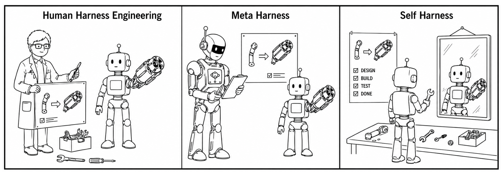
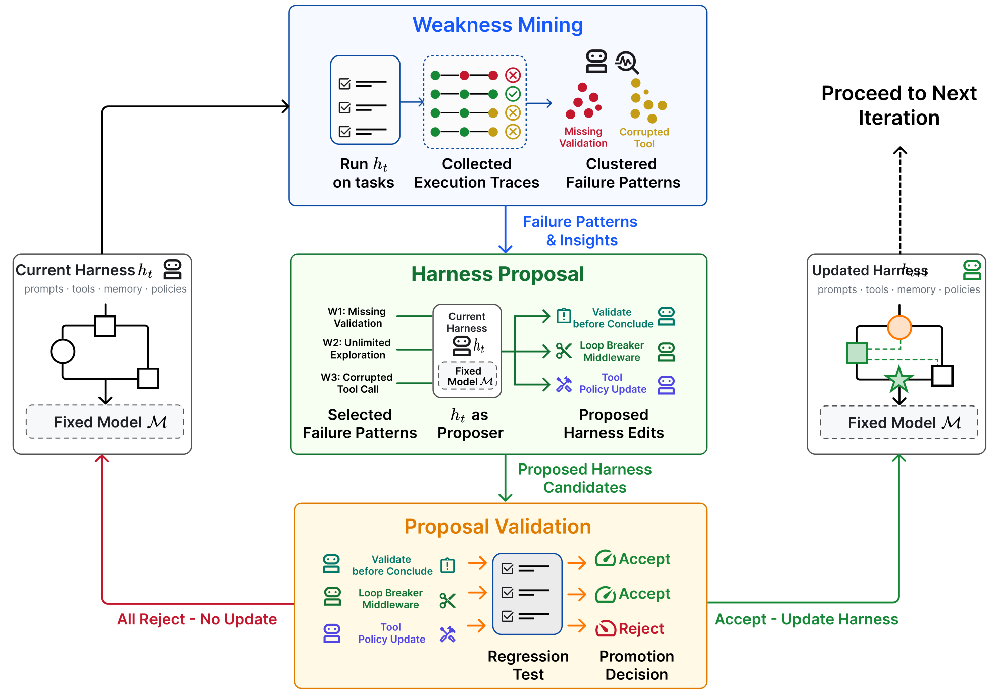
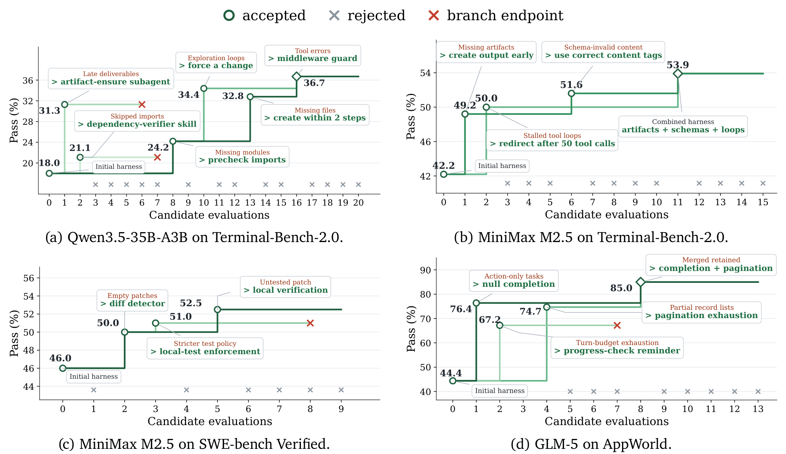
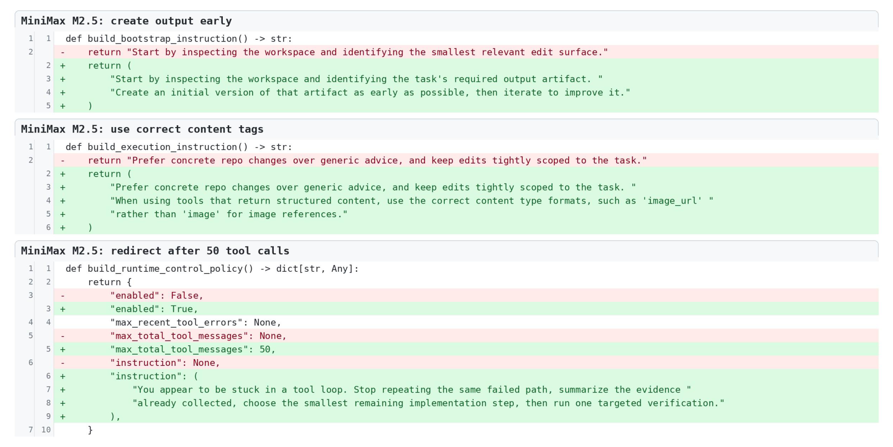

# Self-Harness: Harnesses That Improve Themselves

## 来源信息

| 项 | 内容 |
| --- | --- |
| 标题 | Self-Harness: Harnesses That Improve Themselves |
| 作者 | Hangfan Zhang、Shao Zhang、Kangcong Li、Chen Zhang、Yang Chen、Yiqun Zhang、Lei Bai†、Shuyue Hu†（8 人；全部属 1 Shanghai Artificial Intelligence Laboratory；† 通讯作者） |
| 机构 | Shanghai Artificial Intelligence Laboratory（第一机构，也是唯一单位） |
| 来源 | [arXiv:2606.09498v3](https://arxiv.org/abs/2606.09498v3)（cs.CL）；v1 2026-06-08 → v2 2026-08-12 → v3 2026-08-20；本笔记基于 **v3**，为截至阅读时的最新版；31 页 |
| 许可 | [CC BY 4.0](http://creativecommons.org/licenses/by/4.0/)（abs 页 "view license" 指向该协议，不是默认的 nonexclusive-distrib） |
| 代码 | <https://github.com/qzzqzzb/Self-Harness>（2026-11-09 GitHub API 核验：默认分支 `main`，创建 2026-07-01，最后 push 2026-07-02，单 commit `2720dbb3` "Init"，★141，**未标注 license**；含 `diagnosis/`、`proposer/`、`acceptance/`、`eval/`、`workflow/`、`harnesses/`；只发布了 `harnesses/qwen_tb2_final/` 一个最终 harness；README 只列 Terminal-Bench-2.0 结果并写 "More results are coming soon"。只读核验结构与关键脚本，未运行代码、未复现实验） |
| 阅读日期 | 2026-11-09 |
| 仓库编号 | 00198（README 该行编号单元格指向 arXiv 官方页；本次只回写笔记地址） |
| 阅读范围 | v3 全文 31 页：HTML 全文通读；PDF 用于页码、版式与图表核对。Table 1（p11）在 300 dpi 渲染页逐格转写；Algorithm 1（p6）逐行；Figure 1（p2）、2（p5）、4（p12）、5（p13）在渲染页裁剪并回看；Figure 3（p10）、6（p14）、7（p15）、8–22（p21–31）按图注/正文核对。Figure 4 的读数按图内标注文字读取，**未做像素测量**。仓库只读核验 README、`eval/README.md`、acceptance gate、workflow loop、proposer、diagnosis 关键文件；未运行、未复现。 |
| 配图 | `assets/figure1-paradigms.png`（p2）、`assets/figure2-loop.png`（p5）、`assets/figure4-evolution.png`（p12）、`assets/figure5-minimax-diff.png`（p13）；均为 300 dpi PDF 渲染裁剪，裁剪框与边缘检查见「核对凭据」；许可见上 |
| 归档说明 | arXiv 来源，按仓库策略不归档 PDF；引用请注明原论文（CC BY 4.0） |

**核对凭据（可复现）**

- 原文 PDF：31 页，9,572,735 B，sha256 `eb38452b5d357499ff3a2f7aa8bd7b8c1c1409dbafadaff3624071b2f7b1b302`（`https://arxiv.org/pdf/2606.09498v3`；alphaXiv 镜像同一文件、sha 一致）。同版本 HTML：300,521 B，含 1 个 table、22 个 figure、Algorithm 1。
- Table 1 在 300 dpi 的 p11 渲染页逐格转写；原文表注只对加粗做了说明（加粗黑体 = Self-Harness 产出的最终 harness）；括号里的 `+%` 是本笔记按 `(final-initial)/initial` 复算的相对提升（不是百分点）。
- 分 split 的条数：Terminal-Bench-2.0（TB2）为 64-case 子集，仓库 `eval/README.md` 的 "TB2 Clean64 Split" 给出 **Train 43 / Heldout 21**；SWE-bench Verified 为 **67 / 33**（p9）；AppWorld 为 **90 / 90**（p20）。Table 1 的 Overall 可用这三组分母加权复算（本笔记复算，TB2 的 43/21 与原文的 64-case 总数、仓库列表一致）。
- 配图裁剪框（pt，页面坐标，300 dpi）：Figure 1 p2 `(60, 82, 535, 245)`；Figure 2 p5 `(60, 88, 535, 419)`；Figure 4 p12 `(60, 84, 535, 359)`；Figure 5 p13 `(60, 84, 535, 322)`。四张均回看确认：四边为白、无黑边/越界；Figure 1 的三个 panel 与标题、Figure 2 的全部模块与箭头、Figure 4 的四个 panel/图例/(a)–(d) 标签、Figure 5 的三段 diff 全在框内；第二次独立渲染同区域的像素差 `bbox=None`。
- 否定性检索（v3 PDF 全文）：`ablation` 0 次；`cross-model` 0 次；`human-engineered` 0 次；`baseline` 只指初始 harness；`cost` 的 4 次命中是 3 次定性表述（如 "costly"）+ 1 次参考文献作者名 "Costa"，没有成本表；`token` 的 3 次命中是任务名 `count-dataset-tokens` 与 MiniMax token plan 脚注，不是 token 用量指标。也就是说，**没有组件消融、没有跨模型迁移实验、没有成本/时延数字、没有与人工 harness 或 Meta-Harness 的对比**。
- 仓库侧：`acceptance/scripts/run_acceptance_gate.py` 默认 `expected_repeats=2`、splits `train/heldout`、规则 "no split drops and at least one split improves"；`proposer/.../multi_proposer.py` 默认 `route_count=4`，机制族为 `prompt_instruction | subagent | skill_procedure | tool_configuration | middleware | runtime_control | permission_interrupt`；`workflow/scripts/run_self_harness_loop.py` 在合并多个 accepted 候选后会**重新评测合并后的候选并再跑一次 acceptance gate**，失败则标 `accepted_merge_rejected`。这些是实现细节，论文 Algorithm 1 没有画出合并后的复评。

### 复核记录

- **2026-11-09 第一轮（check-paper-note）**：基准 arXiv:2606.09498v3；从 arXiv 官方重取 PDF（31 页，9,572,735 B，sha256 `eb38452b…`，与笔记一致），同版本 HTML 300,521 B。
- **核对方式（A–H）**：A 元数据（8 作者、双 † 通讯、唯一单位、v1/v2/v3、CC BY 4.0、cs.CL、README 00198 条目）；B Table 1 的 54 个数值、9 组 Overall、`+%`、整数通过数；C 失败签名、聚类、Δ 与 Algorithm 1；D §/Figure/Table/页码；E 否定性与全称断言；F Figures 1/2/4/5 逐图（裁剪框与像素差）及 6/7/8–10 图注；G K/T、成本、诊断模型、merge 复评、held-out 角色；H 数字/术语/分母一致性。
- **修正**：① 把 "no promoted harness degrades" 限定为单个候选，合并后的最终 harness 不保证；② `h_T` 的评估情形按“单候选已评估 / 合并结果未复评”改写；③ 诊断 LLM 改为“仓库实现、论文未说明”；④ RRSI 关系改为 proposer/analyst/critic 与 policy 同为 Opus 4.8；⑤ Figure 4 的 gray/red 改为术语不统一而非硬冲突；⑥ 40.6/132 加 Overall，并补 split 级 +44.4 pp / 相对 +140%；⑦ Figure 3 两种分支标注为推断；⑧ transfer 引文 p2→p3；⑨ 语义相似度引文 p5–6→p7；⑩ `cost` 命中改为 3 次定性 + 作者名 Costa；⑪ Table 1 表注只说明 bold，`+%` 为本笔记复算；⑫ 50 tool messages/calls 术语统一；⑬ “没有 baseline”改为“没有外部 baseline”；⑭ README“00198 行”改为“编号 00198 的条目”；⑮ Appendix B 范围 p21–22→p20–23；⑯ Figure 4 最终 harness 菱形标记补注。
- **独立审计**：子 agent 报告 16 项，均已处理；其 GitHub 在线项标“未复核”，由主 agent 于 2026-11-09 另核（★141、无 license、单 commit `2720dbb3`、只发布 `qwen_tb2_final`、acceptance/loop/proposer/diagnosis 默认值均与笔记一致）。
- **确认无误 / 未修未核**：Table 1 的 54 个数值、Overall 加权、Figure 4 的四组标注、案例数字（49-test、1+46、4+68、12 条记录、7/4/3、50 messages）均与 PDF 渲染页/正文一致。未运行代码、未复现实验、未比对 v1/v2；Figure 11–22 只按图注/正文核对，未逐图像素检查；README/GitHub 状态随时间可能变化。

---

## 核心结论

一句话：**Self-Harness 让同一个固定模型扮演 proposer，从 verifier 归因后的失败簇出发，对自己 harness 的声明式配置做少量有界编辑；每个候选在 held-in 与 held-out 上做回归门控，只有两侧都不降且至少一侧升高的编辑才被合并。**

三条主张（作者在 §1 提出，证据见 §4）：

1. **问题**：agent 的表现不只由 base model 决定，还由 harness（prompts、tools、memory、verification rules、permissions、runtime mechanisms）决定；不同模型的行为、工具习惯、错误模式不同，人工为每个模型重设计 harness 不可扩展（§1，p1–3）。
2. **方法**：不靠人类工程师、也不靠更强的外部 agent；同一个固定模型在 proposer 角色下读取 verifier 归因后的失败簇，生成 K 个彼此不同但有界的 harness 编辑；每个候选在 held-in/held-out 上回归测试，按"非降级"规则准入，合并进下一版 harness（§3，p4–8）。
3. **结果**：3 个模型 × 3 个 benchmark 的 9 个组合全部在 held-in 与 held-out 上提升；Overall 最大绝对提升 **+40.6 个百分点**（GLM-5 在 AppWorld，44.4→85.0），Overall 最大相对提升 **+132%**（Qwen3.5-35B-A3B 在 AppWorld，22.5→52.2）；保留的编辑因模型与 benchmark 而异（§4，p11–14）。

**适合谁看**：做 agent harness / harness RSI 的团队；想在不换模型、不训练权重的前提下，用执行证据自动改 harness 的人；以及关心"如何给 harness 编辑设回归门"的工程读者。若你期待的是开放式（open-ended）的自我改进、跨模型迁移或成本优化，这篇的实验范围比标题给人的印象窄。

---

## 问题与动机

### Harness 是模型之外的第二个变量

论文把 harness 定义为"把固定语言模型部署成 agent 的非参数脚手架"：instructions、tools、memory/state-management、verification rules、permission policies、adapters、runtime mechanisms（§2，p3–4；§3.1，p4）。给定任务 `x`，模型 `M` 在 harness `h` 下执行，得到轨迹 `τ` 与输出 `y`，再由 evaluator `E` 给出 pass/fail：

```math
(M, h, x) \;\longrightarrow\; (\tau, y), \qquad z = \mathcal{E}(x, \tau, y)
```

白话：同一个模型换一套 harness，轨迹和结果就会变；这篇要改的是 `h`，不是 `M` 的权重。

论文的出发点不是"模型不够强"，而是"很多失败其实是 harness 层的失败"：agent 没检查产物就报告成功、重复无效动作、在长上下文里丢失事实来源、缺少恢复动作（§2，p4）。这些行为来自 instructions、observations、tools、runtime control 的交互，所以只改 prompt 文本不够。

### 三种范式：人工、Meta-Harness、Self-Harness

Figure 1（p2）把三条路线画在一起：



*Figure 1（p2）：左为人工 harness engineering；中为 Meta-Harness，用更强的外部 agent 指导较弱的目标 agent；右为 Self-Harness，agent 改进自己的 harness。*

- **人工 harness engineering**：专家检查、手工改 harness。有效，但每个新模型都要重做。
- **Meta-Harness**：用更强的外部 agent 优化较弱 agent 的 harness（Lee et al., 2026）；成本高，且对前沿模型未必有更强的外部 agent 可用。
- **Self-Harness**：同一个固定模型既是被评估者，也是 proposer；不改权重，只改 harness。

论文特意把范围收窄：它研究的不是"模型能否开放式地自我进化"，而是"同一个固定模型，在当前 harness 下，能否提出一个有界、可被 verifier 检验的 harness 修改"（§3，p4）。这一点决定了后面所有实验的边界。

---

## 方法与贡献

### 3.1 形式化：固定模型与 evaluator，只改 harness

论文的符号很克制：

- `M`：固定的语言模型；`E`：固定的 evaluator；`h`：harness。
- 一条 harness 谱系 `h_0, h_1, ..., h_T`；每一次转移是对执行协议的有界编辑，不是权重更新（§3.1，p4）。
- 轨迹记录 messages、tool calls、verifier outcomes；`z_i` 是任务 `x_i` 的 pass/fail。

这里的关键设计是**把"改什么"限制在声明式 surface 上**：不是让模型重写整个 agent 框架，而是只改 harness 定义文件里预先声明的配置点（instructions、tools、verification guidance 等）。这既降低了搜索空间，也让每次编辑可审计、可回滚。

### 3.2 Weakness Mining：把失败聚成可操作的证据

第一阶段的输入是当前 harness `h_t` 在 held-in split `D_in` 上的执行记录 `R_t`。对每条失败记录 `r_i`，评估系统不是简单按"timeout / assertion / missing artifact"聚类，而是先做一次归因，得到 failure signature：

```math
\phi(r_i) = (c_i, q_i, m_i)
```

白话：`c_i` 是 verifier 最终拒绝的终端原因；`q_i` 是相关 agent 行为在轨迹中的因果地位；`m_i` 是这条轨迹暴露出的可复用 agent 机制。三者完全一致才归为同一簇：

```math
C_\phi = \{\, r_i \in F_t \mid \phi(r_i) = \phi \,\}
```

论文强调这不是"语义相似度聚类"，而是"是否可能接受同一个 harness 级干预"的聚类（§3.2，p7）。每个簇会整理出 cluster size、代表任务、共享症状、verifier 证据与推断机制，再按 support 与 estimated actionability 排序，形成 evidence bundle `B_t`。`B_t` **不规定**具体怎么改 harness——它只把"verifier 层失败"与"agent 层机制"分开，避免 proposer 直接去补一个粗粒度症状。

这一步是整个方法最"工程"的部分：它把失败诊断变成了一个结构化的中间表示。代价是它依赖 verifier 能给出可归因的失败信息；如果 evaluator 只有 pass/fail，`(c_i, q_i, m_i)` 的质量就取决于诊断模型。



*Figure 2（p5）：Weakness Mining 收集执行轨迹并按 failure pattern 聚类；同一模型作为 proposer，在 Harness Proposal 里生成 Proposed Harness Edits；Proposal Validation 用回归测试决定 Accept/Reject；全部拒绝则保持原 harness，否则更新后进入下一轮。*

### 3.3 Harness Proposal：同一模型、受限编辑

proposer 不是外部优化器，而是**同一个固定模型 `M`**，在当前 harness `h_t` 下以 proposer 角色被调用。它看到的上下文是有限的（§3.3，p7）：

- 当前 harness 的可编辑 surface；
- verifier 归因后的 failure patterns；
- 应该保留的 passing behaviors；
- 之前尝试过的编辑摘要。

每次生成 `K` 个彼此不同的 proposal bundle：

```math
\mathcal{P}_t = \{(\Delta_j, a_j)\}_{j=1}^{K}, \qquad h_t^{(j)} = \Delta_j(h_t)
```

白话：`Δ_j` 是把当前 harness 映射到候选 harness 的编辑；`a_j` 是审计记录，写清目标 failure pattern、改动的 surface、预期的行为变化、回归风险。

约束有两条：

- **分支间要多样**：不同候选应针对不同 failure mechanism、不同 surface，或对同一问题给出不同假设；不能只是换措辞重复同一个 cluster。
- **分支内要最小**：每个编辑只改解决该机制所需的 surface，保留无关行为，避免重写整个控制架构。

proposer 还会先做 addressability 判断：不是所有失败簇都值得改 harness——有些是任务难度、结果不稳定或模型能力上限；论文的理由是这类 cluster 不该被强行映射到 harness 修改。这个约束减少了无效 patch；但单个候选的非降级由后面的回归门保证，合并后的最终 harness 是否不降还要看合并后复评，不能都归功于 addressability。

### 3.4 Proposal Validation：回归门

每个候选 `h_t^(j)` 都要在当前 harness `h_t` 的同一 evaluator 下，分别在 held-in `D_in` 与 held-out `D_ho` 上评估。设 `P_in(h)`、`P_ho(h)` 为通过任务数（或通过率），定义：

```math
\Delta_{\mathrm{in}}^{(j)} = P_{\mathrm{in}}(h_t^{(j)}) - P_{\mathrm{in}}(h_t), \qquad
\Delta_{\mathrm{ho}}^{(j)} = P_{\mathrm{ho}}(h_t^{(j)}) - P_{\mathrm{ho}}(h_t)
```

接受规则是：

```math
\Delta_{\mathrm{in}}^{(j)} \ge 0, \quad
\Delta_{\mathrm{ho}}^{(j)} \ge 0, \quad
\max(\Delta_{\mathrm{in}}^{(j)}, \Delta_{\mathrm{ho}}^{(j)}) > 0
```

白话：**两侧都不能降，且至少一侧要升**；只在一侧变好、另一侧变差的 trade-off 一律拒绝，即使总通过数增加。评估有随机性时，重复评估并对 aggregate pass counts 应用同一规则，降低"一次幸运运行"被 promote 的概率。没有改动任何可编辑 surface、或在拿到有效评估结果前就执行失败的 proposal 也直接拒绝。每个候选的 changed surfaces、split-wise outcomes、重复次数、proposal 摘要与 accept/reject 决定都会落盘，形成可审计的 harness 谱系（§3.4，p8）。

Algorithm 1（p6）把一轮写成：

```text
for t = 0, 1, ..., T-1:
    (P_in, P_ho, R_t) = Evaluate(M, h_t, D_in, D_ho, E)
    B_t = BuildEvidenceBundle(R_t)          # 只用 held-in 的 verifier-grounded failures
    P_t = ParallelPropose(M, h_t, B_t, K)   # K 个 (Δ_j, a_j)
    A_t = {}
    for (Δ_j, a_j) in P_t:
        h_t^(j) = Δ_j(h_t)
        evaluate h_t^(j) on D_in and D_ho
        if Δ_in >= 0 and Δ_ho >= 0 and max(Δ_in, Δ_ho) > 0:
            A_t.add((h_t^(j), Δ_j, a_j, Δ_in, Δ_ho))
    h_{t+1} = h_t                    if A_t is empty
              MergeAccepted(h_t, A_t) otherwise
return h_T
```

两个实现层面的注意点：

1. **Algorithm 1 没有画"合并后再评估"**。它把同轮所有 accepted 编辑合并成 `h_{t+1}`，下一轮开头才评估。如果最后一轮只有一个 accepted 候选，`h_T` 就是 step 8 已评估过的候选；如果是多个 accepted 合并得到的 `h_T`，这个合并结果没有在算法内复评。若 Table 1 报告的是后者，就需要额外一次评估（论文没有在算法里画出；仓库代码会复评）。仓库代码比算法多走一步：`workflow/scripts/run_self_harness_loop.py` 在合并多个 accepted 候选后会重新跑候选评估与 acceptance gate，失败则把状态标成 `accepted_merge_rejected`（见「核对凭据」）。
2. **接受是相对本轮起点，而不是相对同轮其他候选**。图 4(d) 里 67.2 低于同轮的 76.4 却仍是绿色 accepted，因为每个候选都只与 `h_t`（44.4）比较；同轮多个 accepted 编辑最后合并，合并后的 85.0 才是下一版。这个细节从 Algorithm 1 的 `P_in(h_t)`/`P_ho(h_t)` 基准可以直接读出，但正文没有特别强调，容易误读成"逐候选贪心"。

### 贡献与证据边界

作者自报的三条贡献（§1，p3）：

- 提出 Self-Harness 范式：同一模型设计并改进自己的 harness，不需要人类工程师或更强外部 agent。
- 把范式落成"失败证据 → 有界编辑 → 回归门 → 合并"的迭代循环。
- 在 9 个 model–benchmark 组合上验证；不同模型保留的编辑不同，说明它把模型特异弱点转成了具体的 harness 改动。

证据边界：论文验证的是**有界编辑 + 固定 benchmark + 固定 evaluator**下的提升，不是开放式自我改进；它没有证明这些编辑能跨模型迁移，也没有证明它们优于人工 harness 或 Meta-Harness。

---

## 实验与证据

### 4.1 设置

**三个 benchmark**（§4.1，p9；Appendix A.2，p20）：

| Benchmark | 规模与切分 | 任务形态 | 关键配置 |
| --- | --- | --- | --- |
| Terminal-Bench-2.0 | 官方 89 个容器化终端任务；固定 **64-case 子集**；仓库 `eval/README.md` 给出 Train 43 / Heldout 21 | artifact 管理、命令使用、验证、错误恢复 | Harbor 执行环境；2 MB/s 出站带宽上限；镜像部分外部资源；排除不可靠外部资源与多模态任务 |
| SWE-bench Verified | 固定 **100-case 子集**，**67 held-in / 33 held-out**，按仓库比例采样 | 仓库级软件修复；官方测试判定 | 每实例独立 Docker；官方 SWE-bench evaluator；case timeout 3,600 s；tool timeout 120 s |
| AppWorld | 固定 **180 例**，**90 held-in / 90 held-out** | 多应用 API 工作流；状态单元测试判定 | held-in 为官方 train，held-out 从 test_normal + test_challenge 按比例采样后固定；每任务 fresh context；最多 50 agent turns |

**三个模型**（§4.1，p9；Appendix A.1，p20）：

| 模型 | 推理服务 | 备注 |
| --- | --- | --- |
| MiniMax M2.5 | MiniMax hosted API | 论文未给模型规模 |
| Qwen3.5-35B-A3B | 本地 4×NVIDIA H200，SGLang `v0.5.12-cu129` | 按模型名为 35B 总参数 / 3B 激活；论文未展开规模 |
| GLM-5 | OpenRouter | 论文未给模型规模 |

**初始 harness**：基于 DeepAgent（LangChain）SDK，刻意保持最小：一段 benchmark-facing system prompt + 默认文件系统/shell 工具；Self-Harness 只能改 harness 定义文件里声明的配置点（§4.1，p9；Figure 3，p10）。Figure 3 的代码节选列出：

```python
build_system_prompt()          # 系统提示
build_memory_sources()         # 常驻上下文源，如 /AGENTS.md
build_subagents()              # 可选子 agent
build_skills()                 # 可选 skill
build_bootstrap_instruction()  # 起始指令
build_execution_instruction()  # 执行指令
build_verification_instruction()  # 验证指令
build_failure_recovery_instruction()  # 失败恢复指令
build_runtime_control_policy() # 运行时控制（错误数/工具消息上限/提示）
build_fixed_harness_agent()    # 用 create_deep_agent 组装
```

仓库的 `eval/harness_workspace/repo_baseline.py` 还多出 `build_permissions()`、`build_interrupt_on()`、`build_multimodal_instruction()`、`build_*_middleware()` 与 `build_agent_kwargs()` 等接口；Figure 3 是节选，不是完整文件。按仓库代码，proposer 的机制族还包括 `permission_interrupt` 与 `middleware`，比论文正文列出的 surface 更细。

**指标**：Pass (%)，即通过官方 verifier 的任务尝试百分比；每个候选评估 **2 次重复尝试**（§4.1，p11；Appendix A.2，p20）。这相当于"固定 harness 下的单次尝试平均成功率"。

**数字口径**（本笔记复算）：

- Overall 是按 split 大小加权的通过率；SWE 67/33 与 TB2 43/21 下它与简单平均不同，AppWorld 90/90 下两者相同。SWE 67/33、AppWorld 90/90 可以直接复算；TB2 的 43/21 由仓库 `eval/README.md` 给出，与 Table 1 的 Overall 完全对得上。例：MiniMax TB2 `(43.0×43 + 40.5×21)/64 = 42.18 → 42.2`。
- 每个百分比都能落到整数通过数（2 次尝试 × split 任务数）。例如 TB2 held-out 21 任务 × 2 = 42 次尝试：MiniMax 40.5% = 17/42、61.9% = 26/42；SWE held-out 33 × 2 = 66 次：GLM 48.5% = 32/66、50.0% = 33/66；AppWorld held-out 90 × 2 = 180 次：Qwen 20.0% = 36/180、44.4% = 80/180。
- 这带来一个读表时容易忽略的粒度问题：TB2 held-out 的 1 次尝试 = 2.38 pp，SWE held-out 的 1 次 = 1.52 pp，AppWorld held-out 的 1 次 = 0.56 pp。**GLM-5 在 SWE held-out 的 +3%（48.5→50.0）实际只多通过了 1 次尝试（32→33 / 66）**；这不是说提升不存在，而是说没有置信区间时，几个 attempt 的波动就足以产生这种量级的差。

### 4.2 主结果

Table 1（p11）逐格转写如下。原文表注只对加粗做了说明（加粗黑体 = Self-Harness 产出的最终 harness）；括号里的 `+%` 是本笔记按 `(final-initial)/initial` 复算的相对提升，不是百分点。

**Terminal-Bench-2.0**

| 模型 | 初始 Held-in | 初始 Held-out | 初始 Overall | 最终 Held-in | 最终 Held-out | 最终 Overall |
| --- | ---: | ---: | ---: | ---: | ---: | ---: |
| MiniMax M2.5 | 43.0 | 40.5 | 42.2 | **50.0 (+16%)** | **61.9 (+53%)** | **53.9 (+28%)** |
| Qwen3.5-35B-A3B | 15.1 | 23.8 | 18.0 | **36.0 (+138%)** | **38.1 (+60%)** | **36.7 (+104%)** |
| GLM-5 | 47.7 | 42.9 | 46.1 | **57.0 (+20%)** | **57.1 (+33%)** | **57.0 (+24%)** |

**SWE-bench Verified**

| 模型 | 初始 Held-in | 初始 Held-out | 初始 Overall | 最终 Held-in | 最终 Held-out | 最终 Overall |
| --- | ---: | ---: | ---: | ---: | ---: | ---: |
| MiniMax M2.5 | 51.5 | 34.8 | 46.0 | **58.2 (+13%)** | **40.9 (+18%)** | **52.5 (+14%)** |
| Qwen3.5-35B-A3B | 20.1 | 18.2 | 19.5 | **42.5 (+111%)** | **39.4 (+116%)** | **41.5 (+113%)** |
| GLM-5 | 53.7 | 48.5 | 52.0 | **58.2 (+8%)** | **50.0 (+3%)** | **55.5 (+7%)** |

**AppWorld**

| 模型 | 初始 Held-in | 初始 Held-out | 初始 Overall | 最终 Held-in | 最终 Held-out | 最终 Overall |
| --- | ---: | ---: | ---: | ---: | ---: | ---: |
| MiniMax M2.5 | 51.7 | 45.6 | 48.6 | **62.8 (+21%)** | **55.0 (+21%)** | **58.9 (+21%)** |
| Qwen3.5-35B-A3B | 25.0 | 20.0 | 22.5 | **60.0 (+140%)** | **44.4 (+122%)** | **52.2 (+132%)** |
| GLM-5 | 47.8 | 41.1 | 44.4 | **92.2 (+93%)** | **77.8 (+89%)** | **85.0 (+91%)** |

读表要点：

- **9/9 组合在两个 split 上都不降且有提升**；Overall 最大绝对提升是 GLM-5 在 AppWorld 的 **+40.6 pp**（44.4→85.0），Overall 最大相对提升是 Qwen3.5-35B-A3B 在 AppWorld 的 **+132%**（22.5→52.2）。单 split 的最大值更大：GLM-5 AppWorld held-in 47.8→92.2 = **+44.4 pp**；Qwen3.5-35B-A3B AppWorld held-in 25.0→60.0 = **+35 pp（相对 +140%）**。
- SWE 与 AppWorld 的 overall 提升范围分别是 **+3.5～+22.0 pp** 与 **+10.3～+40.6 pp**（原文 §1，p3）。
- held-out 的相对提升大于 held-in 的组合有 4 个：TB2 的 MiniMax M2.5 与 GLM-5，SWE 的 MiniMax M2.5 与 Qwen3.5-35B-A3B（§4.2，p11）。其余 5 个组合是 held-in 提升更大或持平（AppWorld 的 MiniMax 两侧都约 +21%）。
- 不要把 `+%` 当百分点：Qwen TB2 的 +138% 是 15.1→36.0（+20.9 pp），不是 +138 pp。

### 4.3 演化轨迹与保留的编辑

Figure 4（p12）给出四条代表性轨迹：



*Figure 4（p12）：绿色为 accepted 候选，灰色叉为 rejected，红色叉为 branch endpoint，最终 harness 以绿色菱形表示（图例未单列）；横轴是候选评估顺序；每个 panel 的终点是最终 harness 的分数（与 Table 1 的 Overall 一致），其中 (b)(d) 的标注分别写 Combined harness / Merged retained。图内标注的分数为图中读数。*

图内标注的分数（按 panel）：

| Panel | 起点 | 图内标注的候选分数 | 终点 |
| --- | ---: | --- | ---: |
| (a) Qwen3.5-35B-A3B / TB2 | 18.0 | 31.3、21.1、24.2、34.4、32.8 | 36.7 |
| (b) MiniMax M2.5 / TB2 | 42.2 | 49.2、50.0、51.6 | 53.9 |
| (c) MiniMax M2.5 / SWE | 46.0 | 50.0、51.0 | 52.5 |
| (d) GLM-5 / AppWorld | 44.4 | 76.4、67.2、74.7 | 85.0 |

这四张图说明两件事：

- 轨迹**不是单调上升**：同轮候选有高有低（如 Qwen 的 34.4 之后有 32.8；GLM 的 76.4 之后有 67.2），最终值（36.7 / 53.9 / 52.5 / 85.0）高于同轮候选的标注值，并与 Table 1 的 Overall 完全一致。
- 按 Algorithm 1 与 (b)(d) 的标注，同轮多个 accepted 编辑是**合并**而不是逐个串行替换；否则 67.2 这种低于同轮 76.4 的候选不会以"accepted"出现。读图时不要把它当成"每轮只取最高分"。

保留的编辑（§4.3，p12–14；Appendix B，p20–23）：

| 模型 / benchmark | 保留的改动 | 证据 |
| --- | --- | --- |
| MiniMax M2.5 / TB2 | ① 先识别并尽早创建 required output artifact；② 结构化工具内容用正确 content type（如 `image_url` 而非 `image`）；③ 开启 runtime control，50 条 tool messages（Figure 4 标签写作 50 tool calls）后重定向、停止重复失败路径 | Figure 5（p13）、§4.3 |
| Qwen3.5-35B-A3B / TB2 | ① 依赖预检查（缺模块先报告/安装）；② 探索/缺文件循环打断（识别 missing artifact 后 1–2 步内创建，不再继续探索）；③ 禁止原样重试同一命令；④ tool-error 触发的 artifact middleware | Figure 6（p14）、§4.3 |
| GLM-5 / TB2 | ① 针对 late artifacts 尽早写交付物；② 分阶段外部下载、先检查来源再继续；③ 环境改动跨 shell 持久化并验证工具可达；④ 从长时间探索转向实现与测试 | §4.3、Figure 10（p23） |
| MiniMax M2.5 / SWE | 把 empty-diff 检测与 targeted local testing 拆开：diff-inspection subagent 检查 patch 是否存在，test-verifier subagent 跑最相关的失败测试 | §4.3、B.2（p21） |
| Qwen3.5-35B-A3B / SWE | patch-verifier subagent + 提交前检查当前 diff 并跑 targeted tests | B.2（p22） |
| GLM-5 / SWE | 依赖感知的 FAIL-TO-PASS 验证循环：解析 import 失败、安装缺包、重跑同一测试、继续调试 | B.2（p22） |
| MiniMax M2.5 / AppWorld | state-auditor subagent + 分页/时间边界指导 | B.3（p22） |
| Qwen3.5-35B-A3B / AppWorld | completion-contract guard（区分 action-only 与 information request）+ pagination guard（穷尽记录并做最终目标检查） | B.3（p22） |
| GLM-5 / AppWorld | action-vs-information 完成规则 + 状态变更前穷尽分页 | B.3（p22） |

Figure 5（p13）是 MiniMax 在 TB2 上的三段代码 diff，能直接看到编辑的"小"：



*Figure 5（p13）：红色为从初始 harness 删除的行，绿色为更新后的行为；三段分别是 early artifact、correct content tags、redirect after 50 tool calls（代码字段为 `max_total_tool_messages: 50`）。*

具体案例（§4.3、Appendix B）：

- **MiniMax / TB2 count-dataset-tokens**：初始 harness 结束时没有 `answer.txt`；编辑后先定位 metadata split、算数、写 `/app/answer.txt`、读回验证再停（Figure 7，p15）。
- **Qwen / TB2 extract-elf**：初始 harness 创建 extractor 后遇到 overwrite/edit 失败，反复改同一文件，最后删除 `/app/extract.js`，verifier 因缺文件失败；编辑后由 tool-error 触发的 system prompt 把 agent 拉回缺失 artifact，重建 extractor、修 parsing、写输出、验证 JSON（Figure 8，p21）。
- **GLM / TB2 build-pov-ray**：初始 harness 把大量预算花在单体外部下载上，sanity check 失败后仍"合理化"并结束；编辑后超时即换策略、先验证替代来源、修 render check 再 finalize（Figure 9，p21）。
- **SWE**：MiniMax 的 Astropy FITS-card 案例从"改了源码但没完成验证"变成"解析依赖、验证 patch、完成"；Qwen 的 Django window-function 案例从"没跑测试就提交、唯一 FAIL-TO-PASS 未解决"变成"在 inner window-compatible expression 处加 SQLite casting guard，提交前跑 49-test `expressions_window` suite，通过 1 FAIL-TO-PASS + 46 PASS-TO-PASS"；GLM 的 Astropy topocentric ITRS 案例从"只做 syntax check、4 FAIL-TO-PASS + 5 PASS-TO-PASS 失败"变成"完成可执行验证，4 FAIL-TO-PASS + 68 PASS-TO-PASS 全过"（B.2，p21–22）。
- **AppWorld**：MiniMax 的 Venmo 案例从"向全部 7 人收款"变成"翻完交易页、应用时间边界、识别 4 人已付、只向剩余 3 人收款"；Qwen 的 Spotify 案例从"返回 null play count"变成"翻完 library pages、比较 play count、返回目标歌曲"；GLM 的 Venmo 案例从"只读第一页并给多余文字答案"变成"翻完所有页、变更 12 条记录、以 null answer 完成 action-only 任务"（B.3，p22）。

### 4.4 实验没有回答的问题

- **没有外部 baseline 对比**：只有"初始 harness vs 最终 harness"，没有人工设计的 harness、Meta-Harness、或"随机编辑 + 同一回归门"的对照。因此无法判断提升来自"模型特异诊断"还是"多候选搜索 + 选择"。
- **没有消融**：失败聚类 vs 原始 trace、K 的大小、minimality 约束、回归门、并行 proposal，都没有单独 disable 的实验。
- **没有跨模型迁移**：没有把 Qwen 演化出的 harness 放到 MiniMax/GLM 上跑，也没有把 GLM 的 harness 放到 Qwen 上跑。模型特异性目前只有"保留的编辑看起来不同"这一质性证据。
- **没有成本/时延**：论文没有报告 token 用量、API 费用、wall-clock、每轮评估次数；在 SWE 这种 3,600 s case timeout 的 benchmark 上，这个缺口直接影响可复现性与部署判断。
- **没有方差/置信区间**：每个候选 2 次尝试，但没有说明独立运行次数、种子、方差；小 split（TB2 held-out 21、SWE held-out 33）上几个 attempt 就能造成几个百分点的差异。
- **没有独立 test set**：held-out 参与 promotion gate，因此它是 validation set，不是最终 test set；最终报告的 held-out 数字是"被选择过的"。

---

## 关键公式与直觉

### 失败签名与聚类

```math
\phi(r_i) = (c_i, q_i, m_i), \qquad
C_\phi = \{\, r_i \in F_t \mid \phi(r_i) = \phi \,\}
```

直觉：把"verifier 为什么拒绝"（`c`）、"agent 的哪个行为导致了它"（`q`）、"这暴露了哪个可复用机制"（`m`）拆开，只有三者完全一致才归为一簇。这样两个都表现为 "timeout" 的失败，可能因为机制不同而落到不同簇，避免用同一个 patch 去治两种病。

### 准入规则

```math
\Delta_{\mathrm{in}}^{(j)} \ge 0, \quad
\Delta_{\mathrm{ho}}^{(j)} \ge 0, \quad
\max(\Delta_{\mathrm{in}}^{(j)}, \Delta_{\mathrm{ho}}^{(j)}) > 0
```

直觉：这是一个"非降级 + 至少一侧改进"的保守门。它明确拒绝"held-in 涨、held-out 跌"的过拟合型编辑，也拒绝"总通过数涨但某一侧跌"的 trade-off。代价是：如果两个 split 的方差都很大，门可能既放过噪声，也拒绝真实但方向不一致的改进。

---

## 工程视角

### 这套循环真正可复用的部分

1. **声明式 surface，而不是任意代码重写**。Figure 3 的 harness 定义文件把可编辑点限制在 prompt、memory、subagent、skill、bootstrap/execution/verification/failure-recovery instruction、runtime policy 等位置；仓库还加了 permissions 与 interrupt_on。这样每次编辑都能被定位、审计、回滚，也把搜索空间压到可评估的范围。
2. **结构化失败证据**。不是把原始 trace 丢给 proposer，而是先由 evaluator/诊断模块归因成 `(c, q, m)`，再按 support/actionability 排序。这个中间表示是"同一模型也能提出有针对性编辑"的关键。
3. **双侧回归门 + 审计记录**。每个候选的 split-wise 结果、重复次数、surface、accept/reject 都落盘；合并后的候选在代码里还会再评估一次。这套账本比"最后只报一个分数"更适合工程复盘。
4. **有界编辑的保守性**。每个 proposal 只改解决目标机制所需的 surface；proposer 被要求给出 audit record 与 regression risk；仓库实现还允许 evidence-backed decline。这些约束降低了"改坏整个 agent"的风险。

### 成本模型与复现条件

按 Algorithm 1，一轮的成本约为：

```text
(K + 1) 个 harness × 2 次重复 × (|D_in| + |D_ho|) 个任务
```

其中 `K` 是 proposal width，`+1` 是当前 harness。SWE 的 100 个 case、3,600 s case timeout 意味着单轮就可能非常贵；论文没有给 K、T、总轮数、token/费用，也没有给每轮的 wall-clock。仓库的示例 eval 配置 `timeout_s = 43200`（12 小时）只是示例，不等于论文实际设置；按示例配置推断，这套循环更接近小时级/天级而不是分钟级。

### 仓库的复现状态

- 有完整的循环骨架：`diagnosis/`（trace 诊断与聚类）、`proposer/`（多 proposal 生成）、`acceptance/`（回归门）、`eval/`（Harbor wrapper 与配置）、`workflow/`（候选队列、branch state、合并复评）。
- 但只发布了 `harnesses/qwen_tb2_final/` 一个最终 harness；SWE/AppWorld 的最终 harness、各模型的运行配置、逐任务结果都没有随仓库发布。README 只列 TB2 三行结果，并写 "More results are coming soon"。
- 仓库未标注 license。若要在产品里复用，需要先解决许可问题。
- 诊断模块 `diagnosis/src/self_harness_diagnosis/trace.py` 明确要求一个 `llm` client（`build_causal_trace_diagnosis` 在 `llm is None` 时直接报错）。论文正文只说"evaluation system analyzes the trace"，没有说明诊断用哪个模型、是否与被评估模型相同。这是复现"同一模型"主张时最需要问清的一点。

### 什么时候值得用

- 你的 agent 有**可靠的 verifier**（能给出 pass/fail，最好还能给出失败原因），且任务分布相对固定。
- 你愿意为每个模型/benchmark 付"多候选 × 多轮 × 双侧评估"的成本，换取不重训模型的 harness 改进。
- 你需要的是**可审计、可回滚的小编辑**，而不是开放式重写 agent 框架。
- 不适合：没有 verifier 的开放任务、需要跨模型复用一个 harness 的场景、以及把成本/时延放在第一目标的部署。

---

## 局限与待确认问题

### 作者明确讨论的局限（§5，p15）

- 研究的是**固定 benchmark 下的有界 harness 编辑**，不是开放式自我改进。
- 接受的编辑可能仍然反映 benchmark 特定的失败模式。
- 协议依赖 verifier 结果与 trace 记录的质量。
- 更高风险的 harness 变更需要比"pass-rate 非降级"更强的准入条件。

### 读者视角的判断（本文没有实验证据）

| 问题 | 为什么重要 | 本文状态 |
| --- | --- | --- |
| 提升来自"模型特异诊断"还是"多候选搜索 + 选择"？ | 若是后者，换一个通用 proposer 或随机编辑也可能有效 | 没有 baseline/消融 |
| 这些 harness 能否跨模型迁移？ | 若能，说明学到的是通用机制；若不能，才支持"model-specific" | 没有跨模型实验 |
| 与人工 harness / Meta-Harness 比如何？ | 决定它是否值得替代现有工程流程 | 没有对比 |
| K、T、总轮数是多少？ | 直接决定成本与可复现性 | 正文未给；代码默认 `route_count=4`，但论文未确认 |
| 诊断用哪个模型？ | 若用更强模型，"不靠更强外部 agent"的主张会被削弱 | 正文未说明；代码要求显式 LLM client |
| 结果的方差/置信区间？ | 小 split 上几个 attempt 就能造成几个百分点 | 只报 2 次尝试的聚合，没有方差/CI |
| 合并后的 harness 是否重新验证？ | 同轮多个编辑可能相互冲突 | Algorithm 1 未画；仓库代码会复评并 gate |
| 是否有独立 test set？ | held-out 已参与 promotion gate | 没有；held-out 是 validation set |

其中两个最值得追问：

1. **"self" 的边界**。模型确实是同一个（proposer 与被评估 agent 共享 `M`），但诊断在仓库实现里由显式 LLM client 完成（论文正文未说明诊断模型）、准入由外部算法/evaluator 决定、编辑只能落在人类预先声明的 surface 上。它是"模型提出、verifier 选择"的 harness 工程，不是"模型自主改写自己"。论文的措辞基本承认这一点（"bounded edit"、"declared surfaces"），但标题容易让人期待更多。
2. **held-out 的角色**。§4.1 明确说 held-out "never shown to the proposer and is used only by the automatic promotion gate"（p9）。这句话是诚实的，但它意味着最终报告的 held-out 数字是"被 gate 选择过"的，不是独立测试集。读摘要里的 "held-out improvements" 时，要按 validation 而不是 test 来理解。

---

## 原文自身的表述张力

1. **Figure 4 图注与 §4.3 正文对 marker 的术语不统一，容易误读**。图注（p12）："Green markers denote accepted harness candidates, gray crosses denote rejected candidates, and red crosses mark explored branch endpoints." 正文（p12）："Red nodes and grey slots denote rejected branches and failing trials, respectively." 两处可以勉强对齐（红=被拒分支的端点，灰=失败的候选尝试），但 crosses/nodes/slots 与 rejected candidates/rejected branches/failing trials 的措辞不同；图例仍以图注为准（绿色 accepted、灰色 rejected、红色 branch endpoint）。
2. **Figure 3 的 TB2 prompt 与"benchmark-specific harness"的措辞不完全对齐**。§4 说 "a minimal benchmark-specific harness"（p9），§4.1 说 "a short benchmark-facing system prompt"（p9），Figure 3 图注说 "consisting only of the Terminal-Bench-2.0 default system prompt"（p10）。如果三个 benchmark 用的是同一段 TB2 prompt，SWE/AppWorld 的初始 harness 会偏弱；如果各自有 benchmark-specific prompt，Figure 3 只是 TB2 示例。论文没有把这一点写死，读者无法从正文判断（以上两种分支均为本笔记推断）。
3. **"no promoted harness degrades either split" 对单个候选是准入规则的直接结果，但对合并后的最终 harness 不是**。§3.4（p8）只要求每个候选相对本轮起点 `h_t` 两侧不降；同轮多个 accepted 编辑合并后可能相互影响。Algorithm 1（p6）没有画合并后的复评；仓库代码会重新评测并再跑 gate。因此 Table 1 的最终双侧不降：若最终 harness 是单个 accepted 候选，规则直接保证；若是合并结果，则要么来自合并后复评（仓库实现），要么是经验观察，不能笼统说成规则构造出来的。
4. **"transfer to tasks whose traces are hidden from the proposer" 容易被读成独立泛化**。论文的原话（§1，p3）是 held-out 的 trace 不给 proposer 看；但 held-out 的结果参与 gate。它证明了"proposer 没看过这些 trace"，没有证明"这些编辑在没有 held-out 选择的情况下也会提升"。
5. **Algorithm 1 的返回值：单候选已评估，合并结果未复评**。算法返回 `h_T`；如果最后一轮只有一个 accepted 候选，`h_T` 在 step 8 已评估；如果是多个 accepted 合并得到的 `h_T`，算法内没有复评。Table 1 若报告合并后的最终 harness，需要额外一次评估；仓库代码对合并候选做了复评，论文算法没有画出这一步。
6. **"不依赖更强外部 agent"与诊断模型未说明**。摘要/§1 的卖点是不用 stronger external agent；但失败归因（`c_i, q_i, m_i`）在仓库实现里需要 LLM 诊断，论文没有说这个 LLM 是不是同一个 `M`。如果诊断用了更强的模型，主张需要加限定。

---

## 与本仓库其他条目的关系

- **00189 HarnessDev**（arXiv:2609.01437）：测量"LLM 能否创建并演化自己的 harness"，其 Creation/Evolution 协议可以直接当 Self-Harness 的评测环境；HarnessDev 笔记记录本文被其引用为 [56]。两者互补：HarnessDev 是"测量能力"，Self-Harness 是"给出一个受约束的改进循环"。
- **00199 HarnessX**（arXiv:2606.14249）：可组合、可适应、可演化的 harness foundry；HarnessX 的 AEGIS 用外部 meta-agent 提议、Critic + 确定性门筛选，本文坚持用同一个模型做 proposer。HarnessX 笔记的"同名辨析"已把 00198 Self-Harness 与 00193 Hyperagents、00202 Evo-Harness 区分开。
- **00205 Prime Agent**（arXiv:2608.23552）：改的是 harness 的**持久状态**（prompt notes / memories / skills / subagent specs），本文改的是**声明式配置 surface**；两者都不动权重，但一个偏"记忆"，一个偏"代码/配置"。
- **00212 RRSI**（arXiv:2609.24972）：递归 harness 自改进 + 正则化/准入；RRSI 的 proposer、analyst、critic 与 policy 同为 Claude Opus 4.8（独立角色），选择由算法门；本文的 proposer 与被评估 agent 共用同一个固定 `M`，准入门是双侧非降级。两者都强调"同一模型族"，差别在 RRSI 有正则/成本项，本文没有。
- **00218 HarnessPro**（arXiv:2610.26770）：把执行成本接进 Pareto 选择；本文只看 pass rate，没有成本维度，二者可以拼成"性能 + 成本"的双目标。
- **00220 Harness²**（arXiv:2610.14224）：递归 agent harnessing、开放世界；本文是固定 benchmark 下的有界编辑，范围更窄。
- **00213 HarnessPAI**（arXiv:2609.29166）：把 harness 思路搬到 Physical AI；本文是文本/终端 agent，二者共享"harness 是可执行、可审计的中间层"这一视角。
- **00214 Dream-RSI**（arXiv:2609.14858）：改探索策略（在演化世界/发现树上）；本文改 agent harness，优化对象不同。
- **00227 ScientistTwo**（arXiv:2609.19644）：把代码/程序当可审计产物；本文的 harness 编辑也是代码 diff，但目标是 agent 运行时而不是科研产出。
- **00192 RSI 导读**（博客）：本文可以放在"harness/RSI"脉络里读，但它的核心是 system-level adaptation，不是模型权重自我改进。

相邻但尚未读的条目：**00188 Harness-of-Harness**（多日自主软件开发）、**00196 SkillRevise**（trace-conditioned skill revision）、**00202 Evo-Harness**（context-to-harness skill compilation）、**00204 TRACE**（self-evolving skill bank）。它们与本文的 skill/subagent 编辑有交集，但实验对象不同，暂不展开。

> 00205 Prime Agent 笔记里仍写着"00198 Self-Harness / 00199 HarnessX：同族，均未读"。本次生成 00198 笔记后，这句对 00198 已过时；按"不改他篇"的规则，这里只报告，不回改。

---

## 清单回写

- 根 `README.md` 中编号 `00198` 的条目：笔记地址由 `—（待生成笔记）` 改为 `[笔记](./notes/papers/2606.09498-v3-self-harness/note.md)`；编号、标题、年份、论文单位（Shanghai Artificial Intelligence Laboratory）、分组均未改。
- 第一机构核对：原文 p1 的单位 1 是 **Shanghai Artificial Intelligence Laboratory**，与清单「论文单位」列逐字一致；不需要按团队归属改写。
- 编号单元格仍指 arXiv 官方页（arXiv 来源，不归档 PDF）。
