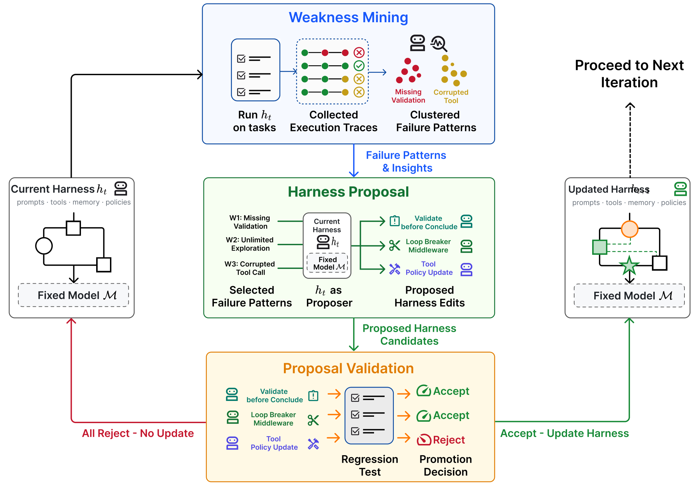
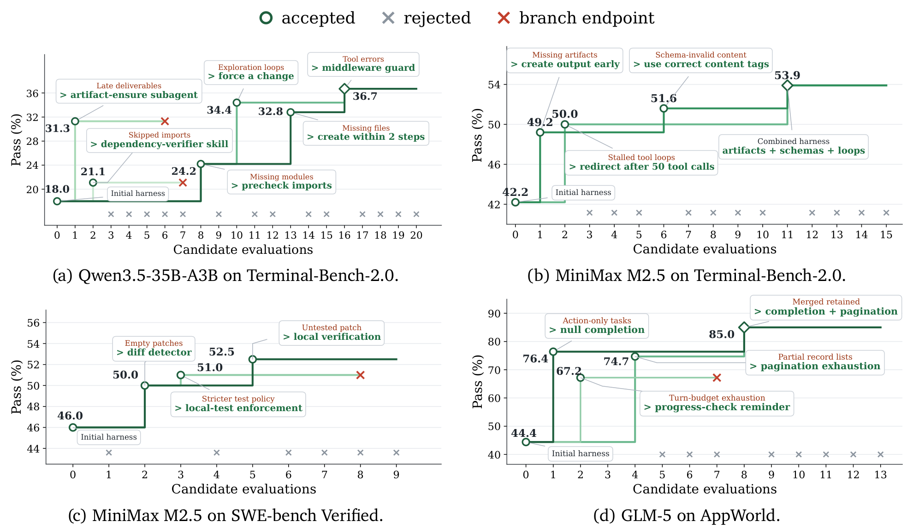

# Self-Harness: Harnesses That Improve Themselves

## 来源信息

| 项 | 内容 |
| --- | --- |
| 标题 | Self-Harness: Harnesses That Improve Themselves |
| 作者 | Hangfan Zhang、Shao Zhang、Kangcong Li、Chen Zhang、Yang Chen、Yiqun Zhang、Lei Bai†、Shuyue Hu†（8 人；全部属 Shanghai Artificial Intelligence Laboratory；† 通讯作者） |
| 机构 | Shanghai Artificial Intelligence Laboratory |
| 来源 | [arXiv:2606.09498v3](https://arxiv.org/abs/2606.09498v3)（cs.CL）；v1 2026-06-08 → v2 2026-08-12 → v3 2026-08-20，31 页；本笔记基于 v3；许可 [CC BY 4.0](http://creativecommons.org/licenses/by/4.0/) |
| 代码 | <https://github.com/qzzqzzb/Self-Harness>（2026-11-09 只读核验：单 commit `2720dbb3`、未标注 license、只发布 `harnesses/qwen_tb2_final/`；未运行、未复现） |
| 阅读日期 | 2026-11-09 |

---

## 核心结论

一句话：**Self-Harness 让同一个固定模型扮演 proposer，从 verifier 归因后的失败簇出发，对 harness 的声明式配置做少量有界编辑；每个候选在 held-in 与 held-out 上过同一道回归门，只有两侧都不降且至少一侧升高的编辑才被合并进下一版。**

- **问题**：agent 的表现不只由 base model 决定，还由 harness（prompts、tools、memory、verification rules、permissions、runtime mechanisms）决定；不同模型的工具习惯与错误模式不同，人工为每个模型重设计 harness 不可扩展（§1）。
- **核心想法**：不靠人类工程师，也不靠更强的外部 agent；同一个固定模型 $M$ 兼任 proposer，改的是预先声明的配置面，不是权重。
- **怎么做到**：失败归因成 $(c_i,q_i,m_i)$ → 聚成失败簇 → 生成 $K$ 个有界编辑 → 双侧回归门 → 合并成下一版，循环 $T$ 轮（§3）。
- **关键结果**：3 个模型 × 3 个 benchmark 的 9 个组合在两侧全部提升；Overall 最大绝对提升 +40.6 pp（GLM-5 / AppWorld，44.4→85.0），最大相对提升 +132%（Qwen3.5-35B-A3B / AppWorld，22.5→52.2）。
- **定位**：它做的是「模型提出、verifier 选择」的有界 harness 工程，不是开放式自我改进；没有跨模型迁移、没有外部 baseline、没有成本数字。

---

## 问题

**Harness 是模型之外的第二个变量。** 论文把它定义为「把固定语言模型部署成 agent 的非参数脚手架」：instructions、tools、memory/state-management、verification rules、permission policies、adapters、runtime mechanisms（§2、§3.1）。给定任务 $x$，模型 $M$ 在 harness $h$ 下执行，得到轨迹 $\tau$ 与输出 $y$，再由 evaluator 判 pass/fail。

论文的出发点不是「模型不够强」，而是「很多失败其实是 harness 层的失败」：agent 没检查产物就报告成功、重复无效动作、在长上下文里丢失事实来源、缺少恢复动作（§2）。这些行为来自 instructions、observations、tools 与 runtime control 的交互，所以只改 prompt 文本不够。

**三条路线的瓶颈**（Figure 1，p2）：

- **人工 harness engineering**：专家检查、手工改 harness。有效，但每来一个新模型都要重做一遍。
- **Meta-Harness**：用更强的外部 agent 去优化较弱 agent 的 harness。成本高，而且对前沿模型未必存在更强的外部 agent。
- **Self-Harness**：同一个固定模型既是被评估的 agent，也是 proposer；不改权重，只改 harness。

**为什么「自动改 harness」不好做**——这是本文设定与前提的来源：

1. **搜索空间大且不可验证**。harness 是提示、工具、运行时策略的混合体；放任模型重写整个框架，就没有便宜办法判断改坏了没有。
2. **失败信号太粗**。只把原始 trace 或一句「timeout」交给 proposer，它只能补表面症状，改不到引起失败的机制。
3. **改进必须可审计、可回滚**。生产 harness 是长期演化的产物，一次编辑要能定位到具体 surface，说清预期行为变化与回归风险。
4. **单侧提升可能只是过拟合**。只在训练侧任务上验证，编辑很容易记住具体任务而不是修机制。

论文因此把范围收窄：它研究的不是「模型能否开放式地自我进化」，而是「同一个固定模型，在当前 harness 下，能否提出一个有界、可被 verifier 检验的 harness 修改」（§3）。

**它依赖的前提**：verifier 能给出 pass/fail（最好还能归因失败）；有 held-in / held-out 两个 split 可做回归门；任务分布相对固定。缺任何一条，这套循环的质量都会下降——这也解释了为什么实验选的都是有官方判定器的 benchmark。

---

## 核心想法

### 一句话

把「改 harness」从一次性人工设计，变成一个**有界编辑 + 双侧回归门**的小步循环：证据负责说清哪里坏了，proposer 负责提改法，verifier 负责否决，账本负责记住改过什么。

### 直觉

harness 的失败有很强的**结构性重复**：同一类缺失的检查、同一类无效重试、同一类丢失的产物，会在很多任务上以不同表面形式出现。所以不必为每个任务单独诊断，只要把失败按「会不会接受同一个 harness 级干预」聚成簇，一次编辑就能覆盖一批任务。

同时，编辑的**收益与风险不对称**：改对一处检查可能救回若干任务，改错一处提示可能让原本通过的任务失败。于是本文把「不让任何一侧变差」当成硬门，把「至少一侧变好」当成收益证据。这是一个很保守的选择，也是它敢用同一个模型做 proposer 的原因——搜索由 verifier 兜底。

### 为什么成立

- **编辑被限制在声明式 surface 上**。模型不是重写 agent 框架，而是改 harness 定义文件里预先声明的配置点（instructions、tools、verification guidance 等）。搜索空间小到可被少量候选覆盖，每次改动可定位、可审计、可回滚。
- **失败证据是结构化的**。proposer 拿到的不是原始 trace，而是归因后的 $(c_i,q_i,m_i)$ 簇：verifier 为什么拒绝、哪个 agent 行为导致它、暴露了哪个可复用机制。三件事分开，才能把「症状」映射到「机制」。
- **门是双侧的**。held-in 保证编辑确实修了看到的失败，held-out 防止它只记住这批任务；两侧都非降、至少一侧升，才允许合并。
- **接受是相对本轮起点**，不是相对同轮其他候选。所以同轮可以接受几个方向不同的编辑，最后合并；代价是合并结果需要额外确认（仓库实现会复评，论文算法没有画这一步）。

### 与已有做法的区别

| 做法 | 谁提改法 | 依据 | 谁决定采纳 |
| --- | --- | --- | --- |
| 人工 harness engineering | 人类专家 | 经验与检查 | 人类 |
| Meta-Harness | 更强的外部 agent | 目标 agent 的执行结果 | 外部优化流程 |
| **Self-Harness** | 同一个固定模型 | verifier 归因后的失败簇 | 双侧非降级回归门 |

与「让模型总结几条经验写进 prompt」相比，本文的产物是**可执行、可比较的 harness 编辑**，而且被 verifier 强制检验过；经验总结只影响下一次提案，无法证明是改好了还是改坏了。

### 一个走通的例子

MiniMax M2.5 在 Terminal-Bench-2.0 上的一条失败记录是：模型算完了答案，但结束时没有把结果写到 `/app/answer.txt`，verifier 因缺产物判失败。这类失败被归到「缺少交付物检查」的机制簇，而不是「算术错误」。

proposer 于是加了一条很小的编辑：先定位 metadata split、算数、写 `/app/answer.txt`、读回验证再停（Figure 7）。同一组合还保留了另外两处编辑——尽早创建 required output artifact，以及 50 条 tool messages 后重定向、停止重复失败路径（Figure 5）。这一组保留的编辑对应 TB2 的 Overall 42.2→53.9。

这个例子的要点是：**失败被归因到机制，编辑才可能小**。如果只看到「这个任务没通过」，proposer 很可能去改提示词语气或加长思考，而不是补一个产物检查。

### 代价

- **评估成本高**。每个候选都要在同一 evaluator 下于两侧各评一次，且每个候选评估 2 次重复尝试；一轮有 $K$ 个候选，再加当前 harness 本身。SWE 的 case timeout 是 3,600 s，单轮就可能很贵；论文没给 $K$、$T$、token 用量或 wall-clock。
- **收益受 verifier 质量限制**。失败归因的质量取决于 evaluator 能否给出可归因的失败信息；仓库实现里诊断还需要一个显式 LLM client，论文没说明用哪个模型。
- **只能做有界编辑**。这套流程不会重写控制架构，也发现不了「当前 surface 表达不了」的改进；更高风险的 harness 变更需要比 pass-rate 非降级更强的准入条件（作者在 §5 承认）。

---

## 方法

### 符号表

| 符号 | 含义 | 取值 / 说明 |
| --- | --- | --- |
| $M$ | 固定的语言模型 | 同时充当被评估 agent 与 proposer |
| $\mathcal{E}$ / $E$ | 固定的 evaluator | 公式里写作 $\mathcal{E}$，符号列表写作 $E$；输出 pass/fail |
| $h$、$h_t$ | harness；第 $t$ 轮的当前 harness | 声明式配置文件，不是权重 |
| $h_t^{(j)}$ | 第 $t$ 轮的第 $j$ 个候选 | $h_t^{(j)}=\Delta_j(h_t)$ |
| $h_T$ | 循环返回的最终 harness | 返回值口径见 Algorithm 1 的读法 |
| $x$、$\tau$、$y$ | 任务、轨迹、输出 | 轨迹记录 messages、tool calls、verifier outcomes |
| $z$、$z_i$ | 任务（第 $i$ 个）的 pass/fail | 由 evaluator 给出 |
| $D_{\mathrm{in}}$、$D_{\mathrm{ho}}$ | held-in / held-out split | 规模随 benchmark 而定 |
| $R_t$ | 当前 harness 在 held-in 上的执行记录 | Weakness Mining 的输入 |
| $F_t$ | $R_t$ 中的失败记录集合 | |
| $r_i$ | 一条失败记录 | $r_i\in F_t$ |
| $c_i$、$q_i$、$m_i$ | 终端原因 / 因果地位 / 可复用机制 | 原文未给各自的取值域 |
| $\phi(r_i)$ | 失败签名 | $(c_i,q_i,m_i)$ |
| $C_\phi$ | 签名完全相同的失败簇 | |
| $B_t$ | evidence bundle | cluster size、代表任务、共享症状、verifier 证据、推断机制 |
| $K$ | proposal width，每轮候选数 | 原文未给数值；仓库默认 `route_count=4` 未确认是论文设置 |
| $\mathcal{P}_t$ | 第 $t$ 轮的 proposal 集合 | $\{(\Delta_j,a_j)\}_{j=1}^{K}$ |
| $\Delta_j$ | 第 $j$ 个编辑，把 $h_t$ 映射为候选 | 有界编辑，不是重写 |
| $a_j$ | 审计记录 | 目标 failure pattern、改动 surface、预期行为变化、回归风险 |
| $P_{\mathrm{in}}(h)$、$P_{\mathrm{ho}}(h)$ | $h$ 在两侧的通过任务数（或通过率） | 原文两种说法并用 |
| $\Delta_{\mathrm{in}}^{(j)}$、$\Delta_{\mathrm{ho}}^{(j)}$ | 候选相对本轮起点的两侧增量 | |
| $A_t$ | 第 $t$ 轮被接受的候选集合 | |
| $T$ | 循环轮数 | 原文未给数值 |

### 数据流

一轮循环分四个阶段，Algorithm 1（p6）把它们写成伪代码：

1. **评估当前 harness**：在 $D_{\mathrm{in}}$ 与 $D_{\mathrm{ho}}$ 上跑 $h_t$，拿到两侧通过数与 held-in 的执行记录 $R_t$。
2. **Weakness Mining**：只用 held-in 的 verifier-grounded 失败，归因成 $(c_i,q_i,m_i)$，聚成簇，整理成 evidence bundle $B_t$。
3. **Harness Proposal**：同一个 $M$ 以 proposer 角色读 $B_t$、当前可编辑 surface、应保留的 passing behaviors、以及之前尝试过的编辑摘要，并行生成 $K$ 个 $(\Delta_j,a_j)$。
4. **Proposal Validation**：每个候选在两侧各评一次，按非降级规则决定接受与否；全拒则保持 $h_t$，否则合并 accepted 编辑得到 $h_{t+1}$。

执行侧的形式关系是：

```math
(M, h, x) \;\longrightarrow\; (\tau, y), \qquad z = \mathcal{E}(x, \tau, y)
```

**逐项读法**：给定模型、harness 与任务，执行产生轨迹与输出；evaluator 再据此判 pass/fail。这套记号的用处是点明可优化对象只有 $h$——$M$ 与 $\mathcal{E}$ 都固定，所以「提升」只能来自 harness 的改动。



*Figure 2（p5）：Weakness Mining 收集轨迹并按 failure pattern 聚类；同一模型作为 proposer 生成候选编辑；Proposal Validation 用回归测试决定 Accept/Reject；全拒则保持原 harness，否则进入下一轮。*

### 失败签名与聚类

原文给出（未编号）：对每条失败记录 $r_i$ 先做一次归因，

```math
\phi(r_i) = (c_i, q_i, m_i), \qquad
C_\phi = \{\, r_i \in F_t \mid \phi(r_i) = \phi \,\}
```

**逐项读法**：

- $c_i$ 是 verifier 最终拒绝的终端原因（timeout、assertion、missing artifact 这类粗分级）。
- $q_i$ 是相关 agent 行为在轨迹中的因果地位——它回答「是哪一步导致了这个终端原因」。
- $m_i$ 是这条轨迹暴露出的可复用 agent 机制——它回答「要改 harness 的什么地方」。
- $C_\phi$ 取三者**完全相等**的记录。所以两个都表现为 timeout 的失败，可能因机制不同落到不同簇；簇不是「语义相似度聚类」，而是「是否可能接受同一个 harness 级干预」的聚类（§3.2）。

每个簇再整理出 cluster size、代表任务、共享症状、verifier 证据与推断机制，按 support 与 estimated actionability 排序，形成 evidence bundle $B_t$。$B_t$ **不规定**具体怎么改 harness，它只把「verifier 层失败」与「agent 层机制」分开，避免 proposer 直接去补一个粗粒度症状。

### Proposal：受限编辑

proposer 不是外部优化器，而是**同一个 $M$**，在当前 $h_t$ 下以 proposer 角色被调用。第 $t$ 轮生成：

```math
\mathcal{P}_t = \{(\Delta_j, a_j)\}_{j=1}^{K}, \qquad h_t^{(j)} = \Delta_j(h_t)
```

**逐项读法**：$\Delta_j$ 是把当前 harness 映射到候选 harness 的编辑，$a_j$ 是随编辑一起落盘的审计记录（目标 failure pattern、改动的 surface、预期的行为变化、回归风险）。$K$ 个候选共享同一个起点 $h_t$，彼此独立，不是串行叠加。

两条约束：

- **分支间要多样**：不同候选应针对不同 failure mechanism、不同 surface，或对同一问题给出不同假设，不能只是换措辞重复同一个簇。
- **分支内要最小**：每个编辑只改解决该机制所需的 surface，保留无关行为，避免重写整个控制架构。

proposer 还要先做 addressability 判断：不是所有失败簇都值得改 harness——有些是任务难度、结果不稳定或模型能力上限。这个约束减少无效 patch，但它不是最终保证：最终不降级仍由下面的回归门负责。

### 回归门

每个候选 $h_t^{(j)}$ 都要在同一 evaluator 下、于两侧分别评估。设 $P_{\mathrm{in}}(h)$、$P_{\mathrm{ho}}(h)$ 为通过任务数（或通过率）：

```math
\Delta_{\mathrm{in}}^{(j)} = P_{\mathrm{in}}(h_t^{(j)}) - P_{\mathrm{in}}(h_t), \qquad
\Delta_{\mathrm{ho}}^{(j)} = P_{\mathrm{ho}}(h_t^{(j)}) - P_{\mathrm{ho}}(h_t)
```

接受规则是：

```math
\Delta_{\mathrm{in}}^{(j)} \ge 0, \quad
\Delta_{\mathrm{ho}}^{(j)} \ge 0, \quad
\max(\Delta_{\mathrm{in}}^{(j)}, \Delta_{\mathrm{ho}}^{(j)}) > 0
```

**逐项读法**：

- 前两项是**非降级**：任一侧低于 $h_t$ 就直接拒绝，哪怕另一侧涨得更多、总通过数更高。
- 第三项是**有效性**：两侧都持平的编辑不算改进，不接受（否则等于白付一次评估）。
- 三个条件合起来只放行「帕累托不劣且确有改进」的候选，明确挡住两类失败模式：记住 held-in 具体任务的过拟合型编辑，以及「总数涨但一侧跌」的 trade-off。
- 评估有随机性时，重复评估并对 aggregate pass counts 应用同一规则，降低「一次幸运运行」被 promote 的概率；没有改动任何可编辑 surface、或在拿到有效评估结果前就执行失败的 proposal 也直接拒绝。
- 代价是保守：如果两侧方差都很大，门既可能放过噪声，也可能拒绝真实但方向不一致的改进。

### Algorithm 1：一轮循环

原文 Algorithm 1（p6）逐行如下（转写，注释是本笔记所加）：

```text
for t = 0, 1, ..., T-1:
    (P_in, P_ho, R_t) = Evaluate(M, h_t, D_in, D_ho, E)
    B_t = BuildEvidenceBundle(R_t)          # 只用 held-in 的 verifier-grounded failures
    P_t = ParallelPropose(M, h_t, B_t, K)   # K 个 (Δ_j, a_j)
    A_t = {}
    for (Δ_j, a_j) in P_t:
        h_t^(j) = Δ_j(h_t)
        evaluate h_t^(j) on D_in and D_ho
        if Δ_in >= 0 and Δ_ho >= 0 and max(Δ_in, Δ_ho) > 0:
            A_t.add((h_t^(j), Δ_j, a_j, Δ_in, Δ_ho))
    h_{t+1} = h_t                    if A_t is empty
              MergeAccepted(h_t, A_t) otherwise
return h_T
```

**逐项读法**：

- **第 2 行只评当前 harness，不评候选**；两侧通过数同时用于后面的增量计算，而 $R_t$ 只取 held-in，保证 proposer 看不到 held-out 的轨迹。
- **第 6–10 行对 $K$ 个候选做同一件事**：先施加编辑得到候选，再两侧评估，再套接受规则。$A_t$ 里存的不只是候选 harness，还有产生它的编辑、审计记录与两侧增量，这是后面能复盘谱系的依据。
- **第 11–12 行是分支**：全拒时原样保留 $h_t$（这一步保证循环不会因为一轮无改进而退化）；有接受时把**同轮所有 accepted 编辑合并**，而不是挑一个最好的。
- **接受基准是 $h_t$**，不是同轮其他候选。所以同轮可以同时接受几个分数高低不一的候选，只要每个都相对 $h_t$ 不降；合并后的结果才是下一版。
- **返回值有一个口径问题**：若最后一轮只有一个 accepted 候选，$h_T$ 就是第 8 行已评估过的候选；若是多个 accepted 合并得到的 $h_T$，算法内**没有复评**。Table 1 若报告的是后者，就需要额外一次评估——论文算法没画，仓库代码会补做（合并后重跑候选评估与 acceptance gate）。

### 与已有方法的结构差异

- **vs 人工 / Meta-Harness**：不改「谁设计 harness」的分工，改的是「谁能提改法」——同一个固定模型，不必存在更强的外部 agent。
- **vs 直接改 prompt / 经验总结**：产物是可执行的 harness 编辑 + 两侧评估记录，而不是一段经验文本；改进是否成立由 verifier 判定，不由 proposer 自述。
- **vs 一次性 harness 搜索**：接受是相对本轮起点、逐轮合并的，形成 $h_0,\dots,h_T$ 的谱系；每条记录都能回放到具体 surface 与某条失败证据。

---

## 主要结果

**设置**：3 个模型（MiniMax M2.5、Qwen3.5-35B-A3B、GLM-5）× 3 个 benchmark（Terminal-Bench-2.0 的 64-case 子集、SWE-bench Verified 的 100-case 子集、AppWorld 的 180 例）；初始 harness 是基于 DeepAgent（LangChain）SDK 的最小 harness；指标是 Pass (%)，每个候选评估 2 次重复尝试。

1. **9/9 组合在两侧都不降且都有提升**，没有出现「一侧涨、一侧跌」的组合。Overall 最大绝对提升 +40.6 pp（GLM-5 / AppWorld，44.4→85.0），最大相对提升 +132%（Qwen3.5-35B-A3B / AppWorld，22.5→52.2）；原文 §1 给的区间是 SWE +3.5～+22.0 pp、AppWorld +10.3～+40.6 pp。
2. **「相对」与「绝对」两种读法给出不同的赢家**：相对提升最大的都是 Qwen3.5-35B-A3B（TB2 +104%、SWE +113%、AppWorld +132%），绝对提升最大的却是 GLM-5 在 AppWorld 的 +40.6 pp。引用「最大提升」时必须说明是哪一种口径。
3. **held-out 的提升不算独立泛化证据**。4 个组合的 held-out 相对提升大于 held-in（TB2 的 MiniMax 与 GLM、SWE 的 MiniMax 与 Qwen），其余 5 个是 held-in 更大或持平；但 held-out 参与了准入，它在这里是 validation 而不是 test。
4. **保留的编辑因模型与 benchmark 而异**，这是「模型特异弱点被转成具体 harness 改动」的主要证据：MiniMax 在 TB2 上补产物检查与 50 条 tool messages 后的重定向，Qwen 在 TB2 上补缺文件循环打断与禁止原样重试，MiniMax 在 SWE 上把 empty-diff 检测与 targeted testing 拆成两个 subagent。

| 模型 | Benchmark | 初始 Overall | 最终 Overall | 提升（pp） |
| --- | --- | ---: | ---: | ---: |
| MiniMax M2.5 | TB2 | 42.2 | 53.9 | +11.7 |
| Qwen3.5-35B-A3B | TB2 | 18.0 | 36.7 | +18.7 |
| GLM-5 | TB2 | 46.1 | 57.0 | +10.9 |
| MiniMax M2.5 | SWE | 46.0 | 52.5 | +6.5 |
| Qwen3.5-35B-A3B | SWE | 19.5 | 41.5 | +22.0 |
| GLM-5 | SWE | 52.0 | 55.5 | +3.5 |
| MiniMax M2.5 | AppWorld | 48.6 | 58.9 | +10.3 |
| Qwen3.5-35B-A3B | AppWorld | 22.5 | 52.2 | +29.7 |
| GLM-5 | AppWorld | 44.4 | 85.0 | +40.6 |

*Table 1（p11）的 Overall 列；提升一列是本笔记按 final−initial 复算的百分点（不是原文表注）。*



*Figure 4（p12）：绿点为 accepted 候选，灰叉为 rejected，红叉为 branch endpoint，绿色菱形为最终 harness（图例未单列）；横轴是候选评估顺序，终点与 Table 1 的 Overall 一致。同轮多个 accepted 编辑是合并而非逐个替换，(d) 中 67.2 低于同轮 76.4 仍被接受即是证据。*

读图时容易误读的两点：**轨迹不单调**（Qwen 的 34.4 之后还有 32.8，GLM 的 76.4 之后还有 67.2），以及**每轮不是只取最高分**——被接受与否只取决于它相对本轮起点 $h_t$ 是否两侧不降。

---

## 边界与局限

**作者承认的（§5）**：

- 研究的是**固定 benchmark 下的有界 harness 编辑**，不是开放式自我改进；接受下来的编辑可能仍反映 benchmark 特定的失败模式。
- 协议依赖 verifier 结果与 trace 记录的质量；更高风险的 harness 变更需要比「pass-rate 非降级」更强的准入条件。

**读者判断的**：

- **没有外部 baseline，也没有消融**：只有「初始 vs 最终」，没有人工 harness、Meta-Harness、或「随机编辑 + 同一回归门」的对照；失败聚类、$K$、minimality、回归门都没有单独 disable 的实验。因此无法判断提升来自「模型特异诊断」还是「多候选搜索 + 选择」。
- **没有跨模型迁移、没有成本/时延**：没有把 Qwen 演化出的 harness 放到别的模型上跑；也没报 token、费用、wall-clock、每轮评估次数——在 3,600 s case timeout 的 SWE 上，这个缺口直接影响可复现性与部署判断。
- **没有方差/置信区间，held-out 也不是 test set**：小 split（TB2 held-out 21、SWE held-out 33）上 1 次尝试分别是 2.38 / 1.52 pp，GLM-5 的 SWE held-out 48.5→50.0 实际只多通过 1 次尝试（32→33 / 66）；而 held-out 参与 promotion gate，最终报告的数字是被选择过的。

---

## 与其他工作的关系

- **00189 HarnessDev**：测量「LLM 能否创建并演化自己的 harness」，其协议可直接当本文的评测环境；本文给出的是一个受约束的改进循环。
- **00199 HarnessX**：用外部 meta-agent 提议、Critic + 确定性门筛选；本文坚持同一个模型做 proposer。
- **00205 Prime Agent**：改的是 harness 的持久状态（prompt notes / memories / skills / subagent specs），本文改声明式配置 surface；两者都不动权重。
- **00212 RRSI**：proposer、analyst、critic 与 policy 同为 Claude Opus 4.8，选择由算法门、带正则/成本项；本文的 proposer 与被评估 agent 共用同一个固定 $M$，门是双侧非降级、没有成本项。
- **00218 HarnessPro**：把执行成本接进 Pareto 选择；本文只看 pass rate，两者可拼成「性能 + 成本」的双目标。

<!-- 复核档案见同目录 audit.md（不随站点发布） -->
