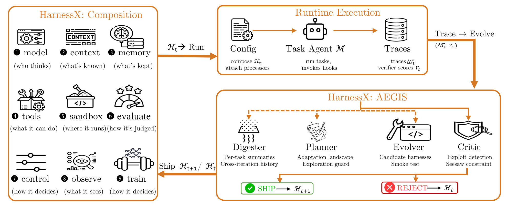
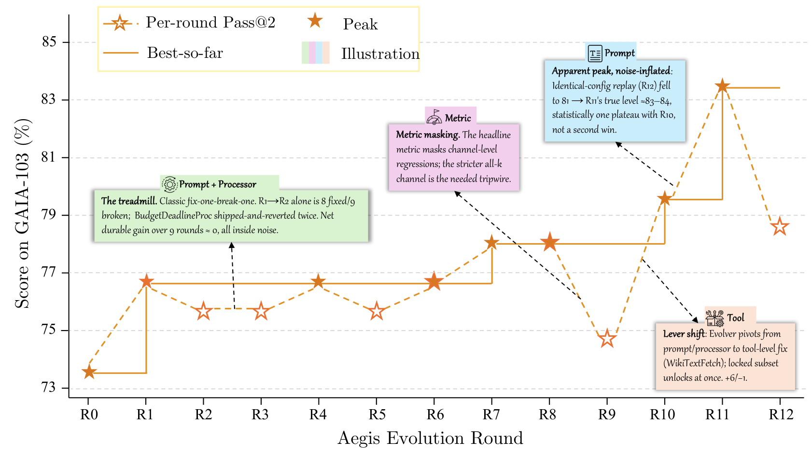

# HarnessX：可组合、可适应、可演化的 Agent Harness Foundry

## 来源信息

| 项 | 内容 |
| --- | --- |
| 标题 | HarnessX: A Composable, Adaptive, and Evolvable Agent Harness Foundry |
| 作者／团队 | 首页署名 **Darwin Agent Team**；arXiv 元信息列 14 位作者，p27 另分 Core Contributors 6 人（3 位同等贡献、2 位通讯）与 Contributors 8 人 |
| 来源 | [arXiv:2606.14249v3](https://arxiv.org/abs/2606.14249v3)（cs.AI；43 页；许可 CC BY 4.0）；官方链接 <https://arxiv.org/abs/2606.14249v3> |
| 版本 | v1 2026-06-12、v2 2026-07-02、v3 2026-07-23（本笔记基准） |
| 项目主页／代码 | <https://darwin-agent.github.io/HarnessX/>；<https://github.com/Darwin-Agent/HarnessX>（MIT） |
| 阅读日期 | 2026-10-14 |

---

## 核心结论

一句话：**HarnessX 把 harness 本身做成一等公民——用类型化 processor 挂在 8 个生命周期 hook 上组合，用「RL 镜像」把 harness 演化当符号空间的 MDP 来防守三类 RL 病理，再用共享 replay buffer 让 harness 演化与模型 GRPO 训练共演化；五基准 15 格平均 +14.5 个百分点，但全部数字取自演化用的同一任务集，没有留出评测。**

- **解决什么**：harness（prompt／工具／记忆／控制流）决定 agent 能力，却仍是手工的、静态的、架构上纠缠的；harness 工程与模型训练又彼此隔离。
- **核心方法**：组合层把 harness 变成类型化、可替换的一阶对象；适应层 AEGIS 用 trace 驱动的四阶段流水线做演化；共演化层让 harness 编辑与模型 RL 共用同一批轨迹。
- **关键结果**：15 格里 14 格改善，平均 +14.5 个百分点、最高 +44.0（ALFWorld／Qwen3.5-9B）；单 harness 在 GAIA 上停滞甚至崩塌，变体隔离把 GAIA／GPT-5.4 从 Δ=0.0 拉到 +13.6；共演化再在 harness-only 峰值上加 4.7。
- **适合什么**：能拿到完整执行 trace、且有固定 verifier 的长程 agent 任务；能力受限的小模型 + 愿意付一次性演化算力时收益最大。
- **一句话定位**：它卖的不是更强的 agent，而是「改 harness」这件事的工程约束——类型系统负责可组合，确定性门负责不回归，共享 buffer 负责不浪费轨迹。

---

## 问题

论文把 harness 定义得很具体（p3 §1）：*把原始模型输出转成结构化 agent 行为的那层中介——决定任务如何被表示、外部服务如何被访问、中间决策如何被传达*。模型、工具、领域一变，这层就要人肉改，而它恰恰是 agent 能力的关键中介。

作者把现有做法的瓶颈归成三条：

1. **手工且静态**：模型版本、工具、领域变化都要人工改 harness，没有「经验驱动改进」的机制。
2. **架构纠缠**：prompt 模板、工具包装、重试策略、记忆混在同一批代码路径里，改一处悄悄坏另一处；跨域复用退化成复制，而不是组合。
3. **harness 工程与模型训练彼此孤立**：改进 harness 时采到的轨迹被丢掉，模型进步也不会转化成 harness 进步。

§2 把已有系统分三层：LangChain／LlamaIndex／Smolagents 是原语层，LangGraph／AutoGen／CrewAI／Letta 是编排层，Claude Code／Cursor／Manus／DeerFlow 是产品层。两个结构性缺口是共通的：**没有任何一层把 harness 暴露为「由类型化元素组成的可替换实体」**，也**没有 in-loop 改进机制**。

§2.1 专门点了并行的 Claude Code **Dynamic Workflows**：运行时生成任务特定的 harness 脚本，是朝自适应迈进了一步，但在单会话内、无持久 trace 优化、无跨会话演化、无 harness-model 共训。

自演化 agent 那条线按被优化对象逐步外扩：prompt（APE／OPRO／EvoPrompt／Promptbreeder／ProTeGi／TextGrad／DSPy／MIPRO）→ 记忆（Memento、MIA）→ 工作流结构（GPTSwarm／ADAS／AFlow／A2Flow／AgentSwift／ResMAS／EvoAgentX，优化组件间关系，组件内部的工具实现与记忆策略仍静态）→ 显式 harness 演化（SICA、Darwin Gödel Machine、HyperAgents、Meta-Harness、AHE、Life-Harness）。作者对这些同族工作的批评是：**缺少把「观测到的失败模式」与「有原则的防守」连起来的统一理论框架**。

本文的设定因此有三个前提：能拿到逐步执行 trace；任务有固定 verifier 可打分；有一个足够强的 meta-agent（实验里是 Claude Opus 4.6）负责读 trace、写代码、提编辑。三者缺一，AEGIS 的闭环都转不起来。

---

## 核心想法

### 直觉：harness 是能力的中介，不是模型的附属

本文自己的结果里，同一个 Qwen3.5-9B 在 ALFWorld 上从 53.0 到 97.0，改的只是 harness。HarnessX 的出发点不是「再训一个更强的模型」，而是承认这层中介本身值得被建模、被版本化、被搜索。一旦 harness 是一个有类型、有 hook、有配置的对象，「改 harness」就从散落在代码里的手工 patch 变成了一个有状态、可回滚的搜索过程。

### 为什么类型化组合成立

- **输入输出事件类型相同**：同一个 hook 上的 processor 吃一种事件、吐零到多个同类型事件，所以可以顺序拼接，插删一个 processor 不影响周围流水线的类型正确性。
- **契约在运行时校验**：run loop 每次调用后检查 hook 契约，改了只读字段就立即抛异常，而不是把坏状态静默传给下游。
- **组合元数据约束冲突**：`_singleton_group` 保证同组至多一个 processor，`_order` 给出 hook 内排序，`_after` 表达对其他 singleton 组的软依赖。
- **变体只是不同的装配**：两个变体之间的差别只在「哪个 processor 占哪个 hook」，类型系统保证不会有变体悄悄违反流水线契约。

### 为什么把演化写成 RL 镜像有用

镜像不提供收敛保证——状态是符号化 harness 配置、动作是开放式代码编辑，经典 RL 的充分探索条件根本不可能满足。它的用处是**当设计清单**：先把 policy、state、action、feedback、update 五项在符号空间里对齐，再逐项问「这里会出哪种 RL 病」。于是 reward hacking、catastrophic forgetting、under-exploration 各自有了明确的防守位置（Critic、确定性门、Planner），而不是等失败发生后再打补丁。

### 与已有做法的区别

| 做法 | 优化对象 | 主要缺口 |
| --- | --- | --- |
| prompt／记忆演化（APE、Memento 等） | 提示或记忆内容 | 不碰工具、控制流与类型契约 |
| 工作流结构演化（GPTSwarm、ADAS、AFlow、EvoAgentX） | 组件间关系 | 组件内部的工具实现与记忆策略仍静态 |
| 显式 harness 演化（SICA、DGM、AHE 等） | 整个 harness 代码 | 缺「失败模式→有原则防守」的统一框架 |
| 产品级动态工作流（Claude Code） | 单会话内生成的脚本 | 无持久 trace、跨会话演化与共训 |
| **HarnessX** | 类型化 processor 装配 + 九维配置 | 需要 trace、verifier 与强 meta-agent |

### 一个走通的例子

GAIA／Sonnet 4.6 的第 10 轮：证据是「本轮所有 Wikipedia fetch 返回 0 字符」（任务 db4fd70a 的 `#step_0`／`#step_1`、f0f46385 连续三次调用，整轮 10 次空响应）。Planner 收到两个目标——解决工具级取源失败，并回退造成 R9 回归的 prompt 与 budget-processor 改动。Evolver 给出跨三个 bucket 的候选 `C-R10-02`：新增走 MediaWiki API 的 `WikiTextFetch`（绕开浏览器，返回 10,529 字符全文）、在 prompt 里加一句「查 Wikipedia 前先用它」、config 恢复 R8 基线并移除有问题的 budget processor。

Critic 批准它的三条理由是：它是 revert-only 候选 `C-R10-01` 的严格超集（移除 budget processor 是有意的）；Level-2 的 round-trip 证据显示工具输出以完整字符串到达模型；这是十轮来第一次 tools ship，而零字符返回的 trace 支持这次干预。结果 74.8%→79.6%（+4.9 个百分点，5 个任务翻正），manifest 预测影响的 7 个任务里 5 个翻正，命中率 0.71，是全部 19 次运行中最高的。这个例子同时展示了三件事：失败证据可以定位到具体工具；编辑可以跨 bucket 组合；「预测哪些任务会翻正」让门可以在事后验伪，而不只是看总分。

### 代价

- **依赖强 meta-agent**：多文件代码生成、结构化 trace 分析、多步规划缺一不可；开放权重模型未测。
- **演化本身不便宜**：GAIA 一轮 103 任务、pass@2 就产生约 10M token 原始 trace；整套 15 轮演化在 GAIA 上按策略不同耗 107.8M–143.7M token。
- **类型安全不等于行为安全**：builder 代数只保证装配合法，manifest 的声称是否兑现仍要靠 Critic 与 trace 证据。
- **需要联合控制权**：harness 演化与模型训练常分属不同团队；共享 replay buffer 在没有跨团队协作时不现实。

---

## 方法

### 符号表

| 符号 | 含义 | 维度／取值 |
| --- | --- | --- |
| $H$, $H_t$ | harness 配置；第 $t$ 轮的配置 | $H=(M,C)$ |
| $M$ | 模型配置：哪个模型担任哪个角色（main／judge／evaluator）及 fallback | 演化全程固定 |
| $C$ | 与模型身份无关的行为配置 | $C=(P,S)$ |
| $P$ | 按 hook 索引的 processor 列表 | `Hook → List[Processor]` |
| $S$ | 固定正交 slot 资源集合：tool registry、tracer、workspace、sandbox provider、plugin list | 单例、跨 processor 共享 |
| $c_i$, $C_i$ | 第 $i$ 个行为维度的分量／其取值空间 | $i=1,\dots,9$ |
| $e$, $E$ | 一次 harness 编辑；编辑动作空间 | $e:H\to H$；$E$ 离散但开放 |
| $R$ | 奖励函数：配置–编辑对到标量 | verifier 分数在适应批次上的聚合 |
| $T_t$ | 截至第 $t$ 轮的 trace store | 单调增长 |
| $\pi_{\mathrm{evo}}$ | harness 更新过程（符号空间的 policy） | 四阶段流水线 |
| $s_t$, $a_t$, $\tilde H_t$ | 状态 $(H_t,T_t)$、动作、候选 harness | $s_t=(H_t,T_t)$ |
| $\Delta T_t$, $r_t$ | 本轮新增轨迹、逐任务 verifier 分数 | — |
| $U$ | 确定性接受算子 | 提交或拒绝 |
| $K_t$ | 每轮候选数 | 实验取 4 |
| $P_{\mathrm{pat}}$ | patience：连续无 ship 的轮数上限 | 原文记作 $P$；实验取 3 |
| $K$, $V_t$ | 变体数上限；第 $t$ 轮的变体数；$H_t^{(k)}$ 为第 $k$ 个变体 | $V_t\le K$；$K$ 值原文未给 |
| $\mathcal B$, $\tau_i$, $r_i$ | replay buffer（定容 FIFO，带 harness 版本标记）；第 $i$ 条轨迹；它的 verifier 分数 | — |
| $x$, $\mathcal G_x$, $\mu$, $\sigma$, $\epsilon$ | 任务；同一任务跨 harness 版本的轨迹组（$\operatorname{task}(\tau_i)$ 为轨迹所属任务）；组均值；组标准差；优势归一化的数值稳定项 | — |
| $\hat A(\tau_i)$ | 轨迹 $\tau_i$ 的组相对优势 | — |
| $\theta$, $\pi_\theta$, $\pi_{\theta_{\mathrm{old}}}$, $\pi_{\mathrm{ref}}$ | 当前策略参数／策略、行为策略、参考策略；$J_{\mathrm{GRPO}}$ 为目标函数 | $\pi_{\theta_{\mathrm{old}}}=M_d$，$\pi_{\mathrm{ref}}=M_0$ |
| $\rho_i(\theta)$, $\epsilon_c$, $\beta$ | 重要性比值、clip 半宽、KL 权重 | 共演化实验 $\epsilon_c=0.2$、$\beta=0$ |
| $C_{\mathrm{buf}}$, $s$ | FIFO 容量；每轮入 buffer 的样本数 | 原文容量记作 $C$；最大滞后 $\lfloor C_{\mathrm{buf}}/s\rfloor$ 轮 |
| $M_k$, $H_k$, $M_d$, $M_0$ | 第 $k$ 版模型与 harness；产出轨迹的 checkpoint；固定参考 checkpoint；$\operatorname{Agent}(M_k,H_k,x)$ 为对应采样过程 | — |
| $n$, $c_i$, $k$, $\vert D\vert$, $r_{ij}$ | pass@k 的 rollout 数、任务 $i$ 的成功次数、k、任务集大小、第 $j$ 次结果 | $c_i=\sum_j r_{ij}$ |

原文用 $P$ 同时表示 processor 列表与 patience、用 $C$ 同时表示行为配置与 FIFO 容量；本笔记分别写 $P_{\mathrm{pat}}$、$C_{\mathrm{buf}}$ 以免混淆。$s$（每轮样本数）原文未定义；按上下文理解为每轮写入 buffer 的轨迹条数。$c_i$ 在两处分别是第 $i$ 个行为分量与任务 $i$ 的 pass@k 成功次数，按上下文区分，未改原文符号。

### 组合层：harness 是一等对象

harness 是二元组 $H=(M,C)$。$M$ 记录角色与 fallback，$C$ 记录与模型身份无关的行为；组合出可执行 agent 的方式是 `agent = model_config.agentic(harness_config)`——agent 是一段绑定到模型的 processor 流水线，两边可独立替换。

$C=(P,S)$。$P$ 按 hook 索引 processor 列表；$S$ 是单例、跨 processor 共享的资源槽。processor 的状态是实例私有的，slot 则全局共享——这个区分是后面「编辑会经共享状态产生非局部影响」的根源。

| hook | 事件类型 | 允许的修改 |
| --- | --- | --- |
| `task_start` | TaskStartEvent | system prompt |
| `step_start` | StepStartEvent | 结构性历史编辑 |
| `before_model` | BeforeModelEvent | 最后一条 user 内容；追加一条 user 消息 |
| `after_model` | ModelResponseEvent | 响应内容、tool calls |
| `before_tool` | ToolCallEvent | 工具输入、approval 标志 |
| `after_tool` | ToolResultEvent | 工具结果 |
| `step_end`、`task_end` | StepEndEvent、TaskEndEvent | 只读 |

processor 协议是 `async def process(self, event: Event) -> AsyncIterator[Event]`：吃一个事件、吐零到多个，恰好产生五种结局之一——pass-through（原样）、transform（改）、split（吐多个同类型事件，下游各自处理）、intercept（不吐，阻断传播）、interrupt（抛异常，终止循环）。因为同一 hook 上输入输出事件类型相同，processor 天然可顺序组合。

九维行为空间（§3.3）是编辑面的坐标系：D1 model selection、D2 context assembly、D3 memory management、D4 tool ecosystem、D5 execution environment、D6 evaluation and reward、D7 control and safety、D8 observability、D9 training bridge。实战中 AEGIS 的编辑覆盖全部九维，D2 与 D4 最频繁；D8 提供 AEGIS 自己推理所依赖的 trace 底座，D9 为共演化供数据。



*Figure 2（p7）：左侧是九维组合空间，右上是一次 rollout（Config → Task Agent $M$ → Traces），右下是 AEGIS 四阶段与确定性门（SHIP $H_{t+1}$／REJECT $H_t$）。*

### 适应层：Operational mirror（Table 2）

| RL 概念 | 符号空间对偶 | AEGIS 实现 |
| --- | --- | --- |
| Policy $\pi$ | harness 更新过程 $\pi_{\mathrm{evo}}$ | 四阶段流水线 |
| State $s_t$ | $(H_t,T_t)$ | harness 配置 + trace store |
| Action $a_t$ | 类型化 harness 编辑 | builder 操作 + change manifest |
| Feedback | trace $\tau$ + verifier 分数 $r$ | 可观测层 |
| Update | $H_{t+1}\leftarrow U(\tilde H_t,T_t,r_t)$ | 确定性接受门 |

三个定义把对应关系钉死（p7–8）：**Def 1（Harness 配置）** $H=(c_1,\dots,c_9)$，每个 $c_i\in C_i$ 实例化一个行为维度，$C_i$ 受 hook 类型契约与 singleton 组排斥约束；**Def 2（Harness 编辑）** $e:H\to H$，改一个或多个维度且保持类型契约，$E$ 离散但开放——每个动作是 meta-agent 生成的代码级产物（新 processor 源码、改过的 prompt 模板、重配的 tool registry、控制流改写），不是从预枚举集合里选，组合爆炸靠 LLM 生成 + 类型约束在生成时剪枝；**Def 3（Operational mirror）** 四元组 $(H,E,R,T)$，$R$ 把配置–编辑对映到标量（verifier 分数在适应批次上的聚合）。

MDP 实例化：状态 $s_t=(H_t,T_t)$，模型 $M$ 在演化全程固定；$\pi_{\mathrm{evo}}$ 采样 $a_t\in E$ 得候选 $\tilde H_t=a_t(H_t)$；在适应批次上跑候选，得 $\Delta T_t$ 与逐任务分数 $r_t$；$U$ 要么提交 $H_{t+1}=\tilde H_t$，要么拒绝 $H_{t+1}=H_t$。无论接受与否 trace store 都增长：$T_{t+1}=T_t\cup\Delta T_t$。门的核心是 seesaw 约束：候选**不得回归 $T_t$ 中任何已被解决过的任务**；它只看已解任务的二元状态，因此对「退步但还没跌破判定阈值」的漂移天然盲视——后文的两次事故都出在这里。

三类 RL 病理在符号空间的放大形态与对应防守（§4.2）：

| 病理 | 为何被放大 | 防守 |
| --- | --- | --- |
| Reward hacking | evolver 可直接瞄准验证协议：把答案嵌进 prompt、利用 verifier 的格式规律、加一个重写输出迎合 verifier 的 processor | Critic |
| Catastrophic forgetting | 修好失败模式 A 的编辑会经共享的 context／tools／memory／control 传播，悄悄让模式 B 回退；只看失败任务 trace 的 evolver 分不清局部收益与全局回退 | 确定性门（seesaw） |
| Under-exploration | 低风险局部编辑便宜且容易过门，反过来把后续 Planner 假设拽回同一邻域；局部编辑耗尽后系统平台化 | Planner |

### 四阶段流水线

1. **Digester**（可选）：整条流水线由同一个 meta-agent LLM 驱动（实验里 Claude Opus 4.6）。Digester 把每任务原始 trace 压成结构化摘要——二元结果、失败类别、涉及组件、支撑证据片段——并链接该任务此前各轮结局与已 ship 编辑，使 Planner 能区分持续失败与瞬时噪声。规模动机很具体：GAIA 一轮（103 任务、pass@2）约 10M token 原始 trace，直接喂下游超上下文，粗暴截断又丢诊断信号（本笔记复算：10M→10K 摘要约 1000× 压缩）。
2. **Planner**（可选）：接收摘要与跨轮历史，构造 adaptation landscape——哪些任务在失败、试过哪些编辑、牵涉哪些组件、哪些编辑类型还没试过。它是防 under-exploration 的主力：先建 landscape 再生成编辑，避免收敛到「按 trace 条件反射做局部修补」。
3. **Evolver**（可选）：产出 $K_t$ 个候选 $\tilde H_t^k$，每个是一个类型化 builder 操作 + 一份 change manifest（改了哪些组件、意图行为效果、预计改善／回退哪些任务）。引入新 processor 代码时必须附冒烟测试，证明它能实例化、能在合成输入上不抛异常地跑起来。builder 代数只保证类型安全，不保证行为安全。
4. **Critic + 确定性门**（强制）：Critic 比对 manifest 声称与 trace 证据、评估经共享状态或控制流的非局部风险，最多发一次修订请求给 Evolver，然后返回 `no_op` 或有序 `ship_ranking`。门按序执行确定性检查：manifest 完整性 → 配置规范化 → build／冒烟测试 → seesaw 约束；第一个失败即中止，通过者提交，失败者连同原因归档。

**Algorithm 1 逐项读法**：输入是当前的 $H_t$ 与 $T_t$；每轮依次调用 Digester、Planner、Evolver，三者各带一个 continuation 条件（可操作性是否够、landscape 是否非空、是否有至少一个类型安全候选），任一不满足就当轮 no-op 短路；只有 Critic 与门无条件执行。门通过则 $H_{t+1}=\tilde H_t$，否则 $H_{t+1}=H_t$；两种情况下 $T_{t+1}=T_t\cup\Delta T_t$。连续 $P_{\mathrm{pat}}$ 轮无 ship 就 break。原文加粗的设计原则是：*语言模型子代理负责探索、假设、提议；类型化结构与确定性门决定什么能 ship。* 作者据此声称安全属性（不回归、无未审计编辑）与 LLM 子代理的失效模式无关。单个演化轮的数据流如下：

```text
H_t + T_t ──▶ Digester（摘要）──▶ Planner（landscape）──▶ Evolver（K_t 个候选 + manifest）
   ──▶ Critic（比对 trace，≤1 次修订）──▶ 确定性门（完整性→规范化→build→seesaw）
   ──▶ ship：H_{t+1} ← 候选；reject：H_{t+1} ← H_t；两种情况下 T_{t+1} ← T_t ∪ ΔT_t
```

### 变体隔离

单 harness 的 seesaw 在「任务之间要求互相冲突的行为」时会拒掉有益编辑——保住稳定，丢掉局部收益。变体隔离改为维护至多 $K$ 个变体 $\{H_t^{(1)},\dots,H_t^{(V_t)}\}$，按「该任务所属簇在既往轮次上的最高估计成功率」路由。门对候选区分两种结局：改善一部分任务且不回归任何任务 → 应用到目标变体；改善一个子集但回归另一个子集 → **fork 出新变体**（池满时退休表现最差的变体），而不是拒绝编辑。多变体存在后，seesaw 按变体作用域生效：针对变体 $k$ 的候选只对路由到 $k$ 的任务做回归检查，所以改好一个簇不会回归另一个簇。$K$ 的取值与「簇」如何构造全文未给；Domain-aware clustering 只作为试点规模的策略被提及（30–40 任务、≤8 轮），未做统计比较。

### 共演化

两层天花板（§5）：只演化 harness 会撞脚手架天花板——脚手架把工具、上下文、控制流都摆对后，约束变成「冻住的模型是否用得上」；只训模型会撞训练信号天花板——新能力在脚手架永不召唤它的场景里得不到锻炼。*更锐利的器械补不了弱内核，更强的内核也补不了从不召唤它的器械。*

迭代七步：① rollout，记录每条 episode 的完整 trace $\tau_i$；② 固定 verifier 打分得 $r_i$（固定 verifier 是 cross-harness 优势可算的前提）；③ 连同产出它的 harness 版本入定容 FIFO replay buffer；④ harness 演化 $H_{t+1}\leftarrow\operatorname{AEGIS}(H_t,\mathcal B)$（非参数）；⑤ 对本轮新增轨迹做一次前向，缓存 token 级 $\pi_{\theta_{\mathrm{old}}}(\tau_i)$ 落盘；⑥ GRPO 更新 $M_{t+1}\leftarrow\operatorname{GRPO}(M_t,\mathcal B)$（参数化）；⑦ 带 $(M_{t+1},H_{t+1})$ 回到 ①。④ 与 ⑤⑥ 读同一个 buffer，但同一轮内互不条件于对方的输出，两者都完成才进入下一次 rollout。

**原文 Eq (2)–(3)**：cross-harness 分组与组相对优势。

```math
\mathcal G_x=\{\tau_i\in\mathcal B \mid \operatorname{task}(\tau_i)=x\}
=\bigcup_k\{\tau\sim\operatorname{Agent}(M_k,H_k,x)\},\qquad
\hat A(\tau_i)=\frac{r_i-\mu(\mathcal G_x)}{\sigma(\mathcal G_x)+\epsilon}
```

**逐项读法**：$\mathcal G_x$ 是任务 $x$ 的轨迹组；关键是**不论轨迹出自哪个 $(M_k,H_k)$ 都并进同一组**，所以组内差异主要由 harness 身份而非随机采样造成。$\hat A(\tau_i)$ 把奖励减去组均值、再除以组标准差加 $\epsilon$，得到跨策略的奖励对比。这样每个新 harness 版本相当于往该任务的采样分布里注入一个不同的行为模式，模型被推向 verifier 打分更高的模式——单策略采样给不了的探索广度，由不断演化的脚手架提供。

**原文 Eq (4)**：GRPO 目标。

```math
J_{\mathrm{GRPO}}(\theta)=\mathbb E_{x,\tau_i\sim\mathcal B}\Big[\min\big(\rho_i(\theta)\hat A(\tau_i),\ \operatorname{clip}(\rho_i(\theta),1-\epsilon_c,1+\epsilon_c)\hat A(\tau_i)\big)\Big]-\beta D_{KL}(\pi_\theta\|\pi_{\mathrm{ref}})
```

**逐项读法**：对所有采样轨迹取期望；括号里取「未裁剪的重要性比值乘优势」与「把比值裁剪到 $1\pm\epsilon_c$ 后再乘优势」的较小值，这是 PPO 式保守更新；最后减去相对参考策略的 KL 惩罚，$\beta$ 是权重。注意共演化实验里 $\beta=0$（无 KL 惩罚），公式里的 KL 项在该组实验中并未生效。

**原文 Eq (4)–(5) 中的重要性比值**：

```math
\rho_i(\theta)=\frac{\pi_\theta(\tau_i\mid x)}{\pi_{\theta_{\mathrm{old}}}(\tau_i\mid x)},\qquad
\pi_{\theta_{\mathrm{old}}}=M_d
```

**逐项读法**：分母的行为策略 $\pi_{\theta_{\mathrm{old}}}$ 是**产出该轨迹的那个 checkpoint** $M_d$，逐轨迹不同；分子是当前策略。**容易看错的一处**：$\pi_{\theta_{\mathrm{old}}}$ 与 KL 项里的 $\pi_{\mathrm{ref}}=M_0$ 不是同一个东西——后者全程固定。

离策略处理（§5.4）：$\pi_{\theta_{\mathrm{old}}}$ 因 $M_k$ 逐条不同，无法从任何单一模型恢复，所以在**入 buffer 时**用 $M_k$ 做一次前向、把 token 级 log-prob 缓存到磁盘，此后每个梯度步复用；$\rho_i(\theta)$ 则用当前策略重算。FIFO 容量 $C_{\mathrm{buf}}$、每轮 $s$ 条样本，最大版本滞后 $\lfloor C_{\mathrm{buf}}/s\rfloor$ 轮——缓存的 $\pi_{\theta_{\mathrm{old}}}$ 总落在 $\pi_\theta$ 的有界窗口内，同一个窗口也界定了 harness 的陈旧度。**无额外 rollout 成本**：一轮探索的轨迹同时驱动两个更新，GRPO 只做 replay，边际成本是「每条轨迹一次缓存前向」＋「梯度步」。

### 评测口径

**原文 Eq (6)**：所有曲线的 Pass@k。

```math
\text{Pass@k}=\frac{1}{\vert D\vert}\sum_{i=1}^{\vert D\vert}\left(1-\frac{\binom{n-c_i}{k}}{\binom{n}{k}}\right)
```

**逐项读法**：对每个任务，先算「从 $n$ 次 rollout 里取 $k$ 次全都失败」的概率，取补概率得到该任务的 pass@k，再对所有任务取平均；$c_i$ 是任务 $i$ 在 $n$ 次 rollout 中的成功次数。演化曲线一律用 pass@2，即两次独立 rollout 任一成功即算解出。两条口径说明：基础设施失败（沙箱崩溃、API 超时）计为失败而非剔除，以对齐官方 leaderboard；pass@2 降低单次随机性，代价是掩盖 sub-threshold 的成功率漂移——这一点后面反复成为失败的根因。

### 与已有方法的结构差异

与已有做法相比：prompt／记忆演化只改提示或记忆；工作流结构演化只改组件间关系；显式 harness 演化改整个 harness 代码，但接受规则各自设计、缺「失败模式→有原则防守」的统一框架；产品级动态工作流只在单会话内生成脚本。HarnessX 把编辑面收敛到类型化 processor 装配与九维配置，用类型契约 + manifest + 确定性门约束，反馈来自结构化 trace + verifier；共演化版再把模型权重接进同一个 buffer。

---

## 主要结果

**设置**：5 个基准 × 3 个任务模型（Claude Sonnet 4.6、GPT-5.4、Qwen3.5-9B），每格最多 15 轮、连续 3 轮无 ship 提前停；每轮评测全任务集，不做子采样；meta-agent 全程 Claude Opus 4.6。基线是「已发表基准专用 prompt 与工具定义构造的 Static Harness」与「Claude Code SDK 单代理 evolver（同基础设施、同轮数预算）」。所有数字都是**峰值**口径。

| 基准 | Claude Sonnet 4.6 | GPT-5.4 | Qwen3.5-9B |
| --- | --- | --- | --- |
| ALFWorld | 83.6 → 94.8（+11.2） | 76.9 → **97.8**（+20.9） | 53.0 → 97.0（+44.0） |
| WebShop | 60.0 → **76.0**（+16.0） | 55.0 → 73.0（+18.0） | 36.0 → 49.0（+13.0） |
| GAIA | 73.8 → **83.5**（+9.7） | 73.8 → 73.8（0.0） | 20.3 → 37.4（+17.1） |
| SWE-bench Verified | 76.4 → **87.3**（+10.9） | 45.5 → 63.6（+18.2） | 23.6 → 41.8（+18.2） |
| τ³-Bench（域均值） | 89.6 → **95.0**（+5.4） | 76.2 → 90.7（+14.5） | 93.5 → 94.6（+1.1） |

*Table 4（p16）的压缩转写；加粗＝原文 Evolved 列中该基准的最高值。τ³ 按表注为域均值、无单一峰值轮。*



*Figure 4（p16）：GAIA-103／Sonnet 4.6 的 pass@2 逐轮轨迹；原文注记标出 treadmill、metric masking 与「apparent peak, noise-inflated」，峰值 83.5 在 R11。*

- **15 格中 14 格改善，平均 +14.5 个百分点**：15 格 Δ 之和 218.2，除以 15 得 14.55（本笔记复算；口径为百分点的算术平均，非相对提升）。最高 +44.0 出现在 ALFWorld／Qwen3.5-9B。
- **增益与基线强弱反相关，收敛速度跟随失败模式集中度**：最弱 agent 收益最大——ALFWorld +44.0（基线 53.0）、GAIA +17.1（基线 20.3）、SWE-bench +18.2（基线 23.6），强模型增益更小；ALFWorld 上跨家族（GPT +20.9、Qwen +44.0）反而比同家族（Sonnet +11.2）更大，说明跟的是基线强弱而非与 meta-agent 的家族亲疏。收敛上，ALFWorld（GPT-5.4）R4 见顶、SWE-bench 全部 agent R2–R3 见顶，两者失败都集中在 1–2 类组件；GAIA（Sonnet）要 11 轮，因为失败横跨 prompt／tool／processor／configuration 四类组件。
- **唯一停滞格暴露单 harness 的失效**：GAIA／GPT-5.4 Δ=0.0。变体隔离把同一 run 的 final 从 49.5 拉到 87.4（peak 73.8→87.4，peak–final 落差 −24.3→0.0），演化 token 从 143.7M 降到 107.8M。Global 策略 R4 早峰后持续退化，作者用「peak–final 落差远超 n=103 时每轮二项 95% CI ±8.5%」排除评测噪声，判定为 catastrophic forgetting。
- **四阶段架构的准确率增益不显著，效率增益显著**：AEGIS 87.4 vs CC SDK 86.4（差 1.0，落在 n=103 的一个标准误 ~3.3% 内）；token 107.8M vs 123.1M。作者的解释是：变体隔离下、meta-agent 足够强时，准确率主要来自基础设施（类型化组件使隔离可行、结构化 trace 使诊断可行），四阶段贡献的是效率与可解释性。
- **共演化越过脚手架天花板**：GAIA 文本子集 37.4%→41.7%、WebShop 49.0%→54%，均值 +4.7（本笔记复算：(4.3+5.0)/2=4.65）。两条曲线在 R4 联合训练生效前重合、之后分离，差距保持到末轮（GAIA 36.4→39.8，WebShop 46.0→50.0）——抬的是末轮成绩，不只是峰值。
- **三类病理都真实出现，但只有两类被现有信号及时抓住**：reward hacking 在 GAIA／Sonnet 的 R10–R12 被 trace 分析发现并在两轮内加 guard 缓解；catastrophic forgetting 在 τ³ Telecom／Sonnet 的 R7 造成 −14.0（94.7→80.7），逃过 seesaw，因为 pass@2 只登记逐任务二元翻转、不登记 sub-threshold 耦合；under-exploration 由 ship-prediction accuracy 从 R3 的 80% 掉到 R7 的 0% 诊断出来。作者由此提炼：**反馈信号的丰富度界定了能安全执行的演化的精细度**。

---

## 边界与局限

**作者明确承认的**：

- **评测与理论证据都不足**：所有报告的增益都在用于演化的同一任务集上测量，报峰值又在适应集上评测，数字同时带选择偏差与过拟合风险，同分布未见过任务上的泛化「plausible but untested」；而镜像只是设计启发式——经典 RL 的充分探索条件在这里不可能满足，它不预测哪种病理会主导、何时出现、哪个更严重，三类病理也只是代表性而非穷尽。
- **依赖闭源强 meta-agent 与联合控制**：AEGIS 需要能做多文件代码生成、trace 分析与多步规划的 meta-agent，开放权重模型未测；共演化还要求 harness 演化与模型训练同属一个团队、共享 buffer。
- **覆盖与动作空间有限**：只测离散、文本动作空间；SWE-bench 全部用 55 任务子采样，τ³ 只评三个域；变体隔离的 $V_t$ 最终等于 peak 只在 15 轮内成立，任务间有依赖、无法干净切簇时没有保证。

**读者判断（非作者结论）**：

- **峰值与逐编辑门控各有盲区**：Figure 4 的原文注记自己写了「apparent peak, noise-inflated」——R12 用相同配置重放掉到 81，R11 的真实水平约 83–84，与 R10 在统计上是同一平台，至少 GAIA／Sonnet 的 +9.7 应视为「与 R10 同平台」；而 seesaw 的不回归是相对已解任务的二元状态，对「退步但未跌破判定阈值」的漂移天然盲视，τ³ Telecom 的 R7 崩溃与 GAIA／GPT-5.4 的 R5–R6 执行悬崖都是直接后果。
- **主表无方差，关键机制参数缺失**：Table 8 声明每格 3 个随机种子，但主表只给单值、无方差或置信区间，全文只在两处给过不确定度（n=103 时每轮二项 95% CI ±8.5%、标准误 ~3.3%），Figure 5 的 +4.7 也建在两条单曲线峰值差上；$K$ 与簇构造全文未给，而变体隔离的核心结论完全建立在这套机制上，想复现或搬用时这是最先卡住的地方。

---

## 与其他工作的关系

- **RRSI（00212）**：RRSI 把「演化涨分能否迁移」当优化问题，用正则把改动约束到可迁移的机制上；HarnessX 用运行时约束（类型化组合、manifest 可伪证、确定性门、版本／回滚）管同类风险。本文正是 RRSI 笔记里作为 baseline 出现、带整行成绩的 HarnessX。
- **HarnessDev（00189）**：那篇给的是 harness 演化的评测协议，核心发现是「演化涨分 ≠ 留出受益」；HarnessX 给的是演化运行时，但自认不做留出、报峰值——两者正好构成「评测方」与「被评测方」。
- **Prime Agent（00205）**：Prime Agent 是运行时 harness 状态持久化（skill／subagent spec／memory 的 refinement + 版本／回滚，不改权重）；HarnessX 是配置的代码级演化 + 改权重的共演化——同一个「harness 自演化」问题的两条互补路线。
- **RSI 导读（00192）**：导读要求「更新产物要被后续任务复用才算 RSI」；HarnessX 的 ship 物是代码级产物，落地后会被后续轮次与部署复用，符合复用要件，并额外给出「复用可被验证」的工程细节（manifest 的 `attribution_signature` 要求下一轮 trace 出现特定特征）。
- **同名辨析**：本文引的 SICA、DGM、HyperAgents、Meta-Harness、AHE 与仓库条目 00193 Hyperagents、00198 Self-Harness、00202 Evo-Harness 名字接近，引用时按 arXiv 编号核对，别按名字对号。

<!-- 复核档案见同目录 audit.md（不随站点发布） -->
