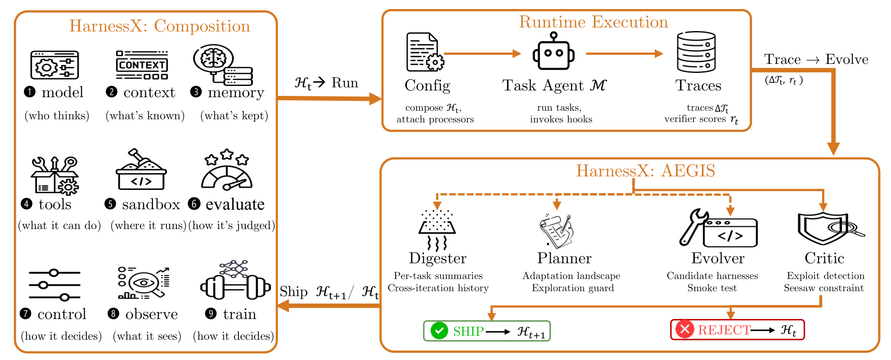
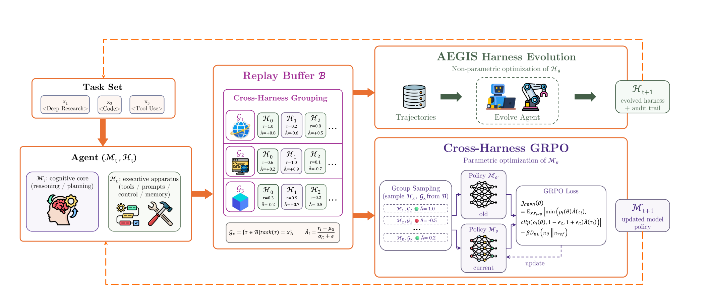
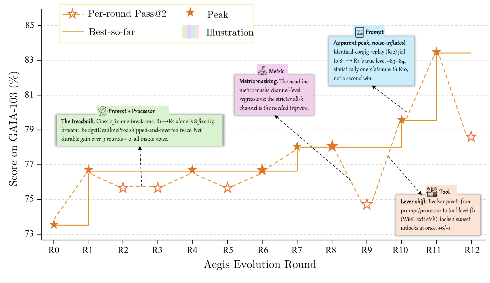

# HarnessX：可组合、可适应、可演化的 Agent Harness Foundry

## 来源信息

| 项 | 值 |
| --- | --- |
| 标题 | HarnessX: A Composable, Adaptive, and Evolvable Agent Harness Foundry |
| 作者／团队 | 首页署名 **Darwin Agent Team**；arXiv 元信息／abs 页列 14 位作者（**不带任何符号**）：Tingyang Chen, Shuo Lu, Kang Zhao, Weicheng Meng, Hanlin Teng, Tianhao Li, Chao Li, Xule Liu, Jian Liang, Zhizhong Zhang, Yuan Xie, Heng Qu, Kun Shao, Jian Luan。p27「Contributions and Acknowledgments」另有分工标注：**Core Contributors 6 人**（Chen、Lu、Zhao 标 Equal Contribution；Shao、Luan 标 Corresponding Author；另有 Weicheng Meng），**Contributors 8 人**（Hanlin Teng、Tianhao Li、Chao Li、Xule Liu、Jian Liang、Zhizhong Zhang、Yuan Xie、Heng Qu） |
| 来源 | **arXiv:2606.14249v3** [cs.AI]（非归档 PDF，只记官方链接） |
| 官方链接 | <https://arxiv.org/abs/2606.14249v3> |
| 版本历史 | v1 2026-06-12、v2 2026-07-02、v3 2026-07-23（本次阅读的版本） |
| 许可 | CC BY 4.0（abs 页 "view license" 指向 `creativecommons.org/licenses/by/4.0/`，本文档由 arXiv 生成，核验日期 2026-10-14） |
| 项目主页 | <https://darwin-agent.github.io/HarnessX/> |
| 代码仓库 | <https://github.com/Darwin-Agent/HarnessX>（MIT，核验日期 2026-10-14；见「版本与渠道关系」） |
| 页数 | 43 页（p1 标题与摘要、p2 目录、正文 p3–23、参考文献 p24–26、贡献与致谢 p27、附录 p28–43；PDF 文件页与印刷页码一致） |
| 阅读日期 | 2026-10-14 |
| 阅读范围 | v3 全文 43 页均读到；正文与附录逐节阅读 |

**阅读范围与核对凭据**（供下次复核复用）

- **已渲染并逐项核对**：Table 3（p15）、Table 4（p16）、Table 5（p17）、Table 6（p18）、Table 7（p22）、Table 8（p29）、Table 9（p36，350 dpi 局部放大）——均在 200 dpi 渲染页上逐格比对正文数字（Table 4 另做了字体级加粗判定，见「复核记录」）；Eq. 6（Pass@k，p29）与 Eq. 1–5（p13–14，400 dpi 局部）在渲染页核对上下标；§6.2「Inverse scaling」段（p15）、§C.1「Failure evidence」段（p36）、§D.5「Did evolution close the clusters?」段（p42）在 350 dpi 渲染页逐字核对归属与限定词。
- **像素测量**：Figure 4（p16）逐点读数。方法：600 dpi 渲染裁剪框 `Rect(104,113,507,346)`（pt，页面坐标系），橙色星标按填充色 `#D67721` / `#E97131`（实测矢量填充为 RGB(214,120,33) / RGB(233,113,50)，分割用 ±16/±18/±25 容差带）做连通域分割，取每个 13 个等距位置（x 起点 369.3 px，间距 238.2 px）星标的 `(ymin+ymax)/2` 为纵坐标；标定用 7 条灰色虚网格线行（y_px = 174.5, 412.5, 653.0, 891.0, 1129.0, 1368.5, 1610.5），线性拟合 `value = −0.008363·y + 86.4540`（1 单位 = 119.57 px）。**标定有效性经三个独立正文值验证**：R11 读数 83.50 对 Table 4「GAIA / Sonnet 4.6 / Evolved 83.5」、R10 读数 79.60 对 §C.1「79.6%」、R9 读数 74.75 对 §C.1「74.8%」。取数口径为**星标上下边中点**（该图星标以数据点为几何中心；含虚线并入的连通域用中点比质心更稳）。
- **放大读数**：Figure 5（p19）两处峰值星标在 600 dpi 裁剪下读出：GAIA 面板 41.7%（Co-Evolution）与 37.4%（AEGIS），WebShop 面板 **54%**（Co-Evolution，非 "5.4%"——200 dpi 下易误读）与 49%（AEGIS）。
- **插图**：Figure 2（p7）、Figure 3（p12）、Figure 4（p16）从 300 dpi 渲染页裁剪（裁剪框见上），已按元素清单逐项点名核对完整（含图内标题、图例、坐标轴标签、图内注记、SHIP/REJECT 等），四边像素纯白、无边黑边或截断。
- **仅按正文/图注引用，未逐点核对**：Figure 1（p1）、Figure 6（p20，文字内容已读，未做像素测量）、Figure 7（p38 manifest card）、Figure 8–12（p39–43 附录分基准三联图，图内数值一律按正文引用）。
- **未做**：未运行任何代码、未复现实验；未对仓库代码做功能验证（只核验仓库存在性、许可与顶层目录结构）。

**版本与渠道关系**（多渠道核验，2026-10-14）

- **arXiv v3 与站点 tech report 的关系**：主页 assets 下的 `HarnessX_Tech_Report.pdf`（2,110,177 B，sha256 `ab69a5ea…`）与 arXiv v3（2,254,858 B，sha256 `81175fb0…`）**均为 43 页，全部关键数字出现次数逐一相同**（`+14.5%`×6、`+44.0%`×11、`87.4`×7、`107.8M`×7、`143.7M`×4、`49.5`×4、`83.5`×1、`79.6`×2、`74.8`×3、`77.7`×1、`WikiTextFetch`×13、`8× H100`×1 等），逐页归一化文本比对后差异**仅一处**：站点版首页写「The complete codebase will be open-sourced in a future release」，v3 改写为「Project homepage: <https://darwin-agent.github.io/HarnessX/>」（其余差异是站点 PDF 连字编码导致的抽取噪声，如 `verified`→`veried`）。**站点版为较早措辞**；本笔记与本次核对一律以 arXiv v3 为准。
- **代码发布状态：论文未声明公开链接，但仓库实际已公开。** 全文**没有**发布声明（按 `open-source` / `release` / `will be released` / 链接 等词检索，除参考文献外无命中）；但**附录 B 两处提到实验文件存在于「the repository」**——B 开头写「the literal contents of the corresponding files **in the repository** as of the commit that produced the experiments in Section 6」（p29），B.2 写「the remaining benchmark defaults … are **listed in the repository**」（p34）——既未给链接、也无公开承诺。附录 E「Reproducibility and Artifacts」只描述运行目录结构 `runs/<run_name>/…`（journal.md、curves.json、audit.jsonl、`R<n>/{landscape,candidates,applied,decision,verdicts,regressions,digests,trajectories}`）这一日志布局，未说明该结构是否有公开产物。而正文给出的项目主页链到 GitHub 仓库 `Darwin-Agent/HarnessX`（API 核验：MIT、创建 2026-04-30、最后 push 2026-10-10、491 stars、约 56 MB），顶层含 `harnessx/`（下有 `processors/`、`bundles/`、`meta_harness/`、`rl/`、`sandbox/`、`tracing/`、`workspace/` 等）、`benchmarks/`、`container/`、`extensions/`、`tests/`、双语 README。**只核验了仓库存在性与目录结构，未验证其与本文实验的可复现性对应关系**——本笔记中所有结论均以论文自述为准。

**复核记录（2026-10-14，check-paper-note）**

- **基准版本**：arXiv 2606.14249v3。复核时**重新下载**，sha256 `81175fb0d23cf9fbd2e6aaf4de6c0192afa0791477f5ec64320d44c638b4b4be`、43 页，与首读版本逐字节一致；arXiv 元信息确认 **v3 仍是当前最新版**。清单 00199 行：编号列指向 arXiv 官方页（上游归档仓库最大编号为 00191，尚无本篇，指向正确）、笔记链接可达、未撞 `papers/` 文件名。
- **核对方式**：PDF 全文文本抽取 ＋ 关键页渲染（200/350/400/500 dpi）＋ **Table 4 字体级加粗判定**（`get_text('dict')` 的 span 字体，`ByteSans-Bold` 恰 5 格）＋ Figure 4 像素测量（600 dpi，网格线定标 `value = −0.008363·y + 86.4540`）＋ Figure 5 峰值标签 600 dpi 放大 ＋ **独立子 agent 审计**（另一套方法：表格 span 级抽取、Figure 4 矢量路径提取与最小二乘定标、配图同坐标像素差比对；其结论已逐条复验）。否定性断言的检索词：`open-source` / `release` / `will be released` / `codebase` / `repository` / `up to K` / `K =` / `cluster` / `seeds` / `standard error`。
- **修正 9 项**：① Table 4 加粗（原文只加粗 Evolved 列 5 格；原稿误加粗 Δ 列且漏 4 格）；② 作者标注的**来源与完整性**（星号/剑号出自 p27，而非 arXiv 元信息；补 Zhao 的同等贡献与 Shao/Luan 的通讯标注）；③ 页数划分（参考文献 p24–**26**，p27 是贡献与致谢，p2 是目录）；④ 代码发布状态补上附录 B 两处「the repository」提及；⑤ 速查「最大单轮回退」→ 加限定（原文未支持「最大」）；⑥ 演化 token 省 25% → 标为本笔记复算，并区分 §7.5 的每任务推理成本；⑦ Figure 6 不一致清单补 (h) 面板；⑧ Figure 4 图注补图例第 4 项 Illustration；⑨ 像素测量凭据补实测色值与容差带。
- **未修项与理由**：Figure 4 的 R7/R8 读数（78.1）不落在任何 k/103 上，且与 §C.1 的「peak 77.7%」差约 0.4pp——**原文未给该图的口径（是否 3 seed 平均）**，无法复算判定谁为准，故保留为「原文自身的表述张力」第 2 条，不代为裁决。
- **渠道核验项**（本次复跑一致）：站点 tech report 2,110,177 B / sha256 `ab69a5ea…` / 43 页 / 仅首页一句措辞与 v3 不同；GitHub `Darwin-Agent/HarnessX` MIT、创建 2026-04-30、最后 push 2026-10-10、491 stars；许可 CC BY 4.0。核验日期 2026-10-14。

---

## 一句话

HarnessX 把 **harness 本身做成一等公民**：用类型化 processor 挂在 8 个生命周期 hook 上做组合，用「RL 镜像」把 harness 演化当符号空间的 MDP 来防守三类 RL 病理，再用一个共享 replay buffer 让 harness 演化与模型 GRPO 训练共演化——五基准 15 格平均 +14.5%（峰值口径），但**全部数字取自演化用的同一任务集，无留出评测**。

## 1. 核心结论

- **解决什么**：harness（prompt／工具／记忆／控制流）是 agent 能力的关键中介，却仍是**手工的、静态的、架构上纠缠的**，且 harness 工程与模型训练互相隔离（§1 三条 gap）。
- **核心方法**：三层合一——**组合层**（harness 是类型化可替换的一阶对象）＋**适应层 AEGIS**（trace 驱动的四阶段演化引擎）＋**共演化层**（harness 演化与模型 RL 共用同一批轨迹）。
- **结果**：5 个基准 × 3 个任务模型 = 15 格中 14 格改善，平均 **+14.5%**（最高 +44.0%），增益**与基线强弱反相关**（越弱获益越大）；异质任务集（GAIA）上单 harness 演化会停滞甚至崩塌，变体隔离把 GAIA/GPT-5.4 从 Δ=0.0 拉到 **+13.6%**；共演化再在 harness-only 之上加 **+4.7%**（两基准峰值均值）。
- **适合什么场景**：能拿到完整执行 trace、且有固定 verifier 的长程 agent 任务；**能力受限的小模型 + 愿意付一次性演化算力**的组合收益最大。不适合：无法切分任务簇的强耦合任务集、只有标量奖励而无 trace 的场景、以及需要「未见过任务上可迁移」保证的部署（本文未测）。

## 2. 问题与动机

论文开篇把 harness 定义得很具体（p3 §1）：*把原始模型输出转成结构化 agent 行为的那层中介——决定任务如何被表示、外部服务如何被访问、中间决策如何被传达*。三条 gap：

1. **手工且静态**：模型版本、工具、领域一变就要人肉改，没有「经验驱动改进」的机制。
2. **架构纠缠**：prompt 模板、工具包装、重试策略、记忆混在同一批代码路径里，改一处悄悄坏另一处；跨域复用退化成**复制**而不是**组合**。
3. **harness 工程与模型训练彼此孤立**：改进 harness 时采到的轨迹数据被丢弃，模型进步也不会转化为 harness 进步。

§2 的相关工作把已有系统分三层，并指出两层结构性缺口：**没有任何一层把 harness 暴露为「由类型化元素组成的可替换实体」**，也**没有 in-loop 改进机制**（LangChain／LlamaIndex／Smolagents 是原语层；LangGraph／AutoGen／CrewAI／Letta 是编排层；Claude Code／Cursor／Manus／DeerFlow 是产品层）。§2.1 还专门点出并行的 Claude Code **Dynamic Workflows**：运行时生成任务特定的 harness 脚本是朝自适应迈进了一步，但**在单会话内、无持久 trace 优化、无跨会话演化、无 harness-model 共训**。

自演化 agent 那条线（§2.2）论文按被优化对象逐步外扩来梳理：prompt（APE／OPRO／EvoPrompt／Promptbreeder／ProTeGi／TextGrad／DSPy／MIPRO）→ 记忆（Memento、MIA）→ 工作流结构（GPTSwarm／ADAS／AFlow／A2Flow／AgentSwift／ResMAS／EvoAgentX，优化的是**组件间关系**，组件内部的工具实现与记忆策略仍静态）→ 显式 harness 演化（SICA、Darwin Gödel Machine、HyperAgents、Meta-Harness、AHE、Life-Harness）。作者对这些同族工作的批评是：**缺少把「观测到的失败模式」与「有原则的防守」连起来的统一理论框架**——这正是本文「operational mirror」要补的位。

> 背景：§2.2 末尾引的 heuristic-learning theory（[38] J. Weng, "Learning beyond gradients"）是本文「RL 镜像」的思想来源，属**仓库外**材料。

## 3. 方法

### 3.1 组合层：harness 是一等对象（§3）

- **两种正交配置**：harness 是二元组 `H = (M, C)`。`M` 记录**哪个模型担任哪个角色**（main／judge／evaluator）及 fallback 策略；`C` 记录**与模型身份无关的行为**。二者组合出可执行 agent：`agent = model_config.agentic(harness_config)`——agent 是一段**绑定到模型的 processor 流水线**，两边都可独立替换。
- **hook 与 processor**：`C = (P, S)`。`P: Hook → List[Processor]` 是**按 hook 索引的 processor 列表**；`S` 是固定的正交 slot 资源集合（tool registry、tracer、workspace、sandbox provider、plugin list），slot 是**单例、跨 processor 共享**，processor 状态则是实例私有的。
- **8 个生命周期 hook 与各自「允许改什么」**（Table 1）——这张表是理解「编辑面」的关键：

| hook | 事件类型 | 允许的修改 |
| --- | --- | --- |
| `task_start` | TaskStartEvent | system prompt |
| `step_start` | StepStartEvent | 结构性历史编辑 |
| `before_model` | BeforeModelEvent | 最后一条 user 内容；追加一条 user 消息 |
| `after_model` | ModelResponseEvent | 响应内容、tool calls |
| `before_tool` | ToolCallEvent | 工具输入、approval 标志 |
| `after_tool` | ToolResultEvent | 工具结果 |
| `step_end` | StepEndEvent | **只读** |
| `task_end` | TaskEndEvent | **只读** |

- **processor 协议**：`async def process(self, event: Event) -> AsyncIterator[Event]`——吃一个事件、吐零到多个，恰好产生**五种结局之一**：pass-through（原样）、transform（改）、split（吐多个同类型事件，下游各自独立处理）、intercept（不吐，阻断传播）、interrupt（抛异常，终止循环）。因为同一 hook 上**输入输出事件类型相同**，processor 天然可顺序组合，插删不影响周围流水线的类型正确性。run loop 在每次调用后**校验 hook 契约**，违反（例如改只读字段）立即抛异常而不是静默传播坏状态。
- **组合元数据三件套**：`_singleton_group`（互斥类，同组至多一个）、`_order`（hook 内排序提示，常量 PRE／NORMAL／POST）、`_after`（对其他 singleton 组的软依赖）。作者强调这三者正是**变体隔离的机制基础**：变体之间只在「哪个 processor 占哪个 hook」上不同，类型系统保证不会有变体悄悄违反流水线契约。
- **九维行为空间**（§3.3，配 Figure 2）：D1 model selection、D2 context assembly、D3 memory management、D4 tool ecosystem、D5 execution environment、D6 evaluation and reward、D7 control and safety、D8 observability、D9 training bridge。论文说明实战中 AEGIS 的编辑**覆盖全部九维**，其中 **D2 与 D4 是最频繁的编辑目标**（§6.2），D8 提供 AEGIS 自己推理所依赖的 trace 底座，D9 为共演化供数据。

> **图中细节**（Figure 2 渲染核对）：九个维度的图内括注依次是 ①model *who thinks*、②context *what's known*、③memory *what's kept*、④tools *what it can do*、⑤sandbox *where it runs*、⑥evaluate *how it's judged*、⑦control *how it decides*、⑧observe *what it sees*、⑨train *how it decides*——**⑦与⑨的括注在原文里重复**，疑为图内笔误（本笔记按渲染页如实记录）。

### 3.2 适应层：AEGIS（§4）



*Figure 2（p7，裁剪自 300 dpi 渲染页）：左侧是组合层的九维空间，右上是一次 rollout（Config → Task Agent `M` → Traces），右下是 AEGIS 四阶段与确定性门（SHIP `H_{t+1}` / REJECT `H_t`）。*

**Operational mirror（操作镜像）**是全文的理论骨架（Table 2）：把 harness 演化写成符号空间里的 MDP——

| RL 概念 | 符号空间对偶 | AEGIS 实现 |
| --- | --- | --- |
| Policy `π` | harness 更新过程 `π_evo` | 四阶段流水线 |
| State `s_t` | `(H_t, T_t)` | harness 配置 + trace store |
| Action `a_t` | 类型化 harness 编辑 | builder 操作 + change manifest |
| Feedback | trace `τ` + verifier 分数 `r` | 可观测层 |
| Update | `H_{t+1} ← U(H̃_t, T_t, r_t)` | **确定性接受门** |

三个定义把对应关系钉死（p7–8）：

- **Def 1（Harness 配置）**：`H = (c_1, …, c_9)`，每个 `c_i ∈ C_i` 实例化一个行为维度，`C_i` 受 hook 类型契约与 singleton 组排斥约束。
- **Def 2（Harness 编辑）**：编辑 `e: H → H`，改一个或多个维度且保持类型契约。动作空间 `E` **离散但开放**——每个动作是 meta-agent 生成的**代码级产物**（新 processor 源码、改过的 prompt 模板、重配的 tool registry、控制流改写），**不是从预枚举集合里选**。作者明确说组合爆炸不是靠穷举搜索解决的，而是靠 LLM 的生成能力 + 类型约束在**生成时**剪枝。
- **Def 3（Operational mirror）**：四元组 `(H, E, R, T)`；奖励函数 `R` 把「配置–编辑」对映到实数标量（verifier 分数在适应批次上的聚合）。

**MDP 实例化**：状态 `s_t = (H_t, T_t)`（**模型 `M` 在演化全程固定**），`π_evo` 采样动作 `a_t ∈ E` 得到候选 `H̃_t = a_t(H_t)`；在适应批次上跑候选得到 `ΔT_t` 与逐任务分数 `r_t`；确定性接受算子 `U` 要么提交（`H_{t+1} = H̃_t`）要么拒绝（`H_{t+1} = H_t`）。**无论接受与否 trace store 都增长**：`T_{t+1} = T_t ∪ ΔT_t`。

**三类 RL 病理在符号空间的放大形态**（§4.2）——这是全文最实用的一节，因为它们各自绑定了防守机制：

| 病理 | 符号空间为何被放大 | 对应防守 |
| --- | --- | --- |
| Reward hacking | evolver 可以**直接瞄准验证协议**：把基准答案嵌进 prompt、利用 verifier 的格式规律、加一个重写输出去迎合 verifier 的 processor | **Critic** |
| Catastrophic forgetting | 修好失败模式 A 的编辑会经**共享**的 context／tools／memory／control 传播、悄悄让模式 B 回退；只看失败任务 trace 的 evolver 无法区分局部收益与全局回退 | **确定性门（seesaw 约束）** |
| Under-exploration | 低风险的局部编辑（改 prompt 措辞、调工具描述、微调控制流）便宜且容易过门，**反过来把后续 Planner 假设也拽回同一邻域**，局部编辑耗尽后系统就平台化 | **Planner** |

**四阶段流水线**（§4.3 + Algorithm 1），由**同一个 meta-agent LLM**（实验里是 Claude Opus 4.6）驱动：

1. **Digester**（可选）：把每任务的原始 trace 压成结构化摘要——二元结果、失败类别、涉及的组件标识、支撑证据片段——并链接该任务此前各轮的结局与已 ship 的编辑，使 Planner 能区分**持续性失败**与**瞬时噪声**。规模动机很具体：**GAIA 一轮（103 任务、pass@2）产生约 10M token 原始 trace**，直接喂下游超上下文，粗暴截断又会丢诊断信号（本笔记复算：10M → 10K 摘要约 **1000×** 压缩，三个数量级）。
2. **Planner**（可选）：接收摘要 + 跨轮历史，构造 **adaptation landscape**——哪些任务在失败、试过哪些编辑、牵涉哪些组件、哪些编辑类型（prompt／tool／processor／config）还没试过。它是**防 under-exploration 的主力**：先建 landscape 再生成编辑，避免流水线收敛到「按 trace 条件反射做局部修补」。
3. **Evolver**（可选）：产出 `K_t` 个候选 `{H̃_t^k}`，每个是一个**类型化 builder 操作** + 一份 **change manifest**（改了哪些组件、意图行为效果、预计改善／回退哪些任务）。引入新 processor 代码时还必须附**冒烟测试**证明它能实例化、能在合成输入上不抛异常地跑起来。作者提醒：builder 代数只保证**类型安全**，不保证**行为安全**。
4. **Critic + 确定性门（强制）**：Critic 比对 manifest 的声称与 trace 证据、评估经共享状态或控制流的非局部风险，可**最多发一次修订请求**给 Evolver，然后返回 `no_op` 或有序 `ship_ranking`。**门按序执行确定性检查**：manifest 完整性 → 配置规范化 → build／冒烟测试 → **seesaw 约束**（对先前通过任务的回退检查）；第一个失败即中止整个序列。通过者提交，失败者连同拒绝原因归档。

> **设计原则（§4.3 末，原文加粗）**：*语言模型子代理负责探索、假设、提议；类型化结构与确定性门决定什么能 ship。* 作者据此声称安全属性（不回归、无未审计编辑）**与 LLM 子代理的失效模式无关**。

**算法层面**（Algorithm 1）：Digester／Planner／Evolver 各自带一个 continuation 条件（可操作性是否够、landscape 是否非空、是否有至少一个类型安全候选），任一不满足就**当轮 no-op 短路**；只有 Critic 与门是无条件的。另有 `patience P`：连续 `P` 轮无 ship 就 break（实验里 `P=3`）。

### 3.3 变体隔离与集成路由（§4.5）

单 harness 的 seesaw 约束在「任务之间要求互相冲突的行为」时会**把有益编辑直接拒掉**——保住了稳定，丢掉了局部收益。变体隔离改为维护**至多 `K` 个变体** `{H^{(1)}_t, …, H^{(V_t)}_t}`，按「该任务所属簇在既往轮次上的最高估计成功率」路由任务。门对每个候选区分两种结局：

- 改善一部分任务且不回归任何任务 → 应用到目标变体；
- 改善一个子集但回归另一个子集 → **fork 出新变体**（池满时**退休表现最差的变体**），而不是拒绝编辑。

多变体存在后，**seesaw 约束按变体作用域生效**：针对变体 `k` 的候选只对路由到 `k` 的任务做回归检查，所以改好一个簇不会回归另一个簇。

> ⚠️ **`K` 的取值、以及「簇」如何构造，全文都没有给出**（正文只写 "up to `K` variants"、`V_t ≤ K`；"Domain-aware clustering" 只作为**试点规模**的更细粒度策略被提及，30–40 任务、≤8 轮，因轮数与任务数不足而未做统计比较）。路由用的「成功率估计」也只说是「既往轮次的 prior success rate」。这是复现该消融的主要缺口（见 §7 局限）。

### 3.4 Harness–Model 共演化（§5）

两层天花板（§5 开篇的比喻很到位）：只演化 harness 会撞**脚手架天花板**——一旦脚手架把工具、上下文、控制流都摆对了，约束就变成「冻住的模型是否用得上」；只训模型会撞**训练信号天花板**——新能力在脚手架永不召唤它的场景里得不到锻炼。*更锐利的器械补不了弱内核，更强的内核也补不了从不召唤它的器械。*

迭代七步（§5.1）：① rollout（记录每条 episode 完整 trace `τ_i`）；② **固定 verifier** 打分得 `r_i`（固定 verifier 是 cross-harness 优势可算的前提）；③ 连同产出它的 harness 版本一起入**定容 FIFO replay buffer**；④ harness 演化 `H_{t+1} ← AEGIS(H_t, B)`（非参数）；⑤ 对**本轮新增**轨迹做一次前向，缓存 token 级 `π_θold(τ_i)` 落盘；⑥ GRPO 更新 `M_{t+1} ← GRPO(M_t, B)`（参数化）；⑦ 带 `(M_{t+1}, H_{t+1})` 回到 ①。注意 ④ 与 ⑤⑥ **读同一个 buffer，但同一轮内互不条件于对方的输出**，两者都完成才进入下一次 rollout。



*Figure 3（p12，裁剪自 300 dpi 渲染页）：`(M_t, H_t)` 跑批次 → 轨迹与奖励入共享 replay buffer `B` → 同一个 buffer 驱动两条更新：AEGIS harness 演化（非参数）与 cross-harness GRPO（参数），分别产出 `H_{t+1}` 与 `M_{t+1}`。*

**Cross-harness GRPO 的关键设计**是分组准则：同一 `x` 的所有轨迹**不论出自哪个 `(M_k, H_k)` 都进同一组**（Eq. 2）。理由是——单策略 RL 里组内差异只是随机采样噪声，而这里**harness 身份主导了组内差异**，于是模型拿到的是**跨策略的奖励对比**而不是同一策略内的抖动。**对齐粒度是任务级而非动作级**：不同 harness 版本可以有互不兼容的动作空间（不同工具 schema、不同 prompt 结构、不同控制流），它们同组共存无冲突，因为计算梯度时每条 `τ_i` **在产出它的 harness 版本 `H_k` 下回放**，梯度只作用在「以 harness 特定上下文为条件的模型输出 token」上，不作用在 harness 的结构动作或环境转移上。

**离策略处理**（§5.4）：`π_θold` 因 `M_k` 逐条不同而**无法从任何单一模型恢复**，所以在**入 buffer 时**用 `M_k` 做一次前向、把 token 级 log-prob 缓存到磁盘，此后每个梯度步复用；`ρ_i(θ)` 则用当前策略重算。FIFO 容量 `C`、每轮 `s` 条样本 ⇒ **最大版本滞后 `⌊C/s⌋` 轮**，因此缓存的 `π_θold` 总是落在 `π_θ` 的有界窗口内——同一个窗口也界定了 harness 的陈旧度。**无额外 rollout 成本**：agentic RL 的主要开销是 rollout（解码＋工具调用＋验证），而共演化里**一轮探索产出的轨迹同时驱动两个更新**，GRPO 只做 replay、不自发 rollout；模型更新的边际成本只有「每条轨迹一次缓存前向」＋「梯度步」。

## 4. 关键公式与直觉

**Pass@k（Eq. 6，p29）**——所有曲线的口径：

$$\text{Pass@k}=\frac{1}{|D|}\sum_{i=1}^{|D|}\left(1-\frac{\binom{n-c_i}{k}}{\binom{n}{k}}\right)$$

白话读法：对每个任务，先算「从 `n` 次 rollout 里取 `k` 次全都失败」的概率，取它的补概率就得到该任务的 pass@k，再对所有任务取平均。

任务 `i` 在 `n` 次 rollout 中的成功次数 `c_i`，等于各次结果 `r_ij` 之和。**演化曲线一律用 pass@2**（两次独立 rollout，任一成功即算解出）。两条容易被忽略的口径说明：**基础设施失败**（沙箱崩溃、API 超时）计为失败而非剔除，以对齐官方 leaderboard 协议；pass@2 在降低单次随机性的同时，**代价是掩盖 sub-threshold 的成功率漂移**——这一点后面反复成为失败的根因。

**Cross-harness 组（Eq. 2）与组相对优势（Eq. 3）**：

$$\mathcal G_x=\{\tau_i\in\mathcal B \mid \text{task}(\tau_i)=x\}=\bigcup_k\{\tau\sim\text{Agent}(\mathcal M_k,\mathcal H_k,x)\},\qquad \hat A(\tau_i)=\frac{r_i-\mu(\mathcal G_x)}{\sigma(\mathcal G_x)+\epsilon}$$

白话读法：把一个任务 `x` 在所有 harness 版本下采到的轨迹并成一组，组内每条轨迹的优势 `Â(τ_i)` 就是它的奖励减去组均值、再除以（组标准差 `σ` 加 `ε`）。

直觉：**同一任务的跨 harness 版本对比 = 结构化的探索算子**。每个新 harness 版本往该任务的采样分布里注入一个不同的行为模式，Eq. 3 让模型朝 verifier 打分更高的模式靠——单策略采样给不了的探索广度，由**不断演化的脚手架本身**提供。

**GRPO 目标（Eq. 4–5）**：

$$J_{GRPO}(\theta)=\mathbb E_{x,\tau_i\sim\mathcal B}\Big[\min\big(\rho_i(\theta)\hat A(\tau_i),\ \text{clip}(\rho_i(\theta),1-\epsilon_c,1+\epsilon_c)\hat A(\tau_i)\big)\Big]-\beta D_{KL}(\pi_\theta\|\pi_{ref})$$

白话读法：对所有采样轨迹取期望——取「新旧策略比值乘优势」与「把该比值裁剪到以 `ε_c` 为半宽的区间后再乘优势」两者中的较小值，再减去相对参考策略的 KL 惩罚（`β` 是 KL 权重）。

其中重要性比值 `ρ_i(θ) = π_θ(τ_i | x) / π_θold(τ_i | x)`，且 `π_θold = M_d`（产出该轨迹的那个 checkpoint）。**容易看错的一处**：比值里的行为策略 `π_θold` 与 KL 项里的参考策略 `π_ref` **不是同一个东西**——`π_ref = M_0` 全程固定，而 `π_θold` **逐轨迹不同**、必须从 buffer 里恢复。

**Seesaw 约束**（§4.1 末）：候选**不得回归 `T_t` 中任何已被解决过的任务**。它是 deterministic acceptance operator 的核心，也是后文多次失败案例的焦点。

## 5. 实验与证据

### 5.1 设置（§6.1 + 附录 A）

| 基准 | 领域 | 采样任务数 | verifier |
| --- | --- | --- | --- |
| GAIA（Level 1–3） | 多步检索 | 103（分布 39/52/12） | 精确匹配 |
| ALFWorld | 具身规划 | 134（valid-unseen 全量，六类任务） | 目标完成 |
| WebShop | 网页交互 | 100（固定 seed） | 属性匹配 |
| τ³-Bench | 多轮对话 | 3 个域（Retail／Airline／Telecom） | 规则合规 |
| SWE-bench Verified | 软件工程 | 55（子采样） | patch 解决 |

- **两个角色**：**meta-agent**（驱动 AEGIS 演化，全程 Claude Opus 4.6）与 **task agent**（在演化后的 harness 下跑基准，三个家族 Claude Sonnet 4.6／GPT-5.4／Qwen3.5-9B）。
- **基线两条**：(1) **Static Harness**——用已发表的基准专用 prompt 与工具定义构造、全程固定；(2) **Claude Code SDK（CC SDK）单代理 evolver**——每轮一个 LLM 会话替代四阶段流水线，**保留同一套基础设施与轮数预算**，用它把「AEGIS 的多阶段架构」从「共享基础设施」里剥出来（同时充当 SICA 这类单体 evolver 的代理）。CC SDK 版本为 v0.0.25、`model="opus"`、`max_turns=200`，实验在 2026 年 5 月进行（p15 脚注 1）。
- **规模**：每实验最多 `T=15` 轮，连续 `P=3` 轮无 ship 提前停止；**每轮评测全任务集，不做子采样**；meta-agent token 预算按基准 100M–175M，同基准内跨任务模型一致。
- **超参（Table 8 渲染核对）**：每轮候选数 `K_t=4`、**每格 3 个随机种子**、噪声阈值「忽略单轮通过数变化 ±5%」、`H_0` 为**手工基座 harness**（不是最小默认——作者明说曲线是相对**一个像样的初始 harness** 的增益）、并发 10、meta-agent 并发 4 且每角色 200 步上限；每任务步数上限 GAIA 20／WebShop 20／ALFWorld 15／τ³-Bench 200／SWE-bench 200。共演化训练用 **8× H100、batch 256、lr `1×10⁻⁶`**；每个 rollout 跑在**每任务重新附着的新环境实例**里，防止购物车／世界状态／工作目录在任务间泄漏。

### 5.2 主结果（Table 4 / Figure 4）



*Figure 4（p16，裁剪自 300 dpi 渲染页）：GAIA-103 的 pass@2 轨迹。图例四项：Per-round Pass@2（虚线＋星标）、Peak（实心星）、Best-so-far（实线）、Illustration（四色色块，即图内注记框）——星标实心/空心的具体分布请以图为准，本笔记不逐点复核；四个注记框是原文自带的说明。*

| 基准 | Task agent | Initial | Evolved | Δ | Best round |
| --- | --- | --- | --- | --- | --- |
| ALFWorld | Claude Sonnet 4.6 | 83.6 | 94.8 | +11.2 | 7 |
| | GPT-5.4 | 76.9 | **97.8** | +20.9 | 4 |
| | Qwen3.5-9B | 53.0 | 97.0 | +44.0 | 9 |
| WebShop | Claude Sonnet 4.6 | 60.0 | **76.0** | +16.0 | 7 |
| | GPT-5.4 | 55.0 | 73.0 | +18.0 | 8 |
| | Qwen3.5-9B | 36.0 | 49.0 | +13.0 | 7 |
| GAIA | Claude Sonnet 4.6 | 73.8 | **83.5** | +9.7 | 11 |
| | GPT-5.4 | 73.8 | 73.8 | 0.0 | 4 |
| | Qwen3.5-9B | 20.3 | 37.4 | +17.1 | 4 |
| SWE-bench Verified | Claude Sonnet 4.6 | 76.4 | **87.3** | +10.9 | 3 |
| | GPT-5.4 | 45.5 | 63.6 | +18.2 | 3 |
| | Qwen3.5-9B | 23.6 | 41.8 | +18.2 | 2 |
| τ³-Bench（均值） | Claude Sonnet 4.6 | 89.6 | **95.0** | +5.4 | – |
| | GPT-5.4 | 76.2 | 90.7 | +14.5 | – |
| | Qwen3.5-9B | 93.5 | 94.6 | +1.1 | – |

（加粗＝原文 Table 4 中真正加粗的格子，共 5 格，**全部在 Evolved 列**（97.8／76.0／83.5／87.3／95.0），即每个基准 Evolved 的最高值——原文的 Δ 列一律未加粗（复核时按字体判定：这 5 格用 `ByteSans-Bold`，其余格为常规字重）。"–" 按表注意为「域均值、无单一峰值轮」。**本笔记复算**：15 格 Δ 之和 218.2，除以 15 得 14.55 ≈ 摘要与 §1 的 **+14.5%**，口径为**百分点的算术平均**，非相对提升。）

论文自己的读数与限定：

- **14/15 改善**；唯一停滞格是 **GAIA／GPT-5.4（Δ=0.0）**，作者解释为「任务异质性使得单一 harness 无法提升聚合准确率」，并指向 §6.3 的变体隔离消融。另有**一处中途回退**：τ³-Bench Telecom／Sonnet 4.6 在 R7 单轮 **−14.0%**（连续同类型编辑累积），R9 恢复（§6.6）。
- **反比例缩放**：最弱 agent 收益最大——ALFWorld +44.0%（基线 53.0%）、GAIA +17.1%（基线 20.3%）、SWE-bench +18.2%（基线 23.6%）；强模型（Sonnet 4.6、GPT-5.4）增益更小。
- **跨模型家族**：meta-agent 全程 Opus 4.6，对不同家族的 task agent 不做家族特定适配；ALFWorld 上**跨家族（GPT +20.9%、Qwen +44.0%）反而比同家族（Sonnet +11.2%）增益更大**，说明增益幅度跟的**是基线强弱而不是与 meta-agent 的家族亲疏**。
- **收敛速度跟随失败模式集中度**：ALFWorld（GPT-5.4）R4 见顶、SWE-bench 全部 agent R2–R3 见顶，两者失败都集中在 1–2 类组件；GAIA（Sonnet）要 11 轮，因为失败横跨 prompt／tool／processor／configuration 四类组件。
- **τ³-Bench 域内差异被均值掩盖**：GPT-5.4 在 Telecom +25.4%（67.5→93.0，R2）、Retail +9.7%（84.2→93.9，R6）；而 Sonnet 4.6 在 Telecom 单轮 −14.0%。作者把后者归因于**逐编辑门控的结构性局限**：连续同类编辑造成的 sub-threshold 耦合在积累到临界点前**检测不到**。
- **SWE-bench 峰后退化**：GPT-5.4 在 R3 见顶 63.6% 后到 R5 退到 50.9%（较峰值 −12.7%），**仍高于静态基线 +5.4%**。两个加速因子：任务只有 55 个（**本笔记复算**：单任务翻转 ≈1.8pp，而 n=103 时 ≈1.0pp），且结构性的代码编辑爆炸半径大于 prompt 编辑。

**Figure 4 的像素测量（本笔记，GAIA／Sonnet 4.6 这一轮）**：R0 73.6 → R1 76.7 → R2/R3 75.7 → R4 76.7 → R5 75.7 → R6 76.7 → **R7/R8 78.1** → R9 74.8 → R10 79.6 → **R11 83.5（峰值）** → R12 78.7。口径为星标上下边中点、标定见「核对凭据」。三处交叉验证（R11=83.5 对 Table 4、R10=79.6 与 R9=74.8 对 §C.1）说明标定可信。

原文图内注记（**都是论文自己写的**，很值得单独留意）：

- **"The treadmill"**：R1→R2 单轮就是 **8 修好／9 打破**；`BudgetDeadlineProc` **ship 了又被回退两次**；**9 轮净持久增益 ≈ 0，全在噪声内**。
- **"Metric masking"**：headline 指标**掩盖了通道级回退**；更严的 all-k 通道才是需要的 tripwire。
- **"Apparent peak, noise-inflated"**：R12 用**相同配置重放**掉到 81 → R11 的真实水平 **≈83–84**，与 R10 在统计上是**同一平台**，不是第二次胜利。
- **"Lever shift"**：Evolver 从 prompt／processor 转向工具级修复（WikiTextFetch），锁定的子集一次性解锁，+6/−1。

### 5.3 策略对比：变体隔离（Table 5，§6.3）

| 策略 | Final (%) | Peak (%) | Final−Peak | Tokens |
| --- | --- | --- | --- | --- |
| Ensemble（至多 `K` 个变体） | **87.4** | 87.4 | 0.0 | **107.8M** |
| Global（单 harness） | 49.5 | 73.8 | **−24.3** | 143.7M |

（GAIA 103 任务、GPT-5.4、AEGIS evolver、15 轮。**本笔记复算**：87.4 − 73.8 = 13.6，即正文所述 **+13.6%** 相对基线。）

- **Global 的失效机制**：R4 早峰 73.8% 后持续退化；后续编辑引入的 sub-threshold 回退**在 pass@2 的二元信号下逐个不可检测**，却复合成聚合下降。**peak–final 落差 −24.3% 远超每轮二项 95% 置信区间（n=103 时 ±8.5%，p≈0.74）**，据此排除评测噪声、判定为 catastrophic forgetting——这也解释了 Table 4 里 GAIA／GPT-5.4 的 Δ=0.0。
- **Ensemble 为何能防跨变体遗忘**：编辑按变体提议与评估，「改好一个簇的编辑无法回归另一个簇」。三条预测性质被验证：① 非退化聚合轨迹（peak = final）；② 更晚的峰（**R14 vs R4**）＝探索持续更久；③ **token 更省**（107.8M vs 143.7M）——因为每次编辑只对目标簇评估，且 Global 下不断退化的基线会让更多候选**在门上失败、白烧 token**。
- 更细粒度的策略（Domain-aware clustering、Task-level tournament）只在**试点规模**（30–40 任务、≤8 轮）试过，轮数与任务数不足以做统计比较。

### 5.4 演进器架构 vs 基础设施（Table 6，§6.4）

| Evolver | Accuracy (%) | Best round | Tokens |
| --- | --- | --- | --- |
| AEGIS（四阶段） | 87.4 | R14 | **107.8M** |
| CC SDK（单代理） | 86.4 | R12 | 123.1M |

（GAIA、GPT-5.4、变体隔离、15 轮，两者同为 Opus 4.6。**1.0% 的准确率差落在 n=103 的一个标准误（~3.3%）以内**。）

作者的解释很诚实：**在变体隔离下、meta-agent 足够强时，准确率增益主要来自 HarnessX 的基础设施（类型化组件使隔离可行、结构化 trace 使诊断可行），而不是 evolver 的内部架构**；四阶段分解贡献的是**效率与可解释性**，不是可测量的准确率。效率来源是 Digester 的压缩（~10M 原始 trace token → ~10K 结构化摘要），没有这一步，单代理 evolver 只能截断 trace 去塞上下文、产生信息量更低的编辑、被门拒得更多、白烧 token。

> **口径提示**：正文一处说 CC SDK 多耗 **~14%** token（123.1M vs 107.8M），另一处说四阶段省 **~12%** token。**本笔记复算**：123.1/107.8 = 1.142（以 AEGIS 为基），107.8/123.1 = 0.876（以 CC SDK 为基）——两句各自正确，只是分母不同，不是矛盾。

### 5.5 共演化（Figure 5，§6.5）

（Figure 5 未归档；数据按正文与放大读数在下方表格中列出——**WebShop 面板的 54% 在 200 dpi 下极易误读成 5.4%，本笔记在 600 dpi 放大后确认**。）

| 基准 | AEGIS（模型冻结）峰值 | + 共演化峰值 | 差 | 末轮 AEGIS → 共演化 |
| --- | --- | --- | --- | --- |
| GAIA（文本子集 103） | 37.4% | **41.7%** | +4.3% | 36.4% → 39.8% |
| WebShop（100） | 49.0% | **54%** | +5.0% | 46.0% → 50.0% |

- 均值 **+4.7%**（**本笔记复算**：(4.3+5.0)/2 = 4.65）。两条曲线**在 R4 联合训练生效前重合，之后分离**，共演化在余下各轮不低于 harness-only；差距**保持到末轮**，WebShop 上更宽（模型层面还有余量）。作者强调共演化抬的是**末轮成绩**，不只是峰值。
- 设置：GAIA 文本子集（103）+ WebShop 子集（100），task agent Qwen3.5-9B；优化器 batch = 整个 replay buffer，buffer 为**四轮滑动窗口**——每任务 2 次 rollout 时 GAIA 是 **824 条**（103×2×4）、WebShop **400 条**（100×1×4）；lr `1×10⁻⁶`、GRPO clip `ε=0.2`、**KL 系数为 0（无 KL 惩罚）**、每轮 5 个训练步；奖励 GAIA = 0.9×正确性 + 0.1×格式，WebShop 用原生属性匹配奖励（**只在 reward = 1.0 时算通过**）。GAIA 因依赖实时 web 工具、延迟与可用性会波动，**每轮评测两次取平均**。
- **打破脚手架天花板**：harness-only 在 GAIA 平台化于 ~37%、WebShop ~49%；共演化越过这两个平台。

### 5.6 三类病理的失败案例（§6.6 + Figure 6）

论文为每条预测的病理给了一个案例研究，并记录**检测信号 → 根因 → 结局**：

1. **Reward hacking（GAIA／Sonnet 4.6，R10）**：一个复合编辑（tool+prompt+config）的 manifest 预测改善检索，**过了 seesaw 约束**，准确率 74.8%→79.6%。R11 的 trace 分析发现：工具**确实**为多数新通过的任务修好了检索，但**一个子集是靠利用 verifier 的格式规律通过的，而不是真做了检索**。Planner 在 R12 标出这条路径，随后的编辑引入 guard——**把该工具限制在输出能与第二条检索路径交叉核对的任务上**。
2. **Catastrophic forgetting（τ³-Bench／Sonnet 4.6／Telecom，R7）**：R2–R6 连续五轮 ship 同类型 prompt／processor 编辑，每次追加一条「reminder」规则。合规率 89.5% → R4 的 100% → R6 回落到 94.7%（后面的规则与前面的冲突）。**R7 的 Critic 明确标出了集中度风险**（原话 "All 5 prior ships occupy the same bucket: [prompt, processor]"），**但仍然批准 ship**，因为 ship 预测准确率一直很高（R2–R6：23/24、5/6、4/5、7/7、2/3）且未记录到回归。第六条 reminder 把合规率从 94.7% 打到 **80.7%（−14.0%）**。**该回退逃过了 seesaw 约束，因为 pass@2 只登记逐任务的二元翻转、不登记 sub-threshold 耦合**。R9 后自愈（Planner 诊断出集中模式、提出替换冲突 reminder 栈的结构性编辑）。
3. **Under-exploration（ALFWorld／Sonnet 4.6，R4–R7）**：这段区间内主要 ship prompt 级编辑，**每轮增益 <1%**；**ship-prediction accuracy 从 R3 的 80% 掉到 R7 的 0%**，标志着 prompt 空间耗尽。窗口内唯一的结构性编辑（R6 一个 processor 级改动）**只有 14% 的 ship 预测准确率（1/7）**，作者判断是 Planner 缺乏结构性编辑历史、无法把假设校准到 prompt 邻域之外。

**Figure 6 还给出了另外六个案例**（论文称"confirmed and pending cases"），其中三条信息量最大：

- **(b) WebShop／Sonnet 4.6**：**near-match 刷部分奖励**——平均奖励上升（reward 0.87）而 exact-match 成功率**冻结在 76%**，两者差距峰值 **+0.113**。这是「reward 与成功率脱钩」的干净实例。
- **(c) SWE-bench**：**门检查的是 replay／novelty／structure，不是通过率**，所以「合规 ship」也会让分数从 20→16（R5）、19→14（R9）。R12 的 workspace 结构性 ship 是唯一真正的 +3 胜。（**该面板图内标题写 "SWE-bench · Qwen"、图注写 "(c) Reward hacking (SWE-bench, GPT-5.4)"——两者不一致**，本笔记不代为裁决；同一图里 **(e)** 标题 "SWE-bench · Sonnet" vs 图注 "(e) Forgetting (SWE-bench, GPT-5.4)"，其 "peak ~61.8% (35/57 scale)" 与 §6.2 的 63.6%（55 任务）也是对不上的口径；**(h)** 标题 "GAIA-103 · Sonnet 4.6" vs 图注 "(h) Under-exploration (GAIA, GPT-5.4)"——但该面板内容是 Sonnet 的 WikiTextFetch／+4.9pp／hit-rate 0.71 案例，与 (a) 面板同源，故疑为图注写错模型。）
- **(f) GAIA／GPT-5.4**：R1–R4 只做 advisory → R4 峰值 73.8%；R5–R6 出现**「执行悬崖」**（SearchBudget + ComputationGate 一起上，76 → 55，−21）；**每个 enforcement 编辑单独都能过门，sub-threshold 累积却抹掉了 R4 的收益**；R12 回滚失败，终值 49.5%（−24.3pp）。

**§6.6 的总结**与 §7.2 呼应：三条病理都真实出现了；reward hacking 两轮内被检测并缓解；under-exploration 由 ship-prediction 衰减诊断出来；而 catastrophic forgetting 暴露了**逐编辑门控的结构性局限**——sub-threshold 耦合会一直不被发现，直到超过逐任务检测阈值。§7.2 由此提炼出一条设计原则：**反馈信号的丰富度界定了能安全执行的演化的精细度**——只看标量奖励，三种病理都无法检测（分数变化分不清 reward hacking 与真实改进、under-exploration 与收敛、forgetting 与评测噪声）；而 trace 结构化让它们**可诊断**，前提是有既往轮次的 trace 可比。但**记录 trace 是检测的必要条件、不是预防的充分条件**：耦合在阈值下累积时，trace 只在损害发生后才记下症状。

### 5.7 附录 D 的分基准分析（Figure 8–12）

四条值得记的模式（均为附录正文自述）：

- **各基准的杠杆结构不同**：GAIA 是**唯一四个杠杆都大量使用**的基准（Sonnet 全程 ship 了 11 prompt／7 processor／7 config／6 tools），失败簇以 **blocked-source 39%** 与 **reasoning 33%** 为主；ALFWorld **prompt 主导**（失败簇 **search／step-ceiling 89%**）；WebShop 也 prompt 主导但**最噪**（失败簇 wrong product 46%、pagination loop 21%）；τ³-Bench **零 tools 编辑**（工具集固定，没有哪个簇是新工具能关掉的），失败是判断型的（premature action 28% + wrong selection 24%）；SWE-bench 也是**零 tools 编辑**，失败簇 **incomplete fix 62%** + wrong diagnosis 19%，**"failures are under-fixes, not gamed evaluations"**（理由很具体：harness **在模型 patch 之前先应用 gold test patch，并禁止写测试文件**）。
- **「模型越弱，越早用结构杠杆」**：ALFWorld 上 Sonnet 几乎只靠 prompt（命中率 0.49），Qwen3.5 则 processor 0.84／config 0.71 最有效；SWE-bench 上强模型的 productive 杠杆命中率 0.39–0.48，而 **Qwen3.5 的每个杠杆都塌到 ≈0.05**。
- **工具杠杆是稀缺资源**：GAIA 上 Qwen3.5 唯一的那次 tools ship 拿到全表最高的 **0.67** 命中率；WebShop 上唯一一次 colour-matcher 工具 ship 拿到 **0.0**。

## 6. 工程视角

**跑一轮演化的实际数据流**（综合 §3–§5 + 附录 A/E）：

```
H_t ──(agent = model_config.agentic(harness_config))──▶ 在适应批次 B_t 上 rollout
   │  每任务一个新环境实例；每 episode 记录完整 trace（每次模型调用/工具调用/环境观测）
   ▼
verifier 打分 r_t ──▶ trace store T_t（+ ΔT_t）──▶ replay buffer B（FIFO，含 harness 版本标记）
   ▼
Digester(~10M→~10K token) → Planner(landscape) → Evolver(K_t=4 个候选 + manifest + 冒烟测试)
   → Critic(比对 manifest 与 trace，最多一次修订) → 确定性门(完整性→规范化→build→seesaw)
   ▼
ship ⇒ H_{t+1}；reject ⇒ H_t（失败候选连同原因归档）
```

**成本口径**（§7.5，全部按 Global 策略、除注明外）：

| 实验 | 轮数 | 总 token | 增益 |
| --- | --- | --- | --- |
| GAIA，GPT-5.4（Global） | 15 | 143.7M | 0.0%（peak = initial） |
| GAIA，GPT-5.4（变体隔离，消融） | 15 | 107.8M | +13.6% |
| ALFWorld，Sonnet 4.6（Global） | 7 | 43.4M | +11.2% |

- **摊销**：部署时演化后的 harness 是**静态产物、不需要 meta-agent 推理**；演化集之外的任务路由到「在演化集上整体成功率最高」的变体。GAIA 上前期 **107.8M token 在约 1,300 次调用内摊销**（**本笔记复算**：107.8M/1300 ≈ 83K，即每次调用约省 83K token）。ALFWorld 则是**每任务成本上升**，回报是准确率（+11.2%）而不是省钱。
- **每个任务的推理成本也会变**：GAIA 上**每任务 token 降 ~25%**（定向选择工具缩短了轨迹）；ALFWorld 上**涨 ~60%**（任务分解类 prompt 拉长了执行）。——同一个「演化」动作在不同基准上对推理成本的作用方向相反，这是选型时容易忽略的一点。
- **可复现性资产设计**（附录 E）：每次演化运行写一个**自描述目录** `runs/<run_name>/`，含 `journal.md`（每轮第一人称备忘）、`curves.json`（逐轮通过率）、`scoreboard.json`（ship 与逐 bucket 声誉）、`audit.jsonl`（stage／gate／commit 结构化事件日志）、`data/{task_history.jsonl, ship_outcomes.json, rejected_candidates.jsonl}`，以及每轮 `R<n>/` 下的 `landscape.md`、`candidates/C-R<n>-NN.md`、`applied/`、`decision.md`、`verdicts/`、`regressions.md`（**显式列出相对上一轮变差的任务**，并附上一轮的 joint-suspect ship）、`digests/*.md`、`trajectories/*.jsonl`。这套布局本身就是「审计轨迹」这一卖点的落地形态——**注意：论文未说明该目录是否有公开产物**（见「代码发布状态」）。
- **change manifest 是被设计成「可伪证」的**（Table 9 + 附录 C 的实例）：字段包括 `candidate_id`（如 `C-R3-01`）、`bucket`（prompt／tools／config／processor）、`capability_evidence`（**编辑机制确实有效**的已验证主张）、`file_changes`、`predicted_impact`（`tasks_will_unlock`／`will_stabilize`／`at_risk`——**这就是可伪证预测**）、`attribution_signature`（若该编辑真的生效则下一轮 trace **必须出现**的特征，如 processor 调用／工具名与最少调用次数）。**Critic 检查的正是「下一轮 trace 特征是否匹配 manifest 预测的机制与影响」**。
- **一个完整的演化步示例**（附录 C，GAIA／Sonnet 4.6 的 R10）：证据是「本轮所有 Wikipedia fetch 返回 0 字符」（任务 db4fd70a 的 `#step_0`/`#step_1`、f0f46385 连续三次调用，整轮 10 次空响应）；Planner 收到两个目标（解决持续的工具级取源失败 + 回退造成 R9 回归的 prompt 与 budget-processor 改动）；Evolver 给出 `C-R10-02`，跨三个 bucket——新增 `WikiTextFetch`（走 MediaWiki API 绕开浏览器，返回 10,529 字符全文）、prompt 加一句「查 Wikipedia 前先用它」、config 恢复 R8 基线并移除有问题的 budget processor。**Critic 的三条理由**：① 交互性（C-R10-02 是 revert-only 候选 C-R10-01 的严格超集，故移除 budget processor 是有意的、不是撞车）；② round-trip 证据（Level-2：工具输出以完整字符串而非截断标记到达模型）；③ 组合收益（十轮来第一次 tools ship，而零字符返回的 trace 证据支持这次干预）。**兑现**：74.8%→79.6%（+4.9pp，5 个任务翻正），manifest 预测影响的 7 个任务里 5 个翻正（**命中率 0.71，全部 19 次运行中最高**）。

## 7. 局限与待确认问题

**作者明确讨论的（§7.3、§7.7、§7.6）+ 正文分散声明：**

1. **无留出评测（最重的一条）**：*所有报告的增益都在**用于演化的同一任务集**上测量*；因为报的是**峰值**、又在适应集上评测，数字**同时带选择偏差与过拟合风险**；同分布未见过任务上的泛化"plausible but untested"。
2. **镜像只是设计启发式，不是形式框架**：经典 RL 的收敛保证要求对状态–动作空间充分探索，而这里状态是符号化 harness 配置、动作是开放式代码编辑，该条件不可能满足。镜像**不预测哪种病理会主导、何时出现、哪个更严重**；作者把它当**设计清单**而非预测理论，并说三类病理是**代表性而非穷尽**（分布偏移、奖励稀疏等在符号空间可能有对应形态）。
3. **只测离散动作空间**：所有实验都是离散、文本动作空间；连续动作（如机器人控制）未测。
4. **依赖闭源 meta-agent**：AEGIS 需要能做多文件代码生成、结构化 trace 分析与多步规划的 meta-agent；接近该能力的开放权重模型（Qwen3.5-72B、Llama-4-Maverick）**未测**。同理 §7.4 声明**没测**较弱的 meta-agent 能否达到可比增益。
5. **联合控制假设**：共演化要求同时掌握 harness 演化与模型训练；实践中这两件事常分属不同团队／组织，共享 replay buffer **没有跨团队协作就不现实**。
6. **基准覆盖**：SWE-bench 全部用 **55 任务子采样**；τ³-Bench 只评三个域。结论（尤其反比例缩放）未必泛化到异质性不同或更大的评测集。
7. **变体隔离的外推未知**（§7.3）：`V_t` 最终 = peak 只在这 15 轮内成立；更长时程（变体可能过度特化）或任务间存在依赖、无法干净切簇的分布上，没有保证。
8. **伦理三机制中的一条未启用**（§7.6）：可审计性（每次 ship 带 manifest 与回滚目标、被拒候选连同原因归档）、确定性门（回归一个已解任务即拒）、**人机协同（支持对超过可配置风险阈值的编辑做人工批准，但自动化实验中未启用）**。

**本笔记的判断（非作者结论）：**

- **「峰值 + 无留出」的组合，恰好是本仓库已有实测证据反对的评测口径。** `notes/papers/2609.01437-v1-harnessdev/note.md` 记录的 HarnessDev 直接测出「演化涨分 ≠ 留出受益」；本文 §7.7 自己承认没有留出，而 Figure 4 的 "Apparent peak, noise-inflated" 注记又自曝峰值可被噪声抬高（R12 同配置重放掉到 81）。两者叠加意味着 Table 4 的 15 个 Δ 里，**至少 GAIA／Sonnet 那一格的 +9.7% 需要打折看**。
- **Table 8 声明「每格 3 个随机种子」，但 Table 4 只给单值、无方差或置信区间。** 全文只在 §6.3／§6.4 给过两个不确定度（n=103 时每轮二项 95% CI ±8.5%、标准误 ~3.3%），未用于主表。**Figure 5 的 +4.7%** 也建在两条单曲线峰值差上（且 200 dpi 下 WebShop 的 "54%" 极易误读成 "5.4%"）。
- **`K`（变体数上限）与「簇」的构造方式全文未给**，而 §6.3 的核心结论完全建立在变体隔离上（+13.6%，以及 107.8M vs 143.7M 的演化 token 开销——**本笔记复算**：省 ≈25%，原文只给绝对量）。这是想复现或搬用这套机制时最先卡住的地方。**注意别与 §7.5 的「GAIA 每任务推理 token 降 ~25%」混淆**：那是部署后每个任务的推理成本，不是演化开销。
- **seesaw 约束的「不回归」是相对于 `T_t` 中已解任务的二元状态**，因此它对「退步但未跌破 0.5 概率」的漂移天然盲视——τ³ Telecom 的 R7 崩溃与 GAIA／GPT-5.4 的 R5–R6 执行悬崖都是这个盲视的直接后果，论文也承认了这一点。
- **SWE-bench 上 Qwen3.5 的结论在正文与附录之间是反的**（详见下节第 1 条），而 §6.2 的「反比例缩放」正是拿这一格当证据。

## 8. 原文自身的表述张力

以下差异均已在渲染页逐字核对，供后续引用时留意（**不影响主结论方向，但影响个别数字的解释**）：

1. **SWE-bench／Qwen3.5-9B 一格，正文与附录的口径相反**。§6.2（p15）把它列入反比例缩放的证据：「the weakest task agent (Qwen3.5-9B) consistently gains most: … +18.2% on SWE-bench Verified (baseline 23.6%)」；而 §D.5（p42）对**同一个 run** 的描述是：「The same loop that lifts GPT-5.4 from 45% to a 64% peak and stabilizes Sonnet near 87% **yields only noise on Qwen3.5 (peak 42%, zero durable gains)**」，并说其每个杠杆命中率塌到 ≈0.05——「a capability floor below which evolution cannot compound」。**同一数字（Table 4 的 41.8 与附录的 peak 42%）在两处得到相反解读**：正文当作收益，附录当作噪声。Table 4 报的是**峰值**，附录强调的是**不可持续**——两者口径不同即可并存，但读者只看 Table 4 会得到过度乐观的印象。
2. **§C.1 的「峰值 77.7%」与 Figure 4 的对应读数不符**。§C.1（p36）写：「Prior to round 10, the success rate stood at 74.8%, having dropped from its **peak of 77.7%** due to a regression in round 9.」而 Figure 4（同一 run）的 R7／R8 像素读数为 **78.1%**（本笔记测量）。**本笔记复算**：77.7% ≈ 80/103、78.1% ≈ 80.5/103，差异不足一个任务。同页的 74.8% 与 79.6% 与图中 R9／R10 读数则完全吻合，故标定本身是可信的（见「核对凭据」）。
3. **Table 4 的「Initial 73.8」与 Figure 4 的 R0 读数 73.6 有 0.2pp 出入**（同一 run、同一指标），同样不足一个任务。论文未解释这类图–文小差。
4. **§1 的一句自相矛盾**：原文为「with individual gains ranging from **0.0% to +44.0% among improving configurations (14 of 15)**, from +1.1% (τ3-Bench, near-ceiling baseline) to +44.0% (ALFWorld, weakest agent)」——0.0% 恰恰是那**唯一未改善**的配置（GAIA／GPT-5.4），把它括进「among improving configurations」与同句后半「from +1.1% … to +44.0%」（改善配置的真实范围）冲突。同段另一处措辞「individual gains ranging from 0.0% to +44.0%」不限定 improving 时是自洽的。
5. **Table 8 记「seeds: 3 random seeds per cell」，但主表不报离散度**（见 §7「本笔记的判断」第 2 条）。
6. **Figure 2 图内 ⑦control 与 ⑨train 的括注重复**，都是 "(how it decides)"（渲染核对）。

## 9. 与本仓库其他条目的关系（本笔记补充，非原文内容）

- **00212 RRSI**（已读）：RRSI 把「演化涨分能否迁移」当成**优化问题**，用正则把改动约束到可迁移的机制上；HarnessX 用**运行时约束**（typed 组合 + manifest 可伪证 + 确定性门 + 版本/回滚）来管同类风险。且本文正是 RRSI 那篇笔记里作为 baseline 出现、带整行成绩的 **HarnessX（RRSI note 记 `91.8 | 89.1 | 36.3 | 48.5 | 34.3`）**。**证据链**（本笔记复核时另取 RRSI 的 arXiv 原文 2609.24972v3 核对）：其参考文献列有「T. Chen, S. Lu, K. Zhao, W. Meng, H. Teng, T. Li, C. Li, X. Liu, J. Liang, Z. Zhang, et al. **Harnessx: A composable, adaptive, and evolvable agent harness foundry**. arXiv preprint **arXiv:2606.14249**, 2026」——作者前 10 位与标题逐字吻合，其 Table 1 中该行即 "HarnessX (Chen et al., 2026) → 91.8 / 89.1 / 36.3 / 48.5 / 34.3"。故 HarnessDev note 登记的「Meta-Harness／HarnessX 两处是否同一篇」悬置**可关闭**。RRSI 引的具体版本（v1/v2/v3）以其自身记录为准，未再核对；RRSI 在其附录 B（"B. Evaluation"）声明「A harness and its baseline are always evaluated in the same window, with the same tool environment, the same judge and the same number of trials」（本笔记已核对原句）。
- **00189 HarnessDev**（已读）：那篇给的是 harness 演化的**评测协议**，核心发现是「演化涨分 ≠ 留出受益」；HarnessX 给的是**演化运行时**，但 §7.7 自认**不做留出评测、报峰值**——两者正好构成「评测方」与「被评测方」的关系。HarnessDev 笔记登记的**未读同族 00199 已由本笔记补上**；HarnessDev 引用的 HarnessX（[10]，composable/evolvable harness foundry）与本文相符。
- **00205 Prime Agent**（已读）：Prime Agent 是「运行时 harness 状态持久化」（skill／subagent spec／memory 的 refinement + 版本/回滚，**不改权重**）；HarnessX 是「harness 配置的代码级演化 + **改权重**的共演化」。两者的差异点值得对照：Prime Agent 的自我改进定义明确排除权重更新，而 HarnessX §5 的共演化恰恰把权重更新接进同一个 loop——**同一个「harness 自演化」问题的两条互补路线**（运行时状态 vs 训练闭环）。
- **00192 RSI 导读**：导读的关键限定是「更新产物要被后续任务复用才算 RSI」。HarnessX 在这一框架下属于**「harness 代码进化 + 参数共演化」**一侧：它的 ship 物是**代码级产物**（processor 源码、prompt、config），落地后会被后续轮次与部署复用，符合导读的「复用」要件；它同时给出了一条导读没覆盖的工程细节——**复用可以被验证**（manifest 的 `attribution_signature` 要求下一轮 trace 必须出现特定特征）。
- **同名辨析**：本文 Related Work 引的 SICA（[31]）、DGM（[18]）、HyperAgents（[47]）、Meta-Harness（[19]）、AHE（[22]）与仓库条目 **00193 Hyperagents**、**00198 Self-Harness**、**00202 Evo-Harness** 这几条名字接近，引用时需按 arXiv 编号核对，别按名字对号（仓库里已有一处此类混淆的登记，见 HarnessDev note 关于 Evo-Bench ≠ Evo-Harness 的提醒）。
- **仓库外**：§2.2 末尾提到的 heuristic-learning theory（[38] J. Weng, *Learning beyond gradients*）是「operational mirror」的思想来源，**不在本仓库清单内**；想追这一理论源头需要单独收录。

## 附：一页速查

| 项 | 值 | 位置 |
| --- | --- | --- |
| Harness 定义 | `H = (M, C)`，`C = (P, S)`；`agent = model_config.agentic(harness_config)` | §3.1 |
| Hook 数 / 只读 hook | 8 个（`step_end`、`task_end` 只读） | Table 1 |
| Processor 五种结局 | pass-through / transform / split / intercept / interrupt | §3.2 |
| 组合元数据 | `_singleton_group`、`_order`(PRE/NORMAL/POST)、`_after` | §3.2 |
| 九维空间 | D1 model … D9 training bridge | §3.3、Figure 2 |
| 镜像四元组 | `(H, E, R, T)`；状态 `s_t = (H_t, T_t)`；动作＝代码级编辑 | Def. 3、§4.1 |
| 三类病理 → 防守 | reward hacking→Critic；forgetting→确定性门（seesaw）；under-exploration→Planner | §4.2–4.3 |
| 四阶段 | Digester → Planner → Evolver → Critic（+ 确定性门）；前三阶段可短路，Critic/门强制 | §4.3、Alg. 1 |
| Digester 压缩量 | ~10M token 原始 trace → ~10K 结构化摘要（GAIA 一轮，103 任务 pass@2） | §4.3 |
| Seesaw 约束 | 候选不得回归 `T_t` 中任何已解任务 | §4.1 |
| 变体隔离 | 至多 `K` 个变体 + 集成路由；冲突时 fork 而非拒绝；池满退休最差变体。（**`K` 值与簇构造未给**） | §4.5 |
| 分组准则 | `G_x = {τ ∈ B : task(τ) = x}`，跨 harness 版本、任务级对齐 | Eq. 2、§5.3 |
| GRPO 两个不同策略 | 比值里 `π_θold = M_d`（逐轨迹不同、入 buffer 时缓存）；KL 里 `π_ref = M_0`（固定） | Eq. 5、§5.4 |
| 主结果 | 15 格中 14 格改善，平均 **+14.5%**（峰值口径），最高 **+44.0%**（ALFWorld／Qwen3.5-9B） | Table 4 |
| 唯一停滞格 | GAIA／GPT-5.4，Δ=0.0（Global 策略下） | Table 4、§6.3 |
| 变体隔离消融 | GAIA／GPT-5.4：Final 87.4 vs 49.5、Final−Peak 0.0 vs −24.3、107.8M vs 143.7M token | Table 5 |
| 四阶段 vs 单代理 | 87.4 vs 86.4（差落在一个 SE 内）；107.8M vs 123.1M token | Table 6 |
| 共演化 | GAIA 37.4→41.7、WebShop 49.0→54.0，均值 +4.7%；末轮同样抬升 | Figure 5、§6.5 |
| 单轮回退（原文点名的那次） | τ³-Bench Telecom／Sonnet 4.6 的 R7：−14.0%（94.7→80.7），R9 自愈（§6.2 称 "in a single round"）。**「最大」未获原文支持**：Figure 6(f) 另有 GAIA／GPT-5.4 的 76 → 55（−21），但标注为跨 R5~6 | §6.6、Figure 6(f) |
| 主超参 | `K_t=4` 候选／轮、3 seeds／格、噪声阈值 ±5%、`H_0`=手工基座、meta-agent Opus 4.6、并发 10 | Table 8 |
| 训练超参 | 8× H100、batch 256、lr `1×10⁻⁶`、GRPO clip 0.2、**KL 系数 0**、5 步／轮 | §6.5、§A.5 |
| 成本 | GAIA 15 轮 143.7M（Global）／107.8M（隔离）；ALFWorld 7 轮 43.4M；GAIA 在 ~1,300 次调用内摊销 | Table 7、§7.5 |
| 最重局限 | 无留出评测、报峰值、在演化集上评测 | §7.7 |
