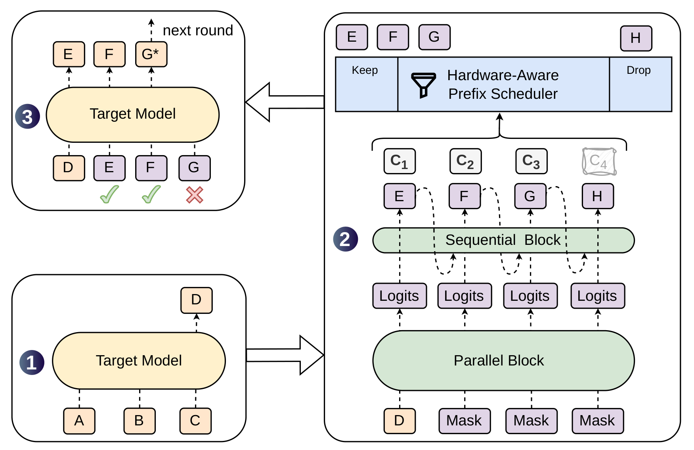

# DSpark: Confidence-Scheduled Speculative Decoding with Semi-Autoregressive Generation

## 来源信息

| 项 | 内容 |
| --- | --- |
| 标题 | DSpark: Confidence-Scheduled Speculative Decoding with Semi-Autoregressive Generation |
| 作者 | 33 人。前 5 位 Xin Cheng、Xingkai Yu、Chenze Shao、Jiashi Li、Yunfan Xiong 标 `*`，脚注为 `Equal contribution`；其余为 Yi Qian、Jiaqi Zhu、Shirong Ma、Xiaokang Zhang、Jiasheng Ye、Qinyu Chen、Chengqi Deng、Jiping Yu、Damai Dai、Zhengyan Zhang、Yixuan Wei、Yixuan Tan、Wenkai Yang、Runxin Xu、Yu Wu、Zhean Xu、Xuanyu Wang、Muyang Chen、Rui Tian、Xiao Bi、Zhewen Hao、Shaoyuan Chen、Huanqi Cao、Wentao Zhang、Anyi Xu、Huishuai Zhang、Dongyan Zhao、Wenfeng Liang。首页给的是 `{chengxin, xingkai, shaochenze, js.li, yunfanxiong}@deepseek.com`，没有单独的通讯作者标记 |
| 机构 | 首页署名行为 `1 Peking University`、`2 DeepSeek-AI`：Xin Cheng 兼署 1、2，Huishuai Zhang 与 Dongyan Zhao 署 1，其余作者署 2。README 00174 的「论文单位」写 `DeepSeek-AI`（按团队归属），与首页第一机构 `Peking University` 不一致；本笔记正文按首页记录，未改 README 该列，见文末说明 |
| 来源 | [arXiv:2607.05147v1](https://arxiv.org/abs/2607.05147v1)（2026-07-06 提交；Subjects: `cs.AI; cs.CL`；abs 页许可链接为 [CC BY 4.0](https://creativecommons.org/licenses/by/4.0/)） |
| 版本 | 截至 2026-11-21 只有 v1。PDF 33 页，1,055,890 B，sha256 `522036b0cc16ad4678bd7c278dd0a0ab4da31170af7b97c2041067cc09a8289a`（2026-11-21 抓取，退出码 0、字节数等于 `Content-Length`、文件尾 `%%EOF`、gs 解析 33 页） |
| 归档关系 | README 00174 的编号列指向本地归档 [papers/00174-DSpark_paper.pdf](../../../papers/00174-DSpark_paper.pdf)：33 页，722,827 B，sha256 `9e1a1e9dadd51537dd02dc8dcec6a25a5bb0417f9835a719dfe05d9dfcba3c19`。它与 `deepseek-ai/DeepSpec` 初始提交（2026-06-26）里的 `DSpark_paper.pdf` 逐字节一致（git blob `1804e22c02313187f1fa5934ab3f6300ed7da346`）；该文件在 2026-07-07 的 commit `182f3216…`（`update citation`）中已从仓库删除，README 标题列指向的 `…/blob/main/DSpark_paper.pdf` 已被 GitHub API 判为 404（文件不在 main 的树里），本地归档仍在。归档版是早于 arXiv v1 的 2026-06-26 提交（committer 与 PDF creationDate 为 2026-06-27），页数、Table 1、Figure 1–8 与 arXiv v1 相同，但 §3.1 段落顺序、脚注 2/3、Related Work 与 References 有差异，详见「版本关系」 |
| 阅读日期 | 2026-11-21 |
| 阅读范围 | 全文 33 页：§1–§7（p1–p21）、References（p21–p31）、Appendix A（p32–p33）。Table 1 逐格对照 p11 渲染页；Figure 1–8 均看渲染页，Figure 1/2 从 PDF 裁剪；Figure 2、Figure 3 的读数用 PDF 矢量 marker 质心加刻度中心定标；公式 (1)–(12) 对照 p3/p4/p6/p7/p9/p10 渲染页；Appendix A 的反例手算复核。未运行代码、未复现实验 |
| 核对凭据 | 渲染页：p3/p4/p5/p6/p7/p9/p10/p11/p12/p13/p15/p18/p19（180–200 dpi）。Figure 2 定标（单位 pt）：Math 的 0.95 在 y=118.659、0.75 在 y=179.409；Code 的 0.95/0.70 用同一对网格线；Chat 的 0.80/0.50 用同一对网格线。Figure 3 纵轴刻度中心：2→y=208.75、3→182.15、4→155.65、5→129.10、6→102.55。裁剪：Figure 1 从 p5 取 `88–508 × 80–352`（300 dpi，1751×1134）；Figure 2 从 p12 取 `76–520 × 80–208`（300 dpi，1851×534）。两张都按元素清单逐项点名（图内标题、图例、坐标轴与刻度、图内注记），边缘无黑边。代码仓库经 GitHub API 核对到文件结构、LICENSE、README 与配置层；Hugging Face 2026-11-21 本机不可达（curl 000）。否定性检索词：`H800`/`H100`/`H20`/`A100`/`GPU`、`seed`/`variance`/`error bar`、`ablation`、`tree-based`（§2.2 与 Related Work 提及，实验未用） |

---

## 复核记录

**2026-11-21（第 1 轮，基准 arXiv:2607.05147v1，33 页，sha256 `522036b0…a8289a`；alphaXiv 镜像同 sha；对照归档 `papers/00174-DSpark_paper.pdf`，33 页，sha256 `9e1a1e9d…ba3c19`）**：重读全文 33 页；Table 1 的 108 个数值逐格对照 p11 渲染页；式 (1)–(12) 对照 p3/p4/p6/p7/p9/p10；Figure 1–8 对渲染页，Figure 2/3 用矢量 marker 质心加刻度中心复核；Appendix A 反例手算；另派独立只读子 agent 全篇审计，逐条复验后修正：

- Figure 3 的「差距最小三个」改为 Arena-Hard v2（约 0.13）、HumanEval（约 0.20）、Alpaca（约 0.24）；MT-Bench 约 0.27，排第四。原文「9 个基准都高于 5L DFlash」仍成立。
- §6 的「离线只报相对延迟」改为 Figure 4 右轴的绝对 `Latency (ms)`（约 188–195 ms，相对 DFlash +0.2%–1.3%）。
- §8 版本关系：DART/PARD 与 Gemma4 条目原已有，不是 v1 新增；v1 新增 Medusa（Related Work）、TAPS、JetSpec、Pard-2、Eldenk。补旧版式 (6) 的 `W_g/W_c/W_o` 维度从 `(2r+d)×r` 改为 `r×(2r+d)`；归档日期补 committer/PDF creationDate 2026-06-27。
- Figure 8 的 budget 改为拟合线约 5.0（Flash）/5.4（Pro）→约 3.5，不再混用散点外包络；补上排 throughput-vs-concurrency 的描述。
- §3.4 early-stop 的返回值改为 `Θbest` 对应的 `ℓ*`；Algorithm 1 的候选空间补 `a>0` 过滤。
- §3.4 的 causal barrier 论证区分原文明确说的部分与本笔记补的单调性/独立性解释。
- §3.5 的 `L_tv` 权重说明改为：L1 是 2×TV，改写成 TV 时应把系数从 0.9 调到 1.8；不要写成「α_tv 吸收比例、等价于最小化 TV」。
- §4.2 加粗说明区分原文数值加粗与本笔记的 `DSpark` 行名加粗。
- §4.6 的 SLA anchor 改为「论文称用于刻画实际部署约束」；训练侧补 HAI-LLM。
- 阅读范围补 p10（式 12）；§6 的 error bar 说明补 Figure 3 竖线是 1L/2L/5L 连接线。

未修/未核：V4-Flash/Pro checkpoint（Hugging Face 2026-11-21 不可达）；References 未逐条读；未运行代码/复现实验；Figure 1 只核图号与内容，未做逐像素比对（旧版边框虚线 vs v1 实线，不影响正文）。

**本轮教训（值得进 skill）**：独立审计建议「α_tv 减半到 0.45」方向相反——`L_tv` 写的是 L1（2×TV），改写成 TV 记法要保持同一总损失，系数应 0.9→1.8；采纳前必须按公式自己复算。Figure 3 的竖线是 1L/2L/5L 连接线，容易被当成 error bar；写「没有 error bar」时应点名排除。Figure 8 的 budget 读数要区分拟合线与散点外包络，不能把低并发散点上限当拟合线起点。

---

## 1. 核心结论

DSpark 是 DeepSeek 为高并发 serving 设计的投机解码框架，由两个可分别优化的部件组成：

- **半自回归草稿**（semi-autoregressive generation）：一个并行 backbone（DFlash）一次前向给出整块 base logits，再串一个极轻量的顺序头（Markov 或 RNN），只用局部转移偏置给并行 logits 补上 token 间依赖。它追求的是「并行 backbone 的 O(1) 草稿延迟 + 自回归的 suffix 一致性」。
- **置信度调度验证**（confidence-scheduled verification）：一个 confidence head 预测每个 draft 位置的**条件存活概率**，经 Sequential Temperature Scaling（STS）校准后，交给一个 hardware-aware prefix scheduler，按当前引擎的 `SPS(B)`（steps per second，随验证 batch 大小变化的吞吐曲线）决定每个请求验证多长的前缀。

离线实验（Qwen3-4B/8B/14B 与 Gemma4-12B，9 个基准，固定 block、关闭调度器）里，DSpark 的 accepted length 在所有模型和所有基准上都高于 Eagle3 与 DFlash。Qwen3 三个规模的 macro-average 相对 Eagle3 提升 **30.9% / 26.7% / 30.0%**，相对 DFlash 提升 **16.3% / 18.4% / 18.3%**（相对提升，不是百分点；本笔记按 Table 1 复算，与原文一致）。Gemma4-12B 上本笔记复算为相对 Eagle3 **+6.6%**、相对 DFlash **+16.1%**（原文未给 Gemma 的汇总百分比）。

生产环境（DeepSeek-V4-Flash/Pro preview，DSpark-5，最大 draft 长度 `γ=5`，对 MTP-1）在 matched throughput 下把 per-user 生成速度提高 **60%–85%**（Flash）与 **57%–78%**（Pro）；在严格 SLA（120 tok/s/user 与 50 tok/s/user）下，MTP-1 进入低并发区、吞吐塌缩，DSpark 仍能维持非退化的吞吐，名义 aggregate throughput 分别高 **661%** 与 **406%**——作者明确说明这两个数是「前沿扩展」的证据，不是有代表性的倍数。

一句话：**DSpark 的贡献不是「又一个并行 drafter」，而是把草稿质量和验证预算拆成两个旋钮：低秩 Markov 头负责让长 block 的后段不掉接受率，校准后的前缀存活概率负责在高并发时把 target batch 容量留给最可能被接受的前缀。**

## 2. 问题与动机

### 2.1 三个杠杆

投机解码每轮由 draft 模型提出 `γ` 个候选 token，target 模型一次前向验证整块，按拒绝采样接受最长一致前缀，并额外产生一个 bonus token。设每轮接受 `τ` 个 token，draft 与 verify 的墙钟时间为 `T_draft`、`T_verify`，则每 token 的平均延迟是：

```math
L=\frac{T_{\mathrm{draft}}+T_{\mathrm{verify}}}{\tau}
```

读法：要加速只有三条路——把 `T_draft` 压下去、把 `τ` 提上去、或把无效的 `T_verify` 砍掉。DSpark 的两个部件正好对应后两条，同时保持 `T_draft` 近似与 block 大小无关。

- **自回归 drafter**（Eagle3 一类）：每个位置条件于前一个已采样 token，`τ` 高，但 `T_draft ∝ γ`，只能用小 block 和浅网络；树式验证可以补 block，但验证 token 数变多，服务吞吐反而下降。
- **并行 drafter**（DFlash 一类）：一次前向出全部 `γ` 个位置，`T_draft` 近似常数，因此可以用更深的网络和更大的 block；但各位置独立预测，无法条件于「本块里实际采样到的前一个 token」，容易出现 multi-modal collision（例如上下文同时允许 "of course" 与 "no problem"，并行模型给出 "of problem" 或 "no course"），接受率沿 block 快速衰减。
- **固定长度验证**：无论请求难易、系统负载，都验证整块；在高并发下，低接受概率的后缀会占用本可以服务其他请求的 target batch 容量。最优验证长度同时取决于数据（代码等结构化文本接受率高，开放聊天低）和系统（轻载时多验证几乎免费，重载时 batch 容量是稀缺资源）。

### 2.2 为什么静态阈值不够

已有工作常用一个固定 confidence 阈值决定验证多长。静态阈值只要求 confidence 能**排序**草稿质量，因此在单请求、轻载的设定下够用；但在生产系统里，验证一个 token 的收益是「它被接受的概率 × 它带来的吞吐」，而成本是「它占用的 target batch 容量」。同一分数在轻载和重载下的最优决策不同，所以 DSpark 的调度器直接最大化系统级 token throughput，而不是最小化验证 token 数或最大化接受率。

## 3. 方法与关键公式



图 1 的一轮流程：target 先用 prompt `ABC` 生成 `D`（anchor / bonus token），DSpark 以 `D` 为输入，经 Parallel Block 得到 4 个位置的 base logits，再经 Sequential Block 从左到右采样出 `EFGH` 及置信度 `c1–c4`；Hardware-Aware Prefix Scheduler 保留 `EFG`、丢掉低置信的 `H`；target 并行验证 `EFG`，接受 `E`、`F`，拒绝 `G` 并由 target 生成修正 token `G*`。图来自 arXiv v1 p5，本笔记裁剪。

### 3.1 并行 backbone

DSpark 直接以 DFlash 为并行 backbone：target 在 prefill 时把若干层 `{l_1,…,l_m}` 的 hidden states 拼起来，投影进 draft 的 hidden 空间：

```math
H_{\mathrm{ctx}}=\mathrm{RMSNorm}\!\left(W_c\,[H^{(l_1)};\ldots;H^{(l_m)}]\right),\qquad W_c\in\mathbb{R}^{d\times md}
```

读法：`H_ctx` 是从 target 抽取的上下文特征，`W_c` 是共享投影。这些特征被拼到每个 draft 层的 key/value 序列维上：

```math
K_i=[W_i^K H_{\mathrm{ctx}};\,W_i^K H_d],\qquad V_i=[W_i^V H_{\mathrm{ctx}};\,W_i^V H_d]
```

读法：draft block 的每个位置既能双向看块内其他位置，也能看注入的 target 上下文。draft 模型共享 target 的 embedding 与 LM head，二者都冻结。

DSpark 对 DFlash 只做了一个小改动：**把 anchor 本身当作第一个预测位置**。原来是「anchor + `γ` 个 mask，只预测 mask 位置」，现在变成「anchor + `γ−1` 个 mask，共 `γ` 个输入，产出 `γ` 个 draft logits」。这样少一次位置的计算，草稿质量基本不变。

### 3.2 顺序头：给并行 logits 加局部转移偏置

并行 backbone 给出每个位置的 base logits `U_1,…,U_γ` 和 hidden `h_1,…,h_γ`。顺序头不重新定义全局归一化的能量模型，而是给每个位置加一个前缀相关的转移偏置 `B_k`，保持自回归分解：

```math
P(X\mid x_0)=\prod_{k=1}^{\gamma}p_k(x_k\mid x_0,x_{<k}),\qquad
p_k(v\mid x_0,x_{<k})=\frac{\exp\!\big(U_k(v)+B_k(x_0,x_{<k},v)\big)}{\sum_{u\in\mathcal{V}}\exp\!\big(U_k(u)+B_k(x_0,x_{<k},u)\big)}
```

读法：`x_0` 是上一轮 target 生成的 anchor；`U_k` 是并行 backbone 在第 `k` 位的 logit；`B_k` 是顺序头注入的偏置。关键点是**每个位置仍然是一个普通的 softmax**，所以能给出精确的逐 token 概率，拒绝采样规则可以原样使用。这一点是 DSpark 与 CRF-NAT、CTC-drafter 一类「有顺序模块但概率被全局归一化/边缘化」的方案的分界：CRF 的配分函数和 CTC 的对齐边缘化都会让精确 per-token 概率不可得。

#### Markov head（默认）

最简单的一阶版本只让 `B_k` 依赖前一个 token：

```math
B(x_{k-1},\cdot)=W_1[x_{k-1}]\,W_2\in\mathbb{R}^{V},\qquad W_1\in\mathbb{R}^{V\times r},\;W_2\in\mathbb{R}^{r\times V}
```

读法：`W_1` 是 embedding lookup，`W_2` 是 logit 投影；完整的 `V×V` 转移矩阵用秩 `r=256` 的分解近似。存储与每步计算都很小，适合大词表。回到 "of course / no problem" 的例子：位置 1 一旦采样到 "of"，Markov head 就在位置 2 抬高 "course"、压低 "problem"，从而缓解跨模式拼接。

#### RNN head（备选实现）

RNN head 维护一个块内 recurrent state，能看完整前缀：

```math
z_k=[s_{k-1};\,W_1[x_{k-1}];\,h_k]\in\mathbb{R}^{2r+d}
```

```math
s_k=\sigma(W_g z_k)\odot s_{k-1}+\big(1-\sigma(W_g z_k)\big)\odot\tanh(W_c z_k),\qquad
B_k(x_{<k},\cdot)=W_2^{\top}\tanh(W_o z_k)
```

读法：`s_k` 是门控状态，`⊙` 是逐元素乘，`s_0=0`；`W_g`、`W_c`、`W_o` 由同一个线性投影切分成 gate、candidate、output 三部分。实验里 RNN head 相对 Markov head 只有边际增益，主要出现在更长的 block；考虑到实现复杂度和部署性质，论文默认用 Markov head。

### 3.3 置信度头：预测「前缀已经活到第 k 位」的条件概率

对每个 draft 位置 `k`，confidence head 输出一个标量 `c_k∈(0,1)`，含义是：**在前 `k−1` 个 draft token 都已被 target 接受的条件下，第 `k` 个 token 也能存活的条件概率**。

```math
c_k=\sigma\!\left(w^{\top}[h_k;\,W_1[x_{k-1}]]\right)
```

读法：输入是 backbone hidden `h_k` 与前一个 draft token 的 Markov embedding `W_1[x_{k-1}]`，经一个线性层和 sigmoid。训练标签不是 0/1，而是解析的每步接受率：

```math
c_k^{*}=1-\frac{1}{2}\lVert p_k^{d}-p_k^{t}\rVert_1
```

读法：`p_k^d`、`p_k^t` 分别是 draft 与 target 在第 `k` 位的分布；`1 − ½·L1` 就是标准投机采样的每步接受概率。训练标签用这个解析接受率，而不是「这次是否被接受」的 0/1 结果。

#### 为什么还要校准

阈值式方法只要 confidence 能排序就够了；DSpark 的调度器却要拿 `c_k` 的**绝对量级**去算期望接受长度 `τ`，所以过度自信会直接扭曲吞吐估计。论文用 STS（Sequential Temperature Scaling）校准累积存活概率 `∏_{i≤k}c_i`：在 held-out 验证集上，从左到右逐位置做一维温度网格搜索，最小化累积乘积的 ECE，并保持已经校准好的前序分数不变。温度缩放是保序变换，因此只改概率量级、不改草稿排序。

### 3.4 调度器：把验证长度选择变成全局吞吐最大化

对一批 `R` 个活跃请求，设请求 `r` 的验证长度为 `ℓ_r∈{0,…,γ}`，`a_{r,j}=∏_{i≤j}c_{r,i}` 是第 `j` 位的累积存活概率。验证 batch 的 token 数、期望接受 token 数与系统吞吐分别是：

```math
a_{r,j}=\prod_{i\le j}c_{r,i},\qquad
B=\sum_{r=1}^{R}(1+\ell_r),\qquad
\tau=\sum_{r=1}^{R}\left(1+\sum_{j=1}^{\ell_r}a_{r,j}\right),\qquad
\Theta=\tau\cdot\mathrm{SPS}(B)
```

读法：`B` 里的 `1` 是每个请求的 anchor 输入；`τ` 里的 `1` 是当前轮 target 必定贡献的 bonus token（与下一轮的 anchor 是同一个 token，论文脚注 1 也把两者互称）；`SPS(B)` 是引擎在 batch 大小为 `B` 时的 steps/s，启动时 profile 成一张轻量 cost table。目标是最大化 `Θ`，也就是每秒接受多少 token，而不是单纯提高接受率或缩短验证长度。

由于 `a_{r,j}` 对 `j` 单调不增，把请求 `r` 的验证从 `j−1` 延到 `j` 的边际期望收益正好是 `a_{r,j}`。因此可以：

1. 只保留 `a_{r,j}>0` 的候选 `(r,j)`，按 `a_{r,j}` 从大到小排序；
2. 从 `B=R`、`τ=R`、`ℓ_r=0` 出发，按序把候选加入验证前缀，每加一个就更新 `B`、`τ` 和 `Θ`；
3. 一旦 `Θ` 不再超过当前最优，立刻停止（early stopping），返回 `Θbest` 对应的 `ℓ*`；刚加入的那个候选被丢弃。

这个贪心在「`Θ` 关于 `B` 单峰」时给出全局最优；论文也承认真实硬件的 `SPS(B)` 是锯齿状、非平滑的，工程上需要另行处理（见本节后面的「生产环境的异步改造」）。

#### 为什么必须 early stop：一个反例

如果不用 early stop，而是先看完所有候选再选全局最大，就会引入**选择偏差**：`c_{k+1}` 依赖前一个已采样 token `x_k`，所以「是否准入 `x_k`」会反过来依赖 `x_k` 本身，违反 lossless 投机解码要求的 non-anticipating property。Appendix A 给了最小反例：

- `R=1`、`γ=2`、`a_1=0.8`；`SPS(1)=1.0`、`SPS(2)=0.5`、`SPS(3)=0.45`。
- 验证 0 个与 1 个 draft token 的期望吞吐：`Θ_0=1.0`、`Θ_1=(1+0.8)×0.5=0.9`。
- 若 `x_1` 使 `c_2=0.9`，则 `a_2=0.72`、`Θ_2=(1+0.8+0.72)×0.45=1.134`，全局最大在 `ℓ=2`；若 `x_1` 使 `c_2=0`，则 `Θ_2=(1.8)×0.45=0.81`，全局最大退回 `ℓ=0`。
- 于是第一个 draft token 是否被验证，取决于第一个 draft token 自己采到了什么。取 `p_t=(0.7,0.3)`、`p_d=(0.5,0.5)`，算出的输出分布是 `(0.85,0.15)`，不等于 target 的 `(0.7,0.3)`，证明这样不再 lossless。
- early stop 在 `Θ_1=0.9 < Θ_0=1.0` 时立即返回 `ℓ=0`，根本不会去算 `c_2`，因此准入决定只依赖 `x_1` 之前的信息。

#### 生产环境的异步改造

真实的 `SPS(B)` 是离散、锯齿状的，early stop 可能把调度器困在局部最优；同时 Zero-Overhead Scheduling（ZOS）要求下一步的 batch size 在当前步完成前就已知，同步调度会 stall GPU。DSpark 的做法是：

- **去掉 early-stopping break**，允许对历史预测做无约束的全局搜索，绕过锯齿状的局部最优；
- 用**两步之前**的 confidence 预测来决定当前步的截断长度 `K`（即 batch 容量上限），当前步的候选按**最新**的累积分数排序；selection 是 rank-preserving（最自信的 draft token 优先验证），等价于一次 dynamic top-K；
- 论文称这套设计形成了 causal barrier：`K` 与当前 token 的 realization 无关。笔记补一句因果性解释：同一请求内 `a_{r,j}` 单调不增，后面的位置不会把前面的位置挤出 top-K；其他请求的分数也不依赖本请求的 token。原文没有展开这两步论证。

这一步是工程近似：理论上它保住了「准入不依赖当前 token」的条件，但两步延迟带来的容量估计误差没有被量化；论文也没有给出输出分布的实证校验（见「局限」）。

### 3.5 训练目标

训练时从每条 target 序列随机采多个 anchor，组成 `γ`-token block；target 全程冻结，draft 共享 target 的 embedding 与 LM head 且保持冻结，只更新 backbone drafter、顺序头和 confidence head。三个损失都按位置加权：

```math
w_k=\exp\!\left(-\frac{k-1}{\gamma}\right)
```

读法：越靠前的位置权重越大，因为前缀验证下前面位置的接受对整块贡献最大。

```math
\mathcal{L}_{ce}=-\sum_{k=1}^{\gamma}w_k\log p_k^{d}(x_k^{*}),\qquad
\mathcal{L}_{tv}=\sum_{k=1}^{\gamma}w_k\lVert p_k^{d}-p_k^{t}\rVert_1
```

```math
\mathcal{L}_{conf}=-\sum_{k=1}^{\gamma}w_k\left[c_k^{*}\log c_k+(1-c_k^{*})\log(1-c_k)\right]
```

```math
\mathcal{L}=\alpha_{ce}\mathcal{L}_{ce}+\alpha_{tv}\mathcal{L}_{tv}+\alpha_{conf}\mathcal{L}_{conf}
```

读法：`L_ce` 让 drafter 拟合 ground-truth token；`L_tv` 让 draft 分布靠近 target 分布；`L_conf` 是 confidence head 的 BCE。默认权重 `α_ce=0.1`、`α_tv=0.9`、`α_conf=1.0`。

一个记号细节：式 (8) 的接受率用 `1 − ½·L1`，式 (10) 的 `L_tv` 写的是 `L1` 而不是 `½·L1`，所以 `L_tv` 实际是 TV 距离的 2 倍。最小化方向相同，但权重不同：若把 `L_tv` 改写成 TV 记法，要保持原来的总损失，系数应从 0.9 调到 1.8。引用公式时不要把它当成「TV 距离」逐字对应。

### 3.6 生产部署的三个工程点

**草稿模型配置**：并行 backbone 是 3 层 MoE（DeepSeekMoE），带 mHC 与 128 的滑动窗口注意力；生产最大 block 为 `γ=5`，顺序头用 Markov。它与 DeepSeek-V4-Flash/Pro preview 共部署，confidence head 端到端训练后再用 STS 校准。

**训练侧**（内部训练框架 HAI-LLM）：

- **hidden state communication**：不在 worker 间传 target 的 full-vocabulary logits（`V≈10^5`），而是缓存 target 前向的 activation，只传 LM head 之前的 hidden state，再在 draft worker 上对采样位置本地做 LM head 投影，把每 token 通信降到 `O(d)`。
- **anchor-bounded sequence packing**：从长序列里采固定数量的 draft anchor，把孤立的预测块打包成密集训练 batch；用 token-level attention index 而不是标准 2D mask 来维持精确的 causal masking，避免 padding 的计算与显存开销。

**推理侧**：动态调度会产生同一 batch 内不同请求验证长度不同的情况，标准 decode kernel 按固定 query 长度优化，直接处理会因 padding 和负载不均而严重浪费 GPU。DSpark 把不同请求的所有 token flatten 成独立元素统一处理，序列内依赖通过一个 marker tensor 传给稀疏注意力实现；在 DeepSeek-V4 架构上只需改 index-attention 与 compress 两个 kernel。

## 4. 实验与证据

### 4.1 离线设置

- **target 模型**：Qwen3-4B、Qwen3-8B、Qwen3-14B、Gemma4-12B。
- **draft 模型**：Eagle3（1 层，TTT horizon 7）、DFlash（5 层）、DSpark（5 层）。Eagle3 的 TTT horizon 与 DFlash/DSpark 的 block size 都对齐到 7；三者用同一套 target feature layers、同一个训练框架和同一份数据。
- **训练数据**：Open-PerfectBlend，130 万条样本，chat 17.6%、math 39.4%、code 38.9%、instruction 4.1%；只用 prompt，response 由各 target 模型按推荐采样参数重新生成；每个 drafter 训 10 epoch；non-thinking 模式。
- **评测**：数学 GSM8K / MATH500 / AIME25，代码 MBPP / HumanEval / LiveCodeBench，日常聊天 MT-Bench / Alpaca / Arena-Hard；标准投机解码，采样温度 1.0；所有 drafter 都用 chain-based drafting，不用树。
- **口径**：accepted length `τ` 按每轮计，**包含 target 生成的 bonus token**；`γ=7` 时理论上限是 8。离线主表**关闭 confidence scheduler**，强制所有 drafter 提出固定 block，因此 Table 1 衡量的是纯草稿质量，不含调度收益。

### 4.2 Table 1：accepted length

| Target | Drafter | Math GSM8K | MATH | AIME25 | Code MBPP | HumanEval | LCB | Chat MT-Bench | Alpaca | Arena-Hard |
| --- | --- | ---: | ---: | ---: | ---: | ---: | ---: | ---: | ---: | ---: |
| Qwen3-4B | Eagle3 | 5.14 | 4.62 | 3.92 | 3.69 | 4.16 | 3.77 | 2.39 | 2.26 | 2.55 |
| Qwen3-4B | DFlash | 5.40 | 4.85 | 4.15 | 4.40 | 4.74 | 4.18 | 3.07 | 2.96 | 2.83 |
| Qwen3-4B | **DSpark** | **6.11** | **5.70** | **4.89** | **5.13** | **5.38** | **4.86** | **3.64** | **3.54** | **3.29** |
| Qwen3-8B | Eagle3 | 5.30 | 4.77 | 3.91 | 3.96 | 4.33 | 4.17 | 2.66 | 2.54 | 2.54 |
| Qwen3-8B | DFlash | 5.33 | 4.91 | 4.07 | 4.36 | 4.64 | 4.39 | 3.11 | 2.98 | 2.81 |
| Qwen3-8B | **DSpark** | **6.17** | **5.78** | **5.01** | **5.16** | **5.52** | **5.17** | **3.72** | **3.58** | **3.21** |
| Qwen3-14B | Eagle3 | 5.24 | 4.60 | 3.71 | 3.81 | 4.14 | 4.01 | 2.62 | 2.47 | 2.48 |
| Qwen3-14B | DFlash | 5.41 | 4.84 | 3.98 | 4.44 | 4.59 | 4.33 | 3.10 | 2.94 | 2.72 |
| Qwen3-14B | **DSpark** | **6.21** | **5.74** | **4.94** | **5.26** | **5.43** | **5.02** | **3.70** | **3.58** | **3.13** |
| Gemma4-12B | Eagle3 | 5.87 | 5.46 | 4.83 | 4.72 | 5.37 | 4.16 | 3.19 | 3.06 | 2.72 |
| Gemma4-12B | DFlash | 5.45 | 5.04 | 4.22 | 4.39 | 4.95 | 3.70 | 2.98 | 2.84 | 2.59 |
| Gemma4-12B | **DSpark** | **6.05** | **5.78** | **5.12** | **5.11** | **5.64** | **4.51** | **3.49** | **3.35** | **2.92** |

注：原文表注写 `Bold marks the best results`。本笔记用 p11 的 PDF 字体信息核对过：36 个 DSpark **数值**全部是 `URWPalladioL-Bold`，其余数值单元格是常规体，所以数值加粗是原文的；表格里的 `**DSpark**` 行名加粗是本笔记的排版，原文行名是常规体。

读表要点：

- DSpark 在 **4 个 target、9 个基准共 36 个格子**上都高于同格的 Eagle3 和 DFlash；不是只赢平均。
- 结构化任务明显高于开放聊天：Qwen3-4B 的 DSpark 在 math 三基准均值 **5.57**、code 均值 **5.12**、chat 均值 **3.49**（本笔记复算，与原文 p11 的 5.57 / 5.12 / 3.49 一致）。这正是固定验证长度浪费 compute 的数据侧原因。
- Gemma4-12B 上 DSpark 仍然全胜，但相对 Eagle3 的平均优势只有 **+6.6%**，远小于 Qwen3 上的 26.7%–30.9%。本笔记判断，原因是 Eagle3 在 Gemma4 上本身强很多（macro-average 约 4.38，而 Qwen3 上约 3.61–3.80），不是 DSpark 在 Gemma 上退化。Gemma 上 DSpark 相对 DFlash 仍是 **+16.1%**，与 Qwen3 的 16.3%–18.4% 接近。这两个百分比是本笔记按 9 个基准简单平均复算，原文未给 Gemma 的汇总值。

### 4.3 位置级分析：并行为什么能赢自回归

Table 1 有一个反直觉现象：并行 DFlash 和半自回归 DSpark 的 accepted length 经常高于完全自回归的 Eagle3。论文用 **position-wise conditional acceptance** 解释：对第 `k` 位，只统计「前 `k−1` 位都被接受」的实例，再看第 `k` 位被接受的比例。这样第 `k` 位的分数不会被前面位置的拒绝惩罚，能单独看该位置的预测质量。


本笔记按 PDF 矢量 marker 质心加刻度中心定标读出的位置 1 → 7 数值（约 ±0.005）：

| 域 | DFlash | Eagle3 | DSpark |
| --- | --- | --- | --- |
| Math | 0.885 → 0.828 | 0.811 → 0.851 | 0.905 → 0.882 |
| Code | 0.865 → 0.777 | 0.771 → 0.784 | 0.886 → 0.851 |
| Chat | 0.718 → 0.688 | 0.534 → 0.733 | 0.735 → 0.761 |

论文的论证链：

- **位置 1 的容量优势**：第一个 draft 位置只看 target context，差别纯粹来自网络容量。Eagle3 受 `O(γ)` 延迟限制只能做浅网络，DFlash/DSpark 可以做 5 层。图 2 里 DFlash 在 Math 的 0.885 高于 Eagle3 的 0.811，在 Chat 的 0.718 高于 Eagle3 的 0.534。由于前缀验证是严格的 prefix-matching，第一位被拒就整块作废，所以这个初始优势对最终 `τ` 的杠杆最大。
- **后段的独立性代价**：Eagle3 在 Chat 从 0.534 升到 0.733（前一位锁定语义路径后，后一位更可预测）；DFlash 在 Code 从 0.865 掉到 0.777，Math 从 0.885 掉到 0.828，说明独立并行位置在长 block 后段会累积多模式冲突。
- **半自回归的折中**：DSpark 继承了并行 backbone 的高初始接受（Math 0.905），又用轻量顺序头把后段衰减压住（Math 末位 0.882、Code 末位 0.851、Chat 末位 0.761，均高于 DFlash 同位置）。

这里有两处实质性的文字—图读数不一致，见「原文自身的表述张力」。

### 4.4 深度、proposal 长度与延迟

**深度**（Figure 3，Qwen3-4B，block 固定 7）：DSpark 的 accepted length 随层数单调上升，1→2 层的边际增益最大；**2 层 DSpark 在 9 个基准上都高于 5 层 DFlash**。按图 3 的刻度读数，差距最小的是 Arena-Hard v2（约 2.98 vs 2.85，差约 0.13）、HumanEval（约 4.95 vs 4.75，差约 0.20）、Alpaca（约 3.21 vs 2.97，差约 0.24）；MT-Bench 的差距约 0.27，排第四。论文的结论是：把参数花在「并行层数」上不如花在「局部顺序建模」上，2 层 DSpark 已经比 5 层 DFlash 更省参数且更准。

**Proposal 长度**（Figure 4，5 层，x 轴 `Draft Length` 从 4 到 16）：注意 x 轴是「proposal 长度 + 1 个 anchor」，所以 x=8 对应 `γ=7`，x=16 对应 `γ=15`。在这个口径下，DSpark 相对 DFlash 的 accepted length 提升为：

- Math：`γ=7` 时 +16%，`γ=15` 时 +30%；
- Code：`γ=7` 时 +15%，`γ=15` 时 +26%；
- Chat：`γ=7` 时 +18%，`γ=15` 时 +22%。

也就是说 block 越长，DSpark 相对 DFlash 的优势越大；纯并行 DFlash 的边际收益随 `γ` 递减，而 DSpark 的顺序头把衰减压住了。RNN head 相对 Markov head 只有小幅增益，主要出现在更长 block；论文因此默认 Markov。

**延迟**（Figure 4 右）：batch size 128，context 长度在 `{512,1024,2048,4096}` 上取算术平均；整轮延迟包含一次 target 验证、一次并行 draft 前向和顺序采样循环。相对 DFlash，draft length 从 4 增到 16 只增加 **0.2%–1.3%** 的整轮延迟（图中标注在 x=8/12/16 为 +0.6%/+0.9%/+1.3%），却换来 `γ=15` 时最高 +30% 的 accepted length。作者的结论是：在这个 batch 下 target 验证占主导，顺序头的串行开销可以忽略。

需要留意：这个 0.2%–1.3% 是 **batch 128** 的数字；论文没有给 batch 1 或更小 batch 的相对开销。batch 越小，顺序循环的固定延迟占比越高，所以不能把 1.3% 直接外推到单请求或极低并发。

### 4.5 置信度阈值与校准

**静态阈值扫描**（Figure 5，Qwen3-4B）：阈值 0 等价于固定长度验证；阈值升高时，confidence head 把最终会被拒的后缀（图中 hashed bars）剪掉，所以 acceptance rate 上升：

- Chat：45.7% → 95.7%（剪枝最明显，因为开放聊天的 token 分布熵高）；
- Math：76.9% → 92.5%；
- Code：67.6% → 92.0%。

这只是诊断，不是调度器：提高阈值会同时减少验证 token 数，acceptance rate 上升不代表系统吞吐上升；真正的决策要用 §3.4 的 `Θ=τ·SPS(B)`。

**校准**（Figure 6，Alpaca）：位置 1/3/5/7 的 raw confidence 有较强区分度（ROC-AUC 0.812–0.907，原文概括为 0.81–0.90），但明显过度自信（ECE 3.3%–8.2%）。STS 校准后 ECE 降到 0.4%–2.0%（四个位置均值约 1.2%，原文写 `~1%`），可靠性曲线贴近对角线。调度器需要的是累积存活概率的绝对量级，所以这一步不是可选的装饰。

### 4.6 生产环境：DeepSeek-V4 的 live traffic

**设置**：DSpark-5（最大 draft 长度 `γ=5`）对 MTP-1。MTP-1 是 V4-preview 发布时的生产基线，只做单 token 投机；论文说历史上不部署静态多 token drafter（MTP-3/5），因为高并发下验证开销会把 aggregate throughput 拉低。DSpark 在 V4-preview 发布两周后取代了 MTP-1。所有图里的散点是 live user traffic 的原始 telemetry，实线是拟合的 performance frontier；这不是受控 A/B；论文称这些 SLA anchor 用于刻画实际部署约束。

**Pareto frontier**（Figure 7）：

- V4-Flash：在 80 tok/s/user 的 moderate SLA 下，aggregate throughput 比 MTP-1 高 **51%**；在 120 tok/s/user 的严格 SLA 下，MTP-1 已接近 operational boundary，只能维持很小的并发 batch，DSpark 的名义 aggregate throughput 高 **661%**。在 matched practical throughput 下，per-user 生成速度高 **60%–85%**。
- V4-Pro：35 tok/s/user 下 aggregate throughput 高 **52%**；50 tok/s/user 下名义高 **406%**；matched capacity 下 per-user 速度高 **57%–78%**。

作者自己给 661%/406% 加了限定：这两个点主要是「DSpark 把可行 interactivity frontier 往外推」的证据，不是对充分利用的 baseline 的代表性倍数；更有意义的比较是 matched throughput 下的 60%–85% 与 57%–78%。

**负载自适应**（Figure 8）：上排是 aggregate throughput 随并发上升的曲线，DSpark 在所有并发段都高于 MTP，差距随并发扩大；下排是每请求的 verification budget。MTP-1 的 budget 是固定 2（1 个 draft + anchor）；DSpark 的拟合线从低并发的约 5.0（Flash）/5.4（Pro）降到高并发的约 3.5，散点围绕拟合线更宽（原文文字概括为 roughly 4–6 tokens per request）。按图 8 的纵轴和 MTP-1=2 推断，这里的 budget 含 anchor，即 `1+ℓ`；原文没有逐字说明单位。高并发下 budget 收缩，正是为了避免低置信后缀占用 target batch 容量。

## 5. 工程视角

### 5.1 为什么它能保持 lossless

标准投机解码的 lossless 依赖于：draft 分布 `p_d` 是实际采样分布，且「验证/截断」的决定不依赖被验证 token 的 realization。DSpark 的两点都做了针对性设计：

- 顺序头只给并行 logits 加偏置，每个位置仍是普通 softmax，`p_d` 可精确计算；没有 CRF 的全局配分函数，也没有 CTC 的对齐边缘化。
- 调度器用 early stop（离线）或两步之前的 `K`（生产）保证 non-anticipating；生产版还利用「同一请求内 `a` 单调不增」保证后面的位置不会把前面的位置挤出 top-K。

但「lossless」在论文里是**算法论证**，不是实证结论：论文没有测输出分布与 target 的 KL、也没有做输出质量评测（如任务准确率或人工评估）。生产异步版的 two-step lag 是否在真实流量下严格保持分布，只有因果性论证，没有实验校验。这是读这篇论文时最应该保留的一个问号。

### 5.2 计算与存储成本

- **调度器**：每步对 `R·γ` 个候选排序，`R` 在数十到约 200、`γ≤7`，复杂度 `O(Rγ log(Rγ))`，相对一次 target 前向可以忽略；`SPS(B)` 是启动时 profile 的查表。
- **Markov head**：`W_1` 是 `V×r`、`W_2` 是 `r×V`，`r=256`。按论文的 `V≈10^5` 估算，两个矩阵合计约 `5.1×10^7` 个参数，bf16 约 100 MB 量级（本笔记估算，不是论文数字）。这是「低秩」能成立的前提：完整的 `V×V` 转移矩阵在 `V≈10^5` 时是 `10^10` 级别，存不下。
- **训练数据**：target response 要重新生成并缓存。DeepSpec 仓库 README 给出的存储警告是：默认 `Qwen/Qwen3-4B` 设置的 target cache 约 **38 TB**（仓库声明，非论文数字）。这解释了论文为什么要在训练侧做 hidden-state communication 和 anchor-bounded packing。
- **推理 kernel**：variable-length 验证需要把 token flatten、用 marker tensor 传序列边界；在 V4 上只改 index-attention 与 compress kernel，说明改动面被刻意压小。

### 5.3 仓库实现与论文的对应关系

DeepSpec 仓库（`deepseek-ai/DeepSpec`，MIT，2026-06-26 创建，2026-07-09 最后 push）包含 DSpark/DFlash/Eagle3 三条训练与评测路径。默认 `config/dspark/dspark_qwen3_4b.py` 与论文的离线设置对得上：`block_size=7`、`num_draft_layers=5`、`markov_rank=256`、`ce_loss_alpha=0.1`、`l1_loss_alpha=0.9`、`confidence_head_alpha=1.0`；target feature layers 为 `[1,9,17,25,33]`（论文只写「同一组 target layers」，没列具体层号）。

一处记号差异：仓库 `deepspec/modeling/dspark/loss.py` 把位置衰减实现为 `exp(-position / loss_decay_gamma)`，默认配置 `loss_decay_gamma=4.0`；论文式 (9)–(11) 把分母写成 `γ`，而 §4.1 的 block size 是 7。如果两者指同一个符号，实际训练的衰减比论文公式更快。本笔记没有继续追 trainer 的调用链，不能确认作者是否把文档里的 `γ` 当作独立超参；引用损失公式时以论文为准，复现时以仓库配置为准。

**发布状态**：仓库 README 的 Released Checkpoints 表列出 Qwen3-4B/8B/14B 与 Gemma4-12B 的 Eagle3/DFlash/DSpark checkpoint（指向 Hugging Face 的 `deepseek-ai/...` 仓库）。论文还说发布了 V4-Flash/Pro preview 的 DSpark checkpoint；但仓库表里没有这两项，Hugging Face 在 2026-11-21 本机不可达（curl 000），所以**V4 checkpoint 的存在性与许可未核验**。仓库本身是 MIT，论文 PDF 是 CC BY 4.0，这两项已核。

## 6. 局限与待确认

**作者明确讨论的**：

- DSpark 仍要为每个请求付出固定的 draft 成本（并行 backbone 生成初始 `γ` 块）。对天然低接受率的复杂请求，这部分 compute 收不回来；未来可以做 difficulty-aware early exit，让这类请求跳过整块 draft。
- 调度器的 early stop 在 `Θ` 单峰时才是全局最优；真实 `SPS(B)` 非平滑，所以生产版改用异步 global search + 两步之前的 `K`。这是工程近似，论文没有量化近似损失。

**本笔记根据证据提出的**：

- **没有方差/重复信息**：Table 1 与 Figure 2–6 都没有 error bar（Figure 3 的竖线是 1L/2L/5L 的连接线，不是误差棒），也没有说明是否多次运行取平均。不能断言「单次报告」，但也不能把它当成有置信区间的结论。
- **baseline 容量不对等**：Eagle3 只给 1 层，DFlash/DSpark 给 5 层。论文的解释是自回归 drafter 受 `T_draft ∝ γ` 限制只能浅，这在其架构下合理；但「并行优于自回归」的对比因此混入了容量差，不是同等参数下的纯架构比较。DSpark 对 DFlash 的对比是 5 层对 5 层，更干净。
- **缺硬件与绝对性能**：离线只报 accepted length 和 batch-128 的整轮延迟（Figure 4 右轴是绝对 `Latency (ms)`，约 188–195 ms；相对 DFlash 只多 0.2%–1.3%），没有 GPU 型号、绝对 tok/s 或显存；生产只报相对 frontier，没有 target 集群规模、batch 分布或 SLA 违约率。`SPS(B)` 的形状依赖硬件与模型，换部署要重新 profile。
- **生产结果不是受控实验**：live traffic 的请求分布会随时间变化，frontier 是拟合的；661%/406% 已由作者自己标注为不可直接外推。matched throughput 的 60%–85% 更可信，但仍是观测性比较。
- **离线与生产的配置不同**：离线主表 `γ=7`、5 层 draft；生产 DSpark-5 是 `γ=5`、3 层 MoE + mHC + SWA 128。不能用离线 +30% 直接解释生产 +60%–85%。
- **只对比了 Eagle3/DFlash**：没有树式 drafter（Medusa、EAGLE-2 tree、DDTree 等），也没有和其他自适应验证方法（SpecDec++、Adaspec 等）做同设定对比。Related Work 讨论了这些工作，但实验没有覆盖。
- **离线 target 不是 V4**：Qwen3/Gemma 上的结论不能直接外推到 DeepSeek-V4；V4 只有生产观测，没有受控离线表。
- **校准集未说明**：STS 的 held-out 验证集大小、领域分布、网格范围都没给；如果验证集与 live traffic 分布不同，ECE 校准后的绝对量级仍可能偏。
- **`SPS(B)` 只依赖 B 的假设**：footnote 2 用「平均 context 长度远低于 1M、PD 分离下 DP rank 的请求数与总 context 大致平衡」来论证，但这是部署假设，不是测量；长 context 或负载不均时可能不成立。
- **lossless 没有实证校验**：见 §5.1。
- **发布未完全核验**：V4 checkpoint 未核验（HF 不可达），仓库 README 的 checkpoint 表只覆盖 Qwen3/Gemma。

## 7. 原文自身的表述张力

这一节只列「原文文字」与「原文图/表」之间的不一致，不把本笔记的推断写进去。

1. **Figure 2 的 Math 起点**：§4.3.1 写 DSpark "starting at 0.93 on Math"（p13），但 Figure 2 的 Math 面板里 DSpark 位置 1 的 marker 在约 **0.905**（DFlash 约 0.885，Eagle3 约 0.811）。按刻度中心定标，0.93 会比 0.90 网格线高约 0.03，而图中只高约 0.005。这个 0.93 在图上找不到对应的曲线点。图 2 的 caption 说曲线是「域内 benchmark 平均」；如果 0.93 是某个单基准的值，原文没有说明这个口径。
2. **Figure 2 的 Chat 衰减**：§4.3.1 写 DFlash "dropping from 0.72 to 0.63 on Chat"（p12），并把这句话放在「positions 2 through 7」的段落里。Figure 2 的 Chat 面板里 DFlash 是 0.718（位置 1）→ 0.638（位置 3，最低点）→ 0.688（位置 7）；从位置 2 到 7 实际是从 0.648 升到 0.688，不是继续降到 0.63。文字取的 0.72→0.63 是「位置 1→位置 3」，不是段落声称的「后段 2–7」，也不是末位。图 2 同样是域平均；若 0.63 是单基准值，原文也没有说明这个口径。
3. **Figure 6 的 AUC 上界**：正文写 ROC-AUC "ranging from 0.81 to 0.90"（p15），图中位置 7 标的是 **0.907**。按两位小数应写 0.91；这是概括取整，不影响结论，但引用时最好用图中的 0.812–0.907。
4. **Gemma 的汇总百分比**：§4.2 只给了 Qwen3 三个规模的 macro-average 百分比，没有给 Gemma4-12B 的数；本笔记复算的 +6.6%/+16.1% 不是原文数字，不能写成「原文说 Gemma 提升 6.6%」。

第 1、2 条是文字与图读数对不上（若文字用的是单基准口径，则属于原文未说明口径）；第 3 条是取整；第 4 条是原文未提供、由本笔记补算，已在正文标明「本笔记复算」。

## 8. 版本关系：arXiv v1 与 00174 归档

- **arXiv v1**：2026-07-06 提交，33 页，1,055,890 B，sha256 `522036b0…a8289a`，creator `arXiv GenPDF`。本笔记的 §/Figure/Table/公式编号都以这一版为准。
- **00174 归档**：`papers/00174-DSpark_paper.pdf`，33 页，722,827 B，sha256 `9e1a1e9d…ba3c19`；与 `deepseek-ai/DeepSpec` 初始提交（2026-06-26）的 `DSpark_paper.pdf` 逐字节一致（git blob `1804e22c…`）。该文件在 2026-07-07 的 commit 中被删除，README 的 GitHub 链接已 404；本地归档是当前工作树里仅存的副本（git 历史里仍可通过 blob 找到）。
- **相同**：摘要、章节骨架、Table 1 的全部 108 个数值、Figure 1–8 的图号；抽查 Figure 2 的 66 个 marker 坐标逐点相同，Figure 5–8 的标注与数值相同；Appendix A 的反例也相同。
- **不同**：arXiv v1 把 §3.1 的「anchor 作为第一个预测位置」段落从 p6 移到 p5，并删掉了原来的「In combination, the two components…」一句；§3.2.2 新增 footnote 2（`SPS(B)` 只依赖 B 的 context 长度假设）；§4.1 新增 footnote 3（发布所有训练 checkpoint），并把原来的数据集链接脚注替换掉；同节还加了 "strict and fair comparison"；Related Work 扩写了并行生成/草稿模型一段（补 Medusa、TAPS、JetSpec、Pard-2 等；PARD/DART 原已出现），References 新增 Pard-2、JetSpec、Eldenk 等条目（Gemma4 条目原已有）；旧版式 (6) 的 `W_g,W_c,W_o` 维度写成 `(2r+d)×r`，v1 改为 `r×(2r+d)`。
- **先后**：归档版来自 2026-06-26 的初始提交（committer/PDF 生成 2026-06-27），arXiv v1 是 2026-07-06；从时间与新增引用看，arXiv v1 更晚。但不能把「更晚」理解为「只改文字」：§3.1 的段落位置、脚注编号和 Related Work 的表述与引用都变了，引用具体段落时应以 arXiv v1 为准。

## 9. 与本仓库其他条目的关系

- **[DeepSeek-V4（00172）](../deepseek-v4/note.md)**：DSpark 是部署在 V4 serving 系统里的投机解码层，target 是 V4-Flash/Pro preview；V4 笔记里的 CSA/HCA、FP4、mHC 等是被 DSpark 加速的模型侧设计。DSpark 的 baseline MTP-1 引自 DeepSeek-V3（2024）的单 token MTP 设置，是 V4-preview 的前生产基线。两篇是「模型」与「服务层」的互补关系。
- **[DeepSeek-V4.1-Flash（00191）](../deepseek-v4.1-flash/note.md)**：V4.1-Flash 报告 §2.4.3 已经把 DSpark 作为其投机解码模块描述（3 层 drafter、SWA 128、5 个 draft 位置、Markov head、confidence head、动态验证长度），并补充了后训练阶段的对齐方式。本笔记以 DSpark 论文为准；V4.1 笔记可以作为「DSpark 在后续模型里的落地形态」交叉阅读。两者对训练阶段的覆盖范围不同，不构成矛盾。
- **[mHC（00148）](../2512.24880-v2-mhc/note.md)**：DSpark 生产 draft backbone 的 3 层 MoE 使用 mHC。DSpark 只把 mHC 当组件，不展开其机制；需要理解 manifold-constrained hyper-connections 时看 mHC 笔记。
- **[GLM-5（00157）](../2602.15763-v2-glm-5/note.md)**：GLM-5 用共享参数的 3 层 MTP，报告 4 步投机接受长度 2.76（对 DeepSeek-V3.2 的 2.55）；DSpark 走的是「并行 backbone + 顺序头」而非 MTP 路线。两者的 target、数据、block 口径不同，Table 1 的 6.11 与 GLM-5 的 2.76 不能直接比较。
- **[Kimi K3（00225）](../2607.24653-v2-kimi-k3/note.md)**：K3 把预训练 MTP 层微调成 EAGLE-3 草稿头，并用接受率的负对数（LK）而不是 KL/TV 作为损失；DSpark 仍用 CE + TV + confidence 三项。两者可以作为「草稿头训练目标」的对照，但 K3 的重点不在 serving 调度。

---

## 待确认事项

1. **README 00174 的「论文单位」**：首页第一机构是 `Peking University`，README 写 `DeepSeek-AI`（按团队归属）。本笔记没有改这一列；如果要按第一机构改成 `Peking University` 并移到 Peking University 分组，需要确认。
2. **README 00174 的标题链接**：指向 `https://github.com/deepseek-ai/DeepSpec/blob/main/DSpark_paper.pdf`，该文件已在 2026-07-07 从仓库删除，链接 404；编号列指向的本地归档仍可用。是否要把标题列改指 arXiv 官方页，并按 CLAUDE.md 的例外 ③ 处理归档 PDF，需要确认。
3. **V4 checkpoint**：论文声称发布了 V4-Flash/Pro preview 的 DSpark checkpoint，仓库 README 的 Released Checkpoints 表只列 Qwen3/Gemma；Hugging Face 2026-11-21 不可达，未核验。
