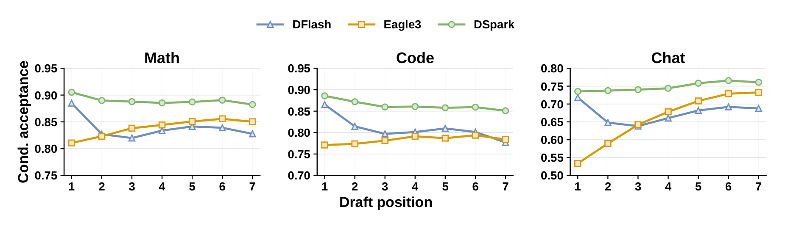

# DSpark: Confidence-Scheduled Speculative Decoding with Semi-Autoregressive Generation

## 来源信息

| 项 | 内容 |
| --- | --- |
| 标题 | DSpark: Confidence-Scheduled Speculative Decoding with Semi-Autoregressive Generation |
| 作者 | 33 人；前 5 位 Xin Cheng、Xingkai Yu、Chenze Shao、Jiashi Li、Yunfan Xiong 标 `*`，脚注为 `Equal contribution`；首页只给联系邮箱，没有单独的通讯作者标记 |
| 机构 | `1 Peking University`、`2 DeepSeek-AI`：Xin Cheng 兼署 1、2，Huishuai Zhang 与 Dongyan Zhao 署 1，其余作者署 2 |
| 来源 | [arXiv:2607.05147v1](https://arxiv.org/abs/2607.05147v1)（2026-07-06 提交；`cs.AI; cs.CL`；CC BY 4.0） |
| 版本 | 截至 2026-11-21 只有 v1，33 页；README 00174 另指向一份更早的本地归档，两版差异见 `audit.md` |
| 阅读日期 | 2026-11-21 |

---

## 核心结论

一句话：**DSpark 把投机解码拆成两个可以分别优化的旋钮——并行 backbone 保证草稿延迟与 block 长度无关、轻量顺序头补回 token 间依赖；校准后的前缀存活概率再按当前引擎的吞吐曲线，决定每个请求验证多长。**

- **问题**：自回归 drafter 的草稿延迟随 block 长度线性增长，并行 drafter 的接受率沿 block 快速衰减，而固定长度验证在高并发下把 target batch 容量花在低接受概率的后缀上。
- **核心想法**：草稿侧用「并行 backbone + 一阶 Markov 偏置」保住每个位置的精确 softmax，从而保持 suffix 一致性又不破坏 lossless；验证侧把「验证多长」写成系统级吞吐最大化，而不是最大化接受率或最小化验证 token 数。
- **怎么做到**：confidence head 预测每步的**条件存活概率**，经 Sequential Temperature Scaling 校准后连乘得到前缀存活概率，再由 hardware-aware prefix scheduler 按 `SPS(B)` 排序贪心选前缀。
- **关键结果**：离线（4 个 target、9 个基准、36 个格子）accepted length 全胜 Eagle3 与 DFlash；Qwen3 三个规模 macro-average 相对 Eagle3 提升 30.9% / 26.7% / 30.0%，相对 DFlash 提升 16.3% / 18.4% / 18.3%。生产环境 matched throughput 下 per-user 生成速度提升 60%–85%（Flash）与 57%–78%（Pro）。
- **定位**：它改进的是 serving 层的草稿与验证调度，不是模型能力；收益依赖「并行 backbone 可用 + target 验证占主导」这一前提。

---

## 问题

投机解码每轮由 draft 模型提出 $\gamma$ 个候选 token，target 模型一次前向验证整块，按拒绝采样接受最长一致前缀，并额外产生一个 bonus token。设每轮接受 $\tau$ 个 token，draft 与 verify 的墙钟时间为 $T_{\mathrm{draft}}$、$T_{\mathrm{verify}}$，则每 token 平均延迟正比于 $(T_{\mathrm{draft}}+T_{\mathrm{verify}})/\tau$。

要加速只有三条路：压 $T_{\mathrm{draft}}$、提 $\tau$、砍掉无效的 $T_{\mathrm{verify}}$。DSpark 的两个部件对应后两条，同时让 $T_{\mathrm{draft}}$ 近似与 block 大小无关。

**已有三条路线各自卡在哪里。**

- **自回归 drafter**（Eagle3 一类）：每个位置条件于前一个已采样 token，$\tau$ 高，但 $T_{\mathrm{draft}}\propto\gamma$，只能用小 block 和浅网络；用树式验证补 block 会让验证 token 数变多，服务吞吐反而下降。
- **并行 drafter**（DFlash 一类）：一次前向出全部 $\gamma$ 个位置，$T_{\mathrm{draft}}$ 近似常数，因此可以上更深的网络和更大的 block；但各位置独立预测，无法条件于「本块里实际采样到的前一个 token」，容易出现 multi-modal collision——上下文同时允许 "of course" 与 "no problem"，并行模型会给出 "of problem" 或 "no course"，接受率沿 block 快速衰减。
- **固定长度验证**：无论请求难易与系统负载都验证整块。高并发下低接受概率的后缀会占用本可以服务其他请求的 target batch 容量；而最优验证长度同时取决于数据（代码等结构化文本接受率高，开放聊天低）和系统（轻载时多验证几乎免费，重载时 batch 容量是稀缺资源）。

**为什么静态置信度阈值不够。** 已有工作常用一个固定阈值决定验证多长。阈值只要求 confidence 能**排序**草稿质量，单请求、轻载时够用；但生产系统里验证一个 token 的收益是「被接受的概率乘以它带来的吞吐」，成本是「它占用的 target batch 容量」。同一分数在轻载和重载下的最优决策不同，所以调度器要直接最大化系统级 token throughput，而不是最小化验证 token 数或最大化接受率。

**本文的设定与前提。** 离线实验固定 block、关闭调度器，单独衡量草稿质量；生产实验在真实流量上比较 Pareto frontier。

调度器的核心假设有两条：引擎吞吐只由验证 batch 的 token 数 $B$ 决定（记作 `SPS(B)`，启动时 profile 成一张轻量 cost table）；下一步的 batch size 必须在当前步完成前已知（Zero-Overhead Scheduling 的要求）。

于是论文要回答三件事：并行 backbone 能否在「一次前向出整块」的前提下补回 token 间条件；每步接受概率能否被预测到**绝对量级**而不只是排序；给定这张概率表与硬件吞吐曲线，每个请求验证多长才能最大化系统吞吐且不破坏 lossless。

---

## 核心想法

### 一句话

草稿质量和验证预算是两个旋钮：前者靠「并行出全部位置 + 串一个只做局部转移的极轻顺序头」，后者靠「把条件存活概率乘上吞吐曲线」。

### 直觉：并行 backbone 缺的不是容量，是位置之间的条件

并行 backbone 一次前向给出整块 base logits，误差主要来自各位置独立预测：一旦前一个位置采样偏离，后面几位仍在为另一条语义路径打分。补这个依赖不需要重跑一个自回归模型，只需要在 softmax 之前加一个「给定前一个 token」的偏置。于是一个 $V\times V$ 的转移矩阵被压成秩 256 的分解，存储和每步计算都很小，却能把 "of course" 与 "no problem" 这两条模式分开。

### 为什么这套设计能成立

- **每个位置仍是普通 softmax**：$p_k$ 是精确的逐 token 概率，拒绝采样规则可以原样使用。这是它与 CRF-NAT、CTC-drafter 一类「有顺序模块但概率被全局归一化/边缘化」方案的分界——CRF 的配分函数和 CTC 的对齐边缘化都会让精确 per-token 概率不可得。
- **偏置只依赖前一个 token，不改变并行前向**：Markov 头在采样时逐步查表即可，草稿延迟仍由一次并行前向主导，顺序部分只增加可忽略的串行开销。
- **条件存活概率可以连乘成期望接受长度**：$c_k$ 定义为「前 $k-1$ 位都被接受的条件下第 $k$ 位也被接受」，于是 $a_{r,j}=\prod_{i\le j}c_{r,i}$ 就是前缀存活概率，期望接受 token 数可以直接写出来。静态阈值只需要排序，而算吞吐需要绝对量级，所以才有 STS 校准这一步。
- **单调性把组合优化变成排序**：$a_{r,j}$ 对 $j$ 单调不增，把请求 $r$ 的验证从 $j-1$ 延到 $j$ 的边际期望收益正好是 $a_{r,j}$，因此按 $a_{r,j}$ 从大到小加候选即可。
- **early stop 保住 lossless**：若先看完所有候选再选全局最大，准入决定会依赖第一个 draft token 自己采到了什么，破坏 non-anticipating property。边加边比、一旦吞吐不再上升就停，使决定只依赖当前 token 之前的信息。

### 一个走通的例子：为什么必须 early stop

Appendix A 的最小反例（$R=1$、$\gamma=2$、$a_1=0.8$，`SPS(1)=1.0`、`SPS(2)=0.5`、`SPS(3)=0.45`）：

- 验证 0 个与 1 个 draft token 的期望吞吐：$\Theta_0=1.0$、$\Theta_1=(1+0.8)\times 0.5=0.9$。
- 若第一个 draft token 使 $c_2=0.9$，则 $a_2=0.72$、$\Theta_2=(1+0.8+0.72)\times 0.45=1.134$，全局最大在 $\ell=2$；若它使 $c_2=0$，则 $\Theta_2=1.8\times 0.45=0.81$，全局最大退回 $\ell=0$。
- 于是「第一个 draft token 是否被验证」取决于第一个 draft token 采到了什么。取 $p_t=(0.7,0.3)$、$p_d=(0.5,0.5)$，这样筛出的输出分布是 `(0.85,0.15)`，不等于 target 的 `(0.7,0.3)`，不再 lossless。
- early stop 在 $\Theta_1=0.9<\Theta_0=1.0$ 时立即返回 $\ell=0$，根本不会去算 $c_2$，准入决定只依赖 $x_1$ 之前的信息。

这个例子说明：调度器的正确性不是「贪心近似得好不好」，而是「决策时刻能不能看见被决策 token 本身」。

### 与已有做法的区别

- **vs 自回归 drafter**：Eagle3 每步都要一次前向，block 越长越贵；DSpark 用一次并行前向拿到全部位置，再补一个一阶偏置。
- **vs 纯并行 drafter（DFlash）**：DFlash 是 DSpark 的 backbone，DSpark 只做了两处改动——把 anchor 本身当作第一个预测位置（$\gamma$ 个输入产出 $\gamma$ 个 draft logits，少算一个位置），以及在 base logits 上加顺序偏置。
- **vs 静态阈值调度**：阈值法只决定「验证到第几位」，DSpark 决定「这一批请求各自验证到第几位」，目标函数里带上了 `SPS(B)` 的斜率。本文离线与生产都只用 chain-based drafting，没有覆盖树式验证。

### 代价

- **固定草稿成本**：每个请求都要付一次并行 backbone 的前向。对天然低接受率的复杂请求，这部分 compute 收不回来。
- **需要校准集与硬件 profile**：STS 要在 held-out 验证集上逐位置做温度网格搜索，校准集与线上分布不一致时绝对量级仍可能偏；`SPS(B)` 的形状依赖硬件与模型，换部署要重新测。
- **生产版是近似**：真实 `SPS(B)` 锯齿状，early stop 会被困在局部最优，生产版改为去掉 break、用两步之前的 confidence 决定截断长度 $K$；两步延迟带来的容量估计误差没有被量化。
- **要改 kernel**：同一 batch 内不同请求验证长度不同，标准 decode kernel 会因 padding 与负载不均浪费 GPU。

---

## 方法

### 符号表

| 符号 | 含义 | 维度 / 取值 |
| --- | --- | --- |
| $L,T_{\mathrm{draft}},T_{\mathrm{verify}}$ | 每 token 平均解码延迟；一轮中草稿 / 验证的墙钟时间 | 延迟单位 / token |
| $\gamma,\tau$ | 一轮提出的 draft 位置数；每轮接受 token 数（含 bonus） | 离线 7 / 生产 5；$\gamma=7$ 时上限 8 |
| $x_0,x_k,x_k^{*}$ | anchor（上一轮 target 生成，与本轮 bonus 同一个）；第 $k$ 个 draft token；第 $k$ 位 ground-truth | $k=1,\dots,\gamma$ |
| $\mathcal{V},V$ | 词表集合 / 词表大小 | $V\approx 10^{5}$ |
| $U_k(v),B_k$ | backbone 的 base logit；顺序头注入的转移偏置 | 对每个 $v$ 各一个实数 |
| $h_k,H_d$ | backbone 在第 $k$ 位的 hidden；draft block 的 hidden | $d$ 维 |
| $H^{(l_i)},H_{\mathrm{ctx}}$ | target 第 $l_i$ 层 hidden（$i=1,\dots,m$）；投影后的上下文特征 | $d$ 维 |
| $W_c$ | 上下文投影矩阵（$d$ 为 hidden 维、$m$ 为抽取层数）；RNN 头里又表示 candidate 投影（原文重名） | $\mathbb{R}^{d\times md}$ |
| $W_i^K,W_i^V$ | draft 第 $i$ 层的 K / V 投影 | — |
| $r$ | Markov 分解的秩；§3.4 又用作请求下标（原文重名） | 256 |
| $W_1,W_2$ | Markov 头的 embedding lookup 与 logit 投影 | $\mathbb{R}^{V\times r}$、$\mathbb{R}^{r\times V}$ |
| $z_k,s_k$ | RNN 头的块内输入拼接 / 门控状态 | `2r+d` / `r` |
| $W_g,W_o$ | RNN 头的 gate / output 投影 | 由同一线性投影切分 |
| $c_k,c_k^{*},w$ | 条件存活概率；其训练标签（解析接受率）；confidence head 的线性层权重 | $(0,1)$；$w$ 维度原文未给 |
| $p_k^{d},p_k^{t}$ | draft / target 在第 $k$ 位的分布 | 长度 $V$ |
| $R,\ell_r,a_{r,j}$ | 活跃请求数；请求 $r$ 的验证长度；前 $j$ 位的累积存活概率 | 数十到约 200；$0,\dots,\gamma$；$\prod_{i\le j}c_{r,i}$ |
| $B,\Theta,\mathrm{SPS}(B)$ | 验证 batch 总 token 数（与偏置 $B_k$ 无关）；系统吞吐；引擎在 batch 为 $B$ 时的 steps/s | $\sum_r(1+\ell_r)$；$\tau\cdot\mathrm{SPS}(B)$；启动时 profile |
| $w_k,\mathcal{L}_{ce},\mathcal{L}_{tv},\mathcal{L}_{conf},\mathcal{L}$ | 第 $k$ 位的损失权重；CE / TV / confidence 三个分损失与总损失 | $\exp(-(k-1)/\gamma)$ |
| $\alpha_{\mathrm{ce}},\alpha_{\mathrm{tv}},\alpha_{\mathrm{conf}}$ | 三个损失的权重 | 0.1 / 0.9 / 1.0 |

### 数据流

一轮的流程（Figure 1）：target 先用 prompt `ABC` 生成 $D$（anchor / bonus token）；DSpark 以 $D$ 为输入，经 Parallel Block 得到 4 个位置的 base logits，再经 Sequential Block 从左到右采样出 `EFGH` 及置信度 `c1–c4`；Hardware-Aware Prefix Scheduler 保留 `EFG`、丢掉低置信的 `H`；target 并行验证 `EFG`，接受 $E$、$F$，拒绝 $G$ 并由 target 生成修正 token `G*`。


*图 1（arXiv v1 p5）：并行 backbone 出整块 logits，顺序头补局部转移偏置并给出逐位置置信度，调度器据此截断，target 再验证。*

### 并行 backbone

DSpark 直接以 DFlash 为并行 backbone：target 在 prefill 时把若干层 $l_1,\dots,l_m$ 的 hidden states 拼起来，投影进 draft 的 hidden 空间：

```math
\begin{aligned}
H_{\mathrm{ctx}}&=\mathrm{RMSNorm}\!\left(W_c\,[H^{(l_1)};\ldots;H^{(l_m)}]\right),\qquad W_c\in\mathbb{R}^{d\times md}\\
K_i&=[W_i^K H_{\mathrm{ctx}};\,W_i^K H_d],\qquad V_i=[W_i^V H_{\mathrm{ctx}};\,W_i^V H_d]
\end{aligned}
```

逐项读法：$H^{(l_i)}$ 是 target 第 $l_i$ 层的 hidden，按特征维拼接后长度 $md$；$W_c$ 把它投影回 $d$ 维（$d$ 为 hidden 维、$m$ 为抽取层数），再过 RMSNorm，得到整个 draft block 共享、不随位置变化的上下文特征 $H_{\mathrm{ctx}}$。$K_i$、$V_i$ 的前半段来自 $H_{\mathrm{ctx}}$，后半段来自块内 hidden $H_d$，于是每个 draft 位置既能双向看块内其他位置，也能看注入的 target 上下文。draft 模型共享 target 的 embedding 与 LM head，二者都冻结。

相对 DFlash 只有一处结构改动：**把 anchor 本身当作第一个预测位置**。原来「anchor + $\gamma$ 个 mask，只预测 mask 位置」，现在「anchor + $\gamma-1$ 个 mask，共 $\gamma$ 个输入，产出 $\gamma$ 个 draft logits」，少一次位置的计算而草稿质量基本不变。

### 顺序头：给并行 logits 加局部转移偏置

并行 backbone 给出每个位置的 base logits $U_1,\dots,U_\gamma$ 和 hidden $h_1,\dots,h_\gamma$。顺序头不重新定义全局归一化的能量模型，只加一个前缀相关的转移偏置 $B_k$，保持自回归分解：

```math
P(X\mid x_0)=\prod_{k=1}^{\gamma}p_k(x_k\mid x_0,x_{<k}),\qquad
p_k(v\mid x_0,x_{<k})=\frac{\exp\!\big(U_k(v)+B_k(x_0,x_{<k},v)\big)}{\sum_{u\in\mathcal{V}}\exp\!\big(U_k(u)+B_k(x_0,x_{<k},u)\big)}
```

逐项读法：$X=(x_1,\dots,x_\gamma)$ 是本块的草稿序列，$x_0$ 是 anchor，$x_{<k}$ 是本块里已经采样出的前 $k-1$ 个 token；$U_k(v)$ 是并行 backbone 的原始打分，$B_k$ 是顺序头注入的修正。分母对全词表 $\mathcal{V}$ 归一化，所以 $p_k$ 是普通 softmax 概率——这正是拒绝采样能原样使用、整套方法保持 lossless 的原因。

#### Markov head（默认）

```math
B(x_{k-1},\cdot)=W_1[x_{k-1}]\,W_2\in\mathbb{R}^{V},\qquad W_1\in\mathbb{R}^{V\times r},\;W_2\in\mathbb{R}^{r\times V}
```

逐项读法：$W_1[x_{k-1}]$ 是查表得到的前一个 token 的 $r$ 维 embedding，$W_2$ 把它映回词表大小的 logit 向量。完整的 $V\times V$ 转移矩阵用秩 $r=256$ 的分解近似，存储与每步计算都很小，适合 $V\approx 10^{5}$ 的词表。回到 "of course / no problem" 的例子：位置 1 一旦采样到 "of"，Markov 头就在位置 2 抬高 "course"、压低 "problem"。

#### RNN head（备选）

```math
\begin{aligned}
z_k&=[s_{k-1};\,W_1[x_{k-1}];\,h_k]\in\mathbb{R}^{2r+d}\\
s_k&=\sigma(W_g z_k)\odot s_{k-1}+\big(1-\sigma(W_g z_k)\big)\odot\tanh(W_c z_k),\qquad
B_k(x_{<k},\cdot)=W_2^{\top}\tanh(W_o z_k)
\end{aligned}
```

逐项读法：$z_k$ 把上一步状态、前一个 token 的 embedding、backbone hidden 拼在一起；$\sigma(W_g z_k)$ 是门控，$\odot$ 是逐元素乘，$s_0=0$。状态更新是「保留旧状态」与「写入 candidate」的凸组合，输出层再用 $W_o$ 与 $W_2$ 生成偏置。它能看到完整前缀，但实验里相对 Markov 头只有边际增益，主要出现在更长 block；考虑实现复杂度与部署性质，论文默认 Markov。

### 置信度头：预测「前缀已经活到第 k 位」

对每个 draft 位置 $k$，confidence head 输出标量 $c_k$，含义是：**在前 $k-1$ 个 draft token 都已被 target 接受的条件下，第 $k$ 个 token 也能存活的条件概率**。

```math
c_k=\sigma\!\left(w^{\top}[h_k;\,W_1[x_{k-1}]]\right),\qquad
c_k^{*}=1-\frac{1}{2}\lVert p_k^{d}-p_k^{t}\rVert_1
```

逐项读法：$c_k$ 的输入是 backbone hidden $h_k$ 与前一个 draft token 的 Markov embedding，拼接后过线性层 $w$ 与 sigmoid；它只用局部信息，因此可以在采样过程中逐个算出。$c_k^{*}$ 是训练标签：$p_k^{d}$、$p_k^{t}$ 分别是 draft 与 target 在第 $k$ 位的分布，$1-\tfrac{1}{2}\cdot L1$ 就是标准投机采样的每步接受概率。用解析值而非「这次是否被接受」的 0/1，标签方差更小。

**为什么还要校准。** 阈值式方法只要 confidence 能排序就够了；DSpark 的调度器要拿 $c_k$ 的绝对量级去算期望接受长度 $\tau$，过度自信会直接扭曲吞吐估计。STS 在 held-out 验证集上从左到右逐位置做一维温度网格搜索，最小化累积存活概率 $\prod_{i\le k}c_i$ 的 ECE，并保持已校准好的前序分数不变。温度缩放是保序变换，所以只改量级、不改草稿排序。

### 调度器：把验证长度选择变成吞吐最大化

对一批 $R$ 个活跃请求，请求 $r$ 的验证长度为 $\ell_r\in\{0,\dots,\gamma\}$，验证 batch 的 token 数、期望接受 token 数与系统吞吐分别是：

```math
a_{r,j}=\prod_{i\le j}c_{r,i},\qquad
B=\sum_{r=1}^{R}(1+\ell_r),\qquad
\tau=\sum_{r=1}^{R}\left(1+\sum_{j=1}^{\ell_r}a_{r,j}\right),\qquad
\Theta=\tau\cdot\mathrm{SPS}(B)
```

逐项读法：$B$ 里的 `1` 是每个请求的 anchor 输入；$\tau$ 里的 `1` 是当前轮 target 必定贡献的 bonus token（与下一轮 anchor 是同一个 token）。$a_{r,j}$ 是前缀存活概率，所以第 $j$ 位被接受的期望贡献就是它。目标是最大化 $\Theta$——每秒接受多少 token，而不是接受率或多验证几位。

因为 $a_{r,j}$ 对 $j$ 单调不增，从 $j-1$ 延到 $j$ 的边际收益正好是 $a_{r,j}$，于是：

1. 只保留 $a_{r,j}>0$ 的候选 $(r,j)$，按 $a_{r,j}$ 从大到小排序；
2. 从 $B=R$、$\tau=R$、$\ell_r=0$ 出发，按序把候选加入验证前缀，每加一个就更新 $B$、$\tau$、$\Theta$；
3. 一旦 $\Theta$ 不再超过当前最优就停止（early stopping），返回 $\Theta_{\mathrm{best}}$ 对应的 $\ell^{*}$，刚加入的候选被丢弃。

这个贪心在「$\Theta$ 关于 $B$ 单峰」时给出全局最优。early stop 的必要性见「核心想法」里的反例：不做 early stop 会让准入依赖被准入 token 本身。

**生产环境的异步改造。** 真实 `SPS(B)` 离散、锯齿状，early stop 可能把调度器困在局部最优；ZOS 又要求下一步的 batch size 在当前步完成前已知。生产版去掉 early-stopping break，允许对历史预测做全局搜索；用**两步之前**的 confidence 决定当前步的截断长度 $K$（batch 容量上限），当前步候选按**最新**累积分数排序。selection 是 rank-preserving（最自信的 draft 优先验证），等价于一次 dynamic top-K。论文称这形成了 causal barrier：$K$ 与当前 token 的 realization 无关；同一请求内 $a_{r,j}$ 单调不增，后面的位置不会把前面的挤出 top-K。

### 训练目标

训练时从每条 target 序列随机采多个 anchor，组成 $\gamma$-token block；target 全程冻结，draft 共享 target 的 embedding 与 LM head 且保持冻结，只更新 backbone drafter、顺序头和 confidence head。三个损失都按位置加权：

```math
w_k=\exp\!\left(-\frac{k-1}{\gamma}\right),\qquad
\mathcal{L}_{ce}=-\sum_{k=1}^{\gamma}w_k\log p_k^{d}(x_k^{*}),\qquad
\mathcal{L}_{tv}=\sum_{k=1}^{\gamma}w_k\lVert p_k^{d}-p_k^{t}\rVert_1
```

逐项读法：$w_k$ 越靠前越大，因为前缀验证下前几位被拒就整块作废；$\mathcal{L}_{ce}$ 让 drafter 拟合 ground-truth token $x_k^{*}$，$\mathcal{L}_{tv}$ 让 draft 分布靠近 target 分布，从而抬每步接受率。

```math
\mathcal{L}_{conf}=-\sum_{k=1}^{\gamma}w_k\left[c_k^{*}\log c_k+(1-c_k^{*})\log(1-c_k)\right],\qquad
\mathcal{L}=\alpha_{ce}\mathcal{L}_{ce}+\alpha_{tv}\mathcal{L}_{tv}+\alpha_{conf}\mathcal{L}_{conf}
```

逐项读法：$\mathcal{L}_{conf}$ 是 confidence head 的加权 BCE，标签是解析接受率 $c_k^{*}$；总损失把三项加权求和，默认 $\alpha_{\mathrm{ce}}=0.1$、$\alpha_{\mathrm{tv}}=0.9$、$\alpha_{\mathrm{conf}}=1.0$，拟合 ground-truth 只占小权重，主要信号来自「贴近 target 分布」。

### 与已有方法的结构差异

- **相对 Eagle3**：把「$T_{\mathrm{draft}}\propto\gamma$ 的串行前向」换成「一次并行前向 + 串行查表偏置」，因此可以上 5 层网络和更长的 block。
- **相对 DFlash**：只改两处（anchor 兼作第一个预测位置、base logits 加顺序偏置），backbone 与 target feature 注入方式不变，所以两者是干净的消融对照。
- **相对 CRF/CTC 类顺序模型与阈值式验证**：保留逐位置普通 softmax 使精确概率可用；目标从「剪掉低置信 token」改成「最大化 $\tau\cdot\mathrm{SPS}(B)$」，同一分数在轻/重载下会给出不同验证长度。

生产配置：3 层 MoE backbone（DeepSeekMoE + mHC + 128 滑动窗口注意力），$\gamma=5$，Markov 头，与 DeepSeek-V4-Flash/Pro preview 共部署；训练侧的 hidden-state 通信、anchor-bounded packing 与推理侧 variable-length kernel 改造见 `audit.md`。

---

## 主要结果

**离线设置**：target 为 Qwen3-4B / 8B / 14B 与 Gemma4-12B；drafter 为 Eagle3（1 层，TTT horizon 7）、DFlash（5 层）、DSpark（5 层），block 都对齐到 7，三者共用 target feature layers、训练框架与数据。训练数据 Open-PerfectBlend 130 万条（response 由各 target 重新生成），10 epoch，non-thinking。9 个基准覆盖数学 / 代码 / 聊天，温度 1.0，chain-based；accepted length 按每轮计、含 bonus token。**主表关闭 confidence scheduler**，所以它只衡量草稿质量。

1. **草稿质量全面领先，且不是只赢平均**：4 个 target、9 个基准共 36 个格子，DSpark 全部高于同格的 Eagle3 与 DFlash。Qwen3 三个规模的 macro-average 相对 Eagle3 提升 30.9% / 26.7% / 30.0%，相对 DFlash 提升 16.3% / 18.4% / 18.3%（本笔记按 Table 1 复算，与原文一致）。
2. **增益集中在结构化任务**：Qwen3-4B 上 DSpark 的 math 三基准均值 5.57、code 均值 5.12、chat 均值 3.49。这正是固定验证长度最浪费的地方——开放聊天的接受率天然低，多验证的边际收益小。
3. **并行的短板是后段而不是首位**：按位置统计条件接受率时，并行 backbone 在位置 1 明显高于 Eagle3（Qwen3-4B 的 Math：DFlash 约 0.885、Eagle3 约 0.811），差距来自网络容量；DFlash 在 Code/Math 后段掉到约 0.777/0.828，DSpark 用顺序头把末位拉回约 0.851/0.882。所以「并行不如自回归」不是架构宿命，而是缺一个局部条件项。
4. **参数花在顺序头上比花在并行层数上划算，代价也可忽略**：block 固定 7 时，2 层 DSpark 在 9 个基准上都高于 5 层 DFlash；block 越长优势越大，$\gamma=7$ 时相对 DFlash 提升 Math/Code/Chat 约 +16%/+15%/+18%，$\gamma=15$ 时约 +30%/+26%/+22%。而 draft length 从 4 增到 16，batch 128 下整轮延迟只增加 0.2%–1.3%（图中标注 x=8/12/16 为 +0.6%/+0.9%/+1.3%），因为该 batch 下 target 验证占主导。
5. **校准与调度是有效的，但证据分层不同**：raw confidence 有区分度（ROC-AUC 0.812–0.907）但明显过自信（ECE 3.3%–8.2%），STS 后 ECE 降到 0.4%–2.0%；静态阈值扫描只提升接受率（Chat 45.7%→95.7%），吞吐收益则来自生产环境的 frontier 对比。



*图 2（Qwen3-4B，block 7）：横轴为 draft 位置 1–7，纵轴为「前 $k-1$ 位都被接受」条件下的第 $k$ 位接受率。DFlash 在 Code/Math 后段持续下降，Eagle3 在 Chat 起点低，DSpark 两端都占优。*

**主表**（accepted length，$\gamma=7$，关闭调度器；逐格对照 p11 渲染页）：

| Target | Drafter | Math GSM8K | MATH | AIME25 | Code MBPP | HumanEval | LCB | Chat MT-Bench | Alpaca | Arena-Hard |
| --- | --- | ---: | ---: | ---: | ---: | ---: | ---: | ---: | ---: | ---: |
| Qwen3-4B | Eagle3 | 5.14 | 4.62 | 3.92 | 3.69 | 4.16 | 3.77 | 2.39 | 2.26 | 2.55 |
| Qwen3-4B | DFlash | 5.40 | 4.85 | 4.15 | 4.40 | 4.74 | 4.18 | 3.07 | 2.96 | 2.83 |
| Qwen3-4B | **DSpark** | **6.11** | **5.70** | **4.89** | **5.13** | **5.38** | **4.86** | **3.64** | **3.54** | **3.29** |
| Qwen3-8B | Eagle3 | 5.30 | 4.77 | 3.91 | 3.96 | 4.33 | 4.17 | 2.66 | 2.54 | 2.54 |
| Qwen3-8B | DFlash | 5.33 | 4.91 | 4.07 | 4.36 | 4.64 | 4.39 | 3.11 | 2.98 | 2.81 |
| Qwen3-8B | **DSpark** | **6.17** | **5.78** | **5.01** | **5.16** | **5.52** | **5.17** | **3.72** | **3.58** | **3.21** |
| Qwen3-14B | Eagle3 | 5.24 | 4.60 | 3.71 | 3.81 | 4.14 | 4.01 | 2.62 | 2.47 | 2.48 |
| Qwen3-14B | DFlash | 5.41 | 4.84 | 3.98 | 4.44 | 4.59 | 4.33 | 3.10 | 2.94 | 2.72 |
| Qwen3-14B | **DSpark** | **6.21** | **5.74** | **4.94** | **5.26** | **5.43** | **5.02** | **3.70** | **3.58** | **3.13** |
| Gemma4-12B | Eagle3 | 5.87 | 5.46 | 4.83 | 4.72 | 5.37 | 4.16 | 3.19 | 3.06 | 2.72 |
| Gemma4-12B | DFlash | 5.45 | 5.04 | 4.22 | 4.39 | 4.95 | 3.70 | 2.98 | 2.84 | 2.59 |
| Gemma4-12B | **DSpark** | **6.05** | **5.78** | **5.12** | **5.11** | **5.64** | **4.51** | **3.49** | **3.35** | **2.92** |

注：数值加粗是原文的（`Bold marks the best results`），`DSpark` 行名加粗是本笔记排版。Gemma4-12B 上 DSpark 仍全胜，但相对 Eagle3 的平均优势只有 **+6.6%**，远小于 Qwen3 上的 26.7%–30.9%；本笔记判断原因是 Eagle3 在 Gemma4 上本身强很多（macro-average 约 4.38，Qwen3 上约 3.61–3.80），相对 DFlash 仍是 +16.1%。

**生产结果**：DSpark-5（$\gamma=5$）对生产基线 MTP-1（单 token 投机）。matched throughput 下 per-user 生成速度快 60%–85%（Flash）与 57%–78%（Pro）；严格 SLA（120 与 50 tok/s/user）下 MTP-1 进入低并发区，DSpark 的名义 aggregate throughput 高 661% 与 406%——作者明确说这两个数是 frontier 扩张的证据，不是有代表性的倍数。

---

## 边界与局限

**作者明确讨论的**：

- 每个请求仍要付固定的 draft 成本；对天然低接受率的复杂请求这部分 compute 收不回来，未来想做 difficulty-aware early exit。
- early stop 只在 $\Theta$ 关于 $B$ 单峰时全局最优；真实 `SPS(B)` 非平滑，生产版改用异步全局搜索 + 两步之前的 $K$，近似损失没有量化。

**读者根据证据提出的**：

- **证据强度与口径**：Eagle3 只给 1 层，DFlash/DSpark 给 5 层，「并行优于自回归」混入了容量差（DSpark vs DFlash 的 5 层对 5 层才是干净比较）；Table 1 与 Figure 2–6 都没有 error bar（Figure 3 的竖线是 1L/2L/5L 连接线），也没说明是否多次运行取平均；离线只报 accepted length 与 batch 128 的整轮延迟（约 188–195 ms），没有 GPU 型号、绝对 tok/s 或显存。
- **生产不是受控实验，且配置不同**：散点是 live telemetry、实线是拟合 frontier，661%/406% 已由作者标注不可外推；离线是 $\gamma=7$、5 层 draft，生产是 $\gamma=5$、3 层 MoE + mHC + SWA 128，离线增益不能直接解释生产数字。
- **lossless 只有算法论证，对比面也窄**：论文没有测输出分布与 target 的 KL，也没有输出质量评测，生产版两步延迟是否严格保分布只有因果性论证；对比只覆盖 Eagle3/DFlash，没有树式 drafter 与其他自适应验证方法，离线 target 也不是 V4。

---

## 与其他工作的关系

- **DeepSeek-V4（00172）**：DSpark 是部署在 V4 serving 系统里的投机解码层，target 正是 V4-Flash/Pro preview；V4 笔记里的 CSA/HCA、FP4、mHC 是被加速的模型侧设计。
- **DeepSeek-V4.1-Flash（00191）**：其报告 §2.4.3 已把 DSpark 作为投机解码模块描述（3 层 drafter、SWA 128、5 个位置、Markov head、confidence head、动态验证长度），可当作「DSpark 在后续模型里的落地形态」交叉阅读。
- **mHC（00148）**：DSpark 生产 draft backbone 的 3 层 MoE 用到 mHC；DSpark 只把它当组件，不展开机制。
- **GLM-5（00157）**：GLM-5 走共享参数 3 层 MTP 路线（4 步接受长度 2.76），DSpark 走「并行 backbone + 顺序头」；target、数据、block 口径不同，Table 1 的 6.11 与 2.76 不能直接比较。
- **Kimi K3（00225）**：K3 把预训练 MTP 层微调成 EAGLE-3 草稿头，用接受率负对数做损失；DSpark 仍是 CE + TV + confidence 三项，可作为「草稿头训练目标」的对照。

<!-- 复核档案见同目录 audit.md（不随站点发布） -->
