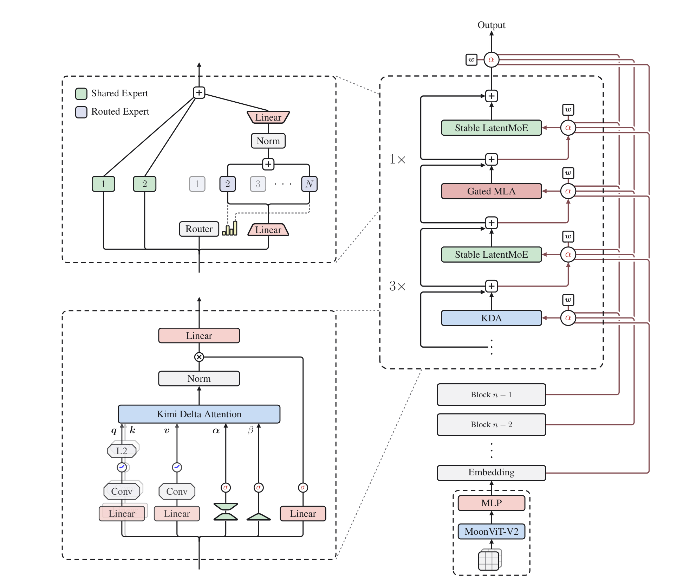

# Kimi K3 — 复核档案

> 本文件是维护性档案，不参与站点构建；读者版正文见同目录 `note.md`。

## 来源与版本

- **标题**：Kimi K3: Open Frontier Intelligence（p1 页眉为 Technical Report of Kimi K3，其余页为 Technical Report）。
- **作者**：Kimi Team（arXiv 提交人 Yulun Du；附录 A 按姓氏字母序给出全体名单，PDF 元数据共 402 个署名条目，含团队名本身，即 401 位个人作者；论文未标 ∗ 共同一作或 † 通讯作者——∗ 只作附录数学式里的上标，† 在 Table 2 脚注另有他用，都不是作者标记）。
- **机构**：Kimi Team（论文无 affiliation 行；首页脚注给出权重地址 `huggingface.co/moonshotai/Kimi-K3`）。
- **来源**：[arXiv:2607.24653v2](https://arxiv.org/abs/2607.24653v2)（cs.CL；cs.LG），v2 日期 2026-08-07。
- **许可**：arXiv 页面标注 CC BY-NC-ND 4.0（版面内图片按引用使用）。
- **版本历史**：v1 2026-07-27 → v2 2026-08-07（本笔记基于 v2，为阅读时最新版；论文未说明 v2 的改动内容）。
- **归档说明**：arXiv 来源，按仓库策略不归档 PDF；仓库清单编号 00225（上游 `paper-is-all-you-need` 归档最大号为 00191，本仓库 README 最大号为 00224，故顺延取 00225）。
- **配图**：`assets/fig2-architecture.png` 由 p3 渲染页裁剪（70.5–541.5 × 43.0–437.5 pt，300 dpi，1964×1644 px），裁剪后按元素清单逐项确认在框内：Output、Shared/Routed Expert 图例、专家编号 1–N、Router/Linear/Norm、KDA 的 q/k/v/α/β/σ 与 L2/Conv/Linear、3×/1×、Stable LatentMoE/Gated MLA/KDA、Block n−1/n−2、Embedding、MLP、MoonViT-V2、输入格。

## 阅读范围与核对手段

- **阅读范围**：v2 全文 47 页：正文 §1–8（p2–34）、附录 A–F（p41–47），含图 1–16、表 1–5、算法 1；参考资料 p35–40 未逐条阅读。
- **核对凭据**：本次抓取的 PDF 共 47 页、sha256 `1a21e4d15de52eb0d4cf09cdbffc6248c497ba6897572cc5574af237c13da51d`（2026-11-05）。表 1 用 p11 渲染页（裁剪 70–540 × 305–582 pt，250 dpi）逐行核对；表 2 用 p27 渲染页（150–250 pt 与 575–690 pt 两段，300 dpi）核对列序与斜杠双值；表 2 的加粗另用 `page.get_text('dict')` 的 `NimbusRomNo9L-Medi` span 逐格核对（Math-Vision 与 ZeroBench 两行原文按单个数值分别加粗）。Figure 2 的裁剪与元素核对见上「配图」。
- **未做**：未运行代码、未复现训练或评测、未独立测量吞吐；Hugging Face 权重页不可达，发布权重的格式与许可未验证。

## 复核记录

**2026-11-06（第 1 轮，依 check-paper-note）**：基准为 arXiv:2607.24653v2，重新下载的 PDF sha256 与首读记录一致（`1a21e4d1…3da51d`，47 页），arXiv abs 页确认 v2 仍为最新（无 v3）。核对方式：A–H 全项；Table 1/2 用渲染页（p11 250 dpi、p27 300 dpi）加 `get_text('dict')` 的粗体 span（`NimbusRomNo9L-Medi`）；7 个公式对 250 dpi 渲染页；否定性断言的检索词为 `needle`/`NIAH`/`RULER`/`haystack`、`tokens`/`GPU`/`H800`/`H100`/`cluster`、`K2.5`/`K2.6`、`ablation`、`Corresponding`/`equal contribution`；另派独立子 agent 审计（只报告），其结论逐条回原文复验后采纳。

修正：

- Table 3 的反例计数 4 处 → **5 处（6 格）**：补 KWV Bench（GPT-5.5 65.8 > 64.7）与 Agent Behavior Bench 的 Opus 65.7。
- GDPval-AA v2「不到 50 Elo」→「50 Elo」（原文 "within 50 Elo"，1736−1686=50）。
- 有界衰减的取舍方向写反：被截断的是**快速遗忘端**（α > e^−5），不是长期记忆端。
- 「三个修补带来次生问题」改为「LatentMoE + 极端稀疏放大两个失效模式，用三个组件处理」。
- 摘要与 §1 的引文分开（摘要 "outperforms"、§1 "consistently ahead of"）。
- BabyVision 的归属从 §6.1.4 改为 Table 2；§6.2.1 只用于内部基准。
- MiniTriton 从「无对照」移出（它有 roofline 与 PyTorch loss 对照）；「四个 GitHub 仓库」→ 五个（FlashKDA 在参考文献 [14]）。
- 预训练算力表述与 §5.3.1（RL 几百张 GPU）、H20/H100/Hopper 的实际用途对齐；删除未经本次核实的「K2 报告 15T token」对比。
- 「开源权重默认 4bit」改为「部署默认 4bit，发布格式论文未明说（本笔记推断）」。
- Table 1 补「原文 22 行、省略 Architecture 行、合并 4 行 ViT」的节选说明；Figure 2 图注的括号对象改为 $3\times (KDA+LatentMoE) + 1\times (Gated MLA+LatentMoE)$。
- 补齐：GPT-5.6 Sol 的潜在 cyber guard、Table 3 的拒答/降级脚注、MCP-Atlas/AutomationBench 子集与视觉重复次数、OfficeQA Pro 图片化、FrontierSWE 重算日期、ALE 的 † 说明。
- 文字修正：直方图段「分子 r_ij」→「所需偏置 r_ij」；Coding Experience 的 0.1/0.6 分对比写清。

未修 / 未核：Hugging Face 权重页仍不可达（curl 000），发布权重的格式与许可未验证；论文未说明 v1→v2 的改动，本次也未下载 v1 比对（不换基准）；「2.5×」图有曲线与数据点但纵轴无刻度值，无法精确复算。

**2026-11-06（第 2 轮）**：基准同上（重新下载的 sha256 仍为 `1a21e4d1…3da51d`，v2 仍为最新版）。本轮以措辞与口径为重点，重查 Table 2 的 bold/underline 规则（全 44 行）、Table 3 的 a–g 脚注、Table 4 的四行复算、Figure 7 的数据点、§6.1.2 的全局 effort、Table 4 的 harness、WorldVQA 的 ForceAnswer 口径、Figure 13a/14 的面板与图例；第一轮的 Table 1/2 数值、五处反例、GDPval 50 Elo、α 方向、五仓库映射做了抽查。Figure 7 在 p11 以 350 dpi 裁剪确认星形数据点；Table 3/4 回 p29 渲染页核对。修正：

- Figure 7 并非「只有拟合曲线」：图中两条虚线旁有星形数据点。三处措辞改为「有曲线与数据点，但纵轴无刻度值、未给拟合参数/置信区间」。
- 「评测在 H20 上」过宽：只有 SWE-Marathon 与 PostTrainBench 用 H20（后者官方设定为 H100），其余评测未说明硬件。
- QB 直方图的通信漏了「每层」：原文是 per layer per step 一次 nB 整数 all-reduce。
- 「56 段素材剪成架构讲解视频」张冠李戴：56 段素材对应 teaser 视频，架构讲解动画是另一项。
- 沙箱口径改为「秒级创建数万个（累计 5100 万）」，原文的 tens of thousands 是创建速率，不是「几十万次」。
- 安全节的引文归位：「we will revisit them at each major model update」指重访评测结论，不是发布策略。
- 「1M 上下文没有检索式评测」与 BabyVision 从「作者明确承认」移到「本笔记判断」，并写明检索词与读数来源。
- 补：其余基线模型均 max effort、仅 GPT-5.5 xhigh；Table 2 的下划线（第二名）未复制、个别单元格只有一侧加粗；Table 3 的 b/c/g 脚注；Table 4 两者同用 Claude Code；WorldVQA 为 ForceAnswer；Harvey 为 criterion pass rate；ALE 为 primary pass-rate；其余基准未给重复次数。
- 小修：α > e^−5（原文严格大于）；Kimi K2.5 关系条目改链本地笔记；Figure 13a 不含 GPT-5.6 Sol、Figure 14 不含 Opus 的图例范围写清；工程视角加「本笔记外推」的声明。

## 原文自身的表述张力

以下都不是笔误级别的排版问题，而是「结论性强断言与自家表格/设定对不上」，引用时需要限定。

1. **「consistently」与表格反例**。摘要写 K3「consistently outperforms other open and proprietary models evaluated in our suite」，§1 的同义句是「is consistently ahead of the other open and proprietary models evaluated in our suite」；§6.1.4 更具体：「consistently outperforming Claude Opus 4.8, GPT-5.5, and GLM-5.2 across the benchmark suite」。但 Table 2 里 Opus 4.8 与 GPT-5.5 至少在三处更高：HLE-Full（Opus 49.8/57.9 > 43.5/56.0）、CritPt（GPT-5.5 27.1 > 23.4）、OfficeQA Pro（Opus 63.9 > 63.3）。Table 3 还有五处（六格）：Agent Behavior Bench（Opus 65.7 与 GPT-5.5 70.1 都高于 65.0）、KWV Bench（GPT-5.5 65.8 > 64.7）、Agentic Vision Bench（Opus 82.8 > 78.3）、24/7 ClawBench（GPT-5.5 48.5 > 48.3）、Faithfulness（GPT-5.5 86.5 > 85.5）。而 §6.2.1 自己就写了「Kimi K3 trails the leaders mainly on Agent Behavior Bench, MIRA Bench, 24/7 ClawBench 2.0, Agentic Vision Bench, and KWV Bench」——与「consistently」直接冲突。**可复算的口径**：按 Table 2 全表 44 行逐格比较，K3 低于 Opus 4.8 的只有上述 HLE-Full 与 OfficeQA Pro 两项，低于 GPT-5.5 的只有 CritPt 一项（GPQA 与 GPT-5.5 同为 93.5）；Table 3 另有上述五处。所以「consistently」至多对 GLM-5.2 成立，对 Opus 4.8 与 GPT-5.5 应写成「多数基准领先」。

2. **成本对比的分数取值与 harness 不对称**。§6.4 写 K3 在 KCB 2.0 上「4.0 points behind Claude Fable 5 at 38% of its cost」，用的是 72.9（Kimi Code harness）对 76.9（Claude Code harness）；而 Table 3 里 K3 在**同一 Claude Code harness** 下是 73.7，差距应为 3.2 分。成本前沿图因此把 K3 画在一个更低的点上。Figure 1 同样用 72.9 与各家并列，未标 harness 差异。

3. **BrowseComp 的成绩依赖上下文压缩，但只在正文一句里披露**。Table 2/Figure 1 给 91.2，§6.1.3 才说这是 300K 触发压缩的结果，无管理时为 90.4。无管理的 90.4 又恰好与 GPT-5.6 Sol 的 BrowseComp 得分相同，两张表并读时容易混。

4. **「3T-class」与 2.78T**。摘要写 2.8T，§1 写「unprecedented 3T-class parameters」，§5 写「3T-class pre-training」，结论写「world's first open 3T-class model」。2.78T 四舍五入到 2.8T 没问题，称为「3T 级」是口径选择（大概指「万亿级中的三万亿档」）。引用时应写 2.78T，而不是 3T。

5. **安全数字不能跨套件比**。自家 38.9%（36 题自定义套件）与第三方 AISI 的 32%（原文点名 ExploitBench）来自不同任务集，论文分别点名了套件但没有说明两者不可直接相减；把两者当作同一能力的两个估计会误导。

## 工程实现与外部资料

### 可以直接借用的设计

以下是本笔记的工程外推（论文只描述 K3 自身设计，未验证这些方案在其他模型上的效果）：

- **下界衰减换稠密 Tensor Core**：任何用「负 Softplus 参数化衰减」的线性注意力（Mamba-2 系、GDN、Kimi Linear）都可以试这个替换——用固定 g_min 给 log-decay 设下界，使 16-token tile 的累积衰减与倒数缩放留在 BF16 范围内；代价是无法表达 α→0 的近完全遗忘，论文未量化这一取舍。这是一个**数值格式驱动架构选择**的干净例子。
- **KCP 的「累计转移 + 零初态状态」分解**：只对「状态会被 token 相关矩阵左乘」的递推成立（delta rule、部分 gated linear attention）。如果递推只是加法（vanilla linear attention），传统 CP 的求和就够了；判断标准是「段的效应是否依赖入态」。
- **静态形状 = 去掉 host 同步**：MoonEP 的收益不只是负载均衡，而是让每层 GEMM 形状在编译期已知，从而消掉逐层 device→host 同步与 kernel launch 抖动。任何 MoE 训练栈都可以先量一下「每层同步」占了多少 step time。
- **前缀缓存的粒度解耦**：混合注意力模型里，「哈希块」和「分配块」不必同大小；把 KDA checkpoint 放在哈希端点的稀疏子集上，就能让 512 token 级复用与 6144 token 级分配共存。这个思路对任何「有固定大小循环状态 + 逐 token KV」的混合模型（Mamba/SSM + attention）都适用。
- **草稿模型用接受率当损失**：投机解码的草稿头直接优化 LK（负对数接受率），而不是 KL；并复用预训练已有的 MTP 层 + 三级特征融合。工程上比从零训一个 draft 便宜得多。

### 成本与规模

- 论文**没有披露预训练**的 token 总量、集群规模/型号/时长与训练成本，也没有单次推理的 token 消耗；RL 侧只给了「几百张 GPU」（§5.3.1），评测侧 SWE-Marathon 与 PostTrainBench 用 H20（后者官方设定为 H100）、案例用 Hopper，都不等于预训练规模。能拿到的规模数字只有参数/层数/专家数与上下文长度。
- 服务侧的三个数字值得记：典型编码请求 400K 前缀只增量 4K（所以命中与 miss 差几个数量级）；每请求成本跨三个数量级（<2K 到 1M）；沙箱侧 checkpoint/resume 133/49 ms、内存超分 6.5×、累计 5100 万次沙箱创建。
- 量化部署是硬约束：专家权重 MXFP4 + 激活 MXFP8，且从 SFT 起就 QAT，rollout 与训练同方案——部署配置默认就是 4bit 专家权重、不是后处理量化；发布权重的实际存储格式论文未明说（本笔记推断：很可能同为 MXFP4）。

### 失败模式（原文点名的 + 本笔记归纳）

- 原文点名：预训练接 SigLIP 编码器会梯度尖峰（→ 从零训）；LatentMoE 链式矩阵乘会激活爆炸（→ RMSNorm + SiTU）；896 专家下 sign 式均衡会震荡（→ QB）；MTP 投机解码被拒时 KDA 状态无法回滚（→ 重放投影输入）；前缀缓存的部分块共享有三类竞态（→ pin / 延迟可见 / 原子失效）；沙箱在容器方案下出现过内核 panic 与死锁（→ microVM）。
- 本笔记归纳：SiTU 的 100 上限在长尾大激活上会**截断信息**，而论文只报了稳定性收益；AttnRes 的伪查询是每层新参数，层数继续涨时 $O(L^{2}d)$ 虽可算但 $O(Nd)$ 的块表示仍要跨 stage 传；prefix cache 的 512 token 粒度仍意味着「短于 512 的请求完全不复用」。

### 一个最小的 KDA 递推示意（解读，非作者代码）

```python
# 单头、逐 token 形式，对应原文 Eq.1/Eq.5；真实实现走 chunkwise + FlashKDA
S = zeros(dk, dv)                      # 固定大小循环状态
for t in range(T):
    q, k, v = proj_qkv(x[t])           # ShortConv + Swish (+ L2Norm for q,k)
    g = gmin * sigmoid(exp(A) * z[t])  # gmin=-5，逐通道，值域 (-5, 0)
    alpha = exp(g)                     # ∈ (e^-5, 1)
    beta = sigmoid(W_beta @ x[t])
    S = (I - beta * outer(k, k)) @ (alpha[:, None] * S) + beta * outer(k, v)
    o = S.T @ q                        # head-wise RMSNorm 后过 output gate
```

注意第 5 行：`alpha` 是 (d_k,) 的逐通道向量，乘在 S 的行方向；$(I - \beta k k^{\top})$ 才是 delta rule 的「擦除」。这正是 KCP 需要「累计转移矩阵」的原因——M_t 依赖当前 token，作用在入态上不可交换。

## 实验与证据细节

### 评测配置（§6.1.1–6.1.3）

- **基准**：四大轴——Reasoning & Knowledge（GPQA Diamond、CritPt、AA-LCR、HLE-Full）、Coding（DeepSWE、ProgramBench、Terminal-Bench 2.1、FrontierSWE、SWE-Marathon、PostTrainBench、MLS-Bench-Lite、SciCode）、Agentic（BrowseComp、DeepSearchQA、ResearchRubrics、Toolathlon-Verified、MCPMark/Atlas、AutomationBench、JobBench、GDPval-AA v2、AA-Briefcase、ALE、APEX-Agents、OfficeQA Pro、SpreadsheetBench 2、OSWorld 1/2、SaaS-Bench、τ3-Banking、Harvey Lab-AA、CorpFin v2、Finance Agent v2、Legal Research Bench）、Vision（WorldVQA、OmniDocBench、PerceptionBench、Video-MME、MMVU、BabyVision、MMMU-Pro、CharXiv、Math-Vision、ZeroBench）。
- **设置**：K3 全部 max effort、temperature 1.0；其余基线模型也是 max effort，只有 GPT-5.5 用 xhigh。单步任务 top-p 0.95，agentic 任务 top-p 1.0。编码任务在 Kimi Code / Claude Code / Codex 三种 harness 里跑，Terminal-Bench 报**各模型跨 harness 的最好分**；DeepSWE 用 v1.1 任务（另注 mini-SWE-agent harness 下 67.3）；SWE-Marathon 用 2026-07-09 的 H20 校准分支（Docker 镜像、性能门、oracle 按 H20 重校，正确性与反作弊校验未改），且 **Claude Fable 5 有 35% 任务触发 fallback**；PostTrainBench 用官方 Harbor 实现、H20 上三次平均。另注：Claude Fable 5 的结果都含潜在 fallback，GPT-5.6 Sol 都含潜在 cyber guard（Figure 1 注、§6.1.2）。
- **子集与重复次数**：MCP-Atlas 用 500 题公开子集、100 轮上限、Gemini 3.1 Pro 判分；AutomationBench 用 600 题公开子集；OfficeQA Pro 把整个 PDF 语料渲染成图片、不提供机器可读文本；FrontierSWE 的 dominance 分数按 2026-07-16 官方脚本从 raw 分数重算；视觉分数三次平均（ZeroBench 五次），其余基准论文未给重复次数。
- **第三方数字**：GDPval-AA v2、AA-Briefcase、τ3-Banking、Harvey、APEX、SciCode、AA-LCR、CritPt 取自 Artificial Analysis（截至 2026-07-23）；CorpFin v2、Finance Agent v2、Legal Research Bench 取自 Vals AI；ALE 取自官方榜（K3 配 Kimi Code，GPT 系配 Codex，Claude 系与 GLM 配 Claude Code；报的是榜单的 primary pass-rate，其中 Fable 5 条目为 xhigh effort、40% 任务标注降级，见 Table 2 脚注 †）。**这些不是本地复跑**。

### 主结果（Table 2）的完整读法与补充数字

读者版已给出 14 行节选；完整表共 44 个数据行，逐格比对过。除正文列出的强项外，论文 §6.1.4 的完整读法是：GPQA 与前沿持平；研究级任务仍有差距（HLE 有/无工具都落后 Fable 与 GPT-5.6，CritPt 落后三家）；编码强在 ProgramBench（第一）、SWE-Marathon（42.0，比 Fable 高 7 点）、FrontierSWE（81.2，第二）；agentic 在 8 个套件上第一（BrowseComp、DeepSearchQA、ResearchRubrics、MCPMark、AutomationBench、SpreadsheetBench 2、τ3-Banking、Harvey——Harvey 报的是 criterion pass rate），Elo 类知识工作第三/第二（GDPval 1686 第三、AA-Briefcase 1548 第二），更难的 computer-use（OSWorld 2.0、SaaS-Bench）由 Fable 5 或 GPT-5.6 领先。视觉侧 OmniDocBench 第一、WorldVQA 第二（ForceAnswer 口径：统一强制回答后的分数）。

### 内部评测（Table 3/4）

- **强项**：Swarm Bench 76.3（GPT-5.6 73.2、Opus 72.6）、Deep Research Bench 90.0（GPT-5.6 85.3、Opus 87.2）、Coding Experience 59.9（Fable 59.8、Opus 58.0、GPT-5.6 在 Codex 下 59.3；前三者同为 Claude Code——领先 Fable 0.1 分、高于 Codex 下 GPT-5.6 0.6 分，0.1 分按本笔记判断不构成实质领先，论文未给置信区间）、CLIF 52.4、KAET 83.5（GPT-5.6 85.4）、Webdev 盲评对 Opus 4.8（两者同用 Claude Code harness）总体 +31.0 个百分点（58.6 胜 / 13.8 平 / 27.6 负，3D/WebGL/Shader 上 +59.1）。
- **弱项**（论文自列）：Agent Behavior Bench 65.0（Fable 75.5、GPT-5.6 76.4、GPT-5.5 70.1）、MIRA 64.1（Fable 72.9）、24/7 ClawBench 48.3（GPT-5.6 52.0、GPT-5.5 48.5）、Agentic Vision 78.3（GPT-5.6 82.9、Opus 82.8）、KWV 64.7（GPT-5.6 66.9）。
- **Kimi Code Bench 2.0**：73.7（Claude Code harness）/ 72.9（Kimi Code harness），Fable 76.9、Opus 71.7、GLM 64.2。
- **表注里的拒答/降级**：Table 3 脚注显示 Fable 5 多行含降级或拒答（a: 13 fallbacks + 1 refusal / 80；d: 2 refused；e: 14 refused；f: 6 refusals / 95）；b/c 是 KCB 2.0 在 Codex 下 GPT-5.6 / GPT-5.5 的拒答（10 / 80、3 / 80），g 是 Faithfulness 的指标定义（1−幻觉率，越高越好）。这些行的差距不能全归能力。

### 安全评测（§6.2.2）

两档：Tier 1 = 在真实代码库里找**未公开**漏洞并给出可复现 PoC；Tier 2 = 端到端利用开发（36 个任务：16 个用户态真实 CVE + 20 个历史内核 CVE 的 QEMU 环境，难度分级逐步开启缓解）。结果：Tier 1 人工复核的发现里约 70% 为真，含 **6 个项目共 16 个此前未知漏洞**（两例在 Linux 内核：一个远端可触发的堆越界写、一个 RDMA 子系统的 Dirty-COW 类本地提权）；Tier 2 解出 **14/36**（38.9%），GLM-5.2 为 8/36（22.2%），其中 10 个来自用户态、内核档两组都未解出四分之三。论文估计整套 36 题需约 540 专家小时。第三方（UK AISI + NIST CAISI）的独立评估给了同向但不同的数字：ExploitBench 32% vs 24%，32 步模拟企业网络 17 步 vs 11 步，但在 41 个任务上任意代码执行成功 0 次。

### 第三方与成本（§6.3、§6.4）

- Artificial Analysis Intelligence Index v4.1 = **57.1，第 4/580**（若把 GPT-5.6 Sol 的各 effort 变体合并则第 3），落后 Fable 5（59.9）与 GPT-5.6 Sol（58.9）。
- Vals AI 指数 74.7，第 2/39（Fable 75.1、GPT-5.6 73.1）。
- WebDev Arena 1678 Elo，**第 1/99**（Fable 1634），作者称是首个登顶该榜的开源模型；Text Arena 1486，第 8/200；Agent Arena 9.1，第 4/37。
- 成本：BrowseComp 91.2 分对应 2.03 美元/任务（约为 GPT-5.6 Sol 的一半）；Kimi Code Bench 2.0 上「落后 Fable 4.0 分、成本 38%」，high 档「以约 1/3 成本追平 Opus 4.8 max 档」；GDPval-AA v2 上距 GPT-5.6 Sol 50 Elo（原文 "within 50 Elo"，1736−1686=50）、成本低 13%，比 Fable 便宜 2.6×；AA-Briefcase 约为 Fable 一半成本。

### 案例（§7）

- **GPU kernel 优化**：24 小时预算，四个核（AttnRes、DeepSeek Sparse Attention、KDA、MLA head dim 512）在 Hopper 与一家非 NVIDIA GPGPU 上做。AttnRes 延迟 283.6 ms → 114.4 ms；DSA 降 55.1%、KDA 降 73.6%；MLA 达到峰值 TFLOPS 的一半以上。作者称与 Fable 5（带 fallback）打平，明显强于 Opus 4.8 / GPT-5.6 Sol / GPT-5.5（Figure 14 只画 AttnRes 上 K3 / Fable / GPT-5.5 / Sol 的轨迹，Opus 的比较来自正文）。
- **编译器**：MiniTriton（Python tile 级前端 + warp 级 MLIR 注解/优化 + PTX codegen + 运行时）；在 L20 上核心基准的几何平均优于 PyTorch eager 与 torch.compile；从零写的 tensor-core matmul 在最大形状上接近 cuBLAS（约 90% 实测机器 roof）；端到端训练一个 GPT，loss 曲线贴合 PyTorch 参考，梯度与 torch autograd 的差异不超过 fp32 舍入（1e−4，对 fp64 参考）。
- **推理芯片**：48 小时自主跑完一个 nano 模型推理芯片原型（同样 hybrid KDA + NoPE-MLA、block size 2 的 AttnRes、sigmoid 路由、INT4 group-128），4 mm² 面积预算内 100 MHz 收敛，RTL 仿真解码 >8,700 token/s，1.46M 标准单元、0.277 MiB SRAM。
- **科研复现 / 知识工作 / 视频**：两小时内复现 I–Love–Q 普适关系（读 20+ 论文、300+ 状态方程、3000+ 行 Python、交互式 dashboard，作者称人类专家需 1–2 周）；用 120+ 轮迭代基于 87 份季报 / 99 份 PDF（1.1 万页+）做 AI ASIC 产业研究站；用 20+ 并发 subagent 分析 GWTC-5 的 391 个引力波事件；另制作了架构讲解动画，并用 56 段素材剪出 teaser 视频。这些是定性案例，无对照、无重复。

### 证据强度与内部一致性检查（本笔记判断，非作者结论）

- **2.5× 不能精确复算**：Figure 7 是两条拟合线、沿线星形数据点与一个「2.5×」水平位移标注；纵轴没有刻度值，也没有给拟合参数或置信区间，更没有分项消融（KDA / AttnRes / LatentMoE / SiTU / QB 各贡献多少）。Table 1 只列结构变化，不能替代归因。
- **视觉编码器「从零更好」的证据是梯度范数**：Figure 6 比较的是训练稳定性（梯度范数更低、尖峰更少），「视觉评测打平」只有一句话、没有表格数字。严格说这只支持「从零不更差且更稳」。
- **SiTU-GLU / RMSNorm 的增益没有数字**：§2.3.1 说 RMSNorm「稳定提升验证损失与下游指标」，§2.3.2 说 SiTU 训练行为更好，均无消融表。
- **QB 的证据是推导 + 定性**：附录 C/D 的推导扎实（且明确给出与 sign 更新、BIP 的关系），但「几步收敛」「无可测残余失衡」是作者陈述，没有收敛曲线。
- **MoE 负载均衡的收益缺少端到端数字**：MoonEP 的「静态形状消掉 host 同步」很有说服力，但论文没给吞吐/利用率对比。
- **跨 harness 混比**：Terminal-Bench 报「各模型跨 harness 最好分」，DeepSWE 的 67.5 未注明 harness（另注 67.3 是 mini-SWE-agent）；KCB 2.0 的成本图（Figure 13a）里 K3 跑 Kimi Code，画面中的对手（GLM-5.2 / Opus 4.8 / Fable 5）跑 Claude Code（GPT-5.6 Sol 不在该面板），另外三个套件的成本则来自公开图表或 Artificial Analysis 的按 token 定价。这些都不是错，但读者不能把差值全归给模型。
- **没有与 K2.5 的同套件对照**：Table 2/3 的基线里没有 Kimi K2.5（Figure 10 只在单个 AET 任务上出现 K2.6），所以「相对上一代提升多少」只能从 scaling 效率曲线间接推断。

## 局限与待确认问题（完整版）

**作者明确承认的**：

- 总体仍落后 Claude Fable 5 与 GPT-5.6 Sol；研究级推理（HLE、CritPt）、Elo 类知识工作、部分 computer-use 是明确短板（§6.1.4）；内部基准的短板见 §6.2.1。
- 安全评测是「能力下界」，且结论绑定当前模型版本与评测覆盖（§6.2.2）。
- WorldVQA 第二（§6.1.4 的 Vision 段；表格行名是 ForceAnswer 口径，即统一强制回答后的分数）。

**本笔记判断、论文无对应实验**：

- **长上下文评测覆盖有限**：全文检索 `needle`/`NIAH`/`RULER`/`haystack` 均无命中，1M 上下文的评测只有 AA-LCR（74.7）与长程 agent 任务，没有独立的检索式长上下文诊断。
- **BabyVision 只能按表格引用**：Table 2 中 K3 85.7，低于 Fable 5（90.5）与 GPT-5.6 Sol（88.9），但正文没有讨论这一项。
- **逐组件归因缺失**：2.5× 是「架构 + 数据 + 配方」的合计，无法判断 KDA/AttnRes/LatentMoE 各自值多少；这对想复用其中某一项的团队是最关键的信息缺口。
- **数据与算力不透明**：预训练 token 数、数据配比、预训练集群规模、训练时长、成本全部未给；开源的是权重与部分基础设施代码，不是训练过程。
- **64K→256K 的过渡未描述**：课程写「预训练 8K→64K，cooldown 256K→1M」，中间一段是空白。
- **内部基准不可复现**：KCB 2.0、Coding Experience、Swarm、CLIF、KAET、Agentic Vision、KWV、DECK、Faithfulness 等均无公开数据与评分协议；Webdev 盲评只给了胜/平/负比例，没有样本量、评审人数与一致性。
- **定性案例无法复核**：芯片原型、科研复现、视频剪辑是单次展示，无对照、无重复（MiniTriton 虽有 roofline 与 PyTorch loss 对照，但没有第三方独立验证）；「48 小时」「两小时」这类时间口径也未说明是否含人工干预。
- **开源承诺的落地状态本次未验证**：权重地址 `huggingface.co/moonshotai/Kimi-K3` 在本次环境不可达（curl 超时），无法确认实际文件、许可与量化格式；已核实的只有论文给出的五个 GitHub 仓库（2026-11-05 与 11-06 两次查询；FlashKDA 见参考文献 [14]，其余四个在脚注 3–6）：MoonEP（MIT，2026-07-24 创建，2026-10-12 最后 push）、FlashKDA（MIT，2026-04-20 创建）、MiniTriton（Apache-2.0）、nano-kpu（Apache-2.0）、AgentENV（MIT，2026-07-23 创建，2026-11-06 仍有 push）。这些仓库与论文实验的可复现性对应关系未验证。
- **安全披露的边界**：Tier 1 找到 16 个未知漏洞、Tier 2 能完成用户态利用链；论文没有讨论发布这些能力（含权重）的缓解措施、使用条款或分级开放策略，安全节只承诺随模型更新重访这些评测结论（"we will revisit them at each major model update"），发布句只写 release full weights。

## 与本仓库其他条目的关系

- **[00132 Kimi Linear](../2510.26692-v2-kimi-linear/note.md)**（arXiv:2510.26692，本仓库已有笔记）：K3 的 KDA 直接来自它，混合比例 3:1 也沿用它。K3 的两处实质改动是①把 log-decay 从无界负 Softplus 换成有界缩放 sigmoid（消除对角线 tile 的逐位置对计算），②输出门从低秩换成输入相关全秩。想理解 K3 的注意力，应先读 Kimi Linear 的分块形式与 UT 变换。
- **[00156 Kimi K2.5](../2602.02276-v2-kimi-k2.5/note.md)**（arXiv:2602.02276，本仓库已有笔记）：K3 的视觉通路（MoonViT 系列 + MLP projector、帧内/帧间分解、时间池化）与「按域训专家再合并」的后训练思路都承接 K2.5；最大差别是视觉编码器从 SigLIP 初始化改为从零训练，以及把 9 个专家用 MOPD 合并（K2.5 用的是 PARL 编排 + 冻结 subagent，两者不是同一机制，别混）。
- **[00172 DeepSeek-V4](https://arxiv.org/abs/2606.19348) / [00191 DeepSeek-V4.1-Flash](../deepseek-v4.1-flash/note.md)**（前者本仓库未生成笔记，后者有笔记）：同一问题域（百万 token 上下文 + 大规模 MoE 训练/推理）。K3 走的是「KDA 固定状态 + 稀疏全局层」的混合注意力路线，与 KV cache 压缩路线不同；本笔记未读这两篇的细节，此处只作定位。

## 附：一页速查

- **规模**：2.78T 总 / 104.2B 激活 / 93 层 / hidden 7168 / 潜空间 3584 / 专家 896（激活 16，稀疏度 56，共享 2）/ 头 96 / 词表 160K / 上下文 1M / ViT 401M（27 层，patch 14）
- **注意力**：每 block 3 KDA + 1 Gated MLA，末尾补 1 层 MLA（共 69 + 24）；MLA 全 NoPE；KDA 用 g_min=−5 的有界 sigmoid 衰减；训练时注意力输出保 FP32
- **深度**：Block AttnRes，8 个 12 层块（末块不满）+ embedding = 9 个来源；每层一个可学伪查询 w
- **宽度**：Stable LatentMoE = RMSNorm + SiTU-GLU（β1=4, β2=25，输出 ≤100）+ Quantile Balancing（Top-(k+1) cutoff，直方图 B=1000，一步分位解）
- **预训练**：8K→64K；cooldown 256K→1M；cosine（独立调参后优于 WSD）；wd 0.1；1% warmup；Per-Head Muon + weight clipping
- **后训练**：SFT（XTML 模板，QAT 起）→ 3 域 × 3 档 = 9 专家 RL（部分 rollout、预算 τ·b0、GRM 带 rubric 协议）→ MOPD 合并 → MXFP4/MXFP8 部署 + EAGLE-3 草稿头（LK loss，7 步展开）
- **基础设施**：FlashKDA / 设备内 CP / KCP（固定 all-gather + 前缀扫描）/ MoonEP（≤E/R 冗余专家、静态形状、零拷贝）/ 统一激活管理 / 外部 KV 池 / AgentENV（133ms checkpoint，49ms resume，6.5× 超分）/ 统一分页池 + 512 token 前缀缓存 / 一致性哈希双集群 + 预算准入
- **招牌数字**：2.5× scaling 效率；SWE-Marathon 42.0；ProgramBench 77.8；BrowseComp 91.2（2.03 美元/任务）；MCPMark 94.5；AutomationBench 30.8；OmniDocBench 91.1；AA Index 57.1（#4/580）；WebDev Arena 1678（#1/99）；cyber Tier 2 14/36

## 迁移索引

2026-11-28 读者版重写时，以下内容从 `note.md` 移入本文件：

- 来源信息表中的标题页眉说明、作者署名细节、版本历史、归档说明与仓库编号依据；原「阅读范围」「核对凭据」两行；Figure 2 的裁剪参数与元素清单；
- 原「复核记录」整节（2026-11-06 第 1、2 轮）；
- 原「原文自身的表述张力」整节（5 条）；
- 原「工程视角」整节（可直接借用的设计、成本与规模、失败模式、KDA 递推示意）；
- 原「实验与证据」整节（评测配置细节、Table 2 完整读法、Table 3/4 内部评测与脚注、安全评测、第三方与成本、案例、证据强度检查）；
- 原「局限与待确认问题」完整版（作者承认 3 条 + 本笔记判断 8 条）；
- 原「与本仓库其他条目的关系」完整版（读者版只保留定位句）；
- 原「附：一页速查」整节。


## 旧版细节补遗（2026-11-28 验收）

> 读者版压缩时删掉了以下表格/数字；按旧版原样保留在档案中，正文不重复。

### 旧版「架构总览」与 Table 1

### 1. 架构总览（§2，Table 1，Figure 2）



*Figure 2（arXiv:2607.24653v2，CC BY-NC-ND 4.0，由 p3 渲染页裁剪）：右侧为主干——每个 block = 3×(KDA + Stable LatentMoE) + 1×(Gated MLA + Stable LatentMoE)；左侧上为 Stable LatentMoE（2 个全宽共享专家 + N 个潜空间路由专家，Router 打分），左侧下为 KDA 模块（q/k 经 ShortConv+Swish+L2Norm，v 经 ShortConv+Swish，α/β 为门控），右下为原生视觉通路（MoonViT-V2 → MLP → 与文本共享 embedding）。图中 w/α 表示 AttnRes 的伪查询与跨层注意力权重。*

Table 1 是全文信息密度最高的一张表（K2 → K3；原文共 22 行，这里省略 `Architecture: MoE / MoE / –` 一行、把 4 行 ViT 参数合并为一行，其余逐行照抄）：

| 项 | Kimi K2 | Kimi K3 | 变化 |
| --- | --- | --- | --- |
| #Layers | 61 | 93 | ↑52% |
| Total Parameters | 1.04T | 2.78T | ↑167% |
| Activated Parameters | 32.6B | 104.2B | ↑220% |
| Hidden Dimension | 7,168 | 7,168 | = |
| Latent MoE Dimension | — | 3584（0.5×） | — |
| MoE Hidden Dimension per Expert | 2,048 | 3,072 | ↑50% |
| Routed Experts | 384 | 896 | ↑133% |
| Experts Active per Token | 8 | 16 | ↑100% |
| Shared Experts | 1 | 2 | ↑100% |
| Attention Heads | 64 | 96 | ↑50% |
| Number of Dense Layers | 1 | 1 | = |
| Vocabulary Size | 160K | 160K | = |
| Training Context Length | 128K | 1M | 8× |
| Attention Mechanism | MLA | Hybrid KDA–MLA | — |
| Activation Function | SwiGLU | SiTU-GLU | — |
| Attention-Layer Composition | 61 MLA | 69 KDA + 24 MLA | — |
| Number of MTP Layers | 1 | 1 | = |
| ViT（参数 / 层数 / patch / 头数） | — | 401M / 27 / 14 / 12 | — |

几点读表要点：hidden 仍是 7168，说明「宽度」没靠加 hidden，而是靠**加专家数 + 把专家放进 3584 的潜空间**；激活参数涨到 3.2×，但每 token 参与的专家数只翻倍、单专家宽度只涨 1.5×，差额来自层数与共享专家；93 层 = 23 个（3 KDA + 1 MLA）块 + 末尾 1 层 MLA（保证最后一层一定是全局注意力）。


### 旧版「基础设施：三处系统设计」

### 9. 基础设施：三处系统设计（§5）

**KDA 的系统协同**（§5.1）

- FlashKDA：CUTLASS 实现的分块核，把块内并行计算与跨块状态传播**重叠**起来（朴素实现两阶段交替会让 SM 空转），作为 flash-linear-attention 的后端自动分发。
- 设备内 CP：TP 只切头、不缩短递推，超长 prefill 时每 rank 只有几个头、SM 大量闲置。观察到「每段的状态转移可独立于入态求值、事后再精确合成」，于是用 SM 级 CP 规划器把序列切到单卡内的多个 SM 上并行算段转移再合并——**无跨设备通信**。
- KCP（跨设备）：线性注意力的传统 CP 只把各 rank「从 S=0 起算的本地状态」相加；但 KDA 的 delta rule 会先用 M_t=(I−β_t k_t k_tᵀ)Diag(α_t) 作用在入态上，段的效果依赖入态。KCP 因此把每段效应拆成两个本地可算的量：累计转移 M 和从零起算的状态 S̃，all-gather 后按前缀扫描逐段合成。通信是**固定大小的 all-gather**（不随序列长度增长），计算线性扩展。

**3T 级预训练**（§5.2）

- 并行组合：PP + 虚拟 stage、EP、ZeRO-1、Pipeline ZeRO-2 梯度分片、CP；共享专家在 EP rank 上复制，all-to-all 与计算重叠。
- **MoonEP**：传统 EP 的 token 负载不均导致算力失衡与显存碎片。MoonEP 要求每 rank 恰好收到 S×K 个 token，用「动态冗余专家」补齐；论文证明**每 rank 至多 E/R 个冗余专家**就能保证平衡方案总存在（附录 E 给了上界与紧性构造，紧性约为 ⌈E(R−1)/R²⌉）。规划核在线近似最优（离线用 ILP 做参照），通信上做融合 permute/unpermute + 零拷贝视图（最坏失衡下 DeepEP 需要 S×K×R 的 buffer，MoonEP 只需固定 S×K）；因为形状静态，**消掉了每层 host 与 device 的同步**；再叠一个面向 token 分布的专家 GEMM 调度器，共享专家走独立 stream。
- **显存**：统一激活管理器（重算/量化/offload/远程 offload 都是可组合的存储策略，按 tensor 声明）；MoE 梯度改写（借 SonicMoE 的思路）去掉对 forward output 的依赖；dispatch 的输入不存、反向重算并与 group-GEMM 反向重叠；AttnRes 整体 checkpoint + 基于缓存的流水线通信（只增量传新块）；PP rank 间激活不均时用 Mooncake Transfer Engine 远程 offload；梯度在 DP 维分片后放 CPU，GPU 只留双缓冲；Muon 的正交化需要完整参数矩阵，改用 P2P 只取本地参数分片（避免全量 all-gather）。
- **多模态编码器**：大图沿 patch 维切到多设备、gather-KV 算注意力；再把 CP 组分细，把多张大图分散到子组，避免通信占比随规模上升；ViT 的前向/反向被排进流水线气泡（K2.5 的 DEP 之上进一步拆解）。

**1M agentic RL**（§5.3）

- 共置 RL（co-located，几百张卡内完成 1M 上下文实验）+ 部分 rollout 降尾延迟。
- **外部 KV 池**：解码中的块留 GPU，被逐出的空闲前缀才写回 CPU DRAM，下次复用前预取；KDA 状态与对应 MLA KV 块**同生命周期**一起搬。训练迭代结束后把权重与优化器状态卸到 NVMe，腾出 DRAM 给 KV 池。
- rollout 自动限流：按活跃请求数、排队数、KV 利用率动态调并发。
- 参考模型等「只做前向」的大模型权重放 CPU，参数张量直接复用策略模型的 FP32 梯度缓冲存储（梯度稍后会被覆盖，所以安全），配合 ZeRO-2 只保留两个 VPP chunk 的缓冲做双缓冲预取。
- **AgentENV**（Firecracker microVM，与合作方开发）：增量 checkpoint 133 ms、恢复 49 ms；pause/resume（暂停不占内存 CPU，等待模型推理可占沙箱生命周期的 98%）、fork（原沙箱继续跑，用于无副作用的判分）、snapshot（定期快照做错误恢复）；OverlayBD 镜像 + 自研 ublk 驱动 + 存储层共享 + P2P 传输做到大规模亚秒级启动，copy-on-write 内存 + page cache 优化做到最高 6.5× 内存超分。K3 训练与评测期间共创建 **51,219,741 个沙箱、覆盖 1,505,678 个镜像**。

**在线服务**（§5.4）

- **统一分页池**：MLA KV 随序列长、KDA 状态固定且每请求一份，两者页大小对齐后共用一套分配/引用计数/淘汰；页内按头连续存放，跨节点传输以「单头字节流」为最小单位；prefill/decode 分离且 TP 度不同时在传输路径上重排布。
- **细粒度前缀缓存**（Figure 12）：块哈希匹配要求所有层共享一个块大小，而 KDA 状态快照只负担得起稀疏边界，导致块大小被逼到 1024–6144 token，几乎没法复用。K3 把两种粒度解耦：MLA 侧用 512 token 的细哈希块（物理块仍是粗分配单位），KDA 侧只在 MLA 哈希端点的一个稀疏子集存 checkpoint；查找分两段（先整物理块，再块内哈希端点），命中点是「同时满足两段的最长边界」。例子：前 2800 token 命中时在 B=2560=5×512 处恢复，从 B 继续 prefill，[0,B) 零重算。
- 并发一致性三个坑：命中块在所有 cache group 上先 pin 再分配；拷入私有块在 forward 前于 GPU 上完成，未落地的块不参与匹配；一个 KDA group 的 checkpoint 被逐出就原子地让兄弟 group 失效。做到之后，混合模型的任意共享前缀都能在**任意 512 token 边界**复用。
- 解码核：MTP 投机解码被拒时需要回滚 KDA 状态；不存每步快照（batch 大时状态流量爆炸），而是只缓存投影输入、片上重放已接受 token 的状态（与同期工作 ReplaySSM 独立提出同一思路）。Block AttnRes 在 prefill 用 SP 把一个 all-reduce 拆成 reduce-scatter + all-gather、把块内核算在中间；decode 时块间核走 side stream，块内合并与 RMSNorm 融进前一个 TP all-reduce。LatentMoE 把潜空间降维与 router 融成一个 GEMM、潜权重分片 + multimem store 做 all-gather、decode 用 WarpDecode 式 token-centric 核（每 warp 负责一个输出神经元、再细分 lane team 处理不同专家）。
- 集群调度：1M 上下文下一次命中与一次 miss 差几个数量级，所以**按前缀缓存亲和性路由**（把会话路由到持有其缓存的集群）；用一致性哈希把每个会话绑到「主 + 备」两个集群，主故障时备重新 prefill，且备份分配在集群间均匀分散，单集群故障影响有界。再加**按预算的准入控制**：给不同请求类别各自的资源预算，避免长上下文突发把短请求的 TTFT 拖垮。

---
