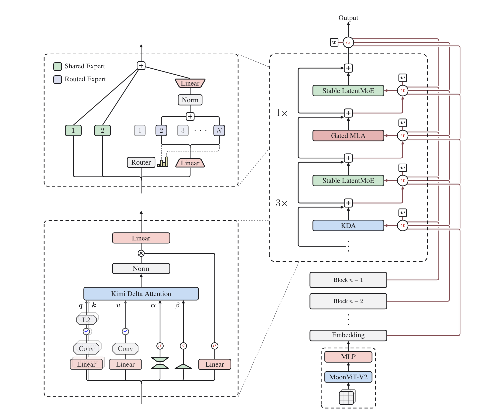

# Kimi K3: Open Frontier Intelligence

## 来源信息

| 项 | 内容 |
| --- | --- |
| 标题 | Kimi K3: Open Frontier Intelligence |
| 作者 | Kimi Team（arXiv 提交人 Yulun Du；附录 A 按姓氏字母序给出 401 位个人作者，论文未标共同一作或通讯作者） |
| 机构 | Kimi Team（论文无 affiliation 行；首页脚注给出权重地址 `huggingface.co/moonshotai/Kimi-K3`） |
| 来源 | [arXiv:2607.24653v2](https://arxiv.org/abs/2607.24653v2)（cs.CL；cs.LG） |
| 版本 | v2（2026-08-07，47 页）；v1 2026-07-27；本笔记基于 v2 |
| 许可 | arXiv 页面标注 CC BY-NC-ND 4.0（版面内图片按引用使用） |
| 阅读日期 | 2026-11-05 |
| 仓库编号 | 00225 |

---

## 核心结论

一句话：**K3 把开源模型的规模上限从 1T 级推到 2.78T 总参数 / 104.2B 激活，并沿序列（KDA + Gated MLA 混合注意力）、深度（Attention Residuals）、宽度（896 专家的 Stable LatentMoE）三个方向改造信息流，配合数据与训练配方换到约 2.5× 的 scaling 效率，再配上百万 token 的 agentic RL 与为 3T 级 + 1M 上下文重做的基础设施。**

- **规模与效率**（§1–§3，Table 1）：2.78T 总参、104.2B 激活、896 路由专家（每 token 激活 16 个，稀疏度 56）、93 层、96 头、160K 词表、原生视觉（401M 的 MoonViT-V2）、上下文 1M。作者用重拟合的 scaling law 声称整体效率约 2.5×；Figure 7 给了拟合曲线与沿线数据点，但纵轴无刻度值、未给拟合参数，也没有分项消融。
- **架构**（§2）：每 4 层一组 = 3 层 KDA（Kimi Delta Attention，线性注意力）+ 1 层 Gated MLA（全局注意力），末尾再补一层 MLA，共 69 KDA + 24 MLA；MLA 全部用 NoPE，位置与近因信息由 KDA 的衰减门提供，因此扩到 1M 不需要改 RoPE base 或上 YaRN；深度用 AttnRes，宽度用 LatentMoE。
- **训练**（§3–§4）：预训练 8K→64K，cooldown 阶段 256K→1M；余弦退火在各自独立调参后优于 WSD；后训练是 SFT → 3 领域 × 3 推理档（low/high/max）= 9 个专家 RL → 多教师 on-policy 蒸馏（MOPD）合并，从 SFT 起就做 QAT（专家权重 MXFP4 / 激活 MXFP8）。
- **基础设施**（§5）：FlashKDA 核、设备内 CP、KCP（固定大小 all-gather + 前缀扫描）、MoonEP（每 rank 至多 E/R 个冗余专家即可完美负载均衡，形状静态化消掉逐层 host 同步）、统一分页池 + 512 token 前缀缓存、microVM 沙箱。
- **结果与定位**（§6，Table 2）：在论文自建的 30+ 基准套件里总体落后 Claude Fable 5 与 GPT-5.6 Sol，领先 Claude Opus 4.8 / GPT-5.5 / GLM-5.2 的多数条目（有反例）。最强的是长程 coding/agent（SWE-Marathon 42.0、ProgramBench 77.8 全表第一、MCPMark-Verified 94.5），弱在研究级推理（HLE-Full 43.5/56.0、CritPt 23.4）、知识工作 Elo 与部分 computer-use；BrowseComp 91.2 对应 2.03 美元/任务。

---

## 问题

### 开源只在「第二条轴」上进步（§1）

作者把 LLM 的 scaling 拆成两条轴：部署前的预训练规模，和部署时的 test-time compute（长思维链、推理档位、工具调用、并行 agent）。过去两年开源在第二条轴上进展很快（R1、K1.5、K2.5 Agent Swarm），但预训练规模大多停在 1T 级或略高。当推理/agentic RL 方法被套到体量相近的底座上时，开源之间的差距会收敛，而**与最强闭源系统的差距有拉大的风险**（原文 "risks converging while the gap … widens"）。K3 的定位就是把两条轴同时推到前沿：底座进到 2.78T 总量级，RL 与推理档位在 1M 上下文上做。

### 三条「信息流」瓶颈（§2）

论文把架构设计统一叙述为「沿三个维度扩展信息流」，每一维都对应一个具体瓶颈：

- **序列维度**：全注意力在 1M 上下文下 KV cache 与计算都不可承受；纯 KDA 效率高但只有固定大小的状态，缺少全注意力的选择性高容量交互（原文对混合设计的说法是 "retaining selective high-capacity attention"）。→ 3:1 混合。
- **深度维度**：标准残差把所有历史压缩进一个状态 h_l，相当于「深度上的 RNN 瓶颈」，层数加到 93 后前层信息只能逐层衰减传递。→ 用注意力跨层取数（AttnRes）。
- **宽度维度**：常规 MoE 每个被选专家都要吃满 d 维表示，专家池一大，通信与权重流量随路由重数增长；而专家池不够大时专业化空间不足。→ LatentMoE 把路由专家放进窄潜空间，从而承受 896 专家 / 16 激活。

LatentMoE 与极端稀疏放大了原设计的两个失效模式，论文用三个组件处理：①潜空间链式矩阵乘（W↓ → 专家 FFN → W↑）条件数差导致激活爆炸（→ W↑ 前加 RMSNorm、并把 SwiGLU 换成有界激活 SiTU-GLU）；②近千专家的负载均衡超出 sign-based 无辅助损失更新的适用区间、收敛慢易震荡（→ Quantile Balancing）。

### 后训练与系统必须一起改（§1、§4、§5）

1M 上下文的 agentic RL 不是「把序列拉长」：单条轨迹跨多个训练迭代（部分 rollout）带来严重的数据陈旧；沙箱要在秒级创建数万个（全程累计 5100 万个）、单次可能上千次工具调用；线上服务又要同时管理两种生命周期完全不同的缓存（KDA 固定状态 vs MLA 逐 token KV）。论文因此把基础设施与算法放在同一篇里讲，这也是这份报告比一般模型卡更有信息量的部分。

### 本文的设定与前提

前提是「长上下文能力」与「agentic 能力」可以共用同一套底座，架构改动只需保证数值稳定与系统可落地；评测则用自建的 30+ 套件，闭源基线通过 API 跑，部分第三方数字直接取自外部榜。后一个前提决定了结果的比较口径，读「主要结果」时要与 `audit.md` 的口径说明一起看。

---

## 核心想法

### 一句话

不换掉 Transformer，而是把「信息在序列、深度、宽度三个方向上怎么流动」各改一处，让 2.78T 参数与 1M 上下文在工程上同时成立。

### 直觉：三个方向各有一个「信息被挤扁」的地方

- **序列**：全注意力让每个 token 与全部历史相连，代价是 KV cache 随长度线性涨；线性注意力把历史压进固定状态，便宜却没有「按内容挑着看」的能力。K3 的做法是让多数层用便宜的状态、少数层保留全注意力，并把位置信息交给状态本身的衰减。
- **深度**：标准残差 h_l = h_{l−1} + f(h_{l−1}) 是一条单通道，第 1 层的信息要经过 92 次相加才能到第 93 层，中间任何一层都可能把它冲淡。AttnRes 让每层直接对所有前序层的输出做一次注意力，等于把「深度」也变成一条可寻址的序列。
- **宽度**：MoE 的每个专家都是一块 d 维进、d 维出的 FFN，专家越多，路由通信与权重读取越重。把专家搬进 3584 维的潜空间后，同样的显存与带宽能放下更多专家，稀疏度才能到 56。

### 为什么这些改造能一起成立

- **混合注意力解决的是「谁来提供位置」**：KDA 的逐通道衰减门本身携带近因信息，MLA 因此可以全部去掉位置编码（NoPE）。位置不再由 RoPE 的基频决定，扩上下文就不需要重调 RoPE base 或上 YaRN——这是「直接外推到 1M」的机制来源。
- **有界衰减解决的是「能不能用 Tensor Core」**：Kimi Linear 的分块形式里，块内对角线 tile 需要逐位置对计算，原因是无界负 Softplus 会让累积衰减与倒数缩放溢出 BF16。给 log-decay 设一个固定下界，数值范围就被钉死，对角线 tile 也能走稠密矩阵乘。
- **潜空间 MoE 的两个次生问题都有对应补丁**：链式矩阵乘的尺度漂移用 RMSNorm 吸收，无界激活用 SiTU-GLU 压住；近千专家的均衡用一步分位解替代 sign 更新。
- **跨层注意力与分块**：全量 AttnRes 的算术量是 $O(L^{2}d)$，层数不到 100 时可算；真正的瓶颈是 $O(Ld)$ 的激活驻留与流水线跨 stage 通信，所以实际用的是按 12 层分块的 Block AttnRes。

### 与已有做法的区别

- **不是 MoE 加宽，而是专家变窄**：hidden 仍是 7168，总参数的增长主要来自专家数（384→896）与层数（61→93），不是把每条专家加宽。
- **不是「线性注意力替换全注意力」**：3:1 混合保留了 24 层全局注意力，这些 MLA 层仍做无限制的全局内容交互，只是不再编码位置。
- **不是「残差加一个门」**：AttnRes 把前序层输出当成 key/value 做 softmax 检索，层间连接从固定加法变成可学的、按内容选择的和。
- **不是「负载均衡再调参」**：QB 直接解一个平衡指派的坐标最小化问题，没有学习率类超参。

### 一个走通的账：有界衰减为什么够用

取 $g_{\min}=-5$：因为 Sigmoid 的值域是 (0,1)，每步 log-decay 落在 (−5,0)。一个 16-token 的 tile 累加 16 次，累计 log-decay 落在 (−80,0)；对应的倒数缩放因子小于 $e^{80}$，仍在 BF16 的动态范围以内。这就是「对角线 tile 可以走稠密矩阵乘」的全部算术依据——不是近似，而是把每一步的遗忘率钉在一个固定区间里。代价是单步遗忘率有严格下界 $\alpha_t>e^{-5}$，模型无法表达「一步几乎清空状态」；长期记忆端（α→1）不受限，论文没有量化这一取舍。

### 第二个走通的例子：前缀缓存怎么在一棵混合模型上复用

KDA 的状态是「每请求一份、大小固定」，MLA 的 KV 是「逐 token 增长」，两者的块大小很难对齐；若强行统一，块大小会被 KDA 状态快照逼到 1024–6144 token，前缀几乎无法复用。K3 把两种粒度解耦：MLA 侧用 512 token 的细哈希块，KDA 侧只在哈希端点的一个稀疏子集存 checkpoint。于是「前 2800 token 命中」可以落到位置 2560（=5×512）处恢复，从该位置继续 prefill，[0,2560) 零重算——复用的最小单位从「一个物理块」降到「一个哈希端点」。

### 代价

- **架构改动的耦合度高**：KDA 的数值范围、MLA 的 NoPE、AttnRes 的伪查询、LatentMoE 的三个补丁互相依赖，单独拆一项未必还能保持同样的训练稳定性。
- **深度方向的读取不是免费的**：每层多一次跨层注意力与一个伪查询参数，服务侧要专门做融合核；块表示仍要跨 stage 传。
- **稀疏度把系统复杂度推到前台**：896 专家 / 16 激活要求 MoonEP 这样的静态形状负载均衡，否则逐层 host 同步与显存碎片会吃掉收益。
- **收益无法归因**：2.5× 是架构、数据、配方的合计，论文没有给 KDA / AttnRes / LatentMoE 各自贡献多少。

---

## 方法

### 符号表

| 符号 | 含义 | 维度 / 取值 |
| --- | --- | --- |
| $L$, $l$ | 层数 / 层下标 | $L=93$ |
| $d$ | hidden 维度 | 7,168 |
| $\ell$ | LatentMoE 潜空间宽度 | 3,584（0.5 倍 hidden） |
| $h_l$ | 第 $l$ 层的残差流表示 | 原文未显式给维度；按上下文为 $\mathbb{R}^{d}$ |
| $S_t$ | KDA 的循环状态 | 原文未定义维度；按上下文理解为 $d_k\times d_v$ |
| $q_t,k_t,v_t$ | KDA 的 query / key / value | key 与 value 的维度分别记为 $d_k,d_v$；query 维度原文未定义 |
| $\alpha_t$ | KDA 逐通道遗忘系数 | $\in(e^{-5},1)^{d_k}$ |
| $\beta_t$ | KDA 写入强度 | 原文未定义维度；按上下文理解为标量 |
| $g_t^h$ | 第 $h$ 头逐通道 log-decay | $\in(g_{\min},0)^{d_k}$ |
| $g_{\min}$ | log-decay 下界常数 | $-5$ |
| $A^h$ | 每头可学的 log-scale | 原文未给形状；按上下文为标量 |
| $z_t^h$ | 低秩投影得到的逐通道 decay logit | 原文未定义维度；按上下文为 $d_k$ |
| $w_l$ | 第 $l$ 层 AttnRes 的可学伪查询 | 原文未定义维度；按上下文为 $d$ |
| $\phi(\cdot)$ | AttnRes 的打分函数 | $\exp\!\left(q^{\top}\operatorname{RMSNorm}(k)\right)$ |
| $k_i,v_i$ | AttnRes 第 $i$ 个来源的 key / value | 来源 0 是 token embedding，其余是层或块表示 |
| $N$ | Block AttnRes 的块数 | 8（每块 12 层，末块不满） |
| $N_s$ | 共享专家数 | 2 |
| $\mathcal{T}_k(x)$ | token $x$ 选中的路由专家集合 | $\lvert\mathcal{T}_k(x)\rvert=16$ |
| $E_i^{\text{routed}}$, $E_j^{\text{shared}}$ | 路由 / 共享专家 FFN | 路由专家 intermediate 3,072 |
| $p_i$ | 路由专家 $i$ 的混合权重 | 原文未给归一化细节 |
| $W_\downarrow$, $W_\uparrow$ | 潜空间下投影 / 上投影 | $d\to\ell$ / $\ell\to d$ |
| $x$, $z$, $u$ | LatentMoE 的输入表示 / 潜空间表示 / 聚合结果 | $z,u\in\mathbb{R}^{\ell}$；$x\in\mathbb{R}^{d}$ |
| $c_t$, $W_c$ | MLA 的 KV 潜向量 / 压缩投影 | 推理时只缓存 $c_t$；$W_c$ 形状原文未给 |
| $\beta_1,\beta_2$ | SiTU-GLU 两个分支的平滑上限 | 4 / 25 |
| $W_g,W_u$ | SiTU-GLU 的门分支 / 上分支投影 | 原文未给形状 |
| $b_j$ | 专家 $j$ 的路由偏置 | 只进 Top-k 选择，不进混合权重 |
| $s_{:,j}$ | batch 内所有 token 给专家 $j$ 的分数 | 列向量 |
| $\alpha^{(t)}$ | QB 中每个 token 的 cutoff（Top-$(k+1)$ 的第 $k+1$ 名） | 原文只写 cutoff 的来源；本笔记按式中用法理解为逐 token 向量 |
| $n$, $k$ | 专家总数 / 每 token 激活数 | 896 / 16（用于 $k/n$；与 KDA 的 $k_t$ 不是同一符号） |
| $B$ | QB 直方图的 bin 数 | 1,000 |
| $r_{\text{opd}}$ | MOPD 的逐 token 蒸馏奖励 | 式中所写 |
| $\pi_{\text{teacher}}^{(d,e)}$, $\pi_\theta$ | 教师 / 学生策略 | — |
| $R_{\max}$ | 蒸馏奖励裁剪上限 | 原文未给数值 |
| $\mathrm{sg}(\cdot)$ | stop-gradient | — |

### 数据流：一个 block 里信息怎么走

输入先过 token embedding；图像与视频经 MoonViT-V2 → MLP → 与文本共享的 embedding。主干 93 层 = 23 个「3×(KDA + Stable LatentMoE) + 1×(Gated MLA + Stable LatentMoE)」块 + 末尾 1 层 MLA，保证最后一层一定是全局注意力。

每层开头不是简单相加，而是用 AttnRes 从「embedding + 所有前序块表示」里取一次加权和；KDA 或 MLA 的输出经全秩输出门后进入 Stable LatentMoE——2 个全宽共享专家 + 16 个潜空间路由专家，聚合后再升维回模型宽度。



*Figure 2（原文 p3，CC BY-NC-ND 4.0）：右侧为主干，每个 block = 3×(KDA + Stable LatentMoE) + 1×(Gated MLA + Stable LatentMoE)；左侧上为 Stable LatentMoE，左侧下为 KDA，右下为 MoonViT-V2 视觉通路。*

### KDA：delta rule 加逐通道遗忘（原文 Eq 1）

```math
S_t = \left(I-\beta_t k_t k_t^{\top}\right)\operatorname{Diag}(\alpha_t)S_{t-1}+\beta_t k_t v_t^{\top},
\qquad \tilde{o}_t = S_t^{\top} q_t
```

**逐项读法**：状态先按通道乘一个遗忘系数 $\alpha_t$，再减去「沿当前 key 方向的分量」（delta rule 的写入修正），最后写入 $\beta_t k_t v_t^{\top}$；输出是状态对 query 的投影。$\alpha_t$ 是逐通道的（$d_k$ 维），$\beta_t$ 是标量式的写入强度。要点是 $\operatorname{Diag}(\alpha_t)$ 乘在状态的行方向，而 $(I-\beta_t k_t k_t^{\top})$ 才是真正的「擦除」——这个顺序决定了状态转移矩阵依赖当前 token，也正是后文 KCP 需要合成「累计转移」的原因。

### 分块并行与有界衰减（原文 Eq 4、Eq 5）

块内用 UT 变换把递推变成两个矩阵乘：一个带前序块状态的 inter-chunk 项，一个块内因果注意力的 intra-chunk 项。工程麻烦在块内对角线 tile：Kimi Linear 时代要逐位置对计算，无法用 Tensor Core。K3 的第一个改动是把 log-decay 从无界负 Softplus 换成有界缩放 sigmoid：

```math
g_t^{h}=g_{\min}\operatorname{Sigmoid}\!\left(e^{A^{h}}z_t^{h}\right)\in(g_{\min},0)^{d_k},
\qquad \alpha_t^{h}=\exp(g_t^{h})\in(e^{g_{\min}},1)^{d_k}
```

**逐项读法**：$z_t^{h}$ 是低秩投影出来的逐通道 decay logit，$A^{h}$ 是每头可学的 log-scale，$g_{\min}=-5$ 是常数下界。于是每个 $\alpha$ 都严格大于 $e^{-5}\approx6.7\times10^{-3}$，16-token tile 的累计 log-decay 落在 (−80,0)，倒数缩放因子小于 $e^{80}$，留在 BF16 动态范围内——这正是对角线 tile 也能用稠密 Tensor Core 矩阵乘、彻底去掉「逐位置对」路径的原因。代价是单步遗忘率有下界，模型无法表达「一步几乎清空状态」。

### Gated MLA 与 NoPE

MLA 把 KV 压成低维潜向量 $c_t=W_c x_t$，只缓存 $c_t$（K2/K2.5 的老配方）。K3 的关键变化是**所有 MLA 层改用 NoPE**：不给 query/key 加任何显式位置编码，位置与近因信息由中间的 KDA 层提供，MLA 只负责无限制的全局内容交互。好处很直接：扩上下文时不用重调 RoPE base、不用 YaRN。KDA 与 MLA 的输出都加了输入相关的**全秩输出门**；训练时注意力输出保持在 FP32（修正 flash attention 的偏置舍入误差），代价是输出 tile 的片上占用翻倍，因此重写训练核让它与 KV staging buffer 重叠。

### Attention Residuals：把注意力搬到深度方向

```math
\alpha_{i\to l}=\frac{\phi(q_l,k_i)}{\sum_{j=0}^{l-1}\phi(q_l,k_j)},
\qquad h_l=\sum_{i=0}^{l-1}\alpha_{i\to l}\,v_i,
\qquad \phi(q,k)=\exp\!\left(q^{\top}\operatorname{RMSNorm}(k)\right)
```

**逐项读法**：第 $l$ 层用一组可学的伪查询 $q_l=w_l$ 对所有前序表示做 softmax 注意力；key 与 value 都取各层输出（第 0 个是 token embedding），权重由伪查询与 RMSNorm 后的 key 的内积决定。RMSNorm 是为了防止输出幅值大的层垄断权重。全量形式是 $O(L^{2}d)$ 算术，层数不到 100 时可承受；真正的瓶颈是 $O(Ld)$ 的激活驻留，以及流水线并行下的跨 stage 通信。

因此实际用 **Block AttnRes**：把 L 层切成 $N=8$ 块、每块 12 层（最后一块不满），块内输出求和成一个块表示，跨块只对 8 个块表示做注意力（块内第 $i$ 层再把自己的部分和并进去）；加上 embedding 共 9 个来源。显存与通信从 $O(Ld)$ 降到 $O(Nd)$，推理时块间并行结果可用 online softmax 与块内顺序部分和合并。K3 的 93 层是 8 块 × 12 = 96 的「末块不满」情形，论文明确写了这一点。

### Stable LatentMoE：潜空间路由与三个补丁

路由路径是 $x\to z=W_\downarrow x\in\mathbb{R}^{\ell}$（$\ell=3584$）→ 选中的 16 个专家在潜空间计算 → 加权聚合 $u$ → $W_\uparrow$ 映回 $d$ 维；两个共享专家走全宽路径。

```math
u=\sum_{i\in\mathcal{T}_k(x)} p_i E_i^{\text{routed}}\left(W_\downarrow x\right),
\qquad y=\sum_{j=1}^{N_s}E_j^{\text{shared}}(x)+W_\uparrow\operatorname{RMSNorm}(u)
```

**逐项读法**：路由专家只在 $\ell$ 维里算，聚合后再用 RMSNorm 归一化、最后升维回模型宽度，与两个全宽共享专家的输出相加。RMSNorm 是 K3 相对原版 LatentMoE 的第一个补丁——原版直接把 $u$ 升维，$u$ 的尺度会随「选中了谁、权重多大」漂移，插一个归一化后路由分支对尺度不敏感；作者称它不仅稳训练，还稳定提升验证损失与下游指标（未给消融数字）。

第二个补丁是 **SiTU-GLU**：把 SwiGLU 的两个无界因子都套上平滑上限 $\beta\tanh(\cdot/\beta)$。

```math
\operatorname{SiTU\text{-}GLU}(x)=\left[\beta_1\tanh\!\left(\frac{W_g x}{\beta_1}\right)\odot\operatorname{Sigmoid}(W_g x)\right]\odot\left[\beta_2\tanh\!\left(\frac{W_u x}{\beta_2}\right)\right]
```

**逐项读法**：门分支保留 sigmoid（负半轴仍趋 0），但把「线性因子」换成受 $\beta_1$ 限制的缩放 tanh；上分支同样受 $\beta_2$ 限制。$\beta_1=4$、$\beta_2=25$ 时逐坐标有 $\lvert\text{输出}\rvert\le\beta_1\beta_2=100$（附录 B 的原文 Eq 19），而原点附近 $\beta\tanh(z/\beta)=z+O(z^{3}/\beta^{2})$，与 SwiGLU 一阶一致、$\beta\to\infty$ 时逐点退化为 SwiGLU。和硬截断的区别是饱和边界外仍有非零梯度。

第三个补丁是 **Quantile Balancing**（QB）：保留「偏置只进 Top-k 选择、不进混合权重」的无辅助损失框架，但把固定步长的 sign 更新换成一步到位的分位数解。

```math
\hat{b}_j^{(t+1)}\leftarrow-\operatorname{quantile}_{1-k/n}\!\left(s_{:,j}-\alpha^{(t)}\right),
\qquad b^{(t+1)}\leftarrow\hat{b}^{(t+1)}-\operatorname{mean}\!\left(\hat{b}^{(t+1)}\right)\mathbf{1}
```

**逐项读法**：对每个专家 $j$，取「本 batch 所有 token 上、它相对各自 cutoff 的 margin」的 $(1-k/n)$ 分位数，取负作为新偏置；再减均值（不影响 Top-k，只固定平移）。cutoff 来自 Top-$(k+1)$ 路由的第 $k+1$ 名，因此不用另算 token 侧分位数；更新只在下一步生效，不能用本 batch 自己的偏置路由自己。与 sign 更新的关系是：sign 只保留负载误差的方向，QB 直接跳到同一对偶目标的精确坐标最优，所以没有学习率类超参。

工程上真正落地的是**直方图估计**（附录 D）：需要统计的量是「让专家 $j$ 正好落在 token 的 cutoff 上所需的偏置」，其取值范围被 sigmoid 值域与当前偏置夹住；每个 rank 本地 scatter-add 进 $n\times B$ 的计数矩阵，每层、每个 step 只做一次 $nB$ 个整数的 all-reduce，再从合并计数里取分位并线性插值。$B=1000$ 时误差不超过 bin 宽（约 $10^{-3}$ 量级），通信量只有「每 micro-batch 交换原始 margin」的 1% 以下；计数可加，所以估的是全局 batch 的分位数，不是各 rank 分位数的平均。

### 原生视觉与 Per-Head Muon

- **MoonViT-V2 从零训练**（相对 K2.5 的最大改动）：K2.5 用 SigLIP 对比预训练权重初始化视觉塔，K3 改成纯 next-token prediction 从零训练。理由不是效果而是稳定性：接上预训练编码器后联合优化不稳，SigLIP 初始化的 MoonViT-3D 梯度范数持续更高、频繁尖峰，从零训练的 MoonViT-V2 全程平稳（Figure 6）；作者称视觉评测上与 SigLIP 初始化基线打平。
- **视觉通路**：27 层、约 0.4B 参数、RMSNorm、线性与注意力投影全部去 bias；图像与视频完全共享参数，注意力分解为帧内空间 + 帧间时间，时间维再做池化；进 LLM 前做 2×2 pixel-shuffle（视觉 token 数降 4×），从而在 1M 上下文里装下最大 3584×3584 的输入。
- **Per-Head Muon**：Muon 的 Newton–Schulz 正交化原本作用在整块 Q/K/V 投影矩阵上，等于把所有头当成一个耦合块，梯度与动量尺度大的头会主导共享更新方向。K3 按头切分动量矩阵、逐头正交化，既均衡各头更新尺度，也因「瘦长块」让 NS 迭代更便宜。

### 后训练：9 个专家合并回一个模型（原文 Eq 15）

SFT 用前代 Kimi 模型合成 agentic 轨迹，统一用 XTML 模板序列化（`[open]/[sep]/[close]` 三个特殊 token 替代尖括号，`[end_of_msg]` 作停止符）。RL 不为单任务训专用模型，而是三大域（general / general agents / coding agents）× 三档推理努力（low / high / max）= 9 个专家。最后用 MOPD 合并：

```math
r_{\text{opd}}^{d}(y_t\mid e,x,y_{<t})=\operatorname{clip}\!\left(\operatorname{sg}\!\left(\log\frac{\pi_{\text{teacher}}^{(d,e)}(y_t\mid x,y_{<t})}{\pi_{\theta}(y_t\mid e,x,y_{<t})}\right),-R_{\max},R_{\max}\right)
```

**逐项读法**：学生自己在当前策略下采样出的 token，用教师对同一 token 的对数概率比作为稠密奖励；裁剪防止个别 token 的优势信号过大。$d$ 与 $e$ 的角色原文未明确定义，按上下文理解为教师侧领域/档位标记与学生侧条件。作者试过更细的 top-k 蒸馏目标，收敛速度与最终性能都没看到明显收益。

RL 的两个配套机制值得单独记：**部分 rollout** 不等全部完成，完成比例到 λ 就暂停生成、进入策略优化，未完成的轨迹入队下一轮续跑（靠沙箱恢复），因此单条长轨迹会跨多个迭代，靠 per-token 正则把更新限制在局部邻域来容忍极端 off-policy；**预算与裁判** 给每个问题一个冷启动模型估的初始预算 b0(x)，总预算超过 τ·b0(x) 的轨迹奖励置 −1，不可验证任务则用锦标赛式二元比较，裁判必须走「读产物 → 生成 rubric → 逐条打分 → 记进 scorepad」的固定协议，并用「输出长度超过 σ·ℓ0 直接判负」抑制靠啰嗦刷分。

部署侧：专家权重 MXFP4、激活 MXFP8，注意力/潜空间投影/共享专家/路由等非专家模块保持高精度；QAT 覆盖 SFT 与 RL 全程，rollout 与训练用同一量化方案以消除训练-推理失配。草稿模型把预训练就有的 MTP 层微调成 EAGLE-3 草稿头，输入融合第 1、4、最后一个 AttnRes 块的三级特征，投影矩阵初始化为 [0 0 I]，训练时展开 7 步，损失直接用接受率的负对数（LK loss）。

### 与已有方法的结构差异

| 环节 | 常见做法 | K3 的做法 | 代价 |
| --- | --- | --- | --- |
| 序列建模 | 全注意力，或纯线性注意力 | 3:1 的 KDA + Gated MLA，MLA 全 NoPE | 需要维持两种状态的生命周期 |
| 位置编码 | RoPE / YaRN 外推 | 位置由 KDA 衰减门隐式携带 | 位置机制与状态数值范围绑定 |
| 深度连接 | 固定残差相加 | AttnRes / Block AttnRes 跨层检索 | 每层多一次读取与伪查询 |
| 专家宽度 | 专家吃满 hidden | 专家在 3584 维潜空间计算 | 链式矩阵乘需归一化与有界激活 |
| 负载均衡 | auxiliary loss 或 sign 更新 | Quantile Balancing 一步分位解 | 需要直方图统计与 all-reduce |

---

## 主要结果

**设置**（§6.1）：四大轴共 30+ 基准（Reasoning & Knowledge、Coding、Agentic、Vision）。K3 全部 max effort、temperature 1.0；基线也多为 max effort，只有 GPT-5.5 用 xhigh。单步任务 top-p 0.95，agentic 任务 top-p 1.0。编码任务在 Kimi Code / Claude Code / Codex 三种 harness 里跑，Terminal-Bench 报各模型跨 harness 的最好分；GDPval-AA、AA-Briefcase、τ3-Banking、Harvey、APEX、SciCode、AA-LCR、CritPt 等取自 Artificial Analysis、Vals AI 与官方榜，**不是本地复跑**。

下表按原文列序照抄 14 行（完整表 44 行；`—` 表示原文为空；粗体照抄原文，下划线即原文第二名未复制）：

| 基准 | Kimi K3 (max) | Claude Fable 5 (max, w/ fallback) | GPT-5.6 Sol (max) | Claude Opus 4.8 (max) | GPT-5.5 (xhigh) | GLM-5.2 (max) |
| --- | :-: | :-: | :-: | :-: | :-: | :-: |
| GPQA Diamond | 93.5 | 92.6 | **94.1** | 91.0 | 93.5 | 91.2 |
| CritPt | 23.4 | 28.6 | **32.3** | 20.9 | 27.1 | 20.9 |
| HLE-Full（无工具 / 有工具） | 43.5 / 56.0 | **53.3 / 63.0** | 44.5 / 58.0 | 49.8 / 57.9 | 41.4 / 52.2 | — |
| DeepSWE | 67.5 | 70.0 | **73.0** | 59.0 | 67.0 | 46.2 |
| Terminal-Bench 2.1 | 88.3 | 88.0 | **88.8** | 84.6 | 83.4 | 82.7 |
| FrontierSWE | 81.2 | **86.6** | 71.3 | 66.7 | 64.9 | 67.3 |
| SWE-Marathon | **42.0** | 35.0 | 39.0 | 40.0 | 14.0 | 13.0 |
| BrowseComp | **91.2** | 88.0 | 90.4 | 84.3 | 84.4 | — |
| GDPval-AA v2（Elo） | 1686 | **1747** | 1736 | 1593 | 1491 | 1510 |
| MCPMark-Verified | **94.5** | 87.4 | 92.9 | 76.4 | 92.9 | — |
| AutomationBench | **30.8** | 29.1 | 29.7 | 27.2 | 22.7 | 12.9 |
| OSWorld 2.0 | 58.3 | **66.1** | 62.6 | 55.7 | 49.5 | — |
| Math-Vision（无 / 有 Python） | 94.3 / 97.8 | 94.8 / **98.6** | **95.8** / 97.8 | 86.7 / 97.1 | 92.2 / 96.8 | — |
| ZeroBench-main pass@5（无 / 有） | **23.0** / 41.0 | **23.0** / **46.0** | 17.0 / 35.0 | 17.0 / 34.0 | 22.0 / 41.0 | — |

**结论**：

1. **总体位置是「落后两个闭源前沿、领先第二梯队」**：论文自己的读法（§6.1.4）是 GPQA 与前沿持平、研究级任务仍有差距；多数 agentic 套件第一，但 HLE 有/无工具都落后 Fable 与 GPT-5.6，CritPt 落后三家。所谓「consistently 领先 Opus 4.8 / GPT-5.5」在 Table 2/3 里有反例，引用时应写「多数基准领先」（反例清单见 `audit.md`）。
2. **coding/agent 是最强的一侧**：SWE-Marathon 42.0 比 Fable 5 高 7 点、FrontierSWE 81.2 第二、ProgramBench 77.8 全表第一；agentic 在 BrowseComp、DeepSearchQA、MCPMark、AutomationBench 等 8 个套件上第一（MCPMark-Verified 94.5）。
3. **研究级推理与知识工作是明确短板**：HLE-Full 43.5/56.0、CritPt 23.4，均低于 Fable 与 GPT-5.6；GDPval-AA v2 1686 排第三，OSWorld 2.0 58.3 低于 Fable 66.1 与 Sol 62.6。
4. **成本是卖点，但口径要看清**：BrowseComp 91.2 分对应 2.03 美元/任务，约为 GPT-5.6 Sol 的一半、Claude 系最大 effort 的十分之一量级；四个套件上 K3 都落在「分数-成本」前沿附近。KCB 2.0 的成本对比里 K3 跑在 Kimi Code、对手跑在 Claude Code，差值不能全归模型。
5. **一个必须一起读的口径**：BrowseComp 的 91.2 是在 300K token 触发上下文压缩下得到的；同段自述「用完整 1M、不做上下文管理时是 90.4%」，而 Figure 1 与 Table 2 只呈现 91.2。

---

## 边界与局限

**作者明确承认的**：

- 总体仍落后 Claude Fable 5 与 GPT-5.6 Sol；研究级推理（HLE、CritPt）、Elo 类知识工作、部分 computer-use 是明确短板（§6.1.4），内部基准的短板见 §6.2.1；安全评测是「能力下界」，结论绑定当前模型版本与评测覆盖（§6.2.2），WorldVQA 为第二。

**读者判断（论文无对应实验）**：

- **逐组件归因缺失**：2.5× 是「架构 + 数据 + 配方」的合计，无法判断 KDA / AttnRes / LatentMoE 各值多少；Figure 7 纵轴无刻度、未给拟合参数，不能精确复算。
- **长上下文评测覆盖有限**：全文检索 `needle`/`NIAH`/`RULER`/`haystack` 均无命中，1M 上下文只有 AA-LCR 与长程 agent 任务，没有独立的检索式诊断。
- **数据与算力不透明**：预训练 token 数、数据配比、集群规模、训练时长与成本全部未给；开源的是权重与部分基础设施代码，不是训练过程。权重地址本次不可达，发布格式与许可未验证。
- **内部基准与定性案例不可复核**：KCB 2.0、Coding Experience、Swarm、CLIF、KAET 等无公开数据与评分协议；芯片原型、科研复现、视频剪辑是单次展示，无对照、无重复。

---

## 与其他工作的关系

- **[Kimi Linear](../2510.26692-v2-kimi-linear/note.md)**（00132）：K3 的 KDA 直接来自它，3:1 混合比例也沿用它。K3 的两处实质改动是①把 log-decay 从无界负 Softplus 换成有界缩放 sigmoid（消除对角线 tile 的逐位置对计算），②输出门从低秩换成输入相关全秩。
- **[Kimi K2.5](../2602.02276-v2-kimi-k2.5/note.md)**（00156）：视觉通路（MoonViT 系列 + MLP projector、帧内/帧间分解、时间池化）与「按域训专家再合并」的后训练思路都承接 K2.5；最大差别是视觉编码器改为从零训练，以及用 MOPD 合并 9 个专家（K2.5 用的是 PARL 编排 + 冻结 subagent，两者不是同一机制）。
- **DeepSeek-V4 / [V4.1-Flash](../deepseek-v4.1-flash/note.md)**（00172 / 00191）：同一问题域（百万 token 上下文 + 大规模 MoE 训练/推理）。K3 走「KDA 固定状态 + 稀疏全局层」的混合注意力路线，与 KV cache 压缩路线不同；本笔记未读这两篇细节，只作定位。

<!-- 复核档案见同目录 audit.md（不随站点发布） -->
