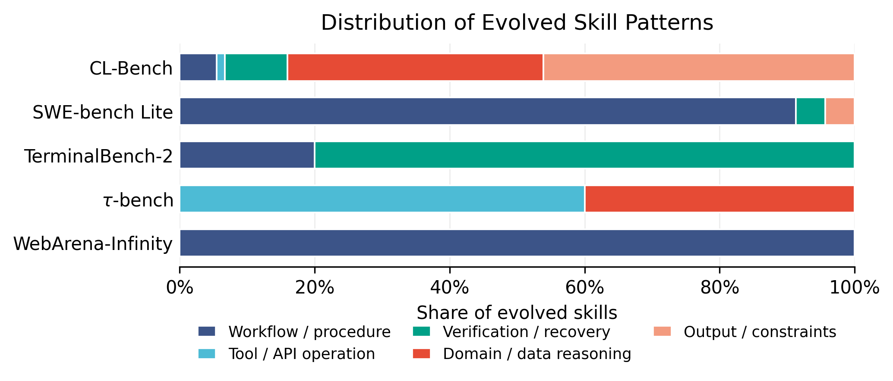
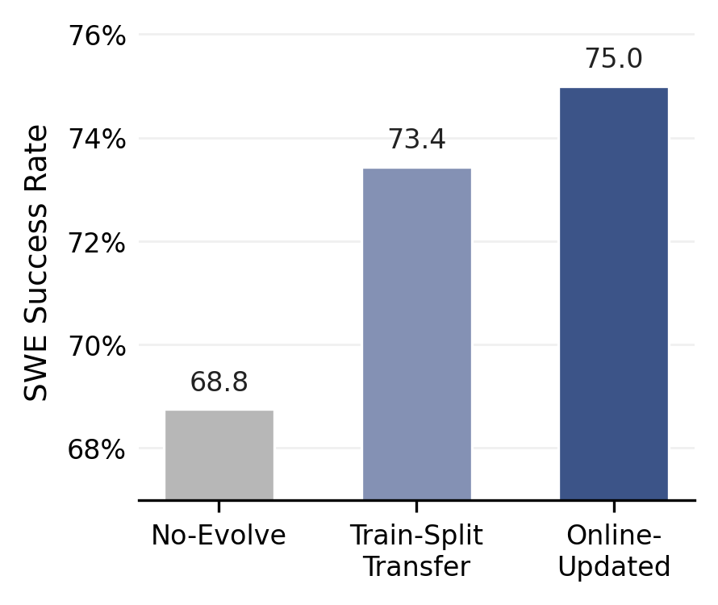

# Evo-Harness — 复核档案

> 本文件是维护性档案，不参与站点构建；读者版正文见同目录 `note.md`。

## 来源与版本

- **标题**：Evo-Harness: Context-to-Harness Skill Compilation for Self-Evolving Agents。
- **作者**：Tianxin Wei¹、Zhan Shi²、Minhua Lin³、Bing He²、Zewen Liu⁴、Yisi Sang²、Yuanchen Bei¹、Xuying Ning¹、Jiaru Zou¹、Ting-Wei Li¹、Xiao Lin¹、Yanjun Zhao¹、Chi Wang⁵、Benoit Dumoulin²、Dakuo Wang⁶、Jingrui He¹、Hanqing Lu²（17 人；首页未标共同一作或通讯作者）。
- **机构**：¹ University of Illinois Urbana-Champaign（第一机构，8 位作者）；² Amazon（5 位）；³ The Pennsylvania State University；⁴ Emory University；⁵ AG2 AI；⁶ Northeastern University。
- **来源**：[arXiv:2608.15071v2](https://arxiv.org/abs/2608.15071v2)（cs.AI; cs.CL）；v1 提交于 2026-08-15，v2 于 2026-08-30；16 页；abs 页 Comments 写 **EMNLP 2026 Main**。
- **许可**：[CC BY 4.0](https://creativecommons.org/licenses/by/4.0/)（abs 页 view license 指向 `licenses/by/4.0/`）。
- **代码**：<https://github.com/A-EVO-Lab/a-evolve/tree/release/evo-harness>（MIT；分支 commit `3c7c7b8`，2026-08-15；仓库创建 2026-02-20、最后 push 2026-11-06、★856（2026-11-18 复核时），均为同日用 GitHub API 核验；只读查看结构与默认参数，**未运行、未复现**）。
- **归档说明**：arXiv 来源，按仓库策略**不归档 PDF**；核对用官方 PDF 16 页、891,904 B、sha256 `41476396f4eab1517395672cc204db8915ae4f41ed363bfa0915b5f81b4824e5`。v1 为 16 页、887,865 B、sha256 `6fe9f508cd21fa8a1be9c46a4172bb3b433f5a79783ea50da948ceee9177a1b6`。
- **版本关系**：v1（16 页，2026-08-15）与 v2（16 页，2026-08-30）的全文抽取文本逐行 diff **只有 arXiv 版本戳一行不同**；本笔记按 v2。PDF 体积差 4,039 B，未逐字节比较图资产；若后续核对图，需重下同版本并比 sha256。
- **配图**：`assets/` 下 3 张：Figure 3（框架，p4）、Figure 4（技能分布，p6）、Figure 5（迁移，p7）。三张均取自 arXiv HTML 的原始图资产；Figure 4/5 已压平白底。许可按 CC BY 4.0，引用请注明出处。

## 阅读范围与核对手段

**阅读范围**：v2 全文 16 页（PDF 页码＝印刷页码）；正文 §1–5、Limitations、References 与附录 A–J 按文本通读。**已渲染页核对**：p1（Figure 1）、p3（式 1–2）、p4（Figure 3、式 3–11）、p6（Table 1、Figure 4）、p7（Table 2、Table 3、Figure 5）、p8（Figure 6、Table 4）、p15（Figure 7 与 §I）；Table 5/6 另在 300 dpi 的 p12/p14 复核；附录 B–D 按文本/HTML。Figure 4 的条段做了像素色段测量（方法见下方〈核对凭据〉），Figure 5/6 的柱顶读数按 200 dpi 渲染页与 HTML 资产核对。HTML 305,097 B，与响应头 `Content-Length` 一致。

### 核对凭据（可复现）

- 官方 v2 PDF：16 页，891,904 B，sha256 `41476396f4eab1517395672cc204db8915ae4f41ed363bfa0915b5f81b4824e5`（`https://arxiv.org/pdf/2608.15071v2`，2026-11-18 获取；`size_download` 与 `Content-Length` 一致，尾部有 `%%EOF`）。
- 官方 v1 PDF：16 页，887,865 B，sha256 `6fe9f508cd21fa8a1be9c46a4172bb3b433f5a79783ea50da948ceee9177a1b6`；两版文本 diff 仅版本戳。
- HTML：`https://arxiv.org/html/2608.15071v2`，305,097 B（与 `Content-Length` 一致，未截断）。
- 渲染：p1/p3/p4/p6/p7/p8/p15 以 200 dpi 渲染（1654×2339）；复核时另以 300 dpi 重渲染 p1–p9、p12–p16，Table 1–6（p6/p7/p8/p12/p14）、Figure 1/3/4/5/6/7 与式 1–11 回渲染页核对。
- Figure 4：原图资产 `https://arxiv.org/html/2608.15071v2/figures/skill_taxonomy_general.png`（2069×884）；在 y=160/260/360/460/560 处取色段，条从 x=418 到 1977，白色分隔缝约 5 px；按色段长度折算并四舍五入到整数。**这是图中读数，不是原文数字**；原文正文没有给这些比例。
- Figure 5/6：原图资产 `.../figures/swe_cross_skill_transfer.png`（890×750）、`.../figures/swe_curator_solver_opus.png`（830×688）、`.../figures/swe_curator_solver_sonnet.png`（831×687）；柱顶标签与 p7/p8 渲染页一致，Figure 6 未作为配图收录，只用其读数。
- 数字复算：Table 1 的 40 个值全部能还原为对应分母上的整数通过数（CL-Bench 1899、TerminalBench-2 89、SWE-bench Lite 300、τ-bench 165、WebArena-Infinity 80）；Table 3/4 同样。Figure 6 的六值在 0.1 pp 显示精度内均能还原为 /300 的整数通过数；Figure 5 的 68.8/73.4 不能还原为 /300；75.0 同时等于 48/64 与 225/300，单看 75.0 不能判分母。口径差异见〈原文自身的表述张力〉。
- 代码：用 GitHub API 读 `LICENSE`、`README.md`、`pyproject.toml`、五个 `scripts/run_*_evolve.sh` 与 `evo_harness/swe_bench.py` 的关键段；commit `3c7c7b8`。**未运行**，因此不声称复现了任何数字。
- 未做：v1/v2 图资产逐字节比对；全部 16 页的 300 dpi 重渲染（只重渲染了 p1–p9、p12–p16）；统计检验；运行日志与每题 pass-to-fail 转移矩阵（原文未提供）。

## 复核记录

**复核记录（2026-11-18）**：基准 v2（官方 PDF 16 页、891,904 B，sha256 `41476396…` 重取一致；HTML 305,097 B 与 `Content-Length` 一致）。方式：300 dpi 重渲染 p1–p9、p12–p16；Table 1–5 数值逐格、Table 6 定性；Figure 4 像素色段复测、Figure 5/6 读数、Figure 7 百分比；式 1–11 回查；另做两轮独立子 agent 只读审计并逐条复验。

修正：①Table 1 加粗归属（原文已加粗五个数值）；②Figure 5/6 的分母（Figure 5 与候选 /64 的 44/47/48 吻合（推断），Figure 6 与 Table 5 给出的 300 题全集 212/226/228/174/166/167 吻合），改写「三次平均」与「No-Evolve 对不上」两条张力；③CL-Bench `--max-samples 500` 是 grouped contexts 上限、不是任务数，删除相关错误；④补 task shuffle 种子 42、Selector/Feedback/Skill 的 launcher 口径；⑤把版本化/回滚/held-out 的断言改为「论文未描述」；⑥补 Table 2 Δ 的舍入说明、DKR 也全为正、Figure 7 注入记录不完整、Algorithm 1 与 §3.2 的 reflection 条件差异；⑦复审再修：Figure 5 的 68.8/73.4 只在 /64 下成立（75.0 同时等于 48/64 与 225/300，单看 75.0 不能判分母）、Table 2 Rate 是一位小数、整数计数与三次平均（3k/3N）相容，不能反推成单次。

未修/未核：仓库代码未运行；其他条目笔记未逐篇重核；star 复核时为 856。

## 原文自身的表述张力

这一节只列「原文内部对不上/没解释清楚」的地方，不把它们当成论文结论。

1. **「三次平均」与表值/图值的整数计数关系没有被说明**：附录 I.3 说「performance is averaged over three runs」，但 Table 1 的 40 个值在两位小数显示精度内全部能还原为对应分母上的整数通过数（CL-Bench 1899、TerminalBench-2 89、SWE-bench Lite 300、τ-bench 165、WebArena-Infinity 80）；Table 3/4 也一样。例如 73.03% = 65/89、67.00% = 201/300、76.97% = 127/165、76.25% = 61/80。Figure 6 的六值也全部与 /300 的整数计数吻合（70.7 ≈ 212/300、75.3 ≈ 226/300、76.0 = 228/300、58.0 = 174/300、55.3 ≈ 166/300、55.7 ≈ 167/300；本笔记复算，按显示精度取整）；Figure 5 的三值则与 /64 的 44/47/48 完全吻合（68.8 ≈ 44/64、73.4 ≈ 47/64、75.0 = 48/64；本笔记复算）。**结论**：原文明确说三次运行平均（I.3），但表值又都能写成整数计数；这与「三次各 k 次通过、3k/3N」完全相容，不能据整数计数反推成单次。原文没有给方差，也没有说明这些分母；Figure 5 的候选分母 /64 只能作为推断（不排除整数倍）。
2. **Figure 5 与 Figure 6 的 No-Evolve 很可能不是同一测试集**：Figure 5 的 68.8 与候选分母 /64 的 44/64 吻合（推断，不排除整数倍）；Figure 6(a) 的 70.7 与 Table 5 给出的 300 题全集 212/300 吻合；原文只缺 Figure 5 的 test-subset 大小。按上下文，Figure 5 的 solver 应为 Opus 4.7（原文只在 Train-Split Transfer 句里明说，No-Evolve 柱没有单独标注）。**结论**：不能把两图的 No-Evolve 直接当成同一基线，也不能直接比较 +1.6 pp（Online vs Train-Split）与 +0.7 pp（Cross vs Same）。
3. **Online-Updated 的 evolver 型号没有说清**：Figure 5 的文字说 Train-Split Transfer 用 Sonnet 4.5 在训练集上进化，再用 Opus 4.7 评测；Online-Updated 说「updates the harness directly with the same models」。这个「same models」是指「和 Train-Split 相同的 Sonnet evolver + Opus solver」，还是「solver 与 evolver 都用 Opus 4.7」，原文没有明确。如果是后者，+1.6 pp 就混入了 evolver 更强的因素，不能纯归因于 in-situ adaptation。
4. **编辑词表前后不一致**：§3.2 的式 10 定义 $o \in \{\mathrm{ADD}, \mathrm{MERGE}, \mathrm{REVISE}, \mathrm{SKIP}\}$；附录 E.1 的 solver 提议 prompt 用 `NEW / ENHANCE / NONE`；E.2 的 evolver curator prompt 用 `ACCEPT / MERGE / SKIP`。这像是「抽象记号」与「压缩后的 prompt 词表」的差别，但原文没有说明映射关系；读消融时不要把这几个词当成同一套操作。
5. **No Propose 的输入没有说明**：Table 3 的 No Propose 仍然比 No Evolve 高 3.74/1.66 pp，说明它不是「完全不更新」。但论文只说「removes solver-side proposal of candidate memories」，没有说 evolver 此时读什么（原始 execution context？空的候选集？另一种 agent evolver？）。因此这个消融的机制解释不完整。
6. **Algorithm 1 与 §3.2 的 reflection 条件不一致**：Algorithm 1 第 9 行对每个任务都写 `Reflect`，§3.2 说只有失败或负反馈才产生候选记忆；正文的机制描述是后者，伪代码没有写出这个条件。引用 Algorithm 1 时不要把「每个任务都反思」当成实际流程。

## 工程实现与外部资料（原「工程视角」）

### 技能文件与更新接口

附录 F 说明，harness 存成 **Markdown skill files + lightweight YAML metadata**，每条包含：

- `trigger`：什么时候应该检索它；
- 一条短的可执行规则/流程；
- 可选的 `evidence`：把它链接到之前的执行；
- `scope`：cross-task guidance 还是 task-type guidance。

这让产物可读、可迁移、可人工审计，也让「技能」和「原始轨迹」在形态上分开。代价是：论文没有描述**版本化、回滚或逐条准入**。RRSI 那种「候选必须过三道准入条件」、HarnessPro 那种「Pareto + 固定测试」在这里都没有出现；从方法描述看，编辑是否被接受由 evolver 判断，没有独立的验证门。Table 4 的 Self-Generated 失败案例说明，这种信任在反馈不接地时会直接伤害性能。

### 仓库实现 vs 论文

论文说代码「available at Link」，链接指向 `A-EVO-Lab/a-evolve` 的 `release/evo-harness` 分支。仓库是 MIT，包含五个 benchmark pipeline、`agent_evolve/` 运行时、`scripts/` launcher 与 `seed_skills/`。README 明确说发布的是「streamlined experiment configurations derived from the latest runs」，不是论文的逐字复现配置。只读核对到的差异：

| 维度 | 论文 | 仓库 `release/evo-harness` | 备注 |
| --- | --- | --- | --- |
| Solver / evolver | Claude Opus 4.6 / Opus 4.6 | `--solver-model 1` / `--curator-model 1`，模型映射为 Opus 4.6 | 一致 |
| Selector | Claude Sonnet 4.5 | τ/WebArena 显式传 `--selector-model 2`；SWE/CL/Terminal 未显式传（`swe_bench.py` 的 argparse 默认值是 `2`，其余默认值未逐项核） | 论文口径是 Sonnet 4.5；launcher 的显式程度不一致 |
| Batch size | 默认 16 | SWE/CL 为 16；Terminal 为 10；τ 为 10；WebArena 为 8 | 不是统一 16 |
| Skill 上限 | general 5、每 topic 5 | SWE/WebArena 为 `max-skills-per-topic 5`；CL 为 `max-skills-per-context 5`；Terminal/τ 为 `max-skills-per-topic 0`（只留 general） | launcher 是「latest runs」的精简配置 |
| Feedback | Table 4 比较 self-generated/minimal/standard；Table 4 的 Standard 行与 Table 1 的 Evo 行相同，可推断主表用 Standard，但原文没有显式写 | SWE standard、Terminal minimal、τ/WebArena standard；CL 用 `--feedback-level 2`（数值档位，输出目录名含 `standard_feedback`，与论文 Standard 的对应关系未核） | 不是统一设置 |
| CL-Bench 任务数 | 1899（附录 I.3 说 full task set） | `--max-samples 500` 是 grouped contexts 上限；README 说这些 context 展开后覆盖论文的 1,899-task stream | 不是任务数缩水 |
| Seed skills | 论文未提 | `--use-seed-skills` 才启用（`swe_bench.py` 的 argparse 参数），默认关闭；README 只说明 bundled seed skills 默认关闭、五个 paper launcher 都关闭 | 若 seed skills 关闭且没有其他初始技能，初始 harness 为空；论文没明说 |

（只读核验，commit `3c7c7b8`；**未运行**。）

这张表的结论不是「仓库有问题」，而是：**不要把 launcher 当成 Table 1 的复现脚本**。如果想复现主表，需要自己确认每个 benchmark 的 batch size、feedback level、任务数和 seed 设置；论文没有给完整的 per-benchmark 配置表。

### 失败模式

从机制和实验可以推出几类失败模式（本笔记判断，除非注明）：

- **反思噪声**：一次失败里可能混着环境问题、工具超时、模型误判；solver 写出的 `lesson` 可能把偶发问题写成通用规则。Table 4 的 Self-Generated 结果说明，没有外部证据时这种噪声会直接反噬。
- **过度具体**：Standard feedback 在 SWE 上略低于 Minimal，说明详细错误消息可能让技能绑定到具体失败；Figure 7 的案例也显示，好的技能通常是「操作区分 + 验证」，而不是「这道题的命令」。
- **技能漂移/遗忘**：论文没有描述版本化、回滚或对单次编辑的 held-out 准入门；一个坏编辑可能留很久，后续任务继续被它影响。论文没有测「随时间推移，旧技能是否还有效」。Figure 5 的 train-split transfer 是在分离测试集上评估最终 harness（split 大小未给），不是逐编辑验证。
- **topic 增殖**：每个 topic 最多 5 条，但 topic 数量没有上限；仓库的 SWE 实现（`swe_bench.py` 的 `_select_relevant_topics`）按 topic 选，topic 太细会让检索变难。论文没有报告实际 topic 数/技能总数。
- **selector 误差**：论文说用 Sonnet 4.5 从当前 harness 检索相关技能；仓库的 SWE 实现按 topic 选，选错 topic 就会注入无关技能。论文没有单独评估 selector 的召回/精度。
- **verifier 依赖**：所有 benchmark 都有可靠 verifier；没有 verifier 的开放任务不在覆盖范围内。这正是它与 Harness² 的互补点：后者专门处理无标签、靠行为对比的场景。
- **上下文成本**：技能是自然语言，注入会占 context；论文没有报告 token 预算或注入长度，无法判断 5+5 的上限在长任务上是否够用。

## 实验与证据细节（原「实验与证据」逐表逐图内容）

### 设置

五个 benchmark、任务数与评测信号（Table 5，p12）：

| Benchmark | #Tasks | 领域 | 评测信号 |
| --- | ---: | --- | --- |
| WebArena-Infinity | 80 | Web navigation | State verifier |
| TerminalBench-2 | 89 | CLI / scripting | Docker verifier |
| SWE-bench Lite | 300 | Software engineering | Unit tests |
| CL-Bench | 1899 | Adaptive reasoning | Rubric judge |
| τ-bench | 165 | Tool use | State verifier |

补充口径：

- **WebArena-Infinity**：只取 email-centered「superhuman-general」设置里的 80 个 hard tasks；任务要求有状态的浏览器交互（建标签、改设置、用邮件过滤器、协调日历/邮件），verifier 检查最终应用状态（附录 A）。
- **TerminalBench-2**：89 个任务，覆盖软件工程、数据处理、科学计算、安全、系统管理等；solver 在隔离 shell 里工作，最终产物由 task-specific Docker image 里的可执行 verifier 判分（附录 A）。
- **SWE-bench Lite**：300 个真实 GitHub issue，来自 12 个 Python 仓库；最终 patch 由仓库测试判定（附录 A）。
- **CL-Bench**：1899 个 adaptive reasoning 任务，分 Domain Knowledge Reasoning（DKR）、Empirical Discovery & Simulation（EDS）、Procedural Task Execution（PTE）、Rule System Application（RSA）四类，用 rubric 判分（附录 A）。
- **τ-bench**：165 个客服工具使用任务，覆盖 airline 与 retail，检查最终数据库状态（附录 A）。

模型与基线（§4.1）：

- 默认 solver 与 evolver 都是 **Claude Opus 4.6**；模型消融另用 Opus 4.7、Opus 4.5、Kimi-K2.5、GPT-OSS。
- 基线：AWM（Agent Workflow Memory）、Dynamic Cheatsheet 的两个变体 DC-Cu/DC-RS、Evo-Memory、ACE、XSkill；都在同一任务划分与评测协议下运行。
- harness 选择用 **Claude Sonnet 4.5**（附录 F），不是 solver 本身。
- 默认 batch size 16；general skills 最多 5 条、每个 task-type topic 下最多 5 条（附录 F）。
- 论文说主要用 AWS Bedrock；仓库五个 launcher 的模型也都走 Bedrock。单个 benchmark 配置通常 16 个并行 worker；一次完整 run 约 2–8 小时；全部主实验与诊断实验的 API 成本约 **10 万美元**（附录 I.1、I.4）。
- 附录 I.3 说「performance is averaged over three runs」，但主表没有方差/置信区间；这一点在〈原文自身的表述张力〉展开。

### Table 1 主结果

Claude Opus 4.6 作为 solver，成功率（%）：

| 方法 | CL-Bench | TerminalBench-2 | SWE-bench Lite | τ-bench | WebArena-Infinity |
| --- | ---: | ---: | ---: | ---: | ---: |
| No Evolve | 29.54 | 62.92 | 63.67 | 72.73 | 72.50 |
| AWM | 28.91 | 62.92 | 62.67 | 70.91 | 70.00 |
| DC-Cu | 29.23 | 60.67 | 63.00 | 72.12 | 71.25 |
| DC-RS | 29.07 | 61.80 | 61.67 | 70.91 | 70.00 |
| Evo-Memory | 29.38 | 64.04 | 64.00 | 72.12 | 72.50 |
| ACE | 29.70 | 61.80 | 63.67 | 72.73 | 71.25 |
| XSkill | 31.44 | 66.29 | 64.67 | 73.94 | 73.75 |
| Evo-Harness | **34.02** | **73.03** | **67.00** | **76.97** | **76.25** |

（原文 Table 1，p6。原文将 Evo-HARNESS 行的五个数值加粗；方法名在原文为常规体的小型大写。本表方法名未加粗，五个数值沿用原文加粗。）

增量与相对提升（本笔记复算，百分点）：

| Benchmark | No Evolve | Evo-Harness | Δ（pp） | 相对提升 |
| --- | ---: | ---: | ---: | ---: |
| CL-Bench | 29.54 | 34.02 | +4.48 | +15.2% |
| TerminalBench-2 | 62.92 | 73.03 | +10.11 | +16.1% |
| SWE-bench Lite | 63.67 | 67.00 | +3.33 | +5.2% |
| τ-bench | 72.73 | 76.97 | +4.24 | +5.8% |
| WebArena-Infinity | 72.50 | 76.25 | +3.75 | +5.2% |

读法上有三点：

1. **最大增量在 TerminalBench-2**：+10.11 pp。作者的解释是这类任务需要查文件、执行命令、读错误、从失败操作里恢复，程序性结构强，正好适合 skill harness（§4.2）。
2. **不是所有经验复用都自动有用**：AWM、DC-Cu、DC-RS 在多个 benchmark 上低于 No Evolve；ACE 在 TerminalBench-2 上也低于 No Evolve（61.80 vs 62.92）。作者用这一点支撑「retrieved/evolved guidance 可能噪声大、过度具体、与 solver 不匹配」的动机（§4.2）。
3. **对最强基线的增量变小，但仍为正**：相对 XSkill，五个 benchmark 的增量是 +2.58/+6.74/+2.33/+3.03/+2.50 pp。SWE-bench Lite 的 +2.33 pp 是最小的；考虑到没有方差，这个差距不宜过度解读。

### Table 2 模型与类别

CL-Bench 上五个 solver 的分类结果（Rate 为 pass rate %，Δ 为相对 No-Evolve 的绝对变化）：

| Model | Method | DKR Rate | DKR Δ | EDS Rate | EDS Δ | PTE Rate | PTE Δ | RSA Rate | RSA Δ | All Rate | All Δ |
| --- | --- | ---: | ---: | ---: | ---: | ---: | ---: | ---: | ---: | ---: | ---: |
| Opus 4.7 | No-Evolve | 32.4 | — | 19.1 | — | 35.5 | — | 29.0 | — | 30.8 | — |
| Opus 4.7 | Evo-Harness | 34.1 | +1.7 | 19.6 | +0.5 | 42.7 | +7.2 | 32.7 | +3.7 | 34.5 | +3.7 |
| Opus 4.6 | No-Evolve | 31.4 | — | 20.6 | — | 34.0 | — | 26.9 | — | 29.5 | — |
| Opus 4.6 | Evo-Harness | 35.6 | +4.2 | 18.1 | -2.5 | 43.8 | +9.8 | 30.4 | +3.5 | 34.0 | +4.5 |
| Opus 4.5 | No-Evolve | 31.4 | — | 18.1 | — | 27.8 | — | 25.3 | — | 27.3 | — |
| Opus 4.5 | Evo-Harness | 32.6 | +1.2 | 19.1 | +1.0 | 37.6 | +9.8 | 28.3 | +3.0 | 31.1 | +3.8 |
| Kimi-K2.5 | No-Evolve | 25.6 | — | 12.1 | — | 25.1 | — | 21.6 | — | 22.9 | — |
| Kimi-K2.5 | Evo-Harness | 25.9 | +0.3 | 13.1 | +1.0 | 29.3 | +4.2 | 20.8 | -0.7 | 23.9 | +1.1 |
| GPT-OSS | No-Evolve | 17.6 | — | 11.6 | — | 17.6 | — | 16.4 | — | 16.6 | — |
| GPT-OSS | Evo-Harness | 17.9 | +0.3 | 10.6 | -1.0 | 18.5 | +0.8 | 18.6 | +2.1 | 17.5 | +0.8 |

（原文 Table 2，p7。原文还标了每个 category-model pair 的最优值；本表省略加粗，只保留数值。）

原文 Δ 列和表中一位小数 Rate 直接相减偶尔差 0.1（看起来是按未舍入值计算的）：例如 Kimi 的 RSA 21.6→20.8 印 -0.7，按显示值相减为 -0.8；Kimi 的 All、GPT-OSS 的 PTE/RSA/All 也有同样的舍入差。本表照录原文 Δ。

三个关键读法：

- **总体每个模型都涨**：+3.7 / +4.5 / +3.8 / +1.1 / +0.8。作者的解释是更强的 solver 更能读懂、遵循和利用 harness 指导（§4.3）。
- **分类别不是全面上涨**：Opus 4.6 的 EDS 从 20.6 掉到 18.1（-2.5），GPT-OSS 的 EDS 从 11.6 掉到 10.6（-1.0），Kimi 的 RSA 从 21.6 掉到 20.8（原文 Δ 印 -0.7，按显示值相减为 -0.8）。作者自己讨论了 EDS 的下降，认为探索性任务对「过于具体的指导」更敏感（§4.3）。
- **PTE 是原文点名的 most consistent 增量来源**：五个模型的 PTE 全部为正，Opus 4.6 与 4.5 都是 +9.8。注意 DKR 也五个全为正（+1.7/+4.2/+1.2/+0.3/+0.3）；原文没有定义 most consistent 的判据，从数据看 PTE 的增幅更大、更一致。

一个替代解释（本笔记判断）：Open-weight 模型的增益小，不一定是「能力弱所以读不懂」，也可能是**技能是由 Claude 模型写的、selector 也是 Claude（Sonnet 4.5）**，风格和先验与 Kimi/GPT-OSS 不匹配。论文没有做「用 Kimi 自己当 evolver 写技能，再由 Kimi 使用」的交叉实验，所以「强模型更能利用指导」与「Claude 风格指导更适合 Claude」这两个解释没有被分开。

### Table 3 消融

CL-Bench 与 SWE-bench Lite 上的组件消融（Opus 4.6 solver）：

| 方法 | CL-Bench | SWE-bench Lite |
| --- | ---: | ---: |
| No Evolve | 29.54 | 63.67 |
| No Propose | 33.28 | 65.33 |
| General Only | 30.28 | 66.67 |
| Topic Only | 33.70 | 64.33 |
| Evo-Harness | 34.02 | 67.00 |

（原文 Table 3，p7。PROPOSE 去掉 solver 侧的候选记忆提议；GENERAL ONLY 只保留 cross-task guidance；TOPIC ONLY 只保留 task-type guidance。）

这张表的信息量比表面大：

- **No Propose 仍然明显高于 No Evolve**：CL-Bench +3.74 pp、SWE +1.66 pp。说明即使没有 solver 侧的「写候选」步骤，evolver 仍能从某种输入里做出有用更新；但论文没有说明 No Propose 时 evolver 到底读什么（原始 context 还是空候选集），所以这个消融的机制含义不完全清楚。
- **两级各有偏好**：CL-Bench 上 Topic Only 33.70，接近 full 34.02；General Only 只有 30.28。SWE 上反过来，General Only 66.67 接近 full 67.00，Topic Only 64.33。作者的解读是：异构推理任务更吃局部 task-type 指导，仓库级调试更吃跨任务的通用流程（§4.4）。
- **full 相对「最好的单级」只高 0.32/0.33 pp**：CL-Bench 上 full 34.02 vs Topic Only 33.70；SWE 上 full 67.00 vs General Only 66.67。这个差距小于 1 pp，原文没有方差。**所以「两级设计」的增量在统计上是否稳定，本文没有证据**；能确定的是「选对层级比选错层级重要」（CL 上 Topic 比 General 高 3.42 pp，SWE 上 General 比 Topic 高 2.34 pp）。
- **proposal 与 compilation 的互补性很弱**：full 相对 No Propose 只高 0.74/1.67 pp，CL 上的 0.74 更小。作者说二者互补（§4.4），但数据更像「compilation 是主贡献，proposal 是小的增益」。

### Figure 4 技能分布

*图（原文 Figure 4，p6）：五个 benchmark 上 evolved skill 的内容类型分布。横轴是「Share of evolved skills」，颜色对应五类技能；原文没有在正文给具体比例。取自 arXiv HTML 原图（2069×884），许可见来源信息。*

图中读数（按色段像素长度折算，近似到整数；分隔缝使合计略低于 100%，**不是原文数字**）：

| Benchmark | Workflow / procedure | Tool / API operation | Verification / recovery | Domain / data reasoning | Output / constraints |
| --- | ---: | ---: | ---: | ---: | ---: |
| WebArena-Infinity | 100 | 0 | 0 | 0 | 0 |
| SWE-bench Lite | 91 | 0 | 4 | 0 | 4 |
| TerminalBench-2 | 20 | 0 | 80 | 0 | 0 |
| τ-bench | 0 | 60 | 0 | 40 | 0 |
| CL-Bench | 5 | 1 | 9 | 38 | 46 |

这张图支持作者的定性说法「harness 会适配每个环境的操作结构」（§4.4）：

- **WebArena**：整条都是 workflow/procedure；正文只说「mainly yields workflow and procedure skills」，图里是 100%，比正文的措辞更强。
- **SWE-bench**：91% workflow/procedure，少量 verification 与 output constraints；符合「仓库级调试主要靠流程」的直觉。
- **TerminalBench-2**：80% verification/recovery，20% workflow；对应「可执行反馈 + 失败恢复」。
- **τ-bench**：60% tool/API operation，40% domain/data reasoning；对应「工具调用 + 领域规则」。
- **CL-Bench**：46% output/constraints，38% domain/data reasoning，9% verification，5% workflow；分布最分散，对应「异构推理 + 局部 rubric」。

但 Figure 4 只告诉你**内容类型**，没有告诉你**层级**（general vs topic）和**条目数**。所以它不能直接验证「两级 harness 各自贡献多少」；那要看 Table 3。

### Figure 5 / Figure 6 迁移与配对

*图（原文 Figure 5，p7）：SWE-bench Lite 上三种技能更新设置。No-Evolve 不更新；Train-Split Transfer 用 Claude Sonnet 4.5 在训练集上进化出的技能，再用 Opus 4.7 solver 在测试集上评测；Online-Updated 在测试任务流上直接更新。取自 arXiv HTML 原图（890×750），许可见来源信息。*

图内读数：No-Evolve 68.8、Train-Split Transfer 73.4、Online-Updated 75.0。这三个值与 64 题子集的 44/47/48 完全吻合（44/64、47/64、48/64，即 68.75/73.44/75.00，显示为 68.8/73.4/75.0；本笔记复算），而 Figure 6 的六值与 300 题全集的 212/226/228/174/166/167 吻合（本笔记复算）；从整除吻合看，两图很可能不是同一测试集大小（推断）。也就是说：

- **技能可以跨任务、跨模型迁移**：Sonnet 4.5 在训练集上进化出的技能，给 Opus 4.7 用，仍然比 No-Evolve 高 +4.6 pp（68.8→73.4）。
- **在线更新更好**：75.0 比 73.4 高 +1.6 pp，比 No-Evolve 高 +6.2 pp。作者把这归因于 in-situ 更新更适应测试流的局部分布与失败模式（§4.5）。

但这里仍有口径问题（详见〈原文自身的表述张力〉）：Figure 5 看起来是 64 题子集、Figure 6 与 300 题全集一致（上述整除吻合，推断），原文没有给 split 大小；二是 Online-Updated 的 evolver 型号没有说清，+1.6 pp 不能纯归因于「在线」本身。

Figure 6（p8）比较 solver-evolver pairing：

| Solver | No-Evolve | Same | Cross |
| --- | ---: | ---: | ---: |
| Opus 4.7 | 70.7 | 75.3 | 76.0 |
| Sonnet 4.5 | 58.0 | 55.3 | 55.7 |

（原文 Figure 6，p8。Same = solver 与 evolver 同一模型；Cross = 用另一个模型当 evolver。）

读法：

- **Opus 4.7 当 solver 时，Cross（Sonnet 当 evolver）76.0 略高于 Same 75.3**，都明显高于 No-Evolve 70.7。作者说这说明「不同的 evolver 也能产出有用、甚至更有用的指导」，前提是下游 solver 有能力解释和应用（§4.5）。
- **Sonnet 4.5 当 solver 时，Same 55.3、Cross 55.7，都低于 No-Evolve 58.0**。这是论文里最诚实的负结果：Sonnet 4.5 不仅没从 harness 里获益，反而被拖低。作者的解释是「如果 solver 不能可靠地遵循、情境化或调整指导，evolution 可能失败」（§4.5）。
- 一个替代解释（本笔记判断）：这也可能是**指导格式与模型不匹配**，而不只是「能力不足」。Sonnet 4.5 是较弱的模型，但它同时也可能是被 Claude 风格的长篇技能 prompt 干扰；论文没有做「给 Sonnet 更短/更结构化的技能」的对照，所以「能力门槛」与「格式适配」没有分开。

### Table 4 反馈接地

CL-Bench 与 SWE-bench Lite 上三种反馈（Opus 4.6 solver）：

| Feedback Level | CL-Bench | SWE-bench Lite |
| --- | ---: | ---: |
| No Evolve | 29.54 | 63.67 |
| Self-Generated | 27.96 | 61.67 |
| Minimal | 29.86 | 67.33 |
| Standard | 34.02 | 67.00 |

（原文 Table 4，p8。Self-Generated 让 LLM 自己判断成功与否；Minimal 只给环境级 pass/fail；Standard 给失败消息、错误栈、verifier 输出或测试失败等诊断。）

这是全文最实用的结论之一：

- **LLM 自评会帮倒忙**：Self-Generated 在两个 benchmark 上都低于 No Evolve（-1.58 / -2.00 pp）。作者说，没有外部执行证据支撑的自我判断会引入误导性更新（§4.6）。
- **有环境信号就稳**：Minimal 与 Standard 都高于 No Evolve；CL-Bench 上 Standard 比 Minimal 高 +4.16 pp（34.02 vs 29.86），说明解释「为什么失败」对异构推理任务有用。
- **SWE 上 Minimal 反而略高于 Standard**：67.33 vs 67.00（+0.33 pp）。作者的解释是，详细的错误消息可能让 harness 过度绑定到具体失败，而稀疏的 pass/fail 鼓励更通用的指导（§4.6）。这个差距同样小于 1 pp，不宜过度解读，但方向和 CL-Bench 相反，说明「反馈越细越好」不成立。

### Table 6 / Figure 7 定性证据

附录 B 给了五个「baseline 失败、evolved 成功」的配对案例；附录 C 的 Table 6 按失败模式归组；附录 D/Figure 7 给了真实的技能摘录。它们的共同信息是：学到的不是「某道题的答案」，而是可迁移的操作区分。

| Benchmark | baseline 的失败 | 学到的指导 |
| --- | --- | --- |
| WebArena h10 | 以为禁用了 auto label，verifier 发现仍然启用 | 创建与禁用是两个操作；改完回到设置列表确认最终状态 |
| WebArena h65 | 把收件人域名写成了猜测的 `acme.com`，实际是 `acmecorp.com` | 用权威角色来源确认收件人；保留精确邮箱地址，不推断/规范化域名 |
| TerminalBench-2 adaptive-rejection-sampler | 反复重跑同一个 R 测试命令，正式测试仍失败 | 停止重复；缩小到最小复现；修核心问题；再逐步加回复杂度 |
| SWE-bench django-11133 | 源码搜索后超时，测试尝试失败 | 先读完整的 failing-test 断言；匹配精确期望行为；提交前跑 targeted tests |
| τ-bench retail_task_5 | 只做了部分商品更换，数据库 verifier 失败 | 枚举所有请求操作；按订单状态选工具；确认响应覆盖完整清单 |
| CL-Bench | 规则/流程/领域知识类任务失败 | 抽取任务逐字返回指定源文本；只匹配 prompt 指定的术语/字段 |

（据附录 B 的五个案例与 Figure 7 的六张卡片整理；Figure 7 的百分比见下。）

Figure 7 还给了几组「matched baseline-fail / evolved-pass」的比例：WebArena 的 settings-state 任务占 24%、identity-grounding 失败占 32%、UI 技能出现在 72% 的 improved runs；Terminal-Bench 的可执行反馈/恢复模式占 100%；SWE 的 Django 与 Sympy 占 66.7%；TAU 的 retail 工作流占 85.2%、该指导出现在 100% 的 improved runs。**这些百分比的分母没有给出**（只说是 matched fail-to-pass cases），而且图注明确说它们「contextualize the examples rather than establish single-skill causality」（p15）。附录 B 还说明，有些 benchmark 的结果文件不记录注入的技能，所以「该指导出现在 100% improved runs」这类比例本身也只覆盖记录了技能的运行。它们只能说明「这些模式在成功翻盘的案例里常见」，不能说明「是这条技能导致了翻盘」。

Table 6 的「easier-to-improve tasks」也应当这样读：WebArena 的有状态 UI、Terminal 的可执行反馈循环、SWE 的成熟仓库（Django/Sympy）、TAU 的 retail 多约束操作、CL 的规则/流程/领域知识——这些是**观察到的热点**，不是因果结论（本笔记判断）。

### 成本

附录 I.1 给了三个成本数字：

- 全部主实验与诊断实验的 API 成本约 **10 万美元**（原文 `$100K`）；
- 单个 benchmark 配置通常 **16 个并行 worker**；
- 一次完整 run 约 **2–8 小时**（Web 与 tool-use 较快，SWE 与 CLI 较慢，因为要做仓库 setup、Docker、测试和 verifier 调用）。

论文没有给每个方法的 token 用量、每条技能的上下文长度、每题的延迟或每个 benchmark 的单价。对工程落地来说，这些缺失比「总分高几个点」更关键：无法从论文判断这套方法在真实流量下的成本是否可接受，也无法判断 harness 增长后的检索/注入开销。

## 局限与待确认问题（完整版）

### 作者明确讨论的

- **只覆盖单 agent、文本/工具类环境**：text-based tool use、web、command line、software engineering；没有 embodied agents 或多 agent 系统（Limitations，p9）。
- **只覆盖自然语言指导**：executable code skills 或 structured programs 没有研究（Limitations，p9）。

### 作者自述的贡献边界

作者列了三条贡献（§1）：① **Online harness learning**，把「冻结 agent 在顺序任务流上通过更新外部 harness 变好」形式化；② **Context-to-harness skill compilation**，把单次执行上下文编译成 general / topic 两级技能更新；③ **Systematic analysis**，拆 evolver 设计、反馈类型、迁移设置对持续自我改进的影响，并在五个复杂 benchmark 上超过已有经验类方法。

第一条是问题设定，第二条是机制，第三条是实证。**本文没有提出新的训练目标、没有改模型权重、也没有让 harness 源码进化**；它进化的对象是自然语言技能文件。第三条的「systematic」主要覆盖 evolver 设计（Table 3）、反馈（Table 4）、迁移与配对（Figure 5/6），没有覆盖 batch size、注入预算 $b$、selector 模型、更新轮数、是否也从成功中学习、topic 粒度等变量。所以它更像「一组有针对性的诊断实验」，而不是把所有驱动因素都拆完的完整析因。

### 本笔记的判断

1. **主表是在线任务流上的结果，不是明确声明的 held-out 泛化**：任务按流处理，harness 在同一个流上更新；Table 1 的分数是沿任务流逐题评测的平均表现（每题只用当时可用的 harness）。论文没有说明主表有独立 held-out 集；唯一的 train/test 分离迁移是 Figure 5（Figure 6 是 solver-evolver 配对，不是任务集迁移），但它本身还有口径问题。读者不应把 +10.11 pp 理解成「在一个固定 benchmark 上一次性超过基线」。
2. **依赖可靠反馈**：方法需要每个任务的成功/失败信号（state verifier、Docker verifier、unit test、rubric judge）。Table 4 的 Self-Generated 失败说明，没有外部证据时更新会伤害性能；真正开放、无 verifier 的任务不在覆盖范围内。
3. **统计证据弱**：没有方差、置信区间、显著性检验；原文说三次平均但未给方差，表值又与整数计数一致，二者关系见下一节；很多关键差距小于 1 pp（两级设计的 +0.32/+0.33、SWE 上 Standard vs Minimal 的 -0.33、Figure 6 的 Cross vs Same +0.7）。这些都不应当作稳定结论。
4. **基线预算没有控制**：论文说基线在同一任务划分与评测协议下运行，但没有报告基线的注入预算、检索条数、上下文长度或 token 成本。Evo-Harness 的增益可能部分来自「注入了更多/更结构化的上下文」，而不是「编译」本身。
5. **模型消融有混淆**：技能由 Claude 写、selector 也是 Claude；open-weight 模型增益小，可能是能力差异，也可能是风格/格式不匹配。没有「同模型自产自用」的交叉实验。
6. **只报成功翻盘的代表案例与聚合分**：附录 B 按 task id 对齐并给 5 个 fail→pass 例子；Table 6 给代表性 task id；Figure 7 给卡片级例子；但没有 pass-to-fail 的数量、没有完整逐题翻转矩阵、没有「哪些任务被 harness 弄坏了」。一个方法可以总体涨 3 pp，同时在一些任务上大幅回退；论文只展示成功翻盘的案例，没有展示反例。
7. **batch size / 预算 / selector / 轮数没有消融**：论文把「systematic analysis」落在 evolver design、feedback、transfer 上，但 batch size、注入预算 b、selector 模型、更新轮数、是否也从成功中学习、topic 粒度、seed skills 都没有拆。尤其 batch size 从 16 变 1 会改变方法的性质（§3.4），但论文没有实验。
8. **Figure 7 的分母缺失**：24%/32%/72%/100%/66.7%/85.2% 都是「matched fail-to-pass cases」的比例，但总数没有给；「100%」很可能是按模式定义出来的，不是独立测量。图注也承认不是单技能因果。
9. **benchmark 覆盖有限**：WebArena-Infinity 只取 80 个 hard tasks，引用条目是个人网站（shuyanzhou.com），未见同行评审出处；CL-Bench 是 1899 个 rubric 判分任务；五个 benchmark 都是文本/工具环境（论文未说明语言分布，按 benchmark 描述推测以英文为主）。没有跨语言、多模态、具身或多人协作。
10. **代码不是精确复现**：release 分支的 README 自己说配置是「streamlined ... derived from the latest runs」；launcher 的 batch size、feedback 与论文默认值不完全一致（CL 的 `--max-samples 500` 是 grouped contexts 上限，README 说展开后覆盖 1,899-task stream，不是任务数缩水）。论文给了 task shuffle 的固定种子 42（I.2），但没有给模型采样种子、完整 per-benchmark 配置、运行日志或题目级结果。**因此本文的数字可以读，但不能假设开箱即复现。**

## 与本仓库其他条目的关系

这一节是位置对照，不是文献综述。Evo-Harness 在「被进化的对象」这条轴上，和仓库里已读的 RSI / harness 论文正好互补：

| 条目 | 被进化的对象 | 与 Evo-Harness 的咬合点 |
| --- | --- | --- |
| [00189 HarnessDev](https://arxiv.org/abs/2609.01437) | 模型自建的 harness 代码（被测量对象） | HarnessDev 测量「模型能不能造/改 harness」；Evo-Harness 是一个具体的「改技能 harness」方法，不是测量 |
| [00198 Self-Harness](https://arxiv.org/abs/2606.09498) | harness（同一固定模型自提议、自编辑） | 两者都让同一个模型参与提议与使用；Evo-Harness 多了外部 selector 与两级技能，但没有 Self-Harness 那样的编辑/回滚描述 |
| [00199 HarnessX](https://arxiv.org/abs/2606.14249) | 类型化 harness 配置（模型角色、processor、prompt、工具、控制流） | HarnessX 用 meta-agent + Critic + 确定性门；Evo-Harness 用自然语言技能 + evolver 判断，没有门 |
| [00205 Prime Agent](https://arxiv.org/abs/2608.23552) | harness 的持久状态（prompt notes / memories / skills / subagent specs） | Prime Agent 有版本化与回滚；Evo-Harness 的论文未描述这两项。两者都把「技能」当外部状态，但 Evo-Harness 更强调 batch 级编译 |
| [00212 RRSI](https://arxiv.org/abs/2609.24972) | harness 源码（9 类组件） | RRSI 有三道非补偿准入条件；从方法描述看，Evo-Harness 没有独立验证门，编辑由 evolver 判断；这是「源码 vs 自然语言技能」的对照 |
| [00214 Dream-RSI](https://arxiv.org/abs/2609.14858) | 探索策略代码 | Dream-RSI 在历史树上回放选策略；Evo-Harness 在任务流上编译失败教训；一个改「怎么探索」，一个改「怎么执行」 |
| [00218 HarnessPro](https://arxiv.org/abs/2610.26770) | 完整 harness + 成本 | HarnessPro 把 token 成本接进 Pareto 选择；Evo-Harness 完全不建模成本，这是它最明显的工程缺口 |
| [00220 Harness²](https://arxiv.org/abs/2610.14224) | 执行 harness + 改进 harness 的经验库 | Harness² 处理「没有可靠 verifier」的开放任务，靠行为对比；Evo-Harness 处理「有 verifier」的在线流，靠 grounded feedback。两者正好覆盖两种反馈条件 |
| [00229 RSIAgent](https://arxiv.org/abs/2609.15364) | 新环境里的持久 memory | RSIAgent 先探索、再冻结 memory、最后测试；Evo-Harness 在测试流上持续更新技能。一个偏「进入新环境前学会」，一个偏「在任务流里边做边学」 |
| [00192 Awesome RSI 导读](https://prism-shadow.github.io/awesome-rsi/#blog/understanding-rsi) | 转引型材料 | 导读已经把 Evo-Harness 归为「Solver 与 Evolver 联合更新」；本笔记核对了它引的 Table 1 与消融结论（见下） |

与 00192 的两点核对：

- 导读说 Evo-Harness「五个 Benchmark 上都超过其他经验复用方法」——**成立**：Table 1 相对 XSkill 五个都为正（+2.33 到 +6.74 pp）。
- 导读说「消融去掉 Solver 生成候选经验的步骤后效果下降」——**相对 full 成立**（No Propose 33.28/65.33 vs full 34.02/67.00），但 No Propose 仍高于 No Evolve；如果读者把它理解成「去掉后还不如 baseline」，那是不对的。导读没有展开这个区别。

相邻但尚未读的条目：**00204 TRACE**（skill bank + trajectory-contrastive evolution）、**00206 Recuris**（working memory + experiential memory）、**00209 SkillAdam**（Adam 式 skill 文档优化）、**00211 Reflect, Revise, Reuse**（training-free skill evolution）、**00215 ReMe**（local-first self-evolving knowledge base）、**00216 Proteus**（harness-agnostic self-evolution）、**00217 Reef**（continual learning infrastructure）。它们与本文的 skill/memory 轴相邻，但实验对象不同，暂不展开。

## 一句话总结

**Evo-Harness 的贡献不是「让模型变聪明」，而是把「一次失败执行」变成「一条可读、可复用、分层的技能规则」；它表明在其实验设置下，这种编译通常能涨点，也诚实地暴露了三个前提——反馈要接地、solver 要能吃下指导、主评测是在线适应（只有 Figure 5 的 train-split transfer 是分离测试集上的评估）。**

## 迁移索引

2026-11-28 读者版重写时，以下内容从 `note.md` 移入本文件：

- 来源信息表中的作者全名单、机构上标、Subjects、v1/v2 日期、许可链接、代码仓库状态与 star、归档 sha256、版本关系、配图清单；
- 原「阅读范围」整行、原「核对凭据」整节与原「未做」清单；
- 原「复核记录（2026-11-18）」整段；
- 原「原文自身的表述张力」整节（6 条）；
- 原「关键公式与直觉」节：三点直觉并入读者版「方法」的符号说明、候选记忆与编译小节，不再单列；
- 原「方法与贡献」中的「贡献的边界」并入本文件「局限与待确认问题」的〈作者自述的贡献边界〉；
- 原「工程视角」整节（技能文件与更新接口、仓库实现 vs 论文表、失败模式）；
- 原「实验与证据」中的设置表与逐 benchmark 口径、Table 1 增量表与三条读法、Table 2 全表与 Δ 舍入说明、Table 3 四条读法、Figure 4 读数表与五条观察、Figure 5/6 读数与配对表、Table 4 三条读法、Table 6 案例表与 Figure 7 百分比、成本三条；
- 原「局限与待确认问题」完整版（作者承认 2 条 + 读者判断 10 条）；
- 原「与本仓库其他条目的关系」完整表、00192 两点核对与未读相邻条目；
- 原「一句话总结」。
