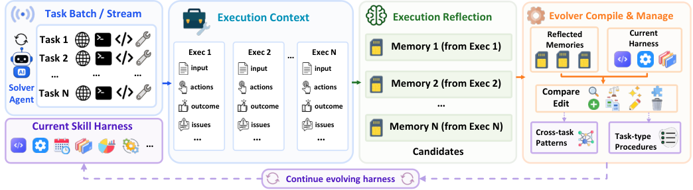
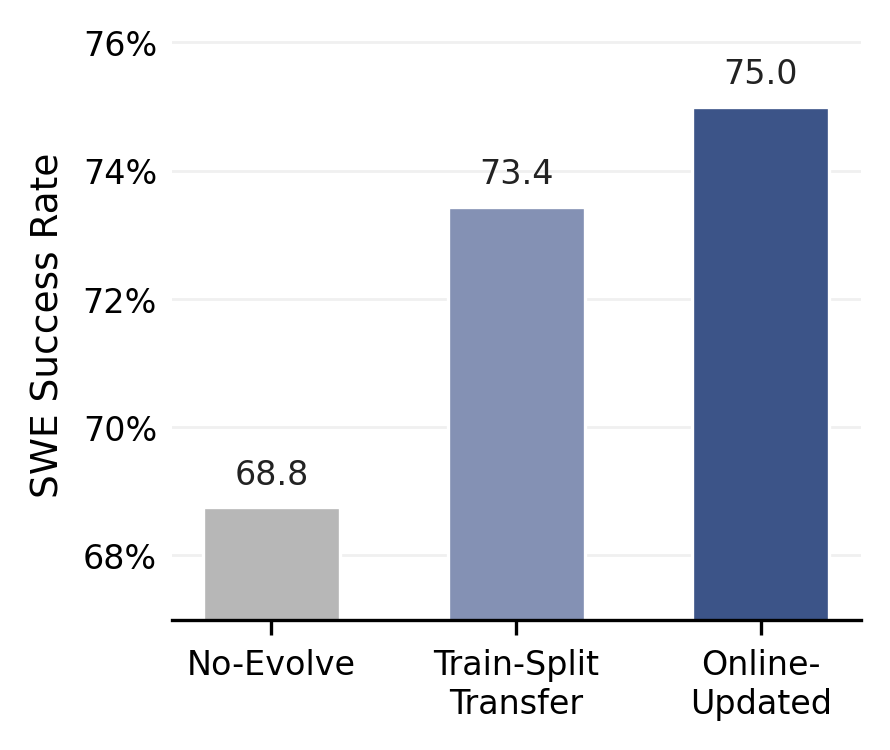

# Evo-Harness：把一次执行的噪声上下文编译成可复用的技能 harness

## 来源信息

| 项 | 内容 |
| --- | --- |
| 标题 | Evo-Harness: Context-to-Harness Skill Compilation for Self-Evolving Agents |
| 作者与机构 | 17 人：University of Illinois Urbana-Champaign（UIUC，第一机构，8 位）、Amazon（5 位）、Penn State、Emory、AG2 AI、Northeastern；首页未标共同一作或通讯作者 |
| 来源 | [arXiv:2608.15071v2](https://arxiv.org/abs/2608.15071v2)（cs.AI; cs.CL）；v2 提交于 2026-08-30，16 页；abs 页 Comments 写 **EMNLP 2026 Main** |
| 许可 | [CC BY 4.0](https://creativecommons.org/licenses/by/4.0/) |
| 代码 | [A-EVO-Lab/a-evolve](https://github.com/A-EVO-Lab/a-evolve/tree/release/evo-harness) 的 `release/evo-harness` 分支（MIT，commit `3c7c7b8`）；只读查看，**未运行、未复现** |
| 阅读日期 | 2026-11-18 |

---

## 核心结论

一句话：**Evo-Harness 把在线任务流里一次执行的失败上下文编译成一份外部的、两级（general / topic）自然语言技能 harness；模型权重和 harness 代码都不动，改进只发生在可读的 Markdown 技能文件里。**

- **问题**：真实在线任务流里 agent 往往只在新任务上执行一次，执行上下文又很吵；已有的 experience reuse 只是检索过去案例，没有把一次执行编译成能指导后续行为的结构化规则。
- **核心想法**：冻结的 solver 先用当前 harness 解题；失败时自己写候选记忆；每批结束后 evolver 对照当前 harness 做 ADD / MERGE / REVISE / SKIP，编译成跨任务的 general skills 与任务类型的 topic procedures。
- **怎么做到**：把 harness 建成带触发条件和作用域的条目集合，按任务选最多 $b$ 条注入；reflection 只产出带证据的候选，是否写进 harness 由 evolver 在 batch 级决定。
- **关键结果**：五个 benchmark 上成功率从 No Evolve 的 29.54/62.92/63.67/72.73/72.50 提到 34.02/73.03/67.00/76.97/76.25（顺序为 CL-Bench、TerminalBench-2、SWE-bench Lite、τ-bench、WebArena-Infinity），相对最强经验复用基线 XSkill 仍分别高 +2.58/+6.74/+2.33/+3.03/+2.50 pp（本笔记复算）。
- **边界**：主表是在同一条任务流上边做边更新的在线结果，原文没有说明它有独立 held-out 集；方法依赖每个任务可靠的环境反馈，且只验证了自然语言技能、单 agent、文本/工具类环境；小于 1 pp 的差距没有方差支撑。

---

## 问题

论文把「从经验里学习」拆成两条路线（§1、Figure 1）：

- **Experience reuse**：把过去的执行存进 case bank，遇到相似任务检索出来复用，回答「上次遇到类似情况时发生了什么」。
- **Harness skill evolution**：把过去执行编译成技能指导，用规则、流程、检查项和恢复策略引导行为，回答「以后遇到这类情况应该怎么做」。

作者认为前者在真实在线流里不够用，理由有三层：

1. **任务只来一次**：每个已完成执行通常只提供一次改进未来行为的机会，不能像离线训练那样先收集大量轨迹再慢慢挖模式（§1）。
2. **上下文很吵**：一次执行里同时有可迁移的教训、任务特有的路径与文件名、部分失败、偶发工具输出；直接检索原始轨迹会把噪声带进下一次任务（§1）。
3. **旧方法验证不够**：作者说已有经验类方法很少在复杂真实任务上严格验证，也很少把「到底是什么在驱动改进」拆开（§1、§2）。这也解释了本文为什么在报总分之外还要做消融。

Figure 2（p2）把三种设置并排：

- **Offline**：先收集经验，再离线分析、挖模式、迭代技能；
- **Practical online stream**：任务按时间顺序一个个来，每次执行只留下 Experience 1…N；
- **Evo-Harness**：每个 batch 后把 memories 编译进 Harness H₁→H₂→…，再用更新后的 harness 指导后续任务。

于是问题写成：**给定一条任务流，冻结的 agent 能否通过不断更新一个外部 harness 来变好？** 「冻结」指模型参数不动；「外部 harness」是一组可读的 guidance entries，不是权重，也不是 harness 源码（§3.1）。

两个容易被忽略的限定：

- **one-shot 指每个任务只执行一次**，不是每个失败只能学一条。evolver 一次看一个 batch（默认 16 个任务）的失败，跨任务模式来自 batch 内多条失败的比较；batch size 退化成 1 时，方法退化成 task-type updating（§3.4）。
- **前提是有可靠反馈**。五个 benchmark 都提供 state verifier、Docker verifier、单元测试或 rubric judge；没有 verifier 的开放任务不在覆盖范围内，这也解释了 Table 4 里「LLM 自评」为什么会伤害性能。

因此本文要证明的不是「存记忆有用」，而是「把记忆编译成规则、并且只在 batch 级更新」有用；后面的消融分别拆 proposal、general/topic、feedback 与 solver-evolver pairing。

---

## 核心想法

### 一句话

经验不是「参考材料」，而是**可编译的源代码**：每次执行是一条带噪声的日志，reflection 是解析器，evolver 是编译器优化 pass，harness 是生成的目标文件。作者没有用这个比喻，但它能解释为什么强调 compile 而不是 retrieve。

### 直觉

- **日志不能直接执行**：原始轨迹里混着任务特有的路径、文件名、偶发工具输出；检索回来只能让模型「看看上次」，不能规定这次该怎么做。
- **编译要付出信息损失**：把一条失败压成「触发条件 + 规则 + 证据」会丢掉细节，但换来可执行、可复用、可读的行为指导。
- **harness 是集合而不是一段 prompt**：每条 guidance 有自己的触发条件和作用域，所以「这次注入哪几条」本身是一个检索问题，可以独立优化。

### 为什么成立

1. **失败的信号密度高**：失败暴露 solver 当前的能力边界——错误假设、缺失约束、无效工具使用、弱验证、失败恢复（§3.2）；成功执行则可能把偶然路径写成通用规则，所以只从失败取候选。
2. **batch 内可以横向比较**：同一 batch 的 solver 都用同一个 $\mathcal{H}_i$，失败之间可比较，evolver 才能提炼跨任务反复出现的模式，而不是给每个任务写一条局部补丁（§3.4）。
3. **发现与准入分成两个角色**：reflection 产出候选，且不跟当前 harness 对照；是否写进 harness 由 evolver 对照 $\mathcal{H}_i$ 与 $R_i$ 决定（§3.2）。这使「发现值得学的东西」与「决定是否写进 harness」成为两个角色，而不是同一步。
4. **编辑而不是追加**：ADD / MERGE / REVISE / SKIP 能过滤噪声、合并兼容信号、修订旧条目；单纯 append 会让 harness 越滚越长、互相冲突。

### 与已有做法的区别

| 做法 | 改进对象 | 反馈形态 | 主要代价 |
| --- | --- | --- | --- |
| 检索式经验复用（AWM / DC / ACE / XSkill） | 下一次的上下文 | 原始案例或摘要 | 噪声大、易过度具体 |
| 权重级学习（RL / SFT） | 模型参数 | 梯度 | 需训练、信号稀疏 |
| harness 源码进化 | 可执行代码 | 测试或验证门 | 工程复杂、要有准入设计 |
| **Evo-Harness** | 自然语言技能文件 | batch 级 evolver 编辑 | 依赖反馈接地、无回滚 |

### 一个走通的例子（原文附录 B）

WebArena 的 h65 任务里，baseline 把收件人域名写成猜测的 `acme.com`，实际是 `acmecorp.com`，verifier 判失败。evolved 版本学到的不是「答案是 acmecorp.com」，而是一条操作规则：**用权威角色来源确认收件人；保留精确邮箱地址，不推断或规范化域名**。这条规则写的是操作与验证方式，不是这道题的答案，因此不会因为下一个任务的域名不同而失效。

TerminalBench-2 的 `adaptive-rejection-sampler` 是另一种形态：baseline 反复重跑同一个 R 测试命令，正式测试仍失败；学到的指导是「停止重复、缩小到最小复现、修核心问题、再逐步加回复杂度」。两者的共同点是**操作区分 + 验证**，而不是某道题的命令或答案。

这两个是附录 B 的 fail→pass 配对案例，不能据此说单条技能导致了翻盘；Figure 7 的图注也明确说它只 contextualize，不建立单技能因果。

### 代价

- **evolver 与 selector 都是额外的 LLM 调用**：每批一次编译、每题一次选择；论文只给总 API 成本约 10 万美元与单次 run 2–8 小时，没有每题 token、延迟或单价。
- **注入占上下文**：技能是自然语言，5+5 条的上限在长任务上是否够用，论文没有给 token 预算。
- **没有版本化、回滚或逐条准入门**：坏编辑可能留很久；Table 4 的 Self-Generated 结果说明，反馈不接地时这种信任会直接伤害性能。
- **只覆盖单 agent、文本/工具环境、自然语言指导**：作者在 Limitations 里明确排除了 embodied、多 agent 与可执行代码技能。

---

## 方法

### 符号表

| 符号 | 含义 | 维度 / 取值 |
| --- | --- | --- |
| $B_i$ | 第 $i$ 个任务批 | $B_i=\{x_{i,1},\dots,x_{i,m_i}\}$ |
| $m_i$ | 第 $i$ 批的任务数 | 默认 16 |
| $K$ | 任务流的批数 | 由 $B_1,\dots,B_K$ 推得 |
| $x_{i,j}$ | 第 $i$ 批第 $j$ 个任务 | — |
| $\mathcal{H}_i$ | 第 $i$ 批开始时的 harness | $n_i$ 条 guidance 的集合 |
| $h_i^k$ | harness 的第 $k$ 条 guidance | 自然语言条目 |
| $n_i$ | 第 $i$ 批时 harness 的条目数 | 随更新变化 |
| $S_{i,j}$ | 为任务 $x_{i,j}$ 选中的条目子集 | $\lvert S_{i,j}\rvert\le b$ |
| $b$ | 注入条数上限（原文未定义该符号的名称；按上下文理解为最多选几条） | 原文未给数值 |
| $\mathrm{Select}$ | 选择算子 | 附录 F：由 Claude Sonnet 4.5 执行 |
| $\mathrm{Inject}$ | 把选中条目拼进任务的算子 | — |
| $\tilde{x}_{i,j}$ | 注入后的任务输入 | — |
| $\mathcal{A}$ | 冻结的 solver | 主实验为 Claude Opus 4.6 |
| $\tau_{i,j}$ | solver 的动作轨迹 | — |
| $y_{i,j}$ | 执行结果 | — |
| $f_{i,j}$ | 可用反馈 | verifier / 单测 / 工具诊断 / judge |
| $c_{i,j}$ | 一次执行的 context | 四元组 $(x,\tau,y,f)$ |
| $r$ | 一条候选记忆 | 四元组（`lesson` / `trigger` / `evidence` / `scope_hint`，见式 7） |
| $R_i$ | 第 $i$ 批的候选记忆集合 | $\{r_{i,j}\}$ |
| $\pi_{\mathrm{evolve}}$ | evolver 的编辑策略 | 主实验为 Claude Opus 4.6 |
| $o$ | 对一条候选的编辑决定 | ADD / MERGE / REVISE / SKIP |
| $O_i$ | 第 $i$ 批的全部编辑 | 编辑集合 |
| $\mathrm{ApplyEdits}$ | 把编辑批量应用到 harness 的算子 | — |
| $\mathrm{CompileTaskType}$ / $\mathrm{CompileCrossTask}$ | evolver 的两个编译步骤 | 分别产出 topic procedures 与 general patterns |

### 数据流：一批任务怎么走

Algorithm 1（p5）的循环：

1. 对 batch 里每个任务，`Select` 当前 harness 的一个子集并注入；
2. 冻结 solver 执行，得到轨迹、结果与反馈；
3. 执行失败或收到负反馈时，solver 做 reflection，产出一条候选记忆（§3.2）；
4. 整个 batch 结束后，evolver 同时做 `CompileTaskType` 与 `CompileCrossTask`；
5. `ApplyEdits` 得到 $\mathcal{H}_{i+1}$，用于下一批。

**逐项读法**：第 1 步是检索与注入（受 $b$ 限制）；第 2 步是唯一与环境交互、产生新证据的步骤；第 3 步把执行结果转成候选，且只在失败或负反馈时触发；第 4 步的两个编译分别面向 topic 与 general，共用同一批候选；第 5 步是唯一的 harness 写回点，写回后 $\mathcal{H}_{i+1}$ 才在下一批生效。

两个设计含义：**更新是批级的**（batch 内始终用同一个 $\mathcal{H}_i$，evolver 才能横向比较同一批的多条失败）；**更新与执行解耦**（solver 只负责做题和写候选，evolver 负责对照当前 harness 做编辑），这也是后面能分别消融 proposal、general/topic、feedback、pairing 的原因。

伪代码与正文有一处不一致：Algorithm 1 第 9 行对每个任务都写 `Reflect`，§3.2 说只有失败或负反馈才产生候选。机制描述以 §3.2 为准，引用伪代码时不要把「每个任务都反思」当成实际流程。



*图 1（原文 Figure 3，p4）：任务批与当前 harness 注入执行，产生 context（input / actions / outcome / issues），reflection 得到候选记忆，evolver 编辑成 cross-task patterns 与 task-type procedures。*

### 选择与注入：原文 Eq (1)–(2)

```math
\mathcal{H}_i = \{h_i^1, \dots, h_i^{n_i}\}, \qquad
S_{i,j} = \mathrm{Select}(x_{i,j}, \mathcal{H}_i; b), \quad |S_{i,j}| \le b
```

**逐项读法**：$\mathcal{H}_i$ 是第 $i$ 批可用的 guidance 集合，每条 $h_i^k$ 有自己的触发条件与作用域；$S_{i,j}$ 是给任务 $x_{i,j}$ 选出的子集，最多 $b$ 条。这里把「给模型看什么」变成了一个独立的检索问题：既不把整个 harness 塞进上下文，也不让 harness 无限增长直接压垮 prompt 预算。

### 执行：注入与四元组

```math
\tilde{x}_{i,j} = \mathrm{Inject}(x_{i,j}, S_{i,j}), \qquad
(\tau_{i,j}, y_{i,j}, f_{i,j}) = \mathcal{A}(\tilde{x}_{i,j})
```

（原文 §3.1 的执行链；现有笔记记录了上下文对应式 5，没有记录这一块的逐式编号。）

**逐项读法**：`Inject` 把选中的规则拼进任务输入；$\mathcal{A}$ 是冻结的 solver，返回轨迹 $\tau$、结果 $y$、反馈 $f$。$f$ 可以是 verifier 结果、单测输出、工具诊断或 judge 反馈，后续 reflection 与 evolver 都只依赖它，不依赖额外的人工标注。

**原文 Eq (5)**

```math
c_{i,j} = (x_{i,j}, \tau_{i,j}, y_{i,j}, f_{i,j})
```

**逐项读法**：一次执行被记成四元组，作为候选记忆的唯一原料。$x$ 说明任务是什么，$\tau$ 说明怎么走的，$y$ 说明结果，$f$ 给出判定依据或诊断信息；只有 pass/fail 时 $f$ 仍可用，但 Table 4 显示反馈的信息量会影响更新质量。

### 候选记忆：只从失败里取（原文 Eq (6)–(7)）

§3.2 的规则是：只在该执行失败或收到负反馈时，产出一条候选记忆（原文 Eq (6)）；候选的表示是

**原文 Eq (7)**

```math
r = (\mathrm{lesson}, \mathrm{trigger}, \mathrm{evidence}, \mathrm{scope}_{\mathrm{hint}})
```

**逐项读法**：`lesson` 是这次到底学到了什么；`trigger` 是什么情况下应该调用它；`evidence` 是支撑这条教训的执行证据；`scope_hint` 是「更像跨任务规则，还是某个任务类型的局部流程」。四个字段合起来让 evolver 能判断这条教训是否过度拟合了某次执行——这正是「带证据的教训」与「原始轨迹」的区别。

现有笔记没有记录候选记忆的序列化格式；harness 条目本身的形态是 Markdown skill files + lightweight YAML metadata（附录 F），但那是编译产物的形态，不是候选的形态。reflection 阶段**不跟当前 harness 对照**，所以它产出的是候选信号，不是最终编辑（§3.2）。

### 编译：evolver 不是追加，而是编辑（原文 Eq (10)–(11)）

```math
o = \pi_{\mathrm{evolve}}(r, \mathcal{H}_i, R_i), \qquad
o \in \{\mathrm{ADD}, \mathrm{MERGE}, \mathrm{REVISE}, \mathrm{SKIP}\}, \qquad
\mathcal{H}_{i+1} = \mathrm{ApplyEdits}(\mathcal{H}_i, O_i)
```

**逐项读法**：每条候选不是直接 append，而是被 $\pi_{\mathrm{evolve}}$ 映射成「新增 / 合并 / 修订 / 跳过」之一；$O_i$ 是这一批编辑的集合，最后统一应用到 harness。evolver 同时看到 $\mathcal{H}_i$ 与 $R_i$，所以能判断这条是否已被覆盖、是否与旧条目冲突。作者把这一步称为从 memory store 到 compiled guidance 的转变（§3.2）。

这里没有可微目标，也没有 verifier 门控：编辑是否被接受由 evolver 判断。与 retrieval 的区别是信息流向——retrieval 把案例放回上下文，compilation 把案例压短成规则；前者保真但噪声大，后者有信息损失但更接近行为指导（本笔记判断）。

### 两级 harness

| 层级 | 内容 | 典型来源 |
| --- | --- | --- |
| Cross-task patterns（general） | 规划、工具使用、验证、失败恢复等跨任务策略 | 多个任务/多个 topic 反复出现的模式 |
| Task-type procedures（topic） | 针对重复出现的任务格式、界面、环境或领域的局部流程 | 同一类任务（如某个 repo、某类网页操作）内的做法 |

论文说两级**不是给单次执行预先贴的标签**，而是 evolver 在过滤、比较、整合候选时「涌现」出来的（§3.3）。但从实现看层级本身是设计好的：prompt 要求 solver 选一个 broad topic，general curator 专门找跨 context 重复出现的模式（附录 E）。更准确的说法是：**两级结构固定，哪些内容进入哪一级是涌现的**。这一点在解读 Table 3 时很重要。

### 与已有方法的结构差异

| 做法 | 改什么 | 反馈怎么用 | 代价 |
| --- | --- | --- | --- |
| 检索式经验复用 | 下一次上下文 | 原文或摘要直接回填 | 噪声与过度具体 |
| 权重级 RL / SFT | 模型参数 | 梯度 | 训练成本、信号稀疏 |
| harness 源码进化 | 可执行代码 | 测试或验证门 | 工程复杂度、准入设计 |
| **Evo-Harness** | Markdown 技能条目 | batch 级编辑 | 依赖接地反馈、无回滚 |

### 实现约束（据附录 F）

harness 存成 Markdown skill files + lightweight YAML metadata，每条有 `trigger`、一条短的可执行规则、可选 `evidence`、以及 `scope`（cross-task 还是 task-type）。默认 batch size 16，general skills 最多 5 条、每个 task-type topic 下最多 5 条；选择由 Claude Sonnet 4.5 执行。论文没有描述版本化、回滚或逐条准入，也没有报告实际 topic 数与技能总数；仓库 launcher 的 per-benchmark 配置与论文默认值并不完全一致，细节见同目录复核档案。

---

## 主要结果

**设置**：五个 benchmark 的评测都在一条在线任务流上边做边更新，每题只用当时已更新的 harness，指标是逐题平均成功率，不是累计分数；solver 与 evolver 都是 Claude Opus 4.6，选择器是 Sonnet 4.5；基线 AWM、DC-Cu、DC-RS、Evo-Memory、ACE、XSkill 在同一任务划分与评测协议下运行。任务数与判分信号：CL-Bench 1899（rubric judge）、TerminalBench-2 89（Docker verifier）、SWE-bench Lite 300（单元测试）、τ-bench 165（state verifier）、WebArena-Infinity 80（state verifier）。

| 方法 | CL-Bench | TerminalBench-2 | SWE-bench Lite | τ-bench | WebArena-Infinity |
| --- | ---: | ---: | ---: | ---: | ---: |
| No Evolve | 29.54 | 62.92 | 63.67 | 72.73 | 72.50 |
| AWM | 28.91 | 62.92 | 62.67 | 70.91 | 70.00 |
| DC-Cu | 29.23 | 60.67 | 63.00 | 72.12 | 71.25 |
| DC-RS | 29.07 | 61.80 | 61.67 | 70.91 | 70.00 |
| Evo-Memory | 29.38 | 64.04 | 64.00 | 72.12 | 72.50 |
| ACE | 29.70 | 61.80 | 63.67 | 72.73 | 71.25 |
| XSkill | 31.44 | 66.29 | 64.67 | 73.94 | 73.75 |
| Evo-Harness | **34.02** | **73.03** | **67.00** | **76.97** | **76.25** |

（原文 Table 1，p6，全部 8 行照录；原文将 Evo-Harness 行的五个数值加粗。）



*图 2（原文 Figure 5，p7）：SWE-bench Lite 上 No-Evolve、训练集迁移（Sonnet 4.5 在训练集进化、Opus 4.7 评测）、在线更新三种设置。图内读数与分母口径的讨论见复核档案。*

- **五个 benchmark 全部高于 No Evolve，TerminalBench-2 的 +10.11 pp 最大**：其余四个增量是 +4.48/+3.33/+4.24/+3.75 pp。作者把 Terminal 的收益归因于这类任务需要查文件、执行命令、读错误、从失败操作里恢复，程序性结构强，正好适合 skill harness（§4.2）。
- **对最强经验复用基线 XSkill 仍全为正，但幅度收窄**：+2.58/+6.74/+2.33/+3.03/+2.50 pp，SWE-bench Lite 的 +2.33 最小。同时 AWM、DC-Cu、DC-RS 在多个 benchmark 上低于 No Evolve，ACE 在 TerminalBench-2 上也低于 No Evolve（61.80 vs 62.92），说明检索或演化的指导本身可能噪声大、过度具体、与 solver 不匹配（§4.2）。
- **换 solver 后总体仍涨，但分类别不均**：CL-Bench 上 Opus 4.7/4.6/4.5、Kimi-K2.5、GPT-OSS 的 All 分别 +3.7/+4.5/+3.8/+1.1/+0.8；PTE 五个全为正（+7.2/+9.8/+9.8/+4.2/+0.8），原文点名它是最 consistent 的增量来源。反面是 Opus 4.6 的 EDS −2.5、GPT-OSS 的 EDS −1.0、Kimi 的 RSA −0.7；作者认为探索性任务对过于具体的指导更敏感（§4.3）。open-weight 增益小也可能是「Claude 写技能 + Claude 选择器」的错配，论文没有做同模型自产自用的交叉实验。
- **消融说明 compilation 是主贡献，两级结构不是**：No Propose 仍比 No Evolve 高 +3.74（CL）/+1.66（SWE），full 相对 No Propose 只高 +0.74/+1.67；CL 上 Topic Only 33.70 接近 full 34.02，SWE 上 General Only 66.67 接近 full 67.00，full 相对最好的单级只高 0.32/0.33 pp。能确定的是「选对层级比选错层级重要」（CL 上 Topic 比 General 高 3.42 pp，SWE 上 General 比 Topic 高 2.34 pp），不能确定两级叠加稳定（§4.4）。
- **反馈必须接地，「越细越好」不成立**：Self-Generated（LLM 自判成败）在两个 benchmark 上都低于 No Evolve（−1.58/−2.00 pp）；Minimal 与 Standard 都高于 No Evolve，CL 上 Standard 比 Minimal 高 +4.16，SWE 上 Minimal 反而略高 +0.33。作者的解释是详细错误消息可能让技能绑定到具体失败（§4.6）；SWE 上的 0.33 与 Figure 6 的 0.7 都小于 1 pp，不宜过度解读。
- **技能可以跨任务、跨模型迁移，但弱 solver 会被拖低**：SWE-bench Lite 上 Sonnet 4.5 在训练集进化出的技能给 Opus 4.7 用，No-Evolve 68.8 → 73.4（+4.6），在线更新再到 75.0（+6.2）（图内读数，分母原文未给）。反过来，Sonnet 4.5 自己当 solver 时 Same 55.3、Cross 55.7，都低于 No-Evolve 58.0；作者的解释是 solver 必须能可靠地遵循、情境化、调整指导（§4.5）。

---

## 边界与局限

**作者明确讨论的**：

- 只覆盖单 agent、文本/工具类环境：text-based tool use、web、命令行、软件工程；没有 embodied agents 或多 agent 系统（Limitations，p9）。
- 只覆盖自然语言指导；executable code skills 或 structured programs 没有研究（Limitations，p9）。

**读者根据证据提出的**：

- **主表是在线适应，不是 held-out 泛化，而且依赖可靠反馈**：harness 在同一条任务流上更新，唯一分离测试集的迁移是 Figure 5（分母与 evolver 型号还有口径问题）；五个 benchmark 都有 verifier，Self-Generated 低于 No Evolve 说明没有外部证据时更新会伤害性能。
- **统计与比较口径都偏弱**：没有方差、置信区间或显著性检验；两级设计 +0.32/+0.33、SWE 上 Standard 比 Minimal 低 0.33、Figure 6 的 Cross 比 Same 高 0.7，都不能当作稳定结论。基线预算（注入条数、上下文长度、token 成本）未报告，增益可能部分来自注入更多上下文；模型消融中技能与 selector 都来自 Claude，能力差异与风格错配没有分开。
- **只展示成功翻盘，未展示反例**：没有 pass-to-fail 数量或逐题翻转矩阵，无法知道有多少任务被 harness 弄坏。
- **关键变量与成本没有拆**：batch size、注入预算 $b$、selector 模型、更新轮数、是否也从成功学习、topic 粒度都没有消融（batch 从 16 变 1 会改变方法性质）；成本只有总量（约 10 万美元、单次 run 2–8 小时），没有每题 token、注入长度、延迟或单价。

---

## 与其他工作的关系

- **Self-Harness（[00198](https://arxiv.org/abs/2606.09498)）**：同一个固定模型自提议、自编辑；Evo-Harness 多一个外部 selector 与两级技能，但没有 Self-Harness 那样的编辑/回滚描述。
- **RRSI（[00212](https://arxiv.org/abs/2609.24972)）/ HarnessX（[00199](https://arxiv.org/abs/2606.14249)）/ Prime Agent（[00205](https://arxiv.org/abs/2608.23552)）**：分别改 harness 源码或配置，并各有非补偿准入、Critic + 确定性门、版本化与回滚；Evo-Harness 的编辑由 evolver 判断，没有独立门。
- **Harness²（[00220](https://arxiv.org/abs/2610.14224)）**：处理没有可靠 verifier 的开放任务，靠行为对比；Evo-Harness 处理有 verifier 的在线流，两者覆盖不同的反馈条件。
- **HarnessPro（[00218](https://arxiv.org/abs/2610.26770)）**：把 token 成本接进 Pareto 选择；Evo-Harness 完全不建模成本。
- **Dream-RSI（[00214](https://arxiv.org/abs/2609.14858)）**：改探索策略代码、靠历史回放选策略；Evo-Harness 改执行侧技能、靠任务流反馈编译——一个改「怎么探索」，一个改「怎么执行」。

<!-- 复核档案见同目录 audit.md（不随站点发布） -->
