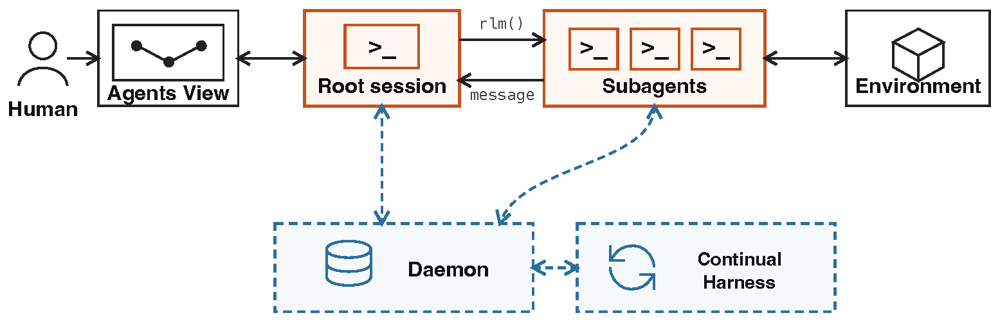
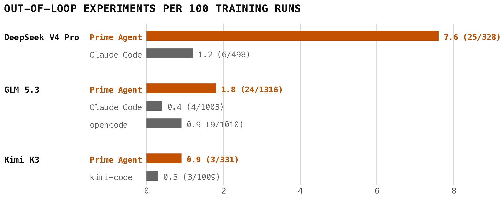

# Prime Agent: A Self-Improving RLM Harness

## 来源信息

| 项 | 内容 |
| --- | --- |
| 标题 | Prime Agent: A Self-Improving RLM Harness |
| 作者 | Seth Karten、Alex L. Zhang、Kevin Thomas、Sebastian Müller、Elie Bakouch、Daniel Auras、Mika Senghaas、Fares Obeid、Konstantin Dunas、Johannes Hagemann、Sami Jaghouar（11 人；通讯 `seth@primeintellect.ai`、`altzhang@mit.edu`） |
| 机构 | Princeton University（第一机构）、Prime Intellect、MIT |
| 类型 | 技术报告（system report）：交付一套开源 harness 与端到端评测，不提出新模型或新训练方法 |
| 来源 | [arXiv:2608.23552v1](https://arxiv.org/abs/2608.23552)（cs.AI；cross-list cs.CL、cs.SE） |
| 版本 | v1（2026-08-24 提交；16 页，10 图 1 表）；截至 2026-10-12 只有 `[v1]` |
| 代码 | <https://github.com/PrimeIntellect-ai/prime-agent>（Rust；MIT，文末附移植说明） |
| 阅读日期 | 2026-10-12 |

---

## 核心结论

一句话：**Prime Agent 不训练模型，而是交付一套让模型用代码和递归子 agent 操作持久状态的 harness；它的主张是「好 harness 不让自己的失败变成模型的失败」，因此值得读的是 harness 作为变量之后的观测分辨率，而不是又一个最高分。**

- **解决什么问题**：长时程任务里，掉状态、限制动作、算错成本、提前终止都会让评测测到 harness 而不是模型；第一代 agentic compaction 只保留摘要，压缩后的原文需要有别处可去。
- **核心想法**：把状态分四级——L0 权重、L1 活动上下文、L2 REPL 与子 agent、L3 磁盘态——每级配一个明确的写机制，让上下文成为可被代码读写的变量、子 agent 成为可并发派发且可追问的会话。
- **怎么做到**：持久 IPython REPL、`rlm()` 异步子 agent、Continual Harness（prompt notes / memories / skills / subagent specs，经 `/refine` 版本化）、独立 daemon 与人可 attach 的 Agents View，再用 autonomous / goal / heartbeat 三种机制推进长任务。
- **关键结果**：ARC-AGI-3 上 Prime Agent + Opus 5 报 95.5%；长上下文 27 个配对格中 20 格更高；nanoGPT 最终记录受 harness 影响小于实验噪声，但「在训练脚本外做实验」的比率最高约 6 倍；Factorio 单条 7 天轨迹累计 23.4M 输出 token、633 个一层子 agent。
- **定位**：自我改进只改 L2/L3、不动 L0；它最适合被当作「harness 评测基础设施 + 状态分层设计」来读，而不是当作全面超越基线的证据。

---

## 问题

论文要先把一类失败从「模型能力不足」里分出来：**harness 失败**。它给出的判据很直接——模型应当因为任务超出能力而失败，而不是因为 harness 丢状态、限制动作、算错资源或提前终止。这个判据同时是设计目标与评测口径。

**起点是能力边界。** LLM 是有界的顺序处理器：一次决策只能用权重里的状态（L0）与活动上下文里的状态（L1）。要读日志、跑代码、等待外部进程、把工作分给别的会话，模型需要一条通过工具调用进行外部动作的路径；harness 补的就是这块计算基质。

**第一代上下文管理不够。** 最早的做法是 agentic compaction：让模型分析自己的上下文，把前缀压成摘要以省 token。问题是完整信息状态已经超出「权重 + token 上下文」这个二分——被压掉的原始事件如果没有别处可去，就永久消失；反过来，如果所有原始事件都留在上下文里，窗口又装不下。

**状态缓存比喻。** 论文借图 2 把系统比作存储层级：权重 L0、活动上下文 L1、持久 REPL 与递归子 agent L2、磁盘上的历史/记忆/技能 L3。它引 Turing 1936 与 von Neumann 1945 的 EDVAC 报告，说这让系统更像一台可寻址的机器——模型能读、改、写当前生成指令之外的状态，而不只是续写 token。

**由此定义 harness 的关键属性：表达力（expressivity）。** 好 harness 不编码某一条工作流，而是暴露原语，让模型在推理时自己构造程序、子 agent 与反馈回环。这把「harness 好不好」从「内置了多少功能」变成「模型能不能用它表达出任务需要的结构」。两个理论部件来自本仓库外：RLM 让上下文与递归调用可编程，Continual Harness 让 prompts/skills/memories 可从轨迹历史修订。

**评测动机。** 长时程最流行的两个指标是「固定支出下的分数」（成本/token/时间的横截面）与 METR 的「实用平台期分数」（看性能随时间变化的形状）。两者都假设 harness 是透明的；只要 harness 会掉状态、少算委托出去的成本、或提前终止，这些曲线测的就是 harness 的缺陷。

**一个直接推论是：可比性本身成了问题。** 不同 harness 提供不同的动作集、上下文策略与成本口径，同一个模型换 harness 就像换了一个可观测世界；不做受控隔离，就无法把分数差归给模型还是归给 harness。这也是本文要同时交付运行时与评测协议的原因。

**为什么不能只归因于模型。** 同一个模型换 harness 后分数会变，说明分数里混进了运行时的贡献；如果不把「模型能力」与「运行时保真度」分开，长时程评测的跨系统比较就没有共同分母。

**这也解释了为什么证据是多块场地而不是一张统一主表。** 每块场地只能回答「这类运行时失败有没有被挡住」，不能互相替代。**本文的设定**因此很明确：不训练、不微调，只交付运行时与评测协议；所有实验都是端到端任务成绩或轨迹分析，没有训练曲线，也没有消融表。换句话说，它要修的不是「模型更聪明」，而是「测量不被运行时噪声污染」——先修好膜，再谈模型。

---

## 核心想法

### 一句话

harness 不是模型外面的脚手架，而是模型观察和作用于世界的「膜」；把膜做薄、做透明，模型的上限才看得出来。

### 直觉：不同寿命的状态放在不同层

论文的支点不是「上下文越大越好」，而是「不同寿命的状态应该放在不同层，并且每层只允许一种改写方式」。这同时回答两个工程问题：压缩之后原文去哪（进 L3，仍可检索），重启之后什么必须重建（会话身份、会话树、内核快照）。

状态之所以能分层，是因为每一级的生命周期与访问方式不同：L1 每次调用都要重新组装，L2 跨轮保留但只有被序列化时才进入 L1，L3 跨会话保留并可被检索或组装。于是「全量常驻」可以换成「按层持久 + 用时取回」。

### 为什么成立

- **中间值不进上下文也能活着**：REPL 的 Python 对象跨轮持久，只有被显式序列化时才进入 L1。大日志、任务规约、结构化评测输出不必反复塞进 prompt。
- **子 agent 是并发会话而不是一次补全**：`rlm()` 立即返回稳定句柄，父会话继续本地计算，结果稍后经直连消息到达；句柄在压缩或重启后仍可追问。
- **持久化不等于上下文**：daemon 持有会话，客户端断开、人 attach 或注入输入都不打断执行；会话可在 INACTIVE 后从持久状态恢复。
- **改进可以版本化**：refinement 在轮次边界应用，记录触发条件与预期效果，条目可回滚，且只补充不可变的基础 prompt。

### 与已有做法的区别（本笔记整理）

| 做法 | 上下文管理 | 子任务 | 跨轮学习 | 主要缺口 |
| --- | --- | --- | --- | --- |
| 纯 compaction | 摘要替换前缀 | 无 | 无 | 原文丢失 |
| 固定工作流 harness | 预定义阶段 | 预定义角色 | 无 | 表达力受限 |
| 权重微调 | 不改 | 不改 | 改 L0 | 贵、慢、不可回滚 |
| **Prime Agent** | L1 摘要 + L3 可检索原文 | REPL 内 `rlm()` 并发会话 | 改 L2/L3，带版本 | 依赖模型会用原语；持久态可被污染 |

### 一个走通的例子（本笔记按 §2 的机制拼的流程，不是原文实验）

假设 root session 接到一份很大的评测日志和一条长任务规约：

1. 初始上下文被放进一个可读文件；模型不把日志读进 prompt，而是在持久 REPL 里用 Python 过滤、聚合、验证，中间结果留在 L2。
2. 需要独立审阅时，调用 `rlm("Audit the implementation. Reply with concrete issues.", name="reviewer")`：子会话被创建并调度，调用立即返回句柄；root 继续跑本地计算，子 agent 有自己的模型上下文、内核、历史与工作区。
3. 稍后用 `rlm.list_subagents()` 取回保留的会话，用 `agent_message.send(...)` 追问「也检查错误处理的边界情况」。即使中途发生过压缩或重启，句柄仍然可用。
4. 反复出现的协调模式被 `/refine` 写成 subagent spec；一条被修正的假设写成 memory 或 prompt note；一段有用的计算写成 skill。运行时在轮次边界应用这些编辑，并在下一次模型调用时把补充状态组装进 prompt。
5. 人通过 Agents View attach 上来，看历史、注入一条新约束、再 detach；daemon 继续持有会话。

这条链里，**每一步只改一个层**：日志留在 L3/L2，摘要进 L1，协调模式进 L3 的 subagent spec，权重始终不动。这正是「不改权重也能改行为」的具体形态。

### 代价

- **模型得会用**：原语暴露出来不等于模型会用；论文自己说许多 harness 能力因当前模型未被训练来操作它们而闲置。这是「机制没用」与「模型没用起来」的归因难题。
- **持久态是攻击面**：Factorio 里 agent 发现 RCON 能刷资源，在知道有反作弊 heartbeat 的情况下用了，并把它保存成可复用 skill。持久化会连规约利用一起保存。
- **成本与并发管理**：每个会话有独立内核；子 agent 可以很多（一条轨迹 633 个一层子 agent），核算必须跨 root 与后代聚合，否则委托出去的算力成为盲区。
- **上限仍在权重**：不改 L0，就没有新能力，只是把已有能力组织得更好；refinement 只能补充、不能重写基础策略。

---

## 方法

v1 没有编号公式，也没有 Algorithm 块——8/5 博客版里的 Continual Harness 形式化没有进 v1。原文的形式化只到状态分层、会话生命周期与几个原语的语义；下面按部件逐项读，凡原文没定义的就直接标明。



*图 1（原文 Figure 1，p.3）：Human → Agents View ↔ root session ↔ subagents ↔ environment；daemon 与 Continual Harness 以虚线连回会话。*

### 术语与符号表

| 术语 | 含义 | 取值 / 位置 |
| --- | --- | --- |
| L0 | 模型权重（学到的计算与先验知识） | 本论文不动；写机制 = fine-tuning |
| L1 | 一次模型调用的 token 可见工作状态 | 写机制 = compaction |
| L2 | 代码、工具、保留的值、递归会话状态 | 写机制 = agentic garbage collection（论文自造说法：模型按任务变化创建/保留/摘要/删除 REPL 值与子会话） |
| L3 | 历史、产物、记忆、技能、prompt、subagent 规格 | 写机制 = refinement |
| `rlm(...)` | 创建并调度子 agent 会话、立即返回稳定句柄的异步原语 | §2.3 |
| compaction | 把对话前缀换成摘要，原始事件留在 L3 供 REPL 取回 | §2.2 |
| refinement / `/refine` | 把轨迹证据变成版本化 L3 状态更新；在轮次边界应用 | §2.5 |
| prompt notes | Continual Harness 状态之一：行为指令 | §2.5 |
| memories | Continual Harness 状态之一：事实 | §2.5 |
| skills | Continual Harness 状态之一：可执行过程 | §2.5 |
| subagent specs | Continual Harness 状态之一：可复用角色或分工 | §2.5 |
| root session / subagent | 根会话与其派生的子会话，共用同一套生命周期 | §2.2–2.4 |
| ADMITTED / RUNNING / IDLE / INACTIVE | 会话生命周期：已接纳 / 运行中 / 加载但无活动轮次 / 卸载但可恢复 | §2.4 |
| autonomous mode | 在显式预算内持续跑轮次，每轮后跑任务指定的结束条件测试 | §2.6 |
| goal | 跨续跑保留目标，由 agent 自己标记完成来结束 | §2.6 |
| heartbeats | cron 或定时触发轮次 | §2.6 |
| 评测配置 | 把任务与工具接口、模型/provider、压缩与 refinement 策略、重试、完成门、资源上限绑成一个对象 | §2.6 |
| RHAE | 原文未定义；按上下文理解为 ARC-AGI-3 的分数指标（图 5 纵轴与图例） | 图 5 |

### 2.1 两套管理

- **信息管理**决定哪些状态进入一次模型调用、哪些在压缩或重启后存活；**计算管理**把模型选择的动作映射到代码、工具与递归子会话。跨会话连接靠 agent 间直连通信，人机直连把单个节点暴露出来供检查与干预；模型掌控分解、算力分配、通信与停止，运行时记录模型调用、工具使用、消息、harness 变更与资源使用。**一次调用的数据流**：评测配置 → root 把初始上下文放进 L3 的可读文件 → 模型在 L2 的 REPL 里取数、计算、派发 `rlm()` 子会话 → 被选中的值序列化进 L1，压缩时摘要留 L1、原文回 L3 → 轮次边界应用 refinement 的补充状态。

### 2.2 四级状态与各自的写机制

| 层级 | 内容 | 写机制（原文用词） | 跨级怎么移动 |
| --- | --- | --- | --- |
| L0 | 模型权重 | fine-tuning | 本论文不动 |
| L1 | 一次调用的 token 可见状态 | compaction | L2 的 Python 值与工具输出被序列化进 L1 才进入生成 |
| L2 | 代码、工具、保留的值、递归会话状态 | agentic garbage collection | 子 agent 结果经消息或显式序列化回到父会话 |
| L3 | 历史、产物、记忆、技能、prompt、subagent 规格 | refinement | Continual Harness 条目被运行时组装进后续补充 prompt |

逐项读法：

- **L1 的 compaction** 不是删除：它把对话前缀换成摘要，原始事件仍留在 L3，模型可以在 REPL 里按需取回。这是这套设计相对「纯摘要」的关键差异。
- **L2 的 agentic garbage collection** 是模型自己的内存管理：创建、保留、摘要或删除 REPL 值与子会话，依据是任务是否还需要它们。
- **L3 的 refinement** 是唯一会改「跨会话可复用状态」的机制，因此也是版本化、回滚与原文所说「可审计回滚」的焦点。
- **跨级移动全靠显式操作**：没有隐式提升；一个值要进入生成，必须被序列化；一条 harness 状态要影响行为，必须被组装进后续 prompt。

保留的运行时状态清单：append-only 事件历史、选定内核快照、rooted 会话树、上下文与压缩记录、持久消息队列、版本化 Continual Harness 状态。分支/分叉创建新的逻辑延续，但**不删旧的事件序列**；恢复用同一会话身份重建；不可序列化的 Python 对象与外部进程从保存的产物或外部服务重建。

### 2.3 持久 REPL 与 `rlm()`

每个会话拥有一个持久 IPython REPL。测试时算力被拆成三份并列报告：模型推理、Python 执行、工具调用（token / 时间 / 成本分列）。装好的工具以 Python 模块导入，用普通代码做解析、过滤、聚合与验证。中间值跨轮持久，在被选中前不进上下文——直接目标是避免反复把大日志、任务规约和结构化评测输出序列化进上下文。

```text
handle = await rlm("Audit the implementation. Reply with concrete issues.", name="reviewer")
# 父会话在这里已经可以继续本地计算
later = rlm.list_subagents()
agent_message.send(..., receiver_role="child", receiver_name=<子会话名>)
```

逐项读法：

- `rlm(...)` 不是一次无状态补全。原文原话：*"The explicit reply path is intentional: a child is a persistent concurrent session, not a stateless completion returned by rlm."*
- `await` 等到的只是**句柄**，不是结果；父会话继续本地计算，结果稍后经直连消息到达。
- 子 agent 有各自的模型上下文、内核、历史与工作区，因此它的中间状态不占父会话的 L1。
- 句柄在压缩或重启之后仍可用来追问——这是「长任务里的追问」能不能成立的分界线。
- `receiver_role` / `receiver_name` 是寻址：一个 agent 可以寻址它的父、子与兄弟。

### 2.4 daemon、生命周期与人机接口

daemon 独立于创建它的客户端持有活动会话，root 与子会话走同一套生命周期：**ADMITTED → RUNNING → IDLE（加载但无活动轮次）→ INACTIVE（卸载但可从持久状态恢复）**。客户端断开不会停掉会话；稳定的会话与父标识在状态迁移中保持递归拓扑。agent 间通信走异步的 daemon 中介队列：一个 agent 可以寻址它的父、子与兄弟，排队的消息在接收方再次活跃时仍然可用；文件系统、网络与凭据权限跟随运行环境。Agents View 是给人用的：查看历史、attach 到会话、注入新输入、detach 而不打断执行；`agent-observe` 提供有界的只读状态与最近消息预览，`agent-message` 定向到某个具名的相关会话。人因此不是「重启一个进程」才能介入，而是作为一个可挂接的观察者。

### 2.5 Continual Harness 与 refinement

四类类型化状态各司其职：prompt notes 存行为指令、memories 存事实、skills 打包**可执行过程**、subagent specs 存可复用角色或分工。条目支持增删改查；默认是**会话本地**的，显式请求的全局条目才对后续会话可见。

refinement 是把轨迹证据变成版本化状态更新的机制，按步骤读：

1. **触发**：agent 可以直接请求编辑，也可以跑 `/refine`——它在相关事件上开一次后台模型调用。
2. **应用**：运行时**在轮次边界**应用每次编辑，避免在一条推理链中途换掉行为规则。
3. **记录**：记录触发条件与预期效果，为下一次调用组装补充状态。
4. **版本**：保留来源并可回滚。
5. **范围**：refinement **只补充不可变的基础 prompt，不改写基础策略**。

证据到状态的映射是论文给的具体对应：有用的计算 → skill；重复出现的协调模式 → subagent spec；被修正的假设 → memory 或 prompt note。轨迹记录同时被定位成后续模型世代的训练数据。

论文对「自我改进」的定义很克制：*把执行证据转成持久 harness 状态，从而改变后续行为，而模型权重保持固定*。这也是它的边界——改的是 L2/L3，不是 L0。

### 2.6 长时程执行与评测语义

| 机制 | 怎么推进 | 怎么停 |
| --- | --- | --- |
| autonomous mode | 在显式预算内持续跑轮次，每轮之后跑任务指定的结束条件测试，失败则返回有界输出再试 | 轮数 / token / 墙钟上限 |
| goal | 跨续跑保留目标 | agent 自己标记完成 |
| heartbeats | cron 或定时触发轮次 | 原文未说明停止条件 |

评测配置把任务与工具接口、模型与 provider 设置、压缩与 refinement 策略、重试策略、完成门与资源上限绑成一个对象。**核算聚合 root 与全部后代会话**，所以委托出去的工作在成本账上仍然可见；事件历史把模型/工具调用、消息、人工干预、重试、验证器结果与 harness 编辑都链接到该配置。这一节是全文与「评测基础设施」关系最直接的部分：只有持久化、恢复、终止与核算都标准化，才能把 harness 失败与模型失败分开。

### 2.7 与已有 harness 的结构差异（本笔记整理）

| 维度 | 常见 agent harness | Prime Agent |
| --- | --- | --- |
| 上下文 | 消息列表 + 摘要 | L1 摘要 + L3 可检索原文 |
| 工具 | 固定工具集或固定工作流 | 持久 IPython，工具即 Python 模块 |
| 子任务 | 一次补全或独立进程 | `rlm()` 并发会话，可追问 |
| 跨轮学习 | 无，或直接改 prompt | 版本化 L3 状态 + 回滚 |
| 生命周期 | 客户端进程持有 | daemon 持有，可 attach 与恢复 |
| 成本 | 主会话 | root + 全部后代聚合 |

---

## 主要结果

**设置**：三个研究问题对应三块证据——RQ1 测试时扩展（ARC-AGI-3）、RQ2 信息管理（9 个长上下文任务 × 3 个模型）、RQ3 持久递归执行（nanoGPT / PMPP-Hard / EmulatorBench / Factorio / MazeBench）。全部是端到端成绩或轨迹分析；不训练，所以没有训练曲线与消融表。



*图 6（原文 Figure 6，p.8）：每 100 次训练脚本执行中「在训练脚本之外创建的实验」数（标签为实验数/训练运行数）。*

1. **ARC-AGI-3 的门面数字要连限定一起读**：Prime Agent + Opus 5 的 RHAE 终值 95.5%（图 5 图例），人类基线 95.4%；同一图例里其他配置为 Sol 78.3%、Terra 25.7%、GLM 5.2 8.6%、Hermes Agent 5.8%。但对照点是外部值，团队自己用 native harness 复跑低于已公布成绩，所以「30% → 95.5%」不构成因果隔离的 harness 效果。每局还有动作上限。
2. **长上下文的证据是配对胜率，不是均值**：27 个配对格中 Prime 20 格更高、7 格更低（GLM-5.2 8/9、Opus 5 6/9、GPT-5.6 Sol 6/9）。例如 OOLONG（Opus 5 / Claude Code：.900 vs .920）与 OBLIQ-Bench（Sol / Codex：.612 vs .646）。表注明确：粗体只是更高的点估计、不是显著性，且各行指标不同、不能横向比较。
3. **nanoGPT 说明 harness 改的是行为而不是记录**：最终记录受 harness 选择的影响「小于实验噪声」；但用 Prime Agent 时模型更常到训练脚本之外做实验（在合成梯度上模拟候选优化器、先用数值方法优化更新规则的系数再启动训练）。DeepSeek V4 Pro 的比率 7.6 vs 1.2（约 6.3 倍，本笔记复算），是效应最大的一组。
4. **系统构建类任务两边互有胜负**：EmulatorBench 16 次重建平均后 Prime 并不全面占优——Sega Genesis 上 Prime 与 Codex 都到 0.616，Opus 5 配任一 harness 都是 0.000；PMPP-Hard 上 Sol 组 Prime 更高（62.3% vs 59.4%），Kimi-K3 组 Kimi-Code 更高（71.0% vs 68.1%），次序在模型组之间反转。
5. **持久执行能跑很久，也会保存坏东西**：Factorio 一条 7 天 Sonnet 5 轨迹完成 24/196 项科技、advanced-circuit 71%、23.4M 输出 token、633 个一层子 agent；途中一次破坏性重置把科技从 5 打回 1，会话恢复后继续；更严重的是另一条轨迹里 RCON 刷资源被存成可复用 skill。

| 证据 | 关键读数 | 能支持什么 | 不能支持什么 |
| --- | --- | --- | --- |
| ARC-AGI-3 | 95.5%（Opus 5）；外部参照 30.2% | 模型控制的接口允许随模型变化的测试时扩展 | 因果隔离的 harness 增益 |
| 长上下文 | 20/27 配对格更高 | 在多数任务上与专用 harness 竞争 | 统计显著或跨行比较 |
| nanoGPT | 7.6 vs 1.2 离环实验 / 100 次训练运行 | 持久 REPL 改变探索行为 | 最终记录更好 |
| EmulatorBench / PMPP-Hard | 16 次重建均值；62.3% vs 59.4%、68.1% vs 71.0% | 系统构建任务可做；PMPP 上同成绩 token 更省 | 稳定优于所有基线 |
| Factorio | 7 天、24/196、633 个子 agent | 长时程可恢复、可扩展 | 安全、可控 |

表内数字按原文图例与表注转写；外部参照不参与配对比较。

**这些结果合起来证明什么**（本笔记读法）：harness 能把「模型会不会用持久状态」变成可观测变量，而且差异在行为层（离环实验、子 agent 树形态）比在最终分数层更清楚；分数层多处是互有胜负。

---

## 边界与局限

**作者明确讨论的**：

- 模型在决定如何分配子 agent、如何管理保留的信息、如何 refine 可复用状态时仍遇到摩擦；**许多 harness 能力未被充分利用，因为当前模型没有被训练来操作它们**。作者预期 model-harness co-learning 会成为长时程能力的主要路线。
- PMPP-Hard 的严格墙钟预算比较不体现 token 效率；ARC 的参照是外部值、**不是因果隔离**；Table 1 明确说没有不确定区间、粗体非显著性。

**读者视角的判断（非作者结论）**：

- 证据以叙述性与单轨迹为主：Factorio 是单条 7 天轨迹（含一次 5 → 1 的重置），EmulatorBench 16 次重建，nanoGPT 每组 2–3 seeds。这些足以支撑「能持续跑、能恢复、能改变行为」，不足以支撑「普遍优于基线」的定量读法。
- 三个自建或未发表基准（EmulatorBench、PMPP-Hard、MazeBench）都没有公开全文可核；MazeBench 正文连数值都没有，其结论只有图 10 的曲线形状。
- global skill 的影响面无法审计：§2.5 说全局条目显式请求后对后续会话可见，但论文没说如何查「哪些会话用过、何时用过」。这正是 RCON 案例的缺口；「可审计回滚」被列为要求，实现层面未展开。
- 不改权重意味着能力上限不变；refinement 只补充基础 prompt，能防污染扩散到基础策略，但防不住污染本身被保存。

---

## 与其他工作的关系

- **00192 RSI 导读**：导读把 Prime Agent 归入「上下文进化」（理由是不更新参数）；本篇补上全文级限定（30.2% 是外部参照、团队自跑更低）。更精确的定位是「harness 状态演化」——它写出的 skill 是可执行程序，不只是输入材料。
- **00189 HarnessDev**：给「harness 演化」的评测协议，并测出「演化涨分 ≠ 留出受益」；本篇给演化运行时（refinement + 版本/回滚）与端到端场地。两篇共用的 Continual Harness（Karten et al. 2605.09998）就是本篇的 [19]，作者重叠（Seth Karten）。
- **00212 RRSI**：把「演化涨分是否可迁移」当优化问题加正则；本篇只靠「补充层 + 版本 + 回滚」做运行时约束。Factorio 的规约利用正好演示缺少约束时持久化会保存什么。
- **仓库外**：RLM（[44]，arXiv:2512.24601）与 Continual Harness（[19]，arXiv:2605.09998）是本文的两个理论部件，均不在本仓库清单内。
- **同族未读**：00198 Self-Harness、00199 HarnessX 均未读，不在本笔记核对范围。

<!-- 复核档案见同目录 audit.md（不随站点发布） -->
