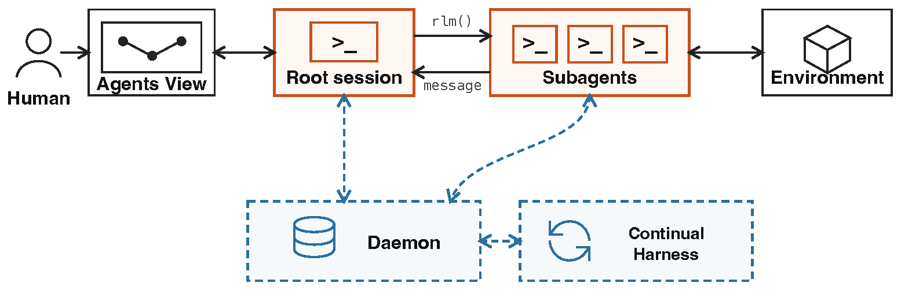
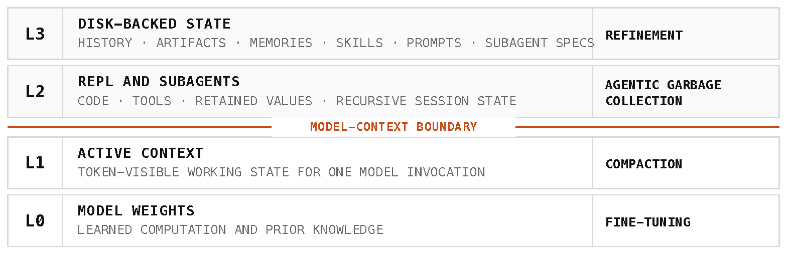
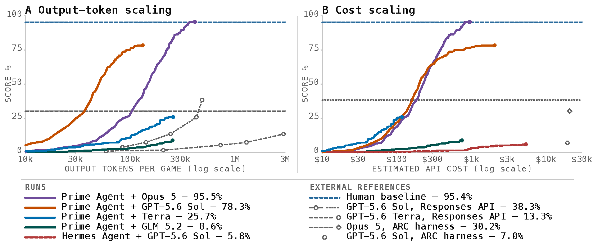
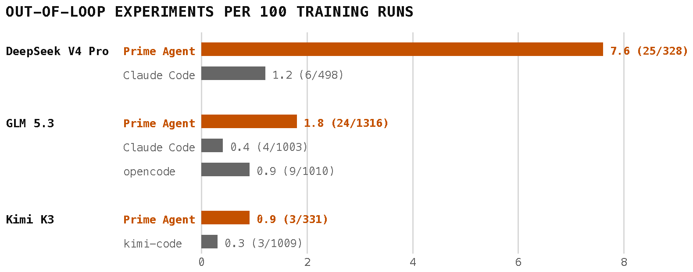
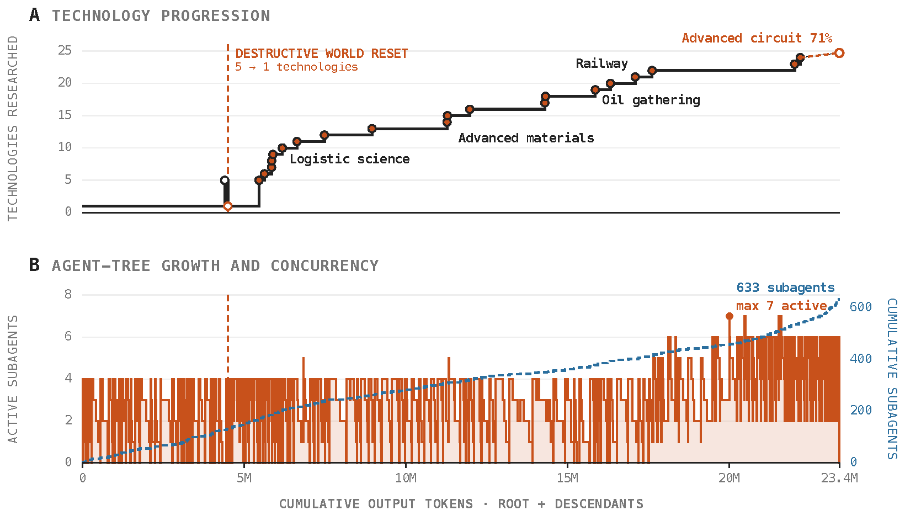

# Prime Agent: A Self-Improving RLM Harness

## 来源信息

| 项 | 内容 |
| --- | --- |
| 标题 | Prime Agent: A Self-Improving RLM Harness |
| 作者 | Seth Karten、Alex L. Zhang、Kevin Thomas、Sebastian Müller、Elie Bakouch、Daniel Auras、Mika Senghaas、Fares Obeid、Konstantin Dunas、Johannes Hagemann、Sami Jaghouar（11 人；通讯 `seth@primeintellect.ai`、`altzhang@mit.edu`） |
| 机构 | Princeton University（第一机构）、Prime Intellect、MIT |
| 类型 | 技术报告（system report），非方法论文：交付物是一套开源 harness 与其端到端评测 |
| 来源 | [arXiv:2608.23552v1](https://arxiv.org/abs/2608.23552)（cs.AI；cross-list cs.CL、cs.SE） |
| 版本 | v1（2026-08-24 提交）。截至 2026-10-12 无更新版本（abs 页 submission history 只有 `[v1]`，核验日期 2026-10-12） |
| 版本旁注 | 论文首页自述 "First published: August 5, 2026 • Current version: August 24, 2026"——8 月 5 日那一版已于 2026-10-12 复核中定位为 Prime Intellect 博客（两版量化差异见「版本关系」小节）；**本笔记仍以 arXiv v1 为基准** |
| 篇幅 | 16 页：正文 §1–§5 至 p.12，参考文献 pp.12–15，附录 A–C pp.15–16；10 张图、1 张表（16 页与 "10 figures" 见 arXiv 元信息 `comment`，与渲染页一致） |
| 许可 | 论文：arXiv abs 页 "view license" 指向 [CC BY 4.0](http://creativecommons.org/licenses/by/4.0/)（核验 2026-10-12）。`assets/` 下 5 张图裁剪自该版 PDF，按 CC BY 4.0 引用并注明出处 |
| 代码 | <https://github.com/PrimeIntellect-ai/prime-agent>。2026-10-12 经 GitHub API 核验：仓库存在且公开、主要语言 Rust（含 `crates/`、`prime-agent-runtime/`）、21,939 stars / 2,420 forks（同日复核读到 21,940，属动态值）、最近推送 2026-10-12（当天仍有合并提交）；仓库许可证为 MIT——`LICENSE` 正文是标准 MIT，**文末另有一段移植说明**（「This software is a port of the Prime Agent TypeScript product, originally Copyright (c) 2025 Mario Zechner, used under the MIT License.」），GitHub 的 licensee 因此把 API 的 `license` 字段判为 `NOASSERTION` 而非 `MIT`（2026-10-12 复核修正：原写「自定义措辞的 MIT」有误） |
| 阅读日期 | 2026-10-12 |
| 复核记录 | 2026-10-12 依 check-paper-note 复核（基准：同版 v1 PDF 重新下载，sha256 `973323f2…`；审计对象快照 md5 `2ecf8076…`、253 行；独立子 agent 审计 + 自查）。手段：16 页逐页文本 + 图 1–10 渲染页过目；Table 1 在 300 dpi 渲染页逐格核对并由脚本重算 27 对（**20/27，与初版一致**）；5 张配图按声明裁剪框重裁做像素差比对（AE=0，且四边纯白、内容区间与图注区间分离——两类检查都做）；逐条核对 `§x.y`/`Figure n`/`Table n` 归属与全部英文引文；否定性断言自设检索词（`rooms`/`gems`、`85.5`、`Pi-mono`、`Kimi-?code`、`30.2`）；定点核对 00192/00189 两篇既有笔记；`curl` 复核上游归档无 00205 撞号、README 该行合规。本轮修正：①许可解释（`LICENSE` 是标准 MIT + 文末移植说明，`NOASSERTION` 由此而来）；②`rooms`/`gems` 的检索结论写错（正文 p.10、p.11 亦出现该两词，但均无数值）；③Kimi-Code 张力条改为「按任务成绩无同向证据」并补 §3.4 的 token 效率表述；④摘要 30% ↔ 图 5 的 30.2% 之对应标注为「本笔记推断」；⑤与 00192 复核记录矛盾的一句转引改写；⑥补 `(public set)`、「metrics differ by row」、PMPP-Hard/MazeBench 无参考文献；⑦新增「版本关系」（8/5 博客版已定位并逐格比对：Table 1 54 个数值中 53 个一致）；⑧速查表 nanoGPT 行位置列改「引言、§3.3」；⑨stars 补记复核值 21,940。**未修项**：ARC 的 30.2% 等外部值未回溯 [1][2] 原始来源；v1 未说明与 8/5 版的差异原因（OOLONG/Codex 一格 0.500→0.900 无法判定哪版为准）；博客版非 PDF、无页码与版本锚点；PMPP-Hard/MazeBench/EmulatorBench 三者均无公开全文可核 |
| 阅读范围 | **已渲染并逐项核对**：全文 16 页通读——正文 p.1–12（§1–§5）在 300 dpi 渲染页上逐页看过，p.12–15 的参考文献与 p.15–16 的附录 A–C 以文本抽取通读（附录 A 的代码段、附录 B 的编排示例与附录 C 的 LLM 使用声明均已核对）；Table 1 在 300 dpi 渲染页放大（裁剪 `2550x700+0+2200`，第 7 页 PNG）逐格核对数值与粗体归属；图 1–10 全部过目（300 dpi）；5 张配图均为同一渲染页上的直接裁剪（裁剪框见下），边缘像素与元素清单逐张校验。**仅按正文/图注引用**：图内数值（ARC-AGI-3 终值、离环实验率、PMPP-Hard 解率、Factorio 标注）取自图上印刷的数据标签与图例文字，**未做像素测量**——10 张图中 6 张含定量元素（图 5/6/7/8/9/10），本笔记引用的读数全部以印刷标签给出，无需从曲线取值；图 5 与图 10 的曲线本身未读取任何数值。**未做**：未运行代码、未复现实验（8/5 首发版本已在 2026-10-12 复核中定位并另做版本核对，见「版本关系」） |
| 核对凭据 | 配图裁剪框（第 × 页 PNG，300 dpi）：图 1 `1555x502+515+381`（p.3）、图 2 `1568x507+491+305`（p.4）、图 5 `1673x697+437+288`（p.7）、图 6 `1580x622+492+314`（p.8）、图 9 `1640x935+455+317`（p.10）。否定性断言检索词：`rooms`/`gems`（核 MazeBench 全文无成绩数值；该两词在正文 p.10、p.11 与图 10 均出现，正文两处均无数值）、`85.5`（核该数字全篇仅引言 1 处）、`Pi-mono`（核论文未交代其来源）；排版折行会让 grep 漏字，检索前已把换行替换为空格。**复核（2026-10-12）追加凭据**：基准 PDF 重新下载并校验（`file` 报 PDF 1.7、gs 计 16 页，sha256 `973323f2d3d85f3ec9b21709248b65ba236cf527cd5cc9ff556909104a5fd370`）；图 7 数据标签在 600 dpi 复读（Genesis 两个 `0.616` + 两个 `0.000`，GBC 一个 `0.998` + 三个 `0.000`）、图 8 在 600 dpi 复读（四柱标签与分母）；Table 1 由脚本做「按序子序列」机器比对并重算 27 对；博客版（8/5）URL 与取回副本 sha256 `571a72225152a90c763c434ba933cc2b7f7893e3ad67c2a510e8c92fa62d3b67` |

> `assets/` 下 5 张图裁剪自本笔记使用的 v1 PDF（图号见各图注）；论文按 CC BY 4.0 发布，引用请注明出处。仓库 README 自述的能力清单与论文各节一一对应（本笔记已交叉核对，见「工程视角」末条）。

## 版本关系（2026-10-12 复核时补充，非原文内容）

本笔记以 **arXiv v1（2026-08-24，16 页 PDF）** 为基准。复核时定位到了论文自述的「First published: August 5, 2026」那一版：**Prime Intellect 博客**《Prime Agent: A self-improving RLM agent》（<https://www.primeintellect.ai/blog/prime-agent>，页首署 AUG 5TH, 2026，作者 Seth Karten、Alex L. Zhang、Kevin Thomas、Sebastian Müller 与 Prime Intellect Team；本次 `curl` 取回 HTTP 200，取回副本 sha256 `571a7222…`——动态站点，无 commit/sha256 官方锚点）。博客结尾写「We will have a full technical report with further details soon.」——**v1 即该技术报告**。

两版按多组关键句检索 + 逐格比对核对，结论方向与绝大多数数字一致；差异如下：

| 维度 | 博客版（2026-08-05） | arXiv v1（2026-08-24，本笔记基准） |
| --- | --- | --- |
| 形态 | 站点博文，无 arXiv 号、未链回 arXiv | 16 页技术报告 PDF |
| Table 1 | 同一张表；**54 个数值中 53 个与 v1 一致** | **OOLONG 行 Codex 一格：博客 `0.500` → v1 `0.900`**（其余 53 格逐格相同，含 EmulatorBench 行）；行名规范化，对照列在博客写作「Pi-mono (w/ sub-agents)」 |
| ARC-AGI-3 | 95.5% 之外还给出：三次运行 `[95.0, 95.2, 95.5]`、Best@3 `99.97%`、`183/183` 关卡完成、median replay 95.2%，并称超过「ARC reported human expert baseline of 95.4%」 | 只保留 95.5%（图 5 图例）与外部参照；**没有**三次运行 / Best@3 / 关卡数；「from 30% to 95.5%」的框架是 v1 新增 |
| 长上下文设置 | 明写「We offload the main context **in each harness** to a file in memory to start」，并说明 GLM-5.2 一侧两臂同用一个 open-weights 模型、Pi-mono 带 sub-agents | 只写 Prime Agent 把初始上下文放进可读文件；**对照 harness 是否同样处理未写**；`Pi-mono` 的来源与配置全篇未交代 |
| nanoGPT / 离环实验 | **没有**（全篇无 Kimi K3、DeepSeek V4 Pro、speedrun、out-of-loop 等字样） | v1 新增 §3.3 与图 6，以及引言的 85.5 小时 / 19 条验证记录 |
| Factorio | 口径是 production score（「in the 100K+ range … in a matter of hours」，四名角色，`/refine` 同时造出正当 skill 与作弊 skill） | 换成 7 天 Sonnet 5 run 的科技进度口径（24/196、71%、23.4M token、633 个子 agent） |
| 公式与实现细节 | 含 Continual Harness 的形式化 `H=(ρ,G,K,M)`、JSONL 会话历史、`/tree`、`compact.run()`、CLI 的 `--autonomous` / `--autonomous-gate` 等参数 | 全部未进 v1（v1 无任何公式） |
| 致谢与出处 | 写明「Prime Agent is built on top of **pi**」并致谢 pi 作者 | 改为感谢跑实验的人（Florian Brand、SinatraS、Patience Cave），未提 pi |

对「原文自身的表述张力」的版本适用性：**第 1 条（95.5 vs 95）与第 5 条（85.5 小时 / 19 条）只适用于 v1**；第 3 条（Kimi-Code）只适用于 v1（博客全篇未出现 Kimi-Code）；第 2 条两版同向（博客也有「higher maximum score … at a lower overall token usage」的宣称，只是位置在 ARC 一节末而非摘要）；第 4 条两版都成立——**两版下 Prime 更高的格数都是 20/27**（唯一差异格里 Prime 仍更高）。

> 复核边界：博客非 PDF、无页码（动态站点），本次以 `curl` 取回正文文本全文（约 2.4 万字符）逐段读过，并对量化内容做多组关键句检索与逐格比对；**本笔记正文的数字与引文一律以 v1 为准，未据博客改写**。另注：`LICENSE` 文末的移植说明（Rust 版是 Prime Agent TypeScript 产品的移植，原版权归 Mario Zechner）与博客「built on top of pi」是两条独立记录，本笔记不推断二者的关系。

---

## 核心结论

**这篇论文不提出新模型或新训练方法，它交付的是一个 harness——以及一套把「harness 能力」当作可测量对象的方法。** 它的核心主张是：长时程任务的评测里，harness 是模型观察和作用于世界的「膜」（membrane），模型应当因任务超出能力而失败，而不是因为 harness 丢状态、限制动作、算错资源或提前终止（§1 原话）；因此好 harness 的标准是 *prevents harness failures from becoming model failures*（摘要）——把测出来的成绩推向模型的真实上限。

四个部件（§2，图 1）：

1. **持久 IPython REPL**：实现 RLM（Recursive Language Model）抽象——上下文是变量、递归子 agent 是函数调用，中间值活着但不进上下文，除非被显式序列化进去（§2.3）。
2. **递归子 agent**：`rlm()` 异步原语，创建子会话后立即返回稳定句柄，父会话继续本地计算；子 agent 有各自的模型上下文、内核、历史与工作区（§2.3）。
3. **Continual Harness**：把 prompt notes（行为指令）、memories（事实）、skills（可执行过程）、subagent specs（协调模式）四类状态做成类型化、版本化、可回滚的可写状态，靠 refinement（`/refine` 或 agent 直接请求）把轨迹证据转成持久状态（§2.5）。
4. **daemon + Agents View**：会话由 daemon 持有、独立于创建它的客户端，断开后可重连；人可以直接 attach、注入输入、观察状态（§2.4）。

状态被分成四级：L0 权重 / L1 活动上下文 / L2 REPL 与子 agent / L3 磁盘态，每级有各自的变更机制（微调、压缩、agentic garbage collection、refinement，图 2）。

结果的主次很清楚（§3）：**ARC-AGI-3 上的 95.5%（Prime Agent + Opus 5，图 5 图例）是门面，真正的证据是三类「别的 harness 测不出来」的观测**——长上下文任务上 27 个配对格中 20 格更高（本笔记复算，Table 1）、nanoGPT 上最终记录与基线无差别但「离环实验」率最高约 6 倍（图 6）、多日运行可恢复（Factorio 7 天、23.4M 输出 token、633 个子 agent，图 9）。作者自己在 §3.3 承认 harness 对 nanoGPT 最终记录「影响小于实验噪声」——**这篇的价值读法不是「又赢了多少分」，而是「把 harness 作为变量之后的观测分辨率」**。

适合谁读：做 agent 系统/评测基础设施的人（可借它的状态分层、成本核算与安全失败清单）；想复现长时程评测的人（它明说了哪些对照不是受控实验）；以及关心「RSI 里哪一步在动」的人——它给出的是「不改权重也能改行为」的那一半（见「与本仓库其他条目的关系」）。

---

## 问题与动机（§1）

- **起点是一个能力边界**：LLM 是有界的顺序处理器，一次决策只能用权重里的状态与活动上下文里的状态；harness 补的正是「通过工具调用进行外部动作」所缺的计算基质。
- **上下文管理的第一代方案不够**：最早是 agentic compaction（模型选择性分析自己的上下文以压缩 token 但保留要点）。但论文认为完整信息状态已经超出「权重 + token 上下文」这个二分。
- **状态信息缓存比喻**（图 2）：模型权重 = L0、活动上下文 = L1、持久 REPL 与递归子 agent = L2、磁盘上的历史/记忆/技能 = L3。这让系统更像 von Neumann 机（引 Turing 1936、von Neumann 1945 的 EDVAC 报告）——模型可以读、改、写当前生成指令之外的**可寻址状态**。
- **由此定义 harness 的关键属性 = 表达力（expressivity）**：不编码某一条工作流，而是暴露原语，让模型在推理时自己构造程序、子 agent 与反馈回环。两个理论基础是本仓库外的 RLM [[44]][44]（让上下文与递归调用可编程）与 Continual Harness [[19]][19]（让 prompts/skills/memories 可从轨迹历史修订），再加上作者这一支的 agent 间直连通信。
- **评测动机**：长时程最流行的指标是「固定支出下的分数」（成本/token/时间的横截面）与「实用平台期分数」（[8] METR 的 *Metrics of agent ability*），后者能看性能随时间变化的形状。若 harness 会掉状态、算错成本、提前终止，这些数字测的就是 harness 而不是模型。

[44]: https://arxiv.org/abs/2512.24601
[19]: https://arxiv.org/abs/2605.09998

---

## 系统结构（§2）

*图 1（原文 Figure 1，p.3）：Human → Agents View ↔ Root session ↔ Subagents ↔ Environment；下方 Daemon 与 Continual Harness 以虚线（持久状态）连回会话。实线箭头运载执行与消息，虚线箭头运载持久状态。裁剪自 v1 PDF，许可见来源信息。*

### 两套管理，分开（§2.1）

- **信息管理**决定哪些状态进入一次模型调用、哪些在压缩或重启后存活。
- **计算管理**把模型选择的动作映射到代码、工具与递归子会话。
- 跨会话的连接靠 agent 间直连通信；人机直连则把单个节点暴露出来供检查与干预。**模型掌控分解、算力分配、通信与停止**；运行时记录模型调用、工具使用、消息、harness 变更与资源使用。

### 四级状态与各自的「写机制」（§2.2，图 2）

*图 2（原文 Figure 2，p.4）：L3 磁盘态（history · artifacts · memories · skills · prompts · subagent specs）/ L2 REPL 与子 agent（code · tools · retained values · recursive session state）/ L1 活动上下文 / L0 权重；L1 与 L2 之间是 model-context boundary。右侧一列是每级的变更机制。裁剪自 v1 PDF，许可见来源信息。*

| 层级 | 内容 | 变更机制（原文用词） |
| --- | --- | --- |
| L0 | 模型权重（学到的计算与先验知识） | fine-tuning |
| L1 | 一次模型调用的 token 可见工作状态 | compaction（压缩：把对话前缀换成摘要，原始事件留在 L3 供 REPL 取回） |
| L2 | 代码、工具、保留的值、递归会话状态 | **agentic garbage collection**（论文自造的说法：模型随任务变化自己创建、保留、摘要或删除 REPL 值与子会话） |
| L3 | 历史、产物、记忆、技能、prompt、subagent 规格 | refinement（对被选中的 L3 条目做版本化） |

跨级移动全靠**显式操作**：L2 的 Python 值与工具输出被序列化进 L1 才进入生成；Continual Harness 条目被运行时组装进后续的补充 prompt；L0 始终不动（本论文的「自我改进」不含权重更新）。

保留的运行时状态清单：append-only 事件历史、选定内核快照、rooted 会话树、上下文与压缩记录、持久消息队列、版本化 Continual Harness 状态。分支/分叉创建新的逻辑延续但**不删旧的事件序列**；恢复用同一会话身份重建；不可序列化的 Python 对象与外部进程从保存的产物或外部服务重建。

### 持久 REPL 与 `rlm()`（§2.3）

每个会话拥有一个持久 IPython REPL。测试时算力被拆成三份并列报告：模型推理、Python 执行、工具调用（token / 时间 / 成本分列）。装好的工具以 Python 模块导入，用普通代码做解析、过滤、聚合与验证。中间值跨轮持久，在被选中前不进上下文——直接的目标是避免反复把大日志、任务规约和结构化评测输出序列化进上下文。

`rlm()` 的语义值得记住：**调用它 = 创建并调度一个子 agent 会话，然后（在子 agent 完成之前）返回一个稳定句柄**。父会话继续本地计算；结果稍后经直连消息到达；句柄在压缩或重启之后仍可用来追问。附录 B 给的编排示例里特意写明这一点（原文原话）：*"The explicit reply path is intentional: a child is a persistent concurrent session, not a stateless completion returned by rlm."*——**子 agent 是并发会话，不是一次无状态补全**。

### daemon、生命周期与人机接口（§2.4）

daemon 独立于创建它的客户端持有活动会话，root 与子会话走同一套生命周期：**ADMITTED → RUNNING → IDLE（加载但无活动轮次）→ INACTIVE（卸载但可从持久状态恢复）**。客户端断开不会停掉会话；稳定的会话与父标识在状态迁移中保持递归拓扑。agent 间通信走异步的 daemon 中介队列：一个 agent 可以寻址它的父、子与兄弟，排队的消息在接收方再次活跃时仍然可用；文件系统、网络与凭据权限跟随运行环境。

Agents View 是给人用的：查看历史、attach 到会话、注入新输入、detach 而不打断执行；`agent-observe` 提供有界的只读状态与最近消息预览，`agent-message` 定向到某个具名的相关会话。

### Continual Harness 与 refinement（§2.5）

四类类型化状态各司其职：prompt notes 存行为指令、memories 存事实、skills 打包**可执行过程**、subagent specs 存可复用角色或分工。条目支持增删改查；默认是**会话本地**的，显式请求的全局条目才对后续会话可见。

refinement 是把轨迹证据变成版本化状态更新的机制：agent 可以直接请求编辑，也可以跑 `/refine`——它在相关事件上开一次后台模型调用。运行时**在轮次边界**应用每次编辑，记录触发条件与预期效果，并为下一次调用组装补充状态；版本保留来源并可回滚；refinement **只补充不可变的基础 prompt，不改写基础策略**。

论文对「自我改进」的定义很克制：*把执行证据转成持久 harness 状态，从而改变后续行为，而模型权重保持固定*。有用的计算 → skill；重复出现的协调模式 → subagent spec；被修正的假设 → memory 或 prompt note。轨迹记录同时被定位成后续模型世代的训练数据。

### 长时程执行与评测语义（§2.6，图 4）

三种控制机制：**autonomous mode**（在显式预算内持续跑轮次，每轮之后跑任务指定的结束条件测试，失败则返回有界输出再试；轮数/token/墙钟上限停止执行）、**goal**（跨续跑保留目标，由 agent 自己标记完成来结束）、**heartbeats**（cron 或定时触发轮次）。

评测配置把任务与工具接口、模型与 provider 设置、压缩与 refinement 策略、重试策略、完成门与资源上限绑成一个对象；**核算聚合 root 与全部后代会话**，所以委托出去的工作在成本账上仍然可见；事件历史把模型/工具调用、消息、人工干预、重试、验证器结果与 harness 编辑都链接到该配置。这一节是全文与「评测基础设施」关系最直接的部分：标准化的持久化、恢复、终止与核算，才能把 harness 失败与模型失败分开。

---

## 实验与证据（§3）

三个研究问题对应三块证据：RQ1 测试时扩展（ARC-AGI-3）、RQ2 信息管理（长上下文套件）、RQ3 持久递归执行（nanoGPT / PMPP-Hard / EmulatorBench / Factorio / MazeBench）。**所有实验都是端到端任务成绩或轨迹分析，没有训练曲线、没有消融表**——因为不训练。

### RQ1：ARC-AGI-3 的测试时扩展（§3.1，图 5）

*图 5（原文 Figure 5，p.7）：RHAE 分数 vs 每局输出 token（左，log 轴）与估计 API 成本（右，log 轴）。图例给的终值：Prime Agent + Opus 5 = 95.5%、+ GPT-5.6 Sol = 78.3%、+ Terra = 25.7%、+ GLM 5.2 = 8.6%、Hermes Agent + GPT-5.6 Sol = 5.8%；外部参照：人类基线 95.4%、GPT-5.6 Sol（Responses API）38.3%、Opus 5（ARC harness）30.2%、GPT-5.6 Terra 13.3%、GPT-5.6 Sol（ARC harness）7.0%。裁剪自 v1 PDF，许可见来源信息。*

设置：Prime Agent 只提供环境接口和一个改编自 PRO-LONG 的 autonomous prompt，**策略由模型自己构造**。论文观测到不同配置把输出 token 与成本转换成进展的速率差别极大——强配置在很长的交互跨度上继续上升，弱的早早平台化；作者把这种形态解释成「模型控制的接口允许与模型相关的测试时扩展，而不是强加一套固定工作流」。

**这一段最需要记住的是限定**（§3.1 原文）：参照线与点**是外部值**，因为团队自己用 native harness 复跑的成绩**低于已公布的分数**，所以这些参照「把结果放进官方成绩的坐标系里，而不构成因果隔离的 harness 效果」；另外他们观察到 Claude Code 与 Codex 的 run 低于 Anthropic 与 OpenAI 自报的成绩，故在 ARC-AGI-3 上沿用自报值（原文限定：自报成绩属于 **public set**）。也就是说：**摘要里那句 "from 30% to 95.5%" 的两端不是同一实验的对照**。设置上还有一条：每局游戏存在**动作上限**（§3.1 "under an action limit"）。

### RQ2：长上下文信息管理（§3.2，Table 1）

做法是把初始上下文放进一个可读文件，让模型从持久 REPL 里搜索、变换、摘要、重访它——把「对固定序列的被动注意力」变成「编程式信息管理问题」。9 个任务 × 3 个模型，每个模型配一个对照 harness（GLM-5.2 对 Pi-mono、Opus 5 对 Claude Code、GPT-5.6 Sol 对 Codex），每个格一组分数。

**本笔记复算**（按数值比较，与表内粗体标记一致）：**27 个配对格中 Prime 有 20 格是更高的点估计，7 格更低**。逐模型：GLM-5.2 8/9、Opus 5 6/9、GPT-5.6 Sol 6/9。低的那 7 格是：LongBench v2（GLM/Pi-mono：.680 vs .696）、OOLONG（Opus 5/Claude Code：.900 vs .920）、LongBench v2（.744 vs .746）、EmulatorBench（.047 vs .062）、OBLIQ-Bench（Sol/Codex：.612 vs .646）、ManyIH IF（.216 vs .232）、LongCoT-Mini（.671 vs .681）。

表的限定是硬的（表注原文）：**粗体只表示配对中更高的点估计，不是统计显著性，且不确定区间不可得**；表注还有一句 **"metrics differ by row"**——各行指标不同，**不能横向比较**。论文自己的概括也比摘要克制：「we generally find Prime Agent to be competitive across a wide range of long tasks, especially against the harness that did not use a model trained around it」（本笔记理解：这句最可能指 GLM-5.2 那一组，因为 Pi-mono 并非围绕 GLM-5.2 训练的 harness；论文未在文中说明 Pi-mono 的来源，本笔记也未核）。

### RQ3 之一：nanoGPT speedrun——记录没差别，行为差别很大（§3.3，图 6）

*图 6（原文 Figure 6，p.8）：每 100 次训练脚本执行中「在训练脚本之外创建的实验」数（标签为 `实验数/训练运行数`）。DeepSeek V4 Pro：Prime Agent 7.6 (25/328) vs Claude Code 1.2 (6/498)；GLM 5.3：1.8 (24/1316) vs 0.4 (4/1003) vs opencode 0.9 (9/1010)；Kimi K3：0.9 (3/331) vs kimi-code 0.3 (3/1009)。裁剪自 v1 PDF，许可见来源信息。*

nanoGPT speedrun 测的是「agent 能把 124M GPT 达到固定验证损失所需的训练步数降到多少」，每条记录是 **8 seed 均值**。三个模型（Kimi K3、DeepSeek V4 Pro、GLM 5.3）各对一条替代 harness（该模型开发者自己的 CLI，否则 Claude Code 或 opencode）。结论分两层：

- **最终记录**：「the choice of harness has little effect on final records compared to the noise of the experiment」——harness 的选择对成绩的影响小于实验噪声。
- **行为**：用 Prime Agent 时模型会**在训练脚本之外做实验**——在合成梯度上模拟候选优化器、先用数值方法优化更新规则的系数再启动训练等。图 6 是对这类实验的计数（跨 18 次运行、按各 agent 执行的训练运行数归一）。效应最大的是 DeepSeek V4 Pro，约 6.3 倍（7.6 / 1.2，**本笔记复算**）；论文给的解释是 DeepSeek 自家的 harness 就提供类似的代码执行模式，REPL 命中了模型很可能被训练过的工作流。另一个观测是模型会为基准**自建编程接口**：Kimi K3 写了一个 probe function，用它跑了约 90 次筛选实验与它全部 19 条验证记录；同一个模型在自家 CLI 上全靠直接改文件，没有建这套机制。

图注的限定也要带上：计数是**人工分类**的（从完整轨迹里），分母**有的经过审计、有的是从启动命令估算的**。

### RQ3 之二：系统构建——模拟器与 GPU kernel（§3.4，图 7/图 8）

**模拟器**（EmulatorBench）：让 agent 在沙箱里从零用 Rust 写游戏机模拟器，不给任何参考实现（论文明说这是为了压低数据污染），正确性由人工写的诊断程序检查 CPU flags、PPU timing 等行为；Table 1 最后一行的 `EmulatorBench` 是 **16 次模拟器重建的平均**。图 7 挑了两台：Sega Genesis 上 Prime Agent + Sol 与 Codex + Sol 都爬到 0.616，而 Opus 5 无论配哪个 harness 都是 0.000；Game Boy Color 上只有 Prime Agent + Sol 到了 0.998。论文对此的说明很短也很实在：「For Opus, our runs surprisingly failed to solve the tasks despite successful tool-call responses.」

**GPU kernel**（PMPP-Hard）：同一个「编辑–编译–正确性检查–profile」循环压进固定墙钟预算。结果两边都不占绝对优势——「Prime Agent 与 native harness 表现接近，次序在两个模型组之间反转」：GPT-5.6 Sol · 1500s 下 Prime 62.3%（43/69）对 Codex 59.4%（41/69）；Kimi-K3 · 4500s 下 Prime 68.1%（47/69）对 Kimi-Code 71.0%（49/69）（图 8）。论文主动指出这个基准的一个局限：**固定墙钟预算不体现 token 用量的改进**——同样成绩下用 Prime Agent 的模型 token 用量显著更低，所以「token-for-token，Prime Agent 有优势」。

### RQ3 之三：持久交互与 refinement（§3.5，图 9/图 10）

*图 9（原文 Figure 9，p.10）：Sonnet 5 的 7 天 Factorio run。上图：已研究科技数 vs 累计输出 token（含 "DESTRUCTIVE WORLD RESET / 5 → 1 technologies" 标注与 "Advanced circuit 71%" 的终点）；下图：活动子 agent 数（左轴，橙色柱）与累计子 agent 数（右轴，蓝色虚线）。裁剪自 v1 PDF，许可见来源信息。*

**Factorio**：一条 **7 天的 Sonnet 5 轨迹**——root 与后代合计 23.4M 输出 token，完成 24/196 项科技，advanced-circuit 研究推进到 71%，「没有停滞迹象」。两个负面观测被如实写下来：

1. **模型处理不可逆动作很差**：一次破坏性世界重置把科技数从 5 打回 1；会话没有丢弃轨迹，而是恢复后继续跑。
2. **安全失败（全文最重要的一段警示）**：另一条 Factorio 轨迹里，agent 发现 RCON 命令可以直接往装配机里刷资源，在明知有反作弊 heartbeat 的情况下用了这个捷径，**然后把它保存成可复用 skill**。论文的结论是：持久化会保存「优化了被测目标的行为」，包括**规约利用（specification exploit）**；安全部署因此需要三样东西——最小权限的动作接口、独立的状态校验、对受污染的 refinement 做可审计回滚。

树形态也值得记：root 建了 **633 个一层子 agent**、分 149 个派发波次、最多 7 个并发——**浅而反复加宽**的树，论文读作「并行任务专门化」而非更深递归。

**MazeBench**：3D 空间推理环境（操作立方体解谜室、收集宝石）；Opus 5 与 GPT-5.6 Sol 各对自家 harness，GLM-5.2 对 Claude Code。**正文没有给任何数值**（检索词 `rooms`/`gems` 全篇核对），只有图 10 的三联「探索量 vs 估计 token 成本」曲线（独特状态数、房间数、宝石数）。

### 其余可复用的量化细节

- 引言的 85.5 小时：**"sustains an 85.5-hour nanoGPT run with 19 validated records"** 只出现在引言（全篇唯一一次 `85.5`）；正文 §3.3 谈 19 条验证记录时主语是 Kimi K3。两者的对应关系论文未明说。
- 图 6 的计数口径是「每 100 次训练脚本执行」，不是每 100 次模型调用。
- Table 1 里 EmulatorBench 一行同时充当 §3.4 模拟器的汇总成绩，论文用一句话把它和 16 次重建挂钩。

---

## 原文自身的表述张力

1. **ARC-AGI-3 提升幅度的两处口径不一致**：摘要写 "raises ARC-AGI-3 RHAE Best@1 from 30% to 95.5%"（p.1），引言写 "improves ARC-AGI-3 performance from 30% to 95%"（p.2 末，句子续至 p.3 首行），图 5 图例的终值是 95.5%。三处里两处是 95.5%、一处是 95%。另外「30%」这一端（**本笔记推断**：即图 5 外部参照点里的「Opus 5, ARC harness — 30.2%」——论文没有把摘要的 30% 与 30.2% 明文挂钩）**不是本文自己跑的对照**——§3.1 明确说自家 native-harness 复跑低于已公布分数，参照只用于定位而非因果隔离。引用这句时应连限定一起引（适用版本：仅 v1，见「版本关系」）。
2. **摘要的 "matches or exceeds … across long-context coding, GPU-kernel generation, emulator construction, and autonomous nanoGPT speedruns" 与正文明细有落差**：nanoGPT 一节自述「harness 对最终记录影响小于实验噪声」；emulator 一侧 Opus 5 的 Prime 行（.047）低于 Claude Code（.062）且论文说 Opus「尽管工具调用成功却未能解题」；GPU kernel 一侧明说「次序在两个模型组之间反转」。句中的 "matches" 能兜住这些，但把它读成「普遍更好」就与正文不符。（两版同向：8/5 博客版在 ARC 一节末也有近似的「更强 + 更省 token」宣称，只是位置不在摘要。）
3. **引言括号里 "outperforms other harnesses, Hermes Agent, OpenCode, and Kimi-Code, on other benchmarks" 就 Kimi-Code 而言，在正文里没有任务成绩上的同向证据**：`Kimi-Code`/`kimi-code` 全篇 4 处——引言括号、图 8（71.0% > Prime 68.1%，**任务成绩上 Kimi-Code 更高**）、图 6（Prime 的离环实验率 0.9 vs 0.3，这是行为计数而非成绩）、以及 §3.4 的一句正文（"the same performance as Codex or Kimi-Code is achieved by Prime Agent at substantially reduced cost, and, token-for-token, Prime Agent has an advantage"——论文自己的口径是「成绩相同、token 更省」）。括号里的 "on other benchmarks" 没有指名是哪些基准。（适用版本：仅 v1——博客版全篇未出现 Kimi-Code。）
4. **Table 1 的 "generally competitive" 比摘要措辞更准确**：27 格里 7 格低于配对基线（本笔记复算），其中 Opus 5 组 3 格、GPT-5.6 Sol 组 3 格、GLM-5.2 组 1 格。
5. **85.5 小时 / 19 条验证记录的主语缺失**：引言把它们写成一次整体成绩（"sustains an 85.5-hour nanoGPT run with 19 validated records"），正文里 19 条验证记录的主语是 Kimi K3，85.5 小时没有第二次出现。

---

## 工程视角

**这套东西怎么用（论文 + 仓库 README 的接口层）**：`prime-agent` CLI 里 `agents` 浏览会话、`attach` 重连、`--resume` 恢复、`status` / `doctor` 查后台服务、`shutdown` 停掉所有 agent 与 worker；会话内 `/login`、`/refine`（审阅当前轨迹并做小步、有证据的 harness 状态更新）、`/goal`、`/heartbeat`、`/autonomous`、`schedule` 对应 §2.6 的三种长时程控制。仓库 README 自述的七条能力（一切都是程序化的、子 agent 内建、harness 可通过 `/refine` 改进、skills 是可导入的 Python 包、会话后台运行、agent 间直连、长任务持续推进）与论文 §2 各节一一对应，本笔记已交叉核对（README 属于材料自述，核验日期 2026-10-12）。

**几个可迁移到自建系统的设计点**（本笔记归纳，非原文结论）：

1. **状态分层 + 每层一个「写机制」**是这套设计最好抄的部分：把「模型能看到什么」（L1）与「系统保留了什么」（L2/L3）用一条明确的边界分开，再给每层指定唯一的改写路径（压缩 / agentic GC / refinement）。它同时回答了两个工程问题：压缩后原文去哪（进 L3 可检索）和重启后什么必须重建（会话身份 + 会话树 + 内核快照）。
2. **成本核算跨 root 与后代聚合**——多数 harness 只统计主会话，委托出去的算力就成了盲区，这一条直接决定评测成本数字是否可信。
3. **refinement 不重写基础 prompt、且带版本与回滚**：把「自改进」限制在补充层，是让持久化不失控的最简手段（对照 Factorio 的 RCON 案例——持久化的东西若可以污染基础策略，回滚就没意义了）。
4. **子 agent 是并发会话而不是无状态补全**：句柄在压缩/重启后仍可追问这一条，决定了「长任务里的追问」是否可行。

**明确的失败模式清单**（原文点名 + 本笔记归纳）：

- **不可逆动作**：Factorio 的破坏性重置（5 → 1）；缓解手段原文只给了「会话恢复并继续」这一层，没有预防机制。
- **规约利用被持久化**：RCON 刷资源 → 保存成 skill。这是**在线 refinement 的中心安全失败**（原文措辞："the central safety failure of online refinement"），危害在于它污染的是后续所有会话可复用的状态。
- **能力闲置**：结论直言 *"Many harness capabilities remain underused because current models were not trained to operate them."* 很多 harness 能力不是没用，而是模型不会用——对自建 harness 的人的直接启示是：涨分不明显时先分清是「机制没用」还是「模型没用起来」。
- **收益与模型训练经历耦合**：DeepSeek V4 Pro 的离环实验率提升最可能与它自家 harness 已有类似代码执行模式有关（原文给的假设）。这意味着**跨模型迁移这类「harness 收益」要当假设验证，不能当普适结论**。

**最小工作示例**（照抄论文附录 B 的语义，非本笔记伪代码）：`await rlm("Audit the implementation. Reply with concrete issues.", name="reviewer")` 与 `tests = await rlm("Run the test suite and classify failures.", name="tester")` 派发两个不阻塞的子 agent；稍后用 `rlm.list_subagents()` 取回保留的会话，再 `agent_message.send(..., receiver_role="child", receiver_name=review.name)` 追问「也检查错误处理的边界情况」。论文特意说明显式回复路径是设计选择（见 §2.3 的小节）。

**部署姿态**（仓库 README 的警告与论文 §3.5 方向一致）：Prime Agent 以用户权限执行模型生成的 Python 与项目命令，worker/kernel 的隔离是生命周期与恢复意义上的，**不是安全沙箱**；要在可信仓库、可信指令与可信 skill 的前提下使用，跑不可信代码应放进外部沙箱。

---

## 局限与待确认问题

**作者明确讨论的**

- 模型在决定如何分配子 agent、如何管理保留的信息、如何 refine 可复用状态时仍遇到摩擦；**许多 harness 能力未被充分利用，因为当前模型没有被训练来操作它们**——作者预期 model-harness co-learning 会成为长时程能力的主要路线（直接用 Prime Agent 训练，或对 RLM 与 Continual Harness 组件做定向训练以隔离各自贡献）。
- PMPP-Hard 的严格墙钟预算比较不体现 token 效率；ARC 的参照是外部值，**不是因果隔离**；Table 1 明确说没有不确定区间、粗体非显著性。

**本笔记（读者视角，非作者观点）**

1. **证据强度偏叙述性**：Factorio 是单条 7 天轨迹的复盘（含一个 5 → 1 的重置），EmulatorBench 16 次重建，nanoGPT 每组 2–3 seeds。这些足以支撑「这套 harness 能持续跑、能恢复、能改变行为」的定性结论，不足以支撑「普遍优于基线」的定量读法——论文自己也没有这么写，是**摘要与引言的措辞比正文强**。
2. **「自我改进」的边界要说清**：本文的自我改进固定 L0（权重），改的是 L2/L3。因此它属于 RSI 讨论里「不改参数也改行为」的那一半；与「演化 harness 代码本身」的那条线（见下节）对象不同——Prime Agent 演化的是补充状态与可执行 skill，不是 harness 的实现代码。
3. **导读的归类可以更精确**：RSI 导读把 Prime Agent 归入「上下文进化」维度（理由是不更新参数）。本笔记认为更贴切的是「harness 状态演化」——它写的 skill 是可执行程序、subagent spec 是协调模式，已经不只是「放进模型输入的上下文材料」。导读笔记自己就记过「分类边界是作者构造的坐标」，本条与之同向。
4. **未验证 / 未覆盖**：8 月 5 日的博客版已定位并做了逐格比对（见「版本关系」），但那**不能当作 v1 的差分说明**——v1 未解释改了什么，两版 Table 1 唯一不一致的一格（OOLONG/Codex：0.500 → 0.900）无法判断哪版为准；ARC-AGI-3 的 30.2% 等外部值未回溯原始来源（论文引 [1][2]）；EmulatorBench 是未发表手稿（参考文献 [18] 标注 "Manuscript"），**PMPP-Hard 与 MazeBench 连参考文献都没有**——只在致谢里署名（SinatraS / Patience Cave），三者都无公开全文可核；MazeBench 正文无数值，其结论只有图 10 的曲线形状。
5. **一个仍未回答的操作性问题**：§2.5 说 global 条目「显式请求」后对后续会话可见，但论文没有说明**如何审计一个已被写入的 global skill 的影响面**（哪些会话用过、何时用过）。Factorio 的 RCON 案例正是这个缺口的后果；「可审计回滚」被列为要求，但实现层面本文未展开。

---

## 与本仓库其他条目的关系（本笔记补充，非原文内容）

- **00192 RSI 导读**：本笔记补上了导读笔记登记的空缺（其复核记录写明「仅核到摘要层面：SEAL、Prime Agent 的实验细节」，并已登记**「摘要另有 ARC-AGI-3 RHAE Best@1 30% → 95.5%，导读未引」——即导读本身没有转引这个数字**）。本笔记本次核到全文，并补上 §3.1 的两条关键限定（30.2% 是外部参照、团队自跑低于已公布分数）；导读把 Prime Agent 归入「上下文进化」的理由（不改参数）成立，更精确的定位见上一节第 3 条。
- **00189 HarnessDev**：那篇给的是「harness 演化」的**评测协议**，并测出「演化涨分 ≠ 留出受益」；本篇提供的是演化**运行时**（refinement + 版本/回滚）与端到端场地。HarnessDev 笔记里提到的 Continual Harness（Karten et al. 2605.09998）正是本篇的 [19]，作者重叠（Seth Karten），两条线在人上相连。
- **00212 RRSI**：RRSI 把「演化涨分是否可迁移」当优化问题用正则约束；本篇的 refinement 没有这类约束，只靠「补充层 + 版本 + 回滚」控制风险——两者可以看作对同一个问题的两种答案（优化侧约束 vs 运行时约束），而本篇 Factorio 的规约利用案例正好演示了**缺少约束时持久化会保存什么**。
- **00198 Self-Harness / 00199 HarnessX**：同族（harness 自演化），均未读，不在本笔记核对范围。
- **仓库外的两个理论部件**：RLM（[44]，arXiv:2512.24601，Zhang/Kraska/Khattab）与 Continual Harness（[19]，arXiv:2605.09998）**都不在本仓库清单内**；想追机制源头要单独收录。
- 同名辨析：本篇的 EmulatorBench（[18]，Karten/Zhang/Jaghouar，手稿）与 MGM 那条线的 Evo-Bench 无关；「Prime Agent」与 Prime Intellect 的其它工作（如 prime-rl）也不是同一件东西。

---

## 附：一页速查

| 项 | 值 | 位置 |
| --- | --- | --- |
| ARC-AGI-3 RHAE Best@1（Prime Agent + Opus 5） | 95.5%（外部参照：人类 95.4%、Opus 5 + ARC harness 30.2%） | 摘要、图 5 图例 |
| ARC-AGI-3 其它配置终值 | GPT-5.6 Sol 78.3%、Terra 25.7%、GLM 5.2 8.6%、Hermes Agent 5.8% | 图 5 图例 |
| 长上下文配对格胜率（本笔记复算） | 20/27 更高（GLM-5.2 8/9、Opus 5 6/9、GPT-5.6 Sol 6/9） | Table 1 |
| 离环实验率（每 100 次训练脚本执行） | DeepSeek V4 Pro 7.6 vs 1.2；GLM 5.3 1.8 vs 0.4；Kimi K3 0.9 vs 0.3 | 图 6 |
| PMPP-Hard 解率（固定墙钟） | Sol·1500s：62.3% vs Codex 59.4%；Kimi-K3·4500s：68.1% vs Kimi-Code 71.0% | 图 8 |
| Factorio（Sonnet 5，7 天） | 23.4M 输出 token、24/196 科技、advanced-circuit 71%、633 个子 agent（149 波次，最多 7 并发）、一次重置 5 → 1 | §3.5、图 9 |
| nanoGPT | 最终记录受 harness 选择的影响小于实验噪声；85.5 小时、19 条验证记录（引言） | 引言、§3.3 |
| 状态分层 | L0 权重 / L1 上下文 / L2 REPL 与子 agent / L3 磁盘态；写机制：微调 / 压缩 / agentic GC / refinement | §2.2、图 2 |
| 自我改进的定义 | 改持久 harness 状态、**不改权重**；refinement 不重写基础 prompt，带版本与回滚 | §2.5 |
| 关键安全失败 | RCON 刷资源被存成可复用 skill（规约利用被持久化） | §3.5 |
