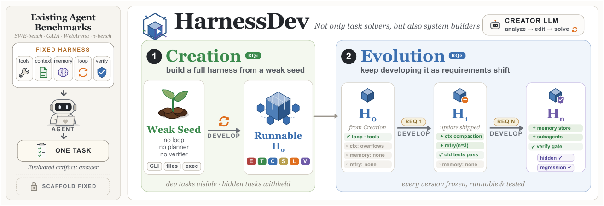
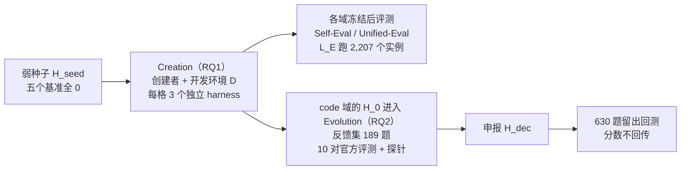
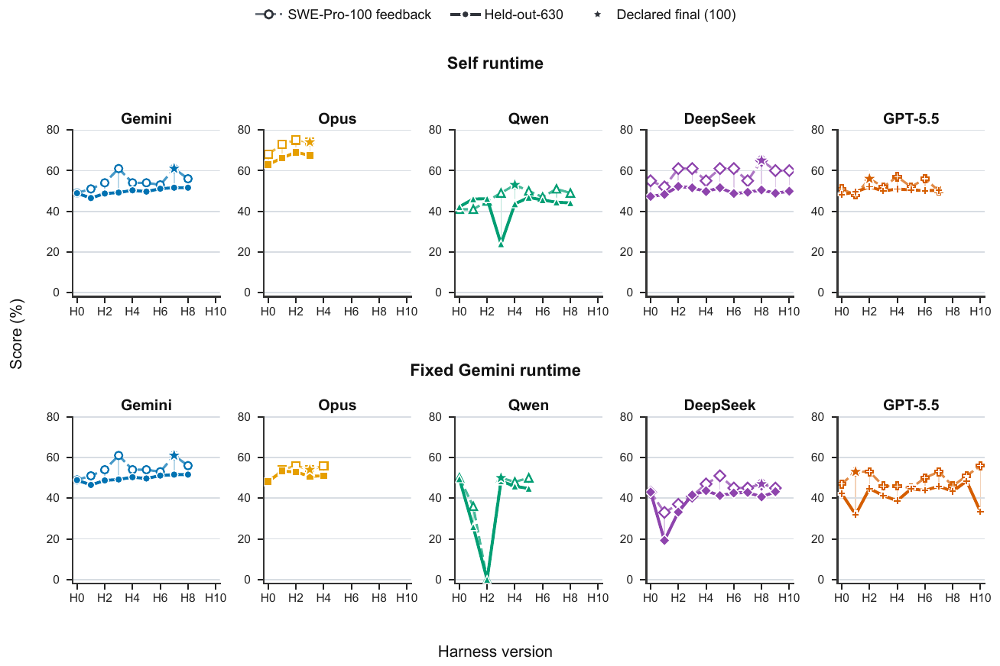

# HarnessDev: Can LLMs Create and Evolve Their Own Agent Harness?

## 来源信息

| 项 | 内容 |
| --- | --- |
| 标题 | HarnessDev: Can LLMs Create and Evolve Their Own Agent Harness? |
| 作者 | 19 位作者；核心贡献者 Yuhao Wu、Jingyuan Zhang、Jiajun Shi；通讯作者 Yuhao Wu / Shen Yan / Wenhao Huang（ByteDance）、Ge Zhang、Wenxuan Zhang |
| 机构 | ByteDance Seed（第一机构）；另有 SUTD、Georgia Tech、M-A-P、TokenWave.AI |
| 来源 | [arXiv:2609.01437v1](https://arxiv.org/abs/2609.01437)（cs.SE，交叉 cs.CL；2026-09-01 提交，41 页；v1 是截至 2026-10-09 的唯一版本） |
| 版本 | v1；许可 CC BY-NC-ND 4.0；项目页 <https://self-developing-agents.github.io/> |
| 阅读日期 | 2026-10-09 |

---

## 核心结论

一句话：**这篇把评测对象从「模型在给定 harness 里答题」换成「模型能否从零造出、并持续改好 harness 这个可运行系统」**：2026-09 的前沿模型能从弱种子造出跑得起来的 harness，但在 code 与 search 上仍大幅落后人类工程版；演化阶段能在可见反馈集上涨分，涨分却不稳定，向留出任务、向「换一个执行模型」的迁移都很有限。

- **问题**：agent 能力越来越依赖权重之外的执行基础设施（工具、上下文、状态、生命周期、验证接口），现有 agent 基准却把这一层当实验配置固定住，只测「模型解题」，不测「模型搭系统」（§1–§2）。
- **做法**：拆成 Creation 与 Evolution 两阶段。Creation 从「跑得起来但不会解题」的弱种子出发造 harness；Evolution 用 189 个任务的下游执行反馈继续改自己的 harness，所有版本冻结后在 630 个不相交的 SWE-Pro 实例上回测，回测分数永不回传（§3）。
- **Creation 结果**：6 个创建模型全部造出可运行 harness（种子在五个基准上全 0）；最强创建者 Opus 4.8 的 Self-Eval 均分 67.8，人类参照 86.2。写作接近参照、机器学习实验超过，搜索差距最大（52.6 对 92.2），code 仍落后（69.3 对 80.0）（Table 3）。
- **Evolution 结果**：五个自运行谱系可见反馈分全部上涨（+3.0～+13.9），留出只涨 +1.43～+4.44；固定 Gemini 执行后四个谱系里只有 Opus 的留出改善，Qwen / DeepSeek / GPT-5.5 分别退步 1.11 / 2.38 / 10.32 分（Table 6）。
- **定位**：这是一篇**基准**论文，不提出新的演化算法；结论是描述性的（每格一条轨迹），价值在评测坐标系与一整组反证——「能造、能改，但改好很难」。

---

## 问题

同一组权重换 harness，成绩差异可以很大：论文开头引用官方榜单，GPT-5 在 Terminus 2 里解出 Terminal-Bench 2.1 的 35.2%，换到 Codex CLI 是 49.6%（§1）。随着 agent 进入更多领域，这类专用执行系统只会更多，而它们需要的是**持续开发**，不是一次性实现。

但现有 agent 基准（SWE-bench、GAIA、WebArena、τ-bench、AgentBench）都把 harness 当实验配置的一部分。这样便于控制变量，却把真实部署里工作量最大的一层——工具、上下文、状态、生命周期、验证接口的构建与维护——从评测里隐掉了（§2、§5）。

论文借 forward-deployed engineer（FDE）的现场工作，把这层拆成三块：

- 把模糊的业务意图翻译成目标、约束与成功判据；
- 自己构造反馈信号（测试、评审、轨迹）来判断有没有变好；
- 把工具、上下文管理、状态、生命周期、验证接口建起来并维护。

基准通常默认前两块已有（任务、评分器、奖励都已定义，反馈信号现成可靠），第三块也已有（执行系统已存在）。HarnessDev 只做第三块；前两块由同项目组的 Aspire 与 S³Gym 分别研究（项目页）。

**为什么「改自己的 harness」不是普通改代码。** 改普通程序时目标行为由外部给定、成功可局部验证；改 harness 是在改自己行动的底座，这个改动会改变模型此后在**所有**任务中观察、规划、恢复的方式（§1）。因此有效的改进要求模型能从执行轨迹里认出自己的行为缺陷、诊断所在系统的结构性瓶颈，并做出能累积为可复用能力的定向修改，而不是一次性修修补补。

**评测一个生成 harness 比评测一个答案难在哪。** 论文列了四种失真方式，并由此定出两个评测轴（§1）：

- harness 可能**过拟合到写它的模型**（执行器依赖）；
- 可能**背下开发用例**；
- 可能一项能力提升的同时另一项悄悄退步；
- 可能靠 benchmark-specific 改动刷反馈集分，却不迁移。

所以每个 harness 都要在留出的下游任务上跑 **Capability**（任务成功率），并单独记 **Efficiency**（冻结后在部署时消耗的执行模型 token）。这两条都不是「造出来能跑」就能回答的。

**本文的设定与前提**：开发环境 $D$ 在两阶段都固定（Claude Code 一类），创建者只对 `harness/` 负责，运行时基底由 runner 注入；所有官方版本冻结、可运行、可检视；反馈集与留出集不相交。这些前提划定了后面所有数字的边界。

---

## 核心想法

### 一句话
评测的对象不是「模型会不会做题」，而是「模型能不能造出、并持续改好一个会做题的系统」。

### 直觉

传统 benchmark 的变量是模型：harness 固定，换模型看分数。HarnessDev 把变量换成 harness：创建者固定在一格，换它造出来的系统看分数。问题因此变成：同一组权重，能不能自己写出工具层、上下文管理、失败恢复、完成判定，并在拿到执行反馈后把这些东西改对。

难处不在「写代码」，而在**质量如何归因**：harness 的分数同时受创建者、开发环境、执行模型、评分器影响。论文的办法是把四者分开记账（原文 Eq 1），再用两种视角各测一次。



*图 1（原文 Figure 1，p.2）：两阶段设计。左：传统基准固定 harness、只评「一个任务的答案」；中：Creation 从弱种子出发造出可运行 harness；右：Evolution 用下游执行反馈反复修订，每个版本都冻结、可运行、经过测试。*

### 为什么弱种子是关键

起点不是空仓库，也不是成熟 agent，而是一个可运行的兼容层：解析任务与模型配置、暴露被动低层工具（paths/files/search/process/artifact io）、写好审计输出、配好 LLM 网关；但没有 agent 循环、任务分解、工具策略、上下文管理、持久状态、验证器、重试/恢复、停止规则，最多发一次连通性探测（§3.2、附录 C.1）。

这个设计同时避开两个极端：

- 空仓库会把「设计 harness」与「搭脚手架」混在一起，分数里混进大量与判断力无关的工程量；
- 成熟 agent 会把要考的规划/验证结构直接送出去，Creation 就退化成调参。

种子在五个下游基准上全部 0 分，因此任何非零的 Creation 分数都只能来自创建者新增的执行逻辑。这是整篇论文最干净的一处实验设计。

### 为什么冻结与留出能成立

演化最容易被「自己给自己打分」污染。论文用三道闸把这条路径隔开：

1. **评分路径与 harness 隔离**：harness 自报的状态永不进入打分。SWE-Pro 只看任务工作目录里真实的 repository diff，Terminal-Bench 只看最终环境状态，所以没有 harness 能靠「声称成功」拿分（§3.4）。
2. **反馈与留出不相交**：演化用 100 个 SWE-Pro + 89 个 Terminal-Bench 任务；事后在 630 个不相交的 SWE-Pro 实例上补测，分数从不回传给创建者，也不影响编辑、停止或申报（§3.2）。
3. **每个版本冻结**：官方候选必须成对提交（同一 commit 的完整 100 题 SWE-Pro + 完整 89 题 Terminal-Bench），两腿都结算才进入官方轨迹；探针只作诊断、永不算官方分。

于是「演化有没有用」被拆成两个可以分别回答的问题：在给它的反馈上有没有涨（几乎总是涨），以及在没给它的任务上有没有涨（常常不涨）。

### 与已有做法的区别

| 维度 | 传统 agent 基准 | HarnessDev |
| --- | --- | --- |
| 固定什么 | harness 固定，换模型 | 模型固定，换 harness |
| 被测产物 | 一次任务的答案 | 冻结、可运行、可检视的系统 |
| 反馈来源 | 基准自带的评分器 | 创建者自己跑下游执行，拿执行结果 |
| 主要失真 | 训练/测试污染 | 执行器绑定、背样例、刷反馈集 |

### 一个走通的例子

Opus 4.8 造的一个 code harness 在 Self-Eval 下表现不错，换 Gemini 执行后几乎崩塌——原因是它把 **120 步上限**硬编码在了原执行器上（§4.2；附录 G 第 03 步记录了这类写法：`max_steps=120`、6,600 秒时间预算、150,000 token 软上下文上限）。同一现象在搜索域更直白：Opus 搜索 harness 的**重复查询率**从 10.1% 涨到 88.2%，说明去重、复核与终止规则都是针对原模型调的。

这个例子说明基准测到了真东西：不是「代码有 bug」，而是**系统与执行器的耦合**。它也预告了演化阶段的核心失败模式——在可见反馈上有效的修改，可能只是把耦合收得更紧。

### 代价

- **结论是描述性的**：每个「创建者×运行时」格只有一条演化轨迹（另有 1 个主运行格未完成），没有方法间对照，也不支持不确定度估计（§6.1）。
- **创建成本没有进口径**：只统计执行模型 token；创建者与 judge、探针的 token 都不计，搭 harness 的 LLM 开销完全不在报告里。
- **人类参照不是配对对照**：参照取自各基准官方榜单里可核验的最高系统级成绩，是不同 harness–模型组合，只能当距离刻度（图 4 图注）。
- **一次成功不等于可复用**：状态与记忆组件大量写成死代码（见「主要结果」），「代码里有」离「运行时活着」很远。

---

## 方法

### 符号表

| 符号 | 含义 | 维度 / 取值 |
| --- | --- | --- |
| $L_C$ | 创建者模型（creator LLM） | 6 个模型之一 |
| $D$ | 开发环境：创建者写 harness 用的 coding agent 环境 | 固定；Claude Code 2.1.177，GPT-5.5 用 Codex 0.144.3 |
| $H$ | 一个 harness：可运行、可冻结的执行系统 | 每个「创建者×基准」独立创建 3 个 |
| $H_{\mathrm{seed}}$ | 弱种子 harness | 五个下游基准全 0 分 |
| $H_0$ | 创建者自己 RQ1 产出的 harness，作为 Evolution 起点 | 每个谱系一个 |
| $H_{\mathrm{dec}}$ | 创建者申报的最终版本 | 必须非 $H_0$ 且有完整官方对 |
| $L_E$ | 执行模型（executor） | Self-Eval 时 $L_E=L_C$；Unified-Eval 固定 Gemini 3.1 Pro |
| $x$ | 一个下游任务实例 | 五个基准共 2,207 个实例 |
| $y$ | 执行产物 / 结果 | 域的最终产物（repo diff、提交、prose、带证据的答案） |
| $J$ | 评分器 | 只看真实产物，不看 harness 自报状态 |
| $t$ | 官方版本下标 | 只计完成完整 pair 的冻结版本 |
| $P_t^{\text{SWE100}}$ | 版本 $t$ 在 SWE-Pro 100 题反馈腿上的百分制得分 | 0–100 |
| $P_t^{\text{Term89}}$ | 版本 $t$ 在 Terminal-Bench 89 题上的百分制得分 | 0–100 |
| $\bar P_t$ | 版本 $t$ 的 pair 分 | 两腿等权平均 |

### 两个阶段与覆盖范围

| 设置 | 起点 | 开发信号 | 产出 |
| --- | --- | --- | --- |
| Creation（RQ1） | $H_{\mathrm{seed}}$ | 规格文档 + 1–3 个开发用例 | $H$（冻结后评测） |
| Evolution（RQ2） | 创建者自己的 RQ1 $H_0$ | 指定反馈集上的下游执行结果 | 一对冻结候选 + 申报的 $H_{\mathrm{dec}}$ |

下游覆盖 2,207 个实例：SWE-bench Pro public split 731 题（任务成功率）、Terminal-Bench 2.1 89 题（任务成功率）、MLE-bench 75 题（medal 率）、EQ-Bench3 46 题（rubric 分）、BrowseComp 1,266 题（准确率）。Evolution 目前只做 code harness；它的反馈任务取自同一批基座，不重复计数。

RQ1 对每个「创建者×基准」独立创建并评测 3 个 harness，报 avg@3；开发环境固定，GPT-5.5 用 Codex，其余用 Claude Code。

### 原文 Eq (1)：三角色分离（p.4）

```math
(L_C, D) \to H, \qquad (H, L_E, x) \to y \xrightarrow{J} \text{score}
```

逐项读法：

- $L_C$ 与 $D$ 一起决定 $H$：创建者模型在开发环境里产出 harness。这两项必须分开记账，否则 Creation 的分数会把 $D$ 的辅助能力算进 harness 质量。
- $H$ 是冻结后的系统；$L_E$ 是在它里面跑任务的执行模型，$x$ 是一个下游实例。同一 $H$ 换 $L_E$ 复跑，差异就只剩「harness 与模型的兼容性」。
- $J$ 是评分器，只看 $y$（真实产物），不看 harness 的自报状态。式子的箭头顺序就是「先造系统、再跑任务、最后打分」，三段互不共享内部状态。

论文由此定义两种视角：**Self-Eval** 取 $L_E=L_C$，对应真实部署形态，测的是「模型—harness 协同设计」；**Unified-Eval** 固定 $L_E$ 为 Gemini 3.1 Pro，剥离执行模型差异，测 harness 是否是可迁移的软件资产。人类工程系统只作外部参照，不是统一执行器下的配对对照。

### 原文 Eq (2)：反馈对的等权组合（p.11）

```math
\bar{P}_t = \tfrac{1}{2}\left(P_t^{\text{SWE100}} + P_t^{\text{Term89}}\right)
```

逐项读法：

- $P_t^{\text{SWE100}}$ 是版本 $t$ 在 SWE-Pro 反馈腿（100 题）上的百分制得分，$P_t^{\text{Term89}}$ 是同一版本在 Terminal-Bench 全部 89 题上的得分；两项等权，得到论文叙述用的 pair 分 $\bar P_t$。
- 选这两个基准做演化反馈的原因在协议里：SWE-Pro 能切出互不相交的反馈/留出子集（100 / 630），Terminal-Bench 全部 89 题都当反馈，因此**没有**留出腿。
- 读表时注意：`feedback pair` 一列是这两项的平均，而 `held-out` 一列只是 SWE-Pro-630 一项，两者构成不同，不能按同一分母比较。

### Evolution 协议：预算、探针与申报

- 反馈集 = 100 个 SWE-Pro 任务 + 全部 89 个 Terminal-Bench 任务。
- 官方候选必须**成对**提交：同一 commit 的完整 100 题 + 完整 89 题评测，两腿都结算才进入官方轨迹；同 commit 的基建修复可合并，探针、半截腿、停止的运行、无效实例都排除。
- 预算：$H_0$ 之后 **10 对完整评测**；两对之间最多用两次**固定子集探针**（两个基准各取相同的前 5 个任务），探针只作诊断、永远不算官方分。
- 结束方式是创建者**申报一个非 $H_0$、且拥有完整官方对的 commit**。
- 留出：所有官方版本事后在 630 个 SWE-Pro 实例（与反馈集不相交）上补测，分数从不回传，也不影响编辑、停止或申报。

### 约束合规与审计（§3.4）

创建者可见的规格明确禁止：硬编码实例特定解、从任务标识/文件名白名单/已知答案推导 patch、查阅隐藏测试/答案/补丁/评分器内部与官方评测反馈、以及绕开统一 provider 接口自己接 LLM。两条设计让约束**可查**而不是口头约束：评分路径与 harness 隔离（原文 Eq 1 的 $J$ 只看真实产物）；每次运行保留轨迹、结果、指标产物与冻结源码，支持事后审计「交付的代码」与「代码实际执行了什么」。作者报告对本篇全部运行做过审计，结果是**零违规**（null result），也没有运行因这些原因被剔除。

### 一轮数据流



*本笔记按 §3 整理，非原文图。*

### 与已有方法的结构差异

- **对固定 harness 的 agent 基准**：被测对象从「答案」换成「系统」。固定 harness 时分数差异归给模型；这里固定创建者，分数差异归给它造出的系统。
- **对 harness 演化方法**（RRSI 一类）：本文不提出新的演化算法，演化阶段直接用现成的 coding agent 在开发环境里看反馈改代码；它提供的是**测量**——冻结、成对结算、留出回测。
- **对软件工程基准**：目标不是给某个仓库打 patch，而是让系统自己在多个域上跑起来；评分器读的是域的真实产物，而不是代码是否通过单测。

---

## 主要结果

**设置**：6 个创建模型，RQ1 每格独立创建 3 个 harness、报 avg@3；人类参照取各基准官方榜单 / 系统报告里可核验的最高系统级成绩（三个带星号的值取自 OpenAI GPT-5.6 发布报告，未本地复跑）。

| 创建者（Self-Eval） | SWE-Pro | Term.-2.1 | MLE-bench | EQ-Bench3 | BrowseComp | Avg. |
| --- | --- | --- | --- | --- | --- | --- |
| 种子 $H_{\mathrm{seed}}$ | 0.0 | 0.0 | 0.0 | 0.0 | 0.0 | 0.0 |
| Opus 4.8 | **69.3** | 64.8 | **32.9** | **84.6** | 52.4 | **67.8** |
| GPT-5.5 | 32.8 | 52.1 | 19.1 | 83.0 | **52.6** | 55.1 |
| Gemini 3.1 Pro | 43.6 | **68.8** | 32.4 | 74.8 | 35.2 | 55.6 |
| DeepSeek V4 Pro | 28.9 | 35.6 | 19.6 | 75.4 | 40.9 | 45.2 |
| Qwen 3.7 Max | 33.5 | 41.3 | 3.1 | 68.7 | 32.3 | 44.0 |
| Seed 2.0 Pro | 10.8 | 6.0 | 5.3 | 71.1 | 3.2 | 22.8 |
| 人类工程版 + 配对模型 | 80.0\* | 88.8\* | 24.0 | 83.7 | 92.2\* | 86.2 |

*Table 3（p.8）。Avg. 是 SWE-Pro / Terminal-Bench / EQ-Bench3 / BrowseComp 的无权重均值，不含 MLE-bench；MLE-bench 是 medal 率、EQ-Bench3 是 rubric 分、BrowseComp 是准确率。*

- **能造，但差距按域严重分化**。六个创建者都从全 0 的种子做出了可运行系统；最好的一格在写作上接近参照（84.6 对 83.7）、在机器学习实验上超过（32.9 / 32.4 对 24.0），但搜索差 39.6 分（52.6 对 92.2），code 差 10.7 分（69.3 对 80.0）。整体距离是 67.8 对 86.2。
- **同一模型的独立创建之间差异很大，换执行者还会重排**。Opus 的 SWE-Pro 从 Self-Eval 的 69.3 掉到 Unified-Eval 的 33.0（该格含一个崩塌复本，剔除后均值 49.1）、写作从 84.6 掉到 74.2；反过来 Qwen 在 Gemini 下 BrowseComp +17.6、MLE-bench +12.9。这说明不少 harness 的规则是绑在写它的模型上的。
- **成本与分数脱钩**。MLE-bench 上 token 用量差约 19 倍，而高成本不保证高分：GPT-5.5 以 29.3M token 拿到 19.1 medal 率，DeepSeek V4 以 208.4M token 拿到 19.6（Figure 9 图注）。
- **演化能在可见集上涨，但迁移有限**。五个自运行谱系的反馈 pair 全部上涨（+3.0～+13.9），留出只涨 +1.43～+4.44；固定 Gemini 后，Opus 是四个谱系里唯一留出改善的（+2.70），Qwen −1.11、DeepSeek −2.38、GPT-5.5 −10.32。
- **选版本这件事本身失效**。64 次相邻官方切换里反馈与留出同向只有 34 次（53.1%）；9 个申报版本里只有 2 个是留出最优；同一 commit 的 pair 分波动约 ±4.75 分，27 次涨分落在重复运行噪声带内。
- **改的多是控制流，不是状态与验证**。64 次切换中 58 次改执行/控制流、37 次改工具、17 次改生命周期恢复、16 次改上下文，只有 4 次改 state，没有任何一次改独立 verifier。18 个 code harness 里 11 个定义了 State 类，但只有 1 个暴露了状态保存接口、1 个实现了周期 checkpoint——26,679 条轨迹里一次 checkpoint 事件都没有出现。



*图 8（原文 Figure 8，p.14）：九个谱系的 SWE-Pro-100 反馈轨迹（虚线）与冻结后 630 题留出轨迹（实线），星号是申报版本；上排自运行、下排固定 Gemini。Qwen 自运行面板的留出曲线在 H3 出现深 V 回落，是「演化不单调」的直观例子。*

---

## 边界与局限

**作者明确讨论的**（§6.1）：

- 四个域覆盖不了全部真实部署；人类基线不齐、不保证最优；Unified-Eval 减少但不能完全消除执行器差异（harness–模型交互很复杂）。
- 行为比较是描述性的，Evolution 每个「创建者×运行时」格只有**一条**轨迹（另有 1 个主运行格未完成），冻结后的留出只覆盖 SWE-Pro——**不支持不确定度估计或总体层面的比较**。
- 开发环境 $D$ 在两阶段都固定；「演化后的 harness 自己当开发环境继续演化」留给未来工作；明确不主张启发式学习可以替代参数训练。

**读者判断**：

- 人类参照是外部成绩（各自 harness+模型的配对），不是统一执行器对照，只能当刻度；其中 3 个带星号的分数未本地复跑。
- avg@3 没有给出置信区间或方差，创建者之间 5 分以内的差距不宜过度解读；「创建 harness 的成本」（创建者 token、开发环境开销）完全没有进成本口径；结论也绑定 2026-09 的模型版本，换代后值得重跑。
- 附录 C 说参考种子实现、审计脚本与留出 split「将随基准发布」，截至 2026-10-09 项目页只有三篇论文链接、未见代码仓库。

---

## 与其他工作的关系

- **RRSI（00212）**：同属「不改权重、只改 harness」的路线。RRSI 用正则把涨分约束到可迁移的机制上；HarnessDev 直接测出「不加约束时留出迁移本来就很弱」，两边结论方向一致。
- **Self-Harness（00198）与 HarnessX（00199）**：都被本文引用；本文的 Creation/Evolution 协议可以直接当这类「改 harness」方法的评测环境。
- **Prime Agent（00205）**：本文引用的 Continual Harness 与 Prime Agent 作者有重叠，是「上下文/工作台持续化」这条支线在本文语境里的对应物。
- **Evo-Bench ≠ Evo-Harness**：本文 Related Work 的 Evo-Bench（2608.09096）与仓库 00202 的 Evo-Harness（2608.15071）是两篇不同工作，引用时别混。
- **RSI 导读（00192）**：导读的限定是「更新产物要被后续任务复用才算 RSI」；本文的机制层证据（state/memory 写在代码里但运行时零触发）给出了这条限定在真实系统里的实测形态。

<!-- 复核档案见同目录 audit.md（不随站点发布） -->
