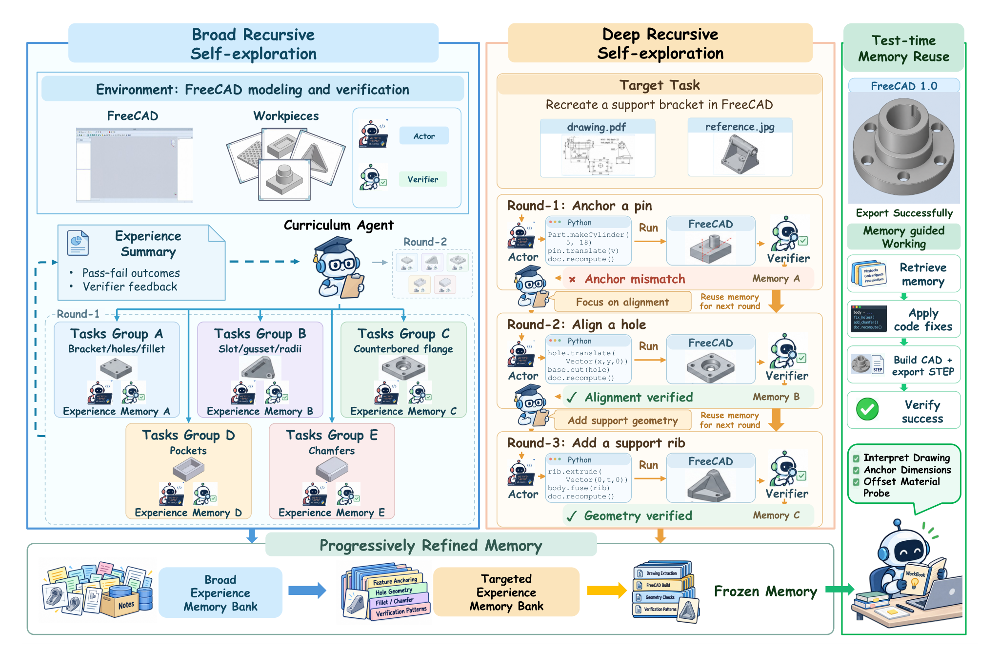
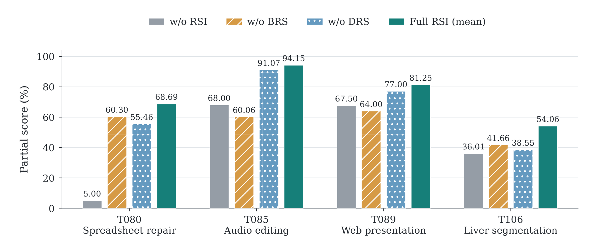

# RSIAgent: 在新环境里用自主探索把经验写成可复用记忆

## 来源信息

| 项 | 内容 |
| --- | --- |
| 标题 | RSIAgent: Autonomous Exploration for Recursive Self-improvement in New Environments |
| 作者 | Sibo Zhu¹²†‡、Shicheng Fan¹³†‡、Xinyue Wang¹²†‡、Wenyi Wu¹²‡、Kun Zhou¹\*、Biwei Huang¹（6 人；† 标注 **Equal contribution**，即共同一作；\* 为 **Corresponding author and project leader**，通讯作者兼项目负责人；‡ 为 "Work done during internship in Aether AI"） |
| 机构 | ¹ Aether AI；² University of California San Diego；³ University of Illinois Chicago。**第一机构为 Aether AI**；6 位作者都署名 ¹，其中 Zhu / Fan / Wang / Wu 四位兼署高校，Kun Zhou 只署 Aether AI。PDF 首页把 Biwei Huang 也只标为 ¹（这是原文署名，本笔记不替作者改单位） |
| 来源 | [arXiv:2609.15364v2](https://arxiv.org/abs/2609.15364v2)（cs.AI; cs.CL; cs.CV）；v1 提交于 2026-09-14，v2 于 2026-09-18；本笔记基于 **v2（截至阅读时的最新版）**，50 页 |
| 许可 | [arXiv.org perpetual non-exclusive license 1.0](http://arxiv.org/licenses/nonexclusive-distrib/1.0/)（abs 页 "view license" 指向该协议；**不是 CC**） |
| 代码 | <https://github.com/AetherLabsAI/RSIAgent>（**Apache-2.0**；2026-11-17 用 GitHub API 核验：创建 2026-09-13、最后 push 2026-10-02、★609；顶层含 `core/`、`env/`、`explore/`、`llm/`、`benchmarks/`、`scripts/`、`tests/`、`tools/` 与 `run_osworld.py`、`run_ale.py`。只读核验仓库结构与许可，**未运行、未复现**） |
| 项目页 | <https://aetherlabsai.github.io/RSIAgent/>（含方法概览、论文/代码链接与结果图；页面标注 "Causality-driven RSI Agent v1"，论文链接文字为 "Paper · arXiv"） |
| 阅读日期 | 2026-11-16 |
| 阅读范围 | v2 全文 50 页（PDF 页码＝印刷页码）。同版本 HTML 全文 438,487 B（与 `Content-Length` 一致，未截断）。正文 §1–7 与附录 A–E（p21–50）通读。**已渲染页逐格核对**：Table 1（p7）、Table 2（p10）、Table A1（p21）、Table A3（p28）、Table A4（p29）、Table A5（p32）、Table A6（p44）、Table A7（p45）、Table A8（p50）；式 (1)（p3）与 Algorithm A1（p23）回渲染页核对。**看图核对**：Figure 1（p1）、Figure 2（p4）、Figure 3（p8）、Figure 4（p9）、Figure 5（p11）；Figure 3 的读数按网格线读取，并用 PDF 矢量 marker 坐标交叉核对（**未做像素颜色测量**）。另抽查 v1（49 页）与 v2 的关键数字和节号差异。附录 B 的提示词模板（P1–P7）按 HTML 全文读，未逐字比对 PDF；Figure A1–A18 多数只按图注/正文核对，未逐张回看；A13/A14/A18 在核对 Table A6/A7/A8 时同页看过。 |
| 配图 | `assets/` 下 3 张：Figure 2（框架示意，p4）、Figure 3（RSI 步数曲线，p8）、Figure 4（消融柱状图，p9）。均为 300 dpi PDF 渲染页裁剪；裁剪框与核对见文末「核对凭据」。许可按上方 arXiv 协议，引用请注明出处 |
| 归档说明 | arXiv 来源，按仓库策略**不归档 PDF**；核对用的官方 PDF 为 50 页、15,269,199 B、sha256 `00cec41255a0dac1100dcf997d3b73b1c06364420bab777a62d01b0aa1545092`（alphaXiv 镜像同一文件，**sha256 完全一致**） |

**版本关系**：v1（49 页，2026-09-14）没有 §3.1 Unified State and Structured Workflow；v2（50 页，2026-09-18）新增该节，原 §3.1/§3.2 顺延为 §3.2/§3.3。抽查两版的 Table 1 与关键数字（78.98、84.82、0.9417、121,104 等）一致；本笔记的节号与页码按 v2。

**核对凭据（可复现）**

- 官方 PDF：50 页，15,269,199 B，sha256 `00cec41255a0dac1100dcf997d3b73b1c06364420bab777a62d01b0aa1545092`（`https://arxiv.org/pdf/2609.15364v2`，2026-11-16 获取）。镜像 `https://pdfs.assets.alphaxiv.org/2609.15364v2.pdf` 字节一致，仅用作加速下载，不作为独立版本。
- HTML：`https://arxiv.org/html/2609.15364v2`，438,487 B（与响应头 `Content-Length` 一致）；公式保留 `<math alttext>`，表格另行按 `<tr>/<td>` 结构化抽取。
- 页码：Figure 1 p1；Figure 2 p4；Table 1 p7；Figure 3 p8；Figure 4 p9；Table 2 p10；Figure 5 p11；Table A1 p21；Algorithm A1 p23；Table A2 p27；Table A3 p28；Table A4 p29；Table A5 p32；Table A6 p44；Table A7 p45；Table A8 p50。
- 配图裁剪框（pt，页面坐标，300 dpi）：Figure 2 p4 `(60, 60, 552, 379)`；Figure 3 p8 `(262, 332, 552, 455)`；Figure 4 p9 `(60, 145, 552, 350)`。成品尺寸分别为 2050×1330、1209×513、2050×855。三张均回看确认：四边像素全为 255（无黑边/越界）、图内标题/图例/坐标轴/刻度/面板标签都在框内；同区域第二次独立渲染的像素差 `max=0`。Figure 3 的左边界取 262 pt 是为了避开正文栏（正文最右 258.2 pt），同时保留纵轴标题（268.4 pt 起）。
- Figure 3 读数另用 PDF 矢量 marker bbox 中心交叉核对：T065 step 0（0 分）中心 y=427.87 pt、T044 step 2（100 分）中心 y=362.65 pt，线性内插得 T044 40/60/100、T049 40/80、T065 0/100；未做像素颜色测量。
- 本笔记复算（口径写在这里）：OSWorld Partial 71.97→78.98 = **+7.01 pp**；Binary 37.80→42.68 = **+4.88 pp**；ALE Partial 83.75→84.82 = **+1.07 pp**；Binary 49.25→50.75 = **+1.50 pp**。若按"只有 41 个 OSWorld、19 个 ALE 结果被替换、其余沿用 baseline"计算，被替换结果的平均 Partial 提升约为 **14.0 pp**（OSWorld）与 **3.8 pp**（ALE）。Figure 4 四个任务的均值：Full RSI 74.54、w/o DRS 65.52、w/o BRS 56.50、w/o RSI 44.13（最后一项原文未给，为本笔记按图中四个值复算；w/o BRS 的 56.50 为原文报告值，四值精确均值为 56.505）。
- 否定性检索（v2 全文）：`token` 仅 1 次（指 65,536 的单次响应上限，**没有 token 用量或费用**）；`dollar` 0 次；`variance` / `standard deviation` / `confidence` 均 0 次；`latency` / `throughput` 均 0 次；`cost` 2 次正文命中（§1 "substantial cost"、§7 "substantial computation cost"；另有参考文献作者名 "Costas Spanos" 的 substring，不计入）。`seed` 2 次，均出现在附录案例（"recorded seeds and repair branches"），主结果没有重复次数说明。`$` 的 3 次命中（174.26 / 49.84 / 177.26 美元）都是 T065 任务内的金额/票价，不是实验成本。

**复核记录（2026-11-17）**：基准 v2（官方 PDF 50 页、sha256 `00cec412…`，重取校验一致；HTML 438,487 B 与 `Content-Length` 一致）。方式：Table 1/2/A1/A3–A8 渲染页逐格，式 (1) 与 Algorithm A1 渲染页，Figure 1–5 看图，Figure 3 用矢量 marker 坐标交叉核对；另下载 v1（49 页）比对版本关系。修正：项目页引文、§E 引文页码 p30→p31、`cost`/`$` 检索口径、BRS 的 target-query 条件、ALE 最高 Partial 配置、GPT-6 OSWorld 来源、T085 零官方调用、T103 verifier-pass、T044 50px 黑边、stall 角色互换、41 个 non-diagnostic 结果、Table 2 加粗范围、Figure 4 均值行标签、Figure 3 的 0 分点坐标 427.85→427.87、target practice 的范围限定与若干推断标注。未修/未核：代码未运行；Figure A1–A18 未逐张回看；v1 只抽查关键数字，未逐页 diff。

---

## 核心结论

一句话：**RSIAgent 把"在新软件环境里做自我改进"落到一个很窄的对象上——模型参数与 harness 结构都不动，只让 actor 在探索中把可复用的操作步骤、约束和失败教训写成一堆 Markdown/文件形式的 memory，冻结后再拿去做任务。** 三个角色（curriculum 出题、actor 执行并写记忆、verifier 独立判分）加上"先广后深"的两阶段探索，是这篇文章的主要机制；此外 §3.1 还借用了 StructAgent 的 unified state / structured workflow，§A.3 另有 checkpoint 保护、冻结 hash 等生命周期机制。

可引用的四条：

1. **问题**：数字 agent 到一个新环境（界面、工具、约定、失败模式都不在预训练知识里）时，靠再训练或人工采集数据成本高；靠上下文里的记忆更灵活，但"记什么、怎么验证、怎么复用"没有系统答案。
2. **方法**：BRS（Broad Recursive Self-exploration）并行铺开多个探索项目，快速覆盖与目标相关的能力邻域；DRS（Deep Recursive Self-exploration）围绕目标做串行练习，专攻难例、隐藏约束和边界条件；最后冻结 memory，测试时只读不写。停止由 curriculum agent 判断"再练没有更高期望收益"，不是固定轮数。
3. **结果**：在 OSWorld 2.0（0808 offline，82 题）与 Agents' Last Exam（Near-term，67 题）上，同一套 harness 的 Partial 从 71.97 升到 78.98、从 83.75 升到 84.82；Binary 从 37.80 升到 42.68、从 49.25 升到 50.75。Partial 上超过 GPT-6 Astra 6.38 / 2.56 个百分点。
4. **边界**（本笔记的判断，详见后文）：主表只有 41 个 OSWorld、19 个 ALE 结果真的用了 RSI 分数，其余沿用 baseline；按参考流程（Algorithm A1）与附录 E 的三个案例，DRS 会在**被评测的目标 q** 上练习（主表部分结果来自历史/变体 run，不能一概而论）；对比又明确不是 matched protocol。因此"开源模型超过 GPT-6"应理解为"在一个允许按任务探索、可多次尝试、且用两个开源模型分工的设定下，Partial 分数更高"，不是一次性 benchmark 上的同条件超越。

**适合谁看**：需要把固定模型适配到某个具体软件/工作流、且能接受按任务做长时间探索的团队（案例 T049 的两次评估分别是 5,105.5 秒与 2,697.0 秒，约 1.4 h / 0.75 h；其他任务未给墙钟）；想理解 memory-based self-improvement 与 harness evolution 区别的人。不适合追求低时延、一次性评测或严格因果结论的读者。



*图 1（原文 Figure 2，p4）：RSIAgent 的三段式流程。左：BRS 并行铺开多组任务；中：DRS 围绕目标逐轮加深；右：冻结 memory 后做测试时复用。图中的 FreeCAD 例子只用于示意流程，块的大小/箭头不代表实际耗时。裁剪自 v2 PDF，许可见来源信息。*

---

## 问题与动机

数字 agent 的默认假设是"预训练知识够用"：看到界面就能点、看到报错就能改。现实里换一个软件（尤其是专业软件：Shotcut、REAPER、WPS、FreeCAD、3D Slicer），界面约定、文件格式、渲染管线、评分口径都可能是模型没见过的。作者的三个观察构成了动机：

- **再训练/采数据太重**：需要额外交互数据，常要人工参与，在私有或持续变化的环境里不现实（§1）。
- **只把成功轨迹塞进上下文不够**：需要的是"动作—条件—结果"之间的稳定关系，并且要组织成可复用的结构，而不是一堆 episode（§1）。
- **人类学新软件的过程本身就是递归的**：先判断要学什么，再动手收集经验，最后从结果里提炼知识；这被作者类比为"因果发现"（§1）。

于是问题被写成：**给定新环境，能否让 agent 自主探索出一个持久 memory，使同一个固定参数模型在后续任务上变好？** 注意这里的"自我改进"不是改权重，也不是改 harness 代码，而是改 memory 的内容。§2 明确的是"不更新模型参数"；harness 结构固定见 §3.2 与 §C.2（"same code-as-policy actor–verifier harness"）。

---

## 方法与贡献

### 形式化：参数固定，记忆持久

给定任务指令 q，agent 在环境 E 中执行动作序列，直到满足要求。第 t 步的动作由策略在"任务、交互历史、持久记忆"条件下采样：

```math
a_t \sim \pi_\theta(\cdot \mid q, h_t, M), \qquad
(s_t, o_t) \sim \mathcal{E}(\cdot \mid s_{t-1}, a_t)
```

读法：动作只依赖任务 q、当前历史 $h_{t}$ 和持久记忆 $M$；环境根据上一状态与动作返回新状态 $s_{t}$ 和新观测 $o_{t}$。$h_{t}$ 在换任务时重置，$M$ 跨任务保留。

实现上采用 **code-as-policy**：每个动作是一段可执行的 Python 或 Bash 程序，程序可以驱动 GUI 应用、读写文件、调用命令行。这样动作空间对异构软件是统一的，也让"记忆里的过程"可以直接以代码/命令的形式被复用。

### 三个角色与信息边界

| 角色 | 能看到什么 | 能产出什么 / 权力边界 |
| --- | --- | --- |
| actor agent | 任务指令、任务可见环境、执行反馈、当前持久 memory | 可执行动作与候选产物；验证后写 memory 更新，并给出一份 learning diagnosis |
| verifier agent | 任务要求与候选环境；**看不到** actor 的私有 memory、推理与执行日志 | 基于证据的 PASS/FAIL（目标接口还支持 UNVERIFIED）与 findings；**不写 memory** |
| curriculum agent | 目标 query、已完成的探索结果、actor 的 learning diagnosis（若有）、当前 memory 的一份**一次性副本** | 练习指令、输入 fixture、继续/停止决定；**不判分、不改 canonical memory** |

这张表是原文 Table A1（p21）。三个设计点值得单独拎出来：

- **verifier 与 actor 隔离**，目的是降低"自己判自己"的相关性错误；verifier 检查的是候选产物与环境证据，不是 actor 的自述。
- **curriculum 只有 memory 的副本**，它的本地修改不会同步回 canonical memory；它也没有判分权。这两条把"出题"和"判分/记忆"解耦。
- **memory 的写入权只在 actor**：只有完成一次 grounded PASS/FAIL 之后，actor 在自己的上下文里做 distillation（提炼过程、约束、失败教训）与 reconciliation（检查与旧条目是否矛盾、给没证据的结论加限定），完成的更新才被提升为 canonical memory。工作阶段的临时修改会被丢弃。

### Stage-1：BRS（广度）

BRS 的目标是快速建立对环境的广度理解，但它不是无条件的环境扫描：BRS 也以目标 query 为搜索方向（§4.1、Prompt P3、§C.2）。curriculum 只把它当作"搜索方向"，Phase 1 不直接尝试未改动的目标（首次精确尝试留给 Phase 2）。所以 memory 是 target-conditioned 的"能力邻域"探索，而不是与环境无关的通用探索。每一轮：

1. curriculum 一次提出**多个**探索项目，覆盖不同方向（前置技能、变体、对照、压力测试）；
2. 这些项目在**隔离环境**里并行执行（每个项目有独立 fixture，重放在统一路径下），actor 执行、verifier 判分；
3. 等一轮里所有项目的 verdict 都落地后，actor 上下文按 curriculum 指定的顺序**逐个**回来做 distillation + reconciliation；
4. curriculum 看到"验证结果 + 实际保留了哪些知识"后再选下一轮。

并行只发生在"采集经验"阶段，**记忆更新严格串行**：每个项目开始时都拿到同一份不可变的 wave 前快照，彼此看不到对方的工作；提交时每个更新都基于最新 canonical memory（含同一 wave 里前面刚提交的更新）。这条设计是为了避免并行写冲突，也让 curriculum 的下一轮决策建立在"真实留下的知识"上，而不是"以为留下的知识"。

名义预算是 8 个项目、最多 4 个并发，但**预算只在一轮结束后检查**，进行中的 wave 不会被截断，所以实际项目数可以超过 8：案例里 T044 做了 10 个、T065 做了 11 个（Table A5，p32）。

### Stage-2：DRS（深度）

DRS 的目标是"把目标真正做对"。它从 BRS 留下的 memory 开始，先在 reset 环境里**直接尝试目标 q**，拿到 grounded verdict 后由 actor 更新 memory；然后 curriculum 看"结果 + learning diagnosis + 更新后的 memory"，决定是否再安排一个练习：

- 目标失败 → 优先安排能区分不同失败假设的练习；
- 目标成功 → 默认不练；只有当某个对照/压力案例能检验一个"重要但不确定或过度泛化"的假设时，才安排练习（Prompt P4）；
- 每个练习都是"执行 → 验证 → actor 写记忆 → curriculum 再看"的串行循环；练习结束后重新尝试目标（reset 环境、用更新后的 memory）。

这里有个容易被忽略的事实：**DRS 的"目标尝试"就是最终被评测的那个任务 q**。附录 E 开头写得很直白："In these runs, DRS includes practice on the target itself."（p31）最终评估只是把同一个 q 在 reset 环境里再做一遍。这一点对解读主表至关重要，后文"表述张力"会展开。

### 测试时复用与停止

探索结束后，memory 被冻结：记录文件树的 hash，复制进评估环境，关闭 curriculum 决策与 host 写回。然后 actor–verifier harness 在 reset 环境里执行目标，官方 evaluator 在所有 agent 上下文之外打分；runner 还会检查冻结的 host memory 没有被改动（§A.3、Algorithm A1）。

停止策略有两种：

- 默认 `curriculum_review`：目标 PASS 且 curriculum 不再安排练习 → DRS 结束；若又安排了练习，就必须再做一次目标尝试。若 curriculum 返回 `STALLED`（失败或练习后仍无 productive 项目），runner 允许**最后一次**目标尝试并记录真实 verdict。
- `verifier_pass`：目标一旦 grounded PASS 并完成记忆合并就结束（早期的部分 run 用这个变体）。

未解决的验证或基础设施错误会**阻断推进**，不会被当成"收敛"（§A.3）。这个细节在处理"失败也算结果"的系统里很重要。

### 贡献的边界

作者列出三条贡献：多 agent 的 RSI 框架、BRS/DRS 两阶段策略、以及"开源模型超过闭源"的实验结果。前两条是机制设计，第三条是本文最主要的实证主张；但如后文所述，第三条的证据强度受任务选择、替换口径与对比协议限制。**本文没有提出新的训练目标、没有改模型参数、也没有让 harness 结构进化**——它进化的对象是 memory。

---

## 工程实现与成本

### 执行接口

- actor 的每次响应是一段完整程序（Python/Bash），runtime 返回合并的 stdout+stderr、退出码与执行元数据；actor 还可以用 `look` 取视觉证据、用 `ask` 向用户通道问缺失信息、用 `done` 提交只读检查。它不能直接点屏幕，"写程序"是唯一的控制通道（§A.1、Prompt P1）。
- verifier 的检查在**受 checkpoint 保护的候选环境副本**上做（reset-and-replay 或 QEMU checkpoint 恢复），检查完再恢复，避免 verifier 的探针改动被评分的产物（§A.1、Prompt P2）。
- 任务/练习的 fixture 由 curriculum 准备，actor 只拿到指令与 fixture，不拿 curriculum 的私有搜索理由。

### 记忆的形态

memory 是 **actor 自己写的文件集合**，没有 schema、文件数或长度要求（§A.2）。案例里的规模：

| 任务 | BRS 项目数 | BRS 后 memory | 冻结时 memory | DRS 练习量 |
| --- | --- | --- | --- | --- |
| T044（视频编辑） | 10 | 109,647 B | 316,541 B | 5 次目标结果 + 7 个补充项目 |
| T049（演示修复） | 8 | 89,086 B | 141,312 B | 2 次目标结果 + 1 个补充项目 |
| T065（火车订票） | 11 | 159,065 B | 281,085 B | 3 次目标结果 + 2 个补充项目 |

（原文 Table A5，p32；字节数是快照里常规文件的大小之和。）

这说明 memory 不是向量库，也不是固定字段的数据库，而是"人可读的笔记 + 脚本 + 检查清单"。原文没有描述 embedding/向量检索；memory 是文件集合，actor 自己决定读哪些文件（案例里有一个由 actor 维护的 memory index 文件，trace 里能看到它在不同轮次去读 index、playbook 或 episode 记录：T049 第 2 轮、T044 第 4/6 轮、T085 第 15 轮）。好处是可解释、可直接改；代价是**检索质量取决于 actor 的自觉**，没有召回率保证（本笔记判断）。

### 计算与时间

原文给出的都是"上限"而不是实测成本：

- 目标 actor：每 run 500 次迭代、36,000 秒（10 小时）watchdog；
- 练习/curriculum：2,000 次迭代、86,400 秒（24 小时）；
- 单次目标脚本执行：600 秒；
- 采样：temperature 1.0、top-p 1.0；单次主模型调用最多 65,536 tokens。

作者特意说明"10 小时的 target watchdog 不是整条探索链路的 10 小时上限"（§C.2）。实际耗时只在 T049 案例里给了：无 memory 5,105.5 秒，有 memory 2,697.0 秒（约 1.4 小时 vs 0.75 小时）。**全文没有 token 总量、API 费用或 GPU 小时的数字**（检索 `token` 仅命中响应上限），Limitations 也只定性说"需要额外的测试时探索与练习，计算成本可能很高"。

### 失败模式与代价

作者在 §4.6 把失败归成三类（Figure 5，p11）：

- **探索不够靶向**：练习覆盖了文档处理、冲突信息、提交持久性，却没有测"拿不到用户信息时怎么办"，于是错误的 missing-information 规则留在 memory 里（4 个审计案例：target-skill mismatch 3/4、unchallenged assumptions 1/4）。
- **验证不完整**：verifier 在字段值无依据或产物与官方 rubric 不符时仍返回 PASS；"检查产物存在"不等于"检查需求清单完整"（6 个案例：fidelity gaps 3/6、grounding gaps 2/6、coverage gaps 1/6）。
- **记忆合并不可靠**：一个没被充分验证的决定会变成可复用规则，后续反复使用而不去补缺失事实（3 个案例：rule scope loss 2/3、uncertainty not enforced 1/3）。

这三类会互相放大：验证漏掉的错误进入 memory，memory 又指导下一轮探索。Figure 5 的分母是**挑选出来的审计案例**（4/6/3 个标签，案例可跨面板重复），不是随机抽样的发生率，不能当成普遍统计。

---

## 实验与证据

### 设置

- **OSWorld 2.0（0808 offline）**：82 题离线子集（完整清单 108 题），覆盖文档编辑、媒体制作、专业工程/科学软件。T082 因 setup 失败没有有效官方分，聚合时按 0 计。
- **Agents' Last Exam（ALE）Near-term**：67 题，覆盖计算、金融、工程、科学分析与视觉媒体。
- **指标**：Partial 是每题归一化分数 $s_{i} \in [0,1]$ 的均值；Binary 是 $s_{i} = 1$ 的比例。两者都乘 100，每题等权，baseline 与 RSI 用同一分母。
- **配置**：actor 默认 GLM-5.3；verifier 与 curriculum 都是 Kimi-K3，但在**独立上下文**里；目标评估的官方 evaluator 在需要模型判分时用 GPT-5.4，user simulator 用 GPT-4o。
- **对比口径与配置例外**：对比分数来自 OSWorld / ALE 榜单，例外是 GPT-6 Astra 的 OSWorld 分由 OpenAI 报告；ALE 上每个模型取覆盖 67 题的最高 Partial 配置；已发布系统保留各自的 harness 与执行预算；原文的基线来源访问日期为 2026-09-11（§C.4）。目标 harness 还允许一次 stall 触发的角色互换：Kimi-K3 当 actor、GLM-5.3 当 verifier（若执行预算允许，§C.2）。

```math
\mathrm{Partial} = 100\cdot\frac{1}{N}\sum_{i=1}^{N}s_i,
\qquad
\mathrm{Binary} = 100\cdot\frac{1}{N}\sum_{i=1}^{N}\mathbf{1}\{s_i=1\}
```

读法：Partial 奖励"做对一部分"，Binary 只奖励"全对"；同一道题在 Partial 里可以拿小数，在 Binary 里只有 0 或 1。

### 主结果：Table 1

| 模型 / 方法 | OSWorld Partial | OSWorld Binary | ALE Partial | ALE Binary |
| --- | --- | --- | --- | --- |
| **开源模型** | | | | |
| Kimi-K2.6 | 22.10 | 4.60 | 21.70 | 9.20 |
| MiMo-V2.5 | — | — | 23.60 | 8.60 |
| DeepSeek V4 Pro | — | — | 43.81 | 19.90 |
| Qwen3.8-Max | — | — | 52.50 | 27.00 |
| Kimi-K3 | 58.30 | — | 71.60 | 40.30 |
| **闭源模型** | | | | |
| Claude Opus 4.8 | 54.80 | 20.60 | 64.00 | 43.30 |
| Gemini-3.8-Flash | 59.00 | — | — | — |
| GPT-5.6 Sol | 64.13 | 28.10 | 78.82 | 47.76 |
| Muse Spark 1.3 | 66.90 | — | — | — |
| Claude Fable 5 | — | — | 71.10 | 37.30 |
| Claude Opus 5 | 70.19 | 34.72 | 79.54 | 46.27 |
| GPT-6 Astra | 72.60 | — | 82.26 | 52.24 |
| **本文（用开源模型）** | | | | |
| RSIAgent (w/o RSI) | 71.97 | 37.80 | 83.75 | 49.25 |
| **RSIAgent** | **78.98** | **42.68** | **84.82** | **50.75** |

（原文 Table 1，p7。加粗为原文对 RSIAgent 行的标注；"—" 表示原榜单/技术报告未报告。基线数字"mostly copied from their official technical reports or blogs"。）

读法上有三点必须同时看：

1. **RSI 的增量**：同一套 harness 从 71.97/37.80 提到 78.98/42.68（OSWorld），从 83.75/49.25 提到 84.82/50.75（ALE）。作者把它表述为"RSI improves the reported aggregate performance of the existing agent harness"（§4.2）。
2. **harness 本身的增量也很大**：`w/o RSI` 这一行不是基础模型，而是**同一套多 agent harness 关掉探索与 memory**。它已经高于 Claude Opus 5（71.97 vs 70.19；83.75 vs 79.54）。所以"开源超过闭源"并不全是 RSI 的功劳，很大一部分来自 harness + 双模型分工。
3. **聚合不是全量**：OSWorld 只有 **41 个 non-diagnostic RSI 结果**的分数被替换（含 recorded retry 与 regressions），其余沿用 baseline；ALE 是 **19 个 RSI 分数 + 48 个 baseline**（§C.3、§C.4）。作者明说"retained baseline scores are not independent RSI evaluations"，且"41/19 描述的是主表报告集，不是 eligible 或 launched 的任务数"。按这个口径复算，被替换结果的平均 Partial 提升约 14.0 pp（OSWorld）与 3.8 pp（ALE）。

### RSI 步数：Figure 3


*图 2（原文 Figure 3，p8）：三个 OSWorld 任务的 Partial 分数随 RSI step 变化。横轴 step 0 是 baseline，step 1–8 是探索/练习推进；纵轴是 Partial（%）。裁剪自 v2 PDF。*

图内读数（按网格线读取；另用 PDF 矢量 marker 坐标交叉核对，**未做像素颜色测量**）：

- **T044（视频编辑）**：40 → 60（step 1）→ 100（step 2），之后保持 100。
- **T049（演示修复）**：40（step 0–3）→ 80（step 4 起），step 8 仍是 80。
- **T065（火车订票）**：0（step 0–6）→ 100（step 7–8）。

这与正文"by step 8, T044, T049, and T065 reach scores of 100%, 80%, and 100%"一致。曲线的形状说明两件事：**T065 在 step 0–6 一直是 0，step 7 才跨过一个门槛**；**T049 在第 4 步从 40 跳到 80**。作者的解释是：当 memory 覆盖到目标的某个关键要求时，解决一个瓶颈会带来离散的分数跳变；单任务曲线比聚合曲线更容易看到这种跳变（§4.3）。注意这只是三个任务，不能当成所有任务的典型曲线。

### 消融：BRS 与 DRS 各贡献多少



*图 3（原文 Figure 4，p9）：四个 OSWorld 任务的阶段消融。灰 = w/o RSI；斜线 = w/o BRS（只做 DRS，空 memory 起步，最多 2 个练习项目）；点 = w/o DRS（只保留 BRS 的 memory）；绿 = Full RSI（两次历史冻结评估的均值）。裁剪自 v2 PDF。*

数值（原文标注）：

| 任务 | w/o RSI | w/o BRS | w/o DRS | Full RSI |
| --- | --- | --- | --- | --- |
| T080 表格修复 | 5.00 | 60.30 | 55.46 | 68.69 |
| T085 音频编辑 | 68.00 | 60.06 | 91.07 | 94.15 |
| T089 网页演示 | 67.50 | 64.00 | 77.00 | 81.25 |
| T106 肝脏分割 | 36.01 | 41.66 | 38.55 | 54.06 |
| **均值** | **44.13**（本笔记复算） | **56.50**（原文） | **65.52**（原文） | **74.54**（原文） |

作者报告的均值是 Full 74.54、w/o DRS 65.52、w/o BRS 56.50；`w/o RSI` 的 44.13 是笔者按四个值复算的（原文没有给这一行均值）。解读要点：

- **BRS + DRS 都保留时最好**：四个任务上 Full RSI 都是最高。
- **BRS 单独就能拿到大部分收益**：只做 BRS（w/o DRS）的均值 65.52，比只做 DRS（w/o BRS）的 56.50 高 9.02 pp；在 BRS 之上再加 DRS，均值再升 9.02 pp（74.54 − 65.52）。
- **但均值被 T080 的 5.00 主导**：T080 的 baseline 只有 5.00，w/o BRS 直接到 60.30，单这一项就把 w/o BRS 的均值拉高很多。四个任务的中位数排序仍然是 Full > w/o DRS > w/o BRS > w/o RSI，所以方向不变，但"均值差 18 pp"不宜当成效应量。
- **w/o BRS 的预算不对称**：它从空 memory 起步，且最多只允许 **2 个练习项目**（T080/T085 停在上限，T089 一个项目后进入 ready，T106 的归档 checkpoint 含两个项目）。Full RSI 的 DRS 可能包含 5 次目标结果 + 7 个补充项目（T044）。所以这不是"相同预算下只去掉一个阶段"的干净消融。
- **不是 matched-seed 重跑**：Full RSI 是两次历史冻结评估的均值，w/o RSI 是记录下来的历史 baseline，单阶段条件用的是各自记录分数（§C.5）。作者自己也说 case 比较是"selected historical runs ... rather than a matched-seed memory ablation"（§E.5）。

### 游戏环境：Table 2

在 GameCraft-Bench 随机抽 40 个任务，按冻结的基础游戏 `P0` 分成四组（生成器分别是 Codex + GPT-5.5、Kimi-K2.6、GLM-5.3-Flash、Qwen3.8-27B）。每组内所有开发方法用同一个起始游戏与同一个开发 backbone；开发 actor/verifier 是 GLM-5.3-Flash，playtesting 与最终评估用 Qwen3.8-27B；每次开发最多 15 轮、每轮 actor 最多 26 次工具调用。

| 组 | 方法 | Mechanics | Depth | Visuals | Art | Overall |
| --- | --- | --- | --- | --- | --- | --- |
| Codex + GPT-5.5 | Baseline | 61.5 | 53.0 | 54.7 | 47.9 | 52.77 |
| | + Play2Code | 60.0 | 50.2 | 52.2 | 47.5 | 51.05 |
| | + RSIAgent (w/o RSI) | 66.4 | 57.1 | 59.3 | 53.8 | 57.84 |
| | + RSIAgent | **69.7** | **61.0** | **62.6** | **57.1** | **61.28** |
| Kimi-K2.6 | Baseline | 43.5 | 33.5 | 34.1 | 22.6 | 31.28 |
| | + Play2Code | 48.9 | 36.5 | 40.9 | 27.9 | 36.02 |
| | + RSIAgent (w/o RSI) | 55.2 | 43.1 | 47.0 | 34.6 | 42.61 |
| | + RSIAgent | **59.0** | **47.2** | **50.8** | **38.1** | **46.37** |
| GLM-5.3-Flash | Baseline | 36.5 | 29.6 | 31.4 | 28.5 | 30.55 |
| | + Play2Code | 48.6 | 37.6 | 40.0 | 33.7 | 38.25 |
| | + RSIAgent (w/o RSI) | 55.1 | 44.0 | 47.3 | 40.1 | 44.73 |
| | + RSIAgent | **59.2** | **48.1** | **51.3** | **43.8** | **48.72** |
| Qwen3.8-27B | Baseline | 50.5 | 36.4 | 39.7 | 42.8 | 41.30 |
| | + Play2Code | 58.1 | 43.4 | 45.3 | 48.4 | 47.67 |
| | + RSIAgent (w/o RSI) | 64.3 | 50.2 | 52.1 | 55.0 | 53.82 |
| | + RSIAgent | **68.0** | **54.1** | **55.9** | **58.7** | **57.46** |

（原文 Table 2，p10；原文只把每组各指标的最优**数值**加粗——它们恰好都在 `+ RSIAgent` 行，方法名本身未加粗；本表同此。）

三点观察：

1. **RSIAgent 在四组、五个指标上都是最高**。按四个 Overall 做未加权平均（本笔记复算）：Baseline 38.98、Play2Code 43.25、w/o RSI 49.75、RSIAgent 53.46。
2. **Play2Code 在最强的基础游戏组会退步**：Codex + GPT-5.5 组 51.05 < Baseline 52.77；其余三组它都提升。作者的解读是"基础游戏越强，Play2Code 的收益越小，甚至会破坏已经高质量的游戏"。
3. **没有方差**：40 个任务只报了一个分数，原文未说明是否重复运行，也未给置信区间或显著性；最终评估是模型 judge（Qwen3.8-27B）按 rubric 打分。这能说明方向，但不能说明稳定性。

---

## 案例：记忆到底改了哪个分数

这一节是全文最扎实的部分：把分数的变化追到"哪个产物、哪个检查项"。

### T049：连接器锚点差 12 万 EMU

T049 要求按论文修复一份 GoogleNet 演示：slide 2 有错位文本与卡片，slide 3/4 的 Inception 模块框和箭头错乱；修复时不能改非箭头元素的尺寸、字号与外观。

- 第一次目标尝试把"保留元素属性"误解成"不能移动框"，只改箭头，框仍然堆在一起，内部 verifier 判 FAIL。memory 记下："WHY FAIL (decisive): I FROZE THE FIGURE BOXES at their corrupted positions."
- 中间插入一个补充练习（`velvet_signal_path_deck.pptx`），用"有正确锚点"的合成 deck 练"先拟合映射、再移动框、再连箭头"；verifier PASS。
- 第二次目标尝试按论文的排布移动框、把箭头接到边缘中心锚点，内部 verifier PASS。

最终分数从 0.40 到 0.80，但**不是靠"整体看起来对了"**：无 memory 的 baseline 也把大排布恢复了，真正的差别是 slide 3 上 connector 69 的起点。它从"Previous layer"框的顶部中心偏了 **121,104 EMU（水平）** 和 **145,345 EMU（垂直）**，都超过评分器每轴 100,000 EMU 的容差；有 memory 的 run 两项都是 **0**。slide 3 的贡献因此从 0 变成 0.40，正好等于任务级 +0.40 的全部来源。slide 4 两次都是 0.40，slide 2 两次都是 0（即使内部 verifier 接受了修复）——Table A7 把这笔账记得很清楚。

同一对 run 里，actor 迭代从 35 降到 19，记录墙钟从 5,105.5 秒降到 2,697.0 秒。作者把它解释为"从重新推导修复方案，变成检查并执行一个保留的方案"。

### T044：从通用滤镜换成应用原生操作

T044 要求去掉视频顶部水印、需要时加对称黑边、保持分辨率、不拉伸不缩放，并且同时交付 Shotcut 工程与不超过 1 MiB 的导出视频。

- baseline 用通用 `avfilter.crop` / `avfilter.pad` 去掉顶部 100 像素，并在上下各加 50 像素黑边，输出 1,019,423 B，分辨率 834×1112。
- 有 memory 的 run 读到 `shotcut-video-editing.md` 与原生操作笔记，用 GUI 的 **Crop: Source**，得到 `mlt_service=crop`、`top=76`、`center=0`，通过自带的 melt 引擎导出；最终 38 像素对称黑边、986,760 B。

分数从 0.40 到 1.00，原因是评分器不只看"水印没了"：它给尺寸上限 0.20、分辨率不变 0.20，然后专门找**原生 crop / qtcrop**，顶部裁切在 75–85 像素给 0.40，Center-off 再给 0.20。baseline 的通用滤镜不进这些检查，所以只能拿前两项。这个案例说明 memory 提供的不是"更漂亮的视频"，而是"这个软件里应该用哪个操作，以及怎么验证它的输出"。

注意 T044 的 actor 迭代是 **42 次（有 memory）vs 26 次（无 memory）**——记忆让分数更高，但这次并没有让执行更短。

### T103：从工程图重建支架

T103 要求从 `drawing.pdf` 和参考图在 FreeCAD 里重建一个支撑支架，导出 `support_bracket.step`。BRS 的 8 个项目（两波、每波 4 个）覆盖扫描图 vs 矢量图、尺寸标注、用代码建实体、STEP 导出后重新导入检查，留下 77,800 B / 8 个文件；DRS 又通过三次法兰壳体练习区分"印刷标签 / PDF 坐标 / 物理尺寸"，冻结时 147,415 B / 同样 8 个文件。

分数：归档 baseline 0.2500，两次冻结评估 0.6789 与 0.6897。baseline 本来就能导出有效实体，所以提升不是"文件终于能生成了"，而是几何解释更完整：第一次 RSI 构造加了圆柱槽和更细致的中央凸台，但支撑与安装孔的口部仍与参考不同（Figure A16 的 (c) 是原始运行时渲染，不是参考图）。作者明确说这是**归档 baseline 对比，不是 matched memory ablation**，保存的分数也无法拆分每个特征的贡献。这次历史 run 的 DRS 用 verifier-pass 停止（§E.6），不是默认 curriculum_review；原文说明早期 verifier_pass run 用不同的停止策略（§A.3），所以尝试次数不完全同口径。

### T085：句子间隔与结尾处理

T085 要求按给定的片段计划拼一个电台 bumper：保留指定来源与顺序、约 0.05 秒交叉淡化、句间 0.50 秒、最后一句后 0.50 秒放结尾音效；最后一句还要单独导出、升两个半音、时长减半。

| 组件 | Baseline | RSI（第一次冻结评估） |
| --- | --- | --- |
| Source order | 0.9062 | 0.9062 |
| Sentence gaps | 0.8250 | 1.0000 |
| Closing sting | 1.0000 | 1.0000 |
| Processed final sentence | 0.2837 | 0.8996 |
| Basic duration | 1.0000 | 1.0000 |
| **Overall partial** | **0.6800** | **0.9417** |

（原文 Table A8，p50；两次冻结评估是 0.9417 与 0.9413，均值 0.9415。）

提升集中在 **sentence gaps** 与 **processed final sentence**；后者还去掉了 baseline 的 0.68 分数上限。该案例的两个探索阶段都记录到 0 次官方 evaluator 调用（§E.7），说明练习期间没有拿到官方分数；这与 §C.2 "官方 evaluator 不回传分数/隐藏检查"一致。评估器用声学活动近似句子边界，所以这些组件衡量的是"它记录的标准"，不是完整的语义/感知正确性（§E.7）。

一个值得注意的读数：Figure A18 的波形显示，baseline 整段 24.849 秒，RSI 整段 13.246 秒；结尾单独导出的部分从 1.633 秒降到 1.010 秒。**两者总时长约为 1.9×（24.849 s vs 13.246 s），但 "Basic duration" 组件两边都是 1.0000**——就这一对样本看，该组件没有区分总时长差；原文没有给这个组件的定义、检查对象或容差，所以不能据此判断时长是否更准（本笔记推测）。

### T065：0 → 1，但混入了日期澄清

T065 的最终 run 从 0 分到 1 分，作者却主动降级了它的证据力：最终 run 收到了"当前日期"的显式澄清，而 baseline 把年份订成了 2027。所以这个 0→1 **不能当作纯 memory 效果**；作者说 T065 主要用来说明 memory 怎么获取与复用，artifact 级的分数对比看 T049/T044（§E.2 末）。

这个自我限定值得肯定，也提醒读者：案例里的分数变化要逐个看混淆因素，不能把"有 memory 的 run 分高"直接归因给 memory。

---

## 证据等级

| 主张 | 证据 | 等级与边界 |
| --- | --- | --- |
| RSI 提升聚合 Partial/Binary | Table 1；41 个 OSWorld / 19 个 ALE 结果替换 | 中等：方向清楚，但非 matched protocol，且含目标练习 |
| BRS 与 DRS 互补 | Figure 4；4 个任务、历史 run | 弱–中：预算/seed 不匹配，均值受 T080 影响 |
| 冻结 memory 可复用 | T049/T044/T103/T085 案例 | 中–强（定性 + 产物级分数），但每个都是单案例 |
| 泛化到游戏开发 | Table 2；40 个任务 | 中等：同 pipeline、无重复/方差、模型 judge |
| 三类失败机制 | Figure 5；4/6/3 个审计案例 | 定性：小样本、非随机抽样 |
| "因果"知识 | 案例中的条件规则 | 未验证：没有因果识别设计，见下 |

---

## 原文自身的表述张力

1. **"超越 GPT-6"只在 Partial 上成立**。摘要说 "including GPT-6"，Figure 1(b) 的图注与 §4.2 明确写 GPT-6 Astra；但 ALE 的 **Binary 是 50.75 < 52.24**，§C.4 自己也写 "the partial-credit advantage does not extend to every reported metric."。OSWorld 的 GPT-6 Binary 未报告，所以无法判断那一列。引用时应写"Partial 上超过 6.38 / 2.56 pp"，不要泛化成"全面超过"。
2. **RSI 增量与 harness 增量混在同一张表里**。`RSIAgent (w/o RSI)` 已经是 71.97 / 83.75，高于 Claude Opus 5（70.19 / 79.54）；RSI 在它之上只加 7.01 / 1.07 pp（Partial）。摘要的 "RSIAgent enables ... to outperform" 容易被读成"RSI 让开源模型超过闭源"，更准确的说法是"作者的 harness + 双模型分工已经接近/超过闭源，RSI 再往上加一截"。
3. **"test-time memory reuse" 的测试任务就是练习过的任务**。Algorithm A1 的 3→6 循环是：目标尝试（step 3）→ 练习（step 5）→ 若未结束则回到目标尝试（step 3）；附录 E（p31）明说 "DRS includes practice on the target itself."。最终评估是同一个 q 在 reset 环境里的再次尝试。因此，**至少按参考流程与这三个案例**，分数包含"在目标 q 上练习过"的收益，和一次性 benchmark 评测不是同一件事；但主表 OSWorld 的 41 个结果含历史/selected-run 变体，ALE 的 19 个分数口径也不一（含 no-BRS 变体），不能把这条无条件推广到全部行，引用具体分数时要说明该 run 的口径。按原文描述，官方 evaluator 在 agent 上下文之外运行、不回传分数或隐藏检查（§C.2；§E.7 记录 T085 两个探索阶段零官方 evaluator 调用）；"没有官方标签泄漏"是据此推断，不是原文的直接结论。但**对比预算与尝试次数严重不对称**，必须在引用时说明。
4. **主表不是全量 RSI 结果**。OSWorld 41 个、ALE 19 个结果被替换（OSWorld 的 41 个含 retry/regression），其余沿用 baseline；作者说"retained baseline scores are not independent RSI evaluations"。ALE 的 19 个分数还混有 "local corrected grades, ECG results qualified by public-label transfer, and a separate no-BRS Tax Form variant"（§C.4），不是同一评分口径。聚合数字应带这个限定。
5. **"causal" 是宽泛用法**。摘要/关键词用 "causal relationships" 与 "agentic causal discovery"，但方法是让 actor 从轨迹里蒸馏条件规则；没有干预实验、对照设计或因果识别假设。Prompt P5 要求 "Make causal claims only when your trajectory and evidence support them"，这是对生成文本的约束，不是因果发现方法。把 memory 里的规则称为"因果知识"应加引号或改成"条件化经验规则"。
6. **消融不是受控对比**。Figure 4 的 w/o RSI 是历史 baseline，Full RSI 是两次历史评估的均值，w/o BRS 最多 2 个练习项目，w/o DRS 是 BRS memory 的精确副本。预算与运行次数见 §C.5，seed 的差异见 §E.5（"recorded seeds ... rather than a matched-seed memory ablation"）；三者都不匹配。作者交代了这些，但正文 "these observations support combining BRS with DRS" 应读作方向性证据，不是严格因果。
7. **T065 的 0→1 有混淆**。最终 run 收到当前日期澄清，baseline 订成 2027；作者自己把 T065 降级为"说明 memory 获取/复用"的案例。引用这个 0→1 时必须带这个限定。
8. **失败模式的百分比不是发生率**。Figure 5 的分母是挑选出来的审计案例（4/6/3 个标签，可跨面板重复），不是随机样本；"75% target-skill mismatch"只在这 4 个被审计案例里成立。

---

## 局限与待确认

**作者明确写的（§7）**：

- 递归自我改进需要额外的测试时探索与练习，计算成本可能很高；
- 性能受有限探索预算、停止策略与学到的 memory 质量影响；
- 基于模型的 verifier 可能误判，错误会传播到后续探索与 memory 更新；
- 不同环境需要不同工具、验证信号与探索策略，当前实验没有完全隔离每个组件的贡献。

**本笔记补充的判断（不是作者结论）**：

- **没有成本数字**：没有 token、金额、GPU 小时；只有 watchdog 上限与一个案例的墙钟。要判断"值不值"，现有材料不够。
- **没有方差/重复次数说明**：原文未说明主结果与游戏结果重复了几次、是否取平均，也未给方差或置信区间；案例里的两次评估是历史 run，不是受控重复。无法判断分数波动的量级。
- **任务选择偏差**：OSWorld 的扩展队列只对"baseline 未满分且没有既有 RSI lineage"的任务做新探索（Table A4：17 个新探索 + 5 个既有 lineage + 4 个 baseline 满分 + 1 个无效 baseline）。这会让提升集中在"baseline 未满分"的任务上（不等于"接近满分"），存在回归均值与选择偏差；Table A4 只描述记录在案的扩展队列，不等于全部 82 题的选取记录。作者保留了 regressions，但没有随机抽样或分层报告。
- **评测任务与练习任务重合**：如张力 3 所述，按参考流程与附录 E 的案例，DRS 会在目标上练习；主表部分结果来自历史/变体 run，不能一概而论。这不是"跨任务泛化"的证据。真正能支持"环境知识可迁移"的，是 BRS 学到的通用过程在**新任务**上的表现，而主表没有单独拆出这一块。
- **双模型配置**：GLM-5.3（actor）+ Kimi-K3（verifier/curriculum）是两个开源模型分工，且 verifier 还提供视觉观测；与单模型闭源基线不是同条件。"Kimi-K3 和 GLM-5.3 超过闭源"应理解为这个混合系统，而不是每个模型单独都超过。
- **memory 的检索没有保证**：memory 是文件集合，actor 自己决定读什么；没有召回率、没有索引质量评估。案例里能看到"读对了文件"的 trace，但没有"读错/没读到"的统计。
- **失败模式的样本很小**：4/6/3 个审计案例，且是挑选出来的；不能据此估计真实发生率。
- **两个数字 agent benchmark（OSWorld、ALE）+ 一个游戏 benchmark**：没有跨环境迁移实验（例如在 OSWorld 上学到的 memory 能否用于 ALE），也没有 memory 规模/探索预算的 scaling 曲线。
- **安全与权限**：agent 可以自主执行程序、读写文件、驱动 GUI；作者在 §7 提到未预期动作、未授权访问与隐私泄漏的风险，实验在受控环境与许可工具下进行。真实部署需要沙箱与权限控制，本文没有给出机制层面的防护评估。

---

## 与本仓库其他条目的关系

本笔记的补充定位，不展开文献综述：

- **StructAgent（arXiv:2607.11388，仓库暂无笔记）**：RSIAgent 的 §3.1 直接建立在它的"unified state + structured workflow"上，把 curriculum、执行、验证、记忆合并串成递归流程。读 RSIAgent 时可以把 §3.1 当成对 StructAgent 的复用，而不是本文的新贡献。
- **RRSI（仓库 00212）**：同样叫"recursive self-improvement of agent harnesses"，但**进化的对象是 harness 的组件/提示/控制流**，用 benchmark 分数做搜索信号，并用正则化约束搜索轨迹；RSIAgent 的 harness 固定，进化的是 memory。两者可以对照"改结构 vs 改记忆"两条路线。
- **Self-Harness（仓库 00198）**：同一个固定模型当 proposer，从失败簇出发改 harness，并用 held-in/held-out 门控；关注的是"改完不退化"。RSIAgent 没有 held-out 门控，只有 verifier 的局部 PASS/FAIL 与 curriculum 的停止判断，这也是它更容易把错误写进 memory 的原因（§4.6 的第三类失败）。
- **Prime Agent（仓库 00205，arXiv:2608.23552）**：自我改进的 RLM harness，属于"系统报告"路线；与 RSIAgent 的差别同样是"改 harness/运行时" vs "改 memory"。
- **Dream-RSI（仓库 00214）**：进化的是**探索策略**——把一次真实发现过程的历史树当作零成本回放模拟器，让候选探索策略先"做梦"再上线；与 RSIAgent 改 memory 不同轴，也不是训练/改权重。
- **HarnessPAI（仓库 00213）**：把 VLA/WAM 降为动作原语、让 coding agent 改可执行 harness；同样是"harness 进化"，但对象是物理 AI 的执行程序。
- **Evolving Agent Teams（仓库 00223，arXiv:2610.36848）**：进化的是"团队组织"，RSIAgent 进化的是"单个 actor 的记忆"；可对照"组织层 RSI"与"记忆层 RSI"。
- 本文引用的 **Voyager**（自动课程 + 技能库）、**Reflexion**（语言反馈）、**EchoTrail-GUI / ZhuLong**（环境探索收集经验）是这条线的直接前身；本文与它们的差别主要在"三角色分工 + 先广后深 + 冻结复用"的组合，而不是单个组件的全新性。

---

## 一句话总结

**RSIAgent 把"自我改进"收缩成"把探索所得写成可复用记忆"：机制清楚、案例扎实、工程细节（并行采集/串行合并、checkpoint 保护验证、文件式 memory）值得借鉴；但它的主表数字是"按任务练习后再测"的适配结果，且只覆盖部分任务、非 matched protocol——把它当成"开源模型在同条件下全面超过 GPT-6"会读过头。**
