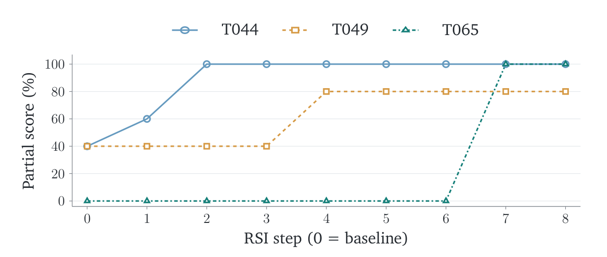

# RSIAgent: 在新环境里用自主探索把经验写成可复用记忆

## 来源信息

| 项 | 内容 |
| --- | --- |
| 标题 | RSIAgent: Autonomous Exploration for Recursive Self-improvement in New Environments |
| 作者 | Sibo Zhu¹²†‡、Shicheng Fan¹³†‡、Xinyue Wang¹²†‡、Wenyi Wu¹²‡、Kun Zhou¹\*、Biwei Huang¹（6 人；† 标注 Equal contribution，即共同一作；\* 为通讯作者兼项目负责人；‡ 为实习期间完成） |
| 机构 | ¹ Aether AI；² University of California San Diego；³ University of Illinois Chicago（第一机构为 Aether AI） |
| 来源 | [arXiv:2609.15364v2](https://arxiv.org/abs/2609.15364v2)（cs.AI; cs.CL; cs.CV）；v2 于 2026-09-18 提交，50 页；本笔记基于 v2，许可为 arXiv 非独占分发 1.0（非 CC）；v1 为 49 页且缺 §3.1，差异见 `audit.md` |
| 代码 | <https://github.com/AetherLabsAI/RSIAgent>（Apache-2.0；只读核验仓库结构与许可，未运行、未复现） |
| 阅读日期 | 2026-11-16 |

---

## 核心结论

一句话：**RSIAgent 把「在新软件环境里做自我改进」落到一个很窄的对象上——模型参数与 harness 结构都不动，只让 actor 在探索中把可复用的操作步骤、约束和失败教训写成一堆 Markdown/文件形式的 memory，冻结后再拿去做任务。**

- **解决什么问题**：数字 agent 进入新环境（界面、工具、约定、失败模式都不在预训练知识里）时，再训练或人工采数据成本高；把经验放进上下文更灵活，但「记什么、怎么验证、怎么复用」没有系统答案。
- **核心想法**：三个角色分工——curriculum 出题、actor 执行并写 memory、verifier 独立判分——加上「先广后深」两阶段探索；探索结束后冻结 memory，测试时只读不写。
- **怎么做到**：BRS 并行铺开多个探索项目覆盖能力邻域，DRS 围绕目标串行练习难例与边界条件；是否继续由 curriculum 判断，不是固定轮数。
- **关键结果**：OSWorld 2.0（82 题）Partial 71.97→78.98、Binary 37.80→42.68；Agents' Last Exam（67 题）Partial 83.75→84.82、Binary 49.25→50.75；Partial 上超过 GPT-6 Astra 6.38 / 2.56 个百分点。
- **边界**：主表只有 41 个 OSWorld、19 个 ALE 结果真的用了 RSI 分数；按参考流程与附录案例，DRS 会在**被评测的目标**上练习；对比也不是 matched protocol。所谓「开源超过闭源」只在允许按任务探索的 Partial 口径下成立。


*图 1（原文 Figure 2，p4）：BRS 并行铺开、DRS 围绕目标加深、冻结 memory 后测试复用。FreeCAD 例子只示意流程，块大小/箭头不代表实际耗时。*

---

## 问题

数字 agent 的默认假设是「预训练知识够用」：看到界面就能点、看到报错就能改。现实里换一个专业软件（Shotcut、REAPER、WPS、FreeCAD、3D Slicer），界面约定、文件格式、渲染管线、评分口径都可能是模型没见过的。作者的三个观察构成动机：

- **再训练/采数据太重**：需要额外交互数据，常要人工参与，在私有或持续变化的环境里不现实（§1）。
- **只把成功轨迹塞进上下文不够**：需要的是「动作—条件—结果」之间的稳定关系，并且要组织成可复用的结构，而不是一堆 episode（§1）。
- **人类学新软件的过程本身就是递归的**：先判断要学什么，再动手收集经验，最后从结果里提炼知识；作者把它类比为「因果发现」（§1）。

于是问题被写成：**给定新环境，能否让 agent 自主探索出一个持久 memory，使同一个固定参数模型在后续任务上变好？** 这里的「自我改进」有明确边界：

- 不更新模型参数（§2）；
- 不改 harness 结构（§3.2、§C.2 的 "same code-as-policy actor–verifier harness"）；
- 改的只是 memory 的内容——探索期可写，测试期冻结后只读。

这也决定了它的适用面。要让这套流程跑起来，至少要满足四个前提：

1. 动作可以写成程序（code-as-policy），否则异构软件没有统一动作空间；
2. 环境能 reset、任务有可重放的 fixture，否则练习与复测无法对齐；
3. 存在一个独立于 actor 的 verifier，能在候选产物与环境证据上给出 grounded PASS/FAIL；
4. 允许按任务做长时间探索与多次尝试——它优化的是「适配一个具体环境后的分数」，不是一次性 benchmark 上的时延或成本。

反过来说，如果任务只跑一次、不能 reset、没有可判定的成功信号，或者需要严格同条件的一次性横比，这篇文章的设定并不直接适用。

---

## 核心想法

### 直觉：把「经验」写成可检查的文件

memory 不是向量库，也不是固定字段的数据库，而是 **actor 自己写的文件集合**：人可读的笔记、脚本、检查清单，没有 schema、文件数或长度要求（§A.2）。案例里 BRS 后约 9–16 万字节，冻结时约 14–32 万字节（T044：109,647 → 316,541 B；T049：89,086 → 141,312 B；T065：159,065 → 281,085 B，Table A5）。好处是可解释、可直接改；代价是**检索质量取决于 actor 的自觉**——案例里能看到它按轮次去读 index、playbook 或 episode 记录，但没有召回率保证。

### 为什么这套写法能成立

关键不在「写笔记」，而在四条隔离把「经验」变成可审计的对象：

- **verifier 与 actor 隔离**：verifier 只看任务要求与候选环境，**看不到** actor 的私有 memory、推理与执行日志，因此它判的是证据而不是自述，降低「自己判自己」的相关性错误。
- **curriculum 只有 memory 的副本**：它的本地修改不会同步回 canonical memory，它也没有判分权——「出题」与「判分/记忆」被拆开。
- **写入权只在 actor，且必须在 grounded verdict 之后**：actor 先做 distillation（提炼过程、约束、失败教训），再做 reconciliation（检查与旧条目是否矛盾、给没证据的结论加限定），完成的更新才被提升为 canonical；工作阶段的临时修改会被丢弃。
- **并行只发生在采集阶段**：每个项目开始时拿到同一份不可变的 wave 前快照，提交时基于最新 canonical memory（含同一 wave 里前面刚提交的更新）。记忆更新严格串行，避免并行写冲突，也让 curriculum 的下一轮决策建立在「真实留下的知识」上。

停止也由这一套结构决定：目标 PASS 且 curriculum 不再安排练习 → DRS 结束；若 curriculum 返回 `STALLED`（失败或练习后仍无 productive 项目），runner 允许**最后一次**目标尝试并记录真实 verdict；未解决的验证/基础设施错误会阻断推进，不会被当成「收敛」（§A.3）。

### 与已有做法的区别

- **vs Reflexion / Voyager**：语言反馈、自动课程 + 技能库是这条线的直接前身；本文的差别主要在「三角色分工 + 先广后深 + 冻结复用」的组合，而不是单个组件的全新性。
- **vs harness 进化（RRSI、Self-Harness、Dream-RSI 一类）**：那些方法改的是 harness 组件、提示、控制流或探索策略；本文的 harness 固定，进化对象是 memory。
- **vs 再训练**：不加交互数据、不动权重；代价从训练侧转移到测试时的探索与练习。

### 一个走通的例子：T044 从通用滤镜换成原生操作

T044 要求去掉视频顶部水印、按需加对称黑边、保持分辨率、不拉伸不缩放，并同时交付 Shotcut 工程与不超过 1 MiB 的导出视频。

- baseline 用通用 `avfilter.crop` / `avfilter.pad` 去掉顶部 100 像素、上下各加 50 像素黑边，输出 1,019,423 B，分辨率 834×1112，得分 0.40。
- 有 memory 的 run 读到 `shotcut-video-editing.md` 与原生操作笔记，改用 GUI 的 **Crop: Source**，得到 `mlt_service=crop`、`top=76`、`center=0`，经自带 melt 引擎导出；最终 38 像素对称黑边、986,760 B，得分 1.00。

评分器不只看「水印没了」：尺寸上限 0.20、分辨率不变 0.20，然后专门找**原生 crop / qtcrop**，顶部裁切在 75–85 像素给 0.40，Center-off 再给 0.20。baseline 的通用滤镜不进这些检查，只能拿前两项。可见 memory 提供的不是「更漂亮的视频」，而是「这个软件里应该用哪个操作，以及怎么验证它的输出」。

### 代价

- **按任务长探索**：案例 T049 的一对 run 分别是 5,105.5 秒（无 memory）与 2,697.0 秒（有 memory，约 0.75 h），其他任务未给墙钟；全文没有 token 总量、API 费用或 GPU 小时。
- **检索无保证**：memory 是文件集合，actor 自己决定读什么；没有召回率、没有索引质量评估。
- **错误会自我放大**：验证漏掉的错误进入 memory，memory 又指导下一轮探索（§4.6 的三类失败会互相放大）。
- **预算不是硬约束**：名义 8 个项目、最多 4 个并发，但只在一轮结束后检查，进行中的 wave 不会被截断；案例里 T044 做了 10 个、T065 做了 11 个（Table A5）。
- **收益依赖具体环境**：论文只覆盖两个数字 agent benchmark 加一个游戏 benchmark，没有跨环境迁移或 memory 规模的 scaling 曲线。

---

## 方法

### 符号表

| 符号 | 含义 | 维度 / 取值 |
| --- | --- | --- |
| $q$ | 任务指令，也是 DRS 反复尝试的目标 | 自然语言 + 环境提供的文件 |
| $\mathcal{E}$ | 环境 | 软件 + 文件系统 + 可执行工具 |
| $t$ | 交互步下标 | $t = 1,2,\dots$ |
| $a_t$ | 第 $t$ 步动作 | 一段可执行的 Python 或 Bash 程序 |
| $s_t$ | 环境状态 | 由环境决定 |
| $o_t$ | 第 $t$ 步观测 | 程序输出、截图等 |
| $h_t$ | 当前任务的交互历史 | 换任务时重置 |
| $M$ | 持久 memory | 文件集合；跨任务保留，测试时冻结 |
| $\pi_\theta$ | 策略（actor） | 参数 $\theta$ 固定，不训练 |
| $\theta$ | 策略参数 | 全程不更新 |
| $s_i$ | 第 $i$ 题归一化得分 | $s_i \in [0,1]$ |
| $N$ | 评测题数 | OSWorld 82；ALE 67 |
| $\mathrm{Partial}$ | 部分得分均值 | $[0,100]$ |
| $\mathrm{Binary}$ | 全对比例 | $[0,100]$ |

原文没有给出 memory 的 schema、文件数或长度要求，也没有描述检索接口；这些在本笔记里按 §A.2 的「actor 自写文件集合」理解。

### 数据流：三角色、两阶段、一次冻结

| 角色 | 能看到什么 | 能产出什么 / 权力边界 |
| --- | --- | --- |
| actor agent | 任务指令、任务可见环境、执行反馈、当前持久 memory | 执行动作与候选产物；验证后写 memory，并给出一份 learning diagnosis |
| verifier agent | 任务要求与候选环境；**看不到** actor 的私有 memory、推理与执行日志 | 基于证据的 PASS/FAIL（目标接口还支持 UNVERIFIED）与 findings；**不写 memory** |
| curriculum agent | 目标 query、已完成的探索结果、actor 的 learning diagnosis（若有）、当前 memory 的一份**一次性副本** | 练习指令、输入 fixture、继续/停止决定；**不判分、不改 canonical memory** |

（原文 Table A1，p21。）一次完整的运行分三段：

1. **Stage-1 / BRS（广度）**：curriculum 一次提出多个探索项目；它们在隔离环境里并行执行（各有独立 fixture），actor 执行、verifier 判分；一轮里所有 verdict 落地后，actor 按 curriculum 指定顺序**逐个**做 distillation + reconciliation；curriculum 看到「验证结果 + 实际保留了哪些知识」后再选下一轮。BRS 仍以目标 query 为搜索方向，Phase 1 不直接尝试未改动的目标。
2. **Stage-2 / DRS（深度）**：从 BRS 留下的 memory 开始，先在 reset 环境里直接尝试目标 $q$，拿 grounded verdict 后更新 memory；curriculum 看「结果 + learning diagnosis + 更新后的 memory」决定是否再安排练习。目标失败 → 优先安排能区分不同失败假设的练习；目标成功 → 默认不练，只有某个对照/压力案例能检验「重要但不确定或过度泛化」的假设时才练（Prompt P4）。每个练习都是「执行 → 验证 → actor 写记忆 → curriculum 再看」的串行循环，练完重新尝试目标。
3. **冻结与测试**：记录 memory 文件树的 hash，复制进评估环境，关闭 curriculum 决策与 host 写回；actor–verifier harness 在 reset 环境里执行目标，官方 evaluator 在所有 agent 上下文之外打分；runner 检查冻结的 host memory 未被改动（§A.3、Algorithm A1）。

### 动作采样：原文 §3 的形式化

**原文 §3 开头的动作采样式（p3）**

```math
a_t \sim \pi_\theta(\cdot \mid q, h_t, M), \qquad
(s_t, o_t) \sim \mathcal{E}(\cdot \mid s_{t-1}, a_t)
```

**逐项读法**：动作只依赖任务 $q$、当前历史 $h_t$ 和持久记忆 $M$；环境根据上一状态 $s_{t-1}$ 与新动作 $a_t$ 返回新状态 $s_t$ 和新观测 $o_t$。$h_t$ 在换任务时重置，$M$ 跨任务保留——这正是「冻结后复用」的形式化：任务变、历史清空，但 $M$ 不变。实现上采用 code-as-policy，每个动作是一段可执行程序，因此动作空间对异构软件是统一的，「记忆里的过程」也能直接以代码/命令形式被复用。

### 一轮 DRS 循环（按 §3.3、§A.3 与 Algorithm A1 整理）

```text
输入：目标 q；BRS 留下的 memory M
重复：
  1. 在 reset 环境里直接尝试目标 q，拿 grounded verdict
  2. 若满足停止条件 → 退出
  3. 否则 curriculum 安排练习（fixture + 指令）
  4. actor 执行练习、verifier 判分
  5. actor 在 grounded verdict 后做 distillation + reconciliation
     完成的更新提升为 canonical memory；临时修改丢弃
  6. 回到 1
```

**逐项读法**（这一段是本笔记按原文叙述整理，不是原文伪代码）：

- 第 1 步的「目标尝试」就是最终被评测的那个 $q$。附录 E 开头写得很直白："In these runs, DRS includes practice on the target itself."（p31）；最终评估只是把同一个 $q$ 在 reset 环境里再做一遍。
- 第 2 步有两条停止路径：默认 `curriculum_review`（目标 PASS 且 curriculum 不再安排练习）与早期的 `verifier_pass`（目标一旦 grounded PASS 并完成记忆合并就结束）。`STALLED` 时允许最后一次目标尝试；基础设施错误阻断推进。
- 第 5 步是这条循环里提升 canonical memory 的环节，而且必须发生在 grounded verdict 之后；没有 verdict 的探索只能留下工作区临时内容。

### 指标

**指标定义（本笔记按 §4 的文字整理，不标式号）**

```math
\mathrm{Partial} = 100\cdot\frac{1}{N}\sum_{i=1}^{N}s_i,
\qquad
\mathrm{Binary} = 100\cdot\frac{1}{N}\sum_{i=1}^{N}\mathbf{1}\{s_i=1\}
```

**逐项读法**：$s_i$ 是第 $i$ 题按官方 rubric 归一化到 $[0,1]$ 的分数，$N$ 是题目数。Partial 奖励「做对一部分」，Binary 只奖励「全对」；同一道题在 Partial 里可以拿小数，在 Binary 里只有 0 或 1。两者都乘 100、每题等权，baseline 与 RSI 用同一分母。

### 与已有方法的结构差异

| 做法 | 改什么 | 反馈信号 | 主要代价 |
| --- | --- | --- | --- |
| 再训练 / 采数据 | 权重 | 人工或交互数据 | 数据与算力；私有环境不现实 |
| 轨迹塞进上下文 | 提示 | episode 本身 | 不成结构、难复用 |
| harness 进化 | 代码 / 控制流 / 提示 | benchmark 分数 | 需要额外的选择信号与防退化门控 |
| **RSIAgent** | memory 文件 | verifier 的 PASS/FAIL + curriculum 判断 | 测试时探索；检索无保证 |

结构上最值得注意的是：**它没有新的训练目标，也没有让 harness 进化**。三角色、两阶段与冻结协议都是围绕「如何产出并验证一份 memory」组织的；因此它的上限由 verifier 的判分质量和 curriculum 的出题质量共同决定，而不是由模型容量决定。

---

## 主要结果

**设置**：OSWorld 2.0（0808 offline）82 题离线子集（完整清单 108 题；T082 因 setup 失败没有有效官方分，聚合时按 0 计）；Agents' Last Exam（ALE）Near-term 67 题。actor 默认 GLM-5.3；verifier 与 curriculum 都是 Kimi-K3，但在独立上下文里；官方 evaluator 需要模型判分时用 GPT-5.4，user simulator 用 GPT-4o。对比分数来自 OSWorld / ALE 榜单（例外是 GPT-6 Astra 的 OSWorld 分由 OpenAI 报告）；ALE 上每个模型取覆盖 67 题的最高 Partial 配置；已发布系统保留各自的 harness 与执行预算（原文记录的基线来源访问日期为 2026-09-11）。

| 模型 / 方法 | OSWorld Partial | OSWorld Binary | ALE Partial | ALE Binary |
| --- | --- | --- | --- | --- |
| **开源模型** | | | | |
| Kimi-K2.6 | 22.10 | 4.60 | 21.70 | 9.20 |
| MiMo-V2.5 | — | — | 23.60 | 8.60 |
| DeepSeek V4 Pro | — | — | 43.81 | 19.90 |
| Qwen3.8-Max | — | — | 52.50 | 27.00 |
| Kimi-K3 | 58.30 | — | 71.60 | 40.30 |
| **闭源模型** | | | | |
| Claude Opus 4.8 | 54.80 | 20.60 | 64.00 | 43.30 |
| Gemini-3.8-Flash | 59.00 | — | — | — |
| GPT-5.6 Sol | 64.13 | 28.10 | 78.82 | 47.76 |
| Muse Spark 1.3 | 66.90 | — | — | — |
| Claude Fable 5 | — | — | 71.10 | 37.30 |
| Claude Opus 5 | 70.19 | 34.72 | 79.54 | 46.27 |
| GPT-6 Astra | 72.60 | — | 82.26 | 52.24 |
| **本文（用开源模型）** | | | | |
| RSIAgent (w/o RSI) | 71.97 | 37.80 | 83.75 | 49.25 |
| **RSIAgent** | **78.98** | **42.68** | **84.82** | **50.75** |

（原文 Table 1，p7；加粗为原文对 RSIAgent 行的标注，「—」表示原榜单/技术报告未报告。）

- **RSI 的增量**：同一套 harness 从 71.97/37.80 提到 78.98/42.68（OSWorld，+7.01/+4.88 pp），从 83.75/49.25 提到 84.82/50.75（ALE，+1.07/+1.50 pp）。
- **harness 的增量更大**：`w/o RSI` 不是基础模型，而是同一套多 agent harness 关掉探索与 memory；它已经高于 Claude Opus 5（71.97 vs 70.19；83.75 vs 79.54）。所以「开源超过闭源」不全是 RSI 的功劳。
- **只在 Partial 上超过 GPT-6**：OSWorld 78.98 vs 72.60（+6.38 pp）、ALE 84.82 vs 82.26（+2.56 pp）；但 ALE Binary 是 50.75 < 52.24，OSWorld 的 GPT-6 Binary 未报告。
- **聚合不是全量**：OSWorld 只有 41 个 non-diagnostic RSI 结果的分数被替换（含 recorded retry 与 regressions），其余沿用 baseline；ALE 是 19 个 RSI 分数 + 48 个 baseline。按这个口径复算，被替换结果的平均 Partial 提升约 14.0 pp（OSWorld）与 3.8 pp（ALE）。
- **消融方向一致但预算不匹配**：四个任务均值 Full RSI 74.54 > w/o DRS 65.52 > w/o BRS 56.50 > w/o RSI 44.13（末项为本笔记复算）；w/o BRS 从空 memory 起步且最多 2 个练习项目，Full RSI 的 DRS 可含 5 次目标结果 + 7 个补充项目，因此只能读作方向性证据。
- **游戏开发上同样领先**：GameCraft-Bench 随机 40 题、按冻结基础游戏分四组，RSIAgent 在四组五个指标上都最高，Overall 分别为 61.28 / 46.37 / 48.72 / 57.46（baseline 52.77 / 31.28 / 30.55 / 41.30）；Play2Code 在最强的基础游戏组反而从 52.77 退到 51.05。



*图 2（原文 Figure 3，p8）：三个 OSWorld 任务的 Partial 随 RSI step 变化；step 0 是 baseline。T044 40→60→100、T049 40→80、T065 0→100（step 7 起）。*

曲线的形状说明分数是**离散跳变**而不是平滑爬升：当 memory 覆盖到某个关键要求时，解决一个瓶颈就跨过一个门槛。作者据此解释「单任务曲线比聚合曲线更容易看到跳变」（§4.3）；但这只是三个任务，不能当成所有任务的典型曲线。

---

## 边界与局限

作者在 §7 明确写的：

- 递归自我改进需要额外的测试时探索与练习，计算成本可能很高；
- 性能受有限探索预算、停止策略与学到的 memory 质量影响；
- 基于模型的 verifier 可能误判，错误会传播到后续探索与 memory 更新；
- 不同环境需要不同工具、验证信号与探索策略，当前实验没有完全隔离每个组件的贡献。

读者需要补上的判断：

- **没有成本数字，也没有方差**：没有 token、金额或 GPU 小时，只有 watchdog 上限与一个案例的墙钟；主结果与游戏结果都未说明重复次数，也没有置信区间，无法判断「值不值」与分数波动量级。
- **任务选择与练习重合**：OSWorld 的扩展队列只对「baseline 未满分且没有既有 RSI lineage」的任务做新探索，存在选择偏差；同时 DRS 会在目标 $q$ 上练习，主表部分结果来自历史/变体 run——这不是「跨任务泛化」的证据。
- **双模型配置**：GLM-5.3（actor）+ Kimi-K3（verifier/curriculum）是两个开源模型分工，与单模型闭源基线不是同条件；应理解为混合系统超过闭源，而不是每个模型单独都超过。

---

## 与其他工作的关系

- **StructAgent**：RSIAgent 的 §3.1 直接建立在它的「unified state + structured workflow」上，把 curriculum、执行、验证、记忆合并串成递归流程；读本文时 §3.1 是对 StructAgent 的复用，不是新贡献。
- **RRSI（本仓库 00212）/ Self-Harness（00198）**：同样叫 harness 的递归自我改进，但进化对象是组件、提示或控制流，并用 benchmark 分数或 held-out 门控做选择；RSIAgent 的 harness 固定，进化的是 memory，也没有 held-out 门控。
- **Dream-RSI（00214）**：进化的是探索策略，把历史树当零成本回放模拟器；与 RSIAgent 的「改记忆」不同轴，两者都不训练权重。
- **前身**：Voyager（自动课程 + 技能库）、Reflexion（语言反馈）、EchoTrail-GUI / ZhuLong（环境探索收集经验）；本文与它们的差别是组合方式，而非单个机制的全新性。

<!-- 复核档案见同目录 audit.md（不随站点发布） -->
