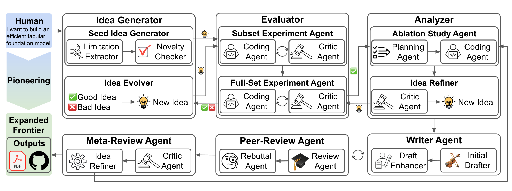

# ScientistTwo：让多智能体自己走完「找局限 → 改方法 → 做消融 → 写论文 → 自审」闭环

## 来源信息

| 项 | 内容 |
| --- | --- |
| 标题 | ScientistTwo: Pioneering the Human Knowledge Frontier with Autonomous AI |
| 作者 | Jaehyun Nam¹, Jinsung Yoon¹, Yanzhou Pan¹, Yubo Wang², Rui Meng¹, Parthasarathy Ranganathan¹, Tomas Pfister¹（¹ Google Cloud AI Research；² University of Waterloo） |
| 机构 | Google Cloud AI Research（第一机构） |
| 来源 | [arXiv:2609.19644v1](https://arxiv.org/abs/2609.19644v1)（cs.AI；2026-09-17 提交，71 页；截至 2026-11-08 abs 页只有 `[v1]`） |
| 项目页 | <https://scientist-two.github.io/>（托管 86 份生成论文 PDF；未发现代码仓库入口） |
| 阅读日期 | 2026-11-08 |

---

## 核心结论

一句话：**ScientistTwo 把科研流程拆成 6 组 agent 加一条带 critic 关卡的闭环：给定一篇人类论文的问题与代码库，它自己找局限、生成并进化想法、先在子集上筛、再放大到全集、做消融归因、写稿，最后用模拟评审 + rebuttal + meta-review 反复改到「可接受」为止。**

- **解决什么问题**：现有 autonomous research agent 多在单个 benchmark 上优化单个标量指标，缺少人类科学家那种「多数据集、多指标、做消融、被审稿人质疑后补实验」的闭环。
- **核心想法**：把科研拆成若干阶段，每个阶段都用同一个三态控制模式（生成候选 → critic 判定 → accept / refine / reject），而 critic 看的是代码、日志、表格这些可执行产物，不是文字好坏。
- **怎么做到**：子集实验先与**自己复现的** baseline 比，全集实验再与**原论文报告的** SOTA 比；消融用来判断涨点是否来自声称的组件；rebuttal 不是改文字，而是按审稿意见补做实验。
- **关键结果**：在 107 个来自 ICLR 2026 / NeurIPS 2025 / ICML 2026 Spotlight 的题目上成功改进 86 个（80.4%），成功任务相对人类 SOTA 平均提升 25.2%（中位数 7.7%）；生成论文在 ScholarPeer 上 7.5/10、91.9% 接受率，在 Stanford Agentic Reviewer 上 5.7/10、72.1%。
- **定位与代价**：这是一份系统/harness 类技术报告，固定 harness 进化的是任务内的想法与代码；平均 2.51 天、3765 美元/任务，代码未公开，两个「接受率」都是 AI 评审代理的判定。

---

## 问题

作者的出发点是：现有 autonomous research agent 大多在**单个 benchmark 上优化单个标量指标**，缺少人类科学家那种「多数据集、多指标、做消融、被审稿人质疑后补实验」的闭环（§1，p1–2；§2，p3–4）。

论文把已有工作分成四类：

- **端到端论文生成**：AI Scientist（Lu et al., 2024）建立了自动化范式，但执行不稳定、写作有幻觉；AI Scientist-v2（Yamada et al., 2025）用 best-first tree search 和 review-based reporting 缓解。
- **模块化写作/评审**：PaperOrchestra（Song et al., 2026）把实验日志整理成 LaTeX 论文；ScholarPeer（Goyal et al., 2026）做多 agent 评审。
- **单指标代码优化**：AutoSOTA（Li et al., 2026d）在已有代码库里搜配置/超参，把论文的 headline result 压成一个数值目标。
- **可验证性导向**：ScientistOne（Meng et al., 2026）做 chain-of-evidence 与完整性审计，但作者认为它缺少「主动的分析扩展」（active analytical expansion）。

ScientistTwo 想补的正是这三件事：**多数据集/多指标评估、消融驱动的假设精炼、动态评审 + rebuttal 闭环**。

形式化地，给定科学问题 $\mathcal{G}$，系统 $\mathcal{A}$ 输出论文 $P^{+}$ 与可复现代码库 $\mathcal{C}^{+}$（原文 §2，p3–4）：

```math
(P^{+},\mathcal{C}^{+})=\mathcal{A}(\mathcal{G}),\qquad
\mathcal{A}=\{\mathcal{A}_{1},\mathcal{A}_{2},\dots,\mathcal{A}_{N_{\mathrm{a}}}\}
```

逐项读法：$\mathcal{A}$ 不是单个模型，而是一组按科研阶段分工的 agent；输入 $\mathcal{G}$ 是问题描述与代码库；输出是「论文 + 代码」这一对产物。论文的系统图把 agent 分成 6 组，本笔记据此把 $N_{\mathrm{a}}$ 理解为 6（原文没有单独给这个数）。论文强调 $P^{+}$ 要指出并解决 $\mathcal{G}$ 中的方法/经验瓶颈，$\mathcal{C}^{+}$ 要正确实现想法并保持可复现。

三个必要前提，也是读结果时要一直记住的边界：

1. **人类仍然出题**：问题、原始论文与代码库由人给定，系统不做选题与文献综述之外的科学判断。
2. **「成功」是复合判据**：产出的方法要在**完整 benchmark** 上超过人类 SOTA，**并且**增益能通过消融归因到提出的机制（Appendix B，p30–31），同时还要生成论文与代码；论文没有给统一的统计检验。
3. **评测域只有 ML**：107 个任务全部来自 ICLR 2026 / NeurIPS 2025 / ICML 2026，没有物理、生物、化学等非 ML 领域；标题里的 "human knowledge frontier" 在实验上只覆盖 ML 的 frontier。

---

## 核心想法

### 一句话

把科研流程做成一条**带 critic 关卡的状态机**，每一关都用可执行产物（代码、日志、表格、复跑结果）判分，而不是让 LLM 说「这个想法不错」。

### 直觉

科研真正难的不是生成一个想法，而是判断这个想法值不值得继续：要跑实验、比 baseline、做消融、回答审稿人。单靠一次生成，模型只能猜；把这条链拆开以后，每一步都有可验证的中间产物，下一步只依赖上一步的产物，错误就不会一路传到底。

于是系统的骨架不是「一个更强的 agent」，而是**六个阶段的接口约定**：找局限 → 生成种子 → 子集实验 → 全集实验 → 消融 → 写作/评审/meta-review。每个阶段都问同一个问题：产物够不够好到可以进下一关；不够就带着反馈重做，或者丢弃。

### 为什么它能成立

- **critic 绑定可执行产物**：判据是代码能不能跑、结果是否稳定优于 baseline、消融是否能拆出组件，而不是一段自我评价。这让「接受」可以被复跑检验。
- **两级 baseline 分离两种误差**：子集上与**自己复现的** baseline 比，量的是想法本身；全集上与**原论文报告的** SOTA 比，量的是最终是否真的推进了 SOTA。前者不受复现差距污染，后者不被「只在自己代码里变好」欺骗。
- **三路判决保留潜力想法**：`Engineer` 分支允许「初始超参不好但方向对」的想法调参两次再判，避免因为工程细节误杀好想法，同时用轮数上限防止无限调参。
- **消融是归因门槛**：不只问「涨没涨」，还问「涨点是否来自我声称的组件」。TeCh 案例里，系统的 DMC-TeCh 在 6 个指标中赢了 5 个，但 Ablation Critic 发现增益主要来自 EMA + label smoothing 这类通用训练控制，而不是提出的 multi-core 架构，于是拒绝把它算作贡献（Appendix B，p31）。
- **先验证再接受**：消融精炼与 meta-review 精炼都要求新结果严格优于旧结果才替换核心状态，否则保留旧版本。这比「让 LLM 说改得更好」稳。

### 与已有做法的区别

- **优化对象**：从「一个 headline 数值」变成「整张 benchmark 网格 + 多指标 + 消融归因」。
- **写作的位置**：写作不是起点也不是终点，而是实验与归因都完成后的下游步骤；PaperOrchestra 被集成为 Initial Drafter，不承担实验。
- **评审的位置**：评审不是打分器，而是下一轮实验的需求来源——rebuttal 阶段真的去补审稿人要求的实验，再改写叙述、表格与图。
- **生成的次数**：不是一次生成定稿，而是「想法 → 实验 → 消融 → 评审 → 再精炼」的多轮闭环，每轮都有轮数上限。

### 一个走通的例子

TOFU `forget10`（Llama-3.2-1B-Instruct）上，初版方法 `LFR-Engram` 已经超过人类 `Engram`（Overall 0.897 vs 0.705）。Meta-Review 判 `Refine`，系统据此把方法改成 `FCD-Engram`，6 个指标全部再升（Overall 0.916，Priv 0.860 vs 0.824，FQ −0.001 vs −0.014）。但相对人类 baseline，遗忘指标 EM 仍然差很多（0.071 vs 0.004，越低越好）。

这个例子同时说明两件事：闭环确实能**改方法**而不只是改文字；但「consistently outperforms LFR-Engram」不等于「全面超过人类 baseline」——它是单任务、单模型、无方差的一次展示。

### 代价

- **钱与时间**：33 个 NeurIPS 任务上平均 2.51 天、3765 美元/任务；其中约 45% 花在 Idea Refinement，写作与评审加起来不到 20%。
- **评审是代理指标**：两个「接受率」都来自 AI 评审，ScholarPeer 还与作者同组并参与 refinement；不能当真实投稿录用率读。
- **新颖性检查很窄**：只检索两篇参考论文，能过滤明显重复，不能保证相对整个领域的新颖性。
- **外部无法复核代码**：项目页只托管论文 PDF，Table 7 的完整性审计由系统自己的 Coding Agent 执行。
- **进化的层级有限**：harness 固定，进化的是任务内的想法与代码；把它读成「自进化 agent」会高估它。

---

## 方法

### 符号表

| 符号 | 含义 | 取值 / 说明 |
| --- | --- | --- |
| $\mathcal{G}$ | 科学问题：问题描述 + 代码库 | 人类给定 |
| $P^{+},\mathcal{C}^{+}$ | 输出的论文与可复现代码库 | 最终产物 |
| $\mathcal{A}$；$N_{\mathrm{a}}$ | 系统整体（agent 组集合）；组数 | 6 组 |
| $h$；$h_{0},H_{0}$ | 候选想法；初始想法与初始集合 | $H_{0}=\{h_{0}\}$ |
| $N_{\mathrm{seed}}$ | 种子想法数 | 原文未给数值 |
| $\mathcal{A}_{\mathrm{Coder}}$ | 「想法 → 代码 → 结果」的统一接口 | — |
| $\mathcal{E}^{h},\mathcal{C}^{h},d^{h},r^{h}$ | 想法 $h$ 的结果、代码、判决、反馈 | 判决取 `Bad` / `Good` / `Engineer` |
| $E_{\mathrm{base}},C_{\mathrm{base}}$ | 子集上复现 baseline 的结果与代码 | — |
| $N_{\mathrm{eng}}$ | 工程精炼最大轮数 | 2 |
| $R_{k}$；$\mathcal{A}_{\mathrm{Evolve}}$ | 第 $k$ 轮轨迹集合；想法进化 agent | — |
| $I_{k}$；$H_{0}^{(k)}$；$\mathcal{H}_{k}$ | 进化候选集；本轮补入的未评估种子；候选池 | $\mathcal{H}_{k}=I_{k}\cup H_{0}^{(k)}$ |
| $N_{e}$；$N_{0}$ | 每轮补入的未评估种子数；第 0 轮执行的种子数 | 原文均未给数值 |
| $S$；$K$；$k,i$ | 成功想法阈值；想法实验最大轮数；轮次下标 | 4；4；$k\ge 1$ 为进化轮 |
| $h_{\mathrm{best}}$；$\mathcal{A}_{\mathrm{Selector}}$ | 选出的最佳想法；选优 agent | 选优见原文式 4，p8 |
| $E_{\mathrm{best}},C_{\mathrm{best}}$ | 最佳想法的结果与代码 | — |
| $N_{p}$；$E_{\mathrm{abl}}$ | 消融计划数；消融实验结果 | 计划数原文未给 |
| $N_{\mathrm{abl}}$；$h_{\mathrm{new}},E_{\mathrm{new}},C_{\mathrm{new}}$ | 消融后精炼轮数上限；精炼后的想法、结果与代码 | 1；须严格优于旧版才接受 |
| $P_{\mathrm{new}}$；$R_{\mathrm{new}}$；$s_{\mathrm{review}}$ | 新写的稿子；本轮评审意见；模拟评审分数 | ICLR 1–10 分制 |
| $N_{t}$；$E_{\mathrm{reb}}$ | rebuttal 拆出的补充实验任务数；其结果 | 任务数原文未给 |
| $N_{\mathrm{peer}}$ | 评审–rebuttal 最大轮数 | 2 |
| $d_{\mathrm{meta}}$；$r_{\mathrm{meta}}$；$N_{\mathrm{meta}}$ | meta-review 判决、反馈、精炼轮数 | `Accept` / `Refine`；1 |

### 数据流

系统由 6 组 agent 组成：**Idea Generator**（Limitation Extractor → Novelty Checker，Idea Evolver 按好/坏想法轨迹生成新想法）、**Evaluator**（Subset Experiment Agent 先在子集上筛，Full-Set Experiment Agent 再放大）、**Analyzer**（Ablation Study Agent 做组件消融，Idea Refiner 据结果改方法）、**Writer**（Initial Drafter + Draft Enhancer）、**Peer-Review**（Review Agent + Rebuttal Agent）、**Meta-Review**（Idea Refiner + Critic Agent，决定接收还是回上游重做）。

主链是：人类给 $\mathcal{G}$ → 找局限、生成种子想法 → 子集实验筛选 → 全集放大 → 选 $h_{\mathrm{best}}$ → 消融归因 → 写稿 → 模拟评审与 rebuttal → meta-review。任何一关不通过，就带着反馈回到上游对应阶段，各阶段有各自的轮数上限。



*Figure 3（p4）：人类只给问题（左上 "Human"），其余阶段由 agent 组完成；底部 Meta-Review 的反馈回到 Idea Generator/Evaluator，形成闭环。*

所有阶段共享同一个控制模式（Listing 1，p5）：**生成候选 → critic 判定 → accept 则返回 / refine 则带反馈重做 / reject 则丢弃**，每个阶段有最大轮数。

```text
生成候选
循环（最多该阶段轮数）：
    critic 判定 →
        accept  → 返回该候选，进入下一阶段
        refine  → 带反馈重做候选，轮数 +1
        reject  → 丢弃
```

逐项读法：这段文本是笔记按 Listing 1 的三态出口整理的，不是原文伪代码。`accept` 是唯一的前进出口；`refine` 消耗该阶段的轮数预算；`reject` 直接出局，不占后续预算。不同阶段只是把「候选」「critic 判据」「轮数上限」换掉，所以后面的子集筛选、消融、评审都能看作它的实例。

| 阶段 | Critic 判据 | 不通过时 |
| --- | --- | --- |
| 找局限 | 是否足以指导新的改进 | 补漏，最多 16 轮 |
| 种子想法 | novelty 分数 | 继续生成更多想法 |
| 子集实验 | 是否稳定优于**复现的** baseline | `Bad` 丢弃；`Engineer` 调参/改代码，最多 2 轮 |
| 全集实验 | 是否优于**原论文的** SOTA | 继续工程 |
| 想法进化 | 实验是否成功 | 用轨迹再进化 |
| 消融 | 组件归因是否干净 | 改方法，最多 1 轮 |
| 模拟评审 | 分数是否达到 8 | 规划并执行 rebuttal 实验，最多 2 轮 |
| Meta-review | 是否达到 venue bar | 改 idea 并重跑，最多 1 轮 |

### 1. 找局限与种子想法（§3.1，p6）

Limitation Extractor 先从 $\mathcal{G}$ 中抽取一组局限；Limitation Verifier 判断这组局限是否「足以指导新的改进」，不够就回到 Extractor 补漏，最多 16 轮。然后 Idea Generator 生成初始想法 $h_{0}$，Novelty Checker 打分；从 $H_{0}=\{h_{0}\}$ 开始迭代扩展，直到收集 $N_{\mathrm{seed}}$ 个候选，再按 novelty 分数降序排列。

一个值得注意的实现细节：**novelty 判断只检索两篇参考论文**（Appendix A.2，p30："ScientistTwo retrieves two reference papers via Google Search"）。这比完整文献综述窄得多，能过滤明显重复，但不能保证相对于整个领域的新颖性；论文也没有报告它与人评估的一致性。

### 2. 从子集到全集：两级 baseline（§3.2，p6–7）

**第一，先复现 baseline，再谈改进。** Baseline Coding Agent 先在 benchmark 子集上复现 $\mathcal{G}$ 的主实验，得到 $E_{\mathrm{base}}$ 与 $C_{\mathrm{base}}$。子集上的候选是与 $E_{\mathrm{base}}$ 比，而不是与论文里报告的数字比；这样可以把「复现差距」和「想法本身的好坏」分开。

**第二，三路判决而不是二路。** 对每个候选 $h$，Subset Critic 输出：

- `Bad`：明显差于 baseline，直接丢弃；
- `Good`：稳定优于 baseline，允许放大到全集；
- `Engineer`：有潜力但需要调参/改代码，交给 Subset Engineering Agent，最多 $N_{\mathrm{eng}}=2$ 轮；两轮后仍不是 `Good` 就当 `Bad` 剪掉。

全集阶段再用 Full-Set Coding Agent 改写代码，并与**原始论文的 SOTA 结果**比较；只有全集也过线，才得到最终的 $d^{h}$。

「想法 → 代码 → 结果」被抽象成一个统一接口（原文 §3.2，p7）：

```math
h,\mathcal{E}^{h},\mathcal{C}^{h},d^{h},r^{h}
=\mathcal{A}_{\mathrm{Coder}}(\mathcal{G},h)
```

逐项读法：给问题 $\mathcal{G}$ 和候选 $h$，Coder 返回想法本身、实验结果 $\mathcal{E}^{h}$、可执行代码 $\mathcal{C}^{h}$、判决 $d^{h}$ 与反馈 $r^{h}$。判决是下一阶段的分支条件，反馈是 refine 时的输入。进化与候选评估复用这个接口；选优用另一个 agent $\mathcal{A}_{\mathrm{Selector}}$（原文式 4，p8），消融另有 Ablation Planner / Coding Agent（§3.4，p8），并不都走 $\mathcal{A}_{\mathrm{Coder}}$。

### 3. 想法进化：利用轨迹，同时保留探索（§3.3，p7–8）

第 0 轮执行 top-$N_{0}$ 个种子想法，得到轨迹集合 $R_{0}$。第 $k\ge 1$ 轮分两路：

- **利用（exploitation）**：Idea Evolver $\mathcal{A}_{\mathrm{Evolve}}$ 汇总历史轨迹，把好/坏结果作为反馈，生成进化后的候选集 $I_{k}$；
- **探索（exploration）**：从 $H_{0}$ 里按 novelty 顺序取 $N_{e}$ 个**尚未评估**的种子，加入候选池，避免只在早期种子附近打转。

候选池是 $\mathcal{H}_{k}=I_{k}\cup H_{0}^{(k)}$；每个候选都走一遍 $\mathcal{A}_{\mathrm{Coder}}$，得到 $R_{k}$。终止条件是累计 $S$ 个 $d^{h}=\mathrm{Good}$ 的成功想法，或达到最大轮数 $K$（原文 §3.3，p8）：

```math
\sum_{i=0}^{k}\sum_{h\in\mathcal{H}_i}\mathbb{I}(d^{h}=\mathrm{Good})\ge S
```

逐项读法：外层 $i$ 遍历第 0 到第 $k$ 轮，内层遍历该轮候选池 $\mathcal{H}_{i}$，$\mathbb{I}(\cdot)$ 是「判决为 `Good`」的指示函数；累计成功数达到 $S$ 就停。配置里 $S=4$、$K=4$，每轮评估 2 个候选（1 个种子 + 1 个进化想法，Appendix A.2，p30）。如果到 $K$ 轮一个成功都没有，整个任务终止，不写论文。

找到至少一个成功想法后，$\mathcal{A}_{\mathrm{Selector}}$ 比较所有 `Good` 想法在全集上的指标与日志，选出 $h_{\mathrm{best}}$。这一步没有新实验，只是跨候选比较。

### 4. 消融：把「涨点」拆成可归因的组件（§3.4，p8）

Ablation Planner 针对 $h_{\mathrm{best}}$ 生成 $N_{p}$ 个可执行消融计划；Ablation Coding Agent 在每个计划上改 $C_{\mathrm{best}}$ 并执行，得到 $E_{\mathrm{abl}}$。Ablation Critic 判断「组件拆解是否干净」：

- `Good`：$h_{\mathrm{best}}$ 定稿，进入写作；
- `Refine`：说明某些组件可能冗余/反效果，交给 Full-Set Engineering Agent 生成 $h_{\mathrm{new}}$，最多 $N_{\mathrm{abl}}=1$ 轮。

这里有一个**防回归检查**：只有当 $E_{\mathrm{new}}$ 被 Result Comparison Agent 判为严格优于 $E_{\mathrm{best}}$ 时，才把 $(h_{\mathrm{best}},E_{\mathrm{best}},C_{\mathrm{best}})$ 替换成新版本；否则保留旧版本。发生替换才重新跑消融。

消融是全文最有工程借鉴价值的部分：它不只问「新方法是否涨点」，还问「涨点是否来自我声称的那个组件」。Appendix B 的 TeCh 案例（p31）里，DMC-TeCh 赢了 5/6 个指标，但增益主要来自 EMA + label smoothing，于是被拒绝算作 multi-core 架构的贡献。

### 5. 写作、模拟评审与 rebuttal（§3.5，p8–9）

Initial Drafter（集成了 PaperOrchestra）把 $h_{\mathrm{best}}$、主结果 $E_{\mathrm{best}}$、消融 $E_{\mathrm{abl}}$ 合成一篇会议格式的稿子 $P_{\mathrm{new}}$。

然后 Peer Reviewer（即 ScholarPeer）按 ICLR 的 1–10 分制评审，给出 strengths / weaknesses / questions / $s_{\mathrm{review}}$。分数低于阈值（论文举的例子是 8）就进入 rebuttal：

1. Rebuttal Planner 把审稿意见拆成 $N_{t}$ 个补充实验任务；
2. Rebuttal Coding Agent 在 $C_{\mathrm{best}}$ 上实现并执行每个任务，得到 $E_{\mathrm{reb}}$；
3. Paper Enhancer 把审稿意见与补充结果写回稿子，更新叙述、表格与图；
4. 再送 Reviewer，最多 $N_{\mathrm{peer}}=2$ 轮。

rebuttal **不是改文字**，而是「审稿人问什么就补做什么实验」；这是它与普通「LLM 改稿」最大的区别。

### 6. Meta-review：最后一道门（§3.6，p9）

Meta-Review Agent 同时看稿子 $P_{\mathrm{new}}$ 与评审 $R_{\mathrm{new}}$，输出 $d_{\mathrm{meta}}\in\{\mathrm{Accept},\mathrm{Refine}\}$ 和 meta-critique $r_{\mathrm{meta}}$。

- `Accept`：定稿，输出 $P^{+}=P_{\mathrm{new}}$、$\mathcal{C}^{+}=C_{\mathrm{best}}$。
- `Refine`：说明 meta-reviewer 发现了算法/经验上的关键弱点；用 $r_{\mathrm{meta}}$ 指导 Full-Set Engineering Agent 改 $h_{\mathrm{best}}$，得到新的 $h_{\mathrm{new}}/E_{\mathrm{new}}/C_{\mathrm{new}}$。只有 $E_{\mathrm{new}}$ 严格优于 $E_{\mathrm{best}}$ 才更新核心状态；更新后重跑消融、重写、再审。最多 $N_{\mathrm{meta}}=1$ 轮；如果 refinement 没有超过 baseline，就丢弃，用之前的 $P_{\mathrm{new}}/C_{\mathrm{best}}$ 结束。

### 与已有方法的结构差异

| 系统 | 主要做什么 | 本篇补上的部分 |
| --- | --- | --- |
| AI Scientist / v2 | 端到端生成论文 | 多指标评估、消融归因、rebuttal 循环 |
| PaperOrchestra | 把实验日志整理成 LaTeX | 上游的实验生成与归因；它在本篇里只是 Drafter |
| ScholarPeer | 多 agent 评审打分 | 把评审接成「补实验再改稿」的闭环 |
| AutoSOTA | 单指标代码/超参搜索 | 整张 benchmark 网格、多指标、组件级归因 |
| ScientistOne | chain-of-evidence 与完整性审计 | 主动的分析扩展（全集放大、进化、消融） |

---

## 主要结果

**设置**（§4；Appendix A.1，p28–29）：107 个任务来自 ICLR 2026 5 篇、NeurIPS 2025 38 篇、ICML 2026 Spotlight 64 篇，输入是每篇论文的问题描述与代码库。评审用两个 AI 代理：ScholarPeer（in-distribution，也参与 refinement）与 Stanford Agentic Reviewer（held-out，外部服务）。成功定义见「问题」一节的复合判据。

1. **改进率与增益**：107 个题目中 86 个成功（80.4%）；成功任务相对人类 SOTA 的平均提升 25.2%、中位数 7.7%。均值与中位数相差约 3.3 倍，说明分布被少数高增益任务拉高，摘要只用了均值。
2. **对其它 autonomous research agent**：见下表。相对最强的先前系统 ScientistOne，ScholarPeer 从 3.8 提到 7.5、Stanford 从 4.1 提到 5.7；但基线的 2–21 篇与本文的 86 篇不是同一任务集上的配对比较。
3. **与人类已接收论文比**：ScholarPeer 上总体 7.5 vs 人类会议已接收论文的 6.2–6.9，Stanford 上 5.7 vs 5.2–6.1。分 venue 看，ICLR 与 NeurIPS 的 Stanford 只高 0.1–0.2 分；**ICML 的 Stanford 反而低 0.4 分**（5.7 vs 6.1）。而且 4 vs 5、33 vs 38、49 vs 64 是不同论文集合的均值，不是配对比较。
4. **与 AutoSOTA 比：总体赢，ICLR 输**：成功任务上的相对提升，总体中位数/均值 7.7/25.2 vs 2.7/7.5，NeurIPS 子集 7.0/13.9 vs 3.7/8.5；但 ICLR 子集是 2.2/3.8 vs 5.0/7.2，接近腰斩，而正文只写 "performance drops slightly"。
5. **部件消融**：rebuttal 第一轮收益最大（ScholarPeer +1.7 分、+32.7 个百分点；Stanford +0.2 分、+24.5 个百分点）；第二轮 ScholarPeer 继续升到 7.6，但 Stanford 接受率从 73.5% 降到 69.4%，是 in-distribution 过拟合的迹象。想法进化的收益在 Round 1 之后迅速变小，最终最佳想法 27/49（55.1%）来自进化、22/49 来自种子。
6. **产物侧**：DynaSpec-RAG 在 7 个 zero-shot 时序基准上的平均 MSE 0.1892，略好于最强的 TS-RAG 0.1940（约 2.5%），但 **Electricity 一项退步**（0.1135 vs 0.1120）；Table 7 的四个完整性维度在 49 篇上全过（分数可复跑、0 规格违规、0 幻觉引用、方法与代码一致），但审计由系统自己的 Coding Agent 执行。

| Framework | # Papers | ScholarPeer Avg. | ScholarPeer Accept | Stanford Avg. | Stanford Accept |
| --- | ---: | ---: | ---: | ---: | ---: |
| AI-Researcher | 7 | 1.0±0.0 | 0.0 | 2.4±0.6 | 0.0 |
| CycleResearcher | 6 | 1.0±0.0 | 0.0 | 2.8±1.0 | 0.0 |
| AI Scientist-v2 | 3 | 2.0±1.0 | 0.0 | 2.5±0.2 | 0.0 |
| AutoResearchClaw | 4 | 2.5±1.0 | 0.0 | 3.7±0.5 | 0.0 |
| Zochi | 2 | 3.0±0.0 | 0.0 | 2.9±0.6 | 0.0 |
| DeepScientist | 3 | 3.0±0.0 | 0.0 | 4.1±0.6 | 0.0 |
| ScientistOne | 21 | 3.8±1.2 | 14.3 | 4.1±0.7 | 0.0 |
| **ScientistTwo (Ours)** | **86** | **7.5±1.3** | **91.9** | **5.7±0.6** | **72.1** |

*Table 2（p10）：8 个系统的 AI 评审结果。两个接受率都是评审代理的判定，不是真实投稿录用；`# Papers` 是各自成功生成的论文数，不是同一任务集。*

读法：相对最强基线 ScientistOne，ScholarPeer 均分约 1.97 倍、Stanford 均分 +1.6（本笔记复算）；两边论文集合不同，不是配对比较。

---

## 边界与局限

**作者明确承认的**（p18）：

- 还没有稳定达到 spotlight/oral 级别，更多是局部算法改进，而不是范式级突破。
- 单任务约 3800 美元（p18 的四舍五入；Figure 10 精确均值 3765），学术实验室/独立研究者可能用不起；未来想换开源模型降本。

**读者根据证据提出的**：

- **失败面与统计**：21 个失败任务没有分类，也没说失败发生在哪个阶段；也没有说明每个任务是单次运行还是多次取平均，Table 4/9/10 没有方差，增益没有显著性检验。
- **评审效度**：ScholarPeer 与作者同组且参与 refinement；Stanford 虽是外部服务，但对已接收人类论文的接受率只有 60.0%–96.9%，对 Agent4Science 已接收 AI 论文是 0%，绝对接受率不能当会议录用率。
- **人类评估协议弱**：33 篇论文由 9 位评审评，未说明每篇几人、是否盲评、评审背景、标注指南与一致性，只有均值。
- **污染未讨论**：ICLR 2026 / ICML 2026 的论文可能已进入基础模型训练数据，论文没有讨论记忆/污染对「改进 SOTA」的影响。
- **成本口径不可外推**：3765 美元是 33 个 NeurIPS 任务的平均，没有 token 数、模型单价、VM 规格与并发度。

---

## 与其他工作的关系

- **直接前作 ScientistOne**（Meng et al., 2026，arXiv:2605.26340）：作者有重合，同样强调 chain-of-evidence 与完整性审计；本篇在 Table 2/3 里把它作为最强基线（21 篇、ScholarPeer 3.8），并加了全集放大、想法进化、消融归因、rebuttal 与 meta-review。
- **同机构的相邻 agent 系统**：[RRSI](../2609.24972-v3-rrsi/note.md)、[Harness²](../2610.14224-v1-harness2/note.md)、[Dream-RSI](../dream-rsi/note.md) 改的是 agent harness / 自进化机制；本篇 harness 固定，进化的是任务内的想法与代码。
- **评审器 ScholarPeer**（Goyal et al., 2026，arXiv:2601.22638）：作者有重合，它既是本篇的 Reviewer Agent，也是主要评测器之一；因此「91.9% 接受率」带有 in-distribution 的成分。

<!-- 复核档案见同目录 audit.md（不随站点发布） -->
