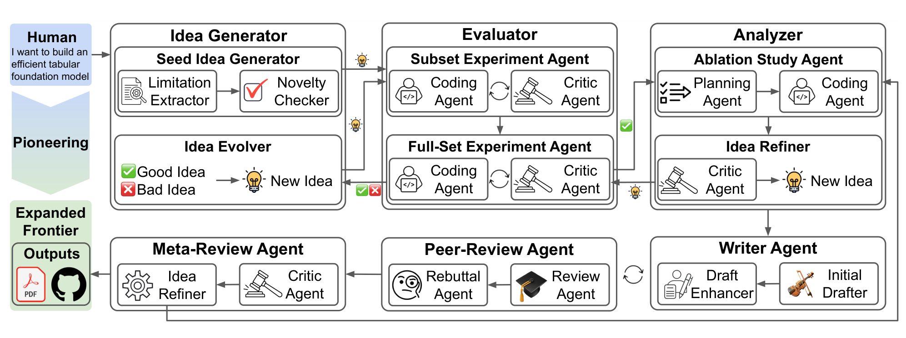
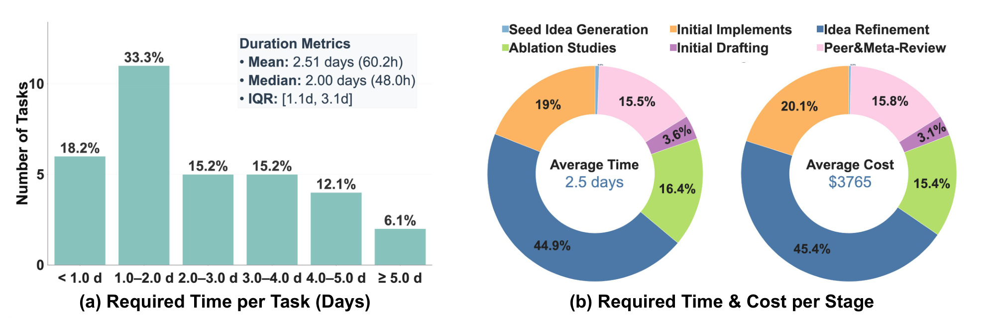
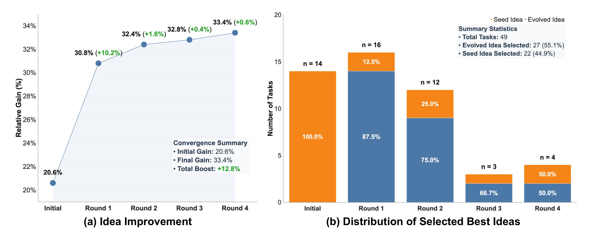
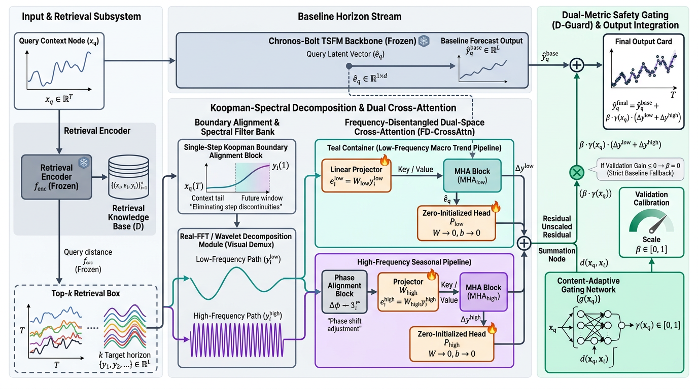

# ScientistTwo：让多智能体自己走完「找局限 → 改方法 → 做消融 → 写论文 → 自审」闭环

## 来源信息

| 项 | 内容 |
| --- | --- |
| 标题 | ScientistTwo: Pioneering the Human Knowledge Frontier with Autonomous AI |
| 作者 | Jaehyun Nam¹, Jinsung Yoon¹, Yanzhou Pan¹, Yubo Wang², Rui Meng¹, Parthasarathy Ranganathan¹, Tomas Pfister¹（¹ Google Cloud AI Research；² University of Waterloo） |
| 机构 | 第一机构为 **Google Cloud AI Research**；7 位作者中 6 位属该机构，Yubo Wang 属 University of Waterloo |
| 来源 | [arXiv:2609.19644v1](https://arxiv.org/abs/2609.19644v1)（cs.AI）。v1 提交于 2026-09-17 03:37 UTC；截至 2026-11-08，abs 页 submission history 只有 `[v1]`，为当前最新版 |
| 许可 | [CC BY 4.0](http://creativecommons.org/licenses/by/4.0/)（abs 页 "view license" 指向该协议） |
| 页数 | 71 页（PDF 页码与印刷页码一致）：正文 p1–18、References p19–27、附录 A–D p28–71 |
| 项目页 | <https://scientist-two.github.io/>（2026-11-08 访问：列出 86 份生成论文 PDF，按 8 个领域分组，路径形如 `generated-papers/<domain>/<subdomain>_<method>.pdf`；未发现代码仓库入口） |
| 代码 | **未发现公开代码仓库 URL**：论文正文、脚注与项目页都没有给出可运行代码库的下载地址。论文使用 "fully verified, executable codebases" 的表述；项目页另称 "the released code is re-run"（项目页渠道，2026-11-08 访问）。但外部目前只能读到 86 份论文 PDF，不能直接复核代码 |
| 阅读日期 | 2026-11-08 |
| 仓库编号 | 00227（本次新增；编号单元格指向 arXiv 官方页） |
| 配图 | `assets/figure3-overview.png`、`assets/figure9-ablation.png`、`assets/figure10-cost.png`、`assets/figure11-dynaspec-rag.png`（PDF p4/p13/p15/p17；前三张 300 dpi 渲染裁剪，Figure 11 抽取 PDF 内嵌图；许可 CC BY 4.0） |
| 版本说明 | 本笔记基于 arXiv v1。arXiv HTML 版从 Figure 4 起把 Listing 1 也编成 Figure 4，之后整体比 PDF 多 1（HTML 的 Figure 5–12 对应 PDF 的 Figure 4–11）；本笔记一律使用 **PDF 编号** |

**阅读范围与核对凭据**（供下次复核复用）

- **已获取全文**：从 arXiv 官方 `https://arxiv.org/pdf/2609.19644v1` 完整下载，26,081,865 B、71 页、sha256 `98fb7802ec28beea159895a3de219307e019867b16296dfe4a79e68daaef9a17`，文件尾为 `%%EOF`，`Content-Length` 与实际下载字节数一致。另从 alphaXiv 镜像 `https://pdfs.assets.alphaxiv.org/2609.19644v1.pdf` 下载同一文件，sha256 与官方版完全相同；两处可互相校验，不存在“同一 v1 的两个重编译副本”。
- **已逐项核对**：Table 2（p10）、Table 3/4（p12）、Table 5（p13）、Table 6/7（p14）、Table 8（p15）、Table 9/10（p16）、Table 11（p17）在 200–300 dpi 渲染页上对照正文数字；Figure 9（p13）、Figure 10（p15）、Figure 11（p17）单独渲染核对；Figure 1（p2）与 Figure 2（p3）在复核时用 180 dpi 渲染页目视核对（Figure 1(b) 的逐题分桶与 Figure 2 的 10 页缩略图）。Table 11 的 8 个方法 × 8 行全部按渲染页抄录，未做列合并。
- **图内读数**：Figure 9(a) 的 20.6% / 30.8% / 32.4% / 32.8% / 33.4% 与每轮增量、Figure 9(b) 的 n=14/16/12/3/4 与 27/49（55.1%）、Figure 10(a) 的 2.51 天 / 中位数 2.00 天 / IQR [1.1, 3.1]、Figure 10(b) 的 44.9% / 45.4% 等均为图内读数，已与正文/图注交叉；口径为“读图内直接标注的文字，不做像素测量”。
- **配图裁剪框**（pt，页面坐标系，300 dpi）：Figure 3 `(58, 74, 536, 252.5)` → 1993×745 px；Figure 9 `(58, 80, 536, 272)` → 1993×801 px；Figure 10 `(58, 214, 540, 371)` → 2009×655 px；Figure 11 直接抽取 PDF 内嵌图（1376×768 px，未缩放）。四张图均复核了边界：未包含题注、未切掉坐标轴/图例/图内说明行。
- **仅按正文/图注引用，未逐页核对**：附录 C 有 7 条 artifact + 1 个 rebuttal 示例（共 8 段；若把最后一条拆成 Spec 与 Method-Code 则 9 项），都是图片/代码截图；正文只读了目录与小标题，抽查了 p41–45 的层权重与审计片段。附录 D 的生成论文读了 p56–59、p62–65（p62–64 是 results/ablations），未逐页核对其 5 张图（Figure 1–5）与全部表格。项目页的 86 份 PDF 只核到列表与单条 URL 可达（其中一份 `Neuroscience_FCD-Engram.pdf` 的 `Content-Length` 为 2,551,163 B），未逐份下载。
- **未做**：未运行任何代码、未复现实验、未独立复算 86 篇论文的分数、未验证生成论文中 "GIFT-Eval −5.6% MSE" 与 "0.27M trainable parameters" 的实现细节；未对 86 份 PDF 做内容审计。
- **否定性断言检索**：在 PDF 全文检索 `https://github.com`、`code is available`、`open-source code`，未命中代码仓库；`github` 的命中只有 p1 的项目页 URL 与 p3 生成论文里提到的 RedPajama GitHub 数据。项目页 HTML 中的外部链接只有 arXiv、字体/CDN 与 PDF.js，无代码托管链接。检索日期 2026-11-08。

### 复核记录

- **2026-11-08 第一轮（check-paper-note）**：基准 arXiv:2609.19644v1，重新下载官方 PDF，26,081,865 B、71 页、sha256 `98fb7802ec28beea159895a3de219307e019867b16296dfe4a79e68daaef9a17`；核对前笔记 md5 `79a28da3207d2244a35c259e814e1890`。Table 2–11、Figure 1/2/9/10/11 与 3 个公式按 180–300 dpi 渲染页重核；另派独立子 agent 只读审计（其读到的 md5 与上同），其报告逐条复验后采纳。**修正 13 项**：① 补 Figure 1(b) 的逐题分桶图，删除“没有给每个任务的增益分布”的过强说法；② 补 Table 4 的 33/4 与输入集 38/5 的原文口径冲突（表注写 input papers，Appendix B 写 five ICLR submissions）；③ 补 Table 3 的 4/5、33/38、49/64 非配对比较；④ 修正 `A_Coder` 的复用范围（选优用 `A_Selector`，消融用 Ablation Planner/Coding Agent）；⑤ 修正 Table 7 的 method-code 归因（仅关 method-code 为 38/49，11/49；三 agent 全关才是 39/50）；⑥ 拆开 Table 7 表头，区分 refinement 标志与审计指标；⑦ 补 Table 9 的 Rating 来源与 Figure 2（6.5 与 Stanford 一致）；⑧ 补 Appendix B（p30）的“各自复现 baseline、不同硬件、Δ 非 head-to-head”与 Table 15 的 5 篇 ICLR 对比；⑨ 修正 Appendix C 的 artifact 数（7 条 + 1 个 rebuttal，拆最后一条才 9 项）与 Appendix D 的图数（5 张，p62–64 才是 results/ablations）；⑩ 修正页码 p11→p10、p15→p15–16；⑪ 把“同一组作者”改为“同机构/作者有重合”；⑫ 修正“同列”为“同一行/同一数据集”、3,800 与 3765 的关系、Table 8 的方差列、60.0%–96.9% 的措辞；⑬ 修正生成论文摘要 “strictly eliminating” 的表述（results 段 p62 承认 Electricity 0.1135 并解释为保守 β=0.350，笔记改为“未消除退步、只限制幅度”）。**未修/未核实**：Table 4 表注的 “input papers” 是原文自身口径问题，保留并注明；项目页 86 份 PDF、代码仓库缺失、`Content-Length 2,551,163 B` 由本人在 2026-11-08 访问项目页核验，独立子 agent 未复核；未运行代码、未复现实验，Appendix C/D 未逐页，86 份 PDF 未逐份审计。

---

## 核心结论

一句话：**ScientistTwo 把科研流程拆成 6 组 agent + 一条带 critic 关卡的闭环：给定一篇人类论文的问题与代码库，它自己找局限、生成并进化想法、先在子集上筛、再放大到全集、做消融归因、写稿，最后用模拟评审 + rebuttal + meta-review 反复改到“可接受”为止。**

结果层面，论文报告在 **107 个来自 ICLR 2026 / NeurIPS 2025 / ICML 2026 Spotlight 的题目**上成功改进 **86 个（80.4%）**，这些成功任务相对人类 SOTA 的平均提升 **25.2%**（中位数 **7.7%**）；生成论文在 ScholarPeer 上 **7.5/10、91.9% 接受率**，在 Stanford Agentic Reviewer 上 **5.7/10、72.1% 接受率**；在 33 个 NeurIPS 任务上测得平均 **2.51 天、3765 美元/任务**。

但读这篇要同时记住三个限定：

1. **“接受率”是 AI 评审代理的判定，不是真实投稿录用**。ScholarPeer 不仅是 in-distribution 评审器，其作者列表还与本文重合（Pfister、Yoon 等，见 References 的 Goyal et al. 2026）；Stanford Agentic Reviewer 是外部 held-out，但它的绝对接受率也没有与真实会议校准（Table 3 里已被会议接受的论文，在它下面的接受率跨度为 60.0%–96.9%；Agent4Science 2025 已接受的 AI 论文更是 0%）。
2. **25.2% 是均值，中位数只有 7.7%**。均值/中位数相差约 3.3 倍，说明分布被少数高增益任务拉高；论文的摘要与结论只用了均值。
3. **代码没有公开，完整性审计是自审**。Table 7 的 49/49、0/49、0/1814 看起来很强，但审计由系统自己的 Coding Agent 执行，外部无法用公开代码复核；项目页只托管论文 PDF。

## 问题与动机

作者的出发点是：现有 autonomous research agent 大多在**单个 benchmark 上优化单个标量指标**，缺少人类科学家那种“多数据集、多指标、做消融、被审稿人质疑后补实验”的闭环（§1，p1–2；§2，p3–4）。

论文把已有工作分成几类：

- **端到端论文生成**：AI Scientist（Lu et al., 2024）建立了自动化范式，但执行不稳定、写作有幻觉；AI Scientist-v2（Yamada et al., 2025）用 best-first tree search 和 review-based reporting 缓解。
- **模块化写作/评审**：PaperOrchestra（Song et al., 2026）把实验日志整理成 LaTeX 论文；ScholarPeer（Goyal et al., 2026）做多 agent 评审。
- **单指标代码优化**：AutoSOTA（Li et al., 2026d）在已有代码库里搜配置/超参，把论文的 headline result 压成一个数值目标。
- **可验证性导向**：ScientistOne（Meng et al., 2026）做 chain-of-evidence 与完整性审计，但作者认为它缺少“主动的分析扩展”（active analytical expansion）。

ScientistTwo 想补的正是这三件事：**多数据集/多指标评估、消融驱动的假设精炼、动态评审 + rebuttal 闭环**。形式化地，给定科学问题 `G`，系统 `A` 输出论文 `P+` 与可复现代码库 `C+`：

```math
(\mathcal{P}^{+},\mathcal{C}^{+})=\mathcal{A}(\mathcal{G}),\qquad
\mathcal{A}=\{\mathcal{A}_{1},\mathcal{A}_{2},\dots,\mathcal{A}_{N_{\mathrm{a}}}\}
```

读法：`A` 不是单个模型，而是一组按科研阶段分工的 agent；输入是问题，输出是“论文 + 代码”这一对产物。论文强调 `P+` 要指出并解决 `G` 中的方法/经验瓶颈，`C+` 要正确实现想法并保持可复现。

## 系统总览

Figure 3 把系统画成 6 组 agent：

- **Idea Generator**：Limitation Extractor → Novelty Checker；Idea Evolver 根据好/坏想法的执行轨迹生成新想法。
- **Evaluator**：Subset Experiment Agent（Coding + Critic）先在子集上筛；Full-Set Experiment Agent 再放大到全集。
- **Analyzer**：Ablation Study Agent（Planning + Coding）做组件消融；Idea Refiner 根据消融结果改方法。
- **Writer**：Initial Drafter + Draft Enhancer。
- **Peer-Review**：Review Agent + Rebuttal Agent。
- **Meta-Review**：Idea Refiner + Critic Agent，决定接收还是回到上游重做。



*Figure 3（p4）：人类只给出问题（左上 "Human"），其余阶段由 agent 组完成；底部 Meta-Review 的反馈会回到 Idea Generator/Evaluator，形成闭环。*

所有阶段共享同一个控制模式（Listing 1，p5）：**生成候选 → critic 判定 → accept 则返回 / refine 则带反馈重做 / reject 则丢弃**，每个阶段有最大轮数。这个模式看似简单，但它是整篇论文的“控制平面”：后面的子集筛选、消融归因、评审 rebuttal 都是它的实例。

| 阶段 | 候选产物 | Critic 判据 | 不通过时 |
| --- | --- | --- | --- |
| 找局限 | limitations 集合 | 是否足以指导新的改进 | 补漏，最多 16 轮 |
| 种子想法 | `N_seed` 个 idea + novelty 分数 | 是否新颖 | 继续生成更多想法 |
| 子集基线 | 复现的 SOTA 结果与代码 | — | — |
| 子集实验 | idea / code / results | 是否稳定优于**复现的** baseline | `Bad` 丢弃；`Engineer` 调参/改代码，最多 2 轮 |
| 全集实验 | full-set results | 是否优于**原始论文的** SOTA | 继续工程 |
| 想法进化 | evolved idea + 执行轨迹 | 实验是否成功 | 用轨迹再进化 |
| 选最佳 | `h_best` | 跨指标/日志比较 | — |
| 消融 | `N_p` 个 ablation 结果 | 组件归因是否干净 | 改方法，最多 1 轮 |
| 初稿 | manuscript | — | — |
| 模拟评审 | review + score | 分数是否达到 8 | 规划并执行 rebuttal 实验，最多 2 轮 |
| Meta-review | accept / refine | 是否达到 venue bar | 改 idea 并重跑，最多 1 轮 |

这张表是 Table 1（p5）与 §3 的压缩版；原文的 Table 1 还列出了每个阶段对应的 refinement agent。

## 分阶段机制

### 1. 找局限与种子想法（§3.1，p6）

Limitation Extractor 先从问题 `G` 中抽取一组局限；Limitation Verifier 判断这组局限是否“足以指导新的改进”。不够就回到 Extractor 补漏，最多 16 轮。然后 Idea Generator 生成初始想法 `h_0`，Novelty Checker 打分；从 `H_0={h_0}` 开始迭代扩展，直到收集 `N_seed` 个候选，再按 novelty 分数降序排列。

一个值得注意的实现细节：**novelty 判断只检索两篇参考论文**（Appendix A.2，p30："ScientistTwo retrieves two reference papers via Google Search"）。这比“完整文献综述”窄得多；它能过滤明显重复，但不能保证相对于整个领域的新颖性。论文没有报告 novelty checker 与人类/外部检索的一致性。

### 2. 从子集到全集：两级 baseline（§3.2，p6–7）

这一节有两个设计值得单独记：

**第一，先复现 baseline，再谈改进。** Baseline Coding Agent 先在 benchmark 子集上复现 `G` 的主实验，得到 `E_base` 与 `C_base`。子集上的 idea 是与 `E_base` 比，而不是与论文里报告的数字比；这样可以把“复现差距”和“想法本身的好坏”分开。

**第二，三路判决而不是二路。** 对每个候选 `h`，Subset Critic 输出：

- `Bad`：明显差于 baseline，直接丢弃；
- `Good`：稳定优于 baseline，允许放大到全集；
- `Engineer`：有潜力但需要调参/改代码，交给 Subset Engineering Agent，最多 `N_eng=2` 轮；两轮后仍不是 `Good` 就当 `Bad` 剪掉。

这个 `Engineer` 分支很关键：它避免“因为初始超参不好就误杀一个好想法”，同时用轮数上限防止无限调参。全集阶段再用 Full-Set Coding Agent 改写代码，并与**原始论文的 SOTA 结果**比较；只有全集也过线，才得到最终的 `d^h`。

整个“想法 → 代码 → 结果”的流程被抽象成一个统一接口：

```math
h,\mathcal{E}^{h},\mathcal{C}^{h},d^{h},r^{h}
=\mathcal{A}_{\mathrm{Coder}}(\mathcal{G},h)
```

读法：给问题 `G` 和想法 `h`，Coder 返回想法本身、实验结果 `E^h`、代码 `C^h`、判决 `d^h` 与反馈 `r^h`。进化与候选评估复用这个接口；选优用 `A_Selector`（式 4，p8），消融另有 Ablation Planner/Coding Agent（§3.4，p8），并不都走 `A_Coder`。

### 3. 想法进化：利用执行轨迹，同时保留探索（§3.3，p7–8）

第 0 轮执行 top-`N_0` 个种子想法，得到轨迹集合 `R_0`。第 `k≥1` 轮：

- **利用（exploitation）**：Idea Evolver `A_Evolve` 汇总历史轨迹，把好/坏结果作为反馈，生成进化后的候选 `I_k`；
- **探索（exploration）**：从 `H_0` 里按 novelty 顺序取 `N_e` 个**尚未评估**的种子，加入候选池，避免只在早期种子附近打转。

候选池 `H_k = I_k ∪ H_0^(k)`。每个候选都走一遍 `A_Coder`，得到 `R_k`。终止条件：累计 `S` 个 `d^h=Good` 的成功想法，或达到最大轮数 `K`；如果到 `K` 轮一个成功都没有，整个任务终止（不写论文）。

```math
\sum_{i=0}^{k}\sum_{h\in\mathcal{H}_i}\mathbb{I}(d^{h}=\mathrm{Good})\ge S
```

读法：把第 0 到第 `k` 轮所有候选的“是否 Good”指示函数加起来，达到 `S` 就停。配置里 `S=4`、`K=4`，每轮评估 2 个候选（1 个种子 + 1 个进化想法，A.2 p30）。

找到至少一个成功想法后，Selector Agent `A_Selector` 比较所有 `Good` 想法在全集上的指标与日志，选出 `h_best`。这一步没有新的实验，只是跨候选比较。

### 4. 消融：把“涨点”拆成可归因的组件（§3.4，p8）

Ablation Planner 针对 `h_best` 生成 `N_p` 个可执行消融计划；Ablation Coding Agent 在每个计划上改 `C_best` 并执行，得到 `E_abl`。然后 Ablation Critic 判断“组件拆解是否干净”：

- `Good`：`h_best` 定稿，进入写作；
- `Refine`：说明某些组件可能冗余/反效果，交给 Full-Set Engineering Agent 生成 `h_new`，最多 `N_abl=1` 轮。

这里有一个**防回归检查**：只有当 `E_new` 被 Result Comparison Agent 判为严格优于 `E_best` 时，才把 `(h_best, E_best, C_best)` 替换成新版本；否则保留旧版本。发生替换才重新跑消融。这个“先验证再接受”的检查，比“让 LLM 说改得更好”要稳。

消融阶段也是全文最有工程借鉴价值的部分：它不只问“新方法是否涨点”，还问“涨点是否来自我声称的那个组件”。Appendix B 的 TeCh 案例（p31）是一个具体例子：ScientistTwo 的 DMC-TeCh 在 6 个指标里赢了 5 个，但 Ablation Critic 发现增益主要来自 EMA + label smoothing 这类通用训练控制，而不是提出的 multi-core 架构，于是**拒绝把它算作贡献**。这是一个“归因门槛”，与 AutoSOTA 的“指标动了就算成功”形成鲜明对比。

### 5. 写作、模拟评审与 rebuttal（§3.5，p8–9）

Initial Drafter（集成了 PaperOrchestra）把 `h_best`、主结果 `E_best`、消融 `E_abl` 合成一篇会议格式的稿子 `P_new`。

然后 Peer Reviewer（即 ScholarPeer）按 ICLR 的 1–10 分制评审，给出 strengths / weaknesses / questions / `s_review`。如果分数低于阈值（论文举的例子是 8），进入 rebuttal：

1. Rebuttal Planner 把审稿意见拆成 `N_t` 个补充实验任务；
2. Rebuttal Coding Agent 在 `C_best` 上实现并执行每个任务，得到 `E_reb`；
3. Paper Enhancer 把审稿意见与补充结果写回稿子，更新叙述、表格与图；
4. 再送 Reviewer，最多 `N_peer=2` 轮。

这里的 rebuttal **不是改文字**，而是“审稿人问什么就补做什么实验”；这是它与普通“LLM 改稿”最大的区别。

### 6. Meta-review：最后一道门（§3.6，p9）

Meta-Review Agent 同时看稿子 `P_new` 与评审 `R_new`，输出 `d_meta ∈ {Accept, Refine}` 和 meta-critique `r_meta`。

- `Accept`：定稿，输出 `P+ = P_new`、`C+ = C_best`。
- `Refine`：说明 meta-reviewer 发现了算法/经验上的关键弱点；用 `r_meta` 指导 Full-Set Engineering Agent 改 `h_best`，得到 `h_new/E_new/C_new`。只有 `E_new` 严格优于 `E_best` 才更新核心状态；更新后重跑消融、重写、再审。最多 `N_meta=1` 轮。
- 如果 refinement 没有超过 baseline，就丢弃，用之前的 `P_new/C_best` 结束。

## 配置与成本

Appendix A.2（p30）给出的关键配置：

| 项 | 设置 |
| --- | --- |
| 基础模型 | 所有 agent 默认 Gemini 3.6 Flash；Idea Experiment Coding Agent、Ablation Study Agent、Rebuttal Agent、Draft Enhancer 用 Claude Code + Claude Opus 4.8 |
| novelty 检索 | Google Search，检索 2 篇参考论文 |
| 找局限 | 最多 16 轮 |
| 想法实验 | 每轮 2 个候选（1 个种子 + 1 个进化）；最多 4 轮；拿到 4 个成功想法提前停 |
| 工程精炼 | 最多 2 轮 |
| 消融后精炼 | 最多 1 轮 |
| 模拟评审 | 最多 2 轮；ScholarPeer 分数达到 8 提前停 |
| 评审驱动的想法精炼 | 最多 1 轮 |
| 论文格式 | ICLR 2025（沿用 PaperOrchestra） |

成本在 33 个 NeurIPS 2025 任务上统计（§4.3，p15；Figure 10）：

- **平均 2.51 天/任务**（中位数 2.00 天，IQR [1.1, 3.1]）；分布：<1 天 18.2%、1–2 天 33.3%、2–3 天 15.2%、3–4 天 15.2%、4–5 天 12.1%、≥5 天 6.1%。
- **平均 3765 美元/任务**，含 token 与虚拟机成本。
- 阶段占比（时间 / 成本）：Idea Refinement **44.9% / 45.4%**；Initial Implementations **19% / 20.1%**；Ablation Studies **16.4% / 15.4%**；Peer & Meta-Review **15.5% / 15.8%**；Initial Drafting **3.6% / 3.1%**；Seed Idea Generation 约 **0.6% / 0.2%**（图中未标注，按 100% 减其余阶段推算）。



*Figure 10（p15）：左图是 33 个任务的耗时分布；右侧两个环图分别是时间与成本按阶段的占比。图中最大的两块都是 Idea Refinement（约 45%）。*

一个直接的工程推论：**钱主要花在“反复做想法实验”上，而不是写作或评审**。如果想压成本，优先砍 idea refinement 的轮数或做并行；但要注意 Figure 9(a) 的收益曲线（见下）显示后期轮次的边际收益已经很小。

## 实验与证据

### 共同设置

- **107 个任务**：ICLR 2026 5 篇、NeurIPS 2025 38 篇、ICML 2026 Spotlight 64 篇（Appendix A.1，p28–29）。任务来自 AutoSOTA 用过的 benchmark，ICML 的 64 篇是按 AutoSOTA 的过滤流程从 spotlight 里选的。
- **输入**：每篇论文的问题描述与代码库；目标是改进其人类 SOTA。
- **评审**：ScholarPeer（in-distribution，作者自己用它参与 refinement）与 Stanford Agentic Reviewer（held-out，外部服务 <https://paperreview.ai/>）。
- **模型**：Gemini 3.6 Flash + Claude Opus 4.8（除 Table 8 的 Antigravity 变体）。
- **成功定义**：产出的方法在完整 benchmark 上超过人类 SOTA，并且增益能通过消融归因到提出的机制（Appendix B，p30–31：ScientistTwo "has no target metric"、要求 gain attributable to the proposed mechanism，且评估整张 benchmark grid 而非单一 split）；同时生成论文与代码。具体判据由 critic/结果比较 agent 给出，论文没有给统一的统计检验。

### 主结果：对其它 autonomous research agent

Table 2（p10）比较了 8 个系统；ScientistTwo 的 86 篇生成论文在 ScholarPeer 上 7.5±1.3、91.9% 接受率，在 Stanford Agentic Reviewer 上 5.7±0.6、72.1% 接受率。所有基线在 Stanford Agentic Reviewer 上都是 0%。Figure 1(b)（p2）还把 107 个任务画成逐题径向条形图，按相对增益分桶着色（含 Failed to Improve）；所以“逐题分布”不是完全没有，但只有分桶、没有逐题精确值与误差。

| Framework | # Papers | ScholarPeer Avg. | ScholarPeer Accept | Stanford Avg. | Stanford Accept |
| --- | ---: | ---: | ---: | ---: | ---: |
| AI-Researcher | 7 | 1.0±0.0 | 0.0 | 2.4±0.6 | 0.0 |
| CycleResearcher | 6 | 1.0±0.0 | 0.0 | 2.8±1.0 | 0.0 |
| AI Scientist-v2 | 3 | 2.0±1.0 | 0.0 | 2.5±0.2 | 0.0 |
| AutoResearchClaw | 4 | 2.5±1.0 | 0.0 | 3.7±0.5 | 0.0 |
| Zochi | 2 | 3.0±0.0 | 0.0 | 2.9±0.6 | 0.0 |
| DeepScientist | 3 | 3.0±0.0 | 0.0 | 4.1±0.6 | 0.0 |
| ScientistOne | 21 | 3.8±1.2 | 14.3 | 4.1±0.7 | 0.0 |
| **ScientistTwo (Ours)** | **86** | **7.5±1.3** | **91.9** | **5.7±0.6** | **72.1** |

读法：相对最强的先前系统 ScientistOne，ScholarPeer 从 3.8 提到 7.5（约 1.97 倍，本笔记复算）；Stanford 从 4.1 提到 5.7。但要注意两边的 `# Papers` 与论文来源不同：基线是各自公开的 2–21 篇，ScientistTwo 是 86 篇成功任务的论文；这不是同一任务集上的配对比较。

### 与人类已接收论文比

Table 3（p12）把“人类已接收论文”和“ScientistTwo 生成的论文”放在同一套 AI 评审下：

| Venue | # Papers | ScholarPeer Avg. | ScholarPeer Accept | Stanford Avg. | Stanford Accept |
| --- | ---: | ---: | ---: | ---: | ---: |
| Agent4Science 2025 Accepted† | 4 | 3.0±0.0 | 0.0 | 3.8±0.4 | 0.0 |
| ICLR 2026 Accepted | 5 | 6.8±1.6 | 60.0 | 5.2±0.7 | 60.0 |
| NeurIPS 2025 Accepted | 38 | 6.2±1.9 | 65.8 | 5.5±0.7 | 76.3 |
| ICML 2026 Spotlight | 64 | 6.9±1.5 | 79.7 | 6.1±0.5 | 96.9 |
| **ScientistTwo ICLR 2026†** | 4/5 | 7.0±1.2 | 100.0 | 5.4±0.2 | 75.0 |
| **ScientistTwo NeurIPS 2025†** | 33/38 | 7.3±1.7 | 87.9 | 5.6±0.7 | 75.8 |
| **ScientistTwo ICML 2026†** | 49/64 | 7.6±1.0 | 93.9 | 5.7±0.6 | 69.4 |
| **Overall†** | **86/107** | **7.5±1.3** | **91.9** | **5.7±0.6** | **72.1** |

逐项看：

- ICLR：ScholarPeer 7.0 vs 6.8（+0.2），Stanford 5.4 vs 5.2（+0.2）；生成论文在 4/5 个题目上成功。
- NeurIPS：ScholarPeer 7.3 vs 6.2（+1.1），Stanford 5.6 vs 5.5（+0.1）；33/38 成功。
- ICML：ScholarPeer 7.6 vs 6.9（+0.7），但 **Stanford 5.7 vs 6.1（−0.4）**；49/64 成功。

所以“超过 ICLR 2026 与 NeurIPS 2025 已接收论文的平均分”这句话在表内成立，但优势在 Stanford 上只有 0.1–0.2 分；ICML 的 Stanford 列反而是下降的。论文在正文里只挑了 ICLR/NeurIPS 来说，是选择性表述，不是错，但读者应把 ICML 的下降一起看。还要注意：4 vs 5、33 vs 38、49 vs 64 是不同论文集合的均值，不是同一批论文的配对比较；“超过人类平均分”只能理解为成功子集均值 vs 全体已接收论文均值。

另外，`86/107` 的分母是“尝试过的题目”，而 Table 2/3 的接受率分母是“成功生成的论文”（86），不是 107。若按尝试次数粗算：ScholarPeer 91.9% × 86 ≈ 79 篇，79/107 ≈ 73.8%；Stanford 72.1% × 86 ≈ 62 篇，62/107 ≈ 57.9%（本笔记复算，假设接受篇数可由比例反推，且不接受的任务按未接收计）。论文没有报告这个口径。

### 与 AutoSOTA 比：总体赢，ICLR 输

Table 4（p12）比较“成功任务上的相对提升”：

| Framework | # Papers | Overall Med. | Overall Avg. | NeurIPS Med. | NeurIPS Avg. | ICLR Med. | ICLR Avg. |
| --- | ---: | ---: | ---: | ---: | ---: | ---: | ---: |
| AutoSOTA | 105 | 2.7 | 7.5 | 3.7 | 8.5 | 5.0 | 7.2 |
| **ScientistTwo** | **86** | **7.7** | **25.2** | **7.0** | **13.9** | **2.2** | **3.8** |

三个观察：

1. **总体均值与中位数都赢**：25.2 vs 7.5，7.7 vs 2.7。但 25.2 与 7.7 的差距说明分布长尾很重；摘要只引用 25.2。
2. **NeurIPS 子集赢**：13.9 vs 8.5（均值），7.0 vs 3.7（中位数）。
3. **ICLR 子集输**：3.8 vs 7.2（均值，约为对方的 53%），2.2 vs 5.0（中位数，约为 44%）。论文正文写的是 "performance drops slightly in the ICLR 2026 tasks"，但按表值这是接近“腰斩”，不是轻微下降。

Appendix B（p30）还明确：两系统各自相对**自己复现的 baseline**、在不同硬件上测量，两个 Δ 列不是同一指标上的 head-to-head；Table 15 的 5 篇 ICLR 对比更直接：AutoSOTA 5/5 有报告增益、ScientistTwo 4/5；新算法组件 0/5 vs 4/4；全 benchmark 评估 0/5 vs 4/4；组件级归因 none vs 5–6 ablations/paper。

还有一个口径问题：AutoSOTA 的 105 篇与 ScientistTwo 的 86 篇不是同一成功子集，Overall 的 105 vs 86 不是配对比较。Table 4 表注写的是 "same set of 33 and 4 input papers"，但 Table 3/Appendix A.1 的输入集是 NeurIPS 38、ICLR 5，Appendix B（p30）又明确 "same five ICLR 2026 submissions"——33/4 应是两系统共同评估的成功子集，表注的 "input papers" 与正文口径不一致（原文自身问题）。增益的提取方式是“用 Gemini 3.6 Flash 解析主表 10 次取平均”，没有人工复核或方差报告；这也意味着 Table 4 的数字不是原始日志的直接汇总。

### 消融：评审轮次与想法进化

Table 5（p13）在 49 个 ICML 任务上做评审消融（round 2 的 7.6/93.9、5.7/69.4 与 Table 3 的 ICML 行完全一致，说明这一组就是 ICML 子集）：

| Framework | Review Round | Rebuttal | ScholarPeer Avg. | ScholarPeer Accept | Stanford Avg. | Stanford Accept |
| --- | ---: | :---: | ---: | ---: | ---: | ---: |
| ScientistOne | — | — | 3.8±1.2 | 14.3 | 4.1±0.7 | 0.0 |
| ScientistTwo (Variant) | 0 | ✗ | 5.2±2.2 | 46.9 | 5.6±0.5 | 49.0 |
| ScientistTwo (Ours) | 1 | ✓ | 6.9±1.6 | 79.6 | 5.8±0.6 | 73.5 |
| ScientistTwo (Ours) | 2 | ✓ | 7.6±1.0 | 93.9 | 5.7±0.6 | 69.4 |

读法：

- 不做 rebuttal 的初稿（round 0）已经有 5.2/5.6 与约 47%–49% 的接受率，说明前面的实验/消融对写作质量有贡献；这正是作者想强调的“不是靠评审器刷分”。
- 第一轮 rebuttal 提升最大：ScholarPeer +1.7 分、+32.7 个百分点；Stanford +0.2 分、+24.5 个百分点。
- **第二轮 ScholarPeer 继续升到 7.6，但 Stanford 的接受率从 73.5% 降到 69.4%，均分从 5.8 降到 5.7**。论文只强调了“第一轮效果显著”，没有讨论第二轮的 held-out 回落。这说明“继续按 ScholarPeer 改”可能在 in-distribution 上过拟合。

Figure 9（p13）在 49 个 ICML 任务上拆开“想法进化”的收益：

- (a) 初始种子的平均相对增益已经是 **20.6%**；Round 1 → 30.8%（+10.2），Round 2 → 32.4%（+1.6），Round 3 → 32.8%（+0.4），Round 4 → 33.4%（+0.6）。总提升 +12.8 个百分点。
- (b) 49 个任务中，最终最佳想法来自 **evolved idea 27 个（55.1%）**、来自 seed idea 22 个（44.9%）；Round 1 有 87.5% 的最佳想法是进化来的，但到 Round 4 只有 50%。



*Figure 9（p13）：左图的斜率在 Round 1 之后迅速变平；右图显示进化想法在早期轮次占主导，但最终只以 55.1% 对 44.9% 略多于种子想法。*

工程含义：**种子质量决定了大部分收益，进化主要贡献前 1–2 轮的增量**。如果成本紧张，Round 3/4 的 +0.4/+0.6 很难为其占用的 45% 成本提供理由；但这是 49 个 ICML 任务上的读数，成本占比是 33 个 NeurIPS 任务上的统计，两者任务集不同，不能直接乘。

### 单案例：review-driven 的想法精炼

Table 6（p14）用一个具体任务（TOFU `forget10`，Llama-3.2-1B-Instruct）展示 Meta-Review 如何把 `LFR-Engram` 改成 `FCD-Engram`：

| Author | Method | Meta-Rev. | Overall↑ | Mem.↑ | Util.↑ | Priv.↑ | EM↓ | FQ↑ |
| --- | --- | :---: | ---: | ---: | ---: | ---: | ---: | ---: |
| Kwon et al. (2026) | Engram | — | 0.705 | 0.922 | 0.871 | 0.495 | 0.004 | −0.551 |
| ScientistTwo (Variant) | LFR-Engram | ✗ | 0.897 | 0.963 | 0.917 | 0.824 | 0.084 | −0.014 |
| **ScientistTwo (Ours)** | **FCD-Engram** | ✓ | **0.916** | **0.969** | **0.926** | **0.860** | **0.071** | **−0.001** |

FCD 相对 LFR 在 6 个指标上全部更好（Overall +0.019、Mem +0.006、Util +0.009、Priv +0.036、EM −0.013、FQ +0.013）。但相对人类 Engram，EM 仍然差很多（0.071 vs 0.004，越低越好）；论文说“consistently outperforms LFR-Engram”是准确的，但不能读成“全面超过人类 baseline”。这是一个单任务、单模型的案例，没有方差/重复。

### 完整性审计：四个维度，49 篇论文

Table 7（p14）报告 CoE Integrity Audit。前三个 ✓/✗ 表示对应的 refinement agent 是否启用，不是审计结果；后四列才是审计指标：

| Framework | Refine: Spec. | Refine: Ref. | Refine: Method | Score Verif.↑ | Spec. Violat.↓ | Ref. Verif.↓ | Method-Code↑ |
| --- | :---: | :---: | :---: | ---: | ---: | ---: | ---: |
| ScientistTwo (Variant) | ✗ | ✗ | ✗ | 50/50 | 1/50 | 19/1840 | 39/50 |
| ScientistTwo (Variant) | ✓ | ✗ | ✗ | 49/49 | 0/49 | 19/1817 | 38/49 |
| ScientistTwo (Variant) | ✓ | ✓ | ✗ | 49/49 | 0/49 | 0/1814 | 38/49 |
| **ScientistTwo (Ours)** | ✓ | ✓ | ✓ | **49/49** | **0/49** | **0/1814** | **49/49** |

读法：

- 最后一行的四个维度都过：49 篇论文的报告分数都能复跑、0 个规格违规、0 个幻觉引用（1,814 条引用全查过）、49 篇的论文方法与代码一致。
- 去掉对应 refinement agent 会看到失败：不做 reference verification 时 1,840 条引用里 19 条是幻觉（约 1.0%）；仅关 method-code（第 3 行）时 38/49 对齐，即 11/49 不一致（约 22.4%）；三个 refinement agent 全关（第 1 行）时 39/50 对齐，即 11/50 不一致（22%）；不做 spec 过滤时有 1/50 的代码存在 reward hacking。
- **但这是自审**：审计由系统自己的 Coding Agent 完成，论文没有说明审计 agent 与被审代码是否完全隔离，也没有给外部复核入口。Table 7 的 49 篇是哪个子集，论文没有明说；49 与 ICML 2026 的 49 个成功任务吻合，但不能仅凭数字断定。
- 第一行的 `50/50` 与脚注（p15）的“额外完成一个任务，但因 reward hacking 必须过滤”存在分母口径差异：50 篇里包含那 1 篇最终被过滤的；后续行用 49。读表时应把 50/49 看成“含被过滤样本”和“过滤后”的两个口径，而不是同一分母。

### 跨 coding agent 的泛化

Table 8（p15）只换了 coding backend，在 5 个 ICLR 2026 任务上跑：

| Coding Agent | SR | Avg. Gain | ScholarPeer Avg. | ScholarPeer Accept | Stanford Avg. | Stanford Accept |
| --- | ---: | ---: | ---: | ---: | ---: | ---: |
| Claude Code (Opus 4.8) | 80.0 | 3.8 | 7.0±1.2 | 100.0 | 5.4±0.2 | 75.0 |
| Antigravity (Gemini 3.8 Flash) | 60.0 | 16.7 | 6.3±1.5 | 66.7 | 4.8±1.0 | 66.7 |

Claude Code 这一行与 Table 3 的 ICLR 2026 行完全相同（4/5、7.0、100、5.4、75.0），说明它复用了同一组 5 个 ICLR 任务，不是新的 5 个题。Antigravity 的 SR 只有 3/5，但成功案例的平均增益更高（16.7 vs 3.8）——样本太小，不能据此说“换 backend 不影响结论”，只能说“3/5 能跑通，且论文声称审计维度仍通过”。

### 人工评审：33 篇论文、9 位评审

Table 10（p16）对 33 篇 NeurIPS 来源的生成论文做人类评审：

| Focus Aspect | Standalone (1–5) | Relative to Human (1–5) |
| --- | ---: | ---: |
| Introduction (Motivation & Related Works) | 4.2 | 3.1（Human < ScientistTwo） |
| Method (Soundness & Algorithmic Rigor) | 4.1 | 2.9（Human > ScientistTwo） |
| Experiment (Baseline & Benchmark) | 4.0 | 3.5（Human < ScientistTwo） |
| Experiment (Ablations) | 4.3 | 3.3（Human < ScientistTwo） |
| Experiment (Insight & Limitation Analysis) | 4.0 | 3.3（Human < ScientistTwo） |
| Overall (Scientific Maturity & Top-Tier Venue Readiness) | 3.7 | 3.0（Human = ScientistTwo） |

读法：

- 单独评分都在 3.7–4.3（5 分制），作者把 >3.0 解释为“正向认可”；但 3.7 的 Overall 只是“略高于中立”。
- 相对评分里，Method 是 2.9（人类略好），Overall 恰好 3.0（持平），其余维度略偏向 ScientistTwo（3.1–3.5）。
- **协议信息不足**：33 篇论文由 9 位评审评，论文没有说明每篇几个人评、是否盲评、评审是否是作者/同机构、是否有标注指南、评审间一致性如何、是否给了置信区间。只有均值，没有方差。这是全文最弱的一块证据。

### 案例研究：DynaSpec-RAG

§4.3（p17–18）用 DynaSpec-RAG 展示“系统自己提出的方法”长什么样：在冻结的时序基础模型输出空间上做检索增强，包含边界对齐、real-FFT 频带分解、逐时间步 gating、validation-calibrated 的 do-no-harm fallback；只训练 0.27M 参数（生成论文自己报告，相对 200M+ backbone 约 0.1%）。



*Figure 11（p17）：左侧是检索子系统，中间是 Chronos-Bolt 冻结 backbone 与频带分解/双 cross-attention，右侧是 D-Guard 与输出融合。*

Table 11（p17）报告 7 个 zero-shot benchmark 的 MSE/MAE：

| Method | DynaSpec-RAG | TS-RAG | Chronos-Bolt B | MOMENT | TTM B | Moirai B | TimesFM | Chronos B |
| --- | --- | --- | --- | --- | --- | --- | --- | --- |
| ETTh1 | 0.3467 / 0.3627 | 0.3557 / 0.3624 | 0.3616 / 0.3650 | 0.3920 / 0.4110 | 0.3619 / 0.3710 | 0.3686 / 0.3835 | 0.4254 / 0.3825 | 0.4217 / 0.3806 |
| ETTh2 | 0.2399 / 0.2970 | 0.2451 / 0.2982 | 0.2517 / 0.2992 | 0.2742 / 0.3327 | 0.2531 / 0.3032 | 0.2547 / 0.3053 | 0.2894 / 0.3233 | 0.2659 / 0.3136 |
| ETTm1 | 0.2803 / 0.3090 | 0.2906 / 0.3114 | 0.3109 / 0.3185 | 0.3506 / 0.3834 | 0.3152 / 0.3248 | 0.5399 / 0.4322 | 0.3321 / 0.3326 | 0.3935 / 0.3695 |
| ETTm2 | 0.1428 / 0.2219 | 0.1466 / 0.2231 | 0.1487 / 0.2236 | 0.1703 / 0.2579 | 0.1511 / 0.2405 | 0.1958 / 0.2687 | 0.1703 / 0.2552 | 0.1663 / 0.2522 |
| Weather | 0.1397 / 0.1749 | 0.1454 / 0.1771 | 0.1525 / 0.1825 | 0.1801 / 0.2384 | 0.1543 / 0.1893 | 0.1711 / 0.1912 | — / — | 0.1897 / 0.2107 |
| Electricity | 0.1135 / 0.2059 | 0.1120 / 0.2002 | 0.1132 / 0.2004 | 0.1967 / 0.3028 | 0.1715 / 0.2643 | 0.1832 / 0.2814 | — / — | 0.1460 / 0.2237 |
| Exchange | 0.0615 / 0.1704 | 0.0627 / 0.1718 | 0.0673 / 0.1780 | 0.0979 / 0.2059 | 0.0657 / 0.1725 | 0.0663 / 0.1720 | 0.0695 / 0.1802 | 0.0831 / 0.1879 |
| **Average** | **0.1892 / 0.2488** | **0.1940 / 0.2492** | 0.2008 / 0.2525 | 0.2374 / 0.3046 | 0.2104 / 0.2665 | 0.2542 / 0.2906 | 0.2573 / 0.2948 | 0.2380 / 0.2769 |

关键读数：

- 平均 MSE 从 TS-RAG 的 0.1940 降到 0.1892，相对约 **2.5%**；MAE 从 0.2492 到 0.2488，几乎持平（本笔记复算）。
- **Electricity 上 DynaSpec-RAG 反而更差**：MSE 0.1135 vs TS-RAG 0.1120（差 1.34%），MAE 0.2059 vs 0.2002（差 2.85%）；同一行/同一数据集的 Chronos-Bolt B 的 MSE 是 0.1132，也比 DynaSpec-RAG 略低。ETTh1 的 MAE 也以 0.3627 vs 0.3624 略差。
- 因此正文“it consistently surpasses strong baselines across standard benchmarks（see Table 11）”这个 “consistently” 与表值不符；更准确的说法是“平均更好，但 Electricity 一项明显退步”。
- 生成论文的摘要还写了“strictly eliminating negative transfer through validation-calibrated baseline fallback”；results 段（p62）其实承认 Electricity 的 0.1135，并解释为 D-Guard 选了保守 β=0.350、优先稳定而不是继续叠加 shift。但摘要的 “strictly eliminating” 仍与相对 TS-RAG 的退步不符：它没有消除这一格，只是限制了幅度。

Table 9（p16）展示“用自己发现的方法作为下一轮上下文”的迭代前沿：人类 Jiang & Gong (2026) → VD-STrans（+10.9%）→ BXT-Transducer（相对 VD +9.6%）→ SBR-Transducer（相对 BXT +8.2%）。如果按乘法复合，三轮累计相对人类约 **31.5%**（本笔记复算：1.109 × 1.096 × 1.082 ≈ 1.315）；论文没有给这个累计值，也没有给每一轮的方差/重复。三个方法的评审分是 6.5、5.6、7.1，与增益大小并不同向。Table 9 没有注明 Rating 的来源；Figure 2（p3）对同一 VD-STrans 给出 ScholarPeer 8.0 / Stanford 6.5，表里的 6.5 与 Stanford 一致，但 BXT/SBR 的评分来源未说明。Figure 2 本身是同一案例的 10 页缩略图，caption 写 10.9% 提升与 8.0/6.5 两个分数。

## 证据分级

按“系统/harness 类技术报告”的口径，把核心主张与证据强度分开：

| 主张 | 主要证据 | 证据等级与理由 |
| --- | --- | --- |
| 107 题中 86 题成功（80.4%），平均相对提升 25.2% | Table 3/4、全部任务清单（App. A.1） | **中**：任务清单与表格完整；但增益由 Gemini 解析 10 次取平均，未独立复跑；均值/中位数差距大 |
| 生成论文达到顶会接受线（ScholarPeer 91.9%、Stanford 72.1%） | Table 2/3 | **低–中**：两个 AI 评审代理；ScholarPeer 与作者同组且用于 refinement；无真实投稿录用 |
| 代码可执行、可复现、无幻觉引用 | Table 7 | **低**：49 篇自审，代码未公开；外部无法复核 |
| 消融/评审/rebuttal/meta-review 各部件有效 | Table 5/6、Figure 9 | **中–低**：有部件消融，但不是全流水线的受控实验；Table 6 是单案例；Figure 9 无误差棒 |
| 平均 2.51 天、3765 美元/任务 | Figure 10（33 个 NeurIPS 任务） | **中**：有分布与阶段拆分；无 token/硬件/并发明细 |
| 换 coding agent 仍可工作 | Table 8（5 个 ICLR 任务） | **低**：3/5 成功，且复用同一组 5 题 |
| 迭代前沿可复合（10.9% → 9.6% → 8.2%） | Table 9（单一家族） | **低–中**：3 次迭代、无重复、评审分与增益不同向 |

这张表不是要否定论文，而是提醒：**“系统能跑出论文”有比较完整的任务清单和表格支撑；“论文达到人类水平”目前主要依赖 AI 评审代理；“代码可复现”目前无法外部验证。**

## 工程视角

如果要把这套系统当作可复用的工程模板，我认为最值得借鉴的是四个模式，而不是具体的 agent 名称：

1. **Critic 关卡绑定可执行产物**。每个阶段的 critic 不是给一段文字打分，而是看代码、日志、表格、复跑结果。Listing 1 的 `accept / refine / reject` 三态 + 最大轮数，是一个很适合落到工作流引擎里的状态机。
2. **子集先筛，全集再放大，并且用两套 baseline**。子集用复现 baseline，全集用原论文 SOTA；这能把“复现差距”和“想法质量”分开。工程上要补的是**子集筛选的假阴性率**：论文没有报告有多少好想法在子集上被误杀，而这决定了子集比例能不能压得很低。
3. **消融作为归因门槛**。TeCh 的例子说明，系统会拒绝“指标涨了但归因不干净”的方案。这是比“单指标优化”更接近人类审稿的判据；但要定义清楚“归因干净”的可操作标准，否则 critic 会变成主观开关。
4. **先验证再接受**。消融精炼和 meta-review 精炼都要求 `E_new` 严格优于 `E_best` 才替换核心状态；这比“让 LLM 说改得更好”稳。工程上应把“严格优于”换成配对多种子检验，而不是单个 Result Comparison Agent 的判断。

成本与运行：

- 33 个任务的均值是 **2.51 天 / 3765 美元**，但这是串行还是并行、用什么 VM、token 怎么计费，论文没有给。按这个均值粗算，107 次尝试约 **40 万美元**，86 次成功约 **32 万美元**（本笔记复算，未计失败重试与并行折扣）。
- 45% 的成本在 Idea Refinement；Figure 9(a) 的收益曲线又显示 Round 1 之后边际收益迅速变小。一个自然的优化是：**Round 2 后早停，或把 Round 3/4 改成低预算的局部搜索**；但这会牺牲 0.4–0.6 个百分点的增益，是否值得取决于任务价值。
- 失败面：1/50 的 reward hacking、19/1840 的幻觉引用、11/50 的方法-代码不一致、21/107 的任务失败。论文没有给 21 个失败的分类（是想法不行、代码跑不通、还是评审不过），这对生产化很关键。
- 运行环境：论文没有提沙箱、依赖固定、超时/重试、断点恢复、并发调度。2–3 天的长任务如果没有恢复机制，实际可用性会大打折扣；这部分是“系统报告”应该补而未补的。

“谁在进化”要说清楚：**这篇的 harness 是固定的，进化的是任务内的想法与代码**。它不像 RRSI/Harness² 那样改 agent harness，也不像 Dream-RSI 那样改“世界模型”；把它读成“自进化 agent”会高估它。

## 局限与待确认问题

**作者明确承认的**（p18）：

- 还没有稳定达到 spotlight/oral 级别，更多是局部算法改进，而不是范式级突破。
- 单任务约 3,800 美元（p18 的四舍五入；Figure 10 精确均值 3765），学术实验室/独立研究者可能用不起；未来想换开源模型降本。

**本笔记根据证据提出的**：

- **领域范围**：107 个任务全部是 ML/AI 论文（ICLR/ICML/NeurIPS），没有物理、生物、化学等“湿实验”或非 ML 领域。标题里的 "human knowledge frontier" 在评测上只覆盖了 ML 的 frontier。
- **失败分析缺失**：21 个失败任务没有分类、没有按领域/难度拆解，也没有说明失败发生在哪个阶段；读者无法判断 80.4% 是“能力上限”还是“工程稳定性”问题。
- **重复与统计**：没有说明每个任务是单次运行还是多次取平均；Table 2/3/5/8 有均值±标准差，Table 4/9/10 没有方差；增益的显著性没有检验。
- **评审效度**：ScholarPeer 与作者同组且参与 refinement；Stanford Agentic Reviewer 是外部服务，但 Table 3 显示它对已接收人类论文的接受率只有 60.0%–96.9%，对 Agent4Science 已接收 AI 论文是 0%——绝对接受率不能当会议录用率读。
- **人类评估协议**：33 篇 / 9 位评审，未说明每篇评审人数、盲评、评审背景、标注指南、一致性；只有均值。
- **任务污染**：ICML 2026 / ICLR 2026 的论文可能已进入基础模型训练数据；论文没有讨论记忆/污染对“改进 SOTA”的影响。
- **novelty 检查过窄**：只检索 2 篇参考论文；不能支撑“novel hypothesis”的强主张。
- **代码未公开**：只有 86 份论文 PDF；没有代码仓库，Table 7 的可复现性无法外部核验。
- **“无人类干预”的边界**：人类仍然提供问题、论文与代码库；系统没有自己做文献综述、选题或实验设计之外的科学判断。论文的表述基本承认这一点（human defines the challenge），但标题容易让读者误解。
- **成本口径**：3765 美元是 33 个 NeurIPS 任务的平均，未给 token 数、模型单价、VM 规格、并发度；不能直接外推到其它任务或其它时间点。

## 原文自身的表述张力

以下均按 PDF v1 的页码/节号；不是“论文错了”，而是原文的措辞与表值/口径之间存在需要读者自己补齐的缝隙。

1. **“drops slightly” vs 接近腰斩**（§4.1，p12）。原文说 ScientistTwo 在 ICLR 2026 任务上 "performance drops slightly"；Table 4 的实际值是均值 3.8 vs AutoSOTA 7.2（约 53%）、中位数 2.2 vs 5.0（约 44%）。这不是 slight。
2. **“consistently outperform” 缺少逐任务精确值/误差**（Abstract p1；§1 p2 与 §5 p18 的 “consistently” 修饰的是接受率/达标，不是增益）。Abstract 说 solutions “consistently outperform human state-of-the-art models”；Table 4 只给 86 个成功任务的聚合均值/中位数，Figure 1(b)（p2）虽然给了全 107 题的逐题分桶图（含 Failed to Improve），但没有逐题精确值、置信区间或误差。用 “consistently” 描述一个均值提升，证据强度仍然不够。
3. **均值 25.2% 与中位数 7.7%**（Table 4，p12）。摘要/结论用均值，正文表里同时给中位数；两者相差约 3.3 倍，说明长尾很重。读者应同时引用两个数。
4. **评审阈值 8 与最终均分 7.6**（§3.5 p9 vs Table 5 p13）。§3.5 说分数低于 8 就进 rebuttal、循环到 ≥8 或预算用完；Table 5 的最终 ScholarPeer 均分是 7.6，但接受率 93.9%。可能是“接受”由 Reviewer 的另一套判定给出，也可能是预算用完仍有低于 8 的稿子；论文没有解释这两个口径的关系。
5. **第二轮 held-out 回落**（Table 5，p13）。ScholarPeer 从 6.9 升到 7.6，但 Stanford 接受率从 73.5% 降到 69.4%、均分从 5.8 降到 5.7；正文只强调第一轮提升，没有讨论第二轮的过拟合迹象。
6. **Table 7 的 50 vs 49**（Table 7 p14 + 脚注 p15）。第一行用 50/50、1/50，脚注说其中一个任务因 reward hacking 必须过滤；后三行用 49。读表时应把 50/49 当作“含被过滤样本/过滤后”的两个口径，而不是同一个分母下的前后对比。
7. **“consistently surpasses” vs Electricity**（§4.3 p18 + Table 11 p17）。DynaSpec-RAG 在 Electricity 上 MSE/MAE 都差于 TS-RAG，ETTh1 的 MAE 也略差；正文的 “consistently” 与表值冲突。生成论文摘要的 “strictly eliminating negative transfer” 也与这个单元格冲突（results 段 p62 承认并解释为保守 β，但没有消除退步）。
8. **Figure 9(a) 的 “steadily diminish”**（p13）。增量是 +10.2、+1.6、+0.4、+0.6；最后一步比前一步略大，“steadily” 是趋势描述，不是严格单调。
9. **“majority of execution time”**（§4.3 p15–16；引句在 p16）。Idea Refinement 单独是 44.9%，不到一半；把 Peer & Meta-Review 的 15.5% 加上才是 60.4%。原文的 “Idea Refinement, Dynamic Peer-Review, and Meta-Review stages” 是三项合并，读的时候不要把 44.9% 当成 “majority” 单独引用。
10. **“4 figures / 2 tables vs 9 figures / 12 tables”**（§4.1 p10）。这是 ScientistOne 的**一篇**最高分论文与 ScientistTwo 的**一篇**代表论文的对比，不是两组论文的分布；它适合当定性示例，不适合当统计结论。

## 与本仓库其他条目的关系

- **直接前作 ScientistOne**（Meng et al., 2026，arXiv:2605.26340）：作者有重合（可确认 Meng、Ranganathan 等；Pfister/Yoon 是否在 et al. 中未逐字确认），同样强调 chain-of-evidence 与完整性审计；本篇在 Table 2/3 里把它作为最强基线（21 篇、ScholarPeer 3.8），并加了全集放大、想法进化、消融归因、rebuttal 与 meta-review。本仓库目前没有 ScientistOne 的笔记。
- **同机构的相邻 agent 系统**：`notes/papers/2609.24972-v3-rrsi/note.md`（RRSI）、`notes/papers/2610.14224-v1-harness2/note.md`（Harness²）、`notes/papers/dream-rsi/note.md`（Dream-RSI）。这三篇改的是 **agent harness / 自进化机制**；本篇的 harness 固定，进化的是任务内的想法与代码。把本篇与它们并列时，注意“谁在进化”不同。
- **评审器 ScholarPeer**（Goyal et al., 2026，arXiv:2601.22638）作者有重合（Pfister、Yoon，见 References p21）；它既是本篇的 Reviewer Agent，也是主要评测器之一。本仓库没有它的单独笔记。
- **AI Scientist / AI Scientist-v2 / AutoSOTA / PaperOrchestra** 在本仓库没有单独笔记；本篇对它们的描述只按 Related Work 与 Table 2/4 转述。

## 清单回写

- 已在根 `README.md` 的 `### Google` 分组追加编号 **00227** 一行（论文单位按第一机构记 `Google Cloud AI Research`），编号单元格指向 arXiv 官方页，笔记地址指向本文件。
- 本笔记的 4 张配图均为 CC BY 4.0 的论文图，放在 `assets/`，使用相对链接；未归档 PDF（arXiv 来源，按仓库策略只记官方链接）。
