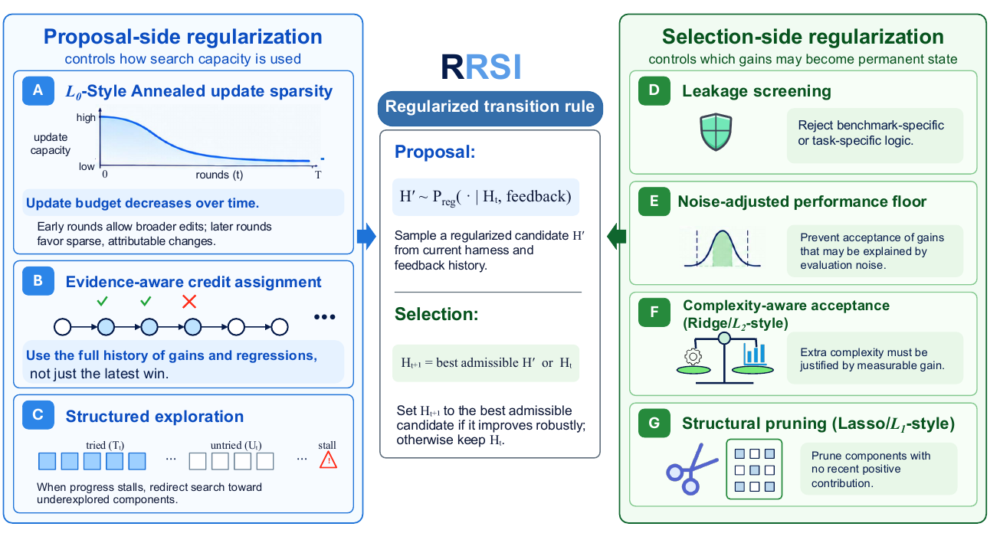
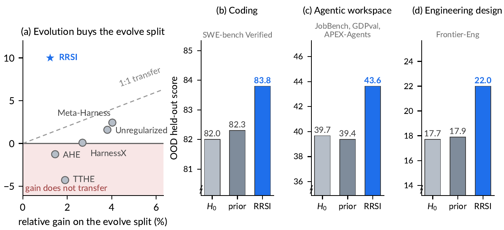

# RRSI: Regularized Recursive Self-Improvement of Agent Harnesses

## 来源信息

| 项 | 内容 |
| --- | --- |
| 标题 | RRSI: Regularized Recursive Self-Improvement of Agent Harnesses |
| 作者 | Peng Xia¹,²\*, Rujun Han, Zifeng Wang, Yanfei Chen, Yufan Zhuang, Yoonho Lee³, Chengsong Huang⁴, Han Yu, Zhongying CuiZhu, Yifei Ming, Huaxiu Yao², Burak Gokturk, Tomas Pfister, Chen-Yu Lee（¹ Google Cloud AI Research；² UNC-Chapel Hill；³ Stanford；⁴ Washington University in St. Louis；\* p.1 脚注：Peng 在 Google Cloud AI Research 做 Student Researcher 期间完成） |
| 机构 | Google Cloud AI Research（第一机构） |
| 来源 | [arXiv:2609.24972v3](https://arxiv.org/abs/2609.24972v3)（cs.LG; cs.AI; cs.CL）；v1 2026-09-21 → v3 2026-10-04，本笔记基于 v3；仓库清单 00212 |
| 代码 | <https://github.com/google-research/rrsi>（Apache-2.0）；项目页 <https://regularized-rsi.com/> 提供逐轮 Evolution Explorer |
| 阅读日期 | 2026-10-07 |

---

## 核心结论

一句话：**RRSI 把「用 agent 自己跑出的反馈反复改 harness」这类 RSI 的失败诊断成过拟合——不是搜得不够，而是有限 evolve set 被反复自适应复用——然后用四项来自经典正则化的约束去限制搜索轨迹（而非编辑空间），换来「evolve 涨得最少、留出涨得最多、token 还更省」。**

- **问题**：harness 演进本质是在有限 evolve set 上的自适应经验优化；候选的提出依赖前几轮在同一批任务上的测量，于是会以三种耦合方式过拟合——benchmark-specific fitting、noise chasing、complexity accumulation。
- **核心想法**：不限制「能改什么」（9 类组件全部开放），只在提议与选择两侧加约束：退火编辑预算对应 $L_0$、结构剪枝对应 Lasso/$L_1$、成本准入对应 Ridge/$L_2$，另有噪声地板与泄漏筛查；这是功能类比，不是带范数惩罚的目标函数。
- **怎么做到**：一轮 = 分析失败反馈 → 按预算起草 $m=2$ 个候选 → 评测前读 diff 筛查泄漏 → 在完整 evolve set 上评估 → 四项非补偿门槛 → 在可准入者中取分最高者。
- **关键结果**：Terminal-Bench 2.1 evolve 分 +6.0；六个留出 split 无一退步，OOD 最多 +4.7（JobBench）；是最省的演化臂（2.42M vs 无约束演化的 3.80M policy tokens/trial，约 −36%）。
- **定位**：贡献几乎全在「接受与拒绝的准则」，与「用什么模型当 proposer」正交；适合需要一个可迁移筛选器的人。

---

## 问题

「不改权重、只改 harness」是一条被寄望的 RSI 路线：prompts、控制流、工具接口、记忆与上下文管理围绕冻结模型自动改写（§1、§2）。harness 决定 agent 能做什么，所以这条路线理论上能在没有新权重的情况下持续涨分。

已有方法的共同循环（§2）只有四步：第 $t$ 轮把当前 harness $H_t$ 在 evolve set 上跑出轨迹、汇总失败反馈 $\mathcal{F}_t$ → proposer 生成候选 → **在同一批 evolve set 上评估** → 取分最高者当下一轮 incumbent。

问题出在最后两步。候选的提出条件于前几轮在同一批任务上的测量，所以这是一个**在有限 evolve set 上的自适应经验优化**：同一份数据既参与提议又参与选择，测量本身会被选择行为污染。论文把它类比为「在极强表达力的搜索空间上反复用同一份留出数据做选择」。

这种复用表现为三种耦合的失效行为（§1）：

| 失效 | 表现 | 对应正则（笔记归纳） |
| --- | --- | --- |
| benchmark-specific fitting | 把评测集特有内容（任务名、实体名、评分体系）写进 harness | 泄漏筛查 + 编辑预算 |
| noise chasing | 在有限样本的噪声里挑赢家，把随机波动固化成永久状态 | 噪声地板 $\delta$ |
| complexity accumulation | 堆上下文与推理成本换 evolve 分 | 成本准入 + 结构剪枝 |

右列不是原文表格，是笔记按 §3 机制归纳的对应关系。

论文的证据是：Meta-Harness 在 Harvey LAB 的 evolve 集上 93.0（高于 RRSI 的 90.5），但 OOD 平均只有 40.6；AHE 与 TTHE 的 OOD 平均甚至低于未演化的 $H_0$（39.2 / 38.0 vs 39.7）。**evolve 分与留出分可以脱钩，而且脱钩方向与「谁更会搜」无关。**

本文的设定有三条前提：策略模型全程冻结；每个领域只在一个 suite 上演化，再原样跑到留出集；「能改什么」不设限——9 类组件都可增删改，$\Omega(H)$ 保持开放。要正则化的是**搜索轨迹**，不是编辑空间。

---

## 核心想法

### 一句话

不是搜得不够，而是搜的东西会过拟合；所以不动「能改什么」，只动「怎么提议、怎么接受」。

### 直觉

harness 演进每一轮都在用同一小批任务做两件事：告诉 proposer 哪里失败、告诉选择器哪个候选更好。轮次一多，这两件事互相喂：上一轮在评测集上有效的偏方被写进 harness，下一轮的测量又在这个偏方上继续做，偏方于是被反复确认。

于是「evolve 分涨」可以来自三种与可迁移性无关的东西：记住了评测集的语境、追到了噪声里的赢家、用更多上下文与推理步骤硬换分。三种都不需要模型变强。

### 为什么这套约束能成立

四项选择侧门槛是**非补偿性**的：每项都必须过，不能被另一项的高分补回来。

- 泄漏筛查在**评估之前**读 diff，把「写进评测语境」的候选直接挡掉，于是它拿不到虚高的 evolve 分，也不会污染后续的信用分配。
- 噪声地板要求候选不显著低于历史最佳（Eq 5），把「这次多对了几条」的随机波动挡在门外。
- 成本准入只在涨幅超过噪声带时要求「多涨一分允许多花多少」（Eq 6–7），把复杂度累积变成有价格的行为。
- 结构剪枝把最近若干轮都没有正增益的组件列为删除目标（Eq 11、14），防止只加不减。

提议侧的退火预算（Eq 4）解决另一个问题：一轮捆了五个改动，涨分也不知道是谁的功劳。把预算从 4 退到 1，后期每次接受都是单一可归因的编辑；台账（Eq 10）再把被否掉的机制留作负证据。停滞时把槽位让给从未被编辑过的组件（Eq 13），是对「只在已验证方向上深化」的对冲。

### 与已有做法的区别

Meta-Harness、AHE、TTHE、HarnessX 主要在**加能力**：更强的提案策略、更细的反馈、更结构化的 harness 表示。RRSI 不加能力，只在候选进入 incumbent 之前加一道筛子；它与「用什么模型当 proposer」正交。

与经典正则化的关系是**功能类比**，不是数学等价：$L_0$ 对应「一次更新的活跃编辑数有上限」，$L_1$ 对应「删掉离散组件」，$L_2$ 对应「抑制整体资源足迹」。作者在 §3.1 与附录 D 开头都强调这一点——这里没有带范数惩罚的目标函数。

### 一个走通的例子

agentic workspace 的 20 轮里共评估 32 个候选，只接受 4 处编辑，全部接在基础 harness 已有的「最终提交前回弹」上：一次覆盖度与深度复查，三个标准库探针（把交付物读回来，指出缺什么，例如未展开的算术简写、某个产出文件里缺失的源值）。

这四个编辑能迁移，是因为探针报告的是**文件的结构性事实**，既不带 rubric 词汇也不带领域词汇；换到 JobBench / GDPval / APEX-Agents 仍然触发。作为对照，Meta-Harness 的 730 词工作法复述了 evolve suite 的评分体系（「交付物按逐条 rubric 打分、只读文件」），TTHE 的 8,500 词协议块里约 1,000 词只在 redline / markup / tracked-changes 这类体裁下触发——前者拟合评分器，后者拟合体裁。

### 代价

- **evolve 分涨得慢**：20 轮只接受 4 处编辑，Harvey LAB 上只涨 1.1，四个 baseline 涨 1.3–3.6。卖点不是更快涨分。
- **门槛依赖可信的测量**：噪声带 $\delta$ 由未改动 $H_0$ 的重复评测估计，任务量小或 judge 方差大时估计不稳。
- **需要读 diff 的 critic**：泄漏筛查读的是候选的实际 diff、不是提案说明，要求 critic 能判断「声明的组件是不是 diff 实际改的」。
- **省 token 部分是设计结果**：成本门槛直接拒绝贵的候选，「更省」与「不接受某些涨分」是同一件事的两面。

---

## 方法

### 符号表

| 符号 | 含义 | 取值 / 维度 |
| --- | --- | --- |
| $t$, $T$ | 演化轮次下标、总轮数 | $T=20$（coding / agentic）、40（engineering） |
| $H_t$ | 第 $t$ 轮的 incumbent harness；$H_0$ 为未演化的基础 harness | 当前被演化的 harness |
| $H'$ | 候选 harness | $H'\in\Omega(H_t)$ |
| $\Omega(H_t)$ | 从 $H_t$ 出发可到达的 harness 空间 | 9 类组件可增删改 |
| $\mathcal{H}_t$ | 本轮提议出的候选集合 | $\lvert\mathcal{H}_t\rvert=m=2$ |
| $P_{\mathrm{reg}}$ | 受正则约束的提议分布 | 原文 Eq (8) |
| $\mathcal{F}_t$ | evolve set 上的跨轮失败反馈 | 由 analyst 汇总 |
| $\mathcal{L}_t$ | 编辑台账 | 七元组：轮次、组件、假设、diff、分数变化、成本变化、是否当轮赢家 |
| $b_t$ | 一轮可独立归因的编辑数上限 | $b_{\min}=1$，$b_{\max}=3$ 或 4 |
| $z_t$, $E_t$ | 编辑选择向量、该轮候选编辑池 | $z_t\in\{0,1\}^{\lvert E_t\rvert}$，非零项数 $\le b_t$；$E_t$ 原文未定义；按上下文理解为候选编辑池 |
| $\mathcal{E}_t$ | 结构化探索的探索指令 | 停滞时启用 |
| $\mathcal{B}_t$ | 结构剪枝的删除目标组件集合 | 原文 Eq (14) |
| $\mathcal{A}_t$ | 可准入候选集合 | 四项门槛全过者；为空则原地不动 |
| $\hat{S}(H')$ | 候选在 evolve set 上的实测分数 | 每任务 $k$ 次 trial |
| $S^{\star}$ | 历史最佳分 | 只升不降 |
| $\delta$ | 经验噪声带 | 0.017 / 0.004 / 0.020（三领域） |
| $\Delta S$, $\Delta C$ | 分数变化、每 trial 策略 token 的相对变化 | 原文未给显式定义；按上下文理解为相对 incumbent 的变化 |
| $\beta_0$, $\beta_1$ | 零增益时的成本容忍度、每分增益允许的成本斜率 | 0.10 / 44.5 等 |
| $w_s$, $w_c$, $w_n$ | 带内规则的分数、成本、新颖性权重 | 原文未给数值 |
| $\nu_t(H')$ | 候选触碰的「从未出现在获胜编辑里」的结构组件计数 | 原文 Eq (15)、(16) |
| $K$ | 可编辑组件词表 | 9 类，原文 Eq (12) |
| $\mathcal{T}_t$, $U_t$ | 已被测量编辑过的组件集合、从未被测量编辑过的组件集合 | $U_t=K\setminus\mathcal{T}_t$ |
| $m$, $m_{\mathrm{draft}}$ | 每轮候选数、其中留给探索的槽位 | 2 / 1 |
| $w$, $\sigma_t$ | 停滞检测窗口、停滞标志 | $w=3$；$\sigma_t\in\{0,1\}$ |
| $g_t(\ell)$, $n_{\mathrm{prune}}$ | 组件 $\ell$（组件下标）在最近 $n_{\mathrm{prune}}$ 轮内的最大 $\Delta S$、剪枝窗口 | 4 或 5 |
| $k$, $a_i$ | 每任务每次评测的 trial 数、第 $i$ 个候选的接受判定 | 2 或 4；$a_i$ 原文未定义，按上下文理解为接受/拒绝判定 |

### 一轮的数据流

按 Algorithm 1/2 与 §4.1 整理（步骤编号是本笔记的重排）：

1. **分析**：Opus 4.8 analyst 在 evolve set 上跑当前 $H_t$，汇总跨轮失败反馈 $\mathcal{F}_t$；
2. **拟题**：算退火预算 $b_t$（Eq 4）、停滞标志 $\sigma_t$、未探索组件 $U_t$、剪枝目标 $\mathcal{B}_t$，proposer 从约 80 条编辑的池子里起草 $m=2$ 个候选；
3. **筛**（评测前）：critic 读候选 diff，拒绝含 evolve-suite 特有逻辑或「惰性机械」的候选；
4. **评**：通过筛查的候选在完整 evolve set 上并行评估 $k$ 次 trial，得到 $\hat{S}(H')$ 与成本；
5. **准入门**：噪声地板（Eq 5）→ 分支判据（超出噪声带用 Eq 6–7，带内用 Eq 17）→ 领域守卫；
6. **选择**：可准入者中取分最高者为 $H_{t+1}$，否则保留 $H_t$；更新 $S^{\star}$，把每个编辑连同 $a_i$ 记入台账。



*图 2（原文 Figure 2，p.4）：A/B/C 为提议侧（退火预算、证据化信用分配、结构化探索），D/E/F/G 为选择侧（泄漏筛查、噪声地板、成本准入、结构剪枝）。*

### 提议侧：受正则约束的提议分布

原文 Eq (8) 把一轮演进写成：

```math
\mathcal{H}_t \sim P_{\mathrm{reg}}(\cdot \mid H_t, \mathcal{F}_t, \mathcal{L}_t, b_t, \mathcal{E}_t, \mathcal{B}_t) \subseteq \Omega(H_t), \qquad
H_{t+1} = \operatorname*{arg\,max}_{H' \in \mathcal{H}_t \cap \mathcal{A}_t} \hat{S}(H'),
```

逐项读法：$P_{\mathrm{reg}}$ 不是新目标函数，而是「在给定反馈、台账、编辑预算、探索指令、剪枝目标时的提议分布」，其中 $\mathcal{F}_t,\mathcal{L}_t$ 支撑证据化信用分配（B），$b_t$ 是退火预算（A），$\mathcal{E}_t$ 是结构化探索指令（C），$\mathcal{B}_t$ 是剪枝目标（G）；$\mathcal{H}_t\subseteq\Omega(H_t)$ 说明候选仍在开放编辑空间里，正则只改提议的偏好；第二式表示只有同时属于候选集与可准入集的 $H'$ 才能成为下一轮 incumbent，若 $\mathcal{A}_t=\varnothing$ 则原地不动。

原文 Eq (4) 是预算的退火形状：

```math
b_t=\Big\lceil b_{\min}+(b_{\max}-b_{\min})\cdot\tfrac{1}{2}\big(1+\cos(\pi t/T)\big)\Big\rceil,
```

逐项读法：$b_t$ 是一轮里可独立归因的编辑数上限，从 $b_{\max}$ 余弦退火到 $b_{\min}=1$；$\lceil\cdot\rceil$ 保证取整后至少为 1。早期允许多个协同改动一起上，用于发现新机制；后期只留单一可归因的改动。附录 D.2 把它写成 $z_t$ 的基数约束（Eq 9）：非零项数不超过 $b_t$。注意约束的是**一轮更新里捆绑的编辑数**，不是 harness 能包含哪些组件——后者始终开放。

### 选择侧：四项非补偿性门槛

原文 Eq (5) 是噪声地板：

```math
\hat{S}(H') \ge S^{\star} - \delta .
```

逐项读法：$S^{\star}$ 是历史最佳且只升不降，$\delta$ 是用未改动 $H_0$ 反复评测得到的经验噪声带。这条门槛要求候选不能显著低于历史最佳，防止「这一轮多对了几条」的噪声赢家替换掉已验证的 incumbent。$\delta$ 因此是唯一被标为「不许调」的超参——调低就等于用噪声买 evolve 分。

当增益超过噪声带时，走原文 Eq (6)–(7) 的成本准入（笔记只转写其中的准入不等式）：

```math
\Delta C \le \beta_0 + \beta_1 \cdot \Delta S .
```

逐项读法：$\Delta C$ 是每 trial 策略 token 的相对变化，$\Delta S$ 是分数涨幅；$\beta_0$ 是「零增益时还允许多花多少」，$\beta_1$ 是「每多一分增益允许多花多少」。它抑制的是整体资源足迹的增长，不要求删掉任何具体组件，所以作者把它类比 Ridge 而非硬约束。

若增益落在噪声带内（$\Delta S\le\delta$），改用原文 Eq (17)：

```math
w_s \cdot \Delta S - w_c \cdot \Delta C + w_n \cdot \nu_t(H') > 0 .
```

逐项读法：$w_s$ 给带内涨分（coding 实例取 $w_s=0$，即带内涨分不算信用）、$w_c$ 惩罚成本、$w_n$ 奖励触碰未用过的结构组件；$\nu_t(H')$ 只统计 `client_tool / skill / memory / subagent` 四类中从未出现在获胜编辑里的组件（Eq 15、16）。也就是说，**省 token 或碰到新结构，二者之一才可能让一个涨分在噪声内的候选过关**。

| 门槛 | 规则 | 位置 |
| --- | --- | --- |
| D 泄漏筛查 | critic 读候选 diff（不是提案说明），拒绝显式编码任务名/实体名/任务特有取值/答案的逻辑，以及「惰性机械」 | 评测前 |
| E 噪声地板 | $\hat{S}(H')\ge S^{\star}-\delta$ | 评测后 |
| F 成本准入 | 超出噪声带用 Eq (6)–(7)，带内用 Eq (17) | 评测后 |
| G 结构剪枝 | $g_t(\ell)\le 0$ 的组件列入 $\mathcal{B}_t$，交给 proposer 后续删除 | 每轮 |

G 的 $g_t(\ell)$ 是组件 $\ell$ 在最近 $n_{\mathrm{prune}}$ 轮内的最大 $\Delta S$（Eq 11）；$\mathcal{B}_t$ 是这些非正增益组件的集合（Eq 14）。四项都过之后，才在 $\mathcal{H}_t\cap\mathcal{A}_t$ 里取 $\hat{S}$ 最高者（Algorithm 2 第 16–18 步），并把每个候选的 $a_i$ 记入台账供后续信用分配。

### 与已有方法的结构差异

| 维度 | 已有 harness 演化 | RRSI |
| --- | --- | --- |
| 编辑空间 | 通常限定或提示可改的组件 | 9 类全部开放 |
| 提议 | 直接由反馈生成候选 | 预算退火 + 台账 + 停滞探索 |
| 接受 | 取 evolve 分最高 | 四项非补偿门槛，先筛后评、评后再筛 |
| 正则化位置 | 目标函数 / 梯度 | 离散的提议与选择轨迹 |

---

## 主要结果

**设置**：8 个 benchmark / 3 个领域，每个领域只在一个 suite 上演化，再原样跑到留出集。Coding 在 Terminal-Bench 2.1（89 个容器化终端任务）上演化、OOD 测 SWE-bench Verified；agentic workspace 在 Harvey LAB（120 任务 evolve + 40 任务 pristine held-out）上演化、OOD 测 JobBench / GDPval / APEX-Agents；engineering design 在 EngDesign（61 个设计任务）上演化、OOD 测 Frontier-Eng。策略与 proposer / analyst / critic 全程为 Claude Opus 4.8，对照为 $H_0$ 与 Meta-Harness / AHE / TTHE / HarnessX，同一时间窗口、同工具环境、同 judge、同 trial 数。



*图 1（原文 Figure 1，p.2）：(a) 横轴 evolve 相对涨分、纵轴 OOD 相对涨分，RRSI 是唯一在分布外继续放大的点；(b–d) 三领域留出分，柱为 $H_0$ / 四个 baseline 平均 / RRSI。*

**Agentic workspace**（原文 Table 1，p.8；加粗为原文强调列）：

| 方法 | Harvey LAB (Evolve) | Harvey LAB (ID held-out) | JobBench (OOD) | GDPval (OOD) | APEX-Agents (OOD) |
| --- | ---: | ---: | ---: | ---: | ---: |
| $H_0$ | 89.4 | 86.9 | 36.0 | 48.8 | 34.2 |
| Meta-Harness | **93.0** | 89.2 | 37.1 | 49.1 | 35.7 |
| AHE | 90.7 | 88.7 | 37.2 | 47.2 | 33.1 |
| TTHE | 91.1 | 88.5 | 35.2 | 47.0 | 31.7 |
| HarnessX | 91.8 | 89.1 | 36.3 | 48.5 | 34.3 |
| **RRSI** | 90.5 | **89.2** | **40.7** | **52.3** | **37.9** |

1. **这是唯一给出逐方法对照的领域，也是「以 evolve 换 transfer」最清楚的一处**：RRSI 的 evolve 分只涨 1.1（89.4→90.5），四个 baseline 涨 1.3–3.6；但三个 agentic OOD 全部最高，JobBench / GDPval / APEX-Agents 为 40.7 / 52.3 / 37.9，比 prior 最好的 37.2 / 49.1 / 35.7 高 3.5 / 3.2 / 2.2。ID held-out 上 RRSI 与 Meta-Harness 并列 89.2。

2. **coding 与 engineering design 只有单点证据**：TB2.1 74.2→80.2（+6.0）、SWE 82.0→83.8（+1.8）；EngDesign +4.9、Frontier-Eng +4.3（RRSI 22.0 vs prior 平均 17.9）。这两处没有逐方法表格，只有 $H_0$ 与 RRSI 的曲线加 prior 平均值，「涨得少、转得多」在两处不能算独立验证。

3. **消融说明两组正则各自贡献 transfer，且都不是免费的**：无正则演化 evolve 分 92.8（全表最高），但 OOD 平均 40.3，只比未演化的 39.7 高 0.6，token 3.80M；RRSI 43.6 / 2.42M。去掉提议侧，evolve 只差 0.2 分但 OOD 掉 1.7（41.9）；去掉接受侧，evolve 升到 91.5、OOD 掉到 41.0、token 涨到 3.59M。**「把搜索引到哪儿」即使什么都没拒绝也在起作用。**

4. **换 policy 与换 backbone 都有正迁移，但证据面窄**：同一 coding harness 换 Gemini 3.5 Flash 演化，TB2.1 64.6→78.7（+14.1）、SWE 76.8→79.0（+2.2）；把 Gemini 3.5 Flash 演化出的 harness 直接跑 Gemini 3.1 Flash Lite，TB2.1 11.2→14.6（+3.4，相对 +30.4%）。搜索重复一遍，九个 split 的最大分歧是 TB2.1 的 1.8 分，其余 ≤0.6。

5. **成本：RRSI 是所有演化臂里最省的**。最终 harness 2.42M policy tokens/trial、26.3 steps/trial；四个 baseline 是 27.3–34.6 steps，AHE 最贵（3.82M，比 RRSI 多 58%，OOD 平均还低 4.4 分）。但未演化的 $H_0$ 是 1.56M / 21.2 steps——**演化本身花了额外推理成本，RRSI 决定的是花多少**。

6. **定性上，留下的东西不一样**：20 轮 32 个候选只接受 4 处编辑，全部是「提交前回弹」上的覆盖度复查与三个结构探针；探针报告文件的结构性事实，不带 rubric 或领域词汇，所以在三个 agentic OOD 上仍触发。这条是机制解释，不是独立实验。

---

## 边界与局限

**作者明确讨论的**：只在冻结 backbone 下研究 harness 级 RSI，不更新权重；仍依赖有限 evolve set 与若干正则超参，效果取决于反馈质量与搜索预算；跨领域 / benchmark / policy 的迁移已验证，但更不同的 agent 架构、工具生态与更长程的自改进仍需更广验证。

**读者判断**：

- **收益最大的领域恰好全靠 LLM judge**：agentic workspace 的四个 benchmark 都是 judge 打分（Harvey LAB 与 APEX-Agents 用 Gemini 3.5 Flash 逐条判定，JobBench 取两个 judge 的均分，GDPval 用三模型评审团），而 OOD 增益恰在这里最大（+3.5 到 +4.7）。作者用「engineering design 是确定性判分、涨分照旧」反驳「只是学会讨好 judge」，但那只覆盖一个领域。
- **主实验、消融、可靠性分析全部用 Opus 4.8**：跨 policy 只有 coding 的两点，跨模型迁移只有一个弱 backbone 的一个 benchmark；「不绑定 policy」的证据强度有限。
- **proposer / analyst / critic 与 policy 同源**：三者都是 Opus 4.8。换更弱的 proposer 后，Eq (17) 的结构新颖性与 critic 的 diff 筛查是否还成立，论文没有实验。
- **$\delta$ 与评测规模强耦合**：$\delta$ 由 $H_0$ 的重复评测估计（agentic 实例约 14,100 条判定里的 60 条）；任务量小得多或 judge 方差更大的场景，这个估计本身会不稳，论文未做敏感性分析；消融也只在 agentic workspace 一个领域做过。

---

## 与其他工作的关系

- **Dream-RSI**（00214，[笔记](../dream-rsi/note.md)）：同属「不改权重、只改 harness」的路线。RRSI 正则化的是**筛选准则**，Dream-RSI 改造的是**探索控制器的获取方式**；两者都把「怎么搜」当成一等公民。
- **Meta-Harness / AHE / TTHE / HarnessX**：本文的直接 baseline，也是「加能力」路线的代表；RRSI 与它们共享 $H_0$、policy、evolve 集与候选预算，只改接受准则。
- **经典正则化（$L_0$ / Lasso / Ridge）**：作者只做功能类比——离散的编辑预算、组件删除、成本收缩，不是带范数惩罚的目标函数。

<!-- 复核档案见同目录 audit.md（不随站点发布） -->
