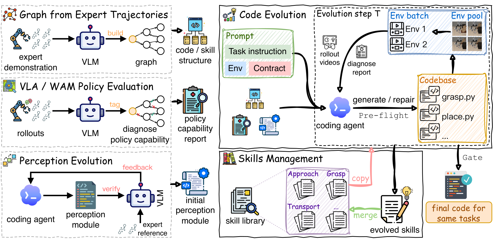
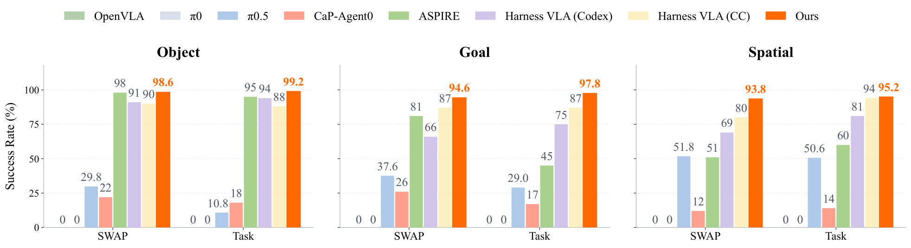

# HarnessPAI：把 VLA/WAM 降为原语，用可执行代码 harness 做「一次执行、跨轮进化」

## 来源信息

| 项 | 内容 |
| --- | --- |
| 标题 | HarnessPAI: An Evolving Harness for Physical AI |
| 作者 | 首页署名 **Darwin Agent Team**；arXiv 元信息列 23 位作者，其中 Core Contributors 6 人（Xin Wang、Wenhao Wu、Menghao Zhang 同等贡献；Zhi Wang、Kun Shao、Jian Luan 通讯，Kun Shao 兼 project lead），其余 17 位为 Contributors（完整名单见 `audit.md`） |
| 机构 | 第一机构 **Xiaomi Inc.**（作者 1 兼属清华大学）；另有南京大学、上海交通大学、华东师范大学、UCL、KCL、帝国理工学院、中科院自动化所、上海创智学院、牛津大学、爱丁堡大学、南洋理工大学（p36） |
| 来源 | [arXiv:2609.29166v2](https://arxiv.org/abs/2609.29166v2)（cs.RO; cs.AI）；v1 2026-09-24，v2 2026-10-21；本笔记基于 v2 |
| 项目页 | <https://darwin-agent.github.io/HarnessPAI/> |
| 代码 | <https://github.com/Darwin-Agent/HarnessPAI>（研究代码；未标注 license，进化后的 code/skill library 未发布；核验细节见 `audit.md`） |
| 阅读日期 | 2026-11-09 |

---

## 核心结论

一句话：**HarnessPAI 不把 VLA/WAM 当成整个 agent，而把它降为「动作原语」；单次 rollout 内运行一个固定的、带感知/几何推理/成功检查的可执行程序（program-level open-loop），跨 rollout 用执行反馈让 coding agent 改程序、把失败蒸馏成按任务图节点索引的 repair skill（closed-loop）。**

- **问题**：标准基准上很强的 VLA/WAM，在语言扰动、场景扰动和精细操作上会急剧失效；论文把主因归到 action-centric 训练配方——视觉 grounding（V）与语言理解（L）被 action prediction 目标挤掉，动作头（A）更擅长粗粒度、低频动作，在精细位移上不稳定。
- **做法**：执行时由代码当 planner，先感知与几何推理，再在接触丰富的阶段调用 action model；进化时 writer 模型改代码、diagnoser 模型看视频给节点级 verdict、确定性 gate 兜底，三者分离。
- **结果**：LIBERO 98.1（π0.5 96.9）；LIBERO-PRO 96.5（ASPIRE 71.7、Harness VLA 87.7）；RoboCasa Atomic-Seen 92.2（65.0）；robosuite 96.3（ASPIRE 81.0）；另有 BEHAVIOR-1K、VacuSim、MicroDuck 三类非桌面设置。
- **代价**：加速与 0 API 成本只针对**部署执行**（23.1×、在线 LLM 调用为 0）；写代码、VLM 诊断、感知进化、仿真与硬件的开发/生命周期成本没有计入。
- **定位**：面向「同一物理任务反复执行」的部署 regime，不是「任意新任务一次成功」的通用修复；实验全部在仿真基准上，没有真机结果。

---

## 问题

论文的出发点是：Physical AI 的很大一部分研究围绕 **action model**（VLA 或 WAM）展开，但一个在标准 benchmark 上很强的模型，换个说法、换个摆位、要求精细接触就会失效。§3.1（p7–9）给了三个失败例子，§3.2（p9–10）另用 Figure 7 说明不可逆错误。

- **语言扰动**（Figure 4，p8）：LIBERO 指令是 “pick up the black bowl between the plate and the ramekin”；在 “between” 前加 “not”，指代对象翻转成另一个碗，π0.5 仍抓原来的碗；即使外部把场景 mask 掉也救不回来。
- **场景扰动**（Figure 5，p9）：指令不变，只把 plate 与 ramekin 的位置互换，π0.5 仍把碗搬到 plate 的旧位置。LIBERO-PRO 正是用这类扰动，把标准 LIBERO 上 90%+ 的模型打到 39.7%/30.1%。
- **精细操作**（Figure 6，p10）：WAM 能走到微波炉前、伸手到 start button，但在示例 trial 里按不下去。原文明确说，不能据此判定失败来自目标定位、接触控制还是动作生成——它只说明粗粒度动作成功不足以保证精细操作完成。
- **不可逆错误**（Figure 7，p10）：双臂任务里抓错物体并抬起，场景状态已被改变，后续无法恢复。物理错误不像软件错误那样可以随便重试。

论文把这些失败归因于 **action-centric 的训练配方**：VLM backbone 被 action prediction 目标覆盖，V 与 L 退化；diffusion / flow-matching action head 在粗粒度、低频动作上可靠，在精细位移上不稳定。它不声称这些例子能证明失败一定来自 V/L 退化（原文写 “do not establish whether it results from degradation...”），而是用它们说明**动作能力本身不足以保证任务完成**。

### 两种部署 regime

§3.3（p10–11）把部署分成两种：

- **many tasks, each once**：真实部署里 agent 面对很多任务，每个只做一次；纯 VLA/WAM 是为这个 regime 设计的，目标是从未见过的指令直接生成正确动作。
- **one task, many times**：同一个物理任务反复执行；HarnessPAI 只针对这个 regime。

第二种 regime 不是「可以容忍失败」：每次 rollout 仍是 open-loop，仍要争取一次成功，因为物理错误可能不可逆。它的价值在于**跨 rollout 的反馈可以积累**——把一次性的推理变成可复用的程序与 repair skill。

### 为什么是代码

§3.3 给了三个理由：**executable**（程序把任务落到当前场景、分解步骤、调用原语、运行 success check）、**inspectable**（感知、grounding、recovery 都是可读可改的语句，不是权重里的数）、**evolvable**（程序可以被修改、再执行，这正是 closed-loop evolution 需要的表示）。

代码还能把不同 VLA/WAM 包成可替换的 primitive；没有 learned action model 时退化为直接 API 控制。这条「系统级可改」的路线与两条已有路线不同：post-training 把适应写进权重，VLA harness 在 rollout 内保留一个在线 planner——后者每一步都要重新推理，执行成本与延迟都高。

---

## 核心想法

### 直觉

一个物理任务真正需要的能力可以拆成三块：看清场景（perception）、算清怎么动（geometry / planning）、把动作做出来（action）。VLA/WAM 把三块压进一个网络；HarnessPAI 把它们重新摊开，用一份可执行代码把前两块和「做完没有」的检查固定下来，只在接触丰富的阶段调用第三块。

论文的原话是（p12）：

> “a physical AI is not an action model; it is perception, geometry, and action held together by an executable plan, of which the action model is only one, replaceable part.”

### 为什么成立

- **失败集中在 V 与 L，而不是全部在 A**：语言否定词、物体互换位置、目标点几厘米的偏移，都是 grounding 与几何问题；代码可以用 segmentation、3D 位姿、显式坐标检查把这些补回来，而 VLA 继续负责抓取、放置这类接触丰富的动作。
- **同一任务的失败会重复**：一个任务反复执行，错误模式（抓空、滑落、路径碰撞、放偏）会反复出现；把「症状—根因—修法」记成 skill，下一次在同一个图节点上就能直接取用。
- **代码同时满足三个条件**：能跑（可自检）、能读（可诊断）、能改（可进化）。权重不满足后两条，纯文本记忆不满足第一条。
- **确定性阶段不需要模型**：grounding、approach、transport 用固定代码就够，只有 grasp / place 等阶段交给 VLA。这既省掉在线推理，也把「模型不擅长的那部分」隔离出来。

需要保留的限定：论文自己说三个失败例子**不能证明**失败一定来自 V/L 退化；「代码补 V/L」是作者的解释框架，不是被单独隔离验证过的因果结论。

### 与已有做法的区别

四种范式的差别不在「用不用模型」，而在**适应存在哪里、什么时候发生**：

| 范式 | 适应存在哪 | rollout 内有 coding agent | API 控制 | 用 learned policy | 跨 rollout 进化 |
| --- | --- | --- | --- | --- | --- |
| VLA/WAM post-training | 模型参数 | ✗ | ✗ | ✓ | 仅训练 |
| Code-as-policy | 程序 | ✗ | ✓ | ✗ | 有时 |
| VLA harness | runtime/memory | ✓ | ✓ | ✓ | 通常 |
| **HarnessPAI** | **程序/memory** | **✗** | **✓** | **✓** | **为持续进化设计** |

关键一行是最后一行：HarnessPAI 把 coding agent 从 rollout 内移到 rollout 之间。执行时没有在线 planner，所以快；进化时有执行反馈，所以能改。

### 一个走通的例子

Appendix C（p44–45）的 `align-object-to-basket-mouth` 展示了 skill 真正解决的是什么问题。place 阶段把物体 3D-align 到 basket 的 **body** 而不是 **mouth**，导致目标在深度方向偏向相机、rim 的 Z 被低估。在 `libero_object_task` task2 ep51 上，body 估计是 `[0.0585, 0.2653, 0.1321]`，mouth 是 `[0.0056, 0.2708, 0.1386]`，X（深度）误差 **5.3 cm**。place 看起来「成功」——物体中心到了目标——实际偏离开口 5 cm、蹭到 rim、没进 `contain_region`。

这个失败先后被误诊为 transport drop（ep51/ep53）和 release timing bug（ep54），其实是同一个 place-target bias。skill 记录的是「症状 → 根因 → 修法」，所以下一次在 place 节点上直接命中，不必在 transport 或 release 阶段空修。这正是「按任务图节点组织 skill」相对 flat 文件堆的价值。

### 代价

- **开发成本转移到离线**：执行时 0 在线 LLM 调用，但写代码、跑诊断、改感知模块都要花模型调用与仿真机时；论文没有汇总这部分成本。
- **依赖 success contract 可写、可检查**：如果「成功」无法用代码判定，主循环就没有可靠的停止条件。
- **不制造能力**：harness 只组织已有的原子能力；模型连「抓住」都做不到时，代码修不了。
- **只适合 repeated task**：每个任务要单独进化一份程序；「很多任务、每个只做一次」不是它的场景。
- **物理不可逆性仍在**：open-loop 加 success check 能减少盲目重试，但论文没有测碰撞率、损坏率或人工干预次数。

---

## 方法

### 符号表

| 符号 | 含义 | 取值 / 说明 |
| --- | --- | --- |
| $C$ | success contract：一次任务的成功契约 | writer 首轮写出；含 evaluation scope、goal、graph terminal state 与「不构成成功」的信号 |
| $T$ | 进化主循环的轮数预算 | Algorithm 1 的输入；原文未给数值 |
| $r$ | 主循环的轮次下标 | 第 1 到第 $T$ 轮 |
| $P$ | 当前候选 code package | 在隔离的 candidate copy 上编辑；只有全部通过才 promote |
| $I$ | 给 writer 的 instruction | 第 1 轮是 task description；之后由诊断与 self-review 合成 |
| $d$ | Diagnose 产出的诊断报告 | VLM 按 task-graph 节点给 verdict；具体字段原文未定义 |
| $v$ | Diagnose 同时给出的 video reward | 原文未定义；按上下文理解为从 rollout video 得到的奖励读数 |
| $g$ | Gate 产出的确定性奖励 | milestone-prefix reward，不依赖 VLM |
| $S$ | 蒸馏出的 failure-to-repair skill 集合 | 写入 skill library |

### 执行时的数据流：三个 memory + 一个 primitive library

§4.1（p11–12；Figure 8，p12）把执行时需要的知识分成四块：

- **Task Memory**：机器人被要求做过的任务描述（如 “turn on the stove”、“pick up A and place it in B”）。
- **Structured Skill Memory**：按任务图节点挂载的 failure-to-repair skill。
- **Executable Code Memory**：已经进化好的可执行代码包。
- **Primitive Library**：三类可替换原语——感知（SAM3、Molmo；Figure 8 图中还列了 OpenCV，正文只点名 SAM3/SAM/Molmo）、控制（`goto_pose`、`close/open_gripper` 等）、模型（VLA、WAM、PPO）。

执行时 code 就是 planner：先调感知原语 grounding 场景，再在感知结果上做几何推理，决定动作，最后才调用 action model 完成接触丰富的操作。所谓 open-loop 限定在 **program level**：程序在一次 rollout 内固定，但执行过程中仍可使用当前观测、预定义检查和 recovery（§3.2）。它反对的不是反馈，而是「每个 action step 都让一个大模型重新推理」。

这里的 verification 也不是「反复试到成功」的 retry loop，而是 **success test**：夹爪是否真的夹住、物体是否到了该到的位置，通过后才允许进入下一步（p11）。

**混合执行**（Table 3，p15）把阶段分工写得很清楚：

| 阶段 | 执行者 |
| --- | --- |
| grounding | 固定代码（segmentation + geometry） |
| approach | 固定代码（Cartesian servo，Pyroki IK rescue） |
| grasp | VLA |
| transport | 固定代码 |
| place | VLA |

这张表是理解全文的关键：deterministic 的阶段用代码，semantic / contact-rich 的阶段交给 VLA。代码不是替代动作模型，而是把动作模型放到它擅长的那几个阶段。



*Figure 9（p13）：左侧三个可选步骤分别处理专家轨迹、VLA/WAM 能力评估、感知模块；右侧是必经的 code evolution 主循环，包含 env batch、diagnose report、codebase、pre-flight、gate 与 skills management。*

### 跨 rollout 的数据流：三个可选步骤 + 一个必经主循环

§4.2（p12–13）把进化分成 3 个可选步骤 + 1 个必经主循环（Figure 9）：

1. **workflow graph generation（可选）**：VLM 读专家轨迹视频，生成任务的 workflow graph，固定代码与 skill 的结构。
2. **capability assessment（可选）**：VLA/WAM 在任务上跑几次，VLM 判断每个 workflow node 上模型是 “good / needs code / mixed”，产出 capability report。
3. **perception module initialization（可选）**：对感知重的任务，coding agent 调 SAM/Molmo 进化感知代码，VLM 用专家轨迹验证。
4. **main evolution loop（必经）**：给任务指令、环境信息、success contract，coding agent 在已有 code structure 上构建 code package，跨多个环境运行，读 diagnostics 与 rollout video 决定下一次编辑；出错时从 skill library 检索 repair，成功时把代码存入 code library、把新 skill 合并进 skill library。

Algorithm 1（p14）是主循环的精确写法：

```text
输入：task description, environment information, success contract C, round budget T
输出：promoted code package P, distilled skills S
1  Define success contract C（scope / goal / terminal state / non-success signals）
2  P ← 构建 code skeleton（有 task graph 就用 graph，否则单文件）
3  I ← task description
4  for r ← 1 to T do
5      P ← Write(Codex 用 I 编辑 candidate copy)
6      if pre-flight 或 probe 失败 then
7          修 bug
8      end if
9      execute P open-loop on every episode × every suite
10     (d, v) ← Diagnose(VLM node-wise verdict 与 video reward)
11     g ← Gate(deterministic milestone-prefix reward)
12     if all rollouts succeed under C then
13         promote P into code library
14         S ← 把 failure-to-repair pairs 蒸馏进 skill library
15         return P, S
16     else
17         I ← Synthesize(Codex 对 d 与 g 的 self-review)
18     end if
19 end for
```

**逐项读法**：

- **第 1 步**：$C$ 先于任何代码。scope、goal、graph terminal state，以及「不构成成功」的信号——clean exit、reached terminal state、high dense reward、writer 自称收敛——都写进同一份 contract，并注入 writer、diagnoser、reviewer，避免「自己给自己判分」。
- **第 2–3 步**：$P$ 从 skeleton 起，有 task graph 就用 graph，否则单文件；$I$ 初始为 task description。进化从结构开始，而不是每轮从零写。
- **第 5–8 步**：每轮先在隔离的 candidate copy 上写。pre-flight 只检查代码能不能跑，把环境/驱动崩溃与 policy failure 分开；probe 只挑上一轮失败的 3 个 seed 修，修完再跑全训练集确认没有回归（p14）。两级快速反馈避免每轮都付全量 rollout 的代价。
- **第 9–11 步**：open-loop 跑完所有 episode × suite，得到 $d$（VLM 节点级 verdict）与 $v$（video reward）；$g$ 是确定性的 milestone-prefix reward，即使 VLM 误判，也有一条不依赖模型的数值信号。
- **第 12–15 步**：只有全部 rollout 在 $C$ 下成功才 promote；$S$ 把本轮 failure-to-repair 对蒸馏进 skill library，然后返回。失败或轮数耗尽时，library 原样不动，candidate 留在 run directory 供诊断（p15）。
- **第 17 步**：$I$ 由 Codex 对 $d$ 与 $g$ 的 self-review 合成，进入下一轮；这是「同一份 contract 同时约束写、诊断、复核」的闭环。
- **两个模型分工**（Table 2，p14）：`GPT-5.6-sol` 是 writer + synthesizer，`Gemini-3.5-Flash` 是 diagnoser；诊断信号与改代码的人分离，避免「改代码的人给自己打分」。
- **candidate isolation**：writer、pre-flight、rollout 都在隔离 copy 上工作；只有整套 episode batch 全部通过才原子 promote 到 code library。

### 技能库：按任务图节点组织

§4.4（p15–17）把 skill library 设计成四级结构：

| 层级 | 内容 |
| --- | --- |
| L1 Graph Library | 每个任务的 workflow graph |
| L2 Node Library | graph 的节点（approach、grasp、transport、place 等） |
| L3 Skill Library | 每个节点下挂多个 problem–repair pair |
| L4 Code Library | skill 的 repair 指向的具体实现代码 |

一个 skill 由 **problem**（这个阶段会遇到什么失败）与 **repair**（怎么过）组成。它可以是小的 markdown note，附解释性代码片段；真正的可执行实现只在 code library 里维护，skill 通过 “refers to” 边指过去。这样避免「每个 skill 都是一段独立代码」导致的重复与失同步。

两个好处：**retrievability**——flat 文件堆（`obj_loc_error.md`、`empty_grasp.md`、`slipping.md`、`path_collision.md`）与任务阶段关联弱，按节点挂载后到了 grasp 阶段就查 grasp 节点；**transfer**——新任务与已解决任务共享 grasp/transport/place 节点，节点上的 repair 可以直接迁移。论文把这一点说成 §5 里 “with skill library, convergence arrives within the first few rounds” 的机制（p16–17）。

### 模型反馈：harness 生成专家数据，模型单向学习

§4.5（p17–18）讨论如何用 harness 反过来改 action model：

- 主进化循环中 action model **保持冻结**，进化只改 code。
- 收敛后的程序是一个 **trajectory generator**：它在扰动的 LIBERO 变体上跑出成功轨迹，而 LIBERO-PRO 本身不提供这些扰动变体的人类演示。
- 用 success gate 过滤，只保留满足成功条件的 rollout，作为 **success-filtered demonstrations** 做监督微调。
- 这条路径是 **单向** 的：harness 是数据源，model 是 learner；本文没有把 fine-tune 后的 model 重新包回 harness 再进化。论文写 “Nothing flows back”，作者把反向路径列为自然后续方向但本文未做（p18）。

### 结构差异

- **vs VLA/WAM post-training**：不改权重，改可执行系统；适应落在程序与 memory 里，可读、可诊断、可回滚。
- **vs code-as-policy**：保留 learned action model，只在 grasp / place 等接触丰富阶段调用；不是用程序替代动作。
- **vs VLA harness**：把在线 planner 移出 rollout，执行时不再 per-step 推理；代价是适应只能发生在 rollout 之间，而不是执行过程中。
- **vs 纯 prompt / memory**：skill 带可执行 repair 与 code library 指针，不只是给下一次提案的文本提示。

---

## 主要结果

**设置**（§5.1，p18–19）：7 个设置，覆盖 4 类 embodiment、5 种动作接口；后端冻结，只进化 harness，进化在 development seeds 上做。LIBERO / LIBERO-PRO 的 50-seed 评测包含 15 个进化 seed；RoboCasa 每任务 20 seeds；robosuite 用 1–100（进化用 101–125）；BEHAVIOR-1K 的 zero-shot 1–25 与 evolution 26–35 分开。

| 设置 | 对照 | HarnessPAI | 差值 | 证据 |
| --- | --- | ---: | --- | --- |
| LIBERO overall | π0.5 96.9 | **98.1** | +1.2 pp | Table 4（p20） |
| LIBERO-PRO overall | Harness VLA (CC) 87.7；ASPIRE 71.7；π0.5 34.9 | **96.5** | +8.8 / +24.8 / +61.6 pp | Table 7（p37）、Figure 13（p21） |
| RoboCasa Atomic-Seen | WorldDreamer 65.0 | **92.2** | +27.2 pp | Table 5（p22） |
| robosuite avg | ASPIRE 81.0；Human 82.6；CaP-Agent0 68.3 | **96.3** | +15.3 / +13.7 / +28.0 pp | Table 6（p37） |
| VacuSim coverage | 初始 4.90（40×40 无家具）/ 11.7（25×25 有家具） | **63.76 / 53.92** | +58.86 / +42.22 pp | Figure 15/16（p23–24） |
| 执行成本（LIBERO-Goal Task1 Swap） | Harness VLA 1134.9 s | **49.2 s** | 23.1× | Figure 21（p27） |



*Figure 13（p21）：Object / Goal / Spatial 三个 suite 在 Swap / Task 两种扰动下的成功率。HarnessPAI 六个格子都在 93.8 以上；π0.5 在 Object/Task 只有 10.8、Goal/Task 29.0。*

1. **真正的增益在扰动与精细任务，不在标准 LIBERO**。98.1 只比 π0.5 的 96.9 高 1.2 pp，而且 π0.5 在 Object 上已是 100.0；98.1 主要来自 Goal +2.0、Spatial +1.6。相比之下，LIBERO-PRO 从 34.9 到 96.5，robosuite 的 Insert 从 ASPIRE 的 9% 到 83%、2A-Lift 从 71% 到 91%。Figure 13 的六个格子是 98.6 / 99.2 / 94.6 / 97.8 / 93.8 / 95.2（Object/Swap、Object/Task、Goal/Swap、Goal/Task、Spatial/Swap、Spatial/Task），都在 93.8 以上；π0.5 在 Object/Task 只有 10.8、Goal/Task 29.0。

2. **同一后端的前后差比跨论文对照更干净**。RoboCasa 的 65.0 → 92.2 是同一个 WorldDreamer 加不加 harness 的差；π0.5 的 96.9 → 98.1、DreamZero 的 0.6/9.6 → 73.4/84.4 同理。Table 5 里 Harness VLA (Codex) 的 91.6 来自另一套协议，论文自己说跨方法比较只能算 “evidence of a performance advantage”。

3. **跨 embodiment / 后端也能工作，但强依赖动作能力**。RoboCasa 是移动机械臂、BEHAVIOR-1K 是移动底座加人形上半身、VacuSim 是差速扫地机器人、MicroDuck 是足式直行。VacuSim 没有 VLA、没有 workflow graph、没有 perception 可选阶段，只靠 diagnostics 与 painted coverage 驱动改代码，最终策略执行时不需要 LLM 调用；MicroDuck 不改 PPO 权重，只加代码纠正，把 4 m 前进中最多 0.8 m 的横向漂移拉回接近零。

4. **BEHAVIOR-1K 的价值在「导航到完成」的 gap**：radio 导航 100%，zero-shot 任务 84%，8 轮 few-shot 到 100%；soda 导航 92%，任务 72% → 92%。也就是说，移动底座能到的 episode，closed loop 最后都能完成（p22–23）。

5. **程序能零样本迁移到另一个动作模型，但补不了底层动作差距**。在 LIBERO-Object 上用 π0.5 进化出的 harness 原封不动套到 DreamZero，只换 action-model 调用：Swap 0.6 → 73.4、Task 9.6 → 84.4（Table 15，p44）。方向是「代码能泛化、权重不能」，但 73.4/84.4 仍低于同 harness 套 π0.5 的 96.5；论文自己说 residual gap 反映 “the weaker underlying WAM”（p25）。

6. **harness 还能当数据源，但只是单向 SFT**。用 success gate 过滤的轨迹做监督微调：π0.5-LIBERO 在 LIBERO-PRO 的 60 个扰动任务上 34.9 → 73.7（seeds 0–39 训练、40–49 测试）；分 suite 的 Swap/Task 扰动上 Object 21.5 → 88.0、Spatial 50.0 → 82.5、Goal 32.5 → 54.5；DreamZero 平均 5.1 → 26.5。SFT 改善了 standalone WAM，但没有替代 harness。

**成本口径要一起读**：49.2 s 对 1134.9 s（23.1×）是单次 rollout 时间；Task 侧 53.2 s 对 978.1 s（18.4×）；7 GPU 并行版 7.7 / 8.3 s（147.4× / 117.8×），不是单卡加速。API 成本从 Swap 的 168.2243 美元、Task 的 200.4173 美元降到 0，但这里的 0 只是 **online high-level LLM API charge**——perception、action-model inference、simulation、hardware 与 program development / lifecycle 成本都不计入（p27）。

---

## 边界与局限
**作者明确讨论的**：
- **依赖 atomic competence 与 success contract**：harness 只组织已有的物理能力，不制造缺失的低层能力；success contract 必须先写清 scope / goal / terminal state / non-success signals（§4.3、§6.2）。
- **不是通用修复**：目标 regime 是 repeated task，不是「任意新任务一次成功」；§6.2 明确写 “The framework is not a universal repair”。
- **模型反馈在本文是单向的**：没有把 fine-tune 后的模型重新包回 harness 再优化；作者说这是自然的后续方向，但本文未做（§4.5，p18）。在线感知也被列为脆弱性与进化成本的来源（§8）。

**读者根据证据的判断**：
- **没有真机结果**：实验全是仿真基准；MicroDuck 只给轨迹与误差，没有硬件部署协议。§2.4 标题写着 “Real-Robot Validation”，但那一节只做 related work 与动机。
- **LIBERO / LIBERO-PRO 的 50 seeds 含 15 个 dev seeds**：98.1 / 96.5 比完全 held-out 更乐观；BEHAVIOR-1K 与 robosuite 的进化/评测 seed 分开，这两处更干净。
- **跨方法比较协议不统一**：Harness VLA、ASPIRE、AtomVLA 的数字来自不同论文或设置；98.1 与 AtomVLA 97.9 只差 0.2 pp，没有置信区间，不能据此说显著更好。
- **没有方差 / 置信区间，也没有进化成本**：50 seeds 是固定评测种子，不是重复训练；coding agent、VLM 诊断、perception 进化、仿真机时、失败 candidate 的成本都没有汇总。
- **消融与发布不完整**：skill library 只在 3 个 task 上做了 with/without，三个可选阶段没有逐项 disable；VLM diagnoser 的误判率未量化；仓库 `runs/` 为空、`code_library/` 只有模板，进化后的程序未发布，也没有 license。

---

## 与其他工作的关系

- **00199 HarnessX**（arXiv:2606.14249）：同为 **Darwin Agent Team** 署名、作者有重合；HarnessX 是通用 agent harness foundry，本文把 harness 思路搬到 Physical AI，§1 引用了 HarnessX。
- **00218 HarnessPro**（arXiv:2610.26770）与 **00220 Harness²**（arXiv:2610.14224）：都在问「harness 能不能被自动改进」，对象是语言 agent 的 harness；本文的对象是 VLA/WAM 的物理程序，多了物理执行、success contract 与 post-training 反馈。
- **00212 RRSI / 00214 Dream-RSI**：都是 recursive self-improvement；本文的「进化单位」是 task code package，不是模型或 world model。
- **00227 ScientistTwo**：同样把「代码/程序」当作可执行、可审计的中间产物；区别是 ScientistTwo 的产物是论文加代码库，本文的产物是机器人任务程序加 skill library。
- **00192 RSI 导读**：本文可以放在 harness / RSI 脉络里读，但核心不是 model self-improvement，而是 **system-level adaptation**；不要把它误读成「模型自己变强」。

> 以上关系只作定位，不扩展为文献综述；本仓库尚未把本文并入 `docs/rsi-methods.md`。
