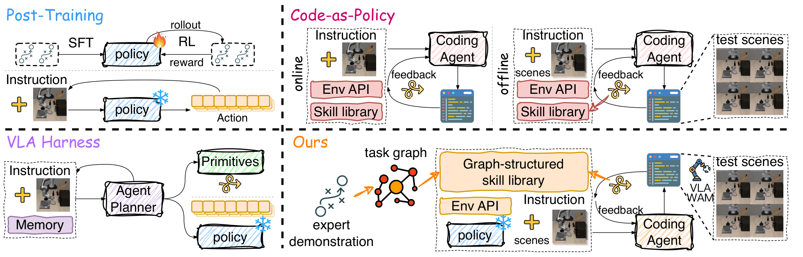
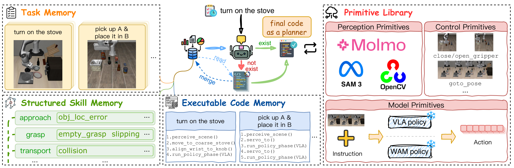
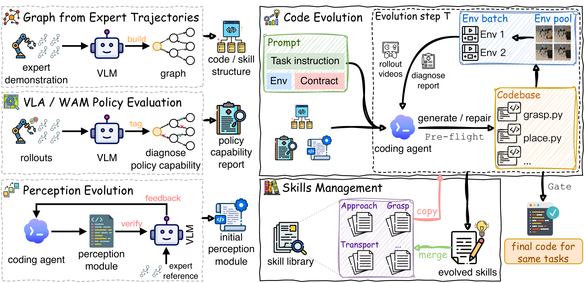
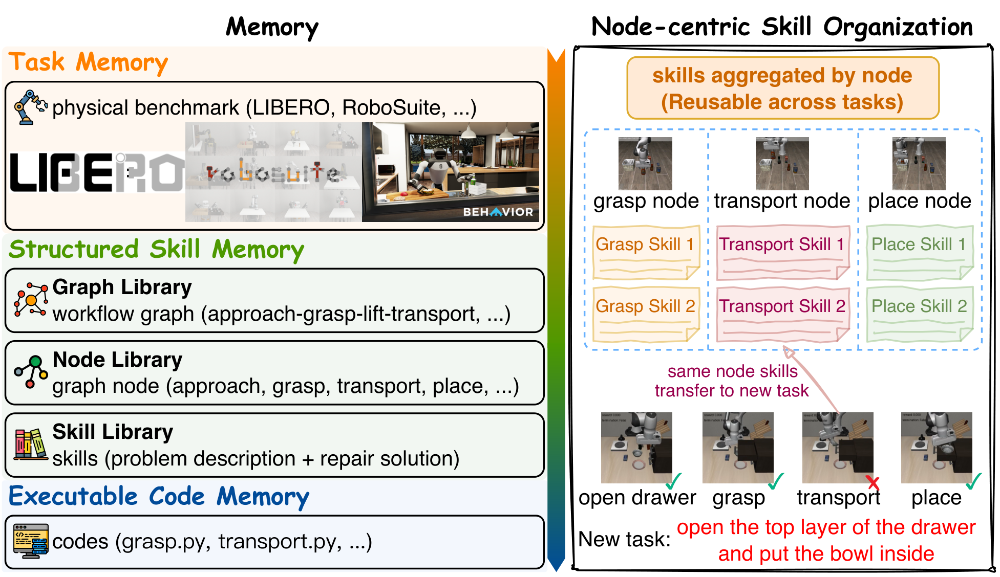
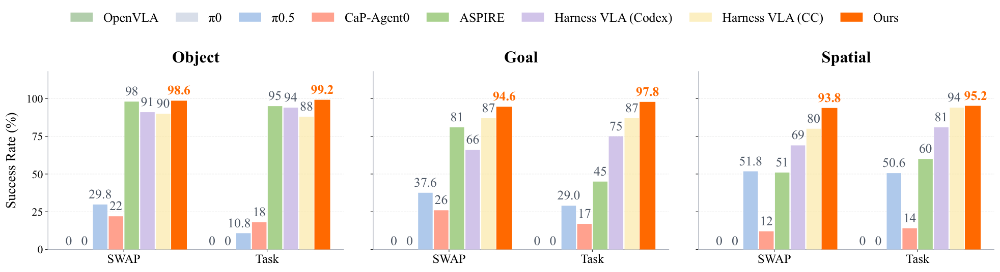
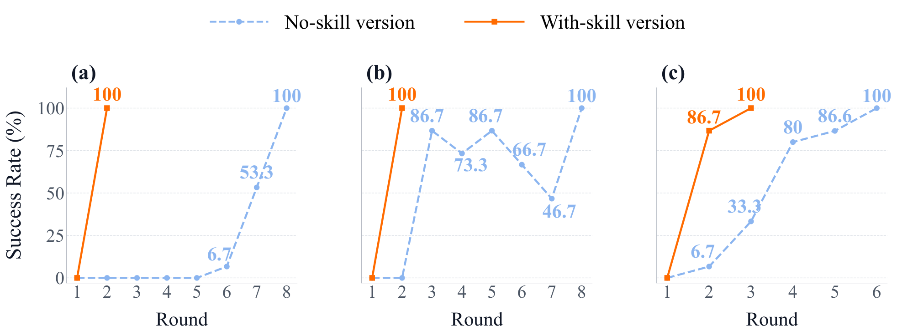
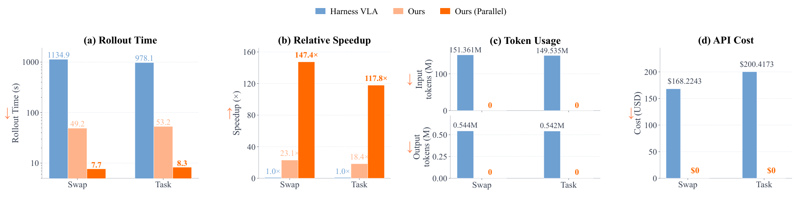

# HarnessPAI：把 VLA/WAM 降为原语，用可执行代码 harness 做「一次执行、跨轮进化」

## 来源信息

| 项 | 内容 |
| --- | --- |
| 标题 | HarnessPAI: An Evolving Harness for Physical AI |
| 作者 | 首页署名 **Darwin Agent Team**；arXiv 元信息列 23 位作者：Xin Wang、Wenhao Wu、Menghao Zhang、Zhi Wang、Kun Shao、Jian Luan、Yang Li、Qing Li、Shangding Gu、Huichi Zhou、Shuqing Shi、Fei Ni、Shuo Lu、Weicheng Meng、Kang Li、Jin Wu、Kang Zhao、Shangmin Guo、Gen Li、Yongqiang Tang、Zhizhong Zhang、Yuan Xie、Heng Qu。p36 的贡献说明：**Core Contributors 6 人**（Xin Wang、Wenhao Wu、Menghao Zhang 标 equal contribution；Zhi Wang、Kun Shao、Jian Luan 标 corresponding author，Kun Shao 另标 project lead），其余 17 人为 Contributors |
| 机构 | 第一机构 **Xiaomi Inc.**（作者 1 同时属 Tsinghua University）。其余单位：Nanjing University、Shanghai Jiao Tong University、East China Normal University、University College London、King's College London、Imperial College London、Institute of Automation, Chinese Academy of Sciences、Shanghai Innovation Institute、University of Oxford、University of Edinburgh、Nanyang Technological University（p36） |
| 来源 | [arXiv:2609.29166v2](https://arxiv.org/abs/2609.29166v2)（cs.RO; cs.AI）。v1 提交于 2026-09-24 07:40 UTC，v2 提交于 2026-10-21 03:58 UTC；本笔记基于 **v2**，为截至阅读时的最新版。arXiv comment 写 `45 pages, 24 figures, 15 tables` |
| 许可 | [arXiv nonexclusive-distrib 1.0](http://arxiv.org/licenses/nonexclusive-distrib/1.0/)（abs 页 "view license" 指向该协议，不是 CC BY） |
| 页数 | 45 页（PDF 页码与印刷页码一致）：正文 p1–31、References p32–35、Contributions p36、Appendix A–C p37–45 |
| 项目页 | <https://darwin-agent.github.io/HarnessPAI/>（2026-11-09 访问：60,200 B，与响应 `Content-Length` 一致；页面可见的外部链接包括 arXiv 与 GitHub 仓库） |
| 代码 | <https://github.com/Darwin-Agent/HarnessPAI>（GitHub API 核验于 2026-11-09：默认分支 `main`，创建 2026-09-23，最后 push 2026-10-22，commit `3af7d561`，★49；顶层含 `harnesspai/{primitives,envs,agents,memory,code_library,execution,evolution,feedback,infra}`、`configs/`、`environments/`、`third_party/`、`data/libero/`、`runs/`，106 个 Python 文件；`third_party/` 是 cap-x、openpi、robocasa/robocasa_robosuite 等 submodule。**仓库未标注 license**；`harnesspai/code_library/` 只有 `TEMPLATE.md`、`promote.py`、`scaffold.py` 与 `__init__.py`，`runs/` 只有 `.gitkeep`，没有看到论文里 60 个任务的进化产物；未逐目录确认是否以其他形式提供了示例代码包。只核到结构与 README 层面，未运行代码、未验证与论文实验的可复现性对应） |
| 阅读日期 | 2026-11-09 |
| 仓库编号 | 00213（清单原有行，本次回写笔记地址；编号单元格指向 arXiv 官方页） |
| 配图 | `assets/figure2-paradigms.png`、`assets/figure8-framework.png`、`assets/figure9-pipeline.png`、`assets/figure10-skill-memory.png`、`assets/figure13-libero-pro.png`、`assets/figure19-evolution.png`、`assets/figure21-cost.png`（PDF p6/p12/p13/p16/p21/p25/p27；300 dpi 渲染裁剪） |
| 版本说明 | 本笔记只读 v2，未逐页比对 v1。abs 页记录：v1 2026-09-24（e-print 11,779 KB），v2 2026-10-21（e-print 8,949 KB）；arXiv 的 size 是提交源码包大小，不等于 PDF 字节数 |

**阅读范围与核对凭据**（供下次复核复用）

- **已获取全文**：从 arXiv 官方 `https://arxiv.org/pdf/2609.29166v2` 完整下载，9,834,169 B、45 页，sha256 `dcca7abb7dabdf1f6ffafa65f818ad93f14aba3d1137bcc9328733cee4619615`；`curl` 退出码 0，文件尾为 `%%EOF`，`Content-Length` 与实际下载字节数一致。另取同版本 HTML `https://arxiv.org/html/2609.29166v2`，700,408 B（与 `Content-Length` 一致），含 Appendix A–C、15 个 table、24 个 figure，用于正文快速阅读；表格与图最终以 PDF 渲染页为准。
- **已逐项核对**：Table 1（p6）、Table 2（p14）、Table 3（p15）、Table 4（p20）、Table 5（p22）、Table 6/7（p37）、Table 11（p41）、Table 13/14（p43）、Table 15（p44）在 200 dpi 渲染页上逐格对照正文；Table 8/9/10（p38–40）只核了小计与总计（p38–p40 渲染页/文本），没有逐行转写全部 30 个 task。Figure 2（p6）、Figure 8（p12）、Figure 9（p13）、Figure 10（p16）、Figure 13（p21）、Figure 19（p25）、Figure 21（p27）在 200 dpi 渲染页上核对图号、图注与内容。
- **图内读数**：Figure 19 的 6.7/33.3/80/86.6/100 与 86.7/73.3/86.7/66.7/46.7、Figure 21 的 1134.9/978.1/49.2/53.2/7.7/8.3 s、23.1×/18.4×/147.4×/117.8×、151.361M/149.535M、0.544M/0.542M、168.2243/200.4173 美元均为图内直接标注文字的读数，未做像素测量；与正文数字交叉，差异只在四舍五入（如正文 151.36M vs 图 151.361M）。
- **配图裁剪框**（pt，页面坐标系，300 dpi）：Figure 2 `(70.5, 363.5, 541.5, 514.5)`；Figure 8 `(70.5, 86.0, 541.0, 240.5)`；Figure 9 `(71.5, 86.0, 538.5, 312.5)`；Figure 10 `(71.5, 86.0, 540.0, 356.5)`；Figure 13 `(70.5, 183.5, 541.5, 312.0)`；Figure 19 `(70.5, 481.5, 541.5, 658.5)`；Figure 21 `(70.5, 109.5, 541.5, 232.6)`。七张图均复核了边界：未包含题注、未切掉坐标轴/图例/图内说明行；Figure 10 的 "Memory" 标题与 Figure 21 的底部坐标轴都在框内。
- **仅按正文/图注引用，未逐页核对**：Figure 1/3/4/5/6/7/11/12/14/15/16/17/18/20/22/23/24 未逐张做像素级核对；Figure 18 与 Table 15、Figure 14 与 §5.2.5 正文交叉过；Figure 12 只按 Table 6 引用，未独立读图；没有逐 task 重算。
- **未做**：未运行仓库代码、未复现任何实验、未做真机验证、未独立复算 45 页的全部 per-task 结果、未比对 v1 与 v2、未对 `data/libero/` 的 init 文件做仿真回放。
- **否定性断言检索**：在 PDF 全文检索 `real robot`、`real-world`、`hardware`、`deployment`：`real robot` 只出现在 §2.4 的 related work（"motivating safety-gated validation on real robots"）；`hardware` 出现在 §2.4 的 "hardware faults" 与 §5.5 的成本边界说明，两处都不是实验章节的真机结果；论文没有报告真机实验。全文没有出现作者自己的代码仓库 URL；`github` 的命中只有 p1 项目页域名与 p34 参考文献里的第三方仓库（vacusim、microduck_rl、RLDX-1、world_...），代码入口来自项目页而不是论文正文。检索日期 2026-11-09。
- **代码仓库检查**：GitHub API 核验仓库存在、默认分支、commit、许可字段与顶层目录；`license` 为 `null`，递归 tree 中没有 `LICENSE`/`COPYING`（只有 `assets/lucide-LICENSE.txt` 这个第三方图标许可）。`runs/` 只有 `.gitkeep`，`code_library/` 只有模板与提升脚本，说明仓库是研究代码而非已打包的复现实验产物。

### 复核记录

- **2026-11-09 第一轮（check-paper-note）**：基准 arXiv:2609.29166v2；从 arXiv 官方重新下载 PDF，9,834,169 B、45 页、sha256 `dcca7abb7dabdf1f6ffafa65f818ad93f14aba3d1137bcc9328733cee4619615`，与笔记记录一致；同版本 HTML 700,408 B。复核前笔记 md5 `f0fd28ff0917098f2018ba5c0ce69e9f`。按 A–H 核对：A 元数据（23 作者、6 位 core contributors、17 位 contributors、13 个单位、v1/v2、许可、页数、README 行）；B 数字（Table 1–7/11/13–15、Figure 13/19/21 的读数；Table 8–10 的小计/总计）；C Algorithm 1；D 全部 §/Figure/Table/页码；E 否定与全称断言；F 7 张配图的图号、图注与元素；G 关键设置、分母、成本口径；H 内部一致性。**修正**：① §3.1/§3.2 与 Figure 7 的归属（§3.1 三个失败例子 + §3.2 不可逆错误）；② Figure 6 改为“不能判定具体原因”，不再写成接触控制失败；③ `hardware` 并非只在 §5.5（§2.4 也有 "hardware faults"），`github` 检索改为“无作者仓库 URL，只有第三方链接”；④ 补 Figure 19 的 30 个 dev rollout 分母、Figure 21 的 50 rollouts/100 seeds/API cache 口径；⑤ 补 per-suite SFT 的 Swap/Task 限定、BEHAVIOR CaP-Agent0 对照、cs.AI 分类；⑥ 把 “OpenCV” 改为按 Figure 8 归因（正文只点名 SAM3/SAM/Molmo）；⑦ 收紧 “pure zero-shot”“不会再被包回”“主要脆弱点”“唯一明确三个可选阶段”等措辞；⑧ 把 “Table 4 唯一三 suite 前二”标注为按表值判断；⑨ Table 8–10 从“只按 HTML”改为“PDF 渲染页/文本核小计与总计”；⑩ README 单位表述改为组名 Xiaomi / 原文 Xiaomi Inc.；⑪ Algorithm 1 恢复 19 步原编号。**独立审计**：子 agent 只报告、未改文件；其报告 18 项，均已处理；OpenCV 一项没有删除（Figure 8 的感知 primitive 图标确实列了 OpenCV），改为按图注归因。**确认无误**：98.1/96.9、96.5/34.9/71.7/87.7、92.2/65.0、96.3/81.0/82.6/68.3、Table 4/5/6/7/15、Figure 19/21 的读数均与 PDF 渲染页一致；未发现硬数字错误。**未修/未核**：未运行代码、未复现实验、未做真机验证、未比对 v1/v2、未逐行核 Table 8–10 全表；项目页/GitHub 的 star/许可/目录结构由主 agent 于 2026-11-09 另行核验（非子 agent）。

---

## 核心结论

一句话：**HarnessPAI 不把 VLA/WAM 当成整个 agent，而把它降为「动作原语」；在单次 rollout 内运行一个固定的、带感知/几何推理/成功检查的可执行程序（open-loop），在多次 rollout 之间用执行反馈让 coding agent 修改程序、把失败蒸馏成按任务图节点索引的 repair skill（closed-loop）。**

结果层面，论文在 **7 个实验设置、4 类 embodiment、5 种动作后端**上报告提升：

- **LIBERO**：98.1% overall，对比 π0.5-LIBERO 的 96.9%（+1.2 pp），Table 4（p20）。
- **LIBERO-PRO**：96.5% overall，对比 π0.5 的 34.9%（+61.6 pp）、ASPIRE 的 71.7%、Harness VLA (CC) 的 87.7%（+8.8 pp），Table 7（p37）/Figure 13（p21）。
- **RoboCasa Atomic-Seen**：92.2%，对比 WorldDreamer 的 65.0%（+27.2 pp），Table 5（p22）。
- **robosuite**：96.3%，对比 ASPIRE 的 81.0%（+15.3 pp）、人类 82.6%、CaP-Agent0 的 68.3%，Table 6（p37）。
- **BEHAVIOR-1K**：radio 任务导航 100%、端到端 84%→100%；soda can 导航 92%、端到端 72%→92%（8 轮 few-shot），Figure 14（p22）。
- **VacuSim**：覆盖率 4.90%→63.76%（40×40 无家具）、11.7%→53.92%（25×25 有家具），Figure 15/16（p23–24）。
- **MicroDuck**：纯 PPO 在 4 m 前进中横向漂移最多 0.8 m，harness 把它拉回接近零，Figure 17（p24）。

但读这篇要同时记住四个限定：

1. **论文没有报告真机实验结果，实验主体是仿真基准**。论文的 §2.4 标题是 "Sim-to-Real Transfer and Real-Robot Validation"，但那一节只做 related work 与动机；实验部分是 robosuite、LIBERO、LIBERO-PRO、RoboCasa、BEHAVIOR-1K、VacuSim、MicroDuck，没有硬件部署、没有安全门槛、没有 sim-to-real 迁移测量。MicroDuck 一节也只给轨迹与误差，没有给硬件部署协议。
2. **LIBERO / LIBERO-PRO 的 50-seed 评测包含 15 个用于进化程序的 dev seed**。§5.1 明确写 "the 50-seed evaluation includes the 15 seeds used for program evolution and 35 additional evaluation seeds"；这不是完全 held-out，98.1/96.5 比完全 held-out 的口径更乐观。
3. **与 Harness VLA、ASPIRE、AtomVLA 的比较不是严格同协议**。论文自己承认 Harness VLA 的 97.0 与 98.1 来自不同评测协议，只能算 "evidence of a performance advantage"，不是 controlled ablation；ASPIRE 的数字取自 ASPIRE 论文，robosuite 的 ASPIRE 也不是本文复现的同后端对照。真正干净的对照是同一后端的前后差：π0.5 96.9→98.1、WorldDreamer 65.0→92.2。
4. **报告的是执行成本，不是进化/开发成本**。§5.5 明确说 "does not establish total program-development or lifecycle costs"；coding agent 写代码、VLM 诊断、perception 进化、仿真与硬件的成本都没有计入。所以 "23.1× 更快、在线 API 0 美元" 只描述部署执行阶段。

## 问题与动机

作者的出发点是：Physical AI 的很大一部分研究围绕 **action model**（VLA 或 WAM）展开，但一个在标准 benchmark 上很强的 VLA，在语言扰动、场景扰动和精细操作上会急剧失效。

§3.1（p7–9）给了三个失败例子；§3.2（p9–10）另用 Figure 7 说明不可逆错误：

- **语言扰动**（Figure 4，p8）：LIBERO 的指令是 "pick up the black bowl between the plate and the ramekin"；在 "between" 前加 "not"，指代对象翻转成另一个碗，π0.5 仍然抓原来的碗；连外部把场景 mask 掉也救不回来。
- **场景扰动**（Figure 5，p9）：指令不变，只把 plate 和 ramekin 的位置互换；π0.5 仍然把碗搬到 plate 的旧位置。LIBERO-PRO 正是用这种扰动把标准 LIBERO 90%+ 的模型打到 39.7%/30.1%。
- **精细操作**（Figure 6，p10）：WAM 能走到微波炉前、伸手到 start button，但在示例 trial 里按不下去；这说明粗粒度动作成功不足以保证精细操作完成；原文明确说，不能据此判定失败来自目标定位、接触控制还是动作生成。
- **不可逆错误**（Figure 7，p10）：双臂任务里抓错物体并抬起，场景状态被改变，后续无法恢复；物理错误不像软件错误那样可以随便重试。

论文把这些失败归因于 **action-centric 的训练配方**：VLM backbone 被 action prediction 目标覆盖，V（视觉 grounding）和 L（语言理解）退化；diffusion/flow-matching action head 在粗粒度、低频动作上可靠，但在精细位移上不稳定。它不声称这些例子能证明失败一定来自 V/L 退化（原文明确说 "do not establish whether it results from degradation..."），而是用它们说明：**动作能力本身不足以保证任务完成**。

### 两种部署 regime

§3.3（p10–11）把部署分成两种：

- **many tasks, each once**：真实部署里 agent 面对很多任务，每个只做一次；纯 VLA/WAM 是为这个 regime 设计的，目标是从未见过的指令直接生成正确动作。
- **one task, many times**：同一个物理任务反复执行；HarnessPAI 针对这个 regime。

第二种 regime 不是"可以容忍失败"：每次 rollout 仍然是 open-loop，仍然要争取一次成功，因为物理错误可能不可逆。它的价值在于：**跨 rollout 的反馈可以积累**，把一次性的推理变成可复用的程序与 repair skill。

### 为什么是代码

§3.3 给了三个理由：

- **executable**：程序把任务落到当前场景，分解步骤，调用 action primitive，运行 success check；open-loop 执行本质上就是"运行一个会自检的程序"。
- **inspectable**：感知、grounding、recovery 决策都是可读、可诊断、可编辑的语句，不是藏在 policy 权重里的数。
- **evolvable**：程序可以被修改、再执行；这正是 closed-loop evolution 需要的表示。

代码还能把不同 VLA/WAM 包成可替换的 primitive；在没有 learned action model 时退化为直接 API 控制。论文用 Table 1（p6）和 Figure 2（p6）把四种范式放在一起：

| 范式 | 适应存在哪 | rollout 内有 coding agent | API 控制 | 用 learned policy | 跨 rollout 进化 |
| --- | --- | --- | --- | --- | --- |
| VLA/WAM post-training | 模型参数 | ✗ | ✗ | ✓ | 仅训练 |
| Code-as-policy | 程序 | ✗ | ✓ | ✗ | 有时 |
| VLA harness | runtime/memory | ✓ | ✓ | ✓ | 通常 |
| **HarnessPAI** | **程序/memory** | **✗** | **✓** | **✓** | **为持续进化设计** |



*Figure 2（p6）：Post-Training 把适应写进权重；Code-as-Policy 用程序替代 learned action；VLA Harness 在 rollout 内保留一个 agent planner；HarnessPAI 则从专家轨迹建 task graph，用 coding agent 在多次 rollout 之间进化代码，执行时不再调用在线 planner。*

## 方法

### 1. 单次 rollout：程序级 open-loop

HarnessPAI 在执行时把知识组织成 **三个 memory + 一个 primitive library**，代码在中间做 planner（§4.1，p11–12；Figure 8，p12）：

- **Task Memory**：机器人被要求做过的任务描述（如 "turn on the stove"、"pick up A and place it in B"）。
- **Structured Skill Memory**：按任务图节点挂载的 failure-to-repair skill。
- **Executable Code Memory**：已经进化好的可执行代码包。
- **Primitive Library**：三类可替换原语——感知（SAM3、Molmo；Figure 8 图中还列了 OpenCV，正文只点名 SAM3/SAM/Molmo）、控制（`goto_pose`、`close/open_gripper` 等）、模型（VLA、WAM、PPO）。



*Figure 8（p12）：Task Memory 存任务；Structured Skill Memory 存按节点组织的 repair；Executable Code Memory 存进化后的代码；Primitive Library 提供感知、控制、模型三类原语。代码把"做什么"与"能调什么"接起来。*

执行时，code 就是 planner：先调感知原语 grounding 场景，再在感知结果上做几何推理，决定动作，最后才调用 action model 完成接触丰富的操作。论文的关键句是（p12）：

> "a physical AI is not an action model; it is perception, geometry, and action held together by an executable plan, of which the action model is only one, replaceable part."

这里的 "open-loop" 限定在 **program level**：程序在一次 rollout 内固定，但执行过程中仍可使用当前观测、预定义检查和 recovery（§3.2，p9–10）。它不是"闭眼执行"；它反对的是在每个 action step 都让一个大模型重新推理。论文的 verification 也不是"反复试到成功"的 retry loop，而是 **success test**：夹爪是否真的夹住、物体是否到了该到的位置，通过后才允许进入下一步（p11）。

**混合执行**（Table 3，p15）把阶段分工写得很清楚：

| 阶段 | 执行者 |
| --- | --- |
| grounding | 固定代码（segmentation + geometry） |
| approach | 固定代码（Cartesian servo，Pyroki IK rescue） |
| grasp | VLA |
| transport | 固定代码 |
| place | VLA |

这张表是理解全文的关键：**deterministic 的阶段用代码，semantic/contact-rich 的阶段交给 VLA**。代码不是替代动作模型，而是把动作模型放到它擅长的那几个阶段。

### 2. 跨 rollout：closed-loop evolution

§4.2（p12–13）把进化分成 **3 个可选步骤 + 1 个必经主循环**（Figure 9，p13）：

1. **workflow graph generation（可选）**：VLM 读专家轨迹视频，生成任务的 workflow graph，固定代码与 skill 的结构。
2. **capability assessment（可选）**：VLA/WAM 在任务上跑几次，VLM 判断每个 workflow node 上模型是 "good / needs code / mixed"，产出 capability report。
3. **perception module initialization（可选）**：对感知重的任务，coding agent 调 SAM/Molmo 进化感知代码，VLM 用专家轨迹验证。
4. **main evolution loop（必经）**：给任务指令、环境信息、success contract，coding agent 在已有 code structure 上构建 code package，跨多个环境运行，读 diagnostics 与 rollout video 决定下一次编辑；出错时从 skill library 检索 repair，成功时把代码存入 code library、把新 skill 合并进 skill library。



*Figure 9（p13）：左侧三个可选步骤分别处理专家轨迹、VLA/WAM 能力评估、感知模块；右侧是必经的 code evolution 主循环，包含 env batch、diagnose report、codebase、pre-flight、gate 与 skills management。*

Algorithm 1（p14）是主循环的精确写法：

```text
输入：task description, environment information, success contract C, round budget T
输出：promoted code package P, distilled skills S
1  Define success contract C（scope / goal / terminal state / non-success signals）
2  P ← 构建 code skeleton（有 task graph 就用 graph，否则单文件）
3  I ← task description
4  for r ← 1 to T do
5      P ← Write(Codex 用 I 编辑 candidate copy)
6      if pre-flight 或 probe 失败 then
7          修 bug
8      end if
9      execute P open-loop on every episode × every suite
10     (d, v) ← Diagnose(VLM node-wise verdict 与 video reward)
11     g ← Gate(deterministic milestone-prefix reward)
12     if all rollouts succeed under C then
13         promote P into code library
14         S ← 把 failure-to-repair pairs 蒸馏进 skill library
15         return P, S
16     else
17         I ← Synthesize(Codex 对 d 与 g 的 self-review)
18     end if
19 end for
```

几个设计点值得单独记住：

- **success contract 先于进化**：第一轮就写清 full evaluation scope、authoritative goal condition、graph terminal state，以及 **不构成成功的信号**——"clean exit"、"reached terminal state"、"high dense reward"、writer 自己声称收敛（p14）。同一份 contract 注入 writer、diagnoser、reviewer，避免"自己给自己判分"。
- **pre-flight + probe 是两级快速反馈**：pre-flight 只检查代码能不能跑，把环境/驱动崩溃和 policy failure 分开；probe 只挑上一轮失败的 3 个 seed 修，修完再跑全训练集确认没有回归（p14）。这能避免每轮都付全量 rollout 的代价。
- **两个模型分工**（Table 2，p14）：`GPT-5.6-sol` 是 writer + synthesizer，负责改代码、self-review、写下一轮 instruction；`Gemini-3.5-Flash` 是 diagnoser，负责看 rollout video、按 graph node 给 verdict，不改代码。这样 diagnosis 信号与 writer 独立，避免"改代码的人给自己打分"。
- **gate reward 是确定性后备**：即使 VLM 误判，`Gate` 仍用 milestone-prefix reward 给出一个不依赖模型的数值信号（p14）。
- **candidate isolation**：writer、pre-flight、rollout 都在隔离的 candidate copy 上工作；只有整套 episode batch 全部通过才原子 promote 到 code library；失败或轮数耗尽时 library 原样不动，candidate 留在 run directory 里供诊断（p15）。

### 3. 技能库：按任务图节点组织

§4.4（p15–17）把 skill library 设计成 **四级结构**（Figure 10，p16）：

- **L1 Graph Library**：每个任务的 workflow graph。
- **L2 Node Library**：graph 的节点（approach、grasp、transport、place 等）。
- **L3 Skill Library**：每个节点下挂多个 problem–repair pair。
- **L4 Code Library**：skill 的 repair 指向的具体实现代码。

一个 skill 由两部分组成：**problem**（在这个阶段会遇到什么失败）与 **repair**（怎么过）。它可以是小的 markdown note，附解释性代码片段；但真正的可执行实现只在 code library 里维护，skill 通过 "refers to" 边指过去。这样避免"每个 skill 都是一段独立代码"导致的重复与失同步。



*Figure 10（p16）：左边是 Task Memory / Structured Skill Memory（Graph Library、Node Library、Skill Library）/ Executable Code Memory；右边是 node-centric 组织——同一个 grasp/transport/place 节点下的 skill 跨任务聚合，新任务按节点查询，而不是按任务或文件名搜索。*

这套设计带来两个好处：

- **retrievability**：flat 文件堆（`obj_loc_error.md`、`empty_grasp.md`、`slipping.md`、`path_collision.md`）与任务阶段关联弱，coding agent 要在无序文件里找；按节点挂载后，到了 grasp 阶段就查 grasp 节点。
- **transfer**：新任务（例如 "open the drawer"）与已解决任务共享 grasp/transport/place 节点，节点上的 repair 可以直接迁移；论文说这就是 §5 里 "with skill library, convergence arrives within the first few rounds" 的机制（p16–17）。

Appendix C（p44–45）给了一个完整的真实 skill 例子 `align-object-to-basket-mouth`：place 阶段把物体 3D-align 到 basket body 而不是 mouth，导致目标在深度方向偏向相机、rim 的 Z 低估开口；在 `libero_object_task` task2 ep51 上，body 估计 `[0.0585, 0.2653, 0.1321]`，mouth 是 `[0.0056, 0.2708, 0.1386]`，X（深度）误差 **5.3 cm**。place 看起来 "succeeded"（物体中心到达目标），实际偏离开口 5 cm、蹭到 rim、没进 `contain_region`；这个失败先后被误诊为 transport drop（ep51/ep53）和 release timing bug（ep54），其实是同一个 place-target bias。这个例子很能说明 skill 的价值：**它把"症状"与"根因"分开记录，避免每次都在错误的阶段修。**

### 4. 模型反馈：harness 生成专家数据，模型单向学习

§4.5（p17–18）讨论如何用 harness 反过来改 action model：

- 主进化循环中 action model **保持冻结**；进化只改 code。
- 收敛后的程序是一个 **trajectory generator**：它在扰动的 LIBERO 变体上跑出成功轨迹，而 LIBERO-PRO 本身不提供这些扰动变体的人类演示。
- 用 success gate 过滤，只保留满足任务成功条件的 rollout，作为 **success-filtered demonstrations**，做 supervised fine-tuning。
- 这条路径是 **单向** 的：harness 是数据源，model 是 learner；本文没有把 fine-tune 后的 model 重新包回 harness 重新进化；作者说这是自然的后续方向，但本文未做，code library / skill library / converged programs 保持原样（p18）。论文明确说 "Nothing flows back"。

结果（§5.6，p27–29）：

- 在对应 suite 的 Swap/Task 扰动上，π0.5-LIBERO 分别 fine-tune：Object 21.5%→88.0%，Spatial 50.0%→82.5%，Goal 32.5%→54.5%（15,000 steps 内最佳 checkpoint，Figure 22，p28）。
- 全 mixture（三个 suite × Base/Swap/Task 九类等量采样）：π0.5-LIBERO 34.9%→73.7%（+38.8 pp）；π0.5-Base 从接近 0 到 53.3%（30,000 steps 内最佳，Figure 23，p28）。
- DreamZero：LIBERO-Object Swap 0.6%→24.0%，Task 9.6%→29.0%，平均 5.1%→26.5%（8,500 steps 的共享 checkpoint；+23.4/+19.4，平均 +21.4 pp，Figure 24，p29）。

这条"模型反馈"是论文与纯 harness 工作最不一样的地方，但要注意它是 **offline SFT**，不是 RL，也不是 harness 与 model 的联合优化；Figure 1 上写的 "Harness & Model Co-Evolve" 与 §4.5 的 "Nothing flows back" 并不一致（见下文"原文自身的表述张力"）。

## 实验与证据

### 设置

§5.1（p18–19）列出 7 个设置，覆盖 4 类 embodiment、5 种动作接口：

| 设置 | embodiment / 任务 | 动作后端 | 进化 / 评测 seeds |
| --- | --- | --- | --- |
| robosuite | 桌面单臂/双臂，7 个任务 | GraspNet | 进化 101–125；评测 1–100（100 seeds） |
| LIBERO | 桌面 Franka，Spatial/Object/Goal 各 10 任务 | π0.5-LIBERO | 进化 0–14；评测 50 seeds（含这 15 个） |
| LIBERO-PRO | 同 LIBERO，Swap/Task 两种扰动，60 任务 | π0.5-LIBERO | 进化 0–14；评测 50 seeds（含这 15 个） |
| RoboCasa | 移动机械臂，Atomic-Seen 18 任务 | WorldDreamer | 每任务 20 seeds，共 360 |
| BEHAVIOR-1K | 移动底座上的人形上半身，radio/soda can | GraspNet | 进化 26–35；zero-shot 1–25；few-shot 8 轮 |
| VacuSim | 差速扫地机器人，25×25 / 40×40 | 纯控制 API | 主循环，无 VLA/graph/perception 可选阶段 |
| MicroDuck | 足式直行 | PPO Walker | 横向误差 / 终点距离，不是二值成功率 |

共同原则：**后端冻结，只进化 harness**；进化在 development seeds 上做；评测一般用 benchmark 的 split，但 LIBERO/LIBERO-PRO 的 50-seed 评测包含 15 个进化 seed（见 §5.1）。只有成功 candidate 才 promote，崩溃/超时算失败。

### 主结果

| 基准 | 对照 | HarnessPAI | 差距 | 证据 |
| --- | --- | --- | --- | --- |
| LIBERO overall | π0.5 96.9 | **98.1** | +1.2 pp | Table 4（p20） |
| LIBERO-PRO overall | π0.5 34.9；ASPIRE 71.7；Harness VLA (CC) 87.7 | **96.5** | +61.6 / +24.8 / +8.8 pp | Table 7（p37）、Figure 13（p21） |
| RoboCasa Atomic-Seen | WorldDreamer 65.0 | **92.2** | +27.2 pp | Table 5（p22） |
| robosuite avg | ASPIRE 81.0；Human 82.6；CaP-Agent0 68.3 | **96.3** | +15.3 / +13.7 / +28.0 pp | Table 6（p37）、Figure 12（p19） |
| BEHAVIOR-1K radio | 导航 100；任务 zero-shot 84→few-shot 100 | 任务：ASPIRE 88；Human 36；CaP-Agent0 56 | few-shot 追平/超过 | Figure 14（p22） |
| BEHAVIOR-1K soda | 导航 92；任务 72→92 | 任务：ASPIRE 88；Human 72；CaP-Agent0 72 | few-shot +4 vs ASPIRE | Figure 14（p22） |
| VacuSim coverage | 初始 4.90 / 11.7 | **63.76 / 53.92** | +58.86 / +42.22 pp | Figure 15/16（p23–24） |
| MicroDuck 横向误差 | 纯 PPO 最多漂 0.8 m（4 m 前进） | 接近 0，能到终点 | 定性 | Figure 17（p24） |



*Figure 13（p21）：Object / Goal / Spatial 三个 suite 在 Swap / Task 两种扰动下的成功率。HarnessPAI 六个格子都在 93.8 以上；π0.5 在 Object/Task 只有 10.8、Goal/Task 29.0，说明标准 LIBERO 的高分并不等于扰动下仍然可靠。*

几个值得展开的点：

- **标准 LIBERO 的提升很小，真正的大头在扰动与精细任务**。98.1 只比 π0.5 的 96.9 高 1.2 pp，而且 π0.5 在 Object 上是 100.0，已经封顶；HarnessPAI 的 98.1 主要来自 Goal +2.0、Spatial +1.6。相比之下，LIBERO-PRO 从 34.9 到 96.5、robosuite 的 Insert 从 ASPIRE 的 9% 到 83%、2A-Lift 从 71% 到 91%，这些才是"代码补 V/L、VLA 补 A"真正生效的地方。
- **混合设计的对照**：OpenETA（纯 code-as-policy，没有 learned action model）在 LIBERO 只有 18.3% overall（Spatial/Object/Goal 为 8.0/26.0/21.0），HarnessPAI 是 98.1%；但两者 action backend 不同，论文自己说这只说明完整系统、不隔离 program evolution 的贡献。按 Table 4 的列值，HarnessPAI 也是唯一在三个 suite 都排进前二的方法（Spatial 第 2、Object 并列最高、Goal 第 2）。
- **LIBERO-PRO 的 96.5 不是靠单一 baseline 弱**：ASPIRE 71.7、Harness VLA (CC) 87.7 都是强 harness；96.5 仍高 8.8 pp。Figure 13 的分 suite 柱状图显示，HarnessPAI 在 Object/Swap 98.6、Object/Task 99.2、Goal/Swap 94.6、Goal/Task 97.8、Spatial/Swap 93.8、Spatial/Task 95.2，六个格子都在 93.8 以上；π0.5 在 Object/Task 只有 10.8、Goal/Task 29.0。这个对比比 overall 数字更有说服力。
- **RoboCasa 的 +27.2 是同一后端的前后差**，比 Table 5 里 Harness VLA (Codex) 91.6 的跨协议比较更干净；论文自己强调 "most informative when read against HarnessPAI's own base policy"（p22）。
- **BEHAVIOR-1K 的价值在"导航到完成"的 gap**：radio 导航 100%，zero-shot 任务 84%，8 轮 few-shot 到 100%；soda 导航 92%，任务 72%→92%。也就是说，移动底座能到的 episode，closed loop 最后都能完成（p22–23）。
- **VacuSim 是无 learned model 的测试**：没有 VLA、没有 workflow graph、没有 perception 可选阶段，只有 diagnostics + painted coverage 驱动代码修改；最终策略执行时不需要 LLM 调用（p23）。这说明主循环不依赖 action model 也能工作。
- **MicroDuck 是"不改 PPO 权重，只加代码纠正"的极端例子**：纯 PPO 的训练目标不惩罚横向漂移，4 m 内漂 0.8 m；harness 测 heading error，把同一个 Walker policy 拉回直线（p24）。

### 进化过程：三种收敛形态

§5.4（p25–26）用 LIBERO-Object 的 task 0/1/5 在 LIBERO-PRO Swap/Task 下展示 closed loop 的行为（Figure 19，p25）：

- **Task 0：Aha moment**。no-skill 在前 5 轮接近 0，第 6 轮 6.7%，第 7 轮 53.3%，第 8 轮 100%；一旦移除 blocking error，成功率的上升很快。
- **Task 1：meandering**。no-skill 在 86.7%、73.3%、86.7%、66.7%、46.7% 之间震荡，最后才落到正确程序；说明搜索地形很崎岖。
- **Task 5：monotone climb**。no-skill 6.7%→33.3%→80%→86.6%→100%，逐步累积部分修正。

with-skill 版本：Task 0 和 Task 1 在第 2 轮就到 100%；Task 5 第 2 轮 86.7%、第 3 轮 100%。论文正文说 "all three jump to 100% within the first two rounds"，但 Figure 19(c) 的 Task 5 实际是第 3 轮才到 100%；同页后文也说 "some tasks ... reaching 100% still requires two or three rounds even with the skill library"（p26）。这是原文自身的一处措辞不一致（见下文）。



*Figure 19（p25）：虚线是 no-skill，实线是 with-skill；三个 task 的成功率按 round 画。每个点是 seeds 0–14 在 Swap+Task 上共 30 个 dev rollout，不含额外 35 个评测 seed。Task 0 是 Aha，Task 1 是 meandering，Task 5 是 monotone；with-skill 明显把收敛压到前 2–3 轮。*

### 零样本迁移与后训练

**零样本迁移**（§5.3，p24–25）：把在 LIBERO-Object 上用 π0.5 进化出的 harness 原封不动套到 DreamZero（WAM），不重新进化、不调参，只把 action-model 调用换成 DreamZero。结果（Table 15，p44）：

| 条件 | DreamZero Swap | DreamZero Task | HarnessPAI zero-shot Swap | HarnessPAI zero-shot Task |
| --- | --- | --- | --- | --- |
| 全部 10 个 task | 0.6 | 9.6 | **73.4** | **84.4** |
| task0 alphabet soup | 0.0 | 0.0 | 100.0 | 94.0 |
| task6 butter | 6.0 | 0.0 | 10.0 | 66.0 |
| task9 orange juice | 0.0 | 0.0 | 60.0 | 80.0 |

DreamZero 在 Task 上的 9.6% 几乎全部来自 task1（cream cheese→alphabet soup 96%），原文说这是模型认出了见过的 alphabet soup 物体、复读对应行为的 memorization artifact（p25）。接上 π0.5 进化出的 harness 后，同一模型在 Swap 到 73.4、Task 到 84.4；论文的结论是 "code generalizes where weights do not"，但也要看到它仍低于同 harness 套 π0.5 的 96.5——代码能补感知/几何/检查，补不了底层 WAM 的动作能力差距。

**后训练**的数字见上一节 §4.5；这里只强调两点：

- π0.5-LIBERO 的 34.9→73.7 是在 **LIBERO-PRO 的 60 个扰动任务**上评测的，训练数据来自 harness 在 Base/Swap/Task 上的成功轨迹；seeds 0–39 训练、40–49 测试，这一点比 LIBERO 主表的 50-seed 口径干净。
- DreamZero 的 5.1→26.5 是 **平均**（Swap 0.6→24.0，Task 9.6→29.0），仍低于把 harness 套在 DreamZero 上的零样本 73.4/84.4；也就是说，SFT 改善了 standalone WAM，但没有替代 harness。

### 成本

§5.5（p27）在 LIBERO-Goal Task 1 的 Swap/Task 上测执行成本（Figure 21，p27）；每个条件 50 rollouts（seeds 0–49，Swap+Task 共 100 seeds），表内为单次 rollout 时间，API cost 含 input+output+cache hits：

| 指标 | Harness VLA (serial) | HarnessPAI (serial) | HarnessPAI (parallel, 7 GPUs) |
| --- | --- | --- | --- |
| Rollout time, Swap | 1134.9 s | 49.2 s | 7.7 s |
| Rollout time, Task | 978.1 s | 53.2 s | 8.3 s |
| Relative speedup, Swap | 1.0× | 23.1× | 147.4× |
| Relative speedup, Task | 1.0× | 18.4× | 117.8× |
| Input tokens, Swap | 151.36M | 0 | 0 |
| Input tokens, Task | 149.54M | 0 | 0 |
| Output tokens, Swap | 0.544M | 0 | 0 |
| Output tokens, Task | 0.542M | 0 | 0 |
| API cost, Swap | 168.2243 美元 | 0 美元 | 0 美元 |
| API cost, Task | 200.4173 美元 | 0 美元 | 0 美元 |

差距是架构性的：Harness VLA 在每个 step 都要调一次 Codex 这样的大模型，读 observation + memory 再决定动作，per-step reasoning 串行化 rollout；HarnessPAI 把一个任务编译成代码一次，执行时不在 critical path 上调在线 LLM。并行版是 7 张 GPU 同时跑 perception/action/simulation，所以 147.4×/117.8× 是"7 GPU 并行"的数字，不是单卡加速。

成本口径的边界必须一起读：这里的 0 美元只是 **online high-level LLM API charge**；perception、action-model inference、simulation、hardware 以及 program development / lifecycle 成本都没有计入（p27）。所以不能把 23.1× 说成"总成本降低 23 倍"，也不能把 0 美元说成"零成本"。



*Figure 21（p27）：(a) rollout time；(b) relative speedup；(c) online LLM token；(d) online LLM API cost。Harness VLA 每 step 调 GPT，HarnessPAI 执行时不再调在线 LLM；并行版是 7 GPU 同时 rollout。*

### 消融与归因：哪些做了，哪些没做

论文的"消融"主要是三类，而不是完整的 component ablation：

1. **base policy 前后差**：π0.5 96.9→98.1、WorldDreamer 65.0→92.2、DreamZero 0.6/9.6→73.4/84.4（zero-shot）、π0.5-LIBERO 34.9→73.7（SFT）。这些是最干净的"加 harness 有没有用"。
2. **skill library 有/无**：Figure 19 只在 3 个 representative task 上比较 no-skill 与 with-skill；没有在全部 60 个 LIBERO-PRO 任务上做 with/without skill 的总体对比，也没有拆开"skill 的检索"与"skill 的内容"。
3. **可选阶段**：Figure 9 列了 workflow graph、capability assessment、perception module 三个可选步骤，但正文没有逐项 disable 的消融表；VacuSim 是正文明确说明不使用 VLA、workflow graph 与 perception 相关可选流程的设置（p23）。所以"每个可选步骤贡献多少"没有定量答案。

论文还缺：**evolution round budget 的敏感性**（T 取多少、收敛需要几轮、成本多少）、**VLM diagnoser 的错误率**、**不同 writer/diagnoser 模型的替换实验**、**skill library 跨任务迁移的规模化测量**。这些是读工程落地时最想知道的。

## 工程视角

1. **接口分层很清楚**：`Primitive Library` 把 perception / control / model 分开；`Executable Code Memory` 存 code package；`Structured Skill Memory` 存 problem–repair；`Task Memory` 存任务描述。对工程实现来说，这四层可以直接映射到目录与 API：`primitives/`、`code_library/`、`memory/skill/`、`memory/task/`。
2. **成功判据先写死**：success contract 里明确列出"不算成功"的信号（clean exit、terminal state、high dense reward、writer 自称收敛）。这是 agent 系统里很容易踩的坑：把"程序没报错"当成"任务成功"。
3. **两级快速反馈**：pre-flight 只查能不能跑，probe 只查上一轮失败的 3 个 seed；通过后才全量 rollout。这个设计对昂贵的物理仿真很实用。
4. **writer 与 diagnoser 分离**：writer 是 GPT-5.6-sol，diagnoser 是 Gemini-3.5-Flash；gate 是确定性 reward。三者互相制衡，避免单一模型自评。
5. **candidate isolation + 原子 promote**：只有全 suite 通过才写入 code library；失败 candidate 留在 run directory，不覆盖已工作的程序。这是"进化系统不能把好代码改坏"的基本保障。
6. **skill 是 note，不是代码**：repair 的具体实现只在 code library 维护，skill 通过引用指向它。这样避免 skill 库变成一堆过期代码片段，但也带来一个工程问题：引用失效时如何发现？论文没有展开。
7. **执行时没有在线 LLM**：代码包一旦 promote，rollout 只跑 perception/control/model primitive 和 success check；这是 23.1× 加速与 0 API 成本的来源，也是"可复现、可审计"的来源。
8. **代码仓库是研究代码，不是一键复现包**：仓库有 `harnesspai/` 的模块、configs、环境 spec、LIBERO init 文件，但 `runs/` 为空、`code_library/` 只有模板，论文里进化后的具体程序与技能库没有发布；仓库也没有 license。要复现论文数字，需要自己准备模型服务（π0.5、WorldDreamer、DreamZero、SAM3、Molmo）、GPU 和 benchmark 环境。

## 局限与待确认问题

以下区分"作者明确讨论"与"读后判断"：

**作者明确讨论的**

- **依赖 atomic competence**：harness 只组织已有的物理能力，不制造缺失的低层能力；如果模型连"抓住"都做不到，代码修不了（§6.2，p30）。
- **依赖 perception 与 success contract**：作者在 §8 把在线感知列为脆弱性与进化成本的来源之一；§4.3 说 success contract 必须先写清（scope / goal / terminal state / non-success signals），但"success condition 是否可检查"是读后补充的工程前提。进化预算 T 虽然是算法输入，论文没有系统分析它的影响（这一条放在下面的"待确认"）。
- **RoboCasa 的长程/中段不可见部分会限制收益**：作者说 WorldDreamer 在中段执行不透明，代码只能修正它能看到的部分（§6.2，p30）；但该句把 Table 5 的 Atomic-Seen 称为 "composite tasks"，且 +27.2 pp 并不算小，具体指哪个子集需要回原文/作者确认。
- **不是通用修复**：目标 regime 是 repeated task，不是"任意新任务一次成功"；§6.2 明确说 "The framework is not a universal repair"。
- **模型反馈在本文是单向的**：本文没有把 fine-tune 后的模型重新包回 harness 再优化；作者说这是自然的后续方向，但本文未做（§4.5，p18）。

**读后判断 / 待确认**

- **没有真机结果**：实验部分是 robosuite、LIBERO、LIBERO-PRO、RoboCasa、BEHAVIOR-1K、VacuSim 等仿真基准，MicroDuck 只报告轨迹/误差、没有给硬件部署协议；§2.4 的 "Real-Robot Validation" 没有对应实验。真实世界的感知噪声、延迟、接触变化、硬件故障都没有测。
- **LIBERO/LIBERO-PRO 评测含 dev seeds**：50 seeds 中有 15 个用于进化，98.1/96.5 不是完全 held-out；BEHAVIOR-1K 的 zero-shot 1–25 与 evolution 26–35 是分开的，robosuite 也是 101–125 vs 1–100，这两处更干净。
- **跨方法比较协议不统一**：Harness VLA、ASPIRE、AtomVLA 的数字来自不同论文/不同评测设置；Table 4 的表注也承认 "different papers adopt evaluation settings that are not entirely identical"。98.1 vs 97.9（AtomVLA）只差 0.2 pp，没有置信区间，不能据此说显著更好。
- **没有方差/置信区间**：LIBERO 的 50 seeds 是固定评测种子，不是重复训练；论文没有给 error bar，也没有说明多 seed 训练方差。
- **进化成本没有报**：coding agent 的 token/API、VLM 诊断、perception 进化、仿真机时、失败 candidate 的成本都没有汇总；23.1× 只是执行阶段。
- **可选阶段没有逐项消融**：workflow graph、capability assessment、perception module 各自贡献多少不清楚；skill library 也只在 3 个 task 上做了 with/without。
- **VLM diagnoser 的可靠性没有量化**：Gemini 看视频给 node verdict，误判率、与 gate 的一致性、对最终成功率的影响都没有报告；Appendix C 的例子反而说明诊断可能把 place bias 误判成 transport drop/release timing。
- **skill 迁移的规模**：论文说节点级 skill 可以跨任务迁移，但只给了 3 个 task 的收敛曲线和一个定性例子；没有"新任务第一次就命中正确 skill"的统计。
- **代码发布不完整**：研究代码在，但进化后的 code package/skill library 不在；没有 license；`runs/` 为空。复现论文数字的成本可能很高。
- **模型版本时效性**：writer 用 GPT-5.6-sol、diagnoser 用 Gemini-3.5-Flash；这些是 2026 年的具体模型，换模型后的行为没有测。
- **安全/不可逆性只停留在动机**：§3.2 强调物理错误不可逆，但没有安全指标、没有碰撞/损坏率、没有 human intervention 统计；"open-loop + checks" 是否真的降低不可逆错误，实验没有直接测。

## 原文自身的表述张力

1. **Figure 1 的 "Harness & Model Co-Evolve" vs §4.5 的 "Nothing flows back"**。Figure 1（p1）把 harness 与 model 画成共同进化；§4.5（p18）明确说 fine-tune 是单向的，harness 不会针对改进后的 checkpoint 重新优化。更准确的说法是 "harness 生成数据 → model 单向学习"，不是 co-evolution。
2. **"all three jump to 100% within the first two rounds" vs Figure 19(c)**。正文 p26 说 with-skill 的三个 task 都在前两轮到 100%；Figure 19(c) 的 Task 5 是第 2 轮 86.7%、第 3 轮 100%。同页后文又说 "some tasks ... two or three rounds"，前后不一致。
3. **VacuSim 的 "roughly 80% attainable ceiling" vs Figure 16 的 73.06%**。§5.1（p18）说 VacuSim 的可达上限约 80%；Figure 16 图注（p24）说 furnished map 的最大可清洁覆盖是 73.06%；实际最好结果 63.76%（40×40）/53.92%（25×25）。80% 的口径未说明；Figure 16 只给 furnished map 的 73.06% 上限，无法直接把 80% 与 73.06% 对齐；实际结果 63.76%/53.92% 都低于这两个上限。
4. **§2.4 标题 "Real-Robot Validation" vs 没有真机实验**。这一节只引用 sim-to-real 工作和"motivating safety-gated validation on real robots"，实验部分没有真机。标题容易被读成"已经做了真机验证"。
5. **"best overall success rate reported in Table 4" vs 0.2 pp 的差距**。98.1 vs AtomVLA 97.9 只差 0.2 pp，论文没有给置信区间；"best" 是表内点估计，不是统计显著。
6. **"code generalizes where weights do not" vs 73.4/84.4 仍低于 96.5**。零样本迁移的方向是对的，但 residual gap 仍然存在；论文自己也在 p25 承认 "reflects the weaker underlying WAM"。这句话更像口号，不是"代码可以替代模型能力"的结论。
7. **§6.2 的 "RoboCasa's composite tasks (Table 5)" 与 Table 5 的 Atomic-Seen 对不上**。§6.2（p30）说 RoboCasa 的 composite tasks 收益 comparatively small，但 Table 5 的标题是 "Atomic-Seen subset of RoboCasa Target50 (18 tasks)"，正文也没有给出 composite 子集的数字；而且 +27.2 pp 在全文里并不算小。这更像是 task 子集标签写错，或"composite"指代 Table 5 之外的设置。

## 与本仓库其他条目的关系

- **00199 HarnessX**（arXiv:2606.14249）：与本文同为 **Darwin Agent Team** 署名，作者有重合（Kun Shao、Jian Luan、Heng Qu 等），但作者列表不完全相同；HarnessX 是通用 agent harness foundry，本文把 harness 思路搬到 Physical AI。本文 §1 引用了 HarnessX（Chen et al. 2026a）。
- **00218 HarnessPro**（arXiv:2610.26770）：递归 harness 自改进 + Pareto 性能/成本权衡，对象是语言 agent 的 harness；本文的对象是 VLA/WAM 的物理程序，二者都在问"harness 能不能被自动改进"，但一个在文本任务、一个在物理任务。
- **00220 Harness²**（arXiv:2610.14224）：递归 agent harnessing，强调 open-world 的 harness 组合；本文的"code as harness"与它同属 2026 年的 harness 热潮，但本文多了物理执行、success contract 和 post-training 反馈。
- **00212 RRSI / 00214 Dream-RSI**：都是 recursive self-improvement 的方法论文；本文的 closed-loop evolution 与它们的概念相邻，但本文的"进化单位"是 task code package，不是模型或 world model。
- **00227 ScientistTwo**：同样把"代码/程序"当作可执行、可审计的中间产物，并用 critic/评审闭环改进；区别是 ScientistTwo 的产物是论文+代码库，本文的产物是机器人任务程序+skill library。
- **00192 RSI 导读**：本文可以放在"harness/RSI"脉络里读，但它的核心不是 model self-improvement，而是 **system-level adaptation**；不要把它误读成"模型自己变强"。

> 以上关系只作定位，不扩展为文献综述；本仓库尚未把本文并入 `docs/rsi-methods.md`，若要并入需按 summarize-paper-methods 的流程另做。

## 清单回写

- 根 `README.md` 的 `00213` 行：笔记地址由 `—（待生成笔记）` 改为 `[笔记](./notes/papers/2609.29166-v2-harnesspai/note.md)`；编号、标题、年份、论文单位（Xiaomi）、分组均未改。
- 第一机构核对：论文 p36 的单位 1 是 **Xiaomi Inc.**（p1 只写 Darwin Agent Team 并指向贡献节），清单「论文单位」列写组名 `Xiaomi`，原文第一机构为 `Xiaomi Inc.`；按仓库分组惯例一致，不需要按团队归属改写。
- 代码入口：论文正文只给项目页，项目页链到 GitHub；清单编号单元格仍指 arXiv 官方页（arXiv 来源，不归档 PDF）。
