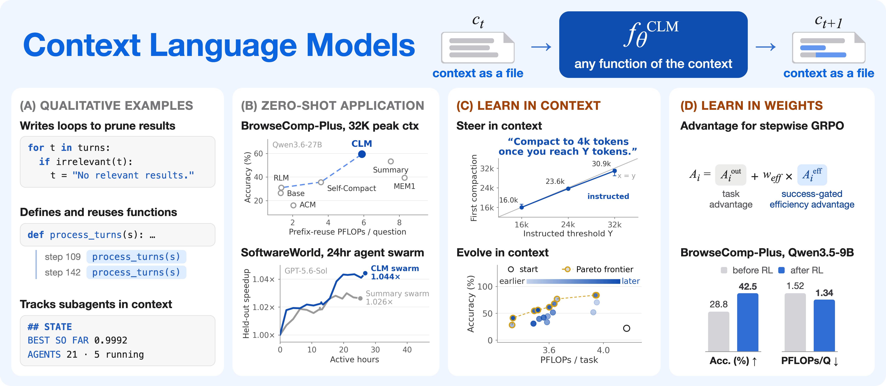
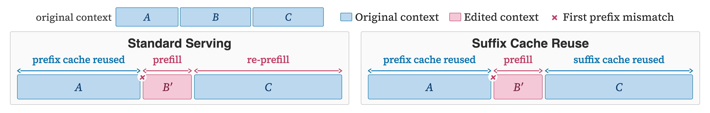

# Context Language Models

## 来源信息

| 项 | 内容 |
| --- | --- |
| 标题 | Context Language Models |
| 作者 | Rulin Shao、Shannon Zejiang Shen、Junjie Oscar Yin、Yuetai Li、Minheng Wang、Hamish Ivison、Radha Poovendran、Nathan Lambert、Teng Xiao、Mike Lewis、Wen-tau Yih、Luke Zettlemoyer、Pang Wei Koh（13 人；原文无共同一作标注，通讯作者为 Rulin Shao） |
| 机构 | University of Washington（第一机构）、Meta Superintelligence Labs、MIT、Trillium Labs |
| 来源 | [arXiv:2609.37725](https://arxiv.org/abs/2609.37725)（cs.AI; cs.CL; cs.LG） |
| 版本 | v1（2026-09-29 提交，PDF 首页另标 September 30, 2026）；27 页，含正文 §1–§6 与附录 A–G |
| 许可与代码 | arXiv 页 CC BY 4.0，代码仓库 CC BY-NC 4.0；[facebookresearch/context-language-models](https://github.com/facebookresearch/context-language-models)、诊断集 [RulinShao/ContextBench](https://github.com/RulinShao/ContextBench) |
| 阅读日期 | 2026-11-19 |

---

## 核心结论

一句话：**CLM 把「上下文怎么维护」从外部 harness 的固定策略变成模型的原生能力——把当前 context 映射成一个可读写文件，模型用普通 Bash 命令任意改写它，改动即时同步回下一轮输入；零样本在 BrowseComp-Plus、TerminalBench 与 32K 主设置的 EdgeBench 上以同等或更低的 prefix-reuse FLOPs 达到或超过 Codex 式摘要等基线，24 小时六仓库任务则在同等 API 花费下取得更大的 held-out 加速改进。**

- **解决什么问题**：长程 agent 的 context 何时压缩、怎么压缩、压缩后怎么取回，一直由 harness 的固定策略或人预先定义的动作集决定。
- **核心想法**：给模型对 live context 的写权限。context 不再只能追加，而是可以像文件一样被任意编辑；模型因此能自己规划、甚至定义可复用的压缩函数。
- **怎么做到**：live context 镜像成文件并把路径写进 system prompt；Bash 编辑立即同步；不编辑时仍走追加，以保住 prefix cache；服务端用 Suffix Cache Reuse 迁移编辑后仍存活的缓存。
- **关键结果**：BCP 59.4%（最强基线约 53.3%，本笔记按其 11.4% 相对差反推）、TBLite 73.7% vs 67.0%；EdgeBench 32K 下 44.6 vs 42.3、FLOPs −59.0%；SCR 在与标准 serving 同为 60.2% 时把每问 10.98 降到 7.14 PFLOPs。
- **定位与边界**：改的是 context 维护这一层，不是模型结构；收益依赖模型「决定何时编辑」的能力（9B 上明显更弱），并引入 prompt injection 可跨轮持久化的新安全面。

---

## 问题

论文的出发点是：**context 是 LM 处理长程信息的基础，但 context 管理一直不是 LM 的原生能力**。现有做法可以按「模型自主性」排成三层：

1. **harness 调度**。Cursor、Codex、Terminus2 等按预设长度阈值触发压缩，压缩流程也由 harness 规定；MEM1 每轮都重写 context。RL 可以训练模型在压缩下保住信息，但「何时压缩、怎么压缩」仍由 harness 决定。
2. **受限动作空间**。AutoCompact、Self-Compact 让模型决定何时压缩；Context-as-a-Tool 暴露模型可触发的压缩；ACM 增加 offload/retrieval；Sculptor 允许选择片段做操作。模型自主性逐步提高，但动作仍是人预先定义的。
3. **context 作为环境变量**。RLM 把长输入放进 REPL 变量供模型按需读取，解决了「读什么进来」，但没有让模型编辑**正在生长的 live context**——读进来的内容仍然只追加、不删除。

作者把这三种做法概括为「人先验」的不断放宽，并用 Sutton 的 The Bitter Lesson 作类比：与其继续设计更好的压缩规则，不如把 context 的写权限直接交给模型，让它自己搜索策略。CLM 的差别不是「再多一个工具」，而是让模型的输出不再是 context 更新的唯一来源：标准 LM 只能把新 token 追加到旧 context，CLM 允许对 $c_t$ 施加任意由模型控制的变换。

这也解释了为什么需要先做一个诊断：如果**任务本身不需要搜索或推理**，只是「记住 / 原地更新 / 卸载后取回」，现有 context 管理策略能做好吗？ContextBench（见方法节）给出的答案是不能，而这正是全文的动机来源。

这里有两个隐含前提，读结果时要记住：

- **操作在入口处不可拦截**。诊断集把每条操作作为连续对话中的新 user message 送入，任何 harness 都无法在入口处截断或卸载。
- **收益的度量口径是 context 内的内容**。只存在文件里、没有取回 context 的答案不算分，所以 offload 类方法必须把答案重新读进来。

固定策略为什么会失败，pilot 给了三类具体机制：摘要式压缩会在 Needle Retention 与 Sudoku 上丢信息或幻觉；没有原地编辑能力的方法在每次细粒度修改时都得重写整个棋盘；普通 coding 工具能把 KV / Log 卸载到文件，却不能在需要时把旧内容从 live context 里清掉。用 GPT-5.4、32K 上限比较 Base、Codex-style Summary、Context Folding、RLM、Self-Compact、ACM 与 CLM 后，**没有一个现有方法能在这些简单任务上做到完美**，CLM 是唯一在四个任务的所有压力档上都保持 1.0 的方法（低压力档也有基线能到 1.0，但没有一个跨全部档保持）。

---

## 核心想法

### 一句话

把 live context 当成一个普通文件：模型能用它已经会的编辑命令改 context，就像改别的文件一样。



*Figure 1（原文 p.2）：(a) 定性例子；(b) 零样本在 BCP 与 Software World 上更好且更省；(c) 一句话指令或 skill 进化改变策略；(d) 用 success-gated efficiency advantage 做 stepwise GRPO。*

### 直觉

模型在长程任务里其实一直在做 context 管理，只是做得隐蔽：它会写笔记、总结搜索结果、维护待办。但这些动作只能通过「生成新 token」发生，旧内容永远留在 context 里，只能靠增长到阈值后由外部压缩。而 harness 的压缩规则有一个根本困难：它在不知道任务会怎么走的情况下，预先决定了「哪些内容值得留」。CLM 把这件事交还给正在解题的模型——context 就是文件内容，文件怎么写，下一轮的输入就是什么。

### 为什么成立

- **编辑语言是现成的**：Bash 的读、写、替换、循环、正则都是模型预训练里见过的东西，不需要为 context 管理发明新 API。
- **常见路径不变慢**：不编辑时生成的 token 默认追加，和普通 LM 一样只做增量 prefill；只有模型主动改写时才付出重算代价。
- **可以发明结构**：一旦写权限在手，模型能做出 harness 设计者不会预置的东西——记分板、内部笔记角色、可复用的 `compact_turns` 函数。
- **改坏会被任务本身惩罚**：删掉关键信息会直接反映在答案质量上；而 RL 的效率奖励只作用于成功轨迹，正是为了避免「删得多就得分高」。
- **不需要新模型**：实现只加一层文件镜像与同步，权重和推理接口不变；这也是它能在 27B 模型上零样本直接用的原因。
- **策略可迁移**：同一套写权限既接受自然语言指导，也能作为文本进化和 RL 的搜索空间，不必为每种优化方式改系统。

### 与已有做法的区别

| 做法 | 谁决定 context 更新 | 能否删除/改写已有内容 |
| --- | --- | --- |
| harness 阈值压缩 | harness | 只能整段替换成摘要 |
| Self-Compact / ACM | 模型决定时机，harness 提供动作 | 动作集由人预先定义 |
| RLM | 模型决定读什么 | 读进来的内容只追加 |
| **CLM** | 模型用通用编辑命令任意改写 | 是，且立即生效 |

### 一个走通的例子

BrowseComp-Plus 第 109 步，模型定义了一个 `compact_turns` 函数，之后调用 37 次：每次把一段历史压缩成与当前问题相关的摘要，同时维护一条 progress note。这个行为不是 harness 提供的工具，而是模型自己写出来并复用的；同一批轨迹里还出现把某段对话的正则改写成 `role=notes`（第 40 步）、用 for 循环把无关搜索结果替换成「Searched: … No relevant results.」（第 1509 步）。这些例子说明 CLM 不是把「压缩」换了个触发者，而是能发明新的 context 结构。

### 代价

- **一次靠前的编辑就能让单轮成本接近 8 倍**（本笔记按附录 C 的示意算例复算：仅追加约 $1.41\times10^{14}$ FLOPs，中间编辑约 $5.74\times10^{14}$，开头编辑 $10.81\times10^{14}$）。因此「允许任意编辑」必须配合服务端的后缀缓存复用。
- **缓存复用是近似的**：SCR 复用编辑前算出的 KV，再把 RoPE 位置对齐到新位置，不是精确重算。
- **模型得知道自己用了多少 context**：现有 LM 对 context 长度的估计很弱，论文只能用「预算前 2,048 token 提醒」这种环境补丁。
- **新的攻击面**：模型对自己的 context 有写权限，注入的指令可以跨轮持久化；论文只把它列为未来工作。

---

## 方法

### 符号表

| 符号 | 含义 | 维度 / 取值 |
| --- | --- | --- |
| $c_t$ | 第 $t$ 轮的 context | 已进入模型输入的 token 序列 |
| $f^{\mathrm{CLM}}_{\theta}$ | CLM 的 context 更新函数，可由模型编辑文件实现任意改写 | — |
| $f^{\mathrm{LM}}_{\theta}$ | 标准 LM 的下一步生成 | 只产生新 token |
| $s$ | 作为额外 in-context 指导的策略说明 / skill 文档 | 自然语言 |
| $x$ | 训练任务 / prompt | — |
| $Y$ | 「超过 Y token 就压缩」指令里的阈值 | 16k / 24k / 32k |
| $\tau(x;s)$ | 在指令 $s$ 下对任务 $x$ 跑出的轨迹 | — |
| $R(\cdot)$ | 轨迹级奖励 | 任务内协议固定 |
| $\mathcal{D}$ | 训练任务分布 | — |
| $P_t,G_t$ | 该轮 prompt token 数、生成 token 数（原文未在正文单独命名；按上下文理解为这两项） | 示意值 20,000 / 500 |
| $R_t$ | 该轮可复用的前缀 token 数（原文未单列定义；按上下文理解为第一个 prefix mismatch 之前的长度） | 从 0 到 $P_t$ |
| $L,d,d_{\mathrm{ff}}$ | 层数、hidden、FFN 维度 | 64 / 5,120 / 17,408（Qwen3.6-27B） |
| $C_{\mathrm{token}}$ | 每 token 的非注意力 FLOPs | $48.70\times10^{9}$ |
| $C_{\mathrm{attn}}$ | 每个 query–key pair 的注意力 FLOPs | $3.93\times10^{5}$ |
| $K$ | 一次编辑最多迁移的存活 span 数 | 正文取 6；敏感性扫 {1,2,3,6,12,64} |
| $B,C$ | SCR 示意中的被编辑片段、其后的存活后缀（原文未定义；按上下文理解为编辑点与其后未变文本） | 示意记号 |
| $c_i$ | 轨迹 $i$ 的 prefix-reuse FLOPs | — |
| $\mathcal{G}_g^{+}$ | 组 $g$ 中成功的轨迹集合 | — |
| $\bar{c}_g$ | 组 $g$ 中成功轨迹的平均成本 | — |
| $A_i^{\mathrm{eff}}$ | 成功轨迹内部的效率 advantage | $[-1,1]$ |
| $A_i^{\mathrm{out}}$ | 轨迹级结果 advantage（标准 GRPO；原文未单列定义，按上下文理解为由结果奖励算出的组内 advantage） | — |
| $A_i$ | 轨迹 $i$ 的最终 advantage | $A_i^{\mathrm{out}}+w_{\mathrm{eff}}A_i^{\mathrm{eff}}$ |
| $w_{\mathrm{eff}}$ | 效率 advantage 的权重 | 0.25 |

### 1. 诊断集 ContextBench：把 context 管理与推理拆开

ContextBench 的四个任务都不需要搜索或推理，只考「记住 / 原地更新 / 卸载后取回」：Needle Retention（4K 块里埋 needle，最后按逐字保留的行计分）、Sudoku Sketchpad（每轮一个 16×16 棋盘移动，按精确复现的版本数计分）、KV Store（每批 100 条 SET，查 24 个 GET，按精确值准确率）、Log Triage（每批 14–54 行日志，24 个查找/计数查询）。

预算与压力：32,768 token 上限里预留 2,048 给回答，可用 30,720；单条操作不超过可用预算的 1/5，任务要求保留的内容不超过 1/2，各留 10% 余量，避免「任务本身放不下」被误判成管理失败。context pressure 定义为「整个 episode 环境推送的总输入 / 32,768」，`1×` 即「全保留刚好填满」；Needle 与 KV 推到 24×，Sudoku 8×，Log Triage 16×，并保留低于 `1×` 的控制组。每个方法都收到与自身机制配套的 skill，每个压力档跑 4 个 seed（部分档 8 个）。

### 2. 数据流：live context 镜像成文件

实现几乎没有新模型结构，只有四步：把 live context 镜像成一个可直接编辑的文件并把路径写进 system prompt；模型用通用 Bash 命令编辑它，和编辑别的文件没有区别；**对 context 文件的修改立即同步到 LM 的 context**，并送到推理服务器继续生成；不编辑时生成的 token 默认追加。

```text
模型生成 ──未编辑──> 新 token 追加到 context ──> 下一轮
        └─调用 Bash 改 context 文件─> 文件内容即下一轮 context
                                      │
              serving：匹配前缀直接复用；SCR 迁移编辑后仍存活的 suffix
```

关键取舍是**保留 prefix cache 的复用能力，同时允许任意位置编辑**：默认追加保证常见路径只做增量 prefill，只有主动改写时才付重算代价。附录 E 的工程细节：预算前 2,048 token 会收到一次「该编辑 context 了」的提醒（base harness 本身没有触发器）；BCP 与 RL 设置中，编辑轮不计入 turn 上限。

**多智能体扩展**：多个 context 文件可以共存并分别与各自的 LLM server 同步。agent swarm 通过在工作区初始化多个 context 文件实现；subagent 通过创建/删除额外 context 文件来启动和终止——子 agent 的生命周期也变成文件操作，而不是另一套调度 API。

### 3. 形式化：输出不再是 context 的唯一来源

**原文的 context 更新式（同时给出标准 LM 作对照）**

```math
c_{t+1} = f^{\mathrm{CLM}}_{\theta}(c_t),
\qquad
c_{t+1} = c_t \oplus f^{\mathrm{LM}}_{\theta}(c_t)
```

**逐项读法**：$f^{\mathrm{CLM}}_{\theta}$ 是模型可控制的任意函数，作用对象是整段 $c_t$，不必是「在末尾接一段新 token」；$f^{\mathrm{LM}}_{\theta}$ 只产生新 token，$\oplus$ 表示把它们接到旧 context 后面。因此标准 LM 是 CLM 的一个特例（只允许追加），而「harness 提供一组 context 工具」也是 CLM 的子集——区别在于这些函数不必由 harness 预定义，模型可以自己规划、甚至显式定义可复用函数。

### 4. 成本口径：prefix-reuse FLOPs

context 中间被改写后，标准 prefix cache 只能复用第一个不匹配位置之前的部分，**后面的 token 即使文本没变也要重新 prefill**。所以作者按整条轨迹度量：

**原文的效率指标定义**

```math
\mathrm{FLOPs}_{\mathrm{prefix}\text{-}\mathrm{reuse}} = \mathrm{FLOPs}_{\mathrm{prefill}}(\text{unmatched context suffix}) + \mathrm{FLOPs}_{\mathrm{decode}}(\text{generated tokens})
```

**逐项读法**：第一项只算「从第一个 prefix mismatch 起的 suffix prefill」，第二项算新生成 token 的 decode；不是把每轮 context 长度简单累加。附录 C 按模型结构展开这个式子，并区分 full-attention 与 Gated DeltaNet 层：线性层每 token 成本与 context 长度无关，只有 full-attention 层有随长度增长的注意力项。代入 Qwen3.6-27B 得 $C_{\mathrm{token}}=48.70\times10^{9}$ FLOPs/token（MLP 34.23、full-attention 投影 3.36、DeltaNet 投影 11.12，单位均为 $10^{9}$）与 $C_{\mathrm{attn}}=3.93\times10^{5}$ FLOPs/query–key pair。一个示意性单轮（$P_t=20{,}000$、$G_t=500$）：

| 可复用前缀 $R_t$ | 该轮 FLOPs | 相对 append-only |
| --- | --- | --- |
| 18,000（仅追加） | $1.41\times10^{14}$ | 1× |
| 10,000（中间编辑） | $5.74\times10^{14}$ | 约 4.1× |
| 0（开头编辑） | $10.81\times10^{14}$ | 7.7× |

这张表解释了为什么「允许任意编辑」必须配合服务端优化：一次靠前的编辑就能让单轮成本接近 8 倍。

### 5. Suffix Cache Reuse：把没变的 suffix 搬过去

SCR 的思路是：编辑把 $B$ 换成 `B'` 后，后缀 $C$ 的文本没变，**不必重算 $C$ 的 KV，只需把它的缓存搬到新位置**。



*Figure 4（原文 p.6）：SCR 只 prefill 新插入的 `B'` 和新追加 token，其余存活 span 的 KV 直接迁移。*

实现要点（附录 B）：

- 作为 **SGLang 的 patch**：新 prompt 与同 session 上一版 prompt 做 diff，找出编辑后仍存活的 span，按长度从大到小最多迁移 $K$ 个（正文 $K=6$）。
- 每个迁移的 span 复用其 cached keys/values，**把 key 的 RoPE 旋转位置重新对齐到新位置**，再拼到 `B'` 之后；只 prefill `B'` 与新追加 token。
- 迁移条目放在 **session 私有 cache slot**，不写共享 radix tree；分配不到 slot 时回退到标准 re-prefill。
- 复用状态是在编辑前的前缀下算出的，所以 SCR 是**近似**；$K$ 限制一次编辑引入的近似量，$K=6$ 是在 64 道 BCP 题上扫 $K\in\{1,2,3,6,12,64\}$ 后的保守选择（增益在 $K=6$ 基本饱和）。
- **混合架构**：Qwen3.6-27B 的 64 层里 48 层是线性注意力，只有固定大小的 recurrent state，没有 token 级缓存；SCR 在编辑前对 recurrent state 做快照并从快照继续，插入的 `B'` 在这些层里不被重算，只通过 16 层 full attention 影响后续输入。
- **推理 token 剥离**：Qwen3.6 的 chat template 与无状态 Chat Completions 会在下一轮剥掉历史 reasoning token，标准 serving 因此要重算后续所有保留文本；SCR 把「剥离」也当成一次编辑来复用缓存。

### 6. 把 context 策略变成可学的东西

**指令**：把一段策略说明 $s$ 作为额外 in-context 指导，转移变成 $c_{t+1}=f^{\mathrm{CLM}}_{\theta}(c_t;s)$。三句指令分别诱导出可测量的行为变化（Claude 4.6 Sonnet、BCP、无预算提醒）：说「超过 Y token 就压到约 4K」，首次压缩的 context 中位数从「未触发」变成 16.0k/23.6k/30.9k（Y=16k/24k/32k）；说「只在子问题边界压缩」，边界当轮压缩率 0.34→0.77、边界后 2 轮内 0.40→0.88；说「压缩前先备份」，编辑前有完整备份的比例 0.00→0.68。策略可以被「说」出来，不必改 harness 或权重。

**文本进化**：目标是找到一份 skill 文档 $s^{*}$，使训练分布上的期望回报最大：

```math
s^{*} = \arg\max_{s} \mathbb{E}_{x\sim\mathcal{D}}\left[R\!\left(\tau(x;s)\right)\right]
```

**逐项读法**：$x$ 是训练任务，$\tau(x;s)$ 是在指令 $s$ 下跑出的完整轨迹，$R$ 是轨迹级奖励；优化时模型与其他部分固定，只改 $s$。实现是 prompt-evolution 循环：在训练 split 上 rollout → proposer 根据轨迹提出候选 skill → 在 dev split 上评估并选出下一轮 skill → 冻结后在 test split 评一次。proposer 可以是更强的外部模型（assisted evolution，Qwen3.6-27B 作 agent、Claude Fable 5.1 作 proposer），也可以是 agent 自己（self-evolution）。在 ContextBench 上，assisted evolution 把 dev 准确率从 Needle 97.6→100.0、Sudoku 45.3→65.8、KV 22.3→83.8、Log Triage 0.0→100.0。

**在线 RL**：由于 context 编辑会改变后续输入，不能把整条轨迹当成一次普通自回归样本。作者用 **stepwise GRPO**：对每个 prompt 采样一组完整轨迹，用轨迹级结果奖励算标准 GRPO advantage，再把它分配给轨迹里的每个 segment，使每次模型调用都用整条轨迹的结果来训练。

只有结果奖励不够：成功轨迹里可能有低效编辑，失败轨迹里也可能有有用的编辑；直接奖励「编辑次数」或「删掉的 context 量」又会被 reward hacking。于是加一个 **success-gated efficiency advantage**，只在同一组的成功轨迹内部按 prefix-reuse FLOPs 重新排序（原文 Eq (6)）：

```math
A_i^{\mathrm{eff}} =
\begin{cases}
\operatorname{clip}\!\left(\dfrac{\bar{c}_g - c_i}{\bar{c}_g},\,-1,\,1\right), & i \in \mathcal{G}_g^{+},\\[4pt]
0, & i \notin \mathcal{G}_g^{+},
\end{cases}
```

**逐项读法**：$c_i$ 是轨迹 $i$ 的 prefix-reuse FLOPs，$\bar{c}_g$ 是组内成功轨迹的平均成本，所以分子是「比平均省多少」，除以 $\bar{c}_g$ 归一化，再用 `clip` 截到 $[-1,1]$ 防止单条极省轨迹主导梯度；不在成功集合 $\mathcal{G}_g^{+}$ 里的轨迹拿 0，失败轨迹的低效编辑不会被反向奖励。若成功轨迹少于两条，所有 $A_i^{\mathrm{eff}}$ 置 0。最终 $A_i=A_i^{\mathrm{out}}+w_{\mathrm{eff}}\cdot A_i^{\mathrm{eff}}$（$w_{\mathrm{eff}}=0.25$），既奖励「做对」，也在做对的里面奖励「更省」。

训练配置（附录 E）：Qwen3.5-9B、3,040 条 OpenResearcher 深搜 prompt、GRPO（截断重要性采样、KL 系数 0.01、动态采样去掉无奖励方差的组）；每步 8 个 prompt × 32 rollouts，学习率 `1e-6`、weight decay 0.1、clip `[0.2,0.28]`，训练 70 步；28K context 预算、2,048 预留、80 轮；奖励由 GPT-5.4-nano 按 DeepSearchQA rubric 打二值分，另有失败工具调用与格式错误的惩罚。策略用 16 张 H200，rollout 用 48 张；checkpoint 按 500 道 held-out OpenResearcher 题选择，最终在全部 830 道 BCP 上评测。

### 7. 与已有方法的结构差异

| 维度 | harness 阈值压缩 / Self-Compact / ACM | RLM | CLM |
| --- | --- | --- | --- |
| 触发 | harness 定时或模型在预置动作里选 | 模型按需读取 | 模型随时可编辑 |
| 动作空间 | 人定义的压缩 / offload / retrieval | 读 REPL 变量 | 任意文件编辑 |
| 旧内容 | 被摘要整体替换 | 只追加 | 可删除、改写、搬移 |
| 代价 | 摘要丢信息 | 不进 live context | 编辑触发的 re-prefill |

---

## 主要结果

**主设置**：零样本、不训练，Qwen3.6-27B、32K context，所有方法共用 Mini-SWE-Agent backbone，基线为 MEM1、Self-Compact、ACM、RLM 与 Codex-style Summary（全部 out-of-the-box；Summary 在 75% 预算压缩，Self-Compact 超过 37% 后每两轮询问）。

| 基准（题数） | CLM | 最强基线 | 相对差 | 计算 |
| --- | --- | --- | --- | --- |
| BrowseComp-Plus（830） | 59.4% | Codex-style Summary（约 53.3%，按 11.4% 相对差反推） | +11.4% 相对 | 比 Summary 少 21.5% FLOPs，比 MEM1 少 28.9% |
| TerminalBench 2.1（89） | 与 Summary 持平（正文未给数值） | Codex-style Summary | 0 | 为 Summary 的 70% FLOPs（引言写少 29.5%） |
| TBLite | 73.7% | Summary 67.0% | +6.7 个百分点（+10.0% 相对） | 为 Summary 的 91% FLOPs |

三行都来自同一条 Pareto 曲线：准确率对 prefix-reuse PFLOPs。基线按作者说法都是 out-of-the-box（MEM1 为作者复现的推理循环，RLM/ACM 用 released code），CLM 一侧零样本、未训练。TB2.1 只报了「持平」与 FLOPs 比例，没有给绝对分数，引用时不要据图反推。

**各组对照不同**：零样本三基准对的是 context 管理基线，数学对的是 OpenEvolve 系工作流，EdgeBench 对的是同 harness 的 summary，Software World 对的是同 API 花费的 swarm。跨组只能比较「CLM 相对各自基线是否更好」，不能比较绝对分数。

- **零样本就能同时赢质量和成本**：三个基准上 CLM 都位于准确率–prefix-reuse PFLOPs 的 Pareto 前沿；BCP 的 +11.4% 是相对提升，不是百分点。
- **收益随模型「会不会编辑」增长**：Qwen3.5-9B 在 BCP 上 39.9% vs Summary 37.7%；在 TB2.1 上 9B 平均每题只编辑 1.4 次、一半任务完全不编辑（27B 为 2.6 次），9B 的 context 峰值中位数 30.2K，27B 为 17.6K。小模型并不天然会管 context。
- **数学开放问题上略胜专用进化工作流**：四个 AlphaEvolve/OpenEvolve 风格问题、Claude 4.6 Sonnet、32K、100 次评分尝试或 5 小时、每种方法只跑一次。CLM / CLM(SA) 在四项上都最高：circle packing 2.618 / 2.636（OE 2.541）、Heilbronn 0.03653（OE 0.03127，+16.8%）、min-max 0.07758（OE 0.07690）、Erdős overlap 0.38094（OE 0.38123，越低越好）。带 subagent 的 CLM(SA) 在 circle packing 上再高一点，单 agent 版本已超过 OE。
- **12 小时单仓库优化**：EdgeBench-10（48 个可运行任务中选 10 个）、3 个 seed、32K 预算下，Qwen3.6-27B 的 CLM 44.6 vs Summary 42.3（+5.4% 相对），每 trial 179 vs 437 PFLOPs（−59.0%）；Claude 4.6 Sonnet 上 51.0 vs 42.3，但加 subagent 反而略低（50.4）。**128K 预算的补充结果是一个反例**：单 agent CLM 47.3 略低于 Summary 47.8（142 vs 222 PFLOPs），只有加 subagent（50.2）才在分数上明显领先。
- **24 小时六仓库 swarm**：六个 agent 各负责一个仓库并行优化 24 小时以上，评估四个未见过的下游包的 17 个 CPU benchmark，指标是 executed instructions 的几何平均加速比（坏掉的 benchmark 记 1.0），成本是累计 API 花费。Summary swarm 1.026×、CLM swarm 1.044×；摘要写的「65% greater improvement」指改进量之比（按图内标签复算约 69%），不是加速比之比。
- **策略可以继续学**：BCP 留出集上，RL 把 CLM 从 28.8% 提到 42.5%（每问 1.52→1.34 PFLOPs），summary harness 从 34.7% 提到 42.1%（4.01→2.19）——训练前 CLM 低约 6 个百分点，训练后追平且便宜 38.8% FLOPs。SCR 则在 BCP 上保持准确率 60.2% 不变，把每问 10.98 降到 7.14 PFLOPs（−35.0%）。

合起来读：收益最大的是**长程、需要反复整理大量中间结果**的任务（BCP、24 小时 EdgeBench）；在「需要开全新方向」或预算放宽到能容纳原始历史（128K EdgeBench）时，优势会收窄甚至反转。一个与机制相容的解释是：CLM 的价值在于整理已经进入 context 的内容，预算足够大时这种整理的必要性下降；论文没有做这一项的对照实验。

四组实验用的模型也不同（Qwen3.6-27B / Qwen3.5-9B / Claude 4.6 Sonnet / GPT-5.6-Sol），这也是不能跨组比较绝对分数的原因。

---

## 边界与局限

**作者明确讨论的**：

- **安全**：可编辑 context 是新的注入 / 持久化通道，prompt injection 或模型自己生成的指令能跨轮存活；论文只列为未来工作，没有防御或评测。
- **context length awareness**：现有 LM 估计自己用了多少 context 的能力很弱，长 context 下会给出 6.2K、9.8K、10.4K 这类分桶估计；论文用「预算前 2,048 token 提醒」临时补上，并建议未来把该信号学进模型。
- **serving 仍有冗余**：混合模型的 recurrent state 只在 request 边界存 checkpoint，SCR 之外仍有大量可复用前缀被重算。

**读者视角的判断**：

- **诊断集是合成的**：ContextBench 的任务不需要搜索或推理，它证明「固定策略会失败」，但不能证明真实任务上的收益来自同一机制。
- **证据强度不均**：数学优化每种方法只跑一次，EdgeBench 只有 10/48 个任务、3 个 seed，跨方法差异没有方差信息；RL 只在一个 9B 模型、一个训练集上验证。
- **口径待确认**：BCP 正文与 Figure 5 写 32K context，附录 E 写 23,560-token budget，两者关系未解释；TB2.1 的具体准确率正文未给，只能确认「持平」与 FLOPs 比例；判分依赖 Qwen3.5-27B 与 GPT-5.4-nano 两个模型，偏差未单独分析。

---

## 与其他工作的关系

- **vs RLM**：互补。RLM 把长输入放在 context 外按需读取（read-only 的 REPL 变量），CLM 管理已经进入 context 的内容（read–write 的 live context）。
- **vs MEM1 / Self-Compact / ACM / Sculptor**：这些方法逐步放宽模型自主性，但动作仍由人预先定义；CLM 把动作空间换成通用编辑语言，形式上覆盖「harness 提供一组 context 工具」。
- **vs 自动优化 harness 的路线**：那条线把 context 更新权留在 harness、自动搜索 harness 配置；CLM 把更新权下放给模型，再用 in-context skill 进化或 RL 把策略学回去。论文在 §6 提出「harness-to-CLM distillation」作为两者的接口。
