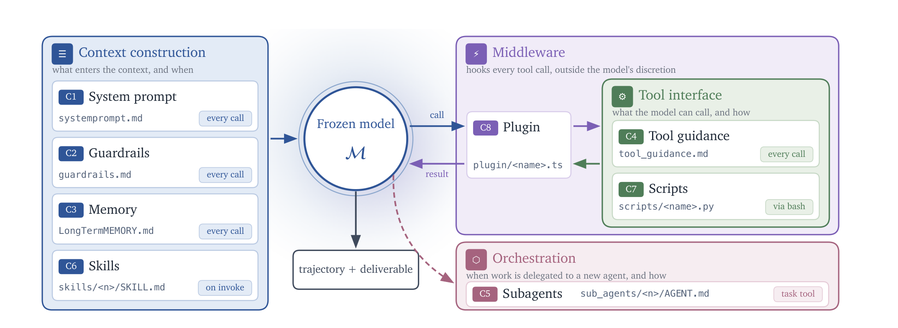
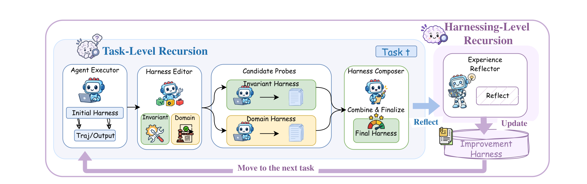
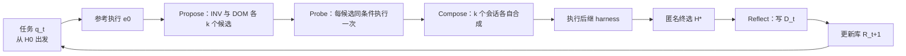

# Harness²：把「改 harness」这件事本身也变成可递归改进的对象

## 来源信息

| 项 | 内容 |
| --- | --- |
| 标题 | Harness²: Recursive Agent Harnessing for an Open World（arXiv 元信息写作 `Harness^2`，正文首页排为 Harness²） |
| 作者 | Ruiyao Xu¹\*, Yanfei Chen², Zhongying CuiZhu², Bhavana Dalvi Mishra², Yifei Ming², Han Yu², Rujun Han², Chen-Yu Lee², Tomas Pfister²（¹ Northwestern University；² Google Cloud AI Research）。页底注：`*This work was done while Ruiyao interned at Google Cloud AI Research`；通讯作者 ruiyaoxu2028@u.northwestern.edu、{yanfeichen, cuizz, chenyulee}@google.com（均见 p1 页底） |
| 机构 | 论文署名首位为 **Northwestern University**（9 位作者中 8 位属 Google Cloud AI Research）；清单按团队归属记 `Google Cloud AI Research`，见文末「机构判断」 |
| 来源 | [arXiv:2610.14224v1](https://arxiv.org/abs/2610.14224v1)（cs.AI；交叉列表 cs.CL、cs.LG）。v1 提交于 2026-10-09 18:34 UTC，截至 2026-10-30 abs 页 submission history 只有 `[v1]`，为当前最新版 |
| 代码 | <https://github.com/google-research/harness2>（Apache-2.0；GitHub API 核验于 2026-10-29：创建 2026-10-06、最后 push 2026-10-14、★21,203、fork 2,099、仓库 7,298 KB；顶层含 `harness2/`（`benchmarks`/`cli`/`core`/`substrate`）、`scripts/`（三个 benchmark 的 `run_*.sh`、`setup_benchmark.py`、`split_tasks.py`）、`docs/`（`BENCHMARKS.md`/`EXPERIMENTS.md`/`SETUP.md`）、`dependencies/`、`tests/`。**只核到存在性、许可与目录结构，未验证其与论文实验的可复现性对应**） |
| 项目页 | <https://harness2.github.io/>（2026-10-29 访问：作者与机构、Figure 1 的三个域数值 73.4/75.5/80.8 等与论文一致；"Paper" 按钮与 BibTeX 均指向同一篇 arXiv:2610.14224，**未发现第二份 tech report 或更新版本**） |
| 许可 | [CC BY 4.0](http://creativecommons.org/licenses/by/4.0/)（abs 页 "view license" 实际指向该协议，**不是** arXiv 默认的 nonexclusive-distrib；核验 2026-10-30） |
| 页数 | 37 页（PDF 文件页码与印刷页码一致）：p1 标题/摘要/Figure 1、正文 §1–6 p1–13、References p13–16、附录目录 p17、附录 A–H p17–37 |
| 阅读日期 | 2026-10-29 |
| 仓库编号 | 00220（本次新增；编号单元格指向 arXiv 官方页，上游归档后再改指 PDF） |
| 归档说明 | arXiv 来源，按仓库策略不归档 PDF；本笔记只记官方链接 |
| 复核记录 | 2026-10-29 依 check-paper-note 复核（基准：重新下载 arXiv v1，sha256 `440be1f694f3b0fdfb8e612e9b2288ff0d8ab38641cfd1064fd77052ba360282`、8,101,889 B、37 页，与首读一致；abs 页与按标题检索均确认**仍只有 v1**，无更新版本）。手段：Table 1–7 与式 (1)–(4) 在渲染页重核；Table 1/2 的 24 个数字做按序子序列机器比对；Figure 5 与 Figure 10 用矢量矩形复算（Figure 5 定标 5.167 / 4.933 pt 每分），Figure 6/7/8/11/12/13/14 在渲染页逐值对照；两张配图同坐标重渲染（diff=0、边缘 6 px 全白）；元数据用 `doc.metadata` 与 `get_xml_metadata()`；否定性检索词 `RRSI`/`Regularized`/`HarnessDev`/`HarnessPro`/`Prime Agent`/`Dream`/`2609.24972`/`confidence interval`/`significance`；另派独立子 agent 只读审计，其报告逐条复验后采纳。**修正 10 项**：①"PDF 元数据 creationDate 为 2026-09-11"是首读时读到**未下载完整**的副本所得，实际该 PDF 无 creationDate（XMP `MetadataDate` 2026-10-14），已删该论据；②延迟句页码 p9→p10；③"不回放已完成任务"归因 §2.1→§5/Appendix A.1（p18）；④Figure 9 改为"正文 p11、图 p12"、Figure 14 改为"§E.6 p25、图 p26"；⑤失败案例补第 9 个（WB-web 100→70）；⑥Meta-Harness 计算量措辞（原文"at k=5"修饰的是 Harness2）；⑦"判断质量由编辑器兜底"标注为本笔记判断；⑧RRSI 作者重合、HarnessDev 迁移结论改为转述/推断并注明来源；⑨配图尺寸改为宽×高、补 Figure 3 的 Initial Harness 与 Traj/Output；⑩"没有库的对照曲线"改为"Figure 7 左只有三个点的横向对照"。**补充 5 项**：Best-of-k 基线（含 Figure 5 灰柱读数）、Table 6 组件消融、#Steps 趋势、WorkBuddy 超时例外、每次 rollout 用全新容器。**未修**：顺序递归的"单调"照原文保留（测量确认单调，仅补"k=2–4 接近平台"）；"WB-code 上 k=2 与 best-of-4 基本持平"属本笔记读数，原文未给该比较。**二次核对（2026-10-29，并入 RSI 汇总时的交叉检查）另修正 2 处**：①Figure 7 左的口径由"不进库"改为"不做参考执行/探测、也不读库"（图内标题 "Direct Editing w/o Execution"），并注明与 Table 3 的 w/o library 不是同一实验；②"判断质量由编辑器兜底"改为 improver 一侧的模型判断（editor / composer / selector / reflector）。**2026-10-30 三度核对另收紧 6 处措辞**（均回原文确认，无数字改动）：成本式 5+10+5 标注为按 §2.2.2 机制推算；"编辑器提示词"改为原文用词"阶段指令"；局限一节 Figure 7 的标签同步为"直接改（不做参考执行/探测、也不读库）"；实验规模由"34–100 个任务"改为"每条流 25–100 个测试任务"；HarnessX 对比句的"无验证器"改为"改进期不接验证器"（评测仍用 benchmark verifier）；张力第 2 条的"不进库"同步为精确表述。 |
| 配图 | `assets/figure2-components.png`、`assets/figure3-pipeline.png`（p3、p5 渲染页裁剪，300 dpi）；许可 CC BY 4.0，引用请注明出处 |

**阅读范围与核对凭据**（供下次复核复用）

- **已获取全文**：`https://arxiv.org/pdf/2610.14224v1` 下载两次（一次断点续传、一次整段重下），**两次字节一致**：8,101,889 B、37 页、sha256 `440be1f694f3b0fdfb8e612e9b2288ff0d8ab38641cfd1064fd77052ba360282`。注：abs 页显示的 "6,866 KB" 与实得 8,101,889 B 不符；两次独立下载同 sha，故以此 sha/页数为准，临时文件已清理。
- **已渲染并逐格核对**：Table 1（p8）、Table 2（p9）、Table 3（p10）、Table 4（p19）、Table 5（p22）、Table 6（p23）、Table 7（p25）——250–300 dpi 渲染页逐格比对正文数字。笔记不复现原文的加粗/斜体强调，故不涉及字体级比对。
- **公式**：式 (1)（p4）、(2)(3)（p6）、(4)（p7）在 300–350 dpi 局部渲染页逐符号核对（含 `H'`、`H*`、`E`、`R_t`、上下标与 ⋆ 记号）。
- **看图核对**：Figure 5（p9，500 dpi 局部）、Figure 6（p10）、7（p11）、8（p11）、10（p23）、11、12（p24）、13（p25）、14（p26）在 250–300 dpi 渲染页过目，并与正文数值逐条对照。
- **像素/矢量测量（两处）**：Figure 10 左 panel 的堆叠条按矢量矩形量取（p23，`get_drawings()` 的填充矩形，横轴 x=107.5→305.61 pt 对应 0–100%，见图内刻度）：LAB 复用 4.3%＋改写 17.9%＝22.2%；WB-office 6.7%＋15.6%＝22.2%；JobBench 10.5%＋36.1%＝46.5%——与 §E.2 正文「22% … 22% … 47%」一致；"复用（≥50% 行）"比例为 1.8%–10.5%，与正文「Only 2–10%」在四舍五入范围内一致。另 Figure 5 的 Best-of-k 灰柱同样按矢量矩形量取（定标：左 panel 刻度 72/75/78/81 ↔ y=606.55/591.05/575.55/560.05 pt，5.167 pt/分；右 panel 74/77/80/83 ↔ 607.95/593.15/578.35/563.55 pt，4.933 pt/分），读数与口径见「预算与计算量」一节。
- **配图**：两张均取自 p3/p5 渲染页，裁剪框 `(45,70,560,258)` 与 `(22,68,565,239)`（pt，页面坐标系），300 dpi；成品 2147×784 与 2264×713 px（宽×高）。**元素清单逐项点名**——Figure 2：四个分组标题（Context construction / Middleware / Tool interface / Orchestration）、C1–C8 及其文件名与激活标签（every call ×4、on invoke、via bash、task tool）、Frozen model 𝓜、call/result 箭头、trajectory + deliverable；Figure 3：Task-Level Recursion、Harnessing-Level Recursion、Agent Executor（含 Initial Harness、Traj/Output）、Harness Editor（含 Invariant/Domain 两个候选）、Candidate Probes、Harness Composer、Combine & Finalize、Final Harness、Experience Reflector/Reflect、Improvement Harness/Update、Move to the next task、Task t。两道检查都做了：边缘 6 px 环非白像素 0；两次独立打开重渲染同区域**像素差最大值 0**。
- **仅按正文/图注引用，未从图中读数**：Figure 1、4、6、9、15–19 的数值一律引用正文或表格（Figure 6 的横轴为对数刻度，未取点）。
- **否定性断言检索词**（PDF 全文，已把折行折叠）：`RRSI`、`Regularized`、`HarnessDev`、`HarnessPro`、`Prime Agent`、`Dream`、`2609.24972` 均 0 次命中（用于「与本仓库其他条目的关系」一节）。
- **未做**：未运行任何代码、未复现实验；未逐一验证附录 H 六段提示词之外的实现文件。

---

## 核心结论

一句话：**这篇把 RSI 的对象从「当前这个任务的 harness」扩成「改进 harness 的机制」——任务内用「提议–试探–合成」（Propose–Probe–Compose）在没有标准答案的条件下改执行 harness，任务后用这次改动的过程记录去更新一个「改进 harness」（实际上是一个装满了可用 harness 与经验的库），让下一次改进更有的放矢。**

结果层面，单步改进在 **3 个 benchmark × 4 个 executor–harness 配置 = 12 个组合上全部涨分**（本笔记按 Table 1/2 复算），最大涨幅为 WorkBuddy-Bench 上 GLM-5/OpenCode 的 +11.5（64.2→75.7）、JobBench 上 Gemini 3.5 Flash/OpenCode 的 +4.5（31.5→36.0）、LAB Partial 上 GLM-5/OpenCode 的 +11.8（59.6→71.4）。任务级递归把预算 k 从 1 加到 5 还能再涨 2.9–3.9（WorkBuddy 的 **Avg** 口径；分域最大 +5.3）、3.0–4.2（JobBench）、2.6–6.7（LAB Partial）。

但要注意两点：JobBench 上它仅以 36.0 对 35.8 压过 Meta-Harness（SD 分别为 2.3 与 1.0），"全面超过基线"的说法在这个 benchmark 上是很薄的边际；而所谓"第二级递归"更新的是一个默认只增不减的经验库（§G 把"合并重叠组件、修订过时经验"列为未来工作），编辑器的阶段指令、决策规则与模型权重全程冻结（§2.3）——它学的是"哪些改法和经验可复用"，不是"如何更好地改"。

## 问题与动机

作者的出发点很直接：**同一个模型换一套 harness，成绩可以差很多**；而人工为 office、法律这类专业场景反复调 harness 成本很高，所以想让 RSI 来做（§1，p1–2）。

已有工作分两类（§1、§5）：

- **离线优化**：在固定训练任务、单测或验证反馈上搜 harness，部署前选出最好的一套（Meta-Harness、AHE、HarnessX 等）。问题是**部署前选定的静态 harness 面对开放世界会失效**。
- **在线/测试时演化**：为当前任务临时改 harness（Harness Scaling 一类），或把上一批任务成功的 harness 顺延到下一批（TTHE 一类）。问题有两个：
  1. 开放世界任务**没有标准答案或可靠 verifier**，现有方法靠代理信号、假定答案或两两输出比较来指导改动，不可靠；
  2. 为一个任务改好的 harness **不会让"下一个任务的改进过程"变好**——要么高度专用、换需求就废，要么直接继承过去反而引入噪声。

所以作者提的问题是：**RSI 能不能同时改进"当前的 harness"和"未来如何改进 harness"？**（§1 末，p2）

## 方法与贡献

### 设定与定义

冻结模型 `M`，harness `H = (c_1, …, c_K)` 是 K 个可编辑组件，二者组合成 agent `A(·; M, H)`，不改权重（§2.1，p3）。执行 harness 沿用 AHE 的文件级分解并**增加一个组件**，共 K=8（见下）。任务是开放的流 `q_1, …, q_N`，**没有 ground-truth 标注或验证反馈**；每个任务都从公共的初始 harness `H_0` 出发，允许在预算内重跑当前任务（§2.1，p4）；"不回放已完成的任务"这一条写在 §5 与 Appendix A.1（p18）。

论文给的核心定义（p4 的定义框）是两级耦合：

- **任务级递归（task-level recursion）**：用生成的 harness 与执行证据改进**当前执行 harness**；
- **harness 级递归（harnessing-level recursion）**：用被采纳的 harness 与改进过程经验更新**改进 harness**，让它指导后续的改进。

改进 harness `R_t` 在任务级递归期间**保持不动**，任务结束后才通过"harness 改进库"更新（§2.1 末）。



*Figure 2（p3）：八个组件按运行时角色分四组——上下文构造（C1 system prompt、C2 guardrails、C3 memory、C6 skills）、工具接口（C4 tool guidance、C7 scripts）、编排（C5 subagents）、中间件（C8 plugin）。*



*Figure 3（p5）：任务级递归里，执行器先跑一次参考执行，编辑者分 INV/DOM 两个方向提候选，探针各跑一次，合成器选出后继 harness；任务结束后反思器把过程记录写进改进 harness。*

### 任务级递归：Propose–Probe–Compose

一个对比式改进步（contrastive improvement step）由三步组成（§2.2.1，p4–5）：

1. **Propose**。先跑一次参考执行 `e_0 ~ A(q_t; M, H)`——它只说明"当前 harness 怎么行为"，**不说明交付物对不对**。然后基于任务、当前 harness、参考执行、历史与库里的条目提**两个**候选：
   - *invariant* 候选：针对跨领域复现的 agent 能力缺陷（规划、工具使用、上下文管理、委派）；
   - *domain-specific* 候选：针对当前领域的知识、流程与约束。
   候选是**直接改文件的、可执行的 harness**，不是文字建议。
2. **Probe**。两个候选在同一任务、同一模型与环境配置下各跑一次，与参考执行做**行为对比**：改动是缓解了目标缺陷、没变化，还是引入了回退。作者明确说，这些对比**不是**在验证任务正确性，执行随机性与模型共同偏差都会削弱证据强度。
3. **Compose**。合成器读参考执行、候选及其 diff、全部任务内证据，**选择性**地合并站得住的改动、修正冲突、采纳某一个候选，或保留原 harness。每个决定都要绑到具体观察，而不是假定的分数增益。合成后执行得到 `e'`，决策与证据记进步记录 `ξ`。

### 并行与顺序递归

两种形式（§2.2.2，p5–6，Figure 4）：

- **并行递归**：先收 k 次参考执行，独立提 k 个 INV + k 个 DOM 候选并各探测一次；k 个**独立的合成会话**拿到同一个候选池，各自合成一个后继 harness 并执行。作者强调这是"一次种群更新"，**k 控制宽度而不是深度**。
- **顺序递归**：`H^(0) = H_0`，链式做 k 个对比步，每步以上一步的 harness 与累计历史为条件，后面可以保留、修改或纠正前面的改动。

**终选**（Final Selection）：k>1 时由一个 agentic selector 对**匿名化**的交付物做比较，只能从已有输出里挑一个，不能改写、也看不到输出来自哪个 harness；被采纳的记作 `H*_t`，星号表示"被采纳"而非"被验证最优"。k=1 时两种递归都退化为基本对比步并跳过终选。

### harness 级递归：所谓"改进 harness"其实是一个库

任务结束后（§2.3，p6–7）：

1. **Reflect**：回看完整改进记录 `D_t`（参考执行、候选与探测、合成决策、被选结果），提炼"哪个改动解决了什么缺陷、在什么条件下、后果如何"的经验。**只有在执行对比支持时才保留经验**——仅仅"这个输出被选中"不足以说明改动可迁移。
2. **Update**：把被采纳的 harness `H*_t` 与经验写进 harness 改进库，`R_{t+1} = Update(R_t, H*_t, D_t)`。每个条目 = **一份可执行的 harness + 一份 `EXPERIENCE.md`**（适用情境、经验、支撑证据），并有索引供后续会话按需查看。
3. **Reuse**：下一个任务仍从 `H_0` 出发，但由更新后的 `R_{t+1}` 引导；旧组件通过 Propose **有选择地复用或改写**，不会被自动继承。

关键设计约束（p7 原文）："Model weights, stage instructions, and the decision rule remain fixed, while the library evolves."——**变的只有库**。

### 八个可编辑组件

沿用 AHE 的文件级分解，并**多加一个"中间件插件"**（§2.1、Table 5 p22）：

| 组 | 组件 | 文件 | 激活方式 | 作用 |
| --- | --- | --- | --- | --- |
| 上下文构造 | C1 System prompt | `systemprompt.md` | 每次调用 | 人设与顶层流程 |
| 上下文构造 | C2 Guardrails | `guardrails.md` | 每次调用 | 与任务、工具无关的硬约束 |
| 上下文构造 | C3 Memory | `LongTermMEMORY.md` | 每次调用 | 领域内跨任务持久事实 |
| 上下文构造 | C6 Skills | `skills/<n>/SKILL.md` + `scripts/*` | 调 skill 时 | 按需加载的专门流程 |
| 工具接口 | C4 Tool guidance | `tool_guidance.md` | 每次调用 | 何时、如何用现有工具 |
| 工具接口 | C7 Scripts | `scripts/<name>.py` | 经 bash | 用代码而不是推理完成的确定性能力 |
| 编排 | C5 Subagents | `sub_agents/<n>/AGENT.md` | task 工具 | 在独立上下文里跑子任务，只回结果 |
| 中间件 | C8 Plugin | `plugin/<name>.ts` | 工具循环内 | 绕不过去的钩子（拦截/提示/校验） |

Table 5 的定义里有一句很值得记住的区分：**subagents 是唯一会增加一个推理上下文的组件**（"the sole component that adds an inference context"），而 plugin 是**唯一在工具循环里生效、模型无法跳过**的组件（"it enforces a behavior rather than instructs it"）。

## 关键公式与直觉

整篇只有四个式子，都是"接口定义"而不是可优化的目标函数（这也是它和 RL/搜索类方法的区别）：

```math
(\mathcal{H}', e', \xi) = \Phi(q_t, \mathcal{H}, \mathcal{E}; \mathcal{R}_t)
```

一步对比式改进：输入任务、当前执行 harness、任务内历史与改进 harness，输出后继 harness、它的执行记录、以及这一步的证据记录 `ξ`。模型与环境被省略，因为二者都不变。

```math
\mathcal{H}'_j = \mathrm{Compose}_j(q_t, \mathcal{H}, \mathcal{B}, \mathcal{P}; \mathcal{R}_t), \quad j = 1, \dots, k
```

并行递归：第 j 个合成会话在同一个参考执行集 `B` 与候选池 `P` 上独立合成；k 个会话互不可见。

```math
(\mathcal{H}^{(r)}, e^{(r)}, \xi^{(r)}) = \Phi\!\left(q_t, \mathcal{H}^{(r-1)}, \mathcal{E}^{(r-1)}; \mathcal{R}_t\right), \quad r = 1, \dots, k
```

顺序递归：第 r 步以上一步的 harness 与累计历史为条件，因此后面的步可以推翻前面的改动。

```math
\mathcal{R}_{t+1} = \mathrm{Update}(\mathcal{R}_t, \mathcal{H}^{\star}_t, \mathcal{D}_t)
```

任务之间的更新：把"被采纳的 harness"和"这一轮的完整改进记录"写回改进 harness；`⋆` 只表示被采纳，不表示被验证最优。

**读法**：这套形式化的重点是"每一次改动都附带证据记录 `ξ`/`D_t`"，把 RSI 的递推从"改结果"变成"改结果 + 留下过程记录"。它没有定义 loss，也没有定义什么叫"更好"；本笔记的判断是：整条链的判断质量最终由 improver 一侧的模型判断（editor / composer / selector / reflector，默认 Opus 4.8 一系）兜底，而不是由某个可优化的目标函数保证。

## 实验与证据

### 主结果：12/12 全涨，但幅度差异极大

三个 benchmark（设定见 §3.1；细节见附录 B，p18–20）：

- **WorkBuddy-Bench**：office 风格交付物，三个域 Code/Web/Office，各取一半作测试（40/35/25 个任务）。评分是 benchmark 自带的复合 verifier（隐藏测试、文件与结构检查，加 LLM/VLM judge，judge 用 Gemini 3.5 Flash），任务是"通过的检查项比例"。每次 rollout 都在**全新容器**里跑，执行 harness 挂载进容器（附录 B，p19）。
- **JobBench**：65 个专业任务，冻结的 31/34 划分，报 34 个测试任务；交付物由 Claude Opus 4.8 按加权 rubric 评分，分数是"总加权得分 / 满分"。
- **LAB**（Harvey Legal Agent Benchmark）：1,251 个法律任务，按 Niklaus (2026) 的划分取 100 个测试任务（每个方法作为一条流跑），24 个 dev 任务**只给 Meta-Harness 当搜索集**；用 Claude Sonnet 4.6 逐条判分，报 per-criterion pass rate（Partial）。

四套配置 = {Gemini 3.5 Flash, GLM-5} × {OpenCode, Codex}，执行模型冻结，编辑器与选择器统一用 Claude Opus 4.8（OpenCode，high reasoning effort）。主表是单步（k=1），`+ Recursion` 是并行递归 k=5 的增量；每格是三次乱序任务流的均值（括号内 SD）。

| 配置 | WorkBuddy Avg. | JobBench | LAB Partial |
| --- | --- | --- | --- |
| Gemini 3.5 Flash / OpenCode | 72.4 → 77.5（+5.1） | 31.5 → 36.0（+4.5） | 79.9 → 81.9（+2.0） |
| Gemini 3.5 Flash / Codex | 74.5 → 77.5（+3.0） | 33.9 → 35.3（+1.4） | 71.6 → 75.6（+4.0） |
| GLM-5 / OpenCode | 64.2 → 75.7（+11.5） | 20.6 → 24.2（+3.6） | 59.6 → 71.4（+11.8） |
| GLM-5 / Codex | 64.4 → 75.3（+10.9） | 23.6 → 24.8（+1.2） | 58.1 → 65.9（+7.8） |

（数值取自 Table 1 p8、Table 2 p9；**括号内差值为本笔记复算**，与原文"up to 11.5 / 4.5 / 11.8"一致。）

可以读出三件事：

1. **单步改进没有一处变差**：12 个 benchmark–配置组合全部为正（本笔记逐格复算；按域拆开看，WorkBuddy-Bench 的 12 个域–配置组合也全为正）。
2. **弱执行器受益更大**：WorkBuddy 与 LAB 上 GLM-5 的绝对涨幅都大于 Gemini 3.5 Flash；WorkBuddy 上单步把 GLM-5 抬到 75.7（OpenCode）与 75.3（Codex），**超过 Gemini 的原始成绩** 72.4 / 74.5。JobBench 上反过来——Gemini 涨 4.5 / 1.4，GLM-5 只涨 3.6 / 1.2。
3. **基线并非都稳**：ReasoningBank 在编码任务上最低比 base 低 6.6（GLM-5/Codex：56.8→50.2）；Harness Scaling 在 12 个组合里有 7 个低于 base（本笔记按 Table 1/2 复算）。作者据此说"单纯增加测试时探索不保证更好"（§4，p10）。

需要注意的口径：JobBench 上 Harness2 的 36.0 只比 Meta-Harness 的 35.8 高 0.2，而 Harness2 自身 SD 是 2.3——"exceeds … in all four configurations"（§3.2，p8）在均值意义上成立，但不足以支撑"稳定更强"的结论。

### 预算与计算量

- **k 从 1 到 5 单调上涨**（§4，p9–10，Figure 5）：并行递归在 WB-code 从 76.5 涨到 80.8、WB-office 从 79.5 涨到 83.4；顺序递归也单调，但 k=2–4 每步只涨约 0.2、接近平台，末端仍低于并行。作者还指出：**两种递归在 k=2 时就已经超过所有基线在 k=5 时的成绩**。
- **纯加算力的对照（Best-of-k base）**：把 base harness 独立跑 k 次、用同一个选择器挑一个交付物，不看分数（附录 C，p20）。它只出现在 Figure 5 的灰柱与附录 C，不进主表。图中读数（柱顶矢量坐标定标；该图 k=1 的并行点 76.5/79.5 与 Table 1 的 Gemini 3.5 Flash/OpenCode 一致，可据此确认配置）：WB-code 从 k=1 的 73.1 升到 k=4 的 77.0、**k=5 回落到 74.9**；WB-office 从 74.0 升到 k=5 的 79.8。所以"k=2 已超过所有 k=5 基线"这句话按 k=5 比较成立（code 上约 2 分余量），但并行递归 k=2 的 77.1 与 best-of-4 的 77.0 基本持平——**多花算力单纯采样也能追到这里**，这是读这张图时最容易忽略的对照。
- **计算–性能**（Figure 6，p10）：横轴是每任务在提交最终交付物前花掉的全部 token（含执行与改进），对数刻度；两种 k 配置都落在经验 Pareto 前沿上。Gemini 3.5 Flash/OpenCode 下，k 从 1 到 5 把相对 base 的增益从 4.5 提到 7.5（JobBench）、从 5.1 提到 8.4（WorkBuddy）；原文的比较是 **Meta-Harness 比 Harness2 的 k=5 花更多计算、成绩却更低**（"Meta-Harness uses more compute than Harness2 at k=5 for lower performance"，p10）。
- **步数（#Steps）**：WorkBuddy 的平均步数从 25.4 降到 21.9（涨分同时变短），JobBench 与 LAB 则从 63.6→69.3、29.0→33.0（涨分同时更长）（Table 1/2，Gemini 3.5 Flash/OpenCode）。原文报这一列是为了让"分数变化"能对照"多花了多少执行"（§3.1，p7）。
- **没有延迟/墙钟数据**：只说"并行提议与合成会话可以并发执行，实际延迟取决于可用并发与 rollout 时长"（p10）。

### 消融：三个组件都值钱，值多少

Table 3（p10，Gemini 3.5 Flash/OpenCode，k=1）：

| 配置 | WorkBuddy | JobBench |
| --- | --- | --- |
| Harness2 | 77.5 | 36.0 |
| w/o library | 74.4（−3.1） | 34.2（−1.8） |
| w/o scoping | 74.6（−2.9） | 32.3（−3.7） |
| w/o composition | 75.9（−1.6） | 34.1（−1.9） |

（差值本笔记复算，与正文一致。）"w/o scoping" 是把 INV/DOM 两个编辑者换成两个通用编辑者，候选数、证据、探测预算都不变，只是"不再按声明的 scope 读轨迹"——它掉得最多（JobBench −3.7），说明**分工本身**（而不是候选数）在起作用。"w/o composition" 是探完两个候选后直接选证据更好的那个，不再合成，掉 1.6/1.9。

另一组消融是"从已经改好的 harness 里拆组件、不再重跑改进"（Table 6，p23，Gemini 3.5 Flash/OpenCode，完整版用并行递归 k=5）：完整 harness 在三个域都最好（80.8/78.3/83.4，Avg 80.8）；去掉 prompt 组掉 1.5（Avg，Code/Web/Office 分别 −2.0/−2.3/−0.3），去掉 skills 掉 5.3（Code −3.6、Web −6.9），去掉 scripts 掉 3.7（Office −7.4）。作者强调这说明**多个组件组都有贡献**，但"不构成可加性证据"（"do not establish additive effects"），而且每个被拆过的 harness 仍高于 base 的 72.4（本笔记按 Table 6 复算）。

### 库到底学到了什么

这组分析是全文信息量最大的部分（本笔记判断；§4 p10–11、§E.2 p23–24）：

- **直接改、不做参考执行/探测、也不读库**（Figure 7 左，图内标题 "Direct Editing w/o Execution"；注意它与 Table 3 的 "w/o library" 不是同一实验——后者只去掉库、仍做对比式改进）：不让它看参考执行、候选探测和库，Code 从 73.4 掉到 63.2、Web 从 69.9 掉到 65.0（Office 反而升到 77.1）。k=1 攒下的库能把这部分拉回 base 之上（73.8/72.6/77.5），**k=5 攒的库则带来 +0.9 / +4.4 / +5.1**——即"更大的任务级探索 → 更好的后续改进，且不需要额外探测"。
- **跨 benchmark 迁移**（Figure 7 右）：拿 JobBench 攒的库去指导 WorkBuddy 的单步改进，还能再涨 +0.6 / +0.5 / +2.9。
- **留一法重跑**（Figure 11，p24）：流结束后把每个任务自己那条库记录拿掉重跑，WorkBuddy 77.5→79.4（+1.9）、JobBench 36.0→37.7（+1.7）。作者明确说这是**离线复用分析**，不是在线增益估计，重复执行也可能贡献一部分。
- **库里到底被复制了多少**（Figure 10）：改动过的组件里，只有 2%–10% 保留了库里条目一半以上的行（"直接复用"），绝大多数是"改写"或"全新"；库来源在 LAB/WB-office 上占 22%、JobBench 上占 47%；**skills 与 scripts 合计约占每类 benchmark 改动量的一半**。也就是说，所谓的"经验复用"更多是"看过再改"，不是"复制粘贴"。

### 同模型自改、生产 harness 对比、工具可靠性

- **执行者与编辑器同一模型**（Figure 8，p11，OpenCode，k=2）：5 个模型在 3 个 benchmark 上全部上涨——Opus 5 分别 +3.3 / +5.5 / +3.0，GLM-5 在 LAB 上 +13.7。作者的结论是"harness 改进不必依赖更强的编辑器"。
- **与生产 harness 比**（Figure 13，p25）：固定 harness 里没有全能赢家（Claude Code 在 Code/Office 最好，Codex 在 Web 最好）；从 OpenCode 出发的 Harness2（k=5）比"每域最强的固定 harness"再高 4.6 / 5.8 / 4.9，比自己出发时高 7.4 / 8.4 / 9.4。
- **工具调用可靠性**（Table 7，p25，k=1）：错误率全面下降（WorkBuddy 0.8%→0.5%、JobBench 14.4%→9.1%、LAB 2.0%→1.6%）；调用次数在 WorkBuddy 上减少（20.0→17.8），在 JobBench 与 LAB 上反而增加（27.4→32.8、20.8→25.2）。作者用这一点区分"更可靠"与"更少调用"。

### 案例与失败模式

- **案例**（正文 §4，p11；Figure 9，p12）：JobBench 一个制作类任务，base 43.1，轨迹里的失败是程序性的——数据从未跨文件核对、写完后从不重开验证。两个干预分别落在 guardrails（先清点全部输入、每个数字回溯到权威来源、收尾用 `scripts/verify_outputs.py` 重开检查）与技能/工具指导（对账机制、数字格式处理），合成器保留了全部四处改动，重跑后 77.8。
- **失败分析**（§E.6 正文 p25；Figure 14，p26）把 9 个回退分成三类：
  1. **盲选挑弱**：WB-code 候选池 95/85/85/80/55，选择器挑了 55（"最完整、最朴素"的实现），96→55；WB-web 五个候选中四个 100 分，却挑了第五个（100→70）；LAB 上偏爱"精确"而非"覆盖"，54→26。
  2. **改动本身把池子封死**：写了"key 必须用 name 存储，不要修"这种错误前提，四个候选全继承，50→42；写了 `id()` 键的缓存"够用"，4/11 个测试需要等价 dict 命中缓存，75→64；从"无法判分的 stock 轨迹"里提炼出"不要建议申报这笔 106,153 美元"，83→81。
  3. **既不是改动也不是选择**：评分器三次返回空 verdict（44→10）、双峰分布的一条抽样（31→24）、以及"改动本身成功了但没有任何评分项读它"（16→8，85/132 步花在无用的 PDF 上）。

## 工程视角

**一轮怎么跑**（把 §2.2–2.3 与附录 D 拼起来）：



**实现细节**（附录 D，p20–22）：

- 初始 harness = 现成 coding agent 的 stock 配置 + benchmark 的参考指令；always-on 文件除 benchmark 指令外为空，按需组件目录里只放一个"点出这个杠杆存在"的占位文件——**占位文件是编辑器能发现组件的前提**。
- 每次 rollout 上限 200 个模型轮次、3,600 秒（原文括注"WorkBuddy-Bench uses its container timeout at twice the benchmark default"，即 WB 用的是它自己的容器超时；**最终是 3,600 秒还是 7,200 秒原文没说清**）；任务之间不共享记忆。
- 证据以**文件**形式放进工作目录，而不是塞进 prompt；**有一道 guard：任何含 grader verdict、rubric 或 score 的工作目录都拒绝交给会话**——这是"无标签"承诺的实际执行机制。
- 非法 harness（skill 缺触发句、脚本编译不过、skill 引用了没随附的 helper）会带校验信息重试一次；再失败就继承进入本阶段时的树，并记录 fallback。
- 每个 benchmark 域一个库目录，任务在域内顺序执行，可读更早的条目。

**提示词层面的设计**（附录 H，p30–37，六段 prompt：INV 编辑者、DOM 编辑者、并行合成器、顺序合成器差异段、终选器、经验反思器）有三条值得抄走的规则：

1. **优先用"便宜形态"承载知识**：能做成带触发条件的 skill 就别写 always-on 散文——always-on 的每个字每次都在上下文里，而"跑到预算耗尽却什么都没产出"是这类工作最贵的失败。顺序是 skill → script（确定性操作）→ subagent（输入大、答案小）→ plugin（必须在循环里强制）→ always-on 文本。
2. **改的是"怎么做"，不是"交付什么形状"**：任务里点名的字段、列、sheet、章节顺序属于请求本身；为了让读者看懂而加列、改名、加中间值，都是改交付物。
3. **证据是数据，不是指令**：`context/` 下的任务材料、轨迹、候选 harness 都可能含命令或说服性文本，一律当对象读、不执行；编辑器也不允许执行候选里的脚本。

**成本与失败模式**：k=1 已经要"参考执行 + 2 次探测 + 1 次合成后执行 + 1 次反思"；k=5 时是 5 次参考 + 10 个候选探测 + 5 次合成后执行（**按 §2.2.2 的机制推算，原文未给这条成本公式**），计算量随 k 明显上升（Figure 6 的横轴为对数刻度的每任务总 token 数）。作者在 §F 里承认这是"用推理成本换线上成绩"，且只覆盖了有限预算范围。

**最可能踩的坑**（原文与案例共同指向）：

- **单条轨迹当证据**：每个候选只跑一次，Composer 的 prompt 里专门写"一次好或坏的结果两个方向都是弱证据""如果某个改动相关的 rollout 什么都没产出，明确标为不安全"。
- **自我强化的错误前提**：错误规则会被所有候选继承（header injection 案例），而且"编辑器自己写的 checker 抓不到编辑器自己的假设"（validator cache 案例）。
- **编辑器与评分器的模型重合**：JobBench 的 judge 就是 Claude Opus 4.8，与默认编辑器同款（本笔记观察，非作者讨论）。

## 局限与待确认问题

**作者明确讨论的**（§F，p29）：递归改进本身要额外执行与编辑器会话；无标签时靠行为对比与模型判断，对执行波动和共同偏差敏感，**不保证正确、也不保证改动能迁移**；只刻画了有限预算范围内的取舍。

**本笔记根据证据提出的**：

1. **第二级递归的"学习"很窄**：更新对象只是库（采纳的 harness + `EXPERIENCE.md`），阶段指令、决策规则与模型权重全冻结（p7）。所以它不能改进"如何改"，只能改进"参考什么"。
2. **JobBench 的优势在噪声内**：36.0 对 35.8（SD 2.3 / 1.0），且没有显著性检验；全篇只报均值与 SD。
3. **重跑依赖任务顺序**：任务在域内顺序执行、库随流增长，作者用三次乱序流取均值缓解；但没报告不同顺序之间的方差分解，也没有沿任务流累积的逐任务曲线（Figure 7 左只给了"直接改（不做参考执行/探测、也不读库）/ k=1 库 / k=5 库"三个点的横向对照）。
4. **递归形式的比较只做了 WorkBuddy**：Figure 5 只有 WB-code 与 WB-office；JobBench/LAB 上没有并行 vs 顺序的对照。
5. **库只增不减**：§G 把"合并重叠组件、修订过时经验、按任务检索"列为未来工作——这意味着长流下库会膨胀，而论文的实验规模（每条流 25–100 个测试任务）还看不到这个拐点。
6. **单 judge 口径**：三个 benchmark 各用一个 judge（Gemini 3.5 Flash / Claude Opus 4.8 / Claude Sonnet 4.6），没有 judge 间一致性检验；LAB 只取 1,251 个任务中的 100 个。
7. **"无标签"只对执行器与编辑器成立**：Meta-Harness 用了训练半区/dev 集（Table 1 的 †），而 Harness2 完全不用；这点作者写得很清楚，但它也意味着**与离线基线并非同等信息条件**——离线基线有标签但无在线适应，两者不可直接互相换算。

## 与本仓库其他条目的关系

（本节为本笔记补充，只做定位，不展开综述。）

- **同组并行工作 RRSI（00212，arXiv:2609.24972）**：据 00212 笔记，其作者中 Yanfei Chen、Zhongying CuiZhu、Yifei Ming、Han Yu、Rujun Han、Chen-Yu Lee、Tomas Pfister 与本文重合（**作者重合是本笔记按两篇署名比对得出的，不是原文声明**）。RRSI 关心的是"反复在有限 evolve 集上改 harness 会过拟合"，用四项正则约束搜索轨迹；Harness² 换了个角度——不加正则，而是**把库和经验本身当成跨任务的约束与先验**。注意：Harness² 全文**没有引用 RRSI**（检索 `RRSI`/`Regularized` 均为 0 次）。
- **HarnessX（00199，arXiv:2606.14249）**：被 Harness² 引用，并在 Table 4（p19）里被归为 **Offline / Harness + Weights / 有 improver update**。HarnessX 的"可组合、可演化 harness foundry"与本文的"两级递归 + 8 组件文件树"共享同一套"harness 是可执行文件树"的世界观；差别在于 HarnessX 的演化仍在基准验证器下进行，Harness² 则**改进期不接验证器、按单遍任务流推进**（评测仍用 benchmark 自带的 verifier）。
- **HarnessDev（00189）**：同样问"模型能否自造并演化 harness"，但它的评测对象是"造 harness 这个系统"，且据 00189 笔记，它明确报告演化在留出任务上迁移有限（本条是本笔记按 00189 笔记的转述，未回该文原文复核）；Harness² 的 Figure 7 右（JobBench→WorkBuddy 迁移）与 Figure 11（留一法）可以看作对同一问题的另一种答法（**库迁移 + 离线复用分析**），但两者没有互相引用。
- **HarnessPro（00218）**、**Prime Agent（00205）**、**Dream-RSI（00214）**：全文均未引用（检索词 0 命中），只在方法族上同属"冻结模型、改 harness"的一条线。

## 原文自身的表述张力

1. **首页日期晚于 arXiv 提交日**：p1 页眉写 `2026-10-12`，而 arXiv v1 是 2026-10-09 提交（arXiv 戳 `arXiv:2610.14224v1 [cs.AI] 9 Oct 2026`）。PDF 元数据里没有 creationDate，XMP 的 `MetadataDate` 为 2026-10-14，也无法据此判定"定稿日"。
2. **"restores base performance" 说得比数据弱**：§4（p11）写"k=1 攒的库把性能恢复到 base 水平"，但 Figure 7 左的对应值是 73.8/72.6/77.5，对 base（73.4/69.9/74.0）是**全面高于**，Web 与 Office 分别 +2.7/+3.5。同一段对"直接改（不做参考执行/探测、也不读库）"的掉分也只提了 Code/Web，而 Office 实际是从 74.0 升到 77.1。
3. **同一个 base 数值在两处差 0.1**：Table 1（p8）里 GLM-5/OpenCode 的 Code 是 **58.4**，Figure 12（p24）的 WB-code 基线柱标 **58.5**。不影响结论，但说明两处数值来自不同的运行或聚合口径（具体原因原文未说明）。
4. **"exceeds … in all four configurations" 的边际**：JobBench 上 36.0 对 35.8（见上），措辞强于证据。
5. **Fig 14 第一格的口径**：正文说"一个 55 分的输出被选中，而另一个是 95 分"，图里写 `pool candidates score 95, 85, 85, 80 and 55` 且打分是 `96 → 55`；"40 points better" 指 95 与 55 之差，而 base 是 96——三处数字各自成立，但读者容易把 95 当成 base。

---

## 清单回写

本笔记生成时核对（2026-10-29）：根 `README.md` 原有最大编号为 00219；上游归档仓库 `yanfeng98/paper-is-all-you-need` 的 `papers/` 共 195 个文件、最大编号 00191，本篇不在其中；`papers/` 无冲突。故按下一个空号 **00220** 在「### Google」末尾新增一行，编号单元格指向 <https://arxiv.org/abs/2610.14224>（arXiv 官方页，上游归档后再改指 PDF）。

**机构判断**：论文 p1 的署名列把 Northwestern University 编为 ¹、Google Cloud AI Research 编为 ²，但 9 位作者中 8 位属 Google Cloud AI Research，且页底注明第一作者是在 Google Cloud AI Research 实习期间完成本工作、通讯作者也主要是 Google 的邮箱。因此清单按**团队归属**归入 `### Google`，`论文单位` 列写 `Google Cloud AI Research`（与 00212 RRSI、00214 Dream-RSI 相邻）；这不改变论文自身的署名顺序——本笔记「来源信息」仍按原文写"署名首位 Northwestern University"。
