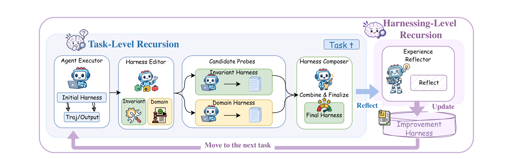

# Harness²：把「改 harness」这件事本身也变成可递归改进的对象

## 来源信息

| 项 | 内容 |
| --- | --- |
| 标题 | Harness²: Recursive Agent Harnessing for an Open World（arXiv 元信息写作 `Harness^{2}`，正文首页排为 Harness²） |
| 作者 | Ruiyao Xu¹\*, Yanfei Chen², Zhongying CuiZhu², Bhavana Dalvi Mishra², Yifei Ming², Han Yu², Rujun Han², Chen-Yu Lee², Tomas Pfister²（¹ Northwestern University；² Google Cloud AI Research）。页底注：第一作者在 Google Cloud AI Research 实习期间完成本工作 |
| 机构 | 论文署名首位 Northwestern University；清单按团队归属记 Google Cloud AI Research（9 位作者中 8 位属该团队），署名顺序未改 |
| 来源 | [arXiv:2610.14224v1](https://arxiv.org/abs/2610.14224v1)（cs.AI；v1 提交于 2026-10-09，截至 2026-10-30 仍是最新且唯一版本） |
| 代码 | <https://github.com/google-research/harness2>（Apache-2.0；只核过存在性、许可与目录结构，未验证其与论文实验的可复现性对应） |
| 项目页 | <https://harness2.github.io/>（作者、机构与 Figure 1 的三个域数值均与论文一致，未发现第二份技术报告或更新版本） |
| 许可 | [CC BY 4.0](http://creativecommons.org/licenses/by/4.0/)（abs 页 "view license" 指向该协议，不是 arXiv 默认的非独占分发） |
| 阅读日期 | 2026-10-29 |

---

## 核心结论

一句话：**这篇把 RSI 的对象从「当前任务的 harness」扩成「改进 harness 的机制」——任务内用「提议–试探–合成」（Propose–Probe–Compose）在没有标准答案的条件下改执行 harness，任务后用这次改动的过程记录更新一个「改进 harness」（实际是一个装满了可用 harness 与经验的库），让下一次改进更有的放矢。**

- **问题**：同一个模型换一套 harness，成绩可以差很多；人工为 office、法律这类专业场景反复调 harness 成本很高。已有的离线优化在部署前选定静态 harness，在线演化又缺可靠验证器，而且改好的 harness 不会让「下一次如何改」变好。
- **做法**：两级递归。任务级：先跑一次参考执行，再分 invariant（跨域能力缺陷）与 domain-specific（领域知识）两个方向各提候选，每个候选探测一次，最后由合成器按任务内证据选择、合并或保留原样；harness 级：任务结束后把被采纳的 harness 与经验写进库，后续任务从同一个初始 harness 出发，但按库里的条目有选择地复用或改写。
- **关键结果**：单步改进在 3 个 benchmark × 4 个 executor–harness 配置共 12 个组合上全部涨分（本笔记按 Table 1/2 复算），最大 +11.5（WorkBuddy，GLM-5/OpenCode）、+11.8（LAB Partial，GLM-5/OpenCode）；任务级递归把预算 $k$ 从 1 加到 5 还能再涨 2.6–6.7。
- **边界**：第二级递归只更新库，编辑器的阶段指令、决策规则与模型权重全程冻结——它学的是「哪些改法和经验可复用」，不是「如何更好地改」；JobBench 上仅以 36.0 对 35.8 压过 Meta-Harness，优势在噪声内。

---

## 问题

作者的出发点很直接：**同一个模型换一套 harness，成绩可以差很多**；而人工为 office、法律这类专业场景反复调 harness 成本很高，所以想让 RSI（recursive self-improvement）来做（§1，p1–2）。

已有工作分两类（§1、§5）：

- **离线优化**：在固定训练任务、单测或验证反馈上搜 harness，部署前选出最好的一套（Meta-Harness、AHE、HarnessX 等）。问题是**部署前选定的静态 harness 面对开放世界会失效**。
- **在线/测试时演化**：为当前任务临时改 harness（Harness Scaling 一类），或把上一批任务成功的 harness 顺延到下一批（TTHE 一类）。问题有两个：
  1. 开放世界任务**没有标准答案或可靠 verifier**，现有方法靠代理信号、假定答案或两两输出比较来指导改动，不可靠；
  2. 为一个任务改好的 harness **不会让「下一个任务的改进过程」变好**——要么高度专用、换需求就废，要么直接继承过去反而引入噪声。

要回答这个问题，先要确定「harness」是什么。本文沿用 AHE 的文件级分解，把 harness 看成一棵可编辑的文件树：system prompt、guardrails、memory、tool guidance、subagents、skills、scripts，再加一个「中间件插件」，共 $K=8$ 个组件。每个组件都是一个可以改、可以执行、可以单独激活的文件，而不是一段文字建议。

评测条件也决定了方法的形状：

- **任务是一条流**，$q_1,\dots,q_N$，没有 ground-truth 标注或验证反馈；每个任务都从同一个公共初始 harness $\mathcal{H}_0$ 出发，允许在预算内重跑当前任务，但不回放已完成的任务（§2.1、§5、Appendix A.1）。
- **模型权重冻结**，改进只能发生在 harness 这一层；同一任务下「改得对不对」没有可直接查询的标签。
- **每次改进都要付执行成本**：改一版 harness 就要真跑一遍，无法像调超参那样低成本试错。

所以作者提的问题是：**RSI 能不能同时改进「当前的 harness」和「未来如何改进 harness」？**（§1 末，p2）

---

## 核心想法

### 一句话

把「改进」本身拆成两层：任务内改当下的 harness，任务之间改「改 harness 时参考什么」。

### 直觉

一次改进其实包含两类信息：

- **任务内的行为证据**：当前 harness 在这道题上怎么失败、改了哪个文件之后行为怎么变；
- **跨任务的改进经验**：哪类改动在什么情境下解决过哪类缺陷。

第一类信息只能靠真跑；第二类信息却可以在任务结束后被提炼、被下一次改进读取。现有方法通常只用了第一类（在线演化，做完就丢）或只用第二类的一半（离线优化，部署前一次性搜完）。Harness² 的做法是：任务内把第一类信息做成证据记录，任务结束后把第二类信息写进库，下一个任务再把库当作先验。

### 为什么这能成立

- **对比的是行为，不是正确性**：没有标签时，参考执行给出「当前 harness 的行为基线」，候选探测给出「改了之后的行为」，两者可以直接对比——某个缺陷是否缓解、是否引入回退。这一步不需要答案对错。
- **候选是可执行的文件，不是文字建议**：候选 harness 能被真正跑起来，所以证据是执行结果而不是编辑器的自我评价。
- **证据被记录下来**：合成决策必须绑定到具体观察，这一步的候选、探测、决策组成记录 $\xi$，任务结束后汇成 $\mathcal{D}_t$；后面的反思只保留有执行对比支撑的经验。
- **库是「参考」而不是「继承」**：下一个任务仍从 $\mathcal{H}_0$ 出发，库里的条目只影响提议阶段，旧组件要被有选择地复用或改写，不会被自动搬过来。

### 与已有做法的区别

| 做法 | 改什么 | 反馈来源 | 主要限制 |
| --- | --- | --- | --- |
| 离线优化（Meta-Harness / AHE / HarnessX） | 部署前选定的 harness | 单测、验证反馈或搜索集 | 静态，开放世界里会失效 |
| 在线/测试时演化（Harness Scaling / TTHE） | 当前任务（或下一批）的 harness | 代理信号、假定答案、两两比较 | 信号不可靠；不改善「下一次改进」 |
| **Harness²** | 当前 harness + 改进库 | 行为对比 + 模型判断 | 不保证正确，也不保证改动可迁移 |

### 一个走通的例子

JobBench 上一道制作类任务，base 得分 43.1。轨迹里的失败是程序性的：数据从未跨文件核对，写完之后从不重开验证。两个干预分别落在两组组件上：

- guardrails：先清点全部输入、每个数字回溯到权威来源、收尾用 `scripts/verify_outputs.py` 重开检查；
- 技能与工具指导：对账机制、数字格式处理。

合成器保留了全部四处改动，重跑后 77.8。这个例子说明「行为对比 → 具体文件改动」这条链是能走通的：失败不是靠猜，而是从轨迹里读出来的；改动不是建议，而是落在文件上、能被下一次执行验证的。

### 代价

- **执行成本成倍增加**：k=1 已经要「参考执行 + 2 次探测 + 1 次合成后执行 + 1 次反思」；k=5 时按机制推算为 5 次参考 + 10 个候选探测 + 5 次合成后执行（原文未给这条成本公式）。
- **判断依赖模型**：整条链没有可优化的目标函数，判断质量最终由 improver 一侧的模型判断（editor / composer / selector / reflector）兜底，这是本笔记的判断。
- **证据很薄**：每个候选只跑一次，执行随机性与模型共同偏差都会削弱对比；论文明确说这些对比不是在验证任务正确性。
- **库只增不减**：库只写不删、也不合并重叠组件（§G 把这两件事列为未来工作），经验又全部来自已经走过的任务；长任务流下会不会被历史锁住，论文没有做实验检验。

---

## 方法

### 符号表

| 符号 | 含义 | 取值 / 说明 |
| --- | --- | --- |
| $q_t$ | 任务流中的第 $t$ 个任务 | $t=1,\dots,N$；$N$ 为流长度，原文未给数值 |
| $M$ | 冻结的执行模型 | 全程不改权重 |
| $\mathcal{H}$ | 当前执行 harness | $K$ 个可编辑组件的文件树 |
| $c_1,\dots,c_K$ | harness 的 $K$ 个可编辑组件 | $K=8$ |
| $A(\cdot;M,\mathcal{H})$ | 模型与 harness 组合成的 agent | 执行入口 |
| $\mathcal{H}_0$ | 公共初始 harness | 每个任务都从这里出发 |
| $\mathcal{H}'$ | 一步对比式改进后得到的后继 harness | — |
| $\mathcal{H}^{(r)}$ | 顺序递归第 $r$ 步的 harness | $r=1,\dots,k$；$\mathcal{H}^{(0)}=\mathcal{H}_0$ |
| $\mathcal{H}^\star_t$ | 任务 $t$ 结束时被采纳的 harness | $\star$ 只表示被采纳，不表示被验证最优 |
| $e_0$ | 参考执行 | $e_0 \sim A(q_t;M,\mathcal{H})$ |
| $e'$ | 后继 harness 的执行记录 | — |
| $e^{(r)}$ | 顺序递归第 $r$ 步的执行记录 | — |
| $\Phi$ | 一步对比式改进算子 | 输入任务、当前 harness、任务内历史与改进 harness |
| $\mathcal{E}$ | 当前任务内的历史（执行与证据） | — |
| $\mathcal{E}^{(r)}$ | 顺序递归到第 $r$ 步的累计历史 | — |
| $\xi$ | 这一步的证据记录 | 候选、探测、合成决策 |
| $\mathcal{R}_t$ | 改进 harness（实现为库） | 任务级递归期间保持不动 |
| $\mathcal{B}$ | $k$ 次参考执行的集合 | 并行递归的输入 |
| $\mathcal{P}$ | $k$ 个 INV 与 $k$ 个 DOM 候选组成的候选池 | 并行递归的输入 |
| $\mathrm{Compose}_j$ | 第 $j$ 个独立合成会话 | $j=1,\dots,k$ |
| $k$ | 递归宽度（参考执行数 / 候选对数 / 合成会话数） | $k=1$ 退化为基本对比步 |
| $\mathcal{D}_t$ | 任务 $t$ 的完整改进记录 | 反思器的输入 |
| $\mathrm{Update}$ | 库更新算子 | 写回被采纳的 harness 与经验 |

### 设定与两级递归

冻结模型 $M$，harness $\mathcal{H} = (c_{1}, \dots , c_{K})$ 是 $K$ 个可编辑组件，二者组合成 agent $A(\cdot ; M, \mathcal{H})$，不改权重（§2.1，p3）。执行 harness 沿用 AHE 的文件级分解并**增加一个组件**，共 $K=8$。

论文给的核心定义（p4 的定义框）是两级耦合：

- **任务级递归（task-level recursion）**：用生成的 harness 与执行证据改进**当前执行 harness**；
- **harness 级递归（harnessing-level recursion）**：用被采纳的 harness 与改进过程经验更新**改进 harness**，让它指导后续的改进。

改进 harness $\mathcal{R}_{t}$ 在任务级递归期间**保持不动**，任务结束后才通过「harness 改进库」更新（§2.1 末）。

### 一轮的数据流

```text
任务 q_t 从 H_0 出发，R_t 在整轮内冻结
1. 参考执行 e_0 ~ A(q_t; M, H)：只说明当前 harness 怎么行为
2. Propose：INV 与 DOM 两个方向各提候选（直接改文件，可执行）
3. Probe：每个候选在同一任务、同一模型与环境下各跑一次
4. Compose：k 个会话各自合成后继 harness，执行得 e'，并与证据一起记入 ξ
5. 终选：k>1 时由匿名 selector 从已有输出里挑一个，记作 H*_t
6. Reflect + Update：把 H*_t 与 D_t 写进库，得到 R_{t+1}
```



*Figure 3（p5）：任务级递归里执行器先跑一次参考执行，编辑者分 INV/DOM 两个方向提候选，探针各跑一次，合成器选出后继 harness；任务结束后反思器把过程记录写进改进 harness。*

### 八个可编辑组件

沿用 AHE 的文件级分解，并**多加一个「中间件插件」**（§2.1、Table 5 p22）：

| 组 | 组件 | 文件 | 激活方式 | 作用 |
| --- | --- | --- | --- | --- |
| 上下文构造 | C1 System prompt | `systemprompt.md` | 每次调用 | 人设与顶层流程 |
| 上下文构造 | C2 Guardrails | `guardrails.md` | 每次调用 | 与任务、工具无关的硬约束 |
| 上下文构造 | C3 Memory | `LongTermMEMORY.md` | 每次调用 | 领域内跨任务持久事实 |
| 上下文构造 | C6 Skills | `skills/<n>/SKILL.md` + `scripts/*` | 调 skill 时 | 按需加载的专门流程 |
| 工具接口 | C4 Tool guidance | `tool_guidance.md` | 每次调用 | 何时、如何用现有工具 |
| 工具接口 | C7 Scripts | `scripts/<name>.py` | 经 bash | 用代码而不是推理完成的确定性能力 |
| 编排 | C5 Subagents | `sub_agents/<n>/AGENT.md` | task 工具 | 在独立上下文里跑子任务，只回结果 |
| 中间件 | C8 Plugin | `plugin/<name>.ts` | 工具循环内 | 绕不过去的钩子（拦截/提示/校验） |

Table 5 里有一句很值得记住的区分：**subagents 是唯一会增加一个推理上下文的组件**（"the sole component that adds an inference context"），而 plugin 是**唯一在工具循环里生效、模型无法跳过**的组件（"it enforces a behavior rather than instructs it"）。

### 任务级递归：Propose–Probe–Compose

一个对比式改进步（contrastive improvement step）由三步组成（§2.2.1，p4–5）。整步写成算子 $\Phi$：

```math
(\mathcal{H}', e', \xi) = \Phi(q_t, \mathcal{H}, \mathcal{E}; \mathcal{R}_t)
```

**逐项读法**：输入是任务 $q_t$、当前执行 harness $\mathcal{H}$、任务内历史 $\mathcal{E}$，再加上改进 harness $\mathcal{R}_t$ 作为先验；输出是后继 harness $\mathcal{H}'$、它的执行记录 $e'$，以及这一步的证据记录 $\xi$。模型与环境被省略，因为二者都不变。注意这是一个**接口定义**，不是可优化的目标函数——全文没有定义 loss，也没有定义什么叫「更好」。

三步各自的机制：

1. **Propose**。先跑一次参考执行 $e_{0} \sim A(q_{t}; M, \mathcal{H})$——它只说明「当前 harness 怎么行为」，**不说明交付物对不对**。然后基于任务、当前 harness、参考执行、历史与库里的条目提**两个**候选：
   - *invariant* 候选：针对跨领域复现的 agent 能力缺陷（规划、工具使用、上下文管理、委派）；
   - *domain-specific* 候选：针对当前领域的知识、流程与约束。

   候选是**直接改文件的、可执行的 harness**，不是文字建议。
2. **Probe**。两个候选在同一任务、同一模型与环境配置下各跑一次，与参考执行做**行为对比**：改动是缓解了目标缺陷、没变化，还是引入了回退。作者明确说，这些对比**不是**在验证任务正确性，执行随机性与模型共同偏差都会削弱证据强度。
3. **Compose**。合成器读参考执行、候选及其 diff、全部任务内证据，**选择性**地合并站得住的改动、修正冲突、采纳某一个候选，或保留原 harness。每个决定都要绑到具体观察，而不是假定的分数增益。合成后执行得到 $e'$，决策与证据记进 $\xi$。

### 并行递归、顺序递归与终选

两种形式（§2.2.2，p5–6，Figure 4）：

- **并行递归**：先收 $k$ 次参考执行，独立提 $k$ 个 INV + $k$ 个 DOM 候选并各探测一次；$k$ 个**独立的合成会话**拿到同一个候选池，各自合成一个后继 harness 并执行。作者强调这是「一次种群更新」，**$k$ 控制宽度而不是深度**。
- **顺序递归**：$\mathcal{H}^{(0)} = \mathcal{H}_{0}$，链式做 $k$ 个对比步，每步以上一步的 harness 与累计历史为条件，后面可以保留、修改或纠正前面的改动。

并行递归的每个合成会话写成：

```math
\mathcal{H}'_j = \mathrm{Compose}_j(q_t, \mathcal{H}, \mathcal{B}, \mathcal{P}; \mathcal{R}_t), \quad j = 1, \dots, k
```

**逐项读法**：第 $j$ 个合成会话看到同一组参考执行 $\mathcal{B}$ 与同一个候选池 $\mathcal{P}$，独立产出自己的后继 harness $\mathcal{H}'_j$；$k$ 个会话互不可见，所以它们是在同一个「世界」上并行提出的 $k$ 个假设。

顺序递归则把上一步的输出接进下一步：

```math
(\mathcal{H}^{(r)}, e^{(r)}, \xi^{(r)}) = \Phi\!\left(q_t, \mathcal{H}^{(r-1)}, \mathcal{E}^{(r-1)}; \mathcal{R}_t\right), \quad r = 1, \dots, k
```

**逐项读法**：第 $r$ 步以上一步的 harness $\mathcal{H}^{(r-1)}$ 与累计历史 $\mathcal{E}^{(r-1)}$ 为条件，因此后面的步可以推翻前面的改动；$r=1$ 时退化为一次基本对比步。

**终选**（Final Selection）：$k>1$ 时由一个 agentic selector 对**匿名化**的交付物做比较，只能从已有输出里挑一个，不能改写、也看不到输出来自哪个 harness；被采纳的记作 $\mathcal{H}^{\star}_{t}$。$k=1$ 时两种递归都退化为基本对比步并跳过终选。

### harness 级递归：所谓「改进 harness」其实是一个库

任务结束后（§2.3，p6–7）：

1. **Reflect**：回看完整改进记录 $\mathcal{D}_{t}$（参考执行、候选与探测、合成决策、被选结果），提炼「哪个改动解决了什么缺陷、在什么条件下、后果如何」的经验。**只有在执行对比支持时才保留经验**——仅仅「这个输出被选中」不足以说明改动可迁移。
2. **Update**：把被采纳的 harness $\mathcal{H}^{\star}_{t}$ 与经验写进 harness 改进库：

```math
\mathcal{R}_{t+1} = \mathrm{Update}(\mathcal{R}_t, \mathcal{H}^{\star}_t, \mathcal{D}_t)
```

**逐项读法**：$\mathcal{R}_t$ 是任务 $t$ 期间冻结的旧库，$\mathcal{H}^{\star}_t$ 是这一轮被采纳的 harness，$\mathcal{D}_t$ 是这一轮的完整过程记录；三者合成新库 $\mathcal{R}_{t+1}$。每个条目 = **一份可执行的 harness + 一份 `EXPERIENCE.md`**（适用情境、经验、支撑证据），并有索引供后续会话按需查看。

3. **Reuse**：下一个任务仍从 $\mathcal{H}_{0}$ 出发，但由更新后的 $\mathcal{R}_{t+1}$ 引导；旧组件通过 Propose **有选择地复用或改写**，不会被自动继承。

关键设计约束（p7 原文）："Model weights, stage instructions, and the decision rule remain fixed, while the library evolves."——**变的只有库**。

整组式子的重点，本笔记读作：每一次改动都附带证据记录（$\xi$ / $\mathcal{D}_{t}$），把 RSI 的递推从「改结果」变成「改结果 + 留下过程记录」。它没有定义 loss，也没有定义什么叫「更好」；判断质量最终由 improver 一侧的模型判断（editor / composer / selector / reflector，默认 Opus 4.8 一系）兜底，而不是由某个可优化的目标函数保证。

### 与已有方法的结构差异

- **相对 AHE 的文件级分解**：在 AHE 的组件集上增加一个 plugin（共 8 类），它是唯一「在工具循环里强制生效、模型无法跳过」的组件；这也让「必须做」和「建议做」在结构上分开。
- **相对离线搜索**：搜索目标不是一个静态 harness，而是「当前 harness + 后续改进的参考库」；改进发生在部署之后、任务流之内。
- **相对在线演化 / RL 类方法**：反馈不是分数或两两比较，而是同任务下的行为对比与证据记录；四个式子都是接口定义，没有目标函数、没有梯度，改进由模型判断驱动，因此可解释性与可复现性都依赖证据记录的质量。

---

## 主要结果

**设置**（§3.1；附录 B）：三个 benchmark——WorkBuddy-Bench（office 风格交付物，Code/Web/Office 三个域，复合 verifier 加 Gemini 3.5 Flash judge）、JobBench（65 个专业任务，冻结的 31/34 划分，Claude Opus 4.8 按加权 rubric 评分）、LAB（Harvey Legal Agent Benchmark，1,251 个法律任务中取 100 个测试任务，Claude Sonnet 4.6 逐条判分，报 per-criterion pass rate）。四套配置 = {Gemini 3.5 Flash, GLM-5} × {OpenCode, Codex}，执行模型冻结，编辑器与选择器统一用 Claude Opus 4.8。下表是单步（$k=1$）结果，每格为三次乱序任务流的均值。

| 配置 | WorkBuddy Avg. | JobBench | LAB Partial |
| --- | --- | --- | --- |
| Gemini 3.5 Flash / OpenCode | 72.4 → 77.5（+5.1） | 31.5 → 36.0（+4.5） | 79.9 → 81.9（+2.0） |
| Gemini 3.5 Flash / Codex | 74.5 → 77.5（+3.0） | 33.9 → 35.3（+1.4） | 71.6 → 75.6（+4.0） |
| GLM-5 / OpenCode | 64.2 → 75.7（+11.5） | 20.6 → 24.2（+3.6） | 59.6 → 71.4（+11.8） |
| GLM-5 / Codex | 64.4 → 75.3（+10.9） | 23.6 → 24.8（+1.2） | 58.1 → 65.9（+7.8） |

（数值取自 Table 1 p8、Table 2 p9；**括号内差值为本笔记复算**，与原文 "up to 11.5 / 4.5 / 11.8" 一致。）

1. **12 个组合全部为正**：单步改进没有一处变差，幅度从 +1.2（JobBench，GLM-5/Codex）到 +11.8（LAB，GLM-5/OpenCode）不等；按域拆开，WorkBuddy 的 12 个域–配置组合也全为正（本笔记按 Table 1/2 复算）。
2. **弱执行器受益更大，但 JobBench 反过来**：WorkBuddy 与 LAB 上 GLM-5 的绝对涨幅都大于 Gemini 3.5 Flash，单步就把 GLM-5 抬到 75.7 / 75.3，超过 Gemini 的原始成绩 72.4 / 74.5；JobBench 上则是 Gemini 涨 4.5 / 1.4、GLM-5 只涨 3.6 / 1.2。
3. **递归预算 $k$ 从 1 到 5 单调上涨**：WorkBuddy Avg 再涨 2.9–3.9、JobBench 3.0–4.2、LAB 2.6–6.7（并行递归，k=5 相对 k=1）；作者还指出两种递归在 $k=2$ 时就已经超过所有基线在 $k=5$ 时的成绩。
4. **消融说明三个组件都值钱，但值多少不同**：Gemini 3.5 Flash/OpenCode 下，去掉库掉 3.1/1.8（WorkBuddy/JobBench）、去掉 INV/DOM 分工掉 2.9/3.7、去掉合成掉 1.6/1.9（本笔记复算）；其中「不再按声明的 scope 读轨迹」掉得最多，说明分工本身（而不是候选数）在起作用。
5. **库确实在起作用，但更多是「看过再改」**：不让它看参考执行、探测与库时，Code 从 73.4 掉到 63.2；$k=5$ 攒下的库能把 Code/Web/Office 分别拉回 +0.9/+4.4/+5.1；JobBench 攒的库迁到 WorkBuddy 还能再涨 +0.6/+0.5/+2.9。图里的复用统计显示，改动过的组件里只有 2%–10% 保留了库条目一半以上的行，绝大多数是改写或全新（本笔记按矢量矩形量取，与正文口径一致）。
6. **JobBench 对 Meta-Harness 的优势在噪声内**：36.0 对 35.8，Harness² 自身 SD 为 2.3、Meta-Harness 为 1.0；"exceeds … in all four configurations"（§3.2，p8）只在均值意义上成立，不足以支撑「稳定更强」。

---

## 边界与局限

**作者明确讨论的**（§F，p29）：递归改进本身要额外执行与编辑器会话；无标签时靠行为对比与模型判断，对执行波动和共同偏差敏感，**不保证正确、也不保证改动能迁移**；只刻画了有限预算范围内的取舍。

**本笔记根据证据提出的**：

- **第二级递归的「学习」很窄**：更新对象只是库（采纳的 harness + `EXPERIENCE.md`），阶段指令、决策规则与模型权重全冻结（p7）。所以它不能改进「如何改」，只能改进「参考什么」。
- **库只增不减**：§G 把「合并重叠组件、修订过时经验、按任务检索」列为未来工作——这意味着库只写不删、也不合并，而论文的实验规模（每条流 25–100 个测试任务）还看不到长流下库膨胀的拐点。
- **递归形式与任务顺序的检验都不完整**：Figure 5 只有 WB-code 与 WB-office，JobBench/LAB 上没有并行 vs 顺序的对照；任务在域内顺序执行、库随流增长，作者用三次乱序流取均值缓解，但没有报告不同顺序之间的方差分解，也没有沿任务流累积的逐任务曲线。
- **单条轨迹当证据、单 judge 口径**：每个候选只跑一次；三个 benchmark 各用一个 judge（Gemini 3.5 Flash / Claude Opus 4.8 / Claude Sonnet 4.6），没有 judge 间一致性检验，LAB 只取 1,251 个任务中的 100 个。
- **与离线基线信息条件不等**：Meta-Harness 用了训练半区/dev 集（Table 1 的 †），Harness² 完全不用；离线基线有标签但无在线适应，两者不可直接互相换算。
- **「无标签」有实现层 guard**：任何含 grader verdict、rubric 或 score 的工作目录都拒绝交给会话（附录 D）；但这条承诺是否覆盖所有泄漏路径，原文没有做对照实验。

---

## 与其他工作的关系

- **RRSI（00212）**：同属「不改权重、只改 harness」的路线，且两篇作者高度重合（本笔记按署名比对，不是原文声明）。RRSI 用四项正则约束搜索轨迹以防过拟合；Harness² 不加正则，而是把库和经验本身当成跨任务的约束与先验。Harness² 全文**没有引用 RRSI**。
- **HarnessX（00199）**：被本文引用并在 Table 4 归为 Offline / Harness + Weights / 有 improver update。两者共享「harness 是可执行文件树」的世界观；差别是 HarnessX 的演化仍在基准验证器下进行，Harness² 改进期不接验证器、按单遍任务流推进。
- **HarnessDev（00189）**：同样问「模型能否自造并演化 harness」，但它的评测对象是「造 harness 这个系统」，且据 00189 笔记，它报告演化在留出任务上迁移有限；Harness² 的库迁移与留一法分析是对同一问题的另一种答法，两者没有互相引用。
- **HarnessPro（00218）、Prime Agent（00205）、Dream-RSI（00214）**：全文均未引用，只在方法族上同属「冻结模型、改 harness」的一条线。

<!-- 复核档案见同目录 audit.md（不随站点发布） -->
