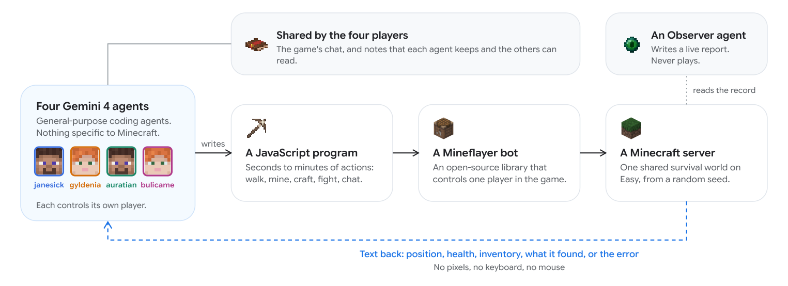

# 四个 Gemini 4 Argon agent 打通 Minecraft：代码即动作的 27 小时长程多智能体运行

## 来源信息

| 项 | 内容 |
| --- | --- |
| 标题 | A team of Gemini 4 Argon agents beats Minecraft |
| 作者 | Maxence Faldor, Satinder Singh, Roberta Raileanu（Google DeepMind；p1 未标通讯作者） |
| 机构 | Google DeepMind |
| 来源 | [arXiv:2610.22319v1](https://arxiv.org/abs/2610.22319v1)（cs.AI；2026-10-15 提交；截至 2026-11-21 只有 v1） |
| 版本 | v1，17 页；无附录、无表格，数据主要在正文、图和聊天记录里 |
| 阅读日期 | 2026-11-21 |
| 代码/数据 | 未公开：正文与参考文献没有代码、日志、世界存档或种子地址；§5 只说所有 program/output/chat/server log 被记录 |

## 核心结论

一句话：**四个通用 coding agent 在游戏侧只拿到标准 Mineflayer 库、一段目标描述和通用工作指令，就在随机种子的 Easy 生存世界里用 27 小时 14 分、2,783 个自写 JavaScript 程序、605 次死亡打通了 Minecraft；过程中没有被分配角色，却自己形成了分工、共享坐标与经验、复用工具，并在队友死亡后互相捡回关键物品。**

- **解决什么问题**：检验一个不是为游戏而造的通用 coding agent，能否在「代码即动作 + 文本观测」的接口下，把需要上千个依赖步骤的开放世界任务维持一天以上，并带三个队友协作。
- **核心想法**：把动作粒度从「按键」抬到「写一段程序」，让写代码、读日志、调试的能力直接变成游戏能力；团队记忆落成文件，聊天同时是通信通道和下一轮观测。
- **怎么做到**：四名玩家 + 一名只读 Observer，同一模型、各自一台云机器；每名玩家用 JS 程序驱动自己的 Mineflayer bot，程序之间靠 `global`、文件记忆和 helper 函数保持连续。
- **关键结果**：服务器日志的 `Free the End` 成就确认击杀；2,783 个程序、63,313 行 JS、229 条消息、605 次死亡；到通关约 1.35B 输入 token、24,000 次调用，按 list price 约 520/1,040 美元。
- **定位**：一次**存在性证明**，不是可靠性、成功率或泛化结论；它证明这套接口下「能发生」，不证明「能稳定复现」。

## 问题

Minecraft 一直是开放世界 agent 的试金石，但已有工作大多落在两类：

- **从游戏数据/经验学策略**：MineRL 提供人类演示与钻石任务竞赛；VPT 从在线视频学键鼠操作并做出钻石工具；DreamerV3 用强化学习从零收集钻石；STEVE-1 跟随短程文本指令；SIMA/SIMA 2 从像素和键鼠跨多个 3D 游戏行动。这些系统需要大量 gameplay 数据或经验。
- **用语言模型做规划/编程**：Voyager 用自动课程把 Mineflayer 程序写进不断增长的技能库；DEPS、GITM、JARVIS-1、Plan4MC、Optimus-1 分别加入 Minecraft 专用 planner、知识、记忆或学到的技能。它们通常带游戏专用的规划器、课程或技能库，长程结果也多在「做出钻石工具」这一层。

两类工作的共同点是：**能力来自为游戏加的东西**——要么是大量 gameplay 数据与训练，要么是课程、技能库、planner 这类游戏专用模块。这留下一个没有被直接回答的问题：如果一个 agent 已经会写代码、会调试、会读日志，这些通用能力本身够不够玩一个开放世界？还是说，玩 Minecraft 必须再叠一层游戏专用设计？

本文要问的更「通用」：**一个不是为 Minecraft 造的通用 coding agent，能不能在游戏侧只靠标准 Mineflayer 库、一段目标描述和通用工作指令，和三个队友一起，从随机出生点一路打到末影龙？** 如果能，长程 coding + 多 agent 协调就有了一个可观测、可记录、有明确胜利条件的压力测试场。

设定刻意做减法：不给攻略、不给课程、不给技能库、不给人类写的游戏专用工具、不给路线；游戏侧只有标准 Mineflayer 和它的 pathfinding 插件，每个程序都由 agent 自己写。这是论文最主要的卖点，也是它和 Voyager 一类工作最直接的区别。

读结果前要先接受四个前提：

- **感知是结构化的**：Mineflayer 直接给出方块、实体、物品栏，甚至龙的行为阶段；寻路由 pathfinding 插件代劳。这不是「从像素学会玩 Minecraft」。
- **难度是 Easy、种子随机、cheats 关闭、无人类输入**；怪物会刷新和攻击，但伤害比 Normal/Hard 低，饥饿不会致死。
- **模型有先验**：Gemini 4 Argon 从训练数据里知道大量 Minecraft/Mineflayer 知识（§8 明确承认）。
- **只有一次运行**：作者说这是第一次尝试，不能据此估计成功率。

所以它是一篇**存在性证明**：证明在「状态可读、世界可重置、日志完整、允许反复死亡」的沙盒里，一个通用 agent 团队能把长程任务维持一天以上，并在高失败率下恢复；不证明可靠性、跨种子/难度可复现，也不证明能泛化到企业任务——摘要里的企业类比是动机，不是实验结论。

## 核心想法

### 一句话

不教 agent 玩 Minecraft，只给它一个「写程序—读文本」的接口，让它用已有的软件工程能力去玩。

### 直觉：把「玩游戏」换成「写程序」

人类玩 Minecraft 的动作是按键：移动、点击、合成。这里把动作换成**一段 JavaScript 程序**，程序通过 Mineflayer 操作角色。于是 agent 不需要学键鼠映射，也不需要从像素里做视觉；它面对的是它最熟悉的东西——写代码、跑代码、读输出、改 bug。

这个替换同时改变了三件事：

- **动作粒度**：一个程序对应几秒到几分钟的游戏动作（走、挖、合成、战斗、聊天），而不是一次按键。中位程序 33.5 秒。
- **反馈形态**：程序返回文本——位置、生命、物品栏、发现了什么、或者报错。错误是可读的，能直接进入下一轮修改。
- **能力复用**：走位、挖矿、战斗都可以写成函数，存下来给后面的程序用；这正好是 coding agent 的强项。

### 为什么这能成立

- **观测已经在结构化层**：Mineflayer 把世界读成方块与实体列表，把背包读成物品计数。agent 不需要「看见」，只需要查询；「知道该做什么」和「知道现在在哪」都变成读文本。
- **动作可以组合**：一个程序能串起几十个游戏操作，也能把常用片段抽成 helper；程序边界由 agent 自己定，超时也由它自己选。
- **状态能跨程序保留**：写在 `global` 上的值在程序之间保留；团队记忆是文件系统里的路径（Figure 5 里 auratian 让队友读 `~/memory/team/world.md`）；helper 函数被后来的程序反复引用。
- **失败可恢复**：死亡后在床上重生，掉落物有坐标，服务器每 5 分钟存档，坏了就从最近存档重启。系统不追求低失败率，而是让失败不终结任务。
- **验证就在环境里**：不需要额外 judge，游戏自己给成就。通关证据是服务器日志的一行 `Free the End`。

### 与已有做法的区别

Voyager 一类工作也写 Mineflayer 程序，但带自动课程和不断增长的技能库，curriculum 决定下一步学什么；本文没有课程，目标只有一段话，做什么由四名 agent 自己谈。SIMA 2 一类工作从像素和键鼠学，本文从代码和文本接口行动——两者不可直接比较。与「单 agent 长程运行」相比，本文多出的变量是**四个同模型实例共享一个世界**：它们能并行、能互相观测，也会互相拖累（比如一个人带着全队的关键物品死掉）。

### 四个 agent 不是简单并行

- 共享的世界与聊天让每个人都能看到别人的进度和位置，但**没有中央 planner**：谁做什么是在聊天里谈出来的，不是分配表。
- 共享记忆是文件，不是消息队列：一个人写进去的坐标、箱子位置、工具怪癖，别人下一次程序就能读到。
- 并行也有代价：一个人带着全队的关键物品死掉，其他人必须放下手头的事去捡（12 颗眼睛的例子）。论文没有报告单 agent 或双 agent 的对照，所以不能把「27 小时」归因于团队规模。

### 一个走通的例子

**三角定位要塞**（§3.3）。末影之眼会飞向最近的要塞。janesick 站在两个不同位置各扔一颗，程序每 50 毫秒采样一次眼睛的飞行位置，再用两条射线求交。结果距村庄 1.3 km，离实际传送门房间 43 m。这不是预先写好的游戏工具，而是 agent 现场写的一段采样加几何代码——它把「游戏机制」翻译成了「可计算的观测量」。

**12 颗眼睛的救援**（§3.3）。auratian 在离 bulicame 只有 8 米的地方溺水，身上带着全队全部 12 颗末影之眼。janesick 和 auratian 在几十秒内发出精确坐标和掉落物消失的截止时间；bulicame 在距消失还有约 2.5 分钟时把 12 颗全部捡回。这个案例说明多 agent 的价值不只是「并行」，还包括「一个人死了，另一个人知道去哪里捡什么」。

### 代价

- **感知和导航被库代劳**：能读到石头后面的方块、龙的行为阶段，寻路也不用自己学。结果能成立，很大程度靠这份「特权感知」。
- **先验在帮忙**：知道要拆水晶、知道末影之眼指向要塞，这些知识来自模型，不是这次运行学到的。
- **成本不低**：约 24,000 次调用、1.35B 输入 token；按 list price 约 520/1,040 美元一次成功运行。
- **只有一次**：没有多种子、多难度、消融，也没有公开日志或存档。

## 方法

论文没有给出公式，也没有编号的 Algorithm；§2 用文字描述接口与运行方式。本节用一张量与符号表、一段按 §2.1 整理的程序循环（编号为本笔记所加，不是原文 Algorithm），以及四段运行记录来讲机制。

### 符号表

| 符号 | 含义 | 取值 / 来源 |
| --- | --- | --- |
| $T$ | 墙钟时间，首个程序到击杀末影龙 | 27 h 14 min ≈ 27.23 h（§3） |
| $N$ | 通关前提交的程序数 | 2,783（§2.1、§3） |
| $M$ | 通关前聊天消息数 | 229（Figure 1，复算合计） |
| $D$ | 通关前死亡次数 | 605（Figure 13 分项合计） |
| $t_{\text{med}}$ | 单程序运行时长中位数 | 33.5 s（§2） |
| $\tau_{\max}$ | agent 自选的单程序超时上限 | 默认 60 s（§2） |
| $\tau_{\text{run}}$ | 每名玩家平均的程序运行时长 | 原文未定义；本笔记由 40% duty cycle 反推 ≈ 56 s |
| $\tau_{\text{wall}}$ | 每名玩家的墙钟时间 | 与 $T$ 相同（四人并行） |
| $C$ | 到通关为止的 list-price 成本 | 约 520 美元（intro）/ 1,040 美元（standard）（§6） |

### 3.1 五个 agent，两层权限

四名玩家加一名 Observer，都是同一个 general-purpose coding agent 的实例，跑在各自的云机器上，模型是 Gemini 4 Argon（§2.1）。每名 agent 都有软件工作用的工具：带版本控制的代码工作区、shell、文件编辑、网页搜索，以及分私有与团队共享两部分的持久记忆；上下文太长时压缩（compaction），指令要求它把「压缩后必须留下」的进行中工作与下一步写进记忆。

这里有一个容易混淆的边界：**agent 的工作环境和游戏内沙箱是两层权限**。agent 可以在自己的机器上跑 shell、写文件、搜网页；但它提交的游戏程序只能控制自己的角色，不能启动进程、不能写文件（§2.1、§9）。论文说的「代码即动作」指的是后者。

### 3.2 动作接口：一个程序就是一次动作

```text
每个玩家（并行，各自一台云机器）:
  loop:
    1. agent 读上一个程序的文本输出，以及这期间到达的聊天
    2. agent 写一段 JavaScript，提交给命令行客户端
    3. 客户端把程序作为 async 函数体交给该玩家的 Mineflayer bot
       （pathfinding 已加载，无额外 helper）
    4. 程序运行到任务完成，或 agent 自选的超时（默认 60 s）
    5. 程序打印日志/返回值；聊天与服务器事件进入下一轮输出
```

逐项读法：

- **第 1 步**：观测不是截图，是文本——位置、生命、物品栏、发现了什么、或者报错。聊天也在这里进入，所以它既是通信通道，也是观测输入。
- **第 2 步**：动作是整段程序，不是单次按键；一个程序覆盖几秒到几分钟（$t_{\text{med}}=33.5$ s）。
- **第 3 步**：bot 只有标准 Mineflayer 与 pathfinding，没有为游戏写的 helper；helper 要 agent 自己在运行中积累（§4）。
- **第 4 步**：超时由 agent 自己选，默认 $\tau_{\max}=60$ s。这也是「程序超时了，但它启动的异步循环还在跑」这个坑的来源。
- **第 5 步**：日志与返回值是下一轮的输入；服务器另外记录聊天、死亡、成就，保存每个程序及其输出，每 5 分钟保存世界。

程序可以加载 Node.js 内置模块和已安装的 Mineflayer 包，但不能启动进程或写文件；写在 `global` 对象上的值会在程序之间保留。



*Figure 2（p3）：agent 写 JavaScript，Mineflayer bot 在共享世界执行，文本返回位置、生命、物品栏、发现或错误；四人共享聊天与笔记，Observer 只读。*

**duty cycle 的账**（本笔记复算，原文只给 40% 与中位数）：

```math
\frac{\tau_{\text{run}}}{\tau_{\text{wall}}} \approx 0.40
\quad\Longrightarrow\quad
\tau_{\text{run}} \approx \frac{0.40\,T}{N/4} \approx 56\ \text{秒}
```

逐项读法：$\tau_{\text{wall}}$ 是每名玩家的墙钟时间，与 $T$ 相同（四人并行）；$N/4\approx 696$ 是每人的程序数；$0.40\times 27.23$ h ≈ 10.9 h 有程序在跑，除以 696 得约 56 s。这个均值高于中位数 33.5 s，说明分布有长尾（超时或长任务）。原文没有给均值或分布，56 s 是反推值，不是原文数字。

### 3.3 指令：通用行为约束与环境接口

每名 agent 的指令分两部分（§2.2）：

- **通用部分**（所有环境共用）：先观察再行动、行动后验证结果；新工具先在短任务上验证再信任；当手动操作限制速度或可靠性时，构建并改进自己的工具；把机制、策略、workaround 记进记忆；后台任务运行时继续工作；对行为和结果保持诚实；追求目标，而不是利用环境或评测的漏洞。
- **环境部分**：怎么用 bot 跑代码、聊天怎么工作、服务器在哪里记录游戏、Mineflayer 文档在哪里；**不含游戏策略**。另有一句简短的队友名单。

游戏目标本身只有一段话：

> “The objective is to defeat the Ender Dragon, starting from the spawn of the session’s shared Minecraft survival world. [. . .] This is the only criterion. Any means of meeting it within the rules of survival mode is permitted, and the players decide how to share the work.”

**Observer** 是第五个 agent，只读记录、不玩游戏（§2.3）。它的指令要求：报告前先拿记录核对玩家的说法；报告 specification gaming（例如利用评测漏洞）和伪造结果；不改变游戏；只在环境故障（工具坏了、配额到顶）时介入，不介入玩家的策略。它发布了一份 live report，含进度摘要、已验证事件日志和基础设施发现；它没有报告 specification gaming，也没有加入游戏或运行游戏内程序。

### 3.4 运行时：程序之间的连续性

三个机制让 2,783 个独立程序像一次连续会话：

- **`global` 对象**：同一个 bot 进程内跨程序保留的值，用来放计数器和会话状态。
- **文件记忆**：团队共享记忆就是一个文件路径。Figure 5 里 auratian 直接让队友去读 `~/memory/team/world.md`；坐标、箱子位置、工具怪癖都写在里面。
- **helper 函数**：§4 统计，程序之间保留了 146 个 state/code 片段，其中 42 个 helper function，被 1,519 个程序引用。最典型的是一个 counter：让超时程序的残留异步循环自己停下来——这是 agent 对运行时坑的自我修复，不是人类预写的工具。

### 3.5 记录、验证与计量

2,783 个程序及其输出、每条聊天、完整服务器日志都被记录；胜利写在日志里：`bulicame has made the advancement [Free the End]`，距首个程序 27 小时 14 分（Figure 12 精确到 `+27h14m12s`）。没有任何程序使用服务器命令。§2.1 还称，整个 session 的 2,839 个程序没有一个发起网络请求或引用网页来源。§9 说研究者可以通过 live dashboard 观察并随时暂停或停止运行，但作者说没有介入的理由——这与「无人类输入」一致，但不是独立审计。

成本口径（§6，本笔记按公开价目表复算）：

```math
\frac{C}{T} \approx 19\ \text{美元/小时},\qquad
\frac{C}{N} \approx 0.19\ \text{美元/程序}
```

逐项读法：取 introductory 口径 $C\approx 520$ 美元、$T\approx 27.23$ h、$N=2{,}783$；换成 standard 价格则两项都约翻倍（38 美元/小时、0.37 美元/程序）。$C$ 是 list price 乘 session token 计数得到的估算，不是 serving cost；introductory 的折扣率与期限原文未给。

### 3.6 一次运行的四个阶段

四个阶段的划分沿用 §3 的叙述（第三段与第二段在 10–11 小时重叠）；里程碑用「距首个程序」计。

1. **0–2 小时：分工在 10 分钟内出现。** 第一个程序运行 10 分钟后，janesick 在聊天里提出分工；1 分钟内 auratian 回了另一个方案，gyldenia 回 “Copy that!”。角色很快稳定：gyldenia 找食物、床和燧石，bulicame 下矿找钻石，janesick 炼铁做工具，auratian 准备下界传送门。2 小时内有了铁工具、钻石和传送门；janesick 放下最后一块黑曜石后 2 秒，auratian 点燃传送门（+1h42）。
2. **2–11 小时：下界、珍珠与烈焰粉。** 一颗末影之眼要烈焰粉加末影珍珠。团队分开行动：janesick 找到下界要塞与烈焰人刷怪笼；另外三人在诡异森林搭两格高的掩体等末影人——末影人近三格高，被看后会传送，但钻不进两格高的天花板。5.5 小时时共享箱子里有 15 颗珍珠。把烈焰粉带回主世界花了 6 个多小时：janesick 带着 12 份烈焰粉烧死，一只恶魂的火球又毁了一堆掉落物；团队把损失变成规则，auratian 发出「不要在某个坐标结束评估」的教训，2 分钟后 janesick 补上根因和修复方案（Figure 6）。
3. **10–13 小时：三角定位与 12 颗眼睛。** janesick 在 10h45 跑三角定位程序（两个位置、每 50 ms 采样、射线求交），得到距村庄 1.3 km、离实际传送门房间 43 m 的估计（交点 `(432, −1376)`，实际房间 `(463, −30, −1406)`）。随后 12 颗眼睛要跨越 1.3 km；auratian 在离 bulicame 8 米处溺水，身上带着全部 12 颗，bulicame 在距掉落物消失约 2.5 分钟时全部捡回。+13h17，bulicame 报告传送门点亮、12 颗就位。
4. **13–27 小时：末地与龙。** 龙杀了他们 69 次。他们从游戏里读龙的内部状态（细到行为阶段），写下「不要在到达平台上等；只在龙栖息时靠近；龙卡住时离开末地让它重置」；离开的办法是故意跳进虚空，死后回到主世界的床。17.5 小时时四个人在 6 分钟内先后跳下去，让空末地卸载、重置卡住的龙。突破在 21 小时左右：auratian 指出黑曜石柱顶的十颗水晶一直在把龙治疗到满血，又发现不需要镐子——堆泥土爬上柱子旁边，用手打碎水晶，再把泥土挖下来。接下来 4 小时 42 分 55 秒（第一颗 +21h52，最后一颗 +26h34:55）拆掉全部十颗；最后一颗落下 39 分 17 秒后，龙死了，bulicame 只剩 2.5/20 点生命。

里程碑链：石制工具 +0h06 → 铁制工具 +0h14 → 下界传送门 +1h42 → 下界要塞 +2h57 → 末影珍珠 +3h06 → 烈焰棒 +4h17 → 末影之眼 +10h43 → 要塞 +13h17（Figure 4 口径；三角定位在 +10h46）→ 末地 +13h33 → 十颗水晶 +26h34 → 末影龙 +27h14。

### 3.7 与已有方法的结构差异

| 维度 | Voyager / DEPS 类 | SIMA 2 类 | 本文 |
| --- | --- | --- | --- |
| 动作 | 游戏专用 API 或键鼠 | 像素与键鼠 | 写 JS 程序驱动 Mineflayer |
| 观测 | 游戏状态与专用模块 | 像素 | 结构化文本与聊天 |
| 游戏专用组件 | 课程、技能库、planner | 无（端到端） | 无；只有标准库与通用指令 |
| 团队 | 单 agent | 单 agent | 4 玩家加 1 只读 Observer |

## 主要结果

**1. 真的打通了。** 服务器日志的 `Free the End` 成就给出明确胜利条件，精确到 `+27h14m12s`；没有任何程序使用服务器命令。这是全文最强的一条证据：不是「做出了钻石工具」，而是游戏定义的终局。

**2. 涌现出的团队行为有四类，且都可观测。**

- **分工**：第一个程序运行 10 分钟后出现分工提议，随后角色稳定；gyldenia 后来拆了十颗水晶中的六颗，janesick 做工具并三角定位要塞。
- **共享记忆**：开局 19 分钟 gyldenia 就警告了 Mineflayer 合成的一个 quirk 和规避方法，带这个修复的 helper 出现在四名 agent 写的 655 个程序里。
- **自建工具**：42 个 helper function 被 1,519 个程序引用，包括让超时程序残留异步循环自己停下的 counter。
- **互相照应与纠错**：229 条消息里 173 条含精确坐标、64 条与共享箱子有关、20 条是物品救援；auratian 宣布了未发生的成功后 2 分钟内撤回。

**3. 失败画像比胜负更有信息量。** 605 次死亡里，怪物 351、龙 69、溺水 67、坠落/虚空 57、熔岩/火 47、其他 14——最多的不是最终 Boss，而是日常怪物。另有 22% 程序报错、6 次服务器重启（合计约 20 分钟暂停），末地战斗近 14 小时。团队靠的不是低失败率，而是「失败可恢复 + 教训可复用」。

**4. 成本可以摊到每次调用、每小时、每个程序。** 到通关约 24,000 次调用、1.35B 输入 token（91% 来自 context cache）、16M 输出 token（含约 4M thinking）；按 list price 约 520 美元（introductory）或 1,040 美元（standard），折合约 19/38 美元每小时、0.19/0.37 美元每程序。

**5. 证据强度不均。** 「击杀了龙」是强证据（服务器成就）；时间、程序数、消息数、死亡数是强记录，但仍属作者自报、原始日志未公开；分工/记忆/救援的计数是中等证据（简单模式匹配，未给模式定义、标注一致性或人工复核比例）；「没有 specification gaming」中偏弱（Observer 与玩家同模型，人工复核是抽样，样本量与抽样方式未说明）；可靠性未测。


*Figure 1（p1）：左侧是四名玩家的程序/消息数与角色，右侧是 13 个依赖步骤的时间线，底部红色刻度是 605 次死亡。*

**主表：关键数字**

| 指标 | 数值 | 口径 |
| --- | ---: | --- |
| 墙钟时间 | 27 h 14 min | 首个程序→击杀；含 6 次重启约 20 min 暂停 |
| 程序数 | 2,783 / 2,839 | 通关前 / 整个 session；差 56 个通关后程序 |
| JavaScript | 63,313 行 | p2 数字卡片；`distinct` 的去重口径未说明 |
| 聊天 / 死亡 | 229 条 / 605 次 | 通关前；Figure 1 与 Figure 13 复算合计 |
| 单程序中位 | 33.5 s | §2；超时默认 60 s，由 agent 自选 |
| 输入 / 输出 token | 约 1.35B / 16M | §6；91% 输入来自 cache，输出含约 4M thinking |
| 模型调用 | 约 24,000 次 | §6；四名玩家到通关 |
| 成本 | 约 520 / 1,040 美元 | list price 估算；整个 session 约 810 / 1,620 美元 |

## 边界与局限

**作者明确列出的（§8）：**

- **通过代码感知和导航**：Mineflayer 给出精确的方块/实体信息（包括石头后面的方块、龙的行为阶段），pathfinding 负责绕障碍；人类要靠眼睛看、自己寻路。从像素与键鼠玩仍然难得多。
- **Easy 难度与模型先验**：伤害比 Normal/Hard 低、饥饿不致死；Gemini 4 Argon 从训练数据里知道大量 Minecraft/Mineflayer 知识。测的是「能不能把知识变成程序和一天以上的团队协调」，不是「能不能玩没见过的游戏」。
- **大量失败与单次运行**：605 次死亡、22% 程序报错、末地战斗近 14 小时、6 次服务器重启；这是第一次尝试的一次运行，不能说明 setup 的成功率。

**读者判断（非作者结论）：**

- **没有消融**：Mineflayer 的结构化感知、pathfinding、模型先验、共享记忆、通用指令、四人团队各自的贡献没有分离；换像素接口、去掉共享记忆、换先验更弱的模型会怎样，都没有答案。
- **没有公开 artifact**：代码、日志、世界存档、随机种子都没有；「每个程序都被记录」是内部可审计性，不是外部可复现性。
- **Observer 不是独立审计**：它与玩家同模型、只是角色和指令不同；「没有作弊」是作者内部核查的结论。也没有同接口的人类基线，HowLongToBeat 的 45 小时与随机种子速通不到 7 分钟只能当背景。

## 与其他工作的关系

- **vs Voyager / DEPS / GITM 一类**：它们带 Minecraft 专用课程、技能库、planner 或知识模块；本文只给标准 Mineflayer 与通用工作指令，把「学什么、怎么分工」留给 agent 自己谈。
- **vs SIMA / SIMA 2**：那些系统从像素和键鼠行动，跨多个 3D 游戏；本文从代码和结构化文本行动，感知与寻路由库代劳，两者不可直接比较。
- **vs 社区端到端击杀**：AI Bengineering（单 Claude Opus 5、37 个高层游戏工具、Normal）与 Malde（planner 与 action-selection、固定 speedrun 种子、Peaceful）都更早。摘要的「first」带三个限定——标准 Mineflayer、无预扫描种子、无人类写的游戏专用工具；不是「首个通关 Minecraft 的 AI」。
- **vs 本仓库的 harness 类工作**：[Harness²](../2610.14224-v1-harness2/note.md)、[Self-Harness](../2606.09498-v3-self-harness/note.md) 关注单 agent 的运行时与 harness 如何被设计或自动改进；本文是固定模型与固定 harness 的一次多 agent 长程实证，价值在存在性证明与成本/失败画像。

<!-- 复核档案见同目录 audit.md（不随站点发布） -->
