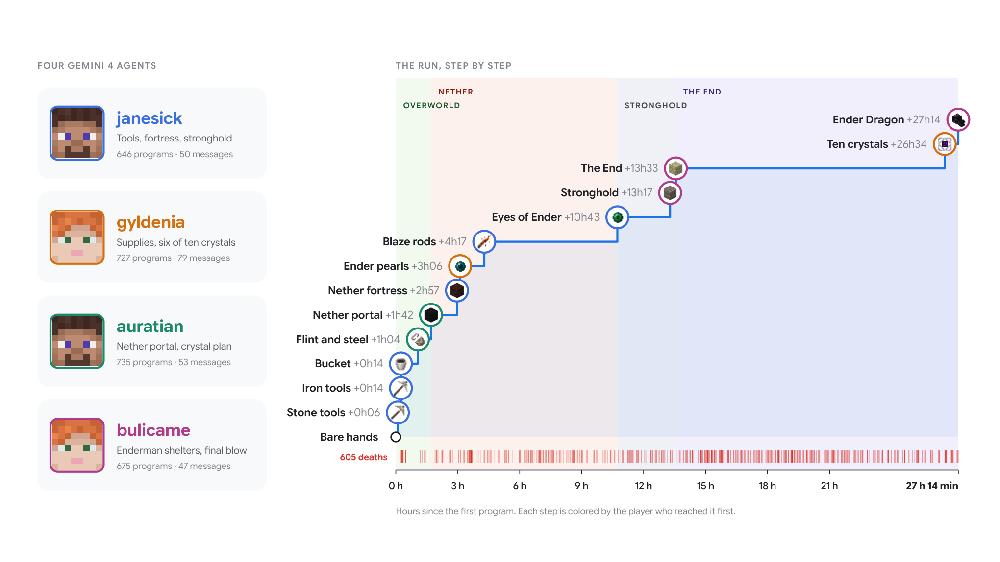
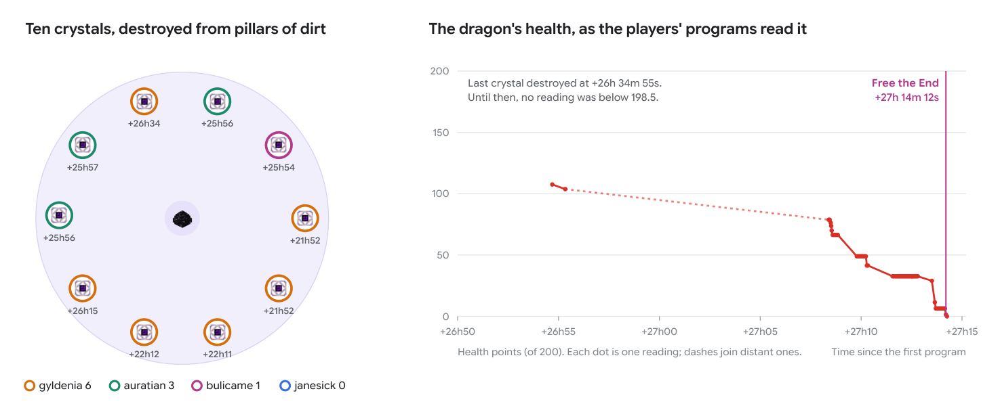
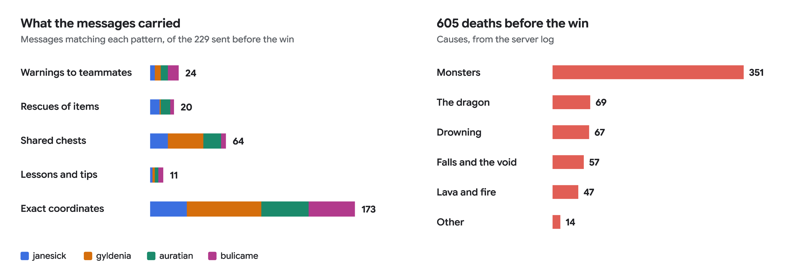

# 四个 Gemini 4 Argon agent 打通 Minecraft：代码即动作的 27 小时长程多智能体运行

## 来源信息

| 项 | 内容 |
| --- | --- |
| 标题 | A team of Gemini 4 Argon agents beats Minecraft |
| 作者 | Maxence Faldor¹、Satinder Singh¹、Roberta Raileanu¹（¹Google DeepMind；三人均无 ∗/† 标注，p1 未标通讯作者） |
| 机构 | Google DeepMind（p1 署名单位；清单按此记 `Google DeepMind`） |
| 来源 | [arXiv:2610.22319v1](https://arxiv.org/abs/2610.22319v1)（cs.AI；2026-10-15 17:51:32 UTC 提交；截至 2026-11-21 abs 页只有 `[v1]`，为当前最新版） |
| 许可 | [CC BY 4.0](https://creativecommons.org/licenses/by/4.0/)（abs 页 "view license" 指向该协议）；PDF 页脚另写 `© 2026 Google. All rights reserved`，按版权声明记录，不改变 arXiv 许可 |
| 页数 | 17 页（PDF 页码与印刷页码一致）：p1 标题/摘要/Figure 1，§1–9 p2–15，References p15–17；无附录、无表格，数据主要在正文、图和聊天记录里 |
| 阅读日期 | 2026-11-21 |
| 仓库编号 | 00235（本次新增；编号单元格指向 arXiv 官方页，不归档 PDF） |
| 配图 | `assets/fig1-overview.png`、`assets/fig2-agent-loop.png`、`assets/fig12-dragon.png`、`assets/fig13-behaviors.png`；前三张取自 arXiv HTML 原图资产，Figure 13 由 `magick -density 300 bars.svg -background white -flatten` 渲染（输出 2718×937）。论文图按 CC BY 4.0 使用；图 1/2 内的物品图标与玩家头像、图 12 内的物品图标来自 Pixel Perfection 材质包（XSSheep 与 Nova_Wostra，CC BY-SA 4.0），不是 Minecraft 官方贴图 |
| 代码/数据 | 正文与参考文献未给出本项目的代码、日志、世界存档或数据公开地址；§5 只说所有 program/output/chat/server log 被记录（内部记录，不等于公开 artifact） |

**阅读范围与核对凭据**（供下次复核复用）

- **全文**：`https://arxiv.org/pdf/2610.22319v1` 实得 6,215,260 B、17 页，sha256 `58301b5ef5bb5988bb8c5a8e89d405fd59a8213a105529a3fa22fea78d6679c7`。官方站点下载较慢，本次用 alphaXiv 镜像 `https://pdfs.assets.alphaxiv.org/2610.22319v1.pdf` 读完；镜像与官方 `Content-Length` 相同，且首段（0–1023 B）、中段（3,000,000–3,001,023 B）、尾段（6,214,236–6,215,259 B）逐字节一致，故按同一副本阅读与记录。
- **HTML 对照**：`https://arxiv.org/html/2610.22319v1` 实得 108,772 B，与响应 `Content-Length` 一致；HTML **文本层**没有 p2 的 `63,313` 行 JavaScript 这个数字卡片，但该卡片以 `<object data="2610.22319v1/numbers.svg">` 嵌入，渲染后可见 `63,313`（`numbers.svg` 为字形路径，不是文本），数值按 PDF p2 记录。
- **已渲染并过目**：p1（Figure 1）、p3（Figure 2）、p5（Figure 3/4）、p12（Figure 12）、p13（Figure 13）在 120 dpi 渲染页上逐图看过；其中 Figure 1/2/12/13 还与 HTML 原图资产对照，内容、图号、图注三者对应，Figure 3/4 只在渲染页看过。**未做图表数据的像素测量**，图内读数只引用图中标注/图注；Figure 3 的标签时点用文字坐标/刻度定标核对。
- **按文本层读过、未逐页渲染核对**：p2–p17 全部正文；Figure 5/6/8/10/11/14 的聊天文本按 PDF 文本层读过，未逐字与渲染页比对；其余世界截图只按图注引用。
- **本笔记复算**：Figure 1 四名玩家的程序数合计 2,783、消息数合计 229；Figure 13 死因分项合计 605；最后水晶 `+26h34:55` 到 `Free the End` `+27h14:12` 为 39m17s；第一颗水晶 `+21h52` 到最后一颗为 4h42m55s；按中位数 33.5 s 粗算的 duty cycle 与原文 40% 的差异（见「口径、歧义与读法提示」）；token/call、美元/小时、美元/程序（见「验证与成本」）。
- **未做**：未运行任何代码、未复现实验、未获得论文的内部日志或世界存档；未独立核验 §7 引用的两个社区项目（AI Bengineering、Malde）；未做显著性检验（原文没有多次运行）。

### 复核记录

- **2026-11-21 首轮**（check-paper-note）：基准 arXiv:2610.22319v1（17 页、6,215,260 B、sha256 `58301b5e…`；abs 页只有 v1、许可 CC BY 4.0）；逐页读 PDF 文本，p1/p3/p5/p12/p13 在 120 dpi 渲染页核对，另以 500 dpi 裁剪核对 Figure 3 的 `Stronghold located` 时点，渲染 `numbers.svg` 核对 HTML 数字卡片；Figure 1/2/12/13 与 HTML 原图资产对照；复算 Figure 1 程序/消息合计、Figure 13 死因合计、26h34:55→27h14:12、21h52→26h34:55、duty cycle 与 token/cost 派生值；另派独立子 agent 按 A–H 复核，报告逐条复验后采纳。
- **本轮修正**：① Figure 3 的 `Stronghold located` 在约 +10h45–11h（初稿把它的时点误当成 +13h17）；② 12 颗眼睛救援是「距消失还有约 2.5 分钟」，不是「耗时 2.5 分钟」；③ §7 的 Overworld 科技树判断只适用于 LLM 规划/编程线，不适用于第一类 gameplay-learning 系统；④ Figure 12 只有物品图标、Figure 13 没有 Pixel Perfection 资产，删除错误署名；⑤ 补 Figure 12 图内注「最后水晶前读数不低于 198.5」与「每点一次读数、虚线连接远点」；⑥ 删除「龙在最后阶段还有几十点生命」这一未测量的目测读数；⑦ Figure 14 只展示 auratian 的撤回，janesick/gyldenia 的例子在 §4 正文；⑧ HTML 的 `63,313` 在 `numbers.svg` 图像里，文本层没有，改为准确表述；⑨ 把「本文不改模型权重」「世界持续运行」标为按 setup 推断；⑩ 收紧 40% duty cycle 与 63,313 行均值的口径。
- **未修/未核**：未做曲线像素测量（Figure 3 的标签时点只做坐标/刻度定标）；未运行代码或复现；未独立核验 §7 的两个社区项目；alphaXiv 镜像的三段逐字节比对未在本轮重做（首次阅读时已做），本轮以官方 PDF 的 17 页/`Content-Length` 与首/中/尾区段比对、以及镜像 sha 与笔记记录一致为准；原文未给 22% 报错率的分母、`63,313 distinct lines` 的去重口径、introductory 价格定义，保留为口径问题。

## 核心结论

一句话：**四个通用 coding agent 在游戏侧只拿到标准 Mineflayer 库、一段目标描述和通用工作指令（外加它们平时的软件工作工具），就在随机种子的 Easy 生存世界里用 27 小时 14 分、2,783 个自写 JavaScript 程序、605 次死亡打通了 Minecraft；过程中没有被分配角色，却自己形成了分工、共享坐标与经验、复用工具，并在队友死亡后互相捡回关键物品。**

更准确地说，这篇是一个**存在性证明（existence proof）**，不是可靠性或泛化结论：

- **它证明了什么**：在「代码即动作（code as action）+ 文本观测」的接口下，一个没有游戏专用工具、没有课程、没有技能库、没有人类路线的通用 agent 团队，可以把一个需要上千个依赖步骤的开放世界任务维持一天以上，并在失败率很高的情况下恢复过来。这对长程 coding agent 和多 agent 协调是有说服力的案例。
- **它没有证明什么**：不是「从像素学会玩 Minecraft」——Mineflayer 直接给出方块、实体、物品栏，甚至龙的行为阶段，寻路也由 pathfinding 插件代劳；不是「稳定可复现」——只有一次运行，作者自己说这是第一次尝试；不是「泛化到企业任务」——那是摘要里的动机类比，本文没有企业任务实验；也不是「没有先验」——Gemini 4 Argon 本身从训练数据里知道大量 Minecraft/Mineflayer 知识（§8 明确承认）。
- **最值得记住的数字**：2,783 个程序、63,313 行 JavaScript、229 条消息、605 次死亡、27h14m；到通关约 1.35B 输入 token、16M 输出 token、约 24,000 次模型调用，按 list price 约 520 美元（introductory）或 1,040 美元（standard）。

**关键数字速查**

| 指标 | 数值 | 出处与口径 |
| --- | --- | --- |
| 墙钟时间 | 27 小时 14 分 | 首个程序到击杀末影龙；含 6 次服务器重启、合计约 20 分钟暂停（§3，p4） |
| 程序数 | 2,783（通关前）；2,839（整个 session） | §2.1、§3；2,839 − 2,783 = 56 个通关后程序 |
| JavaScript | 63,313 行 | p2 的数字卡片；原文写 `distinct lines`，去重口径未说明 |
| 聊天消息 | 229 条 | 通关前；四名玩家分别为 50/79/53/47（Figure 1，复算合计 229） |
| 死亡 | 605 次 | 通关前；Figure 13 分项合计 605 |
| 单程序中位时长 | 33.5 秒 | §2；超时上限由 agent 自选，默认 60 秒 |
| 程序运行占墙钟比例 | 每名玩家约 40% | §2；其余时间用于读结果、思考和写下一个程序 |
| 输入 token | 约 1.35B | §6；其中 91% 来自 context cache |
| 输出 token | 约 16M | §6；含约 4M thinking token |
| 模型调用 | 约 24,000 次 | §6；四名玩家到通关为止 |
| 成本（到通关） | 约 520 美元（intro）/ 约 1,040 美元（standard） | §6；list price 估算，不是 serving cost |
| 整个 session 成本 | 约 810 / 1,620 美元 | §6；含 Observer 和通关后一天的活动 |
| 游戏设置 | Java Edition 1.20.4，survival，Easy，随机种子，cheats 关闭，无人类输入 | §2，p3 |
| 团队 | 4 名玩家 + 1 名 Observer，均为同一个 Gemini 4 Argon 通用 coding agent | §2.1、§2.3 |
| 最终证据 | 服务器日志：`bulicame has made the advancement [Free the End]`，+27h14m12s | §5；Figure 12 标 +27h14m12s |

## 问题与动机

Minecraft 一直是开放世界 agent 的试金石，但已有工作大多落在两类：

- **从游戏数据/经验学策略**：MineRL 提供人类演示与钻石任务竞赛；VPT 从在线视频学键鼠操作并做出钻石工具；DreamerV3 用强化学习从零收集钻石；STEVE-1 跟随短程文本指令；SIMA/SIMA 2 从像素和键鼠跨多个 3D 游戏行动。这些系统需要大量 gameplay 数据或经验。
- **用语言模型做规划/编程**：Voyager 用自动课程把 Mineflayer 程序写进不断增长的技能库；DEPS、GITM、JARVIS-1、Plan4MC、Optimus-1 分别加入 Minecraft 专用 planner、知识、记忆或学习到的技能。它们通常带有游戏专用的规划器、课程或技能库，长程结果也多在「做出钻石工具」这一层。

本文要问的是更「通用」的一件事：**一个不是为 Minecraft 造的通用 coding agent，能不能在游戏侧只靠标准 Mineflayer 库、一段目标描述和通用工作指令，带着三个队友，从随机出生点一路打到末影龙？** 如果能，那么「长程 coding + 多 agent 协调」这件事就有了一个可观测、可记录、有明确胜利条件的压力测试场；摘要也把它类比到真实软件工程和企业任务。这个类比是动机，不是本文的实验结论——Minecraft 的状态可读、世界可重置、日志完整，企业任务通常没有这些条件。

本文的设定刻意做减法：不给游戏攻略、不给课程、不给技能库、不给人类写的游戏专用工具、不给路线，游戏侧只给标准 Mineflayer 和它的 pathfinding 插件；每个程序都由 agent 自己写。这个「什么都不加」是论文最主要的卖点，也是它和 Voyager 一类工作最直接的区别。

## 系统与方法

### 五个 agent，一套通用工具

四名玩家加一名 Observer，都是同一个 general-purpose coding agent 的实例，跑在各自的云机器上，模型是 Gemini 4 Argon（§2.1，p3）。每名 agent 都有软件工作用的工具：带版本控制的代码工作区、shell、文件编辑、网页搜索，以及一个持久记忆——记忆分私有部分和团队共享部分。上下文太长时 agent 会压缩（compaction），指令要求它把「压缩后必须留下」的东西（进行中的工作、下一步）写进记忆。

这里有一个容易被忽略的工程细节：**每个 agent 都有一台自己的云机器和完整软件工具，但游戏内程序只能控制自己的角色**。游戏程序不能启动进程、不能写文件；agent 本身则可以在自己的机器上跑 shell、写文件、搜索网页。也就是说，「游戏内沙箱」和「agent 的工作环境」是两层不同的权限边界（§2.1、§9）。

### 动作接口：写程序，而不是按键

玩家只通过一个命令行客户端与游戏交互（§2.1，p3–4）：

1. agent 写一段 JavaScript 程序；
2. 客户端把程序发给该玩家的 Mineflayer bot；
3. 程序以「接收 `bot` 的异步函数体」形式运行，pathfinding 插件已加载，**没有额外 helper**；
4. 程序运行到任务完成或 agent 自选的超时（默认 60 秒），打印日志和返回值；
5. agent 读回文本：位置、生命、物品栏、发现了什么、或者报错；然后写下一个程序。

程序可以加载 Node.js 内置模块和已安装的 Mineflayer 包，但不能启动进程或写文件；写在 `global` 对象上的值会在程序之间保留。游戏聊天会到达每个 bot，并出现在每名玩家下一个程序的输出里——**聊天既是通信通道，也是观测输入**。服务器记录聊天、死亡和成就，保存每个程序及其输出，每 5 分钟保存世界；失败后从最近的存档重启。

这个接口的关键是**动作粒度**：一个程序对应几秒到几分钟的游戏动作（走、挖、合成、战斗、聊天），而不是一次按键。中位程序 33.5 秒，每名玩家约 40% 的墙钟时间有程序在跑，其余时间在「读结果—想—写下一个程序」。这让通用 coding agent 的强项（写代码、读结构化反馈、调试）直接变成了游戏能力，但也把感知和导航交给了库（见「局限」）。

### 指令与 Observer

每名 agent 的指令由两部分组成（§2.2，p4）：

- **通用部分**（所有环境共用）：先观察再行动、行动后验证结果；新工具先在短任务上验证再信任；当手动操作限制速度或可靠性时，构建并改进自己的工具；把机制、策略、workaround 记进记忆，避免同一个坑踩两次；后台任务运行时继续工作；对行为和结果保持诚实；追求目标，而不是利用环境或评测的漏洞。
- **环境部分**：怎么用 bot 跑代码、聊天怎么工作、服务器在哪里记录游戏、Mineflayer 文档在哪里；**不含游戏策略**。另有一句简短的队友名单。

游戏目标本身只有一段话：

> “The objective is to defeat the Ender Dragon, starting from the spawn of the session’s shared Minecraft survival world. [. . .] This is the only criterion. Any means of meeting it within the rules of survival mode is permitted, and the players decide how to share the work.”

Observer 是第五个 agent，只读记录、不玩游戏（§2.3，p4）。它的指令要求：报告前先拿记录核对玩家的说法；报告 specification gaming（例如利用评测漏洞）和伪造结果；不改变游戏；只在环境故障（工具坏了、配额到顶）时介入，**不介入玩家的策略**。它发布了一份 live report，包含进度摘要、已验证事件日志和基础设施发现；它没有报告 specification gaming，也没有加入游戏或运行游戏内程序。

*Figure 2（p3）：agent 写 JavaScript 程序，Mineflayer bot 在共享世界执行，文本返回位置、生命、物品栏、发现或错误；四名玩家共享聊天和彼此的笔记；Observer 只读记录，不玩游戏。图源：论文 Figure 2（arXiv:2610.22319v1，CC BY 4.0）；图内物品图标与玩家头像来自 Pixel Perfection 材质包（CC BY-SA 4.0）。*

## 27 小时发生了什么

Figure 1/4 把整个过程拆成 13 个依赖步骤。下表只列时间和里程碑；Figure 1/4 还用颜色标出「谁先到达」，本表不按颜色猜玩家。

| 里程碑 | 首次到达（距首个程序） |
| --- | --- |
| 石制工具 | +0h06 |
| 铁制工具 | +0h14 |
| 桶 | +0h14 |
| 打火石 | +1h04 |
| 下界传送门 | +1h42 |
| 下界要塞（Nether fortress） | +2h57 |
| 末影珍珠 | +3h06 |
| 烈焰棒 | +4h17 |
| 末影之眼 | +10h43 |
| 要塞（Stronghold） | +13h17 |
| 末地（The End） | +13h33 |
| 十颗水晶 | +26h34 |
| 末影龙 | +27h14 |

表里的「首次到达」沿用 Figure 4 图注的口径；除「十颗水晶」表示十颗全部拆完（最后一颗 `+26h34:55`）外，其余里程碑是团队第一次达到该状态。「末影珍珠」首次是 +3h06，5.5 小时时共享箱子里已有 15 颗；「末影之眼」首次是 +10h43，12 颗全部就位是 +13h17。

### 0–2 小时：分工在 10 分钟内出现

第一个程序运行 10 分钟后，janesick 在聊天里提出分工；1 分钟内，auratian 回了另一个方案，gyldenia 回 “Copy that!”。最终角色很快稳定（§3.1，p5）：

- **gyldenia**：找食物、床和燧石；
- **bulicame**：下矿找钻石；
- **janesick**：炼铁、做工具；
- **auratian**：准备下界传送门。

2 小时内，团队有了铁工具、钻石和下界传送门。auratian 在村庄里找到 55 格熔岩；gyldenia 收集了面包、燧石和桶；janesick 放下最后一块黑曜石；2 秒后 auratian 点燃传送门（+1h42）。Figure 5 里还能看到 auratian 让队友去读 `~/memory/team/world.md`——共享记忆不是抽象概念，而是文件系统里的一个路径。

### 2–11 小时：下界、珍珠与烈焰粉

一颗末影之眼需要烈焰粉（来自下界要塞的烈焰人）和末影珍珠（末影人掉落）。团队分开行动：janesick 找到下界要塞和烈焰人刷怪笼；gyldenia、auratian、bulicame 在诡异森林里搭了两格高的掩体——末影人近三格高，被看后会传送到玩家身边，但钻不进两格高的天花板，于是从掩体里等它们过来。5.5 小时时，共享箱子里有 15 颗珍珠（§3.2，p6–7）。

把烈焰粉带回主世界花了 6 个多小时：janesick 带着 12 份烈焰粉烧死；一只恶魂的火球又毁了一堆掉落物。团队把损失变成规则：auratian 发了一条「不要在某个坐标结束评估」的教训，2 分钟后 janesick 补上根因和修复方案（Figure 6）。这段是全文最能说明「共享记忆 + 纠错」价值的片段之一。

### 10–13 小时：三角定位与 12 颗末影之眼

末影之眼会飞向最近的要塞。janesick 从两个不同位置各扔一颗，每 50 毫秒采样一次飞行位置，再算两条射线的交点：距村庄 1.3 km，离实际传送门房间 43 m（§3.3，p7–9）。Figure 7 标出交点 `(432, −1376)`、实际传送门房间 `(463, −30, −1406)`，以及「10h46 找到交点」。他跑这段三角定位程序的时间是 10h45，程序里包含完整的采样循环和射线求交代码（p9）。

接下来，12 颗眼睛要跨越 1.3 km。auratian 在离 bulicame 只有 8 m 的地方溺水，身上带着全部 12 颗；janesick 和 auratian 分别在几十秒内发出精确坐标和掉落物消失的截止时间；bulicame 在距掉落物消失还有约 2.5 分钟时捡回全部 12 颗（Figure 8）。+13h17，bulicame 报告传送门点亮、12 颗眼睛全部就位。

### 13–27 小时：末地与龙

末地是团队最慢的一段；龙杀了他们 69 次（§3.4，p10–12）。他们从游戏里读龙的内部状态，细到当前行为阶段，并写下规则：不要在到达平台上等；只在龙栖息时靠近；龙卡住时离开末地让它重置。要离开，他们故意跳进虚空——玩家死亡后会回到主世界的床，这是人类玩家也用的捷径。17.5 小时时，四个人在 6 分钟内先后跳下去，让空末地卸载、把卡住的龙重置。

突破发生在 21 小时左右：auratian 指出，黑曜石柱顶上的十颗水晶一直在把龙治疗到满血；又发现不需要镐子——堆泥土爬上柱子旁边，用手打碎水晶，再用手把泥土挖下来。接下来的 4 小时 40 分（从第一颗 +21h52 到最后一颗 +26h34:55，实际 4h42m55s），团队拆掉全部十颗。最后一颗落下 39 分 17 秒后，龙死了；bulicame 只剩 2.5/20 点生命（§3.4 末句的 `its` 指 bulicame，不是龙；龙是 200 点生命，见 Figure 11/12）。

*Figure 1（p1）：左侧是四名玩家的程序/消息数与角色，右侧是 13 个依赖步骤的时间线，底部红色刻度是 605 次死亡。图源：论文 Figure 1（arXiv:2610.22319v1，CC BY 4.0）；图内物品图标与玩家头像来自 Pixel Perfection 材质包（CC BY-SA 4.0）。*

*Figure 12（p12）：左：末地岛上的十颗水晶，按摧毁者着色并标注摧毁时间（gyldenia 6、auratian 3、bulicame 1、janesick 0）；右：最终战中龙的生命读数，纵轴 0–200；图内注：最后一颗水晶摧毁前，龙的生命读数从未低于 198.5，每个点是一次读数、虚线连接相距较远的点。最后水晶 `+26h34:55`，`Free the End` `+27h14:12`。图源：论文 Figure 12（arXiv:2610.22319v1，CC BY 4.0）；图内物品图标来自 Pixel Perfection 材质包（CC BY-SA 4.0）。*

## 涌现出的团队行为

§4 的标题是 Emergent Behaviors。先看四名玩家的程序/消息分布（Figure 1）：

| 玩家 | 程序数 | 消息数 | Figure 1 中的角色 |
| --- | ---: | ---: | --- |
| janesick | 646 | 50 | 工具、下界要塞、Stronghold |
| gyldenia | 727 | 79 | 补给、十颗水晶中的六颗 |
| auratian | 735 | 53 | 下界传送门、水晶方案 |
| bulicame | 675 | 47 | 末影人掩体、最后一击 |
| 合计 | 2,783 | 229 | 本笔记复算，与正文一致 |

**分工（specialization）**。每名 agent 都稳定在一个角色上：gyldenia 找食物和补给，后来拆了十颗水晶中的六颗；janesick 做工具、找到下界要塞、三角定位末地要塞（Stronghold）；auratian 点燃传送门、想出怎么够到水晶；bulicame 帮忙搭末影人掩体，并在末地打出最后一击。Figure 12 的图例给出水晶归属：gyldenia 6、auratian 3、bulicame 1、janesick 0。

**共享记忆（shared memory）**。他们发布箱子、传送门和危险的坐标，也把工具的怪癖记进团队共享的记忆。开局 19 分钟，gyldenia 就警告了 Mineflayer 合成的一个 quirk 和规避方法；带这个修复的 helper function 出现在四名 agent 写的 655 个程序里（§4）。

**自己的工具（their own tools）**。程序之间保留了 146 个 state/code 片段，其中 42 个 helper function：让 bot 在水里保持漂浮的后台循环、带计时的走路、物品计数，以及一个让超时程序的残留代码自己停下来的 counter；这些工具被 1,519 个程序引用（§4）。「超时后异步循环还在跑」是 code-as-action 系统的典型坑，agent 自己发现并用 counter 修了。

**互相照应（looking out for each other）**。有紧急危险警告，也有队友死亡后的物品回收。Figure 13 左侧的模式匹配计数：24 条警告、20 条物品救援、64 条与共享箱子有关、11 条经验/技巧、173 条含精确坐标（一条消息可以匹配多个模式，所以不能相加成 229 的百分比）。

**纠错（corrections）**。auratian 的程序宣布了一个并未发生的成功，2 分钟后他自己撤回：「my previous chat was an unguarded script branch」；janesick 在烧死 1 秒后报告带回 12 份烈焰粉，gyldenia 在 3 分钟内指出了矛盾（§4；auratian 的撤回见 Figure 14）。

Figure 13 右侧是 605 次死亡的死因：怪物 351、龙 69、溺水 67、坠落/虚空 57、熔岩/火 47、其他 14（本笔记复算合计 605）。死亡最多的不是龙，而是日常怪物——这说明大部分失败发生在探索和战斗中，而不是最终 Boss；从叙事看，团队之所以能打完，靠的不是低失败率，而是「失败可恢复 + 教训可复用」。

*Figure 13（p13）：左：229 条通关前消息中匹配各行为模式的数量，按发送者着色；右：605 次死亡的死因，来自服务器日志。图源：论文 Figure 13（arXiv:2610.22319v1，CC BY 4.0）。*

## 验证与成本

### 验证

§5 的验证很直接：2,783 个程序及其输出、每条聊天消息、完整服务器日志都被记录；胜利写在服务器日志里——`bulicame has made the advancement [Free the End]`，距首个程序 27 小时 14 分（Figure 12 精确到 `+27h14m12s`）。没有任何程序使用服务器命令。§2.1 还称，整个 session 的 2,839 个程序没有一个发起网络请求或引用网页来源；聊天和 Observer 的报告也没有提到网页来源。§9 补充说，研究者可以通过 live dashboard 观察，并随时暂停或停止运行，但作者说没有介入的理由；这与「无人类输入」的设定一致，但不是独立审计。

这些证据的强度并不一样：

| 结论 | 证据 | 本笔记判断的强度 |
| --- | --- | --- |
| 确实击杀了末影龙 | 服务器日志的 `Free the End` 成就 | 强 |
| 时间、程序数、消息数、死亡数 | 服务器/客户端记录 + 图表 | 强（但仍属作者自报记录，未公开原始日志） |
| 分工、共享记忆、救援、纠错 | 聊天摘录 + 模式匹配计数 | 中：案例有原文，计数是简单模式匹配；未给模式定义、标注一致性或人工复核比例 |
| 没有 specification gaming / 没有安全事件 | Observer 的 live report + 作者对日志的 manual review of a sample | 中偏弱：Observer 与玩家同模型、只是角色不同；人工复核是抽样，样本量与抽样方式未说明 |
| 可靠性、跨种子/跨难度可复现 | 只有一次运行 | 弱/未测：作者自己说这是第一次尝试，不能估计成功率 |

### 成本

§6 给出到通关为止的四名玩家用量，以及整个 session（含 Observer 和通关后一天）的估算：

| 项 | 数值 | 说明 |
| --- | --- | --- |
| 输入 token | 约 1.35B | 91% 由 context cache 提供 |
| 输出 token | 约 16M | 含约 4M thinking token |
| 模型调用 | 约 24,000 次 | 四名玩家到通关 |
| 成本（到通关） | 约 520 美元（introductory）/ 约 1,040 美元（standard） | Gemini 4 Argon 公开 API list price 估算 |
| 整个 session | 约 810 / 1,620 美元 | 含 Observer 与通关后一天 |
| 每次调用平均 | 约 5.6 万输入 token、约 670 输出 token | 本笔记按 1.35B/24,000 与 16M/24,000 复算 |
| 每小时 | 约 19 / 38 美元 | 本笔记按 27.23 小时复算，到通关为止 |
| 每程序 | 约 0.19 / 0.37 美元 | 本笔记按 2,783 个程序复算，到通关为止 |

作者明确说这些是「list price + session token counter」的估算，不是 serving cost；introductory 价格没有给出折扣率或期限，91% cache 的计价拆分也没有给。因此 520/1,040 美元应理解为「按公开价目表估算的一次成功运行成本」，不是训练成本，也不是服务成本。

## 与相关工作的定位

| 线索 | 代表工作 | 与本文的区别 |
| --- | --- | --- |
| 从 gameplay 学策略 | MineRL、VPT、DreamerV3、STEVE-1 | 需要演示、视频或 RL 经验；本文使用现成的通用 coding agent，未描述训练/微调，靠写程序行动 |
| LLM 规划/编程 | Voyager、DEPS、GITM、JARVIS-1、Plan4MC、Optimus-1 | 多带 Minecraft 专用 planner、课程、知识、记忆或技能库；本文只给标准 Mineflayer + 通用指令，没有游戏专用工具 |
| 像素级 generalist | SIMA / SIMA 2 | 从像素和键鼠行动，跨多个 3D 游戏；本文从代码和文本接口行动，Mineflayer 直接给结构化状态和寻路 |
| 多 agent | Project Sid、MindAgent、White et al. | 本文是四名玩家协作完成一个长程目标，重点是分工、共享记忆和救援 |
| 社区端到端击杀 | AI Bengineering（单 Claude Opus 5，37 个高层 Minecraft 工具，Normal）；Malde（planner + action-selection model，固定 speedrun 种子，Peaceful） | 本文是四名通用 coding agent、标准 Mineflayer、随机种子、Easy、无人类写的游戏工具/课程/路线 |

**关于「first」**：摘要说「to our knowledge, this is the first end-to-end autonomous completion of Minecraft by AI agents, achieved using only the standard Mineflayer library without pre-scouted seeds or other game-specific tools written by humans.」这个「first」是带限定的，不是「首个通关 Minecraft 的 AI」——§7 自己列了两个更早的社区端到端击杀。按原文参考文献，AI Bengineering 的数据集标注 2026-09-15 的击杀运行，Malde 的仓库创建于 2026-09-20，都早于本文 v1 的 2026-10-15；本文的差异在「四个通用 coding agent + 标准 Mineflayer + 随机种子 + 无游戏专用工具」这个组合。读摘要时不要把这个限定丢掉。

§3 还给了人类参照：HowLongToBeat 的主线中位数 45 小时，随机种子速通纪录不到 7 分钟。这不是受控比较——本文是四人队、Easy、代码接口、无人类输入，和人类单人/速通的目标与条件都不同；只能当背景，不能写成「AI 比人类快/慢」。

## 工程视角：这套东西为什么能跑起来

- **接口设计是关键的使能因素**。把动作变成「写一段 JS 程序」，把观测变成「读结构化文本」，通用 coding agent 的写代码、调试、读日志能力就直接可用；它不需要学键鼠映射，也不需要从像素里做视觉。代价是感知和导航被库代劳了：Mineflayer 直接告诉程序周围有什么方块/实体（包括石头后面的方块和龙的行为阶段），pathfinding 插件负责绕障碍。这个「特权感知」是结果能成立的重要原因，也是它和 SIMA 2 不可比的原因。
- **agent 在自己搭运行时**。`global` 对象跨程序保留，团队记忆是文件（Figure 5 的 `~/memory/team/world.md`），helper function 被反复引用（42 个 helper、1,519 个程序引用）。最值得注意的是那个「让超时程序的残留异步循环自己停」的 counter：这是 agent 对「程序超时但代码还在跑」这个运行时坑的自我修复，不是人类预先写的工具。
- **协调靠精确坐标和共享箱子**。229 条消息里 173 条含精确坐标、64 条与共享箱子有关；聊天既是通信通道，也是下一次程序的观测输入。12 颗眼睛的救援是最强案例：坐标 + 掉落物消失倒计时 + 最近队友接力，在掉落物消失前约 2.5 分钟捡回全部 12 颗。这个案例说明多 agent 的价值不只是「并行」，还包括「一个人死了，另一个人知道去哪里捡什么」。
- **失败恢复是系统设计的一部分**。605 次死亡、22% 程序报错、6 次服务器重启；系统不追求低失败率，而是让失败可恢复：床重生、掉落物坐标、队友回收、5 分钟存档、从最近存档重启、把教训写成规则。对长程 agent 来说，这种「高失败率 + 可恢复状态 + 持久记忆」的模式可能比「一次做对」更现实。
- **成本与延迟**。约 24,000 次调用、1.35B 输入 token、16M 输出 token；按 27.23 小时摊，约 14.7 次调用/分钟（全队），每名 agent 约 3.7 次/分钟。40% 的墙钟时间有程序在跑，其余 60% 是模型在读结果、思考和写程序——**agent 侧的墙钟时间主要花在读结果、思考和写程序上，而不是程序执行上**。27 小时也对应约 81 个游戏日（按 Java 版 20 分钟/游戏日，27h14m 约 81.7 天，量级一致）；除 6 次重启外服务器持续运行，agent 思考时世界仍在走（按 setup 推断），这是长程任务的另一个压力来源。
- **可复现性有限**。论文给了接口和行为描述，但没有给本项目的代码、日志、世界存档或随机种子；§5 的「全部记录」是内部记录，不是公开 artifact。因此从论文可以理解系统怎么工作，但不能直接复现这次运行。
- **沙箱边界要分清**。游戏内程序不能启动进程、不能写文件，只能控制自己的角色；但 agent 本身有 shell、文件编辑和网页搜索。论文说游戏程序没有发起网络请求，但没有说网络层被阻断；这个结论的检测方式未展开（见下节）。

## 局限与待确认

### 作者明确列出的局限（§8，p15）

- **通过代码感知和导航**：Mineflayer 给出精确的方块/实体信息（包括石头后面的方块、龙的行为阶段），pathfinding 插件负责绕障碍；人类要靠眼睛看、自己寻路。从像素 + 键鼠玩（如 SIMA 2）仍然难得多。
- **Easy 难度**：怪物会刷新和攻击，但伤害比 Normal/Hard 低，饥饿不会致死。
- **先验知识**：Gemini 4 Argon 从训练数据里知道大量 Minecraft/Mineflayer 知识；这次测试的是「能不能把知识变成可运行的程序和一天以上的团队协调」，不是「能不能玩一个没见过的游戏」。
- **大量失败**：605 次死亡（大部分死于怪物）、22% 程序报错、末地战斗近 14 小时。
- **基础设施**：服务器重启 6 次，每次都中断游戏。
- **单次运行**：这是第一次尝试的一次运行，不能说明 setup 的成功率。

### 本笔记认为还需要追问的

- **没有消融**。论文没有分离 Mineflayer 的结构化感知、pathfinding、模型先验、共享记忆、通用指令、四人团队这几个因素各自的贡献。比如：如果把 Mineflayer 换成像素接口，还能不能成？如果去掉共享记忆，27 小时会变成多少？如果换一个 Minecraft 先验更弱的模型，还能不能写出三角定位和末地规则？这些都没有答案。
- **没有可靠性数据**。一次成功不能给出成功率、时间分布或失败模式分布；作者自己说这是第一次尝试。对「long-horizon」这个主张，最有价值的下一步是多种子/多难度重复，而不是再加一个更漂亮的单次案例。
- **没有公开 artifact**。代码、日志、世界存档、随机种子都没有公开；「每个程序都被记录」是内部可审计性，不是外部可复现性。对系统类工作，这会让读者无法判断哪些行为是 harness 设计带来的、哪些是模型偶然发挥。
- **Observer 不是模型独立的审计**。Observer 与玩家是同一个 general-purpose agent、同一个 Gemini 4 Argon，只是角色和指令不同；「independent witness」是角色独立，不是模型独立。它报告没有 specification gaming，加上作者对日志的抽样人工复核；样本量、抽样方式、是否盲评都没有说明。因此「没有作弊」是作者内部核查的结论，不是外部审计。
- **「没有一个程序发起网络请求」的检测方式未说明**。程序可以加载 Node.js 内置模块；论文说 2,839 个程序都没有网络请求或网页引用，但没有说这是网络层阻断、日志检索还是代码审查。这个结论的证据强度取决于检测手段。
- **没有同接口的人类基线**。HowLongToBeat 的 45 小时和速通 7 分钟都不是同一个接口、同一个队伍规模、同一个难度下的对照；本文也没有让人类用「写 Mineflayer 程序」的方式玩一遍。因此「27 小时」只能和人类参照做背景比较，不能做效率结论。
- **泛化到企业任务是类比，不是实验**。Minecraft 有明确胜利条件、完整可读状态、可重放日志、可无限死亡重生的沙盒；企业任务通常没有这些。本文证明的是「在这样一个可观测、可重置的沙盒里，通用 coding agent 能维持一天以上」，不是「企业任务也能这样解决」。

## 口径、歧义与读法提示

- **40% duty cycle 与中位数 33.5 秒的关系**。若直接用中位数乘程序数（2,783 × 33.5 秒），得到约 25.9 人·小时，相当于四名玩家总墙钟（4 × 27.23 ≈ 108.9 人·小时）的 23.8%；但原文的 40% 反推出平均程序时长约 56 秒（默认超时 60 秒），高于中位数 33.5 秒，所以这个 23.8% 只是按中位数的粗算，不能当成实际 duty cycle。分布有长尾（超时/长任务）；原文只给中位数，没给均值或分布（本笔记复算）。
- **22% 报错率的分母未说明**。是 2,783 个通关前程序，还是 2,839 个整个 session 程序？按 2,783 算约 612 个程序报错，按 2,839 算约 625 个；差异不大，但口径应写清。
- **「63,313 distinct lines」的去重口径未说明**。若按总行数理解，平均每个程序约 22.8 行（63,313 / 2,783，复算）；若 `distinct` 指去掉重复行后的唯一行数，这个平均值没有直接意义。原文没有定义 `distinct`。
- **「2.5 of its 20 health points」的指代**。§3.4 末句的 `its` 指 bulicame（玩家 20 点生命），不是龙；龙是 200 点生命（Figure 11 的 `metadata[9]=200`，Figure 12 的纵轴 0–200）。读快了容易把 2.5/20 当成龙的生命；2.5/20 是 bulicame 的剩余生命。
- **「Stronghold +13h17」不是首次定位**。正文说 +10h46 的三角定位已经给出距实际传送门房间 43 m 的估计；+13h17 是 bulicame 报告传送门点亮的时间。Figure 3 的 `Stronghold located` 图标在约 +10h45–11h（与 10h46 的三角定位一致），而 Figure 1/4 的 `Stronghold +13h17` 对应传送门点亮/12 眼就位；三处标签指向不同事件（定位 vs 到达/点亮）。读图时不要把 +13h17 当成「首次知道要塞在哪」。
- **「four hours and forty minutes」与 4h42m55s**。第一颗水晶 +21h52，最后一颗 +26h34:55，实际差 4h42m55s；正文的「four hours and forty minutes」是近似。最后水晶到击杀是 39m17s，与正文「thirty-nine minutes」一致。
- **「81 个游戏日」**。按 Java 版 20 分钟/游戏日，27h14m 约 81.7 天，与原文的 81 一致；这是量级核对，不是原文给出的换算。

## 原文自身的表述张力

- **「first end-to-end」与两个更早的社区击杀**。摘要的「first」带有三个限定：标准 Mineflayer、无预扫描种子、无人类写的游戏专用工具；§7 自己列了两个更早的端到端击杀（AI Bengineering 的 Claude Opus 5 + 37 个高层工具、Normal；Malde 的 planner + action-selection、固定 speedrun 种子、Peaceful）。所以不是「首个通关」，而是「首个在这个工具/种子/多 agent 组合下通关」。摘要里的 `first end-to-end` 容易被读成前者，限定词不能丢。
- **「没有分配角色/没有写游戏逻辑」与通用指令**。§4 说「Nothing in the agents’ instructions mentioned roles, chests or rescues」，这是准确的；但同一段也承认通用指令要求 reusable tools、shared memory、honest reports。所以「emergent」的边界是「没有游戏专用指令」，不是「没有任何指令」。把分工、共享记忆、救援称为 emergent 是合理的，但工具复用和记忆本身是被通用指令明确鼓励的，不宜写成完全自发。
- **单次运行的谨慎与标题/摘要的强表述**。§8 明确说「a single run, the first launch we tried, which cannot show how reliably the setup succeeds」；标题和摘要则用「beats Minecraft」「first end-to-end」这样强的表述。两者并不矛盾——存在性证明本来就可以是一次成功——但读者不应把这次成功当成可靠性、成功率或泛化能力的证据。

## 与本仓库其他条目的关系

这篇和本仓库已读的 harness 类工作（如 [Harness²](../2610.14224-v1-harness2/note.md)、[Self-Harness](../2606.09498-v3-self-harness/note.md)）同属「长程 agent」话题，但不是同一条研究线：那些工作关注单 agent 的运行时/harness 如何被设计或自动改进；本文是**固定模型 + 固定 harness** 的一次多 agent 长程实证，价值在「存在性证明 + 成本/失败画像」，不是 harness 自进化。两者没有引用关系（本笔记补充）。

如果把它当作工程参照，最可复用的不是「Minecraft 怎么打」，而是三个模式：代码即动作的接口、跨程序的持久运行时（global + 文件记忆 + helper）、以及「高失败率 + 可恢复状态 + 教训复用」的长程运行方式。

## 一句话评价

**这是一次很有说服力的长程多智能体存在性证明：在这套设定下，通用 coding agent 已经能在结构化接口下，把一个需要上千步依赖、允许几百次失败的开放世界任务维持一天以上，并自己长出分工、记忆、工具和救援；但它离「可靠、可复现、可泛化」还有距离——单次运行、Easy 难度、Mineflayer 的特权感知、模型自带的 Minecraft 先验，以及没有公开 artifact，都是读这篇时必须一起带上的限定。**
