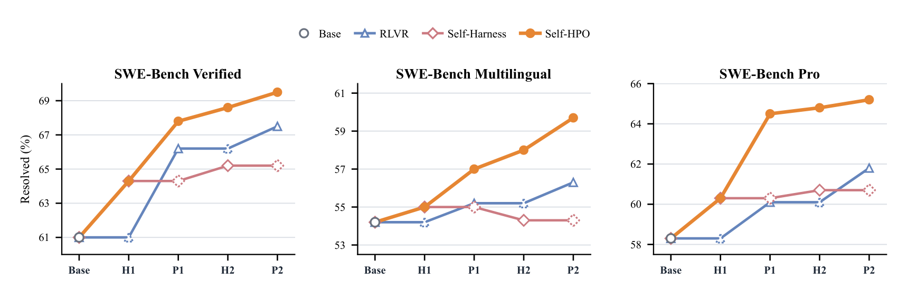
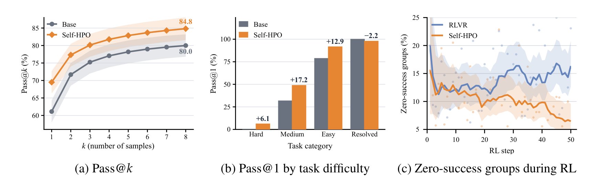
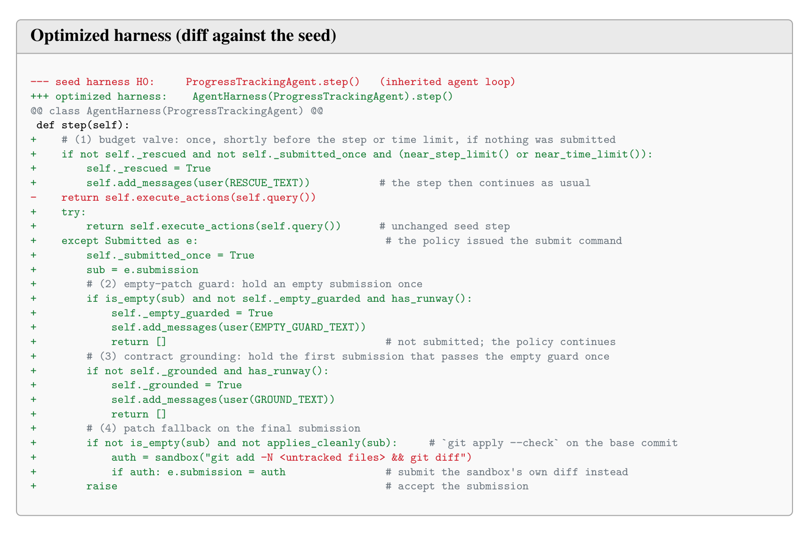

# Self-HPO — 复核档案

> 本文件是维护性档案，不参与站点构建；读者版正文见同目录 `note.md`。

## 来源与版本

- **标题**：Self-Evolving Coding Agents via Harness-Policy Optimization（方法名 Self-HPO）。
- **作者**：Zhepei Wei¹,²\*、Wenlin Yao¹、Baolin Peng¹、Danqing Wang³、Qianhui Wu¹、Hao Cheng¹、Yu Meng²、Jianfeng Gao¹（8 人）。¹Microsoft Research、²University of Virginia、³Carnegie Mellon University。\* 仅第一作者带星号，脚注为 "Work done during internship at Microsoft Research"；PDF 首页**没有**通讯作者 † 标注。
- **机构**：Microsoft Research（第一机构）。8 位作者中 Wenlin Yao、Baolin Peng、Qianhui Wu、Hao Cheng、Jianfeng Gao 5 位只署 MSR；第一作者 Zhepei Wei 同时署 MSR 与 UVa；Danqing Wang 只署 CMU；Yu Meng 只署 UVa。
- **来源**：[arXiv:2610.22791v1](https://arxiv.org/abs/2610.22791v1)（cs.CL；cs.AI），2026-10-16 提交；截至 2026-11-21 仍只有 v1，24 页。
- **许可**：[CC BY 4.0](http://creativecommons.org/licenses/by/4.0/)（abs 页 "view license" 指向该协议；PDF 首页只印 arXiv 编号与日期，未印协议名）。
- **代码**：<https://github.com/MSR-Orchard/Self-HPO>。2026-11-20 GitHub API：MIT License，创建 2026-10-10，最后 push 2026-10-19，默认分支 `main`，最新 commit `3c3d0bd93a`，★68；顶层为 `assets/`、`harnesses/{seed,hpo,self-hpo}/`、`mini-swe-agent/`、`scripts/`、`slime/`。只读核验 README 与三个 harness 的 `agent.py`，未运行、未复现。
- **模型**：<https://huggingface.co/self-hpo>。仓库 README 声称发布 `HPO-Qwen3.5-35B-A3B` 与 `Self-HPO-Qwen3.5-35B-A3B` 两个 checkpoint；**本次未能验证**：2026-11-20/21 多次 `curl` 均 20 s 超时，HF 域名不可达。
- **仓库编号**：00234（本次新增；编号单元格指 arXiv 官方页，未归档 PDF）。
- **归档说明**：arXiv 来源，按仓库策略不归档 PDF；引用请注明原论文（CC BY 4.0）。
- **阅读日期**：2026-11-20。

## 阅读范围与核对手段

- **阅读范围**：v1 全文 24 页。同版本 HTML（540,423 B，与响应 `Content-Length` 一致）通读正文与 A–E 附录；PDF 用于页码、版式、表格与图核对（p1–9 正文关键页 200 dpi 渲染；p16–24 附录的关键页渲染核对，其余按 HTML/PDF 文本；p9–15 为参考文献，只核对边界）。
- **逐格核对**：Table 1（p5）、Table 2/3（p6）、Table 4（p17）、Table 5（p18）在渲染页逐格核对（Table 1/2/3/5 全文转写，Table 4 只摘录部分行）；Table 1 的 `Avg.` 列按三列算术平均复算一致（如 Self-HPO $(69.5+59.7+65.2)/3=64.8$）。文中所有「本笔记复算」的差值均按对应表值计算，不与原文数字混写。
- **图的核对**：Figure 1（p2）、5（p8）、6（p17）看整页渲染；Figure 2（p3）、3（p6）、4（p7）、8（p20）以 300 dpi 裁剪入 `assets/`；Figure 7（p19）按 HTML/PDF 文本核对提示词；Figure 9–11（p21–24）按 HTML 全文与 PDF 文本核对，未逐图裁剪。
- **配图**：`assets/figure2-overview.png`（p3）、`assets/figure3-trajectories.png`（p6）、`assets/figure4-passk-difficulty.png`（p7）、`assets/figure8-harness-diff.png`（p20）；均为 300 dpi PDF 渲染裁剪。
- **裁剪框（pt，页面坐标，300 dpi）**：Figure 2 p3 `(100, 72, 512, 240)`；Figure 3 p6 `(100, 72, 512, 204)`；Figure 4 p7 `(100, 72, 512, 200)`；Figure 8 p20 `(100, 72, 512, 345)`。成品尺寸分别为 1718×700、1718×550、1718×534、1718×1138；四张均回看确认四边为白、无黑边/越界，并按元素清单点名：Figure 2 的 H/P 两步、两个面板内的模块与箭头、左右两条循环箭头；Figure 3 的三个面板、图例、纵轴标题与 Base–H1–P1–H2–P2 刻度；Figure 4 的 (a)(b)(c) 三个面板、图例、`+6.1/+17.2/+12.9/−2.2` 标注与 $k=1..8$ 轴；Figure 8 的标题、`+/-` diff 行、四条 check 注释与结尾 `raise`。
- **仓库侧**：只读核验 README、`harnesses/{seed,hpo,self-hpo}/agent.py`；未运行代码、未复现实验、未下载 HF checkpoint。

**核对凭据（可复现）**

- 原文 PDF：24 页，5,097,920 B，sha256 `801a3a12aca529978cd8c80042177f8c4787f8067b034f50f5cc713dcf0356ba`（`https://arxiv.org/pdf/2610.22791v1`；alphaXiv 镜像 `https://pdfs.assets.alphaxiv.org/2610.22791v1.pdf` 为同一文件、sha 一致；官方下载耗时约 10 分钟，下载字节数与 `Content-Length` 一致且文件尾为 `%%EOF`）。
- 同版本 HTML：540,423 B，与响应 `Content-Length` 一致，含全部 A–E 附录。PDF 只用于页码、版式与图表，不混用不同版本。
- 否定性检索（v1 PDF 全文）：`limitation` 0 次、`future work` 0 次、`cost` 0 次、`latency` 0 次、`held-out`/`heldout` 0 次；`token` 只出现在原文 Eq (2) 段的 token positions / token probabilities 与附录 D 的 maximum tokens。即：**没有局限章节、没有成本/时延数字、没有 harness 选择的 held-out 门控**。
- 否定性检索计数：`token` 3 次（Eq (2) 两处 + 附录 D 一处）。
- Table 1 的粗体按 `page.get_text('dict')` 字体核对（HPO/Self-HPO 两行的数值与 ± 均为粗体）。
- 四张配图重裁像素差 `None`、四边像素全为 255。

## 复核记录

- **2026-11-21 第一轮（check-paper-note）**：基准为 arXiv:2610.22791v1（24 页，5,097,920 B，sha256 `801a3a12aca529978cd8c80042177f8c4787f8067b034f50f5cc713dcf0356ba`；重取官方 PDF 与 alphaXiv 镜像 sha 一致；同版本 HTML 540,423 B）。本轮逐项核对 A–H：元数据（8 位作者与单位、∗ 脚注、无 †、CC BY 4.0、仅 v1）、Table 1–5 与 Eq (1)/(2)、§/Figure/Table 页码、Figure 3/4/6 读数、Appendix E 案例、仓库 commit `3c3d0bd93a`；并由独立子 agent 做只读审计。仓库 README/API 另核（MIT、创建 2026-10-10、最后 push 2026-10-19、★68）；HF 仍不可达。
- **修正**：① 2×2 交互项论据改为「四格都测了（61.0/64.5/64.4/69.5），但 H2 用 P1 搜、P2 在 H2 下从 P1 训练，因子不独立；按四格 SD 粗算 SE ≈ 2」；② Self-Harness/Meta-Harness 的设定改为 Setting 2 / Setting 1（原来误写成同一设定）；③ Table 4 摆位补 Gemini 3 Pro 69.6（Self-HPO 69.5 比它低 0.1）；④ 零成功组 6.5% 改为「原文 p7 明写」，不再写成图末目读；⑤ 零成功组归因改为「RLVR 与 Self-HPO 使用相同 GRPO+BAR 配置，差异归给 policy/harness，不归给 BAR」；⑥ 「第一轮 harness 贡献最大」改为「第一次 harness 更新即时增益更大（+3.3 vs +0.8）；P1 单步最大（+3.5）；H2 在最终 P2 上 +1.4（69.5−68.1）」；⑦ Self-HPO 自身 harness 的机制补注仓库还有 `Decorator Reminder`；⑧ 「override execute_actions」标为仓库实现，Appendix D 只写 step；⑨ 「上一轮留下的笔记」改为「本次搜索中更早 proposal 留下的笔记」；⑩ `token` 计数写全原文 Eq (2) 段的 token positions / token probabilities；⑪ Table 2「表头」改为「第一行（参照行）」；⑫ Table 4 的核对声明改为「渲染页逐格核对，正文只摘录部分行」，不再写全表逐格转写；⑬ Self-Harness 关系条目改为三个 benchmark 都用了 Qwen3.5-35B-A3B、其 SWE/AppWorld 数字不能与本文直接横比；⑭ 「本文的独特处」限定为「在上述条目里」；⑮ 「没有做去重/污染检查」改为「没有说明是否做了」；⑯ 补 pass@k 的 95% bootstrap CI 与 SFT 的 batch 64 / lr 5e-6 / 10% warmup；⑰ 公式块前注明原文 Eq (1)/(2)。
- **未修/未核**：HF checkpoint 仍无法访问（2026-11-20/21 多次超时）；仓库与网页状态随时间变化；未运行代码、未复现实验；未比对 v1 之外的版本（截至 2026-11-21 仍只有 v1）。
- **复核凭据**：PDF sha 与阅读时一致；Table 1 的 `Avg.` 七行复算一致；四张配图重裁像素差 `None`、四边像素全为 255；Table 1 的粗体按 `page.get_text('dict')` 字体核对（HPO/Self-HPO 两行的数值与 ± 均为粗体）；否定性检索 `limitation`/`future work`/`cost`/`latency`/`held-out`/`heldout` 均 0，`token` 3 次（Eq (2) 两处 + 附录 D 一处）。
- **独立审计**：子 agent 只读审计报告 12 项，已逐条回原文验证：11 项完全采纳，第 6 项（第一次 harness 更新 vs 单步最大）部分采纳——采纳其限定；它给出的「两轮合计 harness 约 +4.1」是路径分解（H1 +3.3 + H2 +0.8），与最终 P2 上的交叉评估 +1.4 是两种口径，本文并列分步/交叉评估，不把 4.1 当成最终效应。
- **2026-11-28 读者版重写**：按要求把正文压成读者版（297 行），复核记录、逐表逐图读数、工程实现、表述张力、局限完整版迁入本文件；正文只保留来源信息、核心结论、问题、核心想法、方法、主要结果、边界与局限、与其他工作的关系。本次未重新获取原文，未改动任何数字；`doc_lint.py` 检查无问题。**重写时做的三处表述修正**：① 原「标题里的 "recursive" 在实验上只走到 P2」不成立——本文标题没有该词，读者版改为「『自进化』的叙事」；② 新增表述张力第 5 条，记录 Algorithm 1 的 `ProposeHarness(H_{t+1}, …)` 下标在字面上指本轮结束才产生的 harness；③ H-step 的 budget valve 补回「且还没提交过」这一触发条件。

## 原文自身的表述张力

以下几条是原文内部或图文之间的对照，单独列出，避免把它们混进「论文结论」：

1. **正文案例用的是 HPO 的 harness，Appendix E 用的是 Self-HPO 的 H2，两者不同。** §3.5 第一句就说 Figure 5 是「HPO's second H-step」的 harness；Appendix E 开头又说「H2 ... differs from the HPO harness in Appendix D」。因此 Figure 5/8/9 的四条 check **不是** Self-HPO 最终 harness 的完整描述；Self-HPO 自己的机制只在 Appendix E 的案例和仓库代码里出现（Appendix E 展示的是 Full Files Auditor / PR Intent Reminder；仓库代码还多一个 Decorator Reminder）。读标题以为「Self-HPO 的 harness 就是这四条 check」会错。
2. **Table 1 把外部模型设定（Setting 1）排在自进化设定（Setting 2）前面，且 HPO 的数字更高。** 摘要与 §1 主推 Self-HPO（69.5/64.8），但表里最上面一组是 HPO（71.6/66.3）。这不是矛盾，但比较时容易把 HPO 当成「Self-HPO 的消融」；实际上 HPO 是同一框架换外部 proposer 的另一个完整系统。
3. **消融以 HPO 为参照，不是 Self-HPO。** Table 2 的第一行（参照行）是 HPO 71.6，最后一行「w/ Self-proposer」才变成 Self-HPO 69.5。也就是说「演化搜索集 +1.5」「RL vs SFT +4.4」这些结论只在 Opus proposer 设定下被测量；Self-HPO 设定下没有单独重复这组消融。
4. **「只加一个机制」与「四条 check」的关系需要读者自己补。** Figure 7 的 proposer 约束是「保留父方法、只加一个新机制」，Figure 5/8 的最终 harness 却有四条 check。按 §2.2 的「每次在当前最好上改、K 次迭代累积」可以解释为不同迭代叠加的四个机制；原文没有在同一处把这句话说透。
5. **Algorithm 1 的 proposer 调用写的是 `ProposeHarness(H_{t+1}, P_t, E)`，但 H_{t+1} 在本轮结束才产生。** 按 §2.2「每次在当前最好上改」的机制，这里应理解为「搜索过程中当前最好的 harness」；原文没有解释这个下标，读者不能按字面把 $H_{t+1}$ 当成第 $t+1$ 轮的 harness。
6. **停止准则没有操作化。** Algorithm 1 写「hard-task set stabilizes between rounds」，§3.1 写「perform two rounds ... based on the stopping criterion」，但正文没有给稳定性的阈值、度量或第二轮之后 hard set 的大小；读者无法判断「两轮」是收敛还是预算所限。
7. **「联合增益超过各自之和」是点估计。** 8.5 vs 3.5+3.4 的 1.6 分差异，与 Table 3 四格的 SD 同量级（按四格 SD 粗算交互项 SE ≈ 2，本笔记粗算），而且两个因子不是独立操纵（见下文）。原文的措辞是 "exceeds"，本笔记建议读成「正向交互的点估计」。
8. **Figure 4(b) 的 Resolved 组 −2.2 是明确的回退。** 原文报告了它，但只用来支持「improvement is not uniform across tasks」，没有解释为什么 Base 每次都解出的任务会变差；这不是「全面提升」。
9. **`Avg.` 是算术平均，不是按题数加权。** 三个 benchmark 的题量是 500/300/642，`Avg.` 却按三列等权平均（复算一致）。跨 benchmark 的「平均」因此更接近「每个 benchmark 同等重要」，不是「每道题同等重要」；论文没有声明这一点，但表注只说了 `mean resolve rates`。

## 工程实现与外部资料（原「工程视角」）

### 「harness」在这篇里具体是什么

不是抽象配置，而是一个 **Python 类**：继承 seed agent，override `step()`（Appendix D 只写了 step）；仓库的 `self-hpo` 实现还 override 了 `execute_actions()`。它可以在模型动作前后读写对话、检查 sandbox 状态、拦截提交、替换 patch。候选 harness 连同 prompt 模板一起提交；policy 与采样配置冻结（Appendix D，p18）。

这带来两个工程约束：

- **搜索空间是代码，不是文本**：proposer 必须有能力写可运行的 Python、理解 mini-SWE-agent 的接口，并能通过「保留父方法 + 在真实 sandbox 上触发」的检查。论文没有单独评估 proposer 的代码能力，只用最终 resolve rate 间接衡量。
- **可验证性依赖 sandbox**：所有仓库访问都走 sandbox；候选 harness 必须在真实任务上跑过才算有效。这使 H-step 的成本与「候选数 × 搜索集大小 × 每任务 rollout」成正比，而不是几次 LLM 调用。

### 仓库实现（只读核验）

- `harnesses/seed/agent.py`：一行 `from minisweagent.run.benchmarks.swebench import ProgressTrackingAgent as AgentHarness`，确认 seed 就是 mini-SWE-agent 的 `ProgressTrackingAgent`。
- `harnesses/hpo/agent.py`（233 行）：实现 Figure 8 的四条 check；常量是 `MARGIN=30`（离 step limit 至少 30 步才允许空 patch 挂起）、`RESCUE_STEP_MARGIN=15`、`RESCUE_TIME_SECONDS=150.0`；`_answer_dangling_toolcalls()` 在挂起提交时给未完成的 tool call 补一条合成 tool message（否则 chat template 的 tool-call 配对会坏）；`serialize()` 把 `grounded / empty_guarded / rescued / fallback_fired` 四个标志写进轨迹，便于事后统计机制触发率。
- `harnesses/self-hpo/agent.py`（256 行）：实现 Appendix E 里出现的 `Full Files Auditor` 与 `PR Intent Reminder`，另外还有一个正文没提的 `Decorator Reminder`（检查 patch 里新用的 decorator 是否 import）。它在**第一次** `Submitted` 时返回 `[]` 挂起，第二次才放行。
- `Full Files Auditor` 的「碰过哪些文件」是**从 shell 命令文本里正则解析**出来的（`cat/head/tail/grep/rg/less/tac` 读、`sed -i`/`echo >`/`git diff` 写），不是 filesystem 真值；因此「读过」也会算「碰过」，coverage check 会有噪声。这是仓库实现细节，论文没有展开。
- `PR Intent Reminder` 用 issue 文本里的 Error 名、驼峰标识符、quoted string 和一组版本相关词做关键词匹配；Appendix E 的误报正是这套启发式的直接后果。

**这些都不改变论文的实验结论，但决定了复现时你要接受多少启发式噪声。**

### 计算与成本（论文缺位，本笔记按协议估算）

- P-step：2 轮 × 50 updates = 100 次 optimizer update；每次 128 条训练轨迹，**至少约 1.28 万条轨迹**（$128\times100$，本笔记按原文协议估算）；BAR 为凑满 32 个有效组会额外采样，实际 rollout 数更高。
- H-step：第一轮 $S_{0}=300$ 题，当前 harness 先评估 300 次，6 个候选再各跑 300 次，**至少 2,100 次 rollout**（每候选每任务跑一次）；第二轮搜索集是 hard tasks，**原文没有给 $|S_{1}|$ 的大小**，所以第二轮成本无法估算。加上 proposer 作为 coding agent 的 shell 交互与读轨迹，H-step 的 token 成本没有报告。
- 硬件：一个节点 8×B200，SGLang 服务；RL 与 SFT 用 slime（Appendix A，p16）。**没有 wall-clock、GPU-hours、token 数或 Opus API 费用**。
- 对想做同类系统的团队，这意味着：论文能告诉你「这样交替有效」，但不能直接用来做预算；H-step 的搜索集大小、候选数、每候选重复次数都是需要自己扫的设计变量。

### 失败模式

- **搜索集选择噪声**：每个候选在搜索集上只跑一次、二值结果；300 题时 1 题 = 0.33 个百分点，选中的 harness 可能只是运气好。论文没有重复评估候选，也没有 held-out 门控。
- **搜索集过拟合**：H-step 直接在 $S_{t}$ 上选最好，而 $S_{t}$ 又是训练集 $D$ 的子集；没有像 Self-Harness 那样的 held-in/held-out 回归门。对 benchmark 的泛化靠的是「训练集与测试集不同」，不是「harness 选择有留出」。
- **hard task 里混入不可解任务**：$S_{t+1}$ 的定义是「从未解出」，既包括 harness 可修的失败，也包括模型/任务本身无解的失败；论文没有区分，也没有报告 hard set 的规模与可修比例。
- **启发式误报**：如 Appendix E 的 PR Intent Reminder；误报的代价是浪费一次模型回合，通常可恢复，但在 step budget 紧时可能反而伤害。
- **SFT 的 OOD 回退**：2 个 epoch 的 SFT 在 Multi/Pro 低于 Base；论文没有分析是过拟合、数据分布还是训练不足，不能外推成「SFT 不适合 OOD」。

### 外部资料核验

| 内容 | 来源 | 核对方式 / 状态 |
| --- | --- | --- |
| 代码仓库存在性、许可、创建/推送时间、★68、顶层结构 | <https://github.com/MSR-Orchard/Self-HPO> | 2026-11-20 GitHub API + 只读 README / `agent.py` |
| checkpoint `HPO-Qwen3.5-35B-A3B`、`Self-HPO-Qwen3.5-35B-A3B` | <https://huggingface.co/self-hpo> | **未核到**：2026-11-20/21 多次 20 s 超时，HF 域名不可达；仅见仓库 README 声称 |
| 许可 CC BY 4.0 | arXiv abs 页 | 2026-11-20 访问；PDF 首页未印协议名 |
| v1 仍为最新 | arXiv abs 页 submission history | 2026-11-21 检查，只有 `[v1]` |

## 实验与证据细节（原「实验与证据」逐表逐图内容）

### 设定

- **policy**：Qwen3.5-35B-A3B（Table 4 记总参数 35B、激活 3B；模型名中的 `A3B` 即激活 3B）。
- **seed harness**：mini-SWE-agent 的 ReAct loop；模型在任务专属 sandbox 里执行 bash 命令，用固定提交命令结束（Appendix D，p18）。
- **训练数据**：2,484 个任务，来自 SWE-rebench、SWE-rebench V2、Scale-SWE；harness 搜索与 policy 优化共用这份数据（§3.1，p4）。
- **两个 round**：每轮 6 个 harness 候选（$K=6$），每个 P-step 50 次 RL update（§3.1，p4；Appendix A，p16）。
- **评测**：SWE-Bench Verified（500 题，主 benchmark）、SWE-Bench Multilingual（300 题，9 种非 Python 语言）、SWE-Bench Pro 的 public V2 集（642 题）。指标是 resolve rate；主结果 `avg@3`，报三次运行的标准差（§3.1，p4–5）。
- **评测配置**：step limit 250，temperature/top-p 0.95；sandbox/API 错误导致失败的尝试会重跑，分母仍是该 benchmark 的全部任务（Appendix B，p16）。
- **SFT baseline 配置**：2 个 epoch、batch 64、lr 5e-6、10% warmup（Appendix B）。

### 主结果（Table 1，p5）

| Method | Harness Opt | Policy Opt | SWE-Verified | SWE-Multi | SWE-Pro | Avg. |
| --- | :-: | :-: | ---: | ---: | ---: | ---: |
| Base | ✘ | ✘ | 61.0 ± 0.2 | 54.2 ± 0.3 | 58.3 ± 1.2 | 57.8 ± 0.4 |
| **Setting 1：External-model setup（Opus 4.8）** | | | | | | |
| SFT | ✘ | ✓ | 65.0 ± 1.1 | 49.6 ± 0.8 | 49.1 ± 0.6 | 54.6 ± 0.5 |
| Meta-Harness (Lee et al., 2026) | ✓ | ✘ | 69.1 ± 1.9 | 56.5 ± 0.9 | 64.8 ± 1.4 | 63.5 ± 0.8 |
| HPO (ours) | ✓ | ✓ | **71.6 ± 0.9** | **61.4 ± 0.7** | **66.0 ± 0.5** | **66.3 ± 0.4** |
| **Setting 2：Self-improving setup** | | | | | | |
| RLVR (Peng et al., 2026) | ✘ | ✓ | 67.5 ± 0.8 | 56.3 ± 1.0 | 61.8 ± 1.3 | 61.9 ± 0.6 |
| Self-Harness (Zhang et al., 2026a) | ✓ | ✘ | 65.2 ± 1.5 | 54.3 ± 0.7 | 60.7 ± 0.9 | 60.1 ± 0.6 |
| Self-HPO (ours) | ✓ | ✓ | **69.5 ± 0.9** | **59.7 ± 0.8** | **65.2 ± 1.4** | **64.8 ± 0.6** |

*Table 1（p5）逐格转写；加粗按原文表注「best result within each setup」。`Avg.` 列为三列算术平均，本笔记复算一致。*

读表要点：

- **Self-HPO vs RLVR**（最强单侧 baseline）：Verified +2.0、Multi +3.4、Pro +3.4、平均 +2.9（本笔记复算）。**跨三个 benchmark 的增益方向一致，但幅度不大**；Verified 的 +2.0 相对两边 0.8/0.9 的标准差仍站得住（原文未做显著性检验），但不是碾压。
- **Self-HPO vs Self-Harness**：Verified +4.3、Multi +5.4、Pro +4.5、平均 +4.7（本笔记复算）。harness-only 在 Multi 上只比 Base 高 0.1（54.2→54.3），这是论文强调「harness 单独不够」的直接证据。
- **HPO vs Self-HPO**：外部 Opus 4.8 proposer 把 Verified 再抬 2.1、平均再抬 1.5（本笔记复算）。所以「self-proposer」是有代价的，论文也在 Table 2 里承认这一点。
- **SFT vs Meta-Harness**：同样从 Opus 4.8 迁移知识，SFT 把权重改了却在 OOD 上**低于 Base**（Multi −4.6、Pro −9.2，本笔记复算；原文 §3.2 只说 "falls below Base on both"）。Meta-Harness 靠改 harness，OOD 反而都高于 Base。这是「把知识写进权重 vs 写进 harness」的一个有趣对照，但要注意 SFT 只训练 2 个 epoch（batch 64、lr 5e-6、10% warmup；Appendix B），不能当成「SFT 一定伤 OOD」的普遍结论。

### 优化轨迹（Figure 3，p6；Figure 6，p17）

*Figure 3（p6）：在共同的 Base–H1–P1–H2–P2 横轴上画三条路线。Self-HPO 每个 H/P 点都上升；Self-Harness 只有 H1、H2 两个实心点，RLVR 只有 P1、P2 两个实心点，虚线轮廓表示该方法在该步不更新。*

逐点看 Self-HPO 的 SWE-Verified（Figure 3 与 Table 3 对齐）：

- H1：61.0 → 64.3（+3.3，本笔记复算）
- P1：64.3 → 67.8（+3.5）
- H2：67.8 → 68.6（+0.8）
- P2：68.6 → 69.5（+0.9）

**两次 harness 更新中，第一次的即时增益更大（+3.3 vs +0.8）**；单步最大的是 P1（+3.5）。若看 H2 在最终 P2 上的效应，则是 69.5−68.1=+1.4，所以也不能简单说后半程只靠 policy。Figure 6（p17）的候选级曲线也是同一形状：共享的 H1 到 64.3 后，Self-Harness 分支继续搜到 65.2，Self-HPO 分支先做 P1 到 67.8，再做 H2 到 68.6、P2 到 69.5。

### 消融（Table 2，p6）

| 配置 | Resolve rate (%) |
| --- | ---: |
| HPO | 71.6 |
| w/ SFT in P-step | 67.2（−4.4） |
| w/ RFT in P-step | 70.5（−1.1） |
| w/ Fixed search set in H-step | 70.1（−1.5） |
| w/ Self-proposer in H-step | 69.5（−2.1） |

*Table 2（p6）：原文以 HPO（71.6）为参照；最后一行换成 self-proposer 后等于 Self-HPO。*

三条结论（§3.3，p6）：

1. **RL 比 SFT/RFT 更适合 P-step**：SFT 换成 Opus 轨迹监督掉 4.4 分；RFT（只用 policy 自己成功轨迹做 rejection sampling）掉 1.1 分。即使都用「成功轨迹」，RL 仍更好。
2. **演化搜索集有用**：固定初始搜索集掉 1.5 分。这是最干净的一条消融——其他变量都没动，只把 $S_{t}$ 换回 $S_{0}$。
3. **self-proposer 有代价但可接受**：换成当前 policy 掉 2.1 分，但仍高于两个 self-improving 单侧 baseline（Table 1）。

要注意的是：**这三条消融都在 HPO（外部 proposer）设定下做**，不是在 Self-HPO 上；「w/ Self-proposer」这一行同时换了 proposer、harness 轨迹和后续 policy，是两次完整运行的对比，不是固定其他变量只换 proposer 的受控消融。论文的措辞是「configuration」，读者不应把它当成单变量因果效应。

### 组件互补性（Table 3，p6）

| | P0 | P1 | P2 |
| --- | ---: | ---: | ---: |
| H0 | 61.0 ± 0.2 | 61.7 ± 1.3 | 64.4 ± 1.1 |
| H1 | 64.3 ± 1.1 | 67.8 ± 1.6 | 68.1 ± 1.0 |
| H2 | 64.5 ± 1.5 | 68.6 ± 0.5 | **69.5 ± 0.9** |

*Table 3（p6）：行是 harness、列是 policy，全部在 SWE-Bench Verified 上测。*

论文的读法（§3.4，p6–7）：

- H2 配 base policy：61.0 → 64.5（+3.5）；
- P2 配 seed harness：61.0 → 64.4（+3.4）；
- H2 + P2：69.5（+8.5），比两者单独增益之和（6.9）多 1.6 分。

所以作者说「联合增益超过各自之和」。本笔记的保留意见：这是一个由四个角构成的 **2×2 描述性分解，不是完整的析因实验**——四个格子都测了（61.0/64.5/64.4/69.5），算术上的交互项就是 1.6；但 H2 是 H-step 用 P1 在第一次 P-step（P0→P1）暴露的 hard tasks 上选出来的，P2 又是在 H2 下从 P1 继续训练的，两个因子不是独立操纵，1.6 只能读作路径依赖下的描述性点估计；按四格 SD 粗算交互项 SE ≈ 2（本笔记粗算，假设四格独立），1.6 与噪声同量级。把它读成「存在正向互补的点估计」比读成「严格超可加」更稳。

### 可靠性、能力前沿与训练信号（Figure 4，p7）

*Figure 4（p7）：(a) 每任务 8 次尝试的 pass@k；(b) 按 Base 成功率分组的 pass@1 变化；(c) RLVR 与 Self-HPO 最后一个 P-step 的零成功组比例。*

- **pass@k**：Self-HPO 在 $k=1..8$ 的每个点都高于 Base；pass@8 从 80.0% 到 84.8%（+4.8；阴影为 95% bootstrap CI，Appendix B p17）。说明增益不只是「把已经会的东西做得更稳」，也确实把一部分原本完全解不出的任务推过了线。
- **按难度分组的 pass@1**：Hard（Base 成功率 $p=0$）+6.1、Medium（$0<p\le 0.5$）+17.2、Easy（$0.5<p<1$）+12.9、**Resolved（$p=1$）−2.2**。前三个是可靠性/前沿的提升，最后一个是**回退**：Base 每次都解出的任务，Self-HPO 反而略降。论文明确写了这一点，但没有解释原因，也没有按任务类型拆解这 2.2 分。
- **零成功组**：在最后一个 Self-HPO P-step 里，零成功组比例在最后十次更新降到 6.5%（原文 p7 明写；图中端点也约 6.5%）；RLVR 在最后 50 次更新大多在 11%–17%。零成功组对 GRPO 没有组内对比、给不出梯度。注意 RLVR 与 Self-HPO 使用相同的 GRPO+BAR 配置（Appendix A，p16），所以两组的差异应归给优化后的 policy/harness，而不是 BAR 本身；Figure 4(c) 只画了**一个** P-step 的轨迹，阴影带的含义原文未说明，也没有跨轮比较。

### 与前沿模型的摆位（Table 4，p17）

Table 4 把 Self-HPO 放到 SWE-Bench Verified leaderboard 旁边：Gemini 3 Flash / MiniMax-M2.5 / Claude Opus 4.6 都在 75.6–75.8，GLM-5 与 GPT-5.2 72.8，Kimi K2.5 70.8，DeepSeek-V3.2 70.0，Claude Haiku 4.5 66.6。Qwen3.5-35B-A3B + Self-HPO 的 69.5 **略低于 DeepSeek-V3.2 的 70.0、也低于 Gemini 3 Pro 的 69.6（差 0.1）、高于 Claude Haiku 4.5 的 66.6**，也高于表里的 Devstral Small 2（24B，56.4）、GPT-5 mini（56.2）、Qwen3-Coder-480B-A35B（480B 总 / 35B 激活，55.4）。

这张表只能当「摆位」看，不能当严格对比：frontier 数字来自 leaderboard，harness 都是 mini-SWE-agent，但各家的尝试次数、评测日期、是否有额外 scaffold 未在表内统一；Self-HPO 自己则是 `avg@3`。

### 案例：harness 到底改了什么（Figure 5/8/9，p8、p20–21；Appendix E，p21–24）

论文用两条线展示 harness 的作用：

**（A）HPO 第二个 H-step 选出的 harness**（§3.5，p7–8；Figure 5，p8；Figure 8，p20）：

- seed harness 是 mini-SWE-agent 的默认 loop：`step()` 里查模型、执行命令；提交命令一出现就接受；step budget 用完就抛 `LimitsExceeded`，提交为空。
- 优化后的 `AgentHarness(ProgressTrackingAgent)` 只 override `step()`，加四条 check：
  1. **budget valve**：接近 step/time limit 且还没提交过时，注入一条「预算快用完了，别再探索，做最小可行修改并提交」的提示（只触发一次）。
  2. **empty-patch guard**：第一次提交若为空 patch（没有 diff），挂起不提交，提示模型重新定位、并提醒新文件要 `git add -N`（只触发一次）。
  3. **contract grounding**：第一次通过空 patch 检查的提交也挂起一次，要求模型拿仓库里**已有的测试和调用点**核对新增/改名的符号、签名、错误形状，而不是凭对 PR 的理解猜 API。
  4. **patch fallback**：最终提交若 `git apply --check` 失败，就用 sandbox 里的 `git add -N <untracked> && git diff` 的真实 diff 替换提交内容。

*Figure 8（p20）：`AgentHarness` 只改 `step()`；`+` 为新增，`−` 为删除。Helper 被压缩成短名，完整消息见 Figure 9（p21）。*

**（B）Appendix E 的同一任务对照**（p21–24）：任务 `sphinx-doc__sphinx-9658`，policy 都是 `P2`。

- 配 seed harness `H0`：模型改完源码、既有测试 99 passed，然后用一段 prose summary 作为「提交」；seed harness 照单全收，grader 拿不到代码改动，任务失败（Figure 10，p22）。
- 配 Self-HPO 的 `H2`：模型同样想用 summary 结束，harness 挂起这次提交，返回 `Full Files Auditor`（你碰过 1 个文件、提交的 patch 有 0 个文件）和 `PR Intent Reminder`（提交里没出现 PR 的关键词）；模型于是 `git diff > patch.txt`、验证修复、重新提交有效 patch，任务成功（Figure 11，p24）。

论文自己指出：**这个例子里的 `PR Intent Reminder` 是误报**——它抓到的关键词来自 issue 文本里不相关的部分。这句话很重要：harness 的启发式检查会带来 false positive，案例展示的是「挂起一次 + 让模型自己纠正」的容错，而不是检查本身准确。

另外，Appendix E 开头明确说：**`H2` 是 Self-HPO 第二个 H-step 的 harness，和 Appendix D 的 HPO harness 不同**。所以 Figure 5/8/9 展示的是 HPO 的四条 check，Figure 11 展示的是 Self-HPO 的 `H2`（Full Files Auditor / PR Intent Reminder），两者不是同一套 harness。正文没有用同样的细节描述 Self-HPO 自己的最终 harness——这是读这篇时最容易混淆的一处。

### 相关工作对比表（Table 5，p18）

| 方法 | coding | policy 更新 | harness proposer | harness 搜索集 |
| --- | --- | --- | --- | --- |
| Meta-Harness | ✓ | 冻结 | 冻结的外部模型 | 固定 |
| Self-Harness | ✓ | 冻结 | 冻结的 self-proposer | 固定 |
| Task-CoEvolve | ✓ | 冻结 | 冻结的外部模型 | 演化（高方差任务） |
| Evo² | ✓ | 冻结 | 演化的独立 proposer | 固定 |
| WHALE | ✘ | SFT | 冻结的外部模型 | 固定 |
| HASE | ✘ | RL | 演化的 self-proposer | 固定 |
| **Self-HPO** | **✓** | **RL** | **演化的 self-proposer** | **演化（RL 中的 hard tasks）** |

*Table 5（p18）：表中「✓/✘」「Frozen/SFT/RL」等是原文对各家方法的归类，本笔记照抄；未独立核验这些方法的原文。*

论文据此强调两点差异（§4，p8–9；Appendix C，p18）：

1. **谁提议**：Self-HPO 的 proposer 就是 P-step 训练出来的 policy 本身；WHALE 用冻结外部 proposer，Evo² 另训一个 proposer、solver 冻结，HASE 虽然也 self-propose，但把 harness 编辑放进 RL 的 action space，而不是「搜索 + RL」交替。
2. **在哪些任务上搜**：Self-HPO 的下一轮搜索集来自上一轮 P-step 里从未解出的任务；WHALE/Evo²/HASE 都在固定任务集上搜。Task-CoEvolve 也演化任务集，但依据是候选 harness 间的结果方差，不是 policy 训练中暴露的难度。

## 局限与待确认问题（完整版）

**作者明确讨论的负面结果与边界**：Appendix E 里那句「PR Intent Reminder 是误报」，以及 §3.4 里「Resolved 组下降 2.2」。论文**没有 Limitations 章节**（全文检索 `limitation` 0 次）。

**本笔记根据证据提出的**：

- **单模型、单 seed harness、两轮**：所有结论都来自 Qwen3.5-35B-A3B + mini-SWE-agent；没有第二个模型、第二个 harness 家族、也没有第三轮之后的曲线。「自进化」的叙事在实验上只走到 P2（原笔记写「标题里的 recursive」，但本文标题并无该词，读者版已改掉这一表述）。
- **没有 harness 选择的方差/重复**：每个候选在搜索集上跑一次，选最好；没有重复评估、没有置信区间、没有 seed 方差。Table 1 的 `avg@3` 是最终评测的重复，不是搜索过程的重复。
- **没有 held-out 门控**：与 Self-Harness 的 held-in/held-out acceptance gate 相比，Self-HPO 直接在小规模搜索集上选，过拟合风险没有被测量。
- **没有成本/时延/token**：无法判断「+2.0 分（vs RLVR）」值多少算力；H-step 的 $|S_{1}|$、proposer 调用次数、Opus 费用都缺。
- **数据污染未讨论**：训练集来自 SWE-rebench / SWE-rebench V2 / Scale-SWE，benchmark 是 SWE-Bench Verified/Multi/Pro；论文没有说明是否做了去重或污染检查，OOD 增益应保留这一不确定性。
- **baseline 适配细节缺失**：论文把 Self-Harness 与 Meta-Harness 分别放在与其 proposer 类型匹配的 Setting 2（self-improving）与 Setting 1（external Opus 4.8）下，并给了相同搜索预算，但没有说明具体适配方式；不能排除 baseline 被弱化的可能。
- **HF checkpoint 未验证**：本机 2026-11-20/21 多次尝试均无法访问 `huggingface.co`；仓库 README 声称发布两个 checkpoint，但本次只核到 GitHub 代码与 README，未核到权重可下载、可加载。
- **代码只读、未运行**：`harnesses/{seed,hpo,self-hpo}` 的结构与关键逻辑已读，但没有跑评测，也没有验证仓库与论文实验的一一对应（例如 `self-hpo` harness 是否就是 Appendix E 的 `H2` 的最终版本，只能从机制同名推断）。

**待确认的问题**（值得后续实验）：

1. 把 H-step 的候选评估从 1 次改成 3–5 次、或加一个 held-out 选择集，能否保住 +2.0 的增益？
2. 第三轮、第四轮是否继续上升，还是像 harness-only 一样在 H2 附近饱和？
3. Self-HPO 自己的最终 harness（Full Files Auditor 那套）与 HPO 的四条 check 各贡献多少？正文没有做这个拆解。
4. hard task 集合里有多少是「harness 可修」、多少是「模型/任务不可解」？这决定演化搜索集的上限。
5. 换一个模型（尤其是代码能力更弱的模型）时，self-proposer 还能写出可运行、能触发、不破坏父方法的 harness 吗？

## 与本仓库其他条目的关系

- **[Self-Harness（00198，arXiv:2606.09498）](../2606.09498-v3-self-harness/note.md)**：本文最直接的 baseline，也是「self-proposer」概念的前身。差别在三点：Self-Harness **不改 policy**、候选要在 held-in/held-out 上过 acceptance gate、搜索集固定；Self-HPO **改 policy**、只在搜索集上选最好、搜索集随 P-step 的 hard tasks 演化。Self-Harness 的三个 benchmark 都用了 Qwen3.5-35B-A3B（其 SWE 组 Overall 19.5→41.5，AppWorld 22.5→52.2）；但它从自己的初始 harness 出发、评测子集也不同，不能把 41.5/52.2 与本文的 69.5 直接横比——两篇可以对照的是「同一模型上，只改 harness vs harness+policy」这个设计差异。
- **[AHE（00231，arXiv:2604.25850）](../2604.25850-v4-ahe/note.md)**：同样从执行证据改 coding agent harness，但 AHE 的重点是让每次编辑可归因（文件级组件、分层经验、带预测的 change manifest），且不改权重；本文的重点是把 harness 搜索与 RL 训练交替，并让搜索目标随 policy 移动。两者可以拼成「可观测的编辑」+「会移动的目标」。
- **[RRSI（00212，arXiv:2609.24972）](../2609.24972-v3-rrsi/note.md)**：RRSI 诊断的是「固定 evolve set 被反复复用导致过拟合」，用正则化约束搜索轨迹；本文的「hard tasks 演化搜索集」正是另一种避免固定集过拟合的做法，但没有 RRSI 那样的显式正则/门控。两篇可以对照「换任务」与「约束搜索」两条路线。
- **[HarnessPro（00218，arXiv:2610.26770）](../2610.26770-v2-harnesspro/note.md)**：把 harness 自改进做成 pass rate + 每任务成本的双目标 Pareto 搜索；本文完全没有成本维度。若关心「自进化的代价」，两篇互补。
- **[Evo-Harness（00202，arXiv:2608.15071）](../2608.15071-v2-evo-harness/note.md)**、**[HarnessX（00199，arXiv:2606.14249）](../2606.14249-v3-harnessx/note.md)**、**[HarnessDev（00189）](../2609.01437-v1-harnessdev/note.md)**、**[Prime Agent（00205）](../2608.23552-v1-prime-agent/note.md)**、**[SIM（00230）](../2611.18856-v1-self-improvement-memory/note.md)**：同属「harness 自进化 / agent 自改进」谱系。在上述条目里，本文的独特处是**把 policy 的 RL 更新放进每一轮**，并且用 P-step 的 hard tasks 反哺 H-step；其余多篇把 policy 冻结、只改 harness 或 memory。
- **[Harness²（arXiv:2610.14224）](../2610.14224-v1-harness2/note.md)**：把「改进 harness 的机制」本身作为进化对象，任务内 Propose–Probe–Compose、任务后更新 harness 库；本文则把「谁来提议」交给当前 policy、把「在哪些任务上提议」交给 hard set。两者都在处理「改进器本身怎么随经验变化」，但一个改的是机制库，一个改的是 proposer 权重与搜索集。

*（本节为本笔记补充的定位，不是原文内容；引用其他论文时以各自笔记为准。）*

## 一句话总结

Self-HPO 的价值不在于「又一个 harness 自进化框架」，而在于把 **harness 当成 policy 的函数**：policy 一变，harness 该补的失败就变，所以搜索集也要变。实验证明这条交替路线在三个 SWE benchmark 上稳定优于单侧优化，但也留下了三个明显的空白——**只有两轮、没有成本账、没有 held-out 的 harness 选择**。这三点决定了它是「一个有说服力的存在性证明」，还不是「一个可直接部署的自动优化器」。

## 迁移索引

2026-11-28 读者版重写时，以下内容从 `note.md` 移入本文件：

- 来源信息表中的许可、模型、仓库编号、阅读范围、配图、归档说明；标题/作者/机构的完整版本（含 5 位只署 MSR 的作者、∗ 脚注原文、无 †）；
- 原「核对凭据（可复现）」整节（PDF/HTML 的字节数与 sha256、裁剪框、否定性检索、仓库侧说明）；
- 原「复核记录」整节（2026-11-21 第一轮、17 条修正、未修/未核、独立审计）；
- 原「原文自身的表述张力」整节（原 8 条，新增第 5 条 `ProposeHarness(H_{t+1}, …)` 的下标问题；原第 5 条顺延为第 6 条）；
- 原「工程视角」整节（harness 的形态、仓库实现、计算与成本估算、失败模式），并新增「外部资料核验」表；
- 原「实验与证据」的设定、Table 1 读表要点、Figure 3 逐点读数、Table 2 全表、Table 3 全表与 2×2 保留意见、Figure 4 三个面板、Table 4 摆位、Figure 5/8/9 与 Appendix E 案例、Table 5 全表与两点差异；
- 原「局限与待确认问题」完整版（作者讨论 + 8 条读者判断 + 5 个待确认问题）；
- 原「与本仓库其他条目的关系」完整版（正文只保留 Self-Harness / AHE / RRSI / HarnessPro 四条咬合点）；
- 原「一句话总结」。
