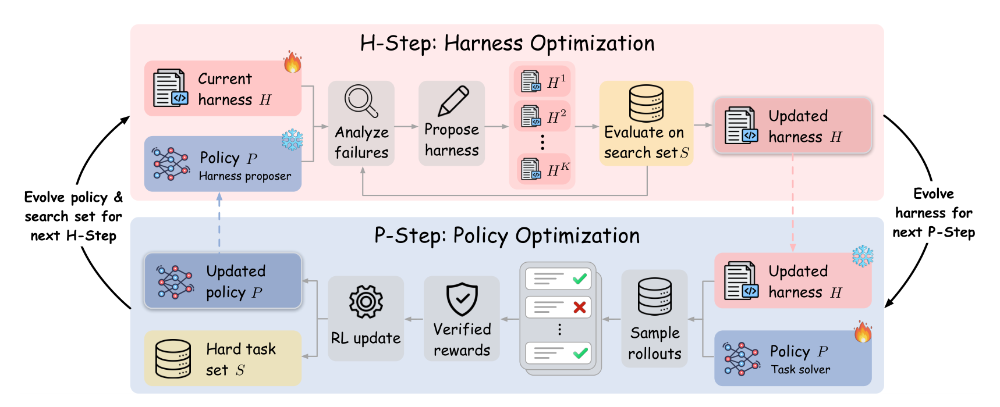
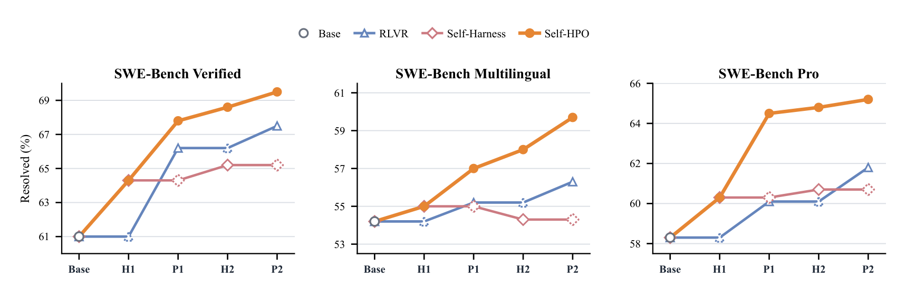

# Self-HPO：让 coding agent 自己提议 harness，并在新 harness 下做 RL

## 来源信息

| 项 | 内容 |
| --- | --- |
| 标题 | Self-Evolving Coding Agents via Harness-Policy Optimization（方法名 Self-HPO） |
| 作者 | Zhepei Wei¹,²\*、Wenlin Yao¹、Baolin Peng¹、Danqing Wang³、Qianhui Wu¹、Hao Cheng¹、Yu Meng²、Jianfeng Gao¹（8 人；¹Microsoft Research、²University of Virginia、³Carnegie Mellon University；\* 第一作者，实习期间完成） |
| 机构 | Microsoft Research（第一机构） |
| 来源 | [arXiv:2610.22791v1](https://arxiv.org/abs/2610.22791v1)（cs.CL；cs.AI），2026-10-16 提交，24 页，CC BY 4.0 |
| 代码 | <https://github.com/MSR-Orchard/Self-HPO>（MIT；本笔记只读核验，未运行） |
| 阅读日期 | 2026-11-20 |

---

## 核心结论

一句话：**Self-HPO 把「改 harness」和「改 policy」放进同一个循环——当前 policy 先看自己的失败轨迹、提议一版新 harness（H-step），再在这版 harness 下用 RL 更新自己（P-step），并把这一轮怎么都解不出的任务交给下一轮 harness 搜索；交替两轮后 SWE-Bench Verified 从 61.0% 升到 69.5%，三个 benchmark 平均从 57.8% 升到 64.8%。**

- **问题**：coding agent 的表现由 policy 与 harness 共同决定。只改 harness 不改模型，或只改模型不换 harness，都只能拿到部分收益；而 harness 的最优形态会随 policy 的 checkpoint 移动。
- **核心想法**：不做「外部强模型当 proposer」的固定流水线，让**当前 policy 同时当 task solver 和 harness proposer**；下一轮搜索集换成上一轮 RL 中「从未被解出」的 hard tasks。
- **怎么做到**：H-step 在搜索集上评估 $K=6$ 个候选并选最好的（候选必须保留父 harness 的每个方法、只加一个新机制）；P-step 用 GRPO + BAR 在新 harness 下更新 policy。
- **关键结果**：三个 coding benchmark 上同时优于 policy-only（RLVR）与 harness-only（Self-Harness）；把 proposer 换成 Opus 4.8 的 HPO 还能到 71.6%，说明 self-proposer 有代价。
- **定位**：一个「harness 与 policy 共同进化」的存在性证明，还不是带成本账、可直接部署的自动优化器。

---

## 问题

论文把 coding agent 拆成两部分（§1，p1）：

- **policy**：LLM 本体，决定能力上限；
- **harness**：模型之外的脚手架，决定「看到什么上下文、动作怎么执行、收到什么反馈、何时终止」。

同一个模型换一套 harness 可能成功也可能失败，所以只优化其中一半会留下结构性缺口。

**harness-only 的天花板**（Self-Harness、Meta-Harness 一类）：policy 冻结，靠执行证据改 prompt、workflow 或 agent code。它能让当前 checkpoint 表现更好，但**不会提高模型本身的能力**；改出来的 harness 针对的是旧 checkpoint 的失败模式，换一个 policy 就可能不再对症。Table 1 里有一个直接证据：Self-Harness 在 SWE-Bench Multilingual 上只比 Base 高 0.1 分（54.2→54.3），几乎没动。

**policy-only 的天花板**（RLVR 一类）：harness 冻结，靠 verifier 的二元奖励更新模型。它只能从**固定 harness elicited 的轨迹**里学习；harness 没暴露的行为，RL 也学不到。RLVR 在三个 benchmark 上把平均从 57.8 推到 61.9，但仍低于同时改 harness 的路线。

论文要解决的是这个「移动靶」问题：H-step 让 harness 去补当前 policy 的短板，P-step 又把补出来的行为内化进权重，于是下一轮该补的短板换了一批。**harness 的搜索目标必须跟着 policy 一起移动**——这是全文的核心动机，也是它与「固定搜索集」方法的分界线。

已有的同类工作在两个维度上分叉：**谁提议**（冻结的外部模型、冻结的 self-proposer、演化的 proposer）和**在哪些任务上搜**（固定集、按方差演化、按训练难度演化）。Table 5（p18）的归类是：Meta-Harness / Self-Harness / Evo² 的 policy 冻结；WHALE 只做 SFT；Task-CoEvolve 冻结 policy、按候选 harness 间的方差演化任务集；HASE 用 RL 且 self-propose，但把 harness 编辑放进 RL 的 action space；只有 Self-HPO 同时是「coding 任务 + RL + 演化的 self-proposer + 由 RL 中 hard tasks 演化的搜索集」。这张表本笔记照抄原文归类，未独立核验各家原文，全表见 `audit.md`。

**本文的前提**：任务要有可执行的 verifier（二元 resolve）、要有一份可复用的训练集（2,484 个任务，来自 SWE-rebench / SWE-rebench V2 / Scale-SWE）、且跑得起大量 rollout（每轮 50 次 RL update）。缺任何一条，这套循环都转不起来。

---

## 核心想法

### 一句话

harness 不是一次性调好的配置，而是**当前 policy 失败模式的函数**；policy 一变，该补的失败就变，所以 harness 的搜索目标和搜索集都要跟着变。

### 直觉

一次 RL 训练会暴露一批「这个 checkpoint 在什么任务、什么环节上卡住」的证据：哪些文件没碰到、patch 提交上去是空的、改对了文件但修法不对。这些证据对**改 harness** 和对**改权重**是同一份原料。

于是可以这样安排一轮：

1. 冻结 policy，让它读自己的失败轨迹，写一版新 harness；
2. 冻结新 harness，在这版 harness 下做 RL，把「新 harness 逼出来的行为」写进权重；
3. 训练中仍然解不出的任务，就是下一版 harness 应该瞄准的新靶子。

第 3 步是关键：如果搜索集固定，第二轮 harness 会继续修第一批任务上的老毛病，而 policy 早已不是那个 policy。

### 为什么成立

- **失败证据是可计算的**：论文的 proposer 不看抽象反思，而看四类可计算信号——coverage gap（reference fix 需要的文件 vs agent 实际碰过的文件）、precision gap（文件都改对了但修法错）、submission loss（轨迹里有真实改动，但最终提交的 patch 为空或格式坏）、reference-fix archetype 与 agent 产出的类型差异（多文件、签名变更、新 import、guard、错误处理等）。
- **proposer 与 solver 同源**：当前 policy 最清楚自己卡在哪，不需要一个外部模型去猜；这同时省掉一个模型。
- **收益可以叠加**：H-step 改的是「policy 能看到什么、能做什么」，P-step 改的是「policy 会做什么」。两者作用在不同层，实验上确实同时有效（Table 3）。
- **搜索集是训练集的子集**：hard tasks 来自本轮 RL 的轨迹，不需要额外标注，也不引入新数据。

### 与已有做法的区别

| 做法 | 改什么 | harness 搜索集 | 主要缺口 |
| --- | --- | --- | --- |
| harness-only（Self-Harness 等） | harness | 固定 | policy 能力不涨，harness 会对着旧 checkpoint 过时 |
| policy-only（RLVR） | policy | 无 | 学不到固定 harness 没暴露的行为 |
| HPO（外部 proposer） | harness + policy | 随 hard tasks 演化 | 依赖 Opus 4.8 这类外部强模型 |
| **Self-HPO** | harness + policy | 随 hard tasks 演化 | proposer 较弱，harness 质量有上限 |

另外两点结构差异（§4，p8–9）：Self-HPO 的 proposer 就是 P-step 训练出来的 policy 本身；搜索集由**上一轮 P-step 里从未解出的任务**决定，而不是候选 harness 间的结果方差。

### 一个走通的例子

论文给出的完整路径（Figure 3 / Table 3，SWE-Bench Verified）：Base 61.0 → 第一次 H-step（H1）64.3 → 第一次 P-step（P1）67.8 → 第二次 H-step（H2）68.6 → 第二次 P-step（P2）69.5。两次 harness 更新都带来即时增益，两次 policy 更新也都带来增益，没有一个环节是空转。

单个机制怎么起作用，可以看 Appendix E 的案例：任务 `sphinx-doc__sphinx-9658`，policy 固定为 P2。配 seed harness 时，模型改完源码、既有测试 99 passed，然后用一段 prose summary 当「提交」，seed harness 照单全收，grader 拿不到代码改动，任务失败；配 Self-HPO 的 H2 时，同样的提交被挂起，harness 返回 `Full Files Auditor`（你碰过 1 个文件、提交的 patch 有 0 个文件）与 `PR Intent Reminder`，模型于是自己 `git diff > patch.txt`、验证修复、重新提交有效 patch，任务成功。

### 代价

- **proposer 变弱**：同一循环把 proposer 换成 Opus 4.8（HPO），Verified 从 69.5 抬到 71.6、平均从 64.8 抬到 66.3。self-proposer 省掉一个外部模型，但 harness 质量有上限。
- **H-step 很贵**：每个候选都要在搜索集上真跑 sandbox 任务，成本与「候选数 × 搜索集大小 × 每任务 rollout」成正比，不是几次 LLM 调用；论文没有报 token、wall-clock 或 GPU 小时。
- **启发式会误报**：上面那个 `PR Intent Reminder` 在原文里就是误报——它抓到的关键词来自 issue 文本里不相关的部分。案例展示的是「挂起一次 + 让模型自己纠正」的容错，不是检查本身准确。

---

## 方法

### 符号表

| 符号 | 含义 | 取值 / 维度 |
| --- | --- | --- |
| $x$ | 一个训练任务（issue + 仓库 sandbox） | — |
| $\mathcal{D}$ | 训练任务集 | 2,484 个任务 |
| $P$ | policy（LLM 本体） | Qwen3.5-35B-A3B（35B 总参、3B 激活） |
| $P_t$ | 第 $t$ 轮的 policy | $t=0$ 为 base policy |
| $H$ | harness（模型之外的 agent 脚手架） | 一个 override `step()` 的 Python 类 |
| $H_t$ | 第 $t$ 轮的 harness | $t=0$ 为 seed harness（mini-SWE-agent 的 ReAct loop） |
| $\tau$ | 一条 rollout 轨迹 | — |
| $\pi_{H,P}(\cdot\mid x)$ | 在任务 $x$ 上由 $(H,P)$ 诱导的轨迹分布 | — |
| $y(x,\tau)$ | 可执行 verifier 给出的任务结果 | $\{0,1\}$ |
| $J(H,P)$ | harness–policy 组合的期望 resolve rate | 原文 Eq (1) |
| $\mathcal{L}_{P}(\theta)$ | P-step 的策略梯度损失 | 原文 Eq (2) |
| $K$ | 每轮 H-step 的 harness 候选数 | 6 |
| $S_t$ | 第 $t$ 轮 H-step 的搜索集 | $S_0$ 为 300 个均匀抽样的任务；$S_{t+1}$ 由上一轮 hard tasks 组成 |
| $v_0$ | 当前 $(H_t,P_t)$ 在 $S_t$ 上的分数 | — |
| $T_0$ | 当前 $(H_t,P_t)$ 在 $S_t$ 上的轨迹 | — |
| $E$ | H-step 内的经验池 | 轨迹、候选输出与评估结果 |
| $H_t^k$ | 第 $k$ 个候选 harness | $k=1..K$ |
| $H_{\mathrm{best}}$ | 搜索过程中当前分数最高的 harness | 初始为 $H_t$ |
| $T_{\mathrm{RL}}$ | P-step 留在 $\mathcal{D}$ 上的训练轨迹 | 用来挑 hard tasks |
| $\theta$ | policy 的参数 | — |
| $i$ | 一个 batch 内的 rollout 下标 | 每 batch 128 条 |
| $u$ | 轨迹中的一个 token 位置 | — |
| $\mathcal{A}(\tau_i)$ | 第 $i$ 条轨迹中 assistant 生成的 token 位置集合 | 原文 Eq (2) |
| $\rho_{i,u}(\theta)$ | 新旧 policy 在位置 $u$ 的 token 概率比 | — |
| $\hat{A}_i$ | 第 $i$ 条轨迹的组内相对优势 | — |
| $\varepsilon_{\mathrm{low}},\varepsilon_{\mathrm{high}}$ | 裁剪下界与上界 | 0.2 / 0.28 |

### 一轮循环的数据流

```text
输入：seed harness H_0、base policy P_0、训练集 D、候选预算 K=6
S_0 ← 从 D 均匀抽 300 个任务
for t = 0, 1, ...:
    H-step：冻结 P_t
        在 S_t 上评估 (H_t, P_t) → v_0, T_0, 经验池 E
        重复 K 次：propose 候选 H_t^k → 在同一个 S_t 上评估 → 并入 E
        H_{t+1} ← S_t 上分数最高的候选
    P-step：冻结 H_{t+1}
        在 D 上跑 GRPO + BAR，P_t → P_{t+1}，留下 T_RL
    S_{t+1} ← SelectHardTasks(T_RL)   # 本轮任何 rollout 都没解出的任务
    直到 hard-task 集合在轮间稳定
```

数据形状是三层嵌套：外层轮次（论文只跑两轮）→ H-step 内的候选评估（6 个）→ P-step 内的 rollout（每 batch 128 条）。**搜索集在一轮 H-step 内固定，只在轮间演化**；policy、采样配置（temperature / top-p 0.95）、step limit、max tokens、verifier 在 H-step 中全部冻结。



*Figure 2（p3）：上半部是 H-step——当前 policy 作为 harness proposer，先分析失败、再提议 K 个候选、在搜索集上评估、选出更新后的 harness；下半部是 P-step——用更新后的 harness 跑 rollout、按 verifier 奖励做 RL，并把 hard task set 交给下一轮。*

### 目标：原文 Eq (1)

```math
J(H,P)=\mathbb{E}_{x\sim\mathcal{D}}\,\mathbb{E}_{\tau\sim\pi_{H,P}(\cdot\mid x)}\left[y(x,\tau)\right]
```

**逐项读法**：外层期望遍历训练任务分布，内层期望遍历「这套 harness 加这个 policy 在任务上采样出的轨迹」。$y$ 是 verifier 的二元结果，所以 $J$ 就是平均 resolve rate。这个式子的作用是把「agent 好坏」定义成 $(H,P)$ 的联合函数：$H$ 变、$P$ 变，期望都变——它没有回答怎么优化，只说明了为什么不能单独优化一半。

### Algorithm 1：H-step 与 P-step 的交替

原文 Algorithm 1（p4）的核心是下面三段；本笔记按原文顺序转写，**并把 H-step 里 proposer 的输入写成「搜索中当前最好的 harness」**：

```text
1. H-step：冻结 P_t，在 S_t 上评估当前 (H_t, P_t) 得到 v_0 与轨迹 T_0；
   把 T_0 放进经验池 E。
2. 对 k = 1..K：
      H_t^k ← ProposeHarness(H_best, P_t, E)   # H_best 初始为 H_t
      在同一个 S_t 上评估 (H_t^k, P_t)，结果并入 E
      若分数高于当前最好，则更新 H_best
3. H_{t+1} ← H_best
4. P-step：冻结 H_{t+1}，在 D 上做 RL，得到 P_{t+1} 与训练轨迹 T_RL
5. S_{t+1} ← SelectHardTasks(T_RL)
6. 若 hard-task 集合在轮间稳定则停，否则回到 1
```

**逐项读法**：

- **第 1 步**先量一遍现状（$v_0$、$T_0$），既是候选的对照基线，也是 proposer 的第一批失败证据；论文的评估还给出经验池 $E$，后面的候选共享它。
- **第 2 步**是「提议–评估」循环：每次只改一版，但都在**当前最好**的 harness 上改，所以 $K$ 次迭代可以累积多个机制。原文 Algorithm 1 把 proposer 写作 $\operatorname{ProposeHarness}(H_{t+1},P_t,E)$，其中 $H_{t+1}$ 指搜索过程中当前最好的 harness，不是本轮结束才有的那个（见 `audit.md` 的表述张力）。
- **第 3 步**是贪心选择：只比同一个 $S_t$ 上的分数，没有 held-out 门控，也没有重复评估。
- **第 4 步**换的是权重而不是 harness；$T_{\mathrm{RL}}$ 是这一步的副产品，第 5 步靠它定义下一轮的靶子。
- **第 6 步**的停止准则原文没有操作化：正文只写「hard-task set stabilizes between rounds」和「perform two rounds」，没给阈值、度量或第二轮之后 hard set 的大小。

### H-step：失败条件化的 harness 搜索

这一节的细节决定了它和「让强模型随便改 prompt」的区别（§2.2，p3；Appendix D，p18–21）。

**proposer 就是 solver**。H-step 里的 $P_t$ 既在搜索集上解题，也负责读失败轨迹、写新 harness；没有额外的 proposer 模型。它是一个有 shell 权限的 coding agent，能读父 harness、搜索集上的轨迹、**搜索集任务的 reference fix**、此前候选的输出，以及本次搜索中更早 proposal 留下的笔记（Figure 7，p19）。

**候选必须可运行、可触发**。约束有四条：

1. 逐字保留父 harness 的每个方法，只加**一个**新机制；
2. policy、采样配置、step limit、max tokens、verifier 全部冻结；
3. **绝不能把 reference patch 或任务事实注入 agent 的上下文**——机制必须在运行时自己算信号；
4. 搜索会检查候选是否保留父方法、是否能在真实 sandbox 任务上触发；失败会退回给 proposer 修。

第 3 条是这套方法可信的前提：proposer 在 H-step 里看得到 reference fix，但写出的机制不能把它泄漏给 solver，否则 H-step 的评估就只是「答案注入」。

**harness 具体长什么样**。不是抽象配置，而是一个 Python 类：继承 seed agent，override `step()`（Appendix D 只写了 step；仓库的 `self-hpo` 实现还 override 了 `execute_actions()`），可以在模型动作前后读写对话、检查 sandbox 状态、拦截提交、替换 patch。HPO 第二个 H-step 选出的 `AgentHarness` 只 override `step()`，加四条 check：budget valve（接近 step/time limit **且还没提交过**时提示收尾）、empty-patch guard（空 patch 挂起一次）、contract grounding（要求用仓库里已有的测试和调用点核对符号与签名）、patch fallback（`git apply --check` 失败时用真实 diff 替换提交）。**注意：这是 HPO 的 harness；Appendix E 里 Self-HPO 的 H2 是另一套**（`Full Files Auditor` / `PR Intent Reminder`），两者不能混读。

### P-step：原文 Eq (2)

P-step 从 $P_t$ 出发，在 $\mathcal{D}$ 上采 on-policy 轨迹，用 verifier 给二元奖励，优化器是 **GRPO + Balanced Adaptive Rollout（BAR）**（§2.3，p4；Appendix A，p16）。BAR 来自 Orchard（Peng et al., 2026）：一组 rollout 全成功或全失败时组内没有对比、GRPO 拿不到梯度，BAR 会**额外采样**，凑出一个成功比例在 0.25–0.75 之间的「奖励平衡组」。

```math
\mathcal{L}_{P}(\theta)=-\mathbb{E}_{i}\left[\frac{1}{|\mathcal{A}(\tau_i)|}\sum_{u\in\mathcal{A}(\tau_i)}\min\left(\rho_{i,u}(\theta)\hat{A}_i,\ \operatorname{clip}\left(\rho_{i,u}(\theta),1-\varepsilon_{\mathrm{low}},1+\varepsilon_{\mathrm{high}}\right)\hat{A}_i\right)\right]
```

**逐项读法**：

- 外层 $-\mathbb{E}_i$ 对 batch 内的 rollout 取平均，负号表示最小化损失（等价于最大化被裁剪的目标）。
- 内层只对 $\mathcal{A}(\tau_i)$ 求和，即**只在 assistant 生成的 token 位置上算策略梯度**；prompt 与工具返回的 token 不计入，并按 $|\mathcal{A}(\tau_i)|$ 归一化，避免长轨迹主导。
- $\rho_{i,u}(\theta)$ 是新旧 policy 在同一 token 上的概率比；$\hat{A}_i$ 是组内相对优势，同一轨迹内所有 token 共享。
- $\min$ 的两项是 PPO 式裁剪：比率超出 $[1-\varepsilon_{\mathrm{low}},1+\varepsilon_{\mathrm{high}}]=[0.8,1.28]$ 后，梯度不再跟随原始比率，避免一次更新把策略拉得太远。
- 式子里没有 KL 项——Appendix A 明确写「无 KL penalty」，靠裁剪与 BAR 的平衡组控制更新幅度。

**训练配置**（Appendix A，p16）：每任务先采 8 条 rollout，选 4 条组成一个平衡组；继续采样直到有 32 个组通过过滤，得到每 batch 128 条训练轨迹；每 batch 训练 1 个 epoch（global batch 128，对应一次 optimizer update）；Adam，恒定学习率 `1e-6`，weight decay `0.01`，entropy coefficient `1e-4`；rollout temperature 0.95、top-p 0.95。**GRPO 与 BAR 都是既有组件**，这篇的贡献是「H-step 与 P-step 怎么交替、搜索集怎么随 policy 演化」，不是新的 RL 算法。

### 两种实例化：Self-HPO 与 HPO

- **Self-HPO**：H-step 的 proposer 就是当前 policy $P_t$，不需要外部模型。
- **HPO**：同一个循环，但 proposer 固定为 **Opus 4.8**，policy 仍然做 RL；论文把它当作「外部监督」的参照点（§2.1，p3；Table 1 Setting 1）。

关系容易误读：**HPO 是框架名，Self-HPO 是它的自提议实例**。Table 1 里 HPO（外部）排在 Self-HPO 前面，数字也更高（71.6 vs 69.5）。标题与摘要主推 Self-HPO，但「外部 proposer 更强」这件事本身也被实验确认了。

### 与已有方法的结构差异

| 维度 | harness-only | policy-only | Self-HPO |
| --- | --- | --- | --- |
| 更新的对象 | harness 代码 | policy 权重 | 两者交替 |
| 失败证据的用途 | 改 harness | 算奖励 | 先改 harness，再算奖励 |
| 搜索集 | 固定 | 无 | 随 RL 的 hard tasks 演化 |
| 主要缺口 | policy 能力不涨 | harness 未暴露的行为学不到 | 单模型、两轮、无成本账 |

**逐项读法**：第三行是本文相对前两列唯一新增的机制——不是「也改 harness」或「也做 RL」，而是把两者的失败证据串成一条闭环。**代价**是每一轮都要重跑 H-step 的候选评估，且 harness 与 policy 的改进互相依赖，无法单独归因（Table 3 的四格因此只能做描述性分解）。

---

## 主要结果

**设置**（§3.1，p4–5）：policy 为 Qwen3.5-35B-A3B；seed harness 为 mini-SWE-agent 的 ReAct loop；训练集 2,484 个任务；两轮，每轮 6 个候选（$K=6$）、每个 P-step 50 次 RL update。评测在 SWE-Bench Verified（500 题）、SWE-Bench Multilingual（300 题，9 种非 Python 语言）、SWE-Bench Pro 的 public V2 集（642 题）上，指标为 resolve rate，主结果 `avg@3` 并报三次运行的标准差；评测 step limit 250、temperature / top-p 0.95。

**结论一：同时压过两个单侧 baseline，但幅度不大。** Self-HPO 的平均 64.8 高于 RLVR 的 61.9 与 Self-Harness 的 60.1；Verified 69.5 vs 67.5 / 65.2。相对最强单侧 baseline（RLVR）的三个 benchmark 增益是 +2.0 / +3.4 / +3.4（本笔记复算），方向一致，但 Verified 的 +2.0 相对两边 0.8/0.9 的标准差只是站得住，不是碾压；原文未做显著性检验。

| Method | Harness Opt | Policy Opt | SWE-Verified | SWE-Multi | SWE-Pro | Avg. |
| --- | :-: | :-: | ---: | ---: | ---: | ---: |
| Base | ✘ | ✘ | 61.0 ± 0.2 | 54.2 ± 0.3 | 58.3 ± 1.2 | 57.8 ± 0.4 |
| **Setting 1：External-model setup（Opus 4.8）** | | | | | | |
| SFT | ✘ | ✓ | 65.0 ± 1.1 | 49.6 ± 0.8 | 49.1 ± 0.6 | 54.6 ± 0.5 |
| Meta-Harness (Lee et al., 2026) | ✓ | ✘ | 69.1 ± 1.9 | 56.5 ± 0.9 | 64.8 ± 1.4 | 63.5 ± 0.8 |
| HPO (ours) | ✓ | ✓ | **71.6 ± 0.9** | **61.4 ± 0.7** | **66.0 ± 0.5** | **66.3 ± 0.4** |
| **Setting 2：Self-improving setup** | | | | | | |
| RLVR (Peng et al., 2026) | ✘ | ✓ | 67.5 ± 0.8 | 56.3 ± 1.0 | 61.8 ± 1.3 | 61.9 ± 0.6 |
| Self-Harness (Zhang et al., 2026a) | ✓ | ✘ | 65.2 ± 1.5 | 54.3 ± 0.7 | 60.7 ± 0.9 | 60.1 ± 0.6 |
| Self-HPO (ours) | ✓ | ✓ | **69.5 ± 0.9** | **59.7 ± 0.8** | **65.2 ± 1.4** | **64.8 ± 0.6** |

*Table 1（p5）逐格转写；加粗按原文表注「best result within each setup」。`Avg.` 为三列算术平均（本笔记复算一致）。*

**结论二：两个组件各自有效，但「联合超过各自之和」只是点估计。** Table 3 的四个角：H0+P0 61.0、H2+P0 64.5、H0+P2 64.4、H2+P2 69.5。单独改 harness +3.5、单独改 policy +3.4，联合 +8.5，比两者之和多 1.6。但 H2 是 H-step 用 P1 在第一次 P-step 暴露的 hard tasks 上选出来的，P2 又是在 H2 下从 P1 继续训练的，两个因子不是独立操纵；按四格标准差粗算，这个交互项的 SE 约 2，1.6 与噪声同量级。读作「正向互补的点估计」比「严格超可加」更稳。



*Figure 3（p6）：Self-HPO 在 Base–H1–P1–H2–P2 每个点都上升；Self-Harness 只有 H1、H2 两个实心点，RLVR 只有 P1、P2 两个实心点，虚线轮廓表示该步不更新。*

**结论三：消融的排序是 RL > RFT > SFT，且演化搜索集与 self-proposer 各有代价。** 以 HPO 的 71.6 为参照：P-step 换成 SFT 掉 4.4（67.2），换成 RFT 掉 1.1（70.5）；H-step 换回固定初始搜索集掉 1.5（70.1）；换成 self-proposer 掉 2.1（69.5）。注意这组消融都在**外部 proposer 设定**下做，「w/ Self-proposer」一行同时换了 proposer、harness 轨迹和后续 policy，是两次完整运行的对比，不是单变量因果效应。

**结论四：增益不只是「把会的做得更稳」。** pass@1 到 pass@8 每个点都高于 Base，pass@8 从 80.0% 到 84.8%（+4.8，95% bootstrap CI）；按 Base 成功率分组，Hard（成功率为 0）+6.1、Medium（大于 0、不超过 0.5）+17.2、Easy（大于 0.5、小于 1）+12.9，说明一部分原本完全解不出的任务被推过了线。代价是 **Resolved（成功率为 1）−2.2**：Base 每次都解出的任务反而略降，原文报告了这一点但没有解释。

**结论五：self-proposer 的差距是真实的，且摆位并不靠前。** HPO 用 Opus 4.8 在三个 benchmark 上都高于 Self-HPO（71.6 / 61.4 / 66.0 vs 69.5 / 59.7 / 65.2）。放到 SWE-Bench Verified leaderboard 旁边（Table 4，p17），69.5 略低于 DeepSeek-V3.2 的 70.0 与 Gemini 3 Pro 的 69.6，高于 Claude Haiku 4.5 的 66.6；这张表只能当摆位看，各家的尝试次数、评测日期与 scaffold 未在表内统一。

---

## 边界与局限

**作者明确讨论的**：Appendix E 承认案例里的 `PR Intent Reminder` 是误报；§3.4 报告了 Resolved 组的 −2.2。论文**没有 Limitations 章节**（全文检索 `limitation` 0 次），也没有成本、时延、token 用量的数字。

**读者根据证据提出的**：

- **单模型、单 seed harness、两轮**：结论都来自 Qwen3.5-35B-A3B + mini-SWE-agent，没有第二个模型、第二个 harness 家族，也没有第三轮之后的曲线；「自进化」的叙事在实验上只走到 P2。
- **harness 选择没有留出**：每个候选在搜索集上只跑一次、二值结果就选最好，没有重复评估、置信区间或 held-out 门控；300 题时 1 题 = 0.33 个百分点，选中的 harness 可能只是运气好。
- **hard set 混入不可解任务**：$S_{t+1}$ 的定义是「从未解出」，既包括 harness 可修的失败，也包括模型或任务本身无解的失败；论文没有区分，也没有报 hard set 的规模与可修比例。
- **没有成本账**：无法判断「相对 RLVR 的 +2.9 平均」值多少算力；H-step 的 $|S_1|$、proposer 调用次数、Opus 费用都缺。
- **数据污染未说明**：训练集来自 SWE-rebench / SWE-rebench V2 / Scale-SWE，评测是 SWE-Bench Verified / Multi / Pro；论文没有说明是否做了去重或污染检查，OOD 增益应保留这一不确定性。

---

## 与其他工作的关系

- **[Self-Harness（00198）](../2606.09498-v3-self-harness/note.md)**：最直接的 baseline，也是 self-proposer 概念的前身。差别在三点：Self-Harness 不改 policy、候选要过 held-in/held-out acceptance gate、搜索集固定；Self-HPO 改 policy、只在搜索集上选最好、搜索集随 hard tasks 演化。
- **[AHE（00231）](../2604.25850-v4-ahe/note.md)**：同样从执行证据改 harness，但 AHE 强调每次编辑可归因且不改权重；本文把 harness 搜索与 RL 交替，让搜索目标随 policy 移动。
- **[RRSI（00212）](../2609.24972-v3-rrsi/note.md)**：RRSI 用正则约束固定 evolve set 的过拟合；本文用「换任务」而非「约束搜索」应对同一问题，没有显式门控。
- **[HarnessPro（00218）](../2610.26770-v2-harnesspro/note.md)**：把 harness 自改进做成 pass rate + 每任务成本的双目标 Pareto 搜索；本文完全没有成本维度，两篇互补。

<!-- 复核档案见同目录 audit.md（不随站点发布） -->
