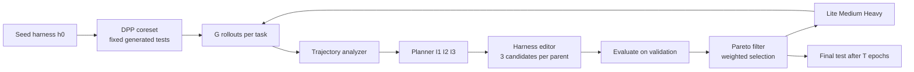
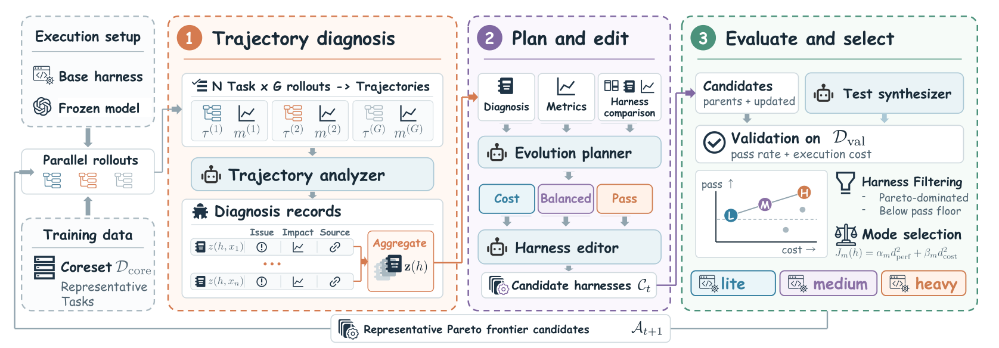
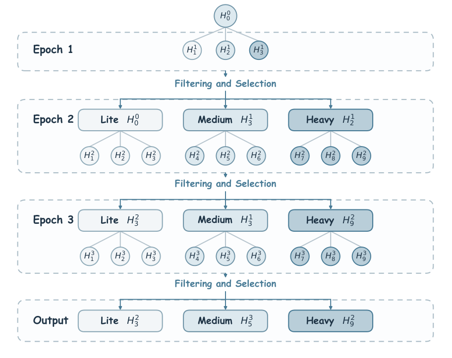
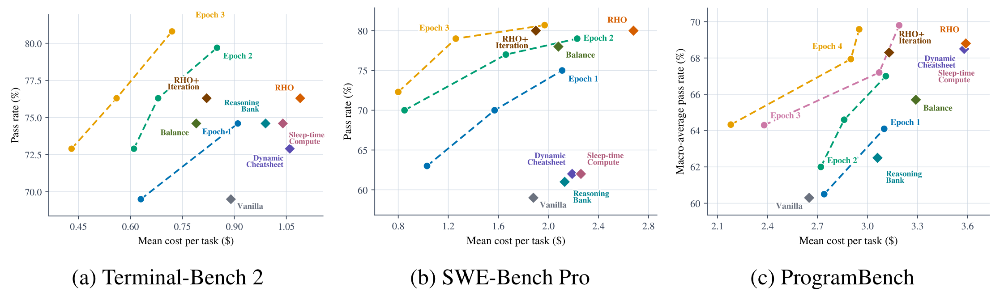

# HarnessPro: Recursive Harness Self-Improvement with Pareto Optimization for Performance-Cost Trade-offs

## 来源信息

| 项 | 内容 |
| --- | --- |
| 标题 | HarnessPro: Recursive Harness Self-Improvement with Pareto Optimization for Performance-Cost Trade-offs |
| 作者 | Zhuoshi Pan¹\*, ZhiYuan Feng¹\*, Yukuo Cen², Honglin Lin³, Junru Lu⁴, Zhongxia Chen⁵, Shuo Yang⁵, H. Vicky Zhao¹†, Jie Tang¹†（¹ Tsinghua University；² Z.AI；³ Shanghai Jiao Tong University；⁴ University of Warwick；⁵ Kling AI；\* 共同一作；† 通讯作者） |
| 机构 | Tsinghua University（第一机构） |
| 来源 | [arXiv:2610.26770v2](https://arxiv.org/abs/2610.26770v2)（cs.LG; cs.CL）；v1 2026-10-19 → v2 2026-10-20；本笔记基于 v2，为截至阅读时的最新版。v1→v2 的全文文本比对显示：第 2 单位由 Z.AI Co., Ltd. 简写为 Z.AI，第 5 单位由 Kuaishou–Kuaishou Technology 改为 Kling AI，并补充共同一作/通讯作者标记；正文结构与 Table 2 关键数字不变；两版均为 41 页。另：2026-10-25 使用的 v2 副本（sha `ce88e54a…`；生成方式/与当前 v2 的差异原因未确认）p4 Figure 1 不完整；2026-10-26 从 arXiv 重取的当前 v2 副本（sha `c633082a…`）完整；两版除 p4 外逐页文本一致，Table 2 数字一致（见「核对凭据」） |
| 代码 | <https://github.com/pzs19/HarnessPro>（MIT；API 核验：创建 2026-09-24、最近 push 2026-10-19、阅读时 ★84；顶层含 `harnesses/{terminal-bench-2,swe-bench-pro,programbench}/{lite,medium,heavy}`、`scripts/`、`splits/`、`src/`、`tests/`、`third_party/`。仅核到结构与 README 自述层面，未验证其与论文实验的可复现性对应。仓库 README 的 "Paper (coming soon)" 徽章与 arXiv 已有 v2 不符——以 arXiv 为准） |
| 许可 | [CC BY 4.0](http://creativecommons.org/licenses/by/4.0/)（arXiv abs 页 "view license" 实际指向该协议，不是默认的 nonexclusive-distrib） |
| 阅读日期 | 2026-10-25 |
| 仓库编号 | 00218（本次按用户要求新增；编号单元格指向 arXiv 官方页） |
| 阅读范围 | v2 全文 41 页：正文 §1–6（p1–10）、References（p10–12）、附录 A–C（p13–23）逐页读取（含关键 listing）；附录 D（p23–41，演化后 harness 产物清单）读了 D 的结构、D.1 的 medium/lite/heavy policy 与 rubric 关键段、D.2/D.3 的产物结构与示例，未逐行核对全部 listing。**已渲染页核对**：Table 1（p3）、Table 2（p8）、Table 3（p9）、Table 4（p14）逐格；公式 (1)（p3）、(2)–(9)（p5–6）、(10)–(12)（p13）逐符号；Algorithm 1（p5）逐行；Figure 1（p4，当前 v2 副本）、Figure 2/3（p6）、Figure 4（p9）看图核对。**未做像素测量**：Figure 4 的读数只引用 §5.4 正文给出的数值，未从坐标轴取数。**Figure 1 已作为配图转载**（当前 v2 副本完整；2026-10-25 旧副本的缺陷见「核对凭据」） |
| 配图 | `assets/figure1-overview.png`（当前 v2 p4 渲染页裁剪，300 dpi）、`assets/figure3-recursion.png`（v2 p6 渲染页裁剪，400 dpi）、`assets/figure4-evolution.png`（v2 p9 渲染页裁剪，400 dpi）；裁剪框与边缘/像素差检查见「核对凭据」。许可见上，引用请注明出处 |
| 归档说明 | arXiv 来源，按仓库策略不归档 PDF；清单编号 00218（编号单元格暂指 arXiv 官方页，归档到上游后改指 PDF） |
| 复核记录 | 2026-10-26 按 check-paper-note 复核：基准为当前 arXiv v2（41 页，sha `c633082a…`；2026-10-25 首次阅读副本 `ce88e54a…` 的 p4 Figure 1 不完整，当前副本完整）。逐项核对 Table 1–4、公式 (1)/(7)/(8)/(9)、§5.2–5.5 数字、Figure 1–4、README 00218 行、代码/许可；另由独立子 agent 做三轮只读审计。修正：Figure 1 版本判断与配图（补 `figure1-overview.png`）、v2 sha、假阳性/precision 表述、v1/v2 单位名与作者标记（Z.AI Co., Ltd.→Z.AI；Kuaishou–Kuaishou Technology→Kling AI；补充共同一作/通讯作者标记）、3 处引用定位、2 个文件名与少量口径措辞；另补充 ProgramBench 固定 high-effort profile、C.1 input token 数、演化成本枚举中的验证集评估；第三轮修正 planner/editor 归属、heavy vs Vanilla 概括、`H_i^t` 记号、lite 延迟与 Balance 限定、harness 产物表归属，并补 medium vs RHO+Iteration 与 GLM 对比、引文补 task、Eq (8) 零分母边界说明。未发现实验数字/公式/结论错误。未修项：§5.1「3 次运行」的语义原文未说明，保留为待确认问题 |

**核对凭据（当前 v2 基准可复现）**

- v2 PDF（2026-10-25 使用的副本）：41 页，sha256 `ce88e54a2c4c8353094db6481fc28f22f1db6adbdea00560dfe8ff11eb8a46a9`（当时从 `https://arxiv.org/pdf/2610.26770v2` 获取；生成方式/为何与当前 v2 不同未确认；2026-10-26 同一 URL 已返回 `c633...`，旧副本无法再从该 URL 重取；本次临时文件已清理）；其 p4 Figure 1 在 PDF 内容流中不完整（panel 2/3 主体为空）。
- v2 PDF（2026-10-26 复核基准）：41 页，sha256 `c633082abff0c6cd4fa3d63f21e689c34f92369068ee0ed13c74be0f2f54b093`（2026-10-26 从同一 URL 重取得到的当前版本；本次临时文件已清理）；p4 Figure 1 完整。两版除 p4 外逐页文本一致，Table 2 关键数字一致。
- v1 PDF：41 页，sha256 `da167e436b2f2c2b5898789d27c22820b92ccb922a8d420e51c341227d9c8676`（重取：`curl -sL https://arxiv.org/pdf/2610.26770v1 -o v1.pdf`；本次临时文件已清理；重取一致）。v1↔当前 v2 逐页文本 diff：仅 p1–p6 有排版位移与上述单位/作者标记变化，实验数字一致；p4 的 Figure 1 两版都完整。
- 渲染核对：`pymupdf` 以 220 dpi 渲染 p3/p6/p8/p9/p14，逐格读 Table 2/3 与公式；Table 4 在 p14。公式 (10)–(12) 在 p13，DPP 参数 `ε=0.1`、`θ=0.7`、`k=10`。
- Figure 3 裁剪框：p6，clip `(343, 486, 507, 616)` pt，400 dpi，成品 912×723；Figure 4 裁剪框：p9，clip `(105, 80, 507, 199)` pt，400 dpi，成品 2234×662。两张均回看确认：无黑边、无越界、无截断；元素清单——Figure 3 的 `H_0^0`、Epoch 1/2/3、Filtering and Selection、Lite/Medium/Heavy、Output 全部在框内；Figure 4 的三面板、坐标轴标签、图例、`Epoch 1/2/3/4` 与 `(a)–(c)` 面板标题全部在框内。另用第二次独立打开 PDF 的同区域渲染做像素差比对：两张的 diff bbox 均为空，边缘 2 px 内的近黑像素数均为 0。
- Figure 1 版本核验：2026-10-25 旧副本 p4 的 Form XObject（xref 2386）内容流为 `q /fzFrm0 Do Q` 后接浅紫矩形与 5 个 `fzFrm*` 贴片；其 `fullpage` 流（xref 2506，54,404 B）只含 panel 1 元素与三个 panel 标题（x≈619、x≈897），panel 2/3 主体为空。2026-10-26 当前 v2 副本 p4 的 Figure 1 完整（文本层含 `Trajectory analyzer`、`Diagnosis records`、`Evolution planner`、`Harness editor`、`Test synthesizer`、`Harness Filtering`、`Mode selection` 等；`fullpage` 流 241,912 B），本笔记配图取自当前副本。Figure 1 裁剪框：p4，clip `(105, 80, 507, 220)` pt，300 dpi，成品 1676×584；回看确认三 panel、标题、图例、底部 `Representative Pareto frontier candidates` 全在框内；边缘 2 px 近黑像素 0；第二次独立渲染的像素差 bbox 为空。
- 否定性检索：v2 全文检索 `RRSI`、`Regularized Recursive`、`HarnessDev`、`Prime Agent`、`Dream` 均为 0 次；`HarnessX` 在 §2 与 References 中出现；RHO 是主 baseline。仓库 README 与 arXiv 的编号/标题/年份/单位已交叉核对。
- 代码仓库 API 值：`created_at 2026-09-24T08:50:03Z`、`pushed_at 2026-10-19T16:20:23Z`、`stargazers_count 84`、`license MIT`、`default_branch main`；README 自述的 quickstart 依赖 Linux、Python 3.12/3.13、`uv`、Docker Compose、Codex CLI 0.147.0。

---

## 核心结论

一句话：**HarnessPro 把 harness 的递归自改进从「只追 pass rate」改成「pass rate + 每任务执行成本」的双目标搜索**——它用固定的 LLM 生成测试替代 LLM 直接打分（label-free），让同一 planner 按省成本 / 平衡 / 保性能三种偏好各出一份计划，再由 harness editor 实现成候选，用 Pareto 过滤加归一化加权平方距离选出 lite / medium / heavy 三个部署档位，再让选中的 harness 进入下一轮。GPT-5.5 × Codex 下，heavy 档相对 RHO 在三个 benchmark 上平均 +2.0 个百分点 pass rate、平均相对成本 −26.1%；GLM-5.2 × Claude Code 下 heavy 也在三个 benchmark 上均超过 RHO 且成本更低。

三条主张（作者在 §1 提出，证据见 §5）：

1. **问题**：已有 harness RSI（RHO、AHE 等）主要优化 pass rate，性能提升常伴随更多探索/验证，推高 token 成本与延迟；实际部署同时关心成本与延迟（§1）。
2. **方法**：label-free 地用 LLM 生成测试来评估候选；多 agent 拆成 trajectory analyzer、evolution planner、harness editor、test synthesizer；候选按 performance floor 与 Pareto 支配过滤，再用归一化加权平方距离选代表点；递归多轮，最终只在 held-out test 上评测（§4）。
3. **结果**：在 Terminal-Bench 2、SWE-Bench Pro、ProgramBench 上，heavy 档在两种 backbone 下都取得比 RHO 更高的 pass rate 与更低的每任务成本；medium/lite 相对 heavy 更便宜、pass rate 略低（相对 RHO 则 medium 在部分项持平，如 GPT-5.5 的 Terminal-Bench 2 与 GLM-5.2 的 SWE-Bench Pro）；消融显示 test synthesizer 与 planner 都有贡献（§5）。

**数字口径**：摘要的「+2.0 pp、−26.1%」不是把三个 benchmark 的样本汇总后算的池化值，而是三个 benchmark 逐项变化的算术平均：pass rate 差为 4.5、0.7、0.8 pp，均值 2.0 pp；相对成本降幅为 33.9%、26.5%、17.8%，均值 26.1%（本笔记复算，见「实验与证据」）。逐项差异很大，读摘要时不要把 2.0/26.1 当成每个 benchmark 都成立。

**适合谁看**：在做 agent harness / RSI、需要把「性能」与「执行成本」一起优化的团队；想从一次演化得到多个部署档位（便宜档、平衡档、性能档）的人；以及关心 label-free 评估（没有 ground truth / 官方测试）如何落地的人。若只关心单轮 prompt/skill 优化，这篇的增量主要在「选择与递归」而不是 proposer 本身。

---

## 问题与动机

### Harness 与递归自改进

论文把 harness 定义为管理基础模型与环境交互的软件运行时层，包含 prompts、tools/skills、context/memory 机制、hooks、verification policies（§3）。给定任务 `x`，harness `h` 执行后得到轨迹 `τ_h(x)`，记录工具调用、环境反馈与最终产物。递归自改进（RSI）用过去任务的轨迹诊断问题，再改 harness，让未来任务做得更好（§1、§3）。

已有工作沿着这条线推进：AFlow 搜索模型调用算子的图；SkillMOO 优化 skills 并同时考虑成本；RHO 用 LLM 自偏好做 label-free 的 harness 演化；AHE 做可追踪的 harness 编辑（§2）。Table 1（p3）把它们的定位总结为：

| 方法 | 目标 | 范围 | 反馈 | 迭代 | 输出 |
| --- | --- | --- | --- | --- | --- |
| AFlow (Zhang et al., 2025) | Pass | Workflow | Ground truth | Recursive | Single |
| SkillMOO (Gong et al., 2026a) | Pass + Cost | Skills | Ground truth | Recursive | Pareto set |
| RHO (Pan et al., 2026a) | Pass | Skills + tools | Label-free | Single round | Single |
| AHE (Lin et al., 2026) | Pass | Harness | Ground truth | Recursive | Single |
| HarnessPro | Pass + Cost | Harness | Label-free | Recursive | Pareto set |

> 上表照抄 Table 1（p3）的列序与取值；它比较的是方法定位，不是实验结果。

### 两个具体瓶颈

作者把问题拆成两点（§3 末）：

1. **搜索空间大且离散**：harness 由 instructions、tools、skills、hooks、rules 等组件构成，组合空间巨大，不能用梯度优化。
2. **性能与成本的权衡**：更多推理、探索、验证可能提升 pass rate，但会消耗更多 token；反过来，盲目削减这些活动可能伤害性能。要推进 Pareto 前沿，必须从轨迹里区分「必要计算」与「可避免开销」。

### 为什么需要 label-free，以及 RHO 的 LLM judge 问题

论文在演化阶段不使用 ground-truth 解、官方测试或 grader（§4.1）。RHO 的做法是用 LLM 直接比较轨迹、按自偏好选候选；作者发现 LLM judge 对执行轨迹**过于乐观**，常把有缺陷的实现判成成功（§4.3）。于是 HarnessPro 改为让一个专门的 test synthesizer 从任务描述与初始 harness 的轨迹生成测试，并在整个演化过程中固定这些测试（§4.3、Eq. 6）。

Figure 2（p6）给出一个初步实验：在 Terminal-Bench 2 与 SWE-Bench Pro 的训练任务上汇总，官方判为 Fail 的 12 个样本中，LLM judge 判 Fail 5 个（判 Pass 7 个；failure recall 41.7%），LLM 生成测试判 Fail 10 个（判 Pass 2 个；83.3%）。代价是生成测试把官方 Pass 的 8 个样本误判了 1 个（12.5% 假阳性）；论文正文只强调 failure recall，Figure 2 的这个假阳性格没有在正文中作为 precision/假阳性指标讨论，这一点在「局限」里再展开。

### 成本为什么是问题

以 GPT-5.5 × Codex 为例，RHO 相对 Vanilla 在三个 benchmark 上都提升了 pass rate，但成本也全面上升；在 SWE-Bench Pro 上，RHO 的每任务平均成本从 1.88 美元升到 2.68 美元（+42.6%），pass rate 从 59.0% 升到 80.0%（§5.2）。HarnessPro 的动机就是：**能不能在提升 pass rate 的同时，把这条成本曲线压下去**。

---

## 方法与贡献

### 4.1 总览：一轮演化做什么

1. **选训练 coreset**：用 DPP（Determinantal Point Process）核从训练任务里选 10 个任务，兼顾难度与多样性；coreset 在演化前选一次，之后固定（§4.1、§A.1）。
2. **维护候选集**：第 `t` 轮候选集为 `A_t`，初始只有 seed harness `h_0`。
3. **并行 rollout**：每个候选在每个训练任务上独立跑 `G=3` 次，得到轨迹与指标向量（pass、cost、latency）（§4.2；`G=3` 见 §5.1）。
4. **轨迹诊断**：trajectory analyzer 联合看这 3 条轨迹，输出问题、影响、来源与证据（轨迹文件路径 + 事件区间）；跨任务聚合；超过 64K token 时摘要（§4.2）。
5. **计划与编辑**：planner 按三种不同偏好各出一份计划（省成本 / 平衡 / 保性能），editor 在独立 workspace 里实现，并把结果 commit 到 Git；每个父候选产生 3 个新候选（§4.2）。
6. **评估与选择**：在验证集上用固定的生成测试评估「父候选 + 新候选」，先按初始 harness 的 pass rate 设 floor、再做 Pareto 过滤，最后按归一化加权平方距离选出 lite/medium/heavy 三个代表，进入下一轮（§4.3）。
7. **最终评测**：多轮结束后冻结 harness，只在 held-out test 上跑官方评测；演化过程中验证集与测试集对 planner 不可见（§4.2、§4.3）。



> 上图是本笔记按 §4 与 Algorithm 1（p5）画的简化流程；完整的方法总览见下方 Figure 1（原文 p4）。



*Figure 1（原文 p4）：左列是 execution setup（base harness、frozen model、parallel rollouts、training data/coreset）；中间三步是 trajectory diagnosis、plan and edit、evaluate and select；底部的 representative Pareto frontier candidates 进入下一轮。裁剪自当前 v2 PDF，许可见来源信息。*

### 4.2 三个 agent 加一个 test synthesizer

**Trajectory analyzer**：对每个候选 `h` 与任务 `x`，联合分析 `G` 条独立 rollout，而不是只看一条；输出 `z(h, x)`，包含识别出的 problem、对 performance/cost 的影响、来源与证据（轨迹摘要或片段、轨迹文件路径、相关事件范围）。跨任务聚合为 `z(h)`；超过 64K token 会摘要（§4.2、Eq. 2）。

**Evolution planner**：对每个候选出三份计划，分别由三条 instruction 引导（§4.2、§B）：

- `I1`：优先降平均执行成本，同时保持正确性与可靠完成；明确要求「不是靠跳过必要工作、放弃困难任务或弱化验证来省账单」。
- `I2`：平衡可靠性与成本；要求「改进 trade-off，而不是把另外两个方向平均一下」。
- `I3`：优先提升任务成功，同时继续消除可避免开销；把额外计算投到能解决真实失败的地方。

planner 能看到诊断、指标、以及候选之间的代码 diff（`Diff(h_i, h_k)`），但默认不给完整轨迹；需要时可凭诊断里的文件路径去查。验证集与测试集对 planner 隐藏，以避免 benchmark leakage（§4.2）。

**Harness editor**：按计划在独立 workspace 修改候选，产出可执行的新 harness，并 commit 到 Git 以便追踪/回滚；每个父候选的 3 份计划对应 3 个新候选（§4.2、Eq. 3–5）。

**Test synthesizer**：对每个训练/验证任务 `x`，从任务描述与初始轨迹 `τ_{h_0}(x)` 生成测试 `S(x)`，并在整个演化过程中固定（§4.3、Eq. 6）。实现上是一个 Codex invocation：写 10 个可执行测试用例，用冻结的 Empty 产物做执行诊断，再自审；输出 `test_generated.py`、`case_manifest.json`、`coverage.json`、`repair-log.json`、`self-review.json`；通过一个 MCP 工具在 fresh Empty container 里运行，工具只返回执行诊断，不返回官方测试/grader/标签（§C.3、Listings 4–6）。

### 4.3 过滤与选择

每轮在验证集上评估候选，得到 `PR_val(h)`、`C_val(h)`、`L_val(h)`。先丢掉低于初始 harness 验证 pass rate 的候选，再丢掉被其他候选 Pareto 支配的候选，得到 `Ã_{t+1}`（§4.3、Eq. 7）。然后对每个候选算两个归一化偏差：离最高 pass rate 多远、离最低成本多远（Eq. 8）；每个模式用一组权重 `(α_m, β_m)` 算加权平方距离 `J_m(h)`，选 `J_m` 最小的候选（Eq. 9）。权重固定为：lite `(1, 2)`、medium `(1, 1)`、heavy `(2, 1)`（§A.2）。每轮最多保留 3 个 harness；若过滤后不足 3 个不同 harness，实际保留更少（Figure 3 脚注 2，并见 Figure 4）。

### 贡献与证据边界

作者在 §1 列了三条贡献，逐条对应证据：

| 作者声称的贡献 | 原文证据 | 本笔记判断 |
| --- | --- | --- |
| 多 agent 框架同时优化性能与成本 | Table 2、Table 3；§4 | 有实验支撑；但「同时优化」是相对 RHO，不是相对 Vanilla 的每项都降本（见「表述张力」） |
| 用固定 LLM 生成测试替代直接 LLM 判断，提升 failure detection | Figure 2（failure recall 41.7%→83.3%）；Table 3 的 w/o test synthesizer | 有初步证据；正文只强调 recall，Figure 2 的假阳性格未在正文讨论 |
| 三个 benchmark 上提升性能、降成本/延迟，给出一组 trade-off harness | Table 2、Figure 4；§5.2–5.4 | 主结果成立；延迟是「多数情况」而非全部 |

**相对前代/同类工作的结构性变化**（§1、§2、Table 1）：

- **目标**：从单目标 pass rate 变为 pass rate + cost；输出从单个 harness 变为 lite/medium/heavy 的 Pareto 代表集。
- **范围**：从 skills/tools 或 workflow 扩到完整 harness（instructions、skills、tools、hooks、verification rules）。
- **反馈**：从 ground truth 或 LLM 自偏好，改为 label-free 的固定生成测试。
- **迭代**：从 RHO 的单轮变为多轮递归；每轮把选中的 harness 作为下一轮候选。

**论文自报的效率数字**：主要是每任务平均成本（美元）与执行时间（秒）；主结果表没有 FLOPs、聚合 token 预算或吞吐指标，附录 C.1 只有零星轨迹的 input token 数（1,058,946 / 1,763,487 / 2,517,861）。成本按 token 用量与 Table 4 的公开价格换算（§3、§5.1、§A.2、Table 4）。注意这些成本是**任务执行**的成本，不是跑完整个演化循环（多轮 rollout、analyzer、planner、editor、test synthesizer）的成本——后者论文没有报告。

---

## 关键公式与直觉

### 优化目标

```math
\min_{h\in\mathcal{H}}\ \bigl(-\mathrm{PR}(h),\ C(h)\bigr)
\quad \text{s.t.}\quad \mathrm{PR}(h)\ge \mathrm{PR}(h_0).
```

**白话读法**：同时希望 pass rate 高、每任务成本低；但任何候选的 pass rate 不能低于初始 harness `h_0`。这是一个带约束的双目标问题，作者不返回单个最优解，而是找 Pareto 前沿上的三个代表点（§3、Eq. 1）。

### Pareto 过滤

```math
\tilde{\mathcal{A}}_{t+1}
=\left\{h\in\tilde{\mathcal{C}}_t\ \middle|\
\mathrm{PR}_{\mathrm{val}}(h)\ge \mathrm{PR}_{\mathrm{val}}(h_0)
\ \wedge\ \nexists h'\in\tilde{\mathcal{C}}_t:\ h'\prec h\right\}.
```

**白话读法**：先把验证 pass rate 低于初始 harness 的候选删掉；再删掉「被别的候选支配」的候选——所谓 `h' ≺ h`，就是 `h'` 在 pass rate 与成本两项上都不比 `h` 差，且至少一项更好。剩下的 `Ã_{t+1}` 才是可选的 Pareto 候选（§4.3、Eq. 7）。

### 归一化加权平方距离选择

```math
d_{\mathrm{perf}}(h)=\frac{P_{\max}-\mathrm{PR}_{\mathrm{val}}(h)}{P_{\max}-P_{\min}},
\qquad
d_{\mathrm{cost}}(h)=\frac{C_{\mathrm{val}}(h)-C_{\min}}{C_{\max}-C_{\min}}.
```

```math
J_m(h)=\alpha_m\,d_{\mathrm{perf}}(h)^2+\beta_m\,d_{\mathrm{cost}}(h)^2,
\qquad
h^{t+1}_m=\arg\min_{h\in\tilde{\mathcal{A}}_{t+1}} J_m(h).
```

**白话读法**：`P_max/P_min` 与 `C_max/C_min` 是当前过滤后候选池里 pass rate 与成本的最大/最小值；两个偏差都归一化到 0 到 1。`J_m` 是加权平方距离，权重决定这个模式更在乎性能还是成本：lite 用 `(1, 2)`（成本权重更大），medium 用 `(1, 1)`，heavy 用 `(2, 1)`（性能权重更大）。每个模式独立选 `J_m` 最小的候选（§4.3、Eq. 8–9、§A.2）。

**一个直觉上的注意点**：归一化用的是**当前候选池的极值**，所以同一个 harness 在不同候选池里的 `J_m` 会变；这套选择是「在当轮候选里选代表」，不是给 harness 打一个绝对分。论文没有讨论候选池变化对选择稳定性的影响（见「局限」）。另外，如果过滤后候选池的 pass rate 或成本全部相同（`P_max=P_min` 或 `C_max=C_min`），归一化分母为 0，论文没有讨论这种 tie-breaking。

---

## 实验与证据

### 5.1 设置

- **Benchmark 与留出**：Terminal-Bench 2（留出 59 个任务）、SWE-Bench Pro（100）、ProgramBench（100）；其余任务里用 DPP 选 10 个作为训练 coreset，剩下的是验证集（§5.1、§A.1）。
- **Backbone / agent**：GPT-5.5 × Codex 0.147.0；GLM-5.2 × Claude Code 2.1.231（§5.1）。
- **演化预算**：每个候选在每个训练任务上 `G=3` 次 rollout；Terminal-Bench 2 与 SWE-Bench Pro 跑 3 个 epoch，ProgramBench 跑 4 个；每轮最多保留 3 个 harness（§5.1）。
- **Baseline**：Vanilla（原始 Codex/Claude Code harness）、Dynamic Cheatsheet、ReasoningBank、Sleep-time Compute、RHO；另外两个 RHO 变体用来分离「成本感知」与「递归」的贡献：`Balance`（只改 RHO 的优化指令，要求以更低成本取得更好或不降的任务性能）与 `RHO+Iteration`（Balance 跑同样多轮，每轮用 RHO 的 best-of-N 选一个继续）（§5.1）。
- **指标**：pass rate（Terminal-Bench 2 / SWE-Bench Pro 要求全部官方测试通过；ProgramBench 按官方协议取每个任务测试通过比例的宏平均）、每任务平均成本（美元）、平均执行时间（秒）；延迟是辅助指标，因为会受服务器负载/网络影响（§3、§5.1）。
- **重复次数**：Terminal-Bench 2 与 SWE-Bench Pro 报 3 次运行的 mean ± sample std，ProgramBench 报 2 次（§5.1）。论文没有明确说明这 3 次是「独立重新演化 3 次」还是「同一批冻结 harness 重复测试 3 次」；Figure 4 的题注写的是 "Final-epoch points show means across repeated test runs"，更接近后者。这个歧义会影响 std 的解释（见「局限」）。
- **价格**：Table 4（p14）——GPT-5.5（<272K context）uncached input 5.00 美元/M、cached input 0.50 美元/M、output 30.00 美元/M；GLM-5.2 为 1.40 / 0.26 / 4.40 美元/M。

### 5.2 主结果

先看 heavy 档相对 RHO 的逐项结果（数据来自 Table 2，p8；Δ 为本笔记复算，成本降幅按相对变化算）：

| Benchmark | Backbone | RHO：P / C / T | Heavy：P / C / T | ΔP | ΔC |
| --- | --- | --- | --- | --- | --- |
| Terminal-Bench 2 | GPT-5.5 × Codex | 76.3 / 1.09 / 354 | 80.8±1.0 / 0.72±0.05 / 310±31 | +4.5 pp | −33.9% |
| SWE-Bench Pro | GPT-5.5 × Codex | 80.0 / 2.68 / 437 | 80.7±0.6 / 1.97±0.02 / 333±10 | +0.7 pp | −26.5% |
| ProgramBench | GPT-5.5 × Codex | 68.8 / 3.59 / 928 | 69.6±1.03 / 2.95±0.13 / 888±32 | +0.8 pp | −17.8% |
| Terminal-Bench 2 | GLM-5.2 × Claude Code | 78.0 / 1.00 / 1318 | 81.4±1.7 / 0.62±0.02 / 1080±15 | +3.4 pp | −38.0% |
| SWE-Bench Pro | GLM-5.2 × Claude Code | 75.0 / 2.17 / 520 | 77.3±0.6 / 1.01±0.03 / 412±11 | +2.3 pp | −53.5% |
| ProgramBench | GLM-5.2 × Claude Code | 63.3 / 17.00 / 6434 | 64.4±0.8 / 14.95±0.08 / 5925±110 | +1.1 pp | −12.1% |

> P 是 pass rate（%），C 是每任务平均成本（美元），T 是平均执行时间（秒）；RHO 行来自 Table 2（无 std），Heavy 行照抄 Table 2 的 mean±std。ΔP 是百分点差，ΔC 是相对变化；两者都是本笔记复算。

把六行放在一起看：

- **heavy 在两种 backbone、三个 benchmark 上都比 RHO 的 pass rate 高、成本低**；pass rate 增益最小的是 GPT-5.5 的 SWE-Bench Pro（+0.7 pp），最大的是 Terminal-Bench 2（+4.5 pp）；成本降幅最小的是 GLM-5.2 的 ProgramBench（−12.1%），最大的是 GLM-5.2 的 SWE-Bench Pro（−53.5%）。
- **摘要的 +2.0 pp / −26.1% 是 GPT-5.5 三行的算术平均**：pass rate 差 `(4.5+0.7+0.8)/3 = 2.0`；相对成本降幅 `(33.9+26.5+17.8)/3 = 26.1`（本笔记复算，取一位小数）。GLM-5.2 的对应均值是 `(3.4+2.3+1.1)/3 ≈ 2.3 pp` 与 `(38.0+53.5+12.1)/3 ≈ 34.5%`（本笔记复算），摘要没有给这两个数。
- **medium / lite 的定位**：GPT-5.5 下 medium 在 Terminal-Bench 2 与 RHO 打平（76.3%），成本 0.56 对 1.09（−48.6%）；在 SWE-Bench Pro 是 79.0% 对 80.0%（低 1.0 pp），成本 1.26 对 2.68（−53.0%）；ProgramBench 67.9% 对 68.8%（低 0.9 pp），成本 2.90 对 3.59（−19.2%）。GPT-5.5 的 lite 在三个 benchmark 上都高于 Vanilla 的 pass rate，成本分别比 Vanilla 低 51.7%、57.4%、17.7%（本笔记复算）。GLM-5.2 下 medium/lite 的 pass rate 也都高于 Vanilla；lite 三项成本都更低，medium 在 ProgramBench 的成本高于 Vanilla（13.74 对 11.34），TB2/SWE 更低（本笔记核对 Table 2）。
- **与 RHO+Iteration 比**：GPT-5.5 下 RHO+Iteration 在 Terminal-Bench 2 是 76.3% / 0.82 / 328；heavy 是 80.8% / 0.72 / 310（+4.5 pp、−12.2% 成本），medium 与它打平（76.3%），成本 0.56 对 0.82（−31.7%）。SWE-Bench Pro 是 80.0% / 1.90 / 375 对 heavy 80.7% / 1.97 / 333（+0.7 pp，但成本高 3.7%）；ProgramBench 是 68.3% / 3.13 / 789 对 heavy 69.6% / 2.95 / 888（+1.3 pp、−5.8% 成本）。所以 heavy 并非在每一项上都比 RHO+Iteration 便宜；medium 在 Terminal-Bench 2 上则以更低成本打平。
- **延迟**：heavy 相对 RHO 在六个组合上都是更低（例如 GLM-5.2 的 SWE-Bench Pro 从 520 秒降到 412 秒）；但 GPT-5.5 的 lite 在 ProgramBench 是 985 秒对 RHO 的 928 秒（更慢），GLM-5.2 的 lite 则是 3907 秒对 6434 秒（更快）。论文的措辞是 "in most cases"（§5.2），不是全部。

**一个容易被摘要带偏的比较**：heavy 的「低成本」是相对 RHO，不是相对 Vanilla。GPT-5.5 × Codex 下，heavy 在 SWE-Bench Pro 的成本是 1.97 对 Vanilla 1.88（高 4.8%），ProgramBench 是 2.95 对 2.65（高 11.3%）；只有 Terminal-Bench 2 是 0.72 对 0.89（低 19.1%）（本笔记复算）。所以在这一 backbone 下，更准确的读法是：**heavy 用比 RHO 少的钱买到比 RHO 高的 pass rate；相对 Vanilla，它在 SWE-Bench Pro 与 ProgramBench 上多花一点钱换更高性能，在 Terminal-Bench 2 上则更便宜**。GLM-5.2 × Claude Code 下则不同：Terminal-Bench 2（0.62 对 0.92）与 SWE-Bench Pro（1.01 对 1.17）的 heavy 比 Vanilla 便宜，只有 ProgramBench 更贵（14.95 对 11.34）。论文 §5.2 的 "better task performance need not come at a higher execution cost" 是放在与 RHO 对比的段落里说的，不应泛化成「对所有 baseline 都降本」。

### 5.3 演化后的 harness 做了什么

作者检查了演化出的 harness（§5.3、§D），发现提升不是靠「压缩上下文」或「无脑增加 reasoning effort」，而是几类机制的组合：

1. **按任务描述动态分配 reasoning effort 与 tool budget**：Terminal-Bench 2 与 SWE-Bench Pro 的 harness 先从任务描述选一个 execution profile；profile 指定 reasoning effort 与工具调用预算；lite/medium/heavy 用不同 rubric 选 profile。ProgramBench 的 medium 则用固定 high-effort profile，没有 routing rubric（§D.3）。
2. **runtime hooks 执行预算**：例如 Terminal-Bench 2 的 medium 在 standard profile 下，14 次工具调用后提醒并行调用、避免重复检查；26 次后转入收敛/验证；44 次后阻止继续调用。提醒追加在 tool result 上，保留 prompt 前缀以便 cache 复用（§5.3）。
3. **降低静态上下文冗余**：用类似 RTK 的工具输出压缩折叠重复日志、压缩长输出；精简 developer instructions，减少重复的 prompt 内容（§5.3）。
4. **保留必要的验证**：不是简单砍掉验证，而是把验证集中到与任务契约相关的检查上；SWE-Bench Pro 的 harness 还带 `repair-verify` 脚本与 checklist（§D.2）。

这些机制是**演化搜索出来的**，不是作者手工写死的；论文把它们作为「为什么能同时提性能降成本」的解释（§5.3）。但这也意味着具体阈值（14/26/44 等）是某个 benchmark 上的产物，换模型/任务分布是否还合适，需要重新演化或调参。

### 5.4 演化动态

Figure 4（p9）把三个 benchmark 的逐 epoch 点画在「成本-性能」平面上；题注说明中间 epoch 的 test 指标只用于可视化，不参与过滤/选择，最终点才是重复 test 运行的均值。正文给出的关键读数（§5.4）：

- Terminal-Bench 2：heavy 的 pass rate 从 epoch 1 的 74.6% 升到 epoch 3 的 80.8%，每任务成本从 0.91 美元降到 0.72 美元；lite 与 medium 从 epoch 2 到 3 保持 pass rate，成本分别从 0.61 降到 0.43、从 0.68 降到 0.56。
- SWE-Bench Pro：medium 从 epoch 1 的 70.0% / 1.57 美元，到 epoch 2 的 77.0% / 1.66 美元（pass 升、成本也升），到 epoch 3 的 79.0% / 1.26 美元（两项都改善）。这说明**单轮演化可能在提性能的同时抬成本，多轮才把成本压回来**。
- ProgramBench：第 4 个 epoch 在三个模式上都降成本，pass rate 大致持平。

> 注意：Figure 4 的横轴是每任务平均成本（美元），纵轴是 pass rate（%）；面板 (c) 的纵轴是 ProgramBench 的 macro-average pass rate。图中还标了 Vanilla、RHO、RHO+Iteration、Balance、Dynamic Cheatsheet、ReasoningBank、Sleep-time Compute 等 baseline 的位置。本笔记没有从图中取精确读数，所有数字以 §5.4 正文为准。



*Figure 3（原文 p6）：每一轮从候选集里过滤并选出 lite/medium/heavy，三个被选中的 harness 再进入下一轮；图中 `H_i^t` 的上标是轮次、下标是候选编号（如 `H_1^2` 表示第 2 轮的候选 1）。裁剪自 v2 PDF，许可见来源信息。*



*Figure 4（原文 p9）：GPT-5.5 × Codex 下，虚线连接每个 epoch 保留的 harness，菱形是 baseline；三个面板分别是 Terminal-Bench 2、SWE-Bench Pro、ProgramBench。裁剪自 v2 PDF，许可见来源信息。*

### 5.5 消融

Table 3（p9）用 GPT-5.5 × Codex 做消融，报告 pass rate、每任务成本与 Cost-of-Pass（CoP，总执行成本除以成功任务数）。要点：

- **去掉 planner**：多数实验里 pass rate 下降、成本上升。例如 SWE-Bench Pro 的 medium 从 79.0% / 1.26 美元降到 73.0% / 1.42 美元。例外是 Terminal-Bench 2 的 lite：pass rate 保持 72.9%，成本从 0.43 降到 0.41（本笔记核对），所以论文的措辞是 "in most experiments"。
- **去掉 test synthesizer**：影响更大，两个 benchmark、三个模式的 pass rate 下降 3.4–10.0 pp（§5.5）。例如 SWE-Bench Pro 的 medium 从 79.0% 降到 69.0%，heavy 从 80.7% 降到 72.0%。
- **把单个机制搬回 RHO**：给 RHO 加 dynamic routing 或 budget hooks 都能降成本，但 pass rate 也可能下降（SWE-Bench Pro 上两个变体都低于 RHO 的 80.0%）；统一用 low reasoning effort 降本更多，但 pass rate 掉到 62.7%（Terminal-Bench 2）与 59.0%（SWE-Bench Pro）。
- **CoP**：HarnessPro-Heavy 在 Terminal-Bench 2 是 0.89 美元、SWE-Bench Pro 是 2.44 美元，低于 RHO 的 1.43 与 3.35；也就是说不仅每任务成本低，按「每个成功任务」摊的成本也更低（Table 3）。

### 原文自身的表述张力

以下不是「论文错了」，而是读摘要/结论时容易过度概括的地方；记录在此，方便对照原文：

1. **摘要的平均数口径**：`+2.0 pp` 与 `−26.1%` 是三个 benchmark 逐项变化的算术平均，不是池化平均，也不是每个 benchmark 的保证。逐项 pass 增益从 +0.7 到 +4.5 pp，成本降幅从 17.8% 到 33.9%；如果把三个 benchmark 的每任务平均成本之和按等权相除（RHO 7.36 美元 对 Heavy 5.64 美元），降幅约 23.4%；按测试任务数 59/100/100 加权则约 22.7%（均为本笔记复算），与 26.1% 不同。
2. **「lower cost than RHO」不等于「lower cost than Vanilla」**：GPT-5.5 × Codex 下，heavy 在 SWE-Bench Pro 与 ProgramBench 上比 Vanilla 贵（1.97 对 1.88、2.95 对 2.65），只是比 RHO 便宜；GLM-5.2 × Claude Code 下，heavy 在 SWE-Bench Pro 反而比 Vanilla 便宜（1.01 对 1.17），ProgramBench 仍更贵（14.95 对 11.34）。§5.2 的 "better task performance need not come at a higher execution cost" 应限定在 RHO 对比的语境里读。
3. **「all three RHO variants are Pareto-dominated」的读法**：§5.5 说的三个 RHO 变体是 dynamic routing、budget hooks、low reasoning effort（原版 RHO 是它们的 base）。严格核对 Table 3，这成立的前提是「允许为每个变体挑不同的 HarnessPro 模式」——例如 Terminal-Bench 2 上，Medium（76.3% / 0.56）支配 dynamic routing 与 budget hooks（同为 76.3%，但成本 0.92），而 low reasoning effort（62.7% / 0.45）更便宜，需要 Lite（72.9% / 0.43）来支配；不存在**单一** HarnessPro 模式同时支配三个变体。作者的原句作为「存在某个 HarnessPro 候选支配每个 RHO 变体」是成立的，作为「一个 HarnessPro harness 全面支配」则不成立。
4. **「each round ... higher pass rates at lower costs」是前沿级陈述**：§5.4 在 Terminal-Bench 2 上说每一轮都改善保留的 Pareto 前沿，但没有逐模式给每一轮的成对数字；SWE-Bench Pro 的 medium 则明确从 1.57 升到 1.66 再降到 1.26（§5.4 原文），说明并非每个模式每一轮都两项同时改善。所以这句话应理解为「前沿整体在移动」，不是「每个点单调变好」。

---

## 工程视角

### 演化产物的文件结构

附录 D 给出了演化后 harness 的实际产物（§D、Listings 7–26）。以 Terminal-Bench 2 medium 为例：

| 文件/目录 | 作用 |
| --- | --- |
| `runtime/model instructions.md` | TB2 medium 给 solver 的行为约束：按任务契约交付、窄范围检查、避免重复读、完成前做任务形状验证（Listing 8） |
| `runtime/profile rubric.md` | 从任务描述选 execution profile；profile 规定 reasoning effort 与工具预算 |
| `runtime/policy.json` | profile 表、tool-call 阈值（economy/strict/finalize）、tool output 的 history token limit/max chars/head/tail、RTK 开关、classifier 设置 |
| `runtime/hook.py` | `pre_tool_use` 计数与拒绝、`stage_context` 阶段提醒、`compact_text` 文本压缩 |
| `README.md`、`bin/repair-verify`、`checklists/` | SWE-Bench Pro 的 solver 指南、修复验证脚本与契约检查清单（§D.2、Listing 17） |

**一个具体的预算配置**（Terminal-Bench 2 medium，Listing 12/13）：standard profile 的 `economy after tools` 是 14、`strict after tools` 是 26、`finalize after tools` 是 44；tool output 的 `history token limit` 是 900、`max chars` 是 4000、`head chars` 是 2400、`tail chars` 是 900，`rtk enabled` 为 true。lite 把 standard/deep/research 的 finalize 阈值分别降到 38/48/40，并把 deep/research 的 reasoning effort 从 high 降到 medium；heavy 把 standard 提到 18/38/60、deep 提到 20/42/68、research 提到 16/36/60（§D.1）。

### 运行时是怎么省钱的

1. **路由**：先用一个轻量 classifier（GPT-5.5，medium effort）读任务描述，按 rubric 选 compact/lean/standard/deep/research 之一；分类器有 timeout、重试与 fallback profile（§D.1、Listing 12）。
2. **阶段提醒**：hook 在工具调用计数达到 `economy` 时提醒批量检查、别重复读；达到 `strict` 后每隔 `strict reminder every` 次提醒收敛；超过 `finalize` 直接 deny，要求用现有证据给最终答案（§D.1、Listing 11）。
3. **输出压缩**：`compact_text` 去重连续重复行，超长时保留 head/tail 并给出省略字符数；RTK 可以改写 Bash 调用以压缩输出（§5.3、§D.2、Listing 22；Listing 12 的 `rtk enabled`）。
4. **cache 友好**：提醒追加在 tool result 上，而不是改 system prompt 前缀，避免破坏 prefix cache（§5.3）。

这套设计的工程含义是：**harness 的「省钱」不是单点技巧，而是路由 + 预算 + 压缩 + 验证策略的组合**；单拿一个机制（例如只加 budget hooks）在 RHO 上可能降本但也降性能（§5.5、Table 3），组合起来才在 HarnessPro 的候选集里被选中。

### 成本口径与复现条件

- **成本**：按 token 用量与 Table 4 的公开 API 价格计算；GPT-5.5 用 <272K context 的短上下文价格档，因为所有请求都在 272K 以下（§A.2）。这是**任务执行**成本，不含演化循环本身的开销。
- **延迟**：从 agent 开始执行到结束的 wall-clock，不含 grading；因服务器负载/网络波动，作为辅助指标（§3）。
- **复现**：仓库提供三种 benchmark × 三种模式的 harness、`scripts/` 运行脚本、`splits/` 留出集、Docker 配置与 `pyproject.toml`；quickstart 需要 Linux、Python 3.12/3.13、`uv`、Docker Compose、Codex CLI 0.147.0，以及各 provider 的 API 配置。**本笔记未实际跑通复现**，只核到仓库结构与 README 自述。
- **失败模式**（工程角度）：test synthesizer 生成了弱测试或错测试；planner 提出不可泛化的 task-specific 改动；router 低估任务难度导致 reasoning effort 不足；输出上限/预算 deny 把有用诊断截掉；这些在 §B 的 instruction 与 §D 的 rubric 里都有对应的防护措辞，但不是硬保证。

---

## 局限与待确认问题

**作者明确讨论的局限**：论文没有单独的 Limitations 节；§6 只做总结，p10 有 AI Use Statement 与 Reproducibility Statement。因此下面主要是读者根据证据提出的判断，已尽量区分。

1. **演化成本没有计入报告的每任务成本**：Table 2 的成本是任务执行成本；跑完整个 RSI 循环需要多轮 rollout（每轮 10 个训练任务 × 3 次 × 多个候选）、analyzer/planner/editor 的 LLM 调用、每个任务 10 个测试的合成，以及每轮在所有验证任务上对每个候选的评估（Algorithm 1 第 17 行）。论文没有报告这些开销，也没有报告演化一次的总 token/美元。对部署方来说，真实 TCO 可能明显高于表里的每任务成本。
2. **生成测试的质量只强调了 failure recall**：Figure 2 的 41.7%→83.3% 是 12 个官方 Fail 样本上的 recall；官方 Pass 的 8 个样本里有 1 个被生成测试误判（12.5% 假阳性）。正文没有给出 precision、测试覆盖率或跨任务稳定性（Figure 2 的假阳性格可以看到，但正文未把它作为指标讨论；若以 Fail 为正类，由该矩阵可算 failure precision = 10/(10+1) ≈ 90.9%，本笔记复算）。生成测试在整个演化中固定，候选可能逐渐适配这些测试；held-out test 能缓解但不能完全排除这种过拟合。
3. **「3 次运行」的含义不清**：§5.1 说 Terminal-Bench 2 / SWE-Bench Pro 的 mean±std 来自 3 次运行，ProgramBench 来自 2 次；Figure 4 题注说最终点是 "means across repeated test runs"。如果只是同一批冻结 harness 重复测试，std 反映的是测试噪声，不是演化过程本身的方差；如果是独立重新演化，论文应该说明每次演化是否用不同随机种子/不同 coreset。这个歧义影响对结果稳健性的判断。
4. **只覆盖 2 个 backbone × 3 个 benchmark**：GPT-5.5 × Codex 与 GLM-5.2 × Claude Code，任务类型是 terminal、repository-level SWE、program reconstruction。对更弱的模型、非代码 agent、长程交互或工具生态不同的场景，成本-性能前沿可能不同；论文没有做跨模型规模的 scaling 分析。
5. **没有与同类 harness RSI 方法做完整实证对比**：Table 1 把 AFlow、SkillMOO、RHO、AHE 放在一起做定位比较，但实验里主要 baseline 是 RHO 及其变体；AFlow/SkillMOO/AHE 没有在同样三个 benchmark 上跑。因此「比同类方法好」的证据主要是相对 RHO，而不是相对所有同类。
6. **超参与选择规则的敏感性没有消融**：coreset 大小 `k=10`、`G=3`、epoch 数（3/4）、每轮最多保留 3 个、权重 `(1,2)/(1,1)/(2,1)`、DPP 的 `ε=0.1`/`θ=0.7` 都是固定的；论文没有报告这些选择对结果的影响。归一化选择依赖当前候选池的极值，换候选池可能改变代表点；也没有讨论权重是否需要按部署预算重新调。
7. **成本是 token 价格，不是总算力/总时长**：成本按公开 API 价格换算，计入 cached/uncached token 用量，但未单独分析缓存命中率变化、并行/重试或基础设施费用对结果的影响；延迟是 wall-clock 且受负载影响。不同 provider/部署方式下的「成本」可能不同。
8. **代码仓库的可复现性未验证**：仓库结构、MIT 许可、harness 产物与脚本都在，但本笔记没有实际跑通；README 的 "Paper (coming soon)" 徽章也说明仓库自述状态可能滞后。复现前需要确认 evolution pipeline（analyzer/planner/editor/test synthesizer）是否完整开源，而不只是冻结的 harness 产物。

**可以问作者的问题**：

- 3 次运行是独立重新演化，还是同一批 harness 的重复测试？如果是后者，演化方差有多大？
- 演化一次的总成本（rollout + agent 调用 + 测试合成）是多少？与单轮 RHO 相比如何？
- 生成测试的 precision/假阳性、跨任务覆盖率、以及候选对固定测试的过拟合程度，能否给出更多数据？
- 如果把 `k`、`G`、epoch 数、权重或 coreset 选择方法换掉，Pareto 前沿会怎么移动？
- 在非代码任务或更弱模型上，这套方法是否仍然有效？

---

## 与本仓库其他条目的关系

> 本节为本笔记补充，只做定位与对照，不扩展为文献综述。

- **HarnessX（00199，arXiv 2606.14249）**：本文在 §2 引用，作为「用 typed primitives 组合 harness、用轨迹证据」的代表。两者的共同点是都把 harness 当作可演化的对象；差异是 HarnessX 侧重可组合的 primitives，HarnessPro 侧重「完整 harness + 成本目标 + Pareto 三档 + 固定生成测试」的递归搜索。HarnessX 的笔记在 `notes/papers/2606.14249-v3-harnessx/`。
- **RHO（arXiv 2606.05922）**：本文的主 baseline，也是 DPP coreset、label-free 设定与 harness 编辑流程的直接前代。RHO 用 LLM 自偏好选候选、只优化 pass rate、单轮；HarnessPro 把「选择器」换成固定生成测试，把「目标」扩成 pass + cost，把「输出」扩成 Pareto 集，把「迭代」扩成多轮。RHO 目前不在本仓库清单里。
- **同族但本文未引用**：RRSI（00212，正则化 RSI，重点在抑制演化过拟合）、HarnessDev（00189，LLM 创建/演化 harness）、Dream-RSI（00214，通过演化 world 做 RSI）、Prime Agent（00205，RLM harness）。这些与 HarnessPro 同属 harness/agent RSI 家族，但 HarnessPro 的 References 中没有它们（本笔记全文检索 `RRSI`、`HarnessDev`、`Prime Agent`、`Dream` 均为 0 次）；对照时不要把「同族」写成「本文引用/对比」。
